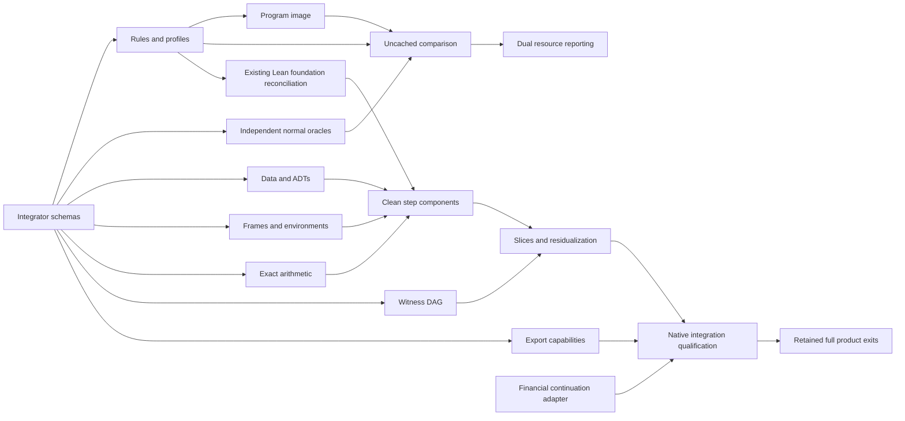

# Sherlock Candidate B Implementation Plan

Routing for new work: the temporary Gemini 4 Argon through AGY assignment in [AGENTS.md](../AGENTS.md) supersedes standing Opus routing below until Opus availability is observed. Historical Opus-authored requirements and frozen gates retain their original identities and scope.

> **For agentic workers:** Use `superpowers:subagent-driven-development` or `superpowers:executing-plans` for authorized implementation packages. Checkboxes below track planned delivery; none records execution in this design edit. Retain existing execution authority and resource limits.

**Goal:** Deliver the full supported Sherlock interpreter, compiler mapping, required Lean/Clean transition implementation and Midnight integration while preserving complete language, financial and release obligations.

**Architecture:** One explicit reference machine evaluates immutable program tables; bounded representations and universal, per-program or fixed-family circuit realizations share its observations. Program preparation, reference semantics, bounded encoding, witness computation, constraints and native export remain separate interfaces. One integrator owns the [schema contract](../openspec/changes/sherlock-universal-interpreter-design/interfaces.md).

**Tech stack:** Existing Moriarty compiler/consumers; K reference and Quint finite companion; Lean recursive reference definitions and bounded Clean components in the existing private Fenrir fork; the actual pinned Midnight/ZKIR/native custom-decider route when qualified.

## Global constraints

- Status: FINAL DESIGN CANDIDATE B, specified implementation plan awaiting fresh independent full-candidate reviews and the existing consequential-decision rule. This document grants no model, Lean, SDK, circuit, native, proof, ledger, benchmark or acquisition execution authority.
- Candidate A remains frozen at `57d830f46fee57c56ed8b854d21f5dd7a695d2977d061b1ef6905eaecd7de30e` in [its immutable receipt](../openspec/changes/sherlock-universal-interpreter-design/research-candidate-a-freeze.json).
- `sherlock-k-a/1`, `sherlock-quint-a/1` and proposed `sherlock-helper-microstep/1` have different named schedules. A-preserving physical work and helper-metered semantic development are separate deliverables. New capacities/admission policies do not silently narrow A or establish refinement.
- First-order named self/mutual recursion, strict arguments/fields, complete lexical restoration, immutable structural values and explicit pending returns are mandatory. Generic ADTs and higher-order extension coverage remain explicit work; a first passing slice does not replace the full target.
- No external implementation is copied or selected as a dependency. Rebuild useful algorithms independently regardless of donor license/backend. See [concept adoption](research/sherlock/CONCEPT-ADOPTION.md) and [ten primary-source studies](research/sherlock/papers/README.md).
- Required Clean implementation stays in existing private Fenrir. Public documents describe scope and dependency; private paths, pins, source and witness material remain privately retained. Public component inventory pins upstream Clean `1a6c28426372bb99af79e533aa7b9a0788eff0d7`.
- Current implementation fact: Fenrir PR1 merged the generic pure Lean reference foundation with eight normal and exact-remaining-zero publication checks and independent scoped source approval. That child result supplies no Clean step circuit, K/Lean refinement, soundness/completeness, native exporter or financial acceptance. Extend and reconcile that foundation; do not start a duplicate implementation or report zero Lean implementation.
- Nonsecurity authors are GPT-6.1 Sol high; fresh non-author nonsecurity audits use Muse Wonder 1.0 high. All security analysis, requirements, hostile tests, theorems and judgments belong to Opus 5.5. Security packages below identify ownership only and do not supply substitute requirements.
- U0–U7, M1–M17, MC01–08, SP01–12, G01–24 and retained UNI/MOR/MPLR/AEO/ZR/MNR requirements remain in force. Source/child success closes no full parent exit. Moriarty remains permissionless; maintainer controls never become developer compile/prove/deploy approval.

## Correctness loop within every phase

Apply the [shared correctness loop](SHERLOCK-CORRECTNESS-LOOP.md) to every transition slice and optimization. Iterate K, Quint and Lean/Clean alongside the handwritten circuits against independent complete-state/prefix expectations. The phases below express dependencies, not a one-time model stage. Maintain an exact-source per-layer matrix, first-divergence regressions and explicit execution gaps; required cross-layer acceptance remains open until its evidence exists. Current security ownership follows the temporary override in [AGENTS.md](../AGENTS.md); historical Opus-authored requirements and gates retain their identities and scope.

## File and ownership map

The following public paths are proposed deliverables, not claims that files already exist. Concrete private paths are assigned only inside Fenrir. Module roles shown for Fenrir are logical boundaries, not disclosed private filesystem names. Before implementation, bind each role to an exact disjoint write set in the existing workflow and freeze its input digest map.

| Sole source owner | Public source/delivery boundary | Private Fenrir logical responsibility | Consumes → produces |
|---|---|---|---|
| Integrator I | `openspec/changes/sherlock-universal-interpreter-design/interfaces.md`; shared exports, compiler IR/ABI, CLI dispatch and integration manifests | Shared schema/module root and reference-to-bounded interface | Reviewed requirements → versioned schemas, common consumers, integrated candidate |
| Rules R | `models/sherlock/reference/rules.json`, `models/sherlock/reference/profiles.json`, `models/sherlock/reference/README.md`; new B model files only | Reference profile reconciliation with existing pure Lean foundation | A K/Quint sources → exact rules/helper inventory and profile mapping |
| Oracle O, non-author | `models/sherlock/oracles/normal-programs.json`, `models/sherlock/oracles/normal-prefixes.json`, `models/sherlock/oracles/financial-prefixes.json` | Independent normal snapshots only | Human-readable source/rule contract → independently derived expected states/work/effects |
| Program P | `crates/mori-core/src/sherlock/program_image.rs`, `crates/mori-core/src/sherlock/admission.rs` | Read-only image consumer | Source tables/types → `ProgramImage`, admission and preparation report |
| Trace T | `crates/mori-core/src/sherlock/step_record.rs`, `crates/mori-core/src/sherlock/compare.rs` | Comparison adapter independent of circuit implementation | Program + state + profile → uncached `StepRecord` consumer and first divergence |
| Semantics L | Public scope record under `docs/research/sherlock/` assigned by I | Existing recursive Syntax/State/Step/Run foundation and helper-control profile extension | Rule/profile inventory → reference implementation |
| Data D | `crates/mori-core/src/sherlock/data_layout.rs`, `crates/mori-core/src/sherlock/match_plan.rs` | Bounded node/ADT encoding components | `TypeDecl` + source arms → `CtorLayout`, `MatchPlan`, partial node encode/decode |
| Frames F | `crates/mori-core/src/sherlock/frame_layout.rs` | Frame/environment encoding and call/return components | Frame inventories → partial full-state decode and layout report |
| Arithmetic A | `crates/mori-core/src/sherlock/scalar_layout.rs` | Exact checked arithmetic components and scalar representation adapters | Named carry/borrow/product API → exact scalar implementation |
| Circuit C | Public component scope/coverage record assigned by I | Bounded step composition and operation-to-component inventory | L/D/F/A and `MachineImage` → Clean step components and `ConstraintPlan` |
| Witness W | `crates/mori-core/src/sherlock/witness_plan.rs` | Structured witness visitor; no constraint-author ownership | Operation dependencies → deterministic uncached `WitnessPlan`, materializer and stream sink |
| Export E | `crates/mori-core/src/sherlock/export_capabilities.rs` | Separate backend exporter/adapter inventory | Constraint/witness plans → capability report and artifact or named unsupported result |
| Resource Q | `crates/mori-core/src/sherlock/resources.rs` | Component physical-cost projection | Reference records + measured/estimated physical events → `ResourceManifest` |
| Optimization B | `crates/mori-core/src/sherlock/reference_slice.rs`, `crates/mori-core/src/sherlock/residual_step.rs` | Common realization adapters and bounded residual graph | Stable baseline interfaces → batches, `ResidualStepIR`, equal-prefix comparison |
| Finance H | `crates/mori-core/src/sherlock/financial_projection.rs`; I alone wires existing runtime/stage consumers | Financial state/continuation mapping separate from pure relation | Existing successful-prefix semantics → complete ordered financial observations |
| Security S | Only Opus-owned security write sets, assigned separately | All security analyses/tests/theorems and judgments | Exact candidate + applicable retained obligations → Opus-owned evidence/review |

The new `crates/mori-core/src/sherlock/` modules extend the existing `mori-core` crate. I alone creates its module root and modifies `crates/mori-core/src/lib.rs`, existing `runtime.rs`/`replay.rs`/`stage/` consumers, and `crates/mori/src/commands/simulate.rs`. The present ordinary local simulation path and continuation path are distinct from `simulate --trace --target`, which calls backend replay and remains outside this documentation task's authority. Native consumer integration targets the existing `crates/mori-backend/src/stage/` and `crates/mori-ledger/src/relation/` boundaries, with exact later write sets frozen by I. Authors never add disconnected duplicate compiler paths. Shared exports/configuration stay with I. Normal tests belong to their component owner in disjoint test modules; oracle fixtures belong only to O. No worker may change schemas or its expected outputs to make a check pass.

## Dependency and parallel preparation

I prepares interface names/profile IDs first; a B schema freeze follows the Opus-owned Phase 0 gate below. R and O prepare independent inventories and expectations concurrently. Once their contract is stable, P, T and the existing Fenrir L reconciliation can proceed together. D, F and A implement disjoint representation components after `MachineImage` and `Bounds` freeze. C, W and E can prepare their independent visitors/inventories in parallel using those fixed interfaces; integrated step acceptance waits for all consumed components and applicable Opus gates. Q instruments existing outputs without changing reference semantics. B begins against the deterministic one-step baseline, while H prepares its Core/2 mapping independently. S has independent ownership throughout and supplies its own requirements and verdicts. No dependency on native qualification blocks unrelated source preparation.

This is a source dependency graph, not a new milestone system, execution scheduler or assertion of launched workers. Source preparation may use as many independent disjoint owners as actual staffing permits; native concurrency and authority remain unchanged. I integrates one source candidate at a time, checks all affected consumers and freezes the full combined bytes for fresh reviews.

## Independent normal oracle pack

O derives complete intermediate states and exact work from source and rule tables before execution, without importing evaluator/compiler/circuit/witness output. Preserve the eight existing fixtures and their separate literal expectations unchanged. Add program inputs in the new oracle pack; never rewrite old observations or model bytes during design work.

| Normal source specimen | Independent expected observation | Required intermediate observation |
|---|---|---|
| Factorial3; sum3; list[1,2,3]; tree(4,5) | 6; 6; 6; 9 | Pending multiplication/right-tree frame, full saved environments and charged prefix cursor |
| Bool/let; caller-local; mutual-even4; constructed list | 7; 12; true; exact list literal | Selected branch, caller restoration, named recursive lookup and ordered constructor fields |
| Three arguments `a+10*b+100*c` on `(1,2,3)`; nested shadowing | 321; 11 | Left-to-right argument evaluation and correct binding restoration |
| Distinct program tables reusing function IDs | Separately derived results from each table | Original function/source ordering; image identity and unused code remain distinguishable |
| Shared/unshared repeated leaves | Same structural result, two logical occurrences | Address sharing cannot remove occurrence work or pending frames |
| `(2^32−3)+8`; `(2^64+9)−7`; `(2^48+1)*3` | `2^32+5`; `2^64+2`; `3*2^48+3` | Named limb/carry/product fields and exact little-endian decode |
| New `Schedule=Done|Pay(UInt128,Schedule)|Both(Schedule,Schedule)` | Ordered nested first arm4; independent sum9; repeated Pay4 sum8 | One completed scrutinee, minimum matching source arm and source field order |
| Technical cut before callee return | Same eventual result and cumulative work | Full control, pending frames, environment, reachable immutable values and budgets survive round-trip |
| Financial prefix from reserve100/liability40 | Pay30+fee2 → reserve68/liability10/debit32/receipts30; then pay10+fee1 → reserve57/liability0/debit43/receipts40 | Ordered effects, fees, duties and each committed prefix; later precommit local failure retains first prefix and reports work |

For every pure specimen, O freezes ordinary fuel prefixes through completion and exact-remaining-zero publication, selected frame-cap behavior and profile identity. Existing K helpers remain unmetered in `sherlock-k-a/1`; O does not invent A charges. New helper expectations explicitly use `sherlock-helper-microstep/1`. The conditional financial arithmetic above does not settle the open universal Commit/Yield/Await opcode arrangement. Security/hostile cases are authored solely by S.

## Delivery packages

Each phase retains one falsifiable source/component comparison predicate and its independent normal oracles. These predicates are necessary comparison evidence; normal cases alone cannot establish B phase acceptance. Static counts, input hashes and draft-document completeness are source-preparation observations, not runtime passes or a B schema freeze. Source preparation and design integration may proceed while implementation evidence remains open. All planned tests, proofs and native checks below remain unexecuted by this documentation edit.

The following gate is reproduced verbatim from the Opus 5.5 engineering handoff for the [Opus-owned Candidate B security amendment](../openspec/changes/sherlock-universal-interpreter-design/security-candidate-b.md). It applies to every phase, in addition to its source/component comparison predicate:

> No B-specific claim without the applicable Opus-authored B001–B009 hostile cases as its gate. Phase 8 is not the sole gate.

Only Opus authors those cases and supplies their security judgments; this plan does not define replacements or claim their results. A phase report retains source/profile/input identities, command and exit, exact output bytes, oracle identity, evidence class, scope and first blocked boundary. Author evidence and independent result review remain separate.

### Phase 0 — rule, admission and resource inventory

**Owners:** I/R/O; S independently owns security review. **Inputs:** immutable A sources, current requirements and public model observations. **Files:** R and O's exact public paths above; I's schemas. **Consumes/produces:** fixed rule text → `OperationManifest`, profile/capacity inventory and independent prefix expectations.

Opus 5.5's Phase 0 gate, reproduced verbatim from the handoff for [A1](../openspec/changes/sherlock-universal-interpreter-design/security-candidate-b.md#a1-uisec-004-overflow-arm-all-named-profiles) and [A4](../openspec/changes/sherlock-universal-interpreter-design/security-candidate-b.md#a4-canonicality-scope):

> No B schema freeze until the error table, `isResourceLimit`, `StepInv` fields, per-rule charge and allocation rows (including failure transitions) and intra-cap order are specified and Opus-reviewed.

Opus's profile-erratum handoff adds these Phase 0 gate items verbatim:

> `Bounds.stepCap`, the `admit` signature and the per-profile `isResourceLimit` table

- [ ] R enumerates every machine rule, startup/publication and helper site, with IDs, input/output shape, ordering, charge, outcome precedence and source locator.
- [ ] R records K error4 as Rejected and terminal publication as free; records Quint's different terminal tick and finite abstraction. List closed-body/unique-function admission as missing until P implements it.
- [ ] Apply the Opus profile-erratum handoff mechanically: include `Bounds.stepCap`, `admit(program,bounds,layout) -> Result<Admitted,CapacityNotAdmitted>` and `isResourceLimit(ProfileId,Observation) -> Bool` under the A1 table. Keep K/B `Rejected(error4)` distinct from frozen Quint `StackBound`; cap-boundary and charge agreement remain differential obligations. `CapacityNotAdmitted` remains an admission error, never an `Outcome`.
- [ ] I records code/data/node/frame/environment/serialization/helper capacities, partial encoding envelope and supported/rejected/exhausted/unsupported dispositions. A new representation cap has a named admission decision; preparation failure is not application exhaustion.
- [ ] O freezes complete normal snapshots and hand counts. I checks every current rule/profile/cap entry is represented exactly once and records the draft manifest digest. A B schema freeze remains subject to the quoted Opus gate; static inventory completeness does not satisfy it.

**Predicate `inventory_complete`:** the enumerated source rules/helpers and profile/capacity disposition rows have no uncovered or conflicting entry, and every selected oracle prefix references those exact rows. Evidence: source-static inventory only. A helper cap or function-admission claim without an implementation fails this predicate's declared status, rather than being recorded as supported.

### Phase 1 — ProgramImage and deterministic StepRecord consumer

**Owners:** P/T, with I-only exports. **Depends:** phase0 schema/oracles. **Files:** P/T owned modules. **Consumes/produces:** `prepare(program,profile,bounds,layout)` → image/operations/preparation report; `stepReference` → complete `StepRecord`.

- [ ] P implements whole-program occurrence indexing, ordered children/parameters/constants/functions, immutable table identity and explicit source-to-expanded-step IDs; recursive calls remain table references.
- [ ] P implements declared admission checks and reports unsupported/rejected preparation separately. Retain original first-match lookup unless the selected profile actually enforces unique function identities. Do not sort the semantic function table to build an index.
- [ ] T implements uncached state materialization and first-divergence reporting over full projections. Read the actual existing production compile/replay consumer before I wires module dispatch.
- [ ] O's two distinct programs and all frozen normal prefixes run through that same consumer when ordinary execution is separately authorized; retain exact traces and current source membership.

**Predicate `program_trace_matches`:** both distinct admitted program tables produce the independently frozen ordered `StepRecord` prefixes under unchanged interpreter rules, preserving source order, outcomes, environments, frames and profile work. Evidence: compiler/host normal execution, separate from model or circuit evidence.

### Phase 2 — reconcile and extend the existing Lean reference boundary

**Owners:** L/I; S owns every theorem and its acceptance. **Depends:** phase0; phase1 supplies comparison adapter. **Files:** existing private Fenrir semantic module roles, no public implementation copy. **Consumes/produces:** rule/profile mapping → recursive semantic `ReferenceState`/step/fuel-run definitions and trace projection.

- [ ] Reuse merged Fenrir PR1's generic foundation and preserve its actual scoped evidence. Inventory its grammar/admission, work and publication against the frozen A rows before asserting any match.
- [ ] Keep recursive immutable Lean values and explicit code/environment/frame/control independent of bounded field encoding. Fuel bounds attempted runs; no source-recursion unrolling or structural-termination requirement on every user function is introduced.
- [ ] Implement lookup/bind/validation/equality cursors in the new helper profile and name mapping boundaries to legacy machine steps. Preserve the A schedule as a separate mode/reference, with no same-fuel refinement claim.
- [ ] Compare all independent normal prefixes and whole-language admitted-rule coverage; report discrepancies as discrepancies. Hand theorem work to S with exact candidate membership, without drafting substitute theorem requirements.

**Predicate `lean_reference_matches`:** the existing/extended Lean reference emits the frozen complete normal reference prefixes for its explicitly enumerated profile and grammar, with every rule mapped and deviations disclosed. Evidence: future Lean reference execution only; K/Lean refinement and theorem acceptance remain separate S-owned evidence.

### Phase 3 — bounded MachineImage, declarations, frames and arithmetic

**Owners:** D/F/A in parallel; I owns common `Bounds` and `MachineImage Bounds F`; S owns security work. **Depends:** interfaces/phase0; integration uses phase2. **Files:** D/F/A paths and private bounded representation components. **Consumes/produces:** semantic state + layout → partial `encode`, `decodeCanonical`, `decodeStep`, `project`, host-only `checkStepInv`, `RepresentationRelation`, `TypeDecl`/`CtorLayout`/`MatchPlan`, scalar/frame reports. These names follow the Opus handoff and integrator-owned schema contract.

Opus 5.5's Phase 3 gate, reproduced verbatim from the handoff for [A4/B002](../openspec/changes/sherlock-universal-interpreter-design/security-candidate-b.md#a4-canonicality-scope):

> `bounded_decode_matches` SHALL NOT be claimed for B unless gated on Opus-authored A4/B002 hostile cases. These are: inactive-slot garbage, a referenced unreachable node, a foreign `codeId`, a tag/layout mismatch, a write below `activeLength`, and a nondeterministic physical post-image.

- [ ] D builds a plain immutable node arena baseline with typed ordered fields and occurrence-based structural decode. Add closed monomorphic and mutually recursive declaration groups; retain parameter-instance capacity as separate admission work.
- [ ] D implements direct ordered matching and a first-column baseline plan preserving minimum source-arm priority; evaluate constructor fields/scrutinee once in source order. Use the genuinely new Schedule declaration before any layout heuristic.
- [ ] F stores complete saved caller environments and every ordered logical frame. Measure physical slots/bytes separately; compressed frames and tail activation reuse retain logical cap checks.
- [ ] A implements byte baseline plus named addCarry/subBorrow/mulWide interfaces with explicit limb order and full product information. Compare four-U32, two-U64 and packed proposals only through the same exact semantic API.
- [ ] I composes partial encoding over explicit code/data/frame/environment/serialization/helper bounds and records which semantic states are representable. No total encoding or unchanged-domain refinement is inferred from round-trip examples.
- [ ] Implement the Opus handoff's decoder split: `decodeCanonical` at the named A4 boundaries; `decodeStep` for intermediate step images; `project` at A4 boundaries only; `checkStepInv` as a host-only check. Keep physical `activeLengths` separate from logical `allocationCounters`, using the exact A3/A4 definitions rather than a new policy in this plan.

**Predicate `bounded_decode_matches`:** canonical boundary images round-trip to the independently supplied semantic projection through `decodeCanonical`; intermediate images materialize that projection through `decodeStep`; each D/F/A transition produces the frozen next projection/work under its named bounds. Evidence: representation/component normal comparisons, subject to the quoted Phase 3 and every-phase Opus gates; theorem and circuit acceptance remain distinct. One scalar-only success cannot satisfy phase3's declared ADT/frame/arithmetic comparison coverage, and normal comparison success alone cannot establish B acceptance.

### Phase 4 — required Clean components, witness DAG and exporter separation

**Owners:** C/W/E in parallel; I integrates; S owns all security/theorem/hostile work. **Depends:** stable phase3 interfaces; full integration waits for phase3 evidence. **Files:** C's private Clean step roles, W/E public interfaces and private visitors. **Consumes/produces:** `compileStep(layout,componentInventory)` → separate `ConstraintPlan` and `WitnessPlan`; capability-directed exporter → artifact or `UnsupportedFeature`.

- [ ] C inventories every reference rule/helper against an actual Clean component, bounded state input/output, ordered field positions and operation locator. `realizeStep(plan, StepInput{program,state})` uses the bounded `ProgramImageView` and returns bounded `StepOutput{next,event,diagnostics}`. Per the Opus handoff, host-side `materializeStep(program,layout,preImage,output)` uses `decodeStep` on both `preImage` and `output.next`; report that host work separately. Unbounded reference snapshots are never circuit payloads. Build normal scalar/frame slice first, then close all admitted data/match/call/helper coverage.
- [ ] W builds typed witness dependencies, deterministic topological order, explicit input bindings and an uncached baseline. Structured serializable programs are the initial exportable subset; native closures have explicit unsupported status.
- [ ] E separately records field, arithmetic, lookup, interaction, custom-gate, table and witness-program export support. Constraint JSON alone cannot satisfy witness export; a witness row cannot establish the emitted relation.
- [ ] W/E compare independently derived normal operation/DAG/artifact expectations. Record public Clean API membership separately from privately retained implementation and consumer bindings.
- [ ] S authors/reviews its own required theorem and security evidence against the complete changed candidate. Missing results stay open; honest witness generation and source approval do not supply them.

**Predicate `clean_plan_coverage`:** every admitted inventoried operation has a concrete separate constraint/witness disposition and backend capability result, and normal component projections match O's frozen `StepRecord`s. Evidence: future Clean/component/export observations with explicit unsupported rows. Soundness, completeness, cross-layer proofs and native compatibility require their own S-owned or target evidence and are not consequences of this predicate.

### Phase 5 — dual resource reporting through the real consumer

**Owners:** Q/I. **Depends:** phase1 reports; phase3/4 add physical observations. **Files:** Q module and I-owned CLI integration. **Consumes/produces:** complete reference/physical event streams → `ResourceManifest` and ordinary consumer report.

- [ ] Report reference consumed/remaining work and logical depth independently from physical dispatch/helper visits, frame/env/node storage and preparation.
- [ ] Add active/padded cells/rows, degree, table/code/key/proof bytes, witness/proving/verification time and memory only when actually observed under separately classified authority. Missing values remain unmeasured with a reason, never zero.
- [ ] Keep DUST, financial fees, service fees, reserve/recovery accounting and target identity separate. Include preparation, wrappers, checkpoint I/O and conversion in each declared total metric.

**Predicate `cost_report_reconciles`:** the real consumer's reference columns exactly equal O's declared profile counts and each physical column reconciles to its own event/accounting evidence or an explicit unmeasured disposition. Evidence: reporting/component checks; no performance winner or economic acceptance follows from estimated counters.

### Phase 6 — prefix-preserving batching, realizations and static residualization

**Owners:** B/W/Q with disjoint module ownership; I owns shared adapters. **Depends:** deterministic complete baseline phases1–5. **Files:** B modules; W alone adds cache/streaming implementation to its own module. **Consumes/produces:** one-step baseline → `ReferenceSlice`, realization plans and `ResidualStepIR`.

- [ ] Implement `advance_m` for m1/2/4/8 with ordered internal rule boundaries, per-prefix fuel/frame checks, earliest stop and zero-charge terminal publication; padding stays physical.
- [ ] Compare universal, per-program and fixed-family realizations against the same step projection. Keep original trace order recoverable from event partitions and complete cut/resume images.
- [ ] Per the Opus handoff, `ChunkStore.put` emits `project` output and `ChunkStore.get` uses `decodeCanonical`. Projection occurs only at A4 boundaries; snapshot I/O and projection work are reported separately from reference work. Retain the exact A3/A4 treatment of physical rows and logical allocation counters.
- [ ] Specialize immutable image/layout facts with a finite memoized worklist. Keep dynamic control, input values, frames, logical depth, budgets and outcomes dynamic. A size-limit fallback emits generic dispatch; source recursion is never unrolled.
- [ ] W compares uncached/cold/warm lifetime/cache variants without removing occurrence work or saved frames. Q reports whole-path cost and reuse-count assumptions; preserve direct baselines and losing alternatives.

**Predicate `optimized_prefixes_match`:** every realization/batch/cache/residual variant matches every frozen complete reference prefix and first stop under identical declared profiles/caps; any claimed advantage also improves its predeclared complete-path metric. Evidence: optimization comparisons; no cost winner exists before measurements. A matching final value with a changed intermediate stop fails.

### Phase 7 — financial continuation and complete compiler mapping

**Owners:** H/P/I with S-owned security requirements/review. **Depends:** current Core/2 semantics and full grammar mapping; source preparation can begin during earlier phases. **Files:** H's new `financial_projection.rs`; I-only wiring in existing `runtime.rs` and `stage/`, with `crates/mori-core/tests/continuations.rs` and `crates/mori/tests/core_continuations.rs` as existing consumer checks to inspect before selecting later ordinary commands. **Consumes/produces:** admitted source/Core + state → Sherlock mapping, ordered effects, complete duties and checkpoint/resume observations.

- [ ] Inventory and implement every admitted grammar/type/field rule, including generic constructors/matching; map every unsupported higher-order closure/letrec/polymorphism extension to an explicit future admission/representation task. Full-language scope is retained rather than inferred from pure fixtures.
- [ ] Define/review exact universal financial control lowering against existing Core/2 successful-prefix await before selecting Commit/Yield/Await opcodes. Preserve previous committed prefix separately from tentative segment effects and local failure.
- [ ] Implement complete state/effect/duty/resume projections and two contrasting newly authored positive programs through the actual compiler path. Freeze independent financial/work expectations before execution; no host replacement or hand-written target artifact substitutes for unsupported source lowering.

**Predicate `financial_compiler_projection_matches`:** all admitted compiler-rule mappings and independently frozen positive financial prefixes/resumptions agree on complete ordered effects, state, gross debit, fees, receipts, liabilities, residual duties and reference work. Evidence: compiler/reference financial comparison only; ledger phases, native proof and target acceptance remain separate.

### Phase 8 — native integration and retained full delivery

**Owners:** I/E/H plus independent Muse result review and S's exclusive security ownership. **Depends:** actual released native capabilities, all applicable semantic/component evidence and existing execution admission. **Files:** existing native consumer and private Fenrir integration, assigned exactly by I. **Consumes/produces:** actual Clean relation/export mapping → pinned ZKIR/native relation and qualified target observations.

- [ ] Inventory the real Clean-to-native/ZKIR translation and existing ledger-9 custom-decider consumer. A VerifyProof instruction is not a prerequisite. Do not assume any donor backend or generic exporter port.
- [ ] Obtain separately authorized exact candidate execution evidence under unchanged resource/debit limits. Bind compiler, instruction surface, field, circuit/key/relation and target/verifier/ledger identities without inventing Fenrir version/configuration.
- [ ] Demonstrate required actual native recursive financial steps, multi-parent/private composition, complete effects, recovery and target phase readback through the existing roadmap dependencies. Preview and Fenrir each require their own qualified observations.
- [ ] Complete all retained ACTUS/DeFi, composition, intent, release and independently authored developer predicates. Keep every failed/unavailable stage and inherited requirement visible; scoped prefixes do not close parent exits.

**Predicate `retained_delivery_exits_pass`:** every applicable atomic predicate in the existing U/M/MC/SP/G and retained requirement crosswalk has its required independent source, theorem, native and target evidence for the exact candidate, with no missing mandatory parent/member. This predicate delegates security content and judgments exclusively to S; it does not redefine them. Full release is blocked while any required evidence is absent.

## Coverage and evidence separation

| Requirement set | Delivery packages | Evidence required beyond an early slice |
|---|---|---|
| UIREQ-001–005 | 0–2,7 | Two programs under unchanged rules; admitted grammar, lexical restoration, order and recursion mapping |
| UIREQ-006–011 | 2–4,7 | Full exact scalar/data/frame/match/result coverage, beyond dedicated list/tree fixtures |
| UIREQ-012–013 | 0–6 | Named schedules/outcomes/caps and exact prefixes; helper work separately bounded in new profile |
| UIREQ-014–016 | 3,6–8 | Full image round-trip/resume and earliest-boundary comparison; financial meanings separately mapped |
| UIREQ-017–020 | 7–8 | Complete financial prefixes/duties, existing await and actual target phase mapping |
| UIREQ-021–026 | 0–8 | Declared K/Quint projection, actual compiler mapping, native inventory, preservation, evidence class and required Clean implementation |
| UIREQ-027–029 | 0–3 | Indexed provenance, helper controls and explicit bounded representation domain |
| UIREQ-030–031 | 3–4,8 | Named arithmetic API; separate plans and actual export-capability inventory |
| UIREQ-032–033 | 6 | Ordered earliest-stop slices; bounded static residualization with dynamic runtime state |
| UIREQ-034–035 | 1,3–4 | Declaration-driven ordered matching; deterministic uncached witness dependency DAG |
| U0/U1/U2 and M/MC/SP/G lineage | 0–8 | Semantic/target reconciliation, primitive evidence and general supported source-to-target path |
| U3/U4/U5 | 7–8 plus retained roadmap work | Financial lifecycle/recovery, native history/private composition and federated/solver obligations |
| U6/U7 | 7–8 plus retained roadmap work | Full conformance and independent developer release, not one interpreter example |

The canonical EARS [specification](../openspec/changes/sherlock-universal-interpreter-design/specs/universal-interpreter/spec.md), [traceability](../openspec/changes/sherlock-universal-interpreter-design/traceability.md), [roadmap](../ROADMAP.md) and consolidated crosswalk retain exact normative clauses and parent links. This mapping adds implementation work without replacing them. ACTUS retains all 277 fixtures/fields, 18 executable types, 32 taxonomy dispositions and DS01–07. DeFi retains all 72 rows, DA01–24, supplements, three held-outs, eight intent cases and eight regression classes. Composition retains sequential, disjoint parallel, shared-state interleaving, atomic synchronization and asynchronous messaging.

| Evidence class | Current fact | What still needs distinct evidence |
|---|---|---|
| Public models | Source-specific K frontend syntax Kore/compiled text; no runtime `definition.kore` or rule execution. Repaired Quint: eight tests and 32 sampled seed 1 traces, max 32 steps, no `allInv` violation and all seven witnesses | B models, generic Quint projection and cross-model refinement |
| Compiler/host | Existing Moriarty consumers have their own scoped evidence; this plan supplies no new run | ProgramImage/admission, deterministic complete traces and actual source-to-relation mapping |
| Lean reference | Merged Fenrir generic pure foundation and scoped normal/publication checks | B helper/admission/ADT reconciliation, full reference coverage and separate correspondence evidence |
| Clean/circuit | Public API inventory and planned required components | Actual bounded step circuit, separate plans/exports and S-owned proofs/security evidence |
| Native/target | Existing historical results retain their own exact scope | Sherlock-native exporter/relation, actual native recursive evidence and independently qualified Preview/Fenrir target results |

Fresh full-candidate Muse nonsecurity and Opus security review is required before Candidate B adoption, with actual identities, scope, terminal status, limitations and dissent retained. Changed integrated bytes need fresh applicable audits. The existing two substantive agreeing votes for consequential decisions remain distinct from source review, implementation tests and release acceptance.
