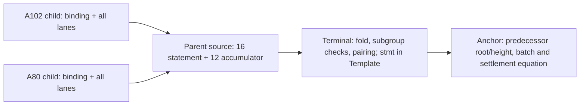

# Documentation supplement for the actual product-result review

Review these exact ordinary source-reference documents alongside the owning source/results packet. This is not a separate provider/execution request. They describe the reviewed Fenrir parent and the unreviewed S1/S2 producer cut, with explicit missing CLI/anchor/Template/byte-compatibility and native observations. They preserve the existing experiment stage order and accepted-review qualifications, add no security policy, test eligibility or EARS decision, and do not change DESIGN011, implementation-loop.md or the experiment. Source/execution/acceptance stay separate. The additional Graphify files are the exact eight portable prior-layer artifacts, not a new rebuild or large graph upload.


===== COMPLETE docs/sherlock/reference/recursive-child-parent-terminal.md =====
# Recursive child, parent and terminal interfaces

Source-reference cut: 2026-10-19. This describes concrete code, not an observed recursive proof. The reviewed Fenrir parent is `sherlock_link.rs`, 37,710 bytes, SHA-256 `b0443be3d61e986871f6960f4dd4dffd3fcc333ab7b687833be267bb9c917e6a`. Its fresh non-author Opus 5.5 opinion approves the MF01–MF06 leaf, with typed API abstentions and composition requirements. It does not approve execution. The Moriarty S1/S2 candidate is 49,991 bytes, `2061d947fa6206fcd89460c3d08e6391e622b16a425a5a75ce4a7dc6e504a312`, unreviewed and uncompiled; the manifest/genesis/provenance leaf is still pending composition. Exact repository/source locations and read regions are in [source pins](../../results/sherlock-recursive-handoff-interfaces-20261019/SOURCE-PINS.json).

## From one Machine to two child instances

Moriarty's `produce_linked_requests(program, capacities, initial_fuel, stack_limit, identity)` returns `(LinkedRequests, LinkShape)`. The S1/S2 source pre-admits `LiteralLayout` and `ReturnPublicationLayout` before calling `produce_a102_literal_return_publication`, then checks produced capacities, identity, program and intermediate image. `LinkedRequests` has `a102: LiteralTransitionRequest` and `a80: ReturnPublicationRequest`; the latter carries `capacities`, `identity`, `values`.

A102 uses `ChildKey`; A80 uses `ReturnChildKey`, `ReturnChildClaim` and `ReturnChildProof`. Each proof carries its claim, full `instance`, processed `vk_bytes` and `proof`. `prove_linked_children` produces `LinkedChildren { a102, a80 }`. `verify_linked_children` returns `LinkVerification` with private fields and read-only `shape()`, `a102()`, `a80()` accessors. The private S1 seal is source tooling for verified export of the exact requests/children/verification records; it is not an in-circuit authentication of source, Init or a parent theorem. None of these new A80 calls is claimed compiled or executed.

Both child instances have `n = P + 2S + 5` scalar lanes, where `P` is the complete program lane count and `S` the complete state-image lane count. `LinkShape::offsets() -> Result<LinkOffsets, Error>` checks arithmetic before indexing.

| Child instance index/range | Content |
| --- | --- |
| `0` | claim binding |
| `1..3` | two context limbs |
| `3..3+P` | every ProgramBlock lane |
| `3+P..3+P+S` | complete pre image |
| `3+P+S..3+P+2S` | complete post image |
| `3+P+2S` | rule tag |
| `4+P+2S` | charge |

The envelopes are A102 `(3,1)` then A80 `(0,0)`. Program lanes agree and `A102.post == A80.pre`. A80's two images remain Step-mode Constant-space images, not canonical StateBlocks. The consumer pins both processed-key SHA-256 digests, both context hashes and the shape independently; `link.json` is checked data, never key authority. The wire is `moriarty-sherlock-link/1`, with scalar encoding `bls12-381-scalar/32-byte-little-endian-lowercase-hex`: exactly 64 lowercase hex characters, no `0x`, for one canonical scalar.

## Fenrir byte boundary and files

`read_link_children(dir, &LinkPins)` returns two `SherlockChild` values in A102/A80 order. `LinkPins` fields are `a102_vk_sha256`, `a80_vk_sha256`, `a102_context_hash`, `a80_context_hash`, `program_lanes`, `state_lanes`. `SherlockChild::from_bytes` checks the pinned key digest, processed-key byte round trip, instance count and proof size. This byte boundary avoids linking Moriarty Rust types across the proofs 0.8.3/0.8.2 crate graphs; it does not demonstrate cryptographic/transcript compatibility.

The reader requires `link.json` plus `a102.vk`, `a102.proof`, `a102.instance.json`, and corresponding `a80.*` files. The manifest must name `a102.claim.json` and `a80.claim.json`, but this reader does **not** read those claim files or authenticate them. Its manifest checks cover format/encoding, shape/offsets and each child's name, fixed file names, key digest, context, instance count and envelope. Extra producer fields are not an authentication mechanism. S3/N2 manifest, genesis and provenance reconciliation is pending; the displayed source format is not a completed producer-consumer compatibility result.

`SherlockLinkRelation::from_pins(a102_vk, a80_vk, &pins)` checks pinned key bytes and constructs the relation. `SherlockLinkWitness::from_children(&a102, &a80, h_pre)` carries both complete instances/proofs and the predecessor height. `check_witness`, `statement` and `instance` operate on that pair. The circuit aliases A80 program/pre cells to A102 program/post cells; it prepares the A102 own accumulator first, then A80, accumulates once, resolves merged fixed bases and collapses. The shared `-G` has one checked value; other fixed-base names must be distinct. The review retains an `msm.rs` same-name merging/API scope limitation; the encoding excerpts used for this reference do not discharge that source-review limitation.

## Parent statement: exactly 16 fields

`FIELD_NAMES` and `link_statement` expose this zero-based order. `h_mid = h_pre + 1` participates in the trace but is not a separate public field; `h_post = h_pre + 2`, with heights below 2^64. Height binding to previous state is an anchor obligation.

| Index | Name | Meaning |
| --- | --- | --- |
| 0 | `keys_id` | Poseidon key/shape identity |
| 1 | `a102_ctx_lo` | A102 context low128 limb |
| 2 | `a102_ctx_hi` | A102 context high128 limb |
| 3 | `a80_ctx_lo` | A80 context low128 limb |
| 4 | `a80_ctx_hi` | A80 context high128 limb |
| 5 | `program_c` | Poseidon commitment to every ProgramBlock lane |
| 6 | `pre_root` | Poseidon root of complete A102 pre image |
| 7 | `h_pre` | predecessor anchored height |
| 8 | `mid_root` | Poseidon root of complete A102 post / A80 pre image |
| 9 | `post_root` | Poseidon root of complete A80 post image |
| 10 | `h_post` | h_pre + 2 |
| 11 | `bind_a102` | A102 binding lane |
| 12 | `bind_a80` | A80 binding lane |
| 13 | `n_steps` | 2 |
| 14 | `work` | A102 charge + A80 charge = 1 |
| 15 | `trace_c` | ordered step/height trace commitment |

The tags are packed ASCII domain constants: `SHK_KEYS`, `SHK_PROG`, `SHK_STATE`, `SHK_TRACE`, `SHK_STMT`. `keys_id` hashes the two VK SHA-256 limb pairs, child instance length, `P` and `S` under `SHK_KEYS`. `trace_c` hashes exactly this 21-field preimage:

```text
SHK_TRACE, keys_id, a102_ctx_lo, a102_ctx_hi, a80_ctx_lo, a80_ctx_hi,
program_c, pre_root, h_pre, bind_a102, 3, 1, mid_root, h_mid,
bind_a80, 0, 0, post_root, h_post, 2, 1
```

All trace inputs are public statement fields or envelope/step constants. The trace supplies no independent height binding beyond the statement; the anchor must enforce the predecessor root/height and next batch equation.

## Collapsed accumulator: the following 12 fields

`instance()` is `statement || acc_pis(acc)` and has 28 fields. `AssignedAccumulator::as_public_input` serializes lhs then rhs. Each resolved/collapsed side is one point followed by scalar 1, with no unresolved fixed-base tail. The pinned Blstrs point encoder emits two x-coordinate chunks, two y-coordinate chunks and the identity bit in that order.

| Parent index | Field | Role |
| --- | --- | --- |
| 16 | `lhs.x[0]` | pinned point/coordinate encoding |
| 17 | `lhs.x[1]` | pinned point/coordinate encoding |
| 18 | `lhs.y[0]` | pinned point/coordinate encoding |
| 19 | `lhs.y[1]` | pinned point/coordinate encoding |
| 20 | `lhs.is_identity` | pinned point/coordinate encoding |
| 21 | `lhs.scalar` | `1` for a resolved/collapsed side |
| 22 | `rhs.x[0]` | pinned point/coordinate encoding |
| 23 | `rhs.x[1]` | pinned point/coordinate encoding |
| 24 | `rhs.y[0]` | pinned point/coordinate encoding |
| 25 | `rhs.y[1]` | pinned point/coordinate encoding |
| 26 | `rhs.is_identity` | pinned point/coordinate encoding |
| 27 | `rhs.scalar` | `1` for a resolved/collapsed side |

`x[i]`/`y[i]` mean the exact SDK `AssignedField::as_public_input` chunks, not raw 128-bit coordinates. The pinned foreign-field encoder encodes `coordinate - 1` into base limbs and packs ordered limb batches; the point encoder appends `is_identity`. Do not substitute a conventional affine-coordinate serialization. `reconstruct_acc` checks the 12-field shape, point decoding and scalar 1 for each side. A collapsed accumulator is a deferred verification obligation, not a recursive-proof acceptance result.

## Terminal decider and anchor handoff

`keygen_link_parent(params, s_g2, &rel, key_dir)` writes `link.vk` and `link.relation`; `load_link_parent_key` checks a separate parent VK digest and exact expected relation bytes. `prove_link_parent(params, s_g2, &rel, &vk, &w)` performs the source's child verification/folded pairing/prove/self-verify route and returns `LinkParentProof { vk, instance, proof }`. Its source calls `ChaCha20Rng::from_entropy`; deterministic inputs do not promise deterministic proof bytes. Actual degrees, costs and outputs remain unmeasured for this leaf.

`write_w_dir(dir, &parent, source)` writes `w.vk`, `w.proof`, `w.instance.json` and `SOURCE`. The new parent writer requires28 fields. The existing `main.rs` path still asserts the old 17 statement fields plus 12 accumulator fields (29 total); its unchanged command is not a usable Sherlock 28-field route.

`sherlock_decider_relation(parent_vk, s_g2, template)` builds `DeciderRelation` with `nr_cols=4`, `n_w_instance=28`, `dom_stmt=SHK_STMT`, and `stmt_fields=0..16`. `keygen_sherlock_decider(params, &rel, key_dir)` writes `decider.vk` and `decider.relation`. `DeciderWitness` carries `w_instance`, `w_proof`, `instance_id`, `batch_no`. The terminal folds the parent proof's own accumulator with its carried accumulator, reassigns the points with subgroup checks, and constrains the residue pairing. These are source operations, not observed checks.

Its statement digest is the pinned Poseidon of 19 fields:

```text
SHK_STMT, instance_id, batch_no, FIELD_NAMES[0], ..., FIELD_NAMES[15]
```

The terminal's public vector is **Template order**, not those 19 fields directly. `Template { slots }` uses `BindingInput`, `CommunicationCommitment`, `Const(F)`, `Stmt`; validation requires the first two slots and exactly one `Stmt`. The Sherlock helper refuses more than 1,023 public slots. The ledger-9 `acceptValidity(stmt)` transcript must be captured from the exact compiled anchor; its statement-slot index and constants cannot be invented.

A historical 2,618-byte `sherlock_anchor.compact` proposal exists. It declares `instance_id`, key/context/program pins, `s_root`, 64-bit `height`, 32-bit `batch_no`, `validity_ok` and `settled`; `acceptValidity` inserts a statement and `settleValidity` reconstructs the 19-field statement before changing state. It is uncompiled historical source, **not** a current reviewed integrated anchor or captured Template. The parent review saw no matching anchor/Template body. Its state/height/replay equation, key replacement, Compact/CPU/in-circuit Poseidon parity and target integration remain open. `genesis_root` is a host candidate over pinned A102 pre lanes; it proves no Init equations and does not authorize an anchor by itself.

## Remaining connected work

Compose/review the A80 manifest/genesis/provenance leaf and remaining tests with S1/S2; typecheck/register the parent and discharge the exact typed API abstentions; connect a Sherlock 28-field CLI with `s_g2` threaded through parent and decider keygen/prove; finish and review the anchor and capture its Template. Cross-graph 0.8.3→0.8.2 VK/transcript compatibility, same SRS [tau]2, source/claim authentication, Init, projectA, StepInv/F3–F5/G4 and full 39-row dispatch remain separately open. No public API requires a Moriarty maintainer's permission; the recorded reviews/operation conditions govern this project's own checked work.

===== COMPLETE docs/sherlock/how-to/inspect-recursive-proof-handoff.md =====
# Inspect a recursive proof handoff before local rehearsal

Use this guide to locate the concrete interface and the missing consumer before selecting an actual local rehearsal. It does not run a command, classify a new operation or supply a proof. The [reference](../reference/recursive-child-parent-terminal.md) binds the exact source cuts; the [explanation](../explanation/recursive-proof-boundaries.md) separates deferred verification from anchoring.

1. **Resolve the source cuts.** Use the pinned Moriarty C4 child, S1/S2 A80 candidate and reviewed Fenrir parent. S1/S2 is unreviewed/uncompiled and the manifest/genesis/provenance leaf is still pending. Preserve the historical anchor as a distinct uncompiled proposal. A matching file hash establishes identity, not behavior or approval.
2. **Inspect the byte handoff.** Check the producer/consumer contract for both independently reconstructed processed VK digests, context hashes, `P`, `S`, the full `P+2S+5` lanes, lowercase canonical 32-byte LE hex, fixed A102/A80 order and envelopes. `LinkPins` is separate from `link.json`; manifest key hashes do not approve themselves. Only the producer's private `LinkVerification` path can supply its proposed verified-export token. Do not substitute returned claims for consumer reconstruction or in-circuit constraints.
3. **Trace the parent instance.** Follow `read_link_children` → `SherlockLinkRelation::from_pins` → `SherlockLinkWitness::from_children` → `statement`/`instance`. The output must use all 16 statement fields followed by the exact 12-field accumulator, in reference order. `h_mid` is inside the trace; the predecessor `h_pre` needs anchor binding. No wrapper should silently relabel 28 fields as the stock CLI's 29.
4. **Locate the terminal consumer.** `write_w_dir` produces the 28-field parent handoff. `sherlock_decider_relation` selects `0..16`, `SHK_STMT`, four range columns and an exact compiled-anchor Template. The existing CLI still uses 17/29 and lacks the new Sherlock wiring and `s_g2` arguments. There is no ready command to copy from this guide. That CLI leaf must be connected and checked before consuming these artifacts.
5. **Locate the actual anchor equation.** Compare the pinned compiled anchor/captured Template against `SHK_STMT, instance_id, batch_no` followed by all 16 named fields. Bind the predecessor root/height and next batch, not only a host `genesis_root`. The 2,618-byte proposal is available history; no matching compiled/reviewed current Template or integrated target is established at this cut.
6. **Select only an independently eligible actual check.** The parent opinion is source-only, not compile/test/native eligibility. Its typed API abstentions and composition requirements remain. Existing resource/source/cleanup conditions and designated ownership apply. Preserve P14's timeout and unsatisfied saved-bundle verify prerequisite; do not requeue that consumed operation unchanged. A changed eligible operation is needed before consuming its verification result.

## What would count as the local rehearsal

The requested local rehearsal is one connected observation of the exact child-pair → parent → terminal → anchor handoff, not another source-registration milestone. Its eventual actual evidence must name the composed source/key/SRS/context/shape identities; independently checked child proof bytes and full lanes; the 28-field parent's actual verification and carried-accumulator treatment; the terminal's actual subgroup/pairing verification and complete Template public vector; and the exact local anchor constructor/call/settlement interpretation of that statement, predecessor root/height and batch. Retain results, rejected/failed/unavailable stages, raw artifacts and resource/cleanup receipts by stage. The existing anchor/rehearsal negative obligations remain with the designated source/security owner; this guide adds no hostile-witness test policy.

At this documentation cut no such connected rehearsal is observed. A host lane equality, nonproving SDK check, parent source approval, accumulator production, terminal self-check or finite K/Quint result alone does not satisfy it. A local rehearsal still does not establish Midnight stagenet deployment, recursive ledger acceptance, settlement/effects readback or the Fenrir benchmark. The experiment's existing stage order and full acceptance remain.

===== COMPLETE docs/sherlock/explanation/recursive-proof-boundaries.md =====
# Why the parent, terminal and anchor are separate boundaries

The A102 child constrains a literal evaluation transition and the A80 child constrains its return publication. Their instance contains every admitted statement lane plus the binding. Joining those proofs is meaningful only if a consumer checks the exact keys, contexts, program and intermediate state; a host export manifest cannot supply those constraints by assertion.

The reviewed parent source builds that connection in circuit by sharing the A102 program/post cells with the A80 program/pre positions. It fixes the two child keys and contexts, prepares both proof accumulators in order and collapses the result. It also exposes a 16-field summary of keys, contexts, program/root commitments, heights, child bindings, step count, work and ordered trace. The 12 additional public accumulator fields carry deferred verification work; they are not a “verified=true” flag.



The diagram is the intended code handoff. It records no observed execution. The terminal verifies the parent proof and folds its carried accumulator before constraining the pairing; it hashes the 16 selected parent fields together with `SHK_STMT`, deployment `instance_id` and `batch_no`. Its public input ordering comes from the exact ledger-call Template, including free binding/communication slots and constants. This is why the parent's 28 fields cannot be passed through an unrelated 29-field command by changing a label.

The anchor has a different duty: bind those roots and heights to the anchored predecessor and the next batch and state update. Children have no height lane. The parent constrains two increments and an ordered trace, but every trace input is already a statement field or constant. Neither the trace nor the host genesis candidate independently authenticates the predecessor height or Machine Init. The old 2,618-byte Compact proposal sketches such an equation, but it is uncompiled historical source with no reviewed matching Template capture. “Historical proposal exists” and “current integrated anchor is missing” are compatible facts.

The source cut is deliberately uneven. C4's child source is installed; A80 S1/S2 source is materialized but unreviewed/uncompiled, its manifest/genesis/provenance leaf is pending; the Fenrir parent received a scoped MF01–MF06 source approval with typed API abstentions. The stock CLI remains 17/29, no current 28-field Sherlock route is wired, and the 0.8.3/0.8.2 proof-graph/transcript boundary is unobserved. Naming these consumers keeps source work connected without treating an interface as a native result.

A saved literal k18 proof, finite uncharged K prefix equality, Quint checked joins and Clean kernel results keep their own profiles and exact evidence. They do not supply a recursive native parent, terminal pairing, anchored state transition or stagenet settlement. The [handoff guide](../how-to/inspect-recursive-proof-handoff.md) states the connected local observation still needed; the full experiment's target and benchmark remain separate acceptance stages.

===== EXACT NAVIGATION APPEND =====


## Recursive child, parent and terminal handoff — source cut October 19

- Reference: [exact child/parent/terminal interfaces and 16+12 field order](reference/recursive-child-parent-terminal.md).
- How-to: [inspect the handoff before a local rehearsal](how-to/inspect-recursive-proof-handoff.md).
- Explanation: [why the parent, terminal and anchor remain separate](explanation/recursive-proof-boundaries.md).

These pages accompany actual source/results publication. They add no accepted recursive proof, deployed target, new EARS closure or separate execution route. A new tutorial is deferred until a connected actual path exists; no fictitious runnable command is introduced.

===== CHANGE PROOF =====
{
  "new_docs": [
    {
      "path": "/home/charl/Moriarty/.moriarty-dev/runtime/sherlock-review-20261017/recursive-child-parent-terminal-interface-docs-20261019/afterimages/docs/sherlock/reference/recursive-child-parent-terminal.md",
      "bytes": 11745,
      "sha256": "1bdac95e0056806eedc6de654eed76b1dd6dee665057113a1855325e16fbef47"
    },
    {
      "path": "/home/charl/Moriarty/.moriarty-dev/runtime/sherlock-review-20261017/recursive-child-parent-terminal-interface-docs-20261019/afterimages/docs/sherlock/how-to/inspect-recursive-proof-handoff.md",
      "bytes": 4394,
      "sha256": "aacf6b2c5dd0200fc0be69d928773350a333ade045c17de211092643ae2b5f46"
    },
    {
      "path": "/home/charl/Moriarty/.moriarty-dev/runtime/sherlock-review-20261017/recursive-child-parent-terminal-interface-docs-20261019/afterimages/docs/sherlock/explanation/recursive-proof-boundaries.md",
      "bytes": 3408,
      "sha256": "117046767feb8f2c800b94533597dfe11a32256b2dc88c89e318efdc794561f8"
    }
  ],
  "navigation": {
    "preimage": {
      "path": "/home/charl/Moriarty/.worktrees/sherlock-formal-graph-refresh-20261019/docs/sherlock/README.md",
      "bytes": 12075,
      "sha256": "f4f3aabc5fa5c4d832d54e9dfb0d3a343fc56fcd85fdbb12b8645ea4aa426547"
    },
    "afterimage": {
      "path": "/home/charl/Moriarty/.moriarty-dev/runtime/sherlock-review-20261017/recursive-child-parent-terminal-interface-docs-20261019/afterimages/docs/sherlock/README.md",
      "bytes": 12759,
      "sha256": "6d833ae1c760c497b3b8168f1186e12c437973bfe62ec0f1cd5f8815953f9cea"
    },
    "exact_append": "\n\n## Recursive child, parent and terminal handoff \u2014 source cut October 19\n\n- Reference: [exact child/parent/terminal interfaces and 16+12 field order](reference/recursive-child-parent-terminal.md).\n- How-to: [inspect the handoff before a local rehearsal](how-to/inspect-recursive-proof-handoff.md).\n- Explanation: [why the parent, terminal and anchor remain separate](explanation/recursive-proof-boundaries.md).\n\nThese pages accompany actual source/results publication. They add no accepted recursive proof, deployed target, new EARS closure or separate execution route. A new tutorial is deferred until a connected actual path exists; no fictitious runnable command is introduced.\n",
    "inverse_exact": true
  },
  "statement_names_parsed_from_exact_parent": [
    "keys_id",
    "a102_ctx_lo",
    "a102_ctx_hi",
    "a80_ctx_lo",
    "a80_ctx_hi",
    "program_c",
    "pre_root",
    "h_pre",
    "mid_root",
    "post_root",
    "h_post",
    "bind_a102",
    "bind_a80",
    "n_steps",
    "work",
    "trace_c"
  ],
  "accumulator_order_from_pinned_encoding_source": [
    "lhs.x[0]",
    "lhs.x[1]",
    "lhs.y[0]",
    "lhs.y[1]",
    "lhs.is_identity",
    "lhs.scalar",
    "rhs.x[0]",
    "rhs.x[1]",
    "rhs.y[0]",
    "rhs.y[1]",
    "rhs.is_identity",
    "rhs.scalar"
  ],
  "old_DESIGN011_unchanged": true,
  "loop_and_experiment_not_written": true,
  "eight_Graphify_files_byte_exact": true,
  "large_graph_not_copied": true,
  "source_tests_provider_native_Git_canonical_actions": 0
}