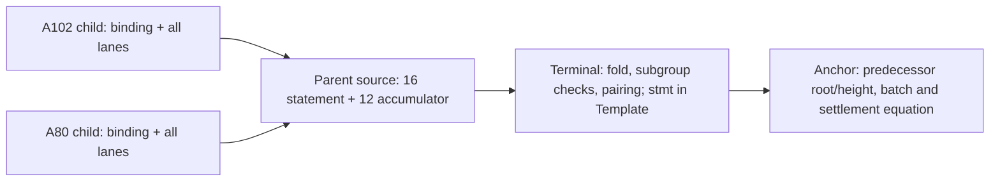

# Why the parent, terminal and anchor are separate boundaries

The A102 child constrains a literal evaluation transition and the A80 child constrains its return publication. Their instance contains every admitted statement lane plus the binding. Joining those proofs is meaningful only if a consumer checks the exact keys, contexts, program and intermediate state; a host export manifest cannot supply those constraints by assertion.

The reviewed parent source builds that connection in circuit by sharing the A102 program/post cells with the A80 program/pre positions. It fixes the two child keys and contexts, prepares both proof accumulators in order and collapses the result. It also exposes a 16-field summary of keys, contexts, program/root commitments, heights, child bindings, step count, work and ordered trace. The 12 additional public accumulator fields carry deferred verification work; they are not a “verified=true” flag.

The diagram is the intended code handoff. It records no observed execution. The terminal verifies the parent proof and folds its carried accumulator before constraining the pairing; it hashes the 16 selected parent fields together with `SHK_STMT`, deployment `instance_id` and `batch_no`. Its public input ordering comes from the exact ledger-call Template, including free binding/communication slots and constants. This is why the parent's 28 fields cannot be passed through an unrelated 29-field command by changing a label.

The anchor has a different duty: bind those roots and heights to the anchored predecessor and the next batch and state update. Children have no height lane. The parent constrains two increments and an ordered trace, but every trace input is already a statement field or constant. Neither the trace nor the host genesis candidate independently authenticates the predecessor height or Machine Init. The old 2,618-byte Compact proposal sketches such an equation, but it is uncompiled historical source with no reviewed matching Template capture. “Historical proposal exists” and “current integrated anchor is missing” are compatible facts.

The source cut is deliberately uneven. C4's child source is installed; A80 S1/S2 source is materialized but unreviewed/uncompiled, its manifest/genesis/provenance leaf is pending; the Fenrir parent received a scoped MF01–MF06 source approval with typed API abstentions. The stock CLI remains 17/29, no current 28-field Sherlock route is wired, and the 0.8.3/0.8.2 proof-graph/transcript boundary is unobserved. Naming these consumers keeps source work connected without treating an interface as a native result.

A saved literal k18 proof, finite uncharged K prefix equality, Quint checked joins and Clean kernel results keep their own profiles and exact evidence. They do not supply a recursive native parent, terminal pairing, anchored state transition or stagenet settlement. The [handoff guide](../how-to/inspect-recursive-proof-handoff.md) states the connected local observation still needed; the full experiment's target and benchmark remain separate acceptance stages.

## October22 UTC — the current CLI and child verifier do not run the parent

This Source09 cut leaves earlier dated descriptions intact. Root adopted the current normal recl9 CLI build (108.303918 seconds outer). Separately, a fresh process reconstructed requests/keys and verified the retained A102/A80 children on the same backend. The exact A102 proof-byte mutation with an updated copied manifest digest refused. A built CLI, child verification and this scoped tamper result each have their own receipts; none executes the recursive parent. The parent remains unrun at this cut, with terminal/decider, crossgraph compatibility, source Init authentication, full-interpreter/financial obligations, stagenet settlement and target benchmarks still open.

The finite action-API comparison has a different boundary:205 inputs consumed,207 complete states independently compared and six whole bindings checked. Its external-input Quint typecheck remains open and nominal semantics unbound. It is neither a native proof comparison nor a target performance benchmark. Wallet generation5 records applied progress and persistence while transaction readiness remains false.

The Source09 safe capture binds exact Root metadata and qualification. PR390's producer-metadata archive and PR391's A195 source publication are merged; the latter's nine tests remain uncompiled/unrun. Clean22's failed strict leaf and rejected source repair remain separate from accepted proofs, and K16 R2 has source approval only. Continue through the actual receiving consumer without upgrading these boundaries from a source or publication result.

Later dated receipt supplement, read 2026-10-22T00:53:28.316037+00:00: Source07 saved generation6 and closed after an accepted exit2 diagnostic in11.053556 seconds. Shielded applied8267 with gap163226; DUST applied646 with gap171426; unshielded was strict, with47emissions per component. Transaction readiness remains false and fee sufficiency unassessed. This advances the Source06 generation5 history without replacing it. The exact private PR78 receipt now confirms merge19373127e3630aabfd16e29907a04d442e2928d6/three additions; its scope remains the existing six adopted logical proofs, with no new native or target result. Only safe metadata was read.

## October22 UTC — keygen reuse source and wallet sync have separate receiving checks

[Source10's safe receipt capture](../../../.raw/captured/1e72150d338d99a6023e6529ffde9f275680fadba5d0719e0d940c81de3a7b30.json) records a second parent-keygen timeout, not a parent proof: native exit124 after500.302865 seconds, with1133.219477 closed-unit CPU seconds and4,618,358,784-byte memory peak. Root adopted that completed failure/resource disposition. The three-file Source37 cost-model reuse and phase clocks are source-adopted, but remain uncompiled/unmeasured; the old CLI is stale for this patch. Source38's caller correction is proposed and has no execution result at this cut.

Root later selected the exact six SDK-free warm-boundary checks; all six passed once in0.931234 seconds with unchanged source/config/caller bytes. The corrected future1180-P/500-S/295-whole native reservation stays conditional and native selection remains false. The old9 selector/1170-P metadata is explicitly declined. Runtime guards and the actual caller's selected inputs must be checked together; a proposal file does not demonstrate a called guard, measured runtime or successful build. This adds no wrapper, resource exemption or execution authority.

Wallet generation11 is now saved/closed with Shielded, unshielded and DUST all connected/strict/gap0. Its safe result still records transaction readiness false and fee sufficiency unassessed. Synchronization does not establish the missing proof path, fee result or stagenet settlement. K16's45-phase/15-Bool finite diagnostics, private PR79's existing ten logical contracts and Root's source-only ReturnRight/next-formal status likewise supply no recursive native/target result. Source09 and all earlier cuts remain dated history.
