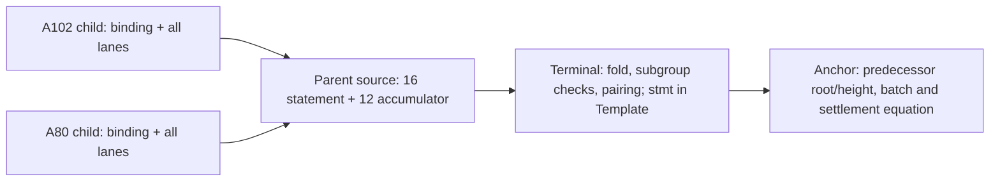

# Why the parent, terminal and anchor are separate boundaries

The A102 child constrains a literal evaluation transition and the A80 child constrains its return publication. Their instance contains every admitted statement lane plus the binding. Joining those proofs is meaningful only if a consumer checks the exact keys, contexts, program and intermediate state; a host export manifest cannot supply those constraints by assertion.

The reviewed parent source builds that connection in circuit by sharing the A102 program/post cells with the A80 program/pre positions. It fixes the two child keys and contexts, prepares both proof accumulators in order and collapses the result. It also exposes a 16-field summary of keys, contexts, program/root commitments, heights, child bindings, step count, work and ordered trace. The 12 additional public accumulator fields carry deferred verification work; they are not a “verified=true” flag.

The diagram is the intended code handoff. It records no observed execution. The terminal verifies the parent proof and folds its carried accumulator before constraining the pairing; it hashes the 16 selected parent fields together with `SHK_STMT`, deployment `instance_id` and `batch_no`. Its public input ordering comes from the exact ledger-call Template, including free binding/communication slots and constants. This is why the parent's 28 fields cannot be passed through an unrelated 29-field command by changing a label.

The anchor has a different duty: bind those roots and heights to the anchored predecessor and the next batch and state update. Children have no height lane. The parent constrains two increments and an ordered trace, but every trace input is already a statement field or constant. Neither the trace nor the host genesis candidate independently authenticates the predecessor height or Machine Init. The old 2,618-byte Compact proposal sketches such an equation, but it is uncompiled historical source with no reviewed matching Template capture. “Historical proposal exists” and “current integrated anchor is missing” are compatible facts.

The source cut is deliberately uneven. C4's child source is installed; A80 S1/S2 source is materialized but unreviewed/uncompiled, its manifest/genesis/provenance leaf is pending; the Fenrir parent received a scoped MF01–MF06 source approval with typed API abstentions. The stock CLI remains 17/29, no current 28-field Sherlock route is wired, and the 0.8.3/0.8.2 proof-graph/transcript boundary is unobserved. Naming these consumers keeps source work connected without treating an interface as a native result.

A saved literal k18 proof, finite uncharged K prefix equality, Quint checked joins and Clean kernel results keep their own profiles and exact evidence. They do not supply a recursive native parent, terminal pairing, anchored state transition or stagenet settlement. The [handoff guide](../how-to/inspect-recursive-proof-handoff.md) states the connected local observation still needed; the full experiment's target and benchmark remain separate acceptance stages.
