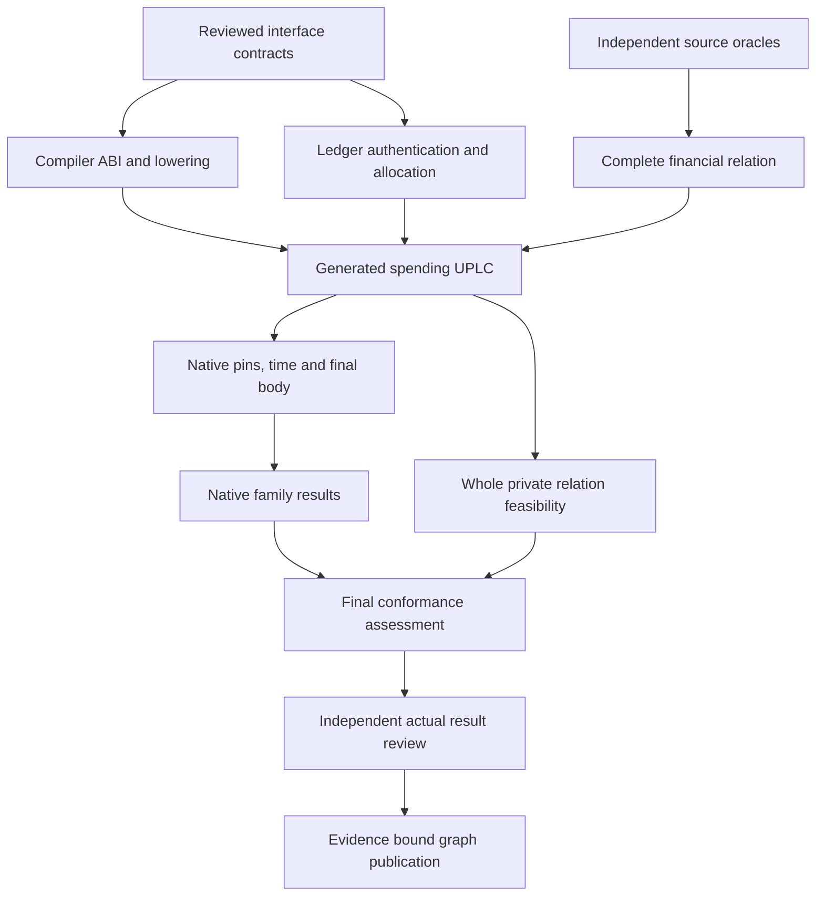

# Moriarty UTXO requirement index

Branch: `utxo`. Base: `84f64b30df53ff0b8ccaf475f57324d3d7c6e594`.

All five packages are S2 written proposals with strict OpenSpec structural validation.
Semantic design, native, private, PCD, mandatory Preview, and Complete approval remain open.
The packages contain 119 requirements, 238 scenarios, and 162 task groups.
All implementation task groups remain unchecked.

[Machine coverage](requirements-coverage.json) preserves exact IDs, scenarios, tasks, planned paths, input hashes, and the artifact DAG.

## Packages

| Owner | Requirements | Task groups | Package |
| --- | --- | --- | --- |
| compiler | 16 | 16 | [eutxo-compiler-correspondence](../../openspec/changes/eutxo-compiler-correspondence/proposal.md) |
| ledger | 31 | 37 | [eutxo-ledger-state-and-authority](../../openspec/changes/eutxo-ledger-state-and-authority/proposal.md) |
| finance | 26 | 26 | [eutxo-financial-pattern-validation](../../openspec/changes/eutxo-financial-pattern-validation/proposal.md) |
| native | 28 | 65 | [eutxo-native-validation-and-receipts](../../openspec/changes/eutxo-native-validation-and-receipts/proposal.md) |
| conformance | 18 | 18 | [eutxo-conformance-and-private-feasibility](../../openspec/changes/eutxo-conformance-and-private-feasibility/proposal.md) |

## Interfaces and integration order

Compiler produces versioned source/Core/kernel lowering manifests and the preserved thirteen-field HeadDatum ABI.
Ledger produces authenticated context, authority, identity, and injective effect-output allocation.
Finance produces complete independent economic envelopes and gross/net outcome policies.
Native produces RuntimePins/1, NativeTimeWitness/1, NativeCaseResult/1, and NativeRunManifest/1.
Conformance consumes these through ConformanceCase/1, LayerOutcome/1, PrivateCapabilityProbe/1, and FinalAssessment/1.
These are proposed interfaces. Their presence does not establish implemented exports.

Interface design is coupled across packages. The diagram orders artifact readiness, not author permission or automatic approval.
The ledger pin-cycle removal proposal is an unapproved amendment to reviewed T1 design.
Compiler, ledger, and native consumers must agree on its version and measured construction before adoption.
S03/S04 lifecycle operations and AP04 proof semantics also require scoped versioned amendments.

## Twenty-family obligations

Every row needs exact-source correspondence, generated UPLC controls, native receipts, and scoped result review where claimed.
Missing implementation remains an engineering obligation. It does not prove infeasibility.

| Exact inventory ID | Primary owner | Native status | Private status | Tranches |
| --- | --- | --- | --- | --- |
| S01 | ledger | pending | unverified | T4 |
| S02 | ledger | pending | unverified | T14 |
| S03 | ledger | pending | unverified | T15 |
| S04 | ledger | pending | unverified | T16 |
| escrow-time | finance | pending | unverified | T1 |
| interval-boundary | finance | pending | unverified | T1 |
| joint-role | finance | pending | unverified | T2 |
| oracle-observation | finance | pending | unverified | T3 |
| bilateral atomic escrow swap | finance | pending | unverified | T5 |
| constant-product exact rounding/slippage with serialized pool continuation | finance | pending | unverified | T7 |
| order execution versus timeout cancellation | finance | pending | unverified | T6 |
| two-order batch exact input coverage and injective output allocation / same-output double satisfaction | finance | pending | unverified | T8 |
| F01-origination | finance | pending | unverified | T9 |
| F02-interest-period | finance | pending | unverified | T10 |
| F03-partial-repayment-residual-liability | finance | pending | unverified | T11 |
| F04-fee-gross-net-policy | finance | pending | unverified | T12 |
| AP01 | finance | pending | unverified | T13 |
| AP02 | ledger | pending | unverified | T13 |
| AP03 | ledger | pending | unverified | T2 |
| AP04 | conformance | pending | unverified | T17, T18 |

## Requirement and task navigation

Each package's specification holds the normative requirement and its positive and negative scenarios.
Each task document gives prospective tests, outputs, commands, and controls.
Machine coverage maps their exact IDs to all affected inventory families.

- compiler: [requirements](../../openspec/changes/eutxo-compiler-correspondence/specs/eutxo-compiler/spec.md) and [tasks](../../openspec/changes/eutxo-compiler-correspondence/tasks.md). IDs: `EUC-001` through `EUC-016`.
- ledger: [requirements](../../openspec/changes/eutxo-ledger-state-and-authority/specs/eutxo-ledger-state/spec.md) and [tasks](../../openspec/changes/eutxo-ledger-state-and-authority/tasks.md). IDs: `EU-LDG-001` through `EU-LDG-031`.
- finance: [requirements](../../openspec/changes/eutxo-financial-pattern-validation/specs/eutxo-financial-patterns/spec.md) and [tasks](../../openspec/changes/eutxo-financial-pattern-validation/tasks.md). IDs: `EU-FIN-001` through `EU-FIN-026`.
- native: [requirements](../../openspec/changes/eutxo-native-validation-and-receipts/specs/eutxo-native-validation/spec.md) and [tasks](../../openspec/changes/eutxo-native-validation-and-receipts/tasks.md). IDs: `EU-NAT-001` through `EU-NAT-028`.
- conformance: [requirements](../../openspec/changes/eutxo-conformance-and-private-feasibility/specs/eutxo-conformance-private/spec.md) and [tasks](../../openspec/changes/eutxo-conformance-and-private-feasibility/tasks.md). IDs: `EU-CON-001` through `EU-CON-018`.

## Evidence and review limits

Stage00 demonstrates a narrow public atomic prototype. It does not validate the full twenty-family inventory.
Revision03 design votes bind candidate `dcc62e21e9e351843bd04a3be537ebe260f8c1d0ec606cfcc5e15fd83ca7aff0` only.
They preserve LifecycleState/1, the thirteen-field HeadDatum, and distinct transport, ordinary, and work counters.
Oracle19 packet `9d71e736e3d3c159a83ff3bb21dbb3f5b2a9661dd90ed1e70414c2690b6552d6` supplies source envelopes, not native results.
Implementation18 reported freeze `aed4090af8f1e94e3904140ac2b23be9aa79e85141806841f1066115e5386680` has separate code reviews.
These drafts do not infer their verdicts.

AP04 current source probes preserve OPERATION_BINDING and UNKNOWN_DECLARATION.
BLS primitives and public compatibility do not establish a whole-transition private verifier or ledger history.
Canonical Moriarty PCD is ledger-anchored certified state transitions with bounded certificates.
The Midnight ledger-10 seam cannot be relabeled as a currently available Cardano proof API.
Private, PCD, mandatory Preview, and Complete remain unverified until their exact required receipts exist.

Final assessments must preserve source codes, admission fences, UPLC failures, transport failures, and ledger phases separately.
Negative native controls need correctly reached predicates, immutable body bindings, readbacks, and separate collateral accounting.
Structural graph extraction cannot substitute for semantic review.
Historical Luna, Grok, and Sol identities and prior dissent remain attached to their original evidence.
