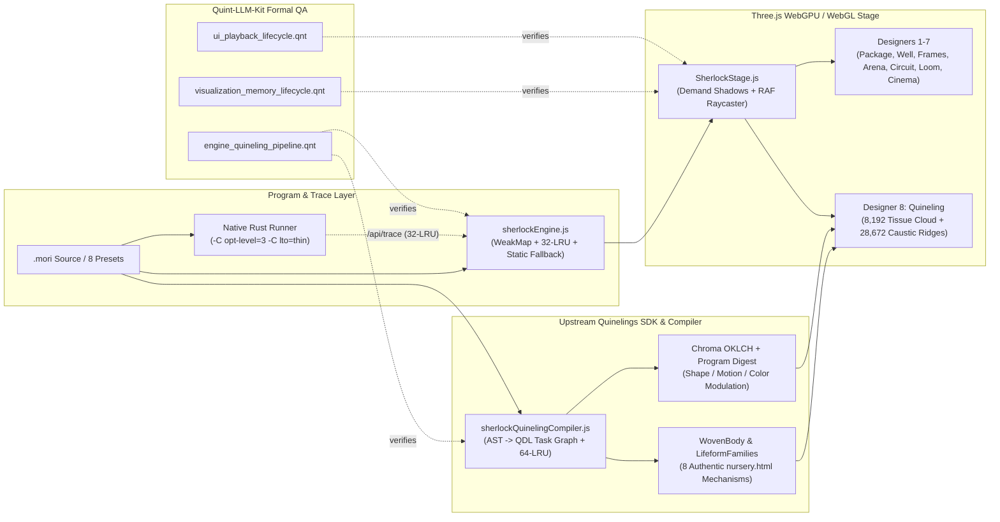

# Sherlock 3D Visualization, Authentic Quinelings & Performance Architecture (`design.md`)

## 1. Architectural Overview

The Sherlock Universal Interpreter 3D Visualization (`visualization/`) is a dual-mode (local native Rust + static GitHub Pages) WebGPU/WebGL application built on Three.js r171 (`vendor/three.webgpu.js`) and the upstream Quinelings SDK (`src/engine/quinelingsSdk.js`).

---

## 2. Subsystem Design & Zero-Quality-Loss Optimization Principles

### 2.1 Stage, Lighting, Shadows & Procedural Textures (`SVP-001`–`SVP-005`)
- **Demand-Gated Shadow Pass (`SVP-001`)**: `SherlockStage` maintains `_shadowDirtyFrames`. During step transitions, designer changes, or active animations (`markShadowDirty(frames)`), `keyLight.shadow.needsUpdate` is enabled; once settled, shadow map regeneration is gated off, preserving the full 2048×2048 soft shadow map at zero steady-state GPU shadow pass cost.
- **RAF-Coalesced Targeted Raycasting (`SVP-002`)**: Pointer movement records `_pendingPointerNDC` and sets `_pointerDirty = true`; raycasting executes at most once per animation frame against `activeDesigner.interactiveTargets`.
- **Typed-Array `ImageData` Grain Synthesis (`SVP-003`)**: `getCeramicGrainTexture(size)` fills a `Uint8ClampedArray` via `ctx.createImageData(size, size)` and uploads once with `ctx.putImageData`, replacing 65,536 DOM canvas draw calls.
- **Bounded Plaque & Material Memoization (`SVP-004`)**: `createEngravedPlaque` caches shared label textures in a bounded LRU map (`MAX_PLAQUE_CACHE = 512`), preventing duplicate `<canvas>` allocations while guaranteeing bounded GPU memory.

### 2.2 Designers 1–7 Hardware & Semantic Views (`SVP-006`–`SVP-018`)
- **Static Matrix Locking (`SVP-006`, `SVP-008`, `SVP-010`)**: All stationary substrate, stator, ring housing, bore wall, and floor base meshes call `updateMatrix()` once at construction and set `matrixAutoUpdate = false`.
- **Step-Dirty Gating & Active-Rule Delta Updates (`SVP-007`, `SVP-009`, `SVP-011`)**: Designers track `_lastStepIndex` and `_lastTraceRef`. In `designer2_well.js`, transitioning from `prevRule` to `nextRule` updates only the affected rule modules rather than scanning all 39 floor modules every frame.
- **Object Pooling & Disposal Hygiene (`SVP-012`–`SVP-016`)**: Dynamic continuation cards (`designer3_frames.js`), DAG wafers (`designer4_arena.js`), circuit buses (`designer5_circuit.js`), and arithmetic carry ribbons (`designer6_loom.js`) reuse pooled meshes/geometries or explicitly dispose replaced `BufferGeometry`/`Material` instances on trace changes.
- **Visibility-Gated Sub-Designers & Pre-Collected Cutaway Materials (`SVP-017`, `SVP-018`)**: `designer7_cinema.js` caches fadeable materials in flat arrays at initialization (eliminating per-frame `group.traverse()`) and skips `.update()` on hidden sub-designers.

### 2.3 Authentic `nursery.html` 3D `WovenBody` & Upstream Quinelings SDK (`SVP-019`–`SVP-031`)
- **8 Authentic `WovenBody` Mechanisms (`SVP-019`, `SVP-026`)**:
  1. `factorial` $\rightarrow$ `logarithmic-mantle` (Spiral Mantle Shell)
  2. `list_fold` $\rightarrow$ `pleated-braid` (Pleated Ribbon Braid)
  3. `tree_fold` $\rightarrow$ `recursive-affine` (Recursive Affine Scroll)
  4. `mutual_even_odd` $\rightarrow$ `lorenz-flow` (Chaotic Attractor Ribbon)
  5. `lexical_let` $\rightarrow$ `phyllotaxis-fan` (Golden-Angle Fan)
  6. `checked_underflow` $\rightarrow$ `clifford-flow` (Folded Phase Veil)
  7. `stack_overflow` $\rightarrow$ `recursive-julia` (Julia Contour Basin)
  8. `fuel_exhaustion` $\rightarrow$ `toroidal-weave` (Toroidal Weave)
- **Optical Density & Y-Up Orientation (`SVP-020`, `SVP-021`)**: Matches `nursery.html` / `lifeform-webgl.js` by projecting `ny = -(y - cy) * scale`, applying exponential optical density (`1 - Math.exp(-2.2 * rawAlpha)`), sampling the full span of every caustic/crest filament (`MAX_RIDGE_SEGMENTS = 28672`, `TISSUE_BUDGET = 8192`), and hiding polygon chord overlays (`sdkManifoldRibbonMesh`, `depArcLines`, `tendrilMesh`).
- **Program-Authored Shape, Motion & Color Variation (`SVP-027`–`SVP-029`)**: Upstream `woven-body.js`, `lifeform-families.js`, and `chroma.js` compute a deterministic `programDigest` from the program's opcodes, constants, and topology to modulate `chirality`, `radialModFreq`, `axialTwist`, `lobeCount`, `filamentSpread`, `temporalCadence`, `phaseHarmonic`, `paletteRot`, `iridescenceSpan`, and `chromaContrast`.
- **Zero-Allocation `WovenBody.frame()` Hot Path (`SVP-022`, `SVP-030`, `SVP-031`)**:
  - 60Hz 1-entry reference fast-path + 64-entry LRU cache + lazy `morphBounds` getter in `sherlockQuinelingCompiler.js`.
  - Pre-indexed `territoriesByComponent`, `territoryByOwner`, `territoryByNode`, and `ownerMarks` for O(1) owner lookups.
  - Neighbor-cached `basisWithNeighbors` and `differentialNzFromBasis` in `WovenBody.caustics`, eliminating ~500,000 temporary object/array allocations per frame in `pleated-braid` and `lorenz-flow`.
  - Reusable `Float32Array` (`points`) and `Uint16Array` (`owners`) across all 8 mechanisms.

### 2.4 CEK Engine, Native Rust, HTTP Server & GitHub Pages (`SVP-032`–`SVP-040`)
- **Dual-Mode Execution (`SVP-032`–`SVP-036`)**: Local mode uses `server.js` (Brotli/Gzip static cache + 32-entry `/api/trace` LRU) backed by `rust-runner/sherlock-runner` (`-C opt-level=3 -C lto=thin`). Static GitHub Pages mode (`*.github.io` or `file:`) automatically latches client-side CEK evaluation with a 32-entry trace LRU and `WeakMap` step telemetry memoization.
- **GitHub Pages Build Integration (`SVP-039`, `SVP-040`)**: `site/scripts/build-docs.mjs` copies `../visualization/` (`index.html`, `src/`, `vendor/`) into `site/public/visualization/`, which Vite bundles into `site/dist/visualization/` for GitHub Pages deployment.

### 2.5 Quint-LLM-Kit Formal Verification & Memory-Leak Audit (`SVP-041`–`SVP-043`)
- Three formal Quint specifications (`visualization_memory_lifecycle.qnt`, `engine_quineling_pipeline.qnt`, `ui_playback_lifecycle.qnt`) verified with `quint typecheck`, `quint run`, and `quint test` accompanied by 3 specialized Gemini Quint-LLM-Kit audit agents inspecting every file for GPU/heap leaks, cache aliasing, and async race conditions.
