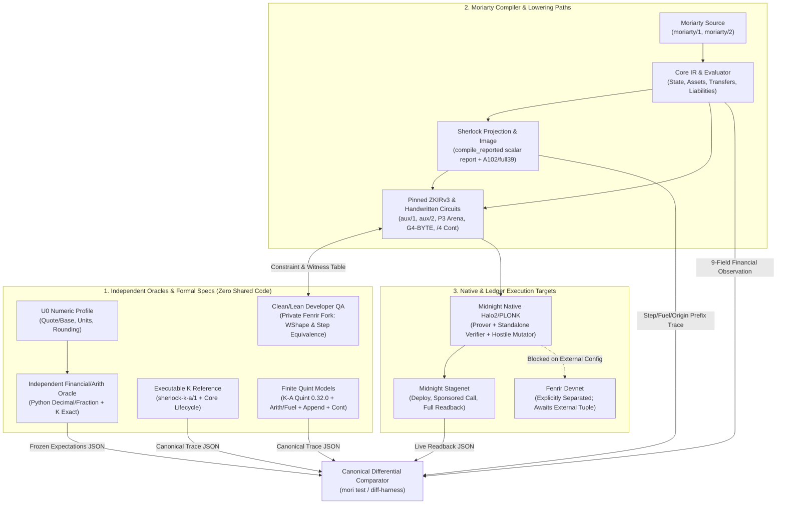
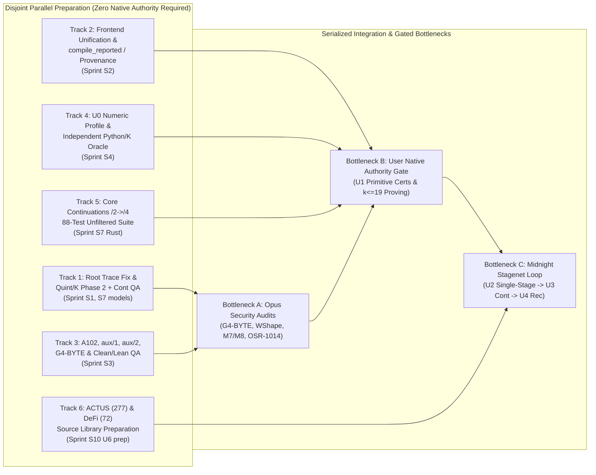

# Moriarty V1 Independent Planning Review — QA Strategy & Differential-Testing Factory Lens

> [!IMPORTANT]
> **Inspection Scope, Baseline & Authority Limits**
> - **Inspection Basis:** This review is conducted strictly over the supplied prompt texts: `ROADMAP.md` (`SHA256: 0afd1af3851ac4367b453ff28573b176c99b7c8ecfb818ad291524f8b418c256`), `docs/MORIARTY-PRODUCT-CONTRACT.md` (`SHA256: d5674c650741103284e0aa8cded4c0e8a0a1be38faa0c65aedb043710caa4396`), `openspec/changes/consolidated-language-kernel/requirements.md` (`SHA256: aa7b2243bbb27e0420bce24977180eec253d0f8c201c94baa1d14333ca1e4a9a`), `openspec/changes/consolidated-language-kernel/specs/consolidated-language-kernel/spec.md` (`SHA256: 66f85468058830690bd8e0d21e4f76a291dd99c572f1f5224cbf4b49b8de67b1`), `openspec/changes/consolidated-language-kernel/traceability.md` (`SHA256: d549f31a16e3b7c1ef0f1de6a58812f9084aace273939190ff10b3529c84ded0`), `COMPLETE_HEADING_INDEX` (`original_sha256: a361071a458f1486a82bd7256e31cc8b7a94dd69d4ade7dcc90d0cf6861d248f`), and `LATEST ROOT PHASE1 RECEIPT` (`capture_sha256: 4b20fae0447274a5974ba5d21a39d7eac4d6342943de944fe4b5b3708a9a4ebd`).
> - **Inspection Limits:** No live filesystem, git repository (`main` `9bcbca52bbfbc58443f6bdb287d73afb7d71f1ab`, PR95–101), Rust crate sources, Quint/K/Lean files, or OSR-1014/ZR/MNR body texts outside the supplied excerpts were inspected or executed. All historical test counts cited from `ROADMAP.md` are treated as **source text claims**, not fresh independent executions.
> - **Zero Native Authority & No Orchestration Bureaucracy:** `native_authority = 0`. This document creates no native execution authorization, resource counter reset, or product/audit acceptance. Per user override, **no Foreman, Endstop, Pel scheduler, or receipt-review bureaucracy** is used or proposed. All security judgments and adversarial witness certifications are routed to **Opus**, never self-certified.

---

## 1. Current Evidence Versus Incomplete Behavior

### 1.1 Architectural Clarifications on the Pinned Baseline (`9bcbca52bbfbc58443f6bdb287d73afb7d71f1ab`, PR95–101)

1. **`compile_reported` vs. Core Compiler Scope:** `compile_reported` invokes the existing backend compiler first and then appends a Sherlock projection report. The Sherlock scalar-only projection restriction applies **only** to that appended Sherlock projection layer; it does **not** restrict the Core compiler (`moriarty-core/1`), which already supports rich financial state, multi-asset balances, transfers, and typed liabilities.
2. **Production vs. `cfg(test)` Draft Frontends:** The private draft source frontend (`docs/audits/2026-10-15/sherlock-draft-source/README.md`) that parses and checks source functions via cached `.rlib` lexer bindings and builds an indexed image for `Factorial(4) = 24` and tree folding (`7`) exists only inside a `cfg(test)` envelope. Production CLI/library frontends and the `cfg(test)` draft frontend differ and are not unified into a single public compiler profile (`UNI-018`).
3. **Lean/Clean Role Boundary:** Per `docs/MORIARTY-PRODUCT-CONTRACT.md` and `ROADMAP.md`, Lean/Clean (in the private Fenrir fork) is strictly **internal developer QA** for semantic definitions, bounded representations, transition circuit modeling, and correspondence proofs. It is **never** a public Moriarty compiler stage, developer toolchain requirement, proof-production runtime, or Midnight deployment dependency (`UNI-001`, `MOR-002`).

### 1.2 Audit Matrix: Supplied Source Text & Receipts vs. Open Requirements

| Subsystem / Artifact | Observed / Recorded in Supplied Text (Scope & Hash/Ref) | Unrun, Pending, or Incomplete Behavior | Open Parent Exits |
| :--- | :--- | :--- | :--- |
| **Root Phase 1 Arithmetic/Fuel Quint Normal Tests** | `LATEST ROOT PHASE1 RECEIPT` (`2026-10-16T12:54:20Z`, `capture_sha256: 4b20fae0...`, `stdout_sha256: 1ce5a9f5...`): source closure (`63 files, 35 dirs, 40 pairs`), package closure (`4667 files, 79 packages`), and P2 tool pins matched. Ran once with `exit_code: 0`, `parent_timeout: false`, and 18 named passing tests (`arithmeticNormal1Test`–`8Test`, `fuelNormal1Test`–`10Test`). | Zero failed/ignored is `INFERRED_NOT_PRINTED`. **Trace adjudication is PENDING** because the first Root data query used an `execve` regex that rejected ordinary whitespace in reconstructed unfinished/resumed `strace` text. **Phase 2 (`phase2`) is `NEVER_STARTED`**. All 33 authored K checks (9 distinct fuel requests) are **UNRUN**. | `P4`, `G4`, `IO1–IO8`, `U1`, `U2` |
| **Sherlock Machine & Literal Step (`PR #95`–`101`)** | `PR #95` registers `A102` source APIs `literal_schema` and `emit_literal_step` (`models/sherlock/literal-step/MAPPING.md`). `full39` semantic source map (`models/sherlock/machine-circuit/README.md`), `aux/1` host packing, `aux/2` UInt128 arithmetic/fuel (`232` logical lanes), and CandidateA `P3` arena policy have conditional source adoption in text. | `A102` registered fragment is **not compiled** (`native_authority: 0`, `C4`). All 16 authored Rust tests in the machine module are **UNRUN**. All 6 `aux/1` private normal tests are **UNRUN**. `232` logical lanes are unmeasured as circuit gates. New `G4-BYTE` draft is **unadopted** with no proof or stagenet evidence. | `P1`, `P3`, `P4`, `G4`, `U0–U2` |
| **Sherlock Finite Models (Quint & K)** | Source text cites `sherlock-k-a/1` Quint (`98` tests + `126` extra normal tests in `docs/audits/2026-10-15/sherlock-extra-normal-quint/README.md`, older 98 not rerun) and finite append-model (`8` normal tests, seed-1 simulation). Host A-profile (`86` checks with checkpoints/source-origin; `11` draft-source tests where `86` older tests were filtered out). | K counterpart executions (`9` append cases, `33` arithmetic/fuel checks, general K-A refinement) are **UNRUN**. Canonical serialized checkpoints, Candidate B bounded schema/helpers, general ADTs, and circuit/native correspondence are **OPEN**. | `U0`, `U1`, `U2`, `M1`, `M6` |
| **Core Compiler, Provenance & Continuations** | Source text records CLI test report (`4` regressions, `256` cases > 1 MiB, `87` FeePool cases), mapped-role provenance (`10` tests, byte-identical IR for 1 specimen), and Core continuations (`moriarty/2` `await` to `/4` `N+1` circuits; `88` focused Rust functions across partial captures: `17` run in closure capture, `71` carried forward; `11` Quint tests). | Continuation candidate is unpublished, unmerged, not freshly rerun across all 88 tests simultaneously, has no established Quint-to-Rust correspondence, and `mori-ledger` does not support `/2`. Mapped-role mode is unauthenticated, unproven, and uninstalled. | `U0`, `U2`, `U3`, `M1`, `M10`, `MC01`, `MC04`, `MC08` |
| **Native Proof & Ledger Execution** | Source text cites one bounded local `k13` signed financial payment proof (`deliverables/native-owner-intent-2026-10-11/RESULT.md`) with 6 hostile-witness and 6 byte-mutation rejections, and an earlier `R3-04` refusal on excess-NIGHT genesis (`2026-10-01`). Offline stagenet helper passes `16` JSON assertions without backend invocation. | Task 3 full 16-asset/16-duty shape hits 1 MiB production-preparation refusal. No general source-to-ZKIRv3 native compilation, no live **Midnight stagenet** deployment/call/readback (`docs/SHERLOCK-CORRECTNESS-LOOP.md`), and **Fenrir** version/networkID/Anchor/committee are unestablished (`UNI-022`). | `U1–U7`, `M1–M17`, `MC01–MC08`, `SP01–SP12`, `G01–G24` |

---

## 2. Prioritized Capability Sprints Across Full V1

Below are **10 concrete capability sprints** covering the full V1 roadmap (`U0`–`U7`, `M1`–`M17`, `MC01`–`MC08`, `SP01`–`SP12`, `G01`–`G24`, `ZR01`–`ZR16`, `MNR01`–`MNR08`, `MPLR-001`–`035`), with deep integration of our assigned **QA strategy and differential-testing factory** lens.

### Sprint S1: Root Phase 1 Trace Adjudication, Arithmetic/Fuel Phase 2 & K/Quint Differential Factory (`U0`, `U1`, `P3`, `P4`, `G4`)
- **Prerequisites:** Baseline `9bcbca52bbfbc58443f6bdb287d73afb7d71f1ab`; existing `LATEST ROOT PHASE1 RECEIPT` (`capture_sha256: 4b20fae0...`).
- **Owned Source Interfaces:**
  - Trace parser / syscall verifier script inspecting frozen `strace` logs (`execve` argument framing).
  - `models/sherlock/machine-circuit/arithmetic-fuel-source-20261016/` (`aux/2` UInt128 byte relations, E1–E7, E-FUEL) and `models/sherlock/machine-circuit/append-model-review-20261016/`.
  - K projection definitions (`33` arithmetic/fuel checks across 9 fuel requests; `9` append cases) and JSON trace canonicalizer.
- **EARS Requirements:**
  - **WHEN** the trace adjudication verifier parses reconstructed `<... execve resumed>` or multi-line `strace` records containing arbitrary ASCII whitespace between syscall tokens, **THE** verifier **SHALL** normalize structured `argv` and environment vectors before matching P2 tool pins, without re-executing the Quint process (`UNI-016`, `UNI-021`).
  - **WHILE** Phase 1 post-gates are verified and when Phase 2 is authorized, **THE** differential QA runner **SHALL** execute the 18 Quint arithmetic/fuel tests, the sampled seed-1 trace run, the 33 K arithmetic/fuel checks, and the 9 K append checks, and **SHALL** assert field-by-field equality of terminal states, UInt128 carry/borrow bytes, and remaining fuel (`UNI-002`, `UNI-019`, `UNI-020`).
  - **IF** a K or Quint trace diverges on fuel exhaustion precedence (`E-FUEL`) or UInt128 overflow refusal, **THEN THE** differential comparator **SHALL** exit non-zero and emit a minimal counterexample diff binding rule ID, input operands, and step index (`AEO-003`).
- **Positive Contrasting New Programs & Complete Effects:**
  1. *Program A (`ArithBoundaryCarry128`):* Multi-step `UInt128` addition/subtraction/multiplication across byte boundaries (`2^64 - 1 + 1`, `2^128 - 1 - (2^128 - 1)`) under exact sufficient fuel (`fuel = 9`). Complete effects: pure value termination with exact 16-byte little-endian lane witness and `remaining_fuel = 0`.
  2. *Program B (`FuelStarvedAppend128`):* Structurally contrasting arena-append sequence combining two `aux/1` host records and one `UInt128` comparison with `fuel = 2` (1 unit short of terminal publication). Complete effects: deterministic suspension/refusal under `E-FUEL` with zero partial arena mutation and exact pre-step commitment preserved.
- **Rejection Tests with Valid Positive Controls:**
  - *Valid Positive Control:* `ArithBoundaryCarry128` at `fuel = 9` passes both Quint and K with identical 16-byte output.
  - *Hostile/Rejection Test:* Mutate carry byte `lane[8]` from `0x01` to `0x00` while compensating `lane[7]` by `+256` (unnormalized byte witness), and separately test `2^128 - 1 + 1` at `fuel = 9`. Both must be rejected by the arithmetic relation, not by malformed input parsing.
- **Formal / Native / Target Distinctions:** Formal model QA only (Quint TypeScript engine + K `kompile`/`krun`). Establishes zero native circuit or Midnight stagenet acceptance (`native_authority = 0`).
- **Independent Observable Acceptance:** Deterministic JSON adjudication receipt for Phase 1 `capture_sha256: 4b20fae0...`; fresh Phase 2 stdout/stderr hashes for Quint and K (`33 + 9` checks passing) with explicit printed `0 failed, 0 ignored` counters.

### Sprint S2: Production Frontend Unification, `compile_reported` Isolation &Lowering Provenance (`U0`, `U2`, `M1`, `M6`, `MC01`)
- **Prerequisites:** Sprint S1; baseline PR95–101 (`compile_reported` and `moriarty-core/1`).
- **Owned Source Interfaces:**
  - `moriarty-core` parser/elaborator (`moriarty/1` and draft frontend reconciliation, removing `cfg(test)` divergence).
  - `compile_reported` entrypoint (decoupling the optional Sherlock scalar-only projection report from Core state/asset/transfer/liability compilation).
  - Provenance exporter (`docs/audits/2026-10-15/core-source-provenance/`) and admission matrix generator (`UNI-018`, `UNI-019`).
- **EARS Requirements:**
  - **WHEN** `compile_reported` is invoked on a `moriarty/1` program containing state transitions, multi-asset transfers, or typed liabilities, **THE** compiler **SHALL** execute full Core backend lowering and preserve complete financial semantics while marking out-of-projection constructs as `unsupported_in_sherlock_scalar_projection` in the appended Sherlock report (`UNI-018`, `UNI-019`).
  - **WHERE** source functions are parsed for image generation or Core compilation, **THE** production binary and library API **SHALL** use the exact same lexer, AST, typechecker, and source-origin table as the test suite, eliminating `cfg(test)`-only frontend paths (`UNI-002`, `UNI-024`).
  - **IF** two lowering consumers (`Core -> ZKIRv3` vs. `Core -> Sherlock Image`) are compared over their declared common domain, **THEN THE** differential harness **SHALL** verify identical source-origin spans, evaluation order, and refusal codes (`UNI-019`).
- **Positive Contrasting New Programs & Complete Effects:**
  1. *Program A (`DirectEscrowTransfer`):* Single-stage multi-asset transfer debiting `100 ASSET_A` and `2 FEE_DUST` from Owner `0x01`, crediting `100 ASSET_A` to Recipient `0x02` and `2 FEE_DUST` to FeePool `0xFF`, opening and closing `0` liabilities.
  2. *Program B (`RecursiveScalarFeeCalc`):* Structurally contrasting scalar arithmetic and conditional branching function computing tiered fee schedules (`Factorial(4)` / piecewise linear rate) admitted by both Core and the Sherlock scalar projection. Complete effects: identical return value, source-origin trace, and provenance map in both lowerings.
- **Rejection Tests with Valid Positive Controls:**
  - *Valid Positive Control:* `DirectEscrowTransfer` compiles cleanly through `compile_reported` into full Core IR with complete asset/liability fields and an explicit non-fatal projection boundary note.
  - *Hostile/Rejection Test:* A program with an uninitialized liability balance or an undeclared asset domain (`ASSET_UNKNOWN`) must be rejected by the Core type/effect checker with a structured diagnostic, whereas a valid `Source/6` beta construct outside `moriarty/1` must report `unsupported_profile_construct` (`UNI-018`).
- **Formal / Native / Target Distinctions:** Local Rust compiler and static IR provenance (`moriarty-core/1`); does not claim native ZKIRv3 proving or ledger verification.
- **Independent Observable Acceptance:** `cargo test` passing all unified frontend, provenance, and `compile_reported` tests in a single unfiltered run; emitted `admission-matrix.json` binding exact profile/consumer construct coverage.

### Sprint S3: Handwritten Circuits, A102 Literal Step, G4-BYTE & Clean/Lean Developer QA (`U1`, `P1`, `P3`, `G4`, `ZR01`, `ZR06`)
- **Prerequisites:** Sprint S1; Opus security review of `G4` B1–B13 (`models/sherlock/machine-circuit/g4-source-requirements-20261016/README.md`) and `G4-BYTE` draft.
- **Owned Source Interfaces:**
  - `models/sherlock/literal-step/` (`literal_schema`, `emit_literal_step`, 16 registered machine Rust tests).
  - `models/sherlock/machine-circuit/` (`full39` semantic map, `aux/1` 6 tests, `aux/2` 232 lanes, CandidateA `P3` arena policy, `G4-BYTE` lookup/range gates).
  - Private Fenrir fork Lean/Clean developer QA repository (bounded representation theorems and Clean step-circuit equivalence checker).
- **EARS Requirements:**
  - **WHEN** `emit_literal_step` and the handwritten step-circuit emitters lower the `full39` machine transition and `G4-BYTE` byte decompositions to ZKIRv3, **THE** emitter **SHALL** enforce explicit range and Boolean/byte constraints on every witness column without assuming that a subsequent boolean gate implicitly constrains an earlier unconstrained wire (`UNI-003`, `G4` B1–B13).
  - **WHILE** Lean/Clean developer QA runs in the developer verification pipeline, **THE** Clean transition specification **SHALL** check functional equivalence and witness-shape (`WShape`) soundness conditions against the handwritten Rust circuit emitter's exported constraint table, without introducing Lean or Clean into the public `mori` binary (`UNI-001`, `UNI-014`).
  - **IF** an adversarial prover supplies a witness that satisfies honest producer equations in $\mathbb{Q}$ or $\mathbb{Z}$ but exploits field wrap-around modulo $p$ or unnormalized byte lanes, **THEN THE** emitted ZKIRv3 constraints **SHALL** fail verification (`UNI-003`, `MPLR-020`). *(Opus-owned security sign-off required).*
- **Positive Contrasting New Programs & Complete Effects:**
  1. *Program A (`LiteralStepLookupChain`):* Executes 4 sequential `A102` literal steps with `aux/1` host record unpacking and `P3` arena equality-trace lookups. Complete effects: valid ZKIRv3 constraint satisfaction, exact step-counter increment (`pc: 0 -> 4`), and arena digest update.
  2. *Program B (`CheckedU128MulDivStep`):* Executes `aux/2` checked `UInt128` multiplication and directed-rounding division using `G4-BYTE` byte-table constraints and `E-FUEL` deduction. Complete effects: exact quotient, remainder, and carry-byte witnesses verified against Clean/Lean reference definitions.
- **Rejection Tests with Valid Positive Controls:**
  - *Valid Positive Control:* Honest witness for `CheckedU128MulDivStep` passes Rust constraint check, Clean/Lean equivalence, and native verifier check.
  - *Hostile/Rejection Test:* (1) Forge a byte lane value `256` (`0x0100`) with adjusted high byte so the linear combination equals the valid `UInt128` word; (2) supply a non-boolean (`val = 2`) flag wire to a conditional step selector; (3) mutate an `aux/1` arena record value across an equality-trace read. All three must fail circuit constraint satisfaction.
- **Formal / Native / Target Distinctions:** Separates Clean/Lean developer theorem/model QA from Rust compilation (`16` machine tests + `6` `aux/1` tests) and actual Halo2/PLONK native verification (`U1` primitive certificates). Native execution requires explicit user gate authorization.
- **Independent Observable Acceptance:** All 16 `A102` machine tests and 6 `aux/1` tests compiled and passing; Clean/Lean correspondence check artifact exported; measured ZKIRv3 gate/row counts replacing the unmeasured `232` logical-lane estimate; **Opus security sign-off** on `G4-BYTE` and `WShape` adversarial soundness.

### Sprint S4: U0 Numeric Profile & Independent Financial/Work Oracles (`U0`, `U6`, `UNI-014`, `UNI-020`, `SP03`)
- **Prerequisites:** Sprints S1, S2.
- **Owned Source Interfaces:**
  - U0 Numeric Profile specification and Rust verifier (`quote/base` price orientation, unit dimension algebra, per-primitive directed rounding toward beneficiary/protocol reserve, overflow/dust bounds).
  - Independent Python/Decimal + K exact rational/fixed-point financial oracle generator (zero shared code with `moriarty-core` evaluator).
- **EARS Requirements:**
  - **WHEN** any financial primitive or library computes a rate, price conversion, fee split, or interest accrual, **THE** compiler and evaluator **SHALL** enforce dimensional unit consistency, canonical `quote/base` orientation, and explicit rounding direction (`RoundDown` for user payouts/withdrawals, `RoundUp` for user debits/liabilities) bound to the U0 numeric profile (`UNI-014`, `UNI-020`).
  - **WHEN** a conformance or semantic test suite is scored, **THE** QA harness **SHALL** compare actual evaluator and circuit outputs against pre-frozen expectations produced by the independent non-Rust financial oracle, recording `shared_code_dependencies: none` (`UNI-020`).
  - **IF** a library or port inverts `base/quote` by taking the reciprocal of an already rounded integer/fixed-point ratio rather than converting the exact rational numerator/denominator prior to directed rounding, **THEN THE** U0 numeric qualifier **SHALL** reject the implementation (`UNI-014`).
- **Positive Contrasting New Programs & Complete Effects:**
  1. *Program A (`ExactQuoteBaseSwapOddLot`):* Converts `333_333` units of `BASE_USD` at an exact rational price `7 / 3` `QUOTE_NIGHT / BASE_USD` with a `30 bps` fee directed to `FeePool`. Complete effects: gross debit `333_333 BASE_USD`, exact fee `1_000 BASE_USD` (rounded up in favor of protocol), net converted payout `775_443 QUOTE_NIGHT` (rounded down), dust `2/3 QUOTE_NIGHT` retained in reserve commitment, logical work `W = 14`.
  2. *Program B (`LinearInterestAccrualDust` - `SP04`/`loan-origination-accrual`):* Accrues bounded integer interest over 3 monotone periods on principal `10_001` at rate `5 / 36500` per period. Complete effects: opening liability `10_001`, accrued liability delta `+5` (directed ceiling for debt obligation), closing liability `10_006`, duplicate-period replay counter incremented to period `3`.
- **Rejection Tests with Valid Positive Controls:**
  - *Valid Positive Control:* `ExactQuoteBaseSwapOddLot` matches the independent Python/K rational oracle across all 9 observation fields (ordered effects, changed state, preserved state, gross debit, fees, net receipts, dust, liability delta, logical work).
  - *Hostile/Rejection Test:* A port that first rounds `7 / 3` to integer `2` (or fixed-point reciprocal `3 / 7`) before multiplying by `332_333`, or that nets the `1_000` fee into the debit without reporting gross debit vs. fee recipient, is rejected by the `UNI-014`/`UNI-020` comparator.
- **Formal / Native / Target Distinctions:** Independent mathematical/K oracle vs. local Rust evaluator vs. ZKIRv3 arithmetic circuit constraints.
- **Independent Observable Acceptance:** Frozen oracle manifest (`oracle-expectations-v1.json`) with SHA256 digest generated by an independent script; `mori test` verifying 100% field match across all 9 observation dimensions without invoking shared Rust evaluator code to build expectations.

### Sprint S5: Certified Minimum Basis & Native Primitive Feasibility (`U1`, `M5`, `M7`, `M8`, `MC01`, `MC04`, `MC05`)
- **Prerequisites:** Sprints S3, S4; Opus security review routing for `M7` (network ID/Anchor domain separation) and `M8` (in-circuit JubJub Schnorr primitive/splice).
- **Owned Source Interfaces:**
  - Native ZKIRv3 primitive certificates (`UInt128` checked ops, Poseidon/commitments, JubJub Schnorr verification `M8`, domain-separated intent hash `M7`).
  - Transaction size and circuit row profiler (`M5`: $\le 64\text{ KB}$ transaction limit, fraud game $k \le 19$, deterministic replay budget; resolving Task 3's 16-asset/16-duty 1 MiB production-preparation refusal).
- **EARS Requirements:**
  - **WHEN** a primitive jet or in-circuit cryptographic check (`M8` JubJub Schnorr, `M7` Anchor/network-ID intent binding, `UInt128` checked math) is registered for `U1`, **THE** certificate **SHALL** bind its exact specification, input preconditions, reference semantics, ZKIRv3 constraint fragment, measured circuit row/gate cost, and adversarial witness soundness proof (`UNI-003`, `UNI-014`, `MPLR-020`, `MPLR-021`).
  - **WHILE** compiling any single-stage or fraud-proof step circuit for `M5`, **THE** backend **SHALL** enforce a hard ceiling of $k \le 19$ ($2^{19}$ rows) and serialized transaction payload $\le 65,536\text{ bytes}$, rejecting or splitting preparation envelopes before reaching the 1 MiB host refusal limit (`M5`, `UNI-008`).
  - **IF** a signed intent proof is replayed with a mutated `network_id`, mutated `anchor_block_hash`, or forged JubJub Schnorr $(R, s)$ witness, **THEN THE** native ZKIRv3 verifier **SHALL** reject the proof (`M7`, `M8`, `UNI-003`). *(Opus security audit required).*
- **Positive Contrasting New Programs & Complete Effects:**
  1. *Program A (`SignedAnchorIntent16x16` - Compacted Shape):* Authorizes a 16-asset, 16-duty bounded financial settlement bound to a specific `(network_id, anchor_hash)` and JubJub Schnorr public key. Complete effects: serialized transaction $< 64\text{ KB}$, circuit degree $k \le 19$, all 16 asset balances and 16 residual duties verified.
  2. *Program B (`MinimalSingleAssetIntent`):* 1-asset, 0-duty signed transfer with existential $(R, s)$ proof reuse across two valid attachments as permitted by the owner-intent contract (`deliverables/native-owner-intent-2026-10-11/RESULT.md`).
- **Rejection Tests with Valid Positive Controls:**
  - *Valid Positive Control:* `SignedAnchorIntent16x16` produces a valid witness within $k \le 19$ and $< 64\text{ KB}$ and passes independent native verification.
  - *Hostile/Rejection Test:* (1) Excess-NIGHT genesis supply violation (reproducing and catching `R3-04` at the pre-proving genesis invariant gate); (2) wrong `network_id` or `anchor_hash` with valid signature; (3) low-order JubJub point $R$ or non-canonical scalar $s \ge \ell$.
- **Formal / Native / Target Distinctions:** Distinguishes source/static size estimates from actual Halo2/PLONK prover key generation, $k$-degree measurement, and standalone native verifier execution.
- **Independent Observable Acceptance:** Published `U1` primitive certificate table with measured $k$ and byte sizes; Opus audit report on `M7`/`M8` and hostile-witness soundness; passing pre-flight genesis supply invariant check.

### Sprint S6: General Single-Stage Source-to-Midnight Stagenet Path (`U2`, `M1`–`M4`, `M9`, `M12`, `MC02`, `MC04`, `SP05`)
- **Prerequisites:** Sprints S2, S4, S5; live Midnight stagenet endpoint and genesis/funding configuration (`docs/SHERLOCK-CORRECTNESS-LOOP.md`).
- **Owned Source Interfaces:**
  - Full `moriarty/1 -> ZKIRv3` general single-stage compiler pipeline (admitted grammar generality argument).
  - Midnight stagenet deployment, transaction submission, DUST/Capacity Exchange sponsorship consumer (`M4`), domain-qualified asset identity (`M9`, `L3`), and online/offline effect readback verifier (`models/sherlock/STAGENET-OFFLINE-README.md` upgraded to live stagenet).
- **EARS Requirements:**
  - **WHEN** any newly authored program within the admitted `moriarty/1` single-stage grammar is compiled and proved, **THE** toolchain **SHALL** emit a pinned ZKIRv3 artifact, bind the canonical signed intention and predecessor state, submit the transaction to Midnight stagenet, and verify complete post-state effect readback against independent oracle expectations (`UNI-002`, `UNI-003`, `M1`, `M3`).
  - **WHEN** a Midnight transaction executes across guaranteed and fallible ledger phases (`UNI-006`, `MOR-011`), **THE** compiled contract **SHALL** explicitly record guaranteed-phase DUST/sponsorship fees (`M4`) and authority/nonce consumption even when the fallible phase aborts, without claiming atomic rollback of guaranteed fees.
  - **IF** a transaction attempts to substitute an asset with matching ticker but distinct `(network, issuer, reference)` tuple (`M9`, `L3`) or replays a consumed nonce, **THEN** Midnight stagenet execution and the local verifier **SHALL** reject the transition (`UNI-004`, `UNI-005`).
- **Positive Contrasting New Programs & Complete Effects:**
  1. *Program A (`OriginatedFixedTermLoan` - Loan Fixture Successor):* Originates a collateralized loan debiting `1_000 USDC (net=1, iss=0xA, ref=0x1)` from Lender to Borrower, locking `2_000 NIGHT` collateral in custody, charging `5 DUST` sponsored fee via Capacity Exchange (`M4`), and recording an opening repayment liability of `1_050 USDC` due at Maturity `T+100`.
  2. *Program B (`InstantLimitSwapWithFeeSplit` - Structurally Contrasting Non-Loan Program):* Stateless atomic swap with no persistent liability, exchanging `500 ASSET_X` for at least `980 ASSET_Y` across two liquidity pools with a `0.3%` LP fee and guaranteed-phase `2 DUST` sponsor fee. Complete effects: zero closing liabilities, exact multi-pool balance deltas, consumed intent nonce `N+1`.
- **Rejection Tests with Valid Positive Controls:**
  - *Valid Positive Control:* Both `OriginatedFixedTermLoan` and `InstantLimitSwapWithFeeSplit` deploy, prove, finalize on Midnight stagenet, and pass full JSON readback comparison.
  - *Hostile/Rejection Test:* (1) Valid envelope where fallible phase fails a minimum-output guard (`output = 979 < 980`): guaranteed phase retains `2 DUST` fee and consumes phase-1 nonce while main swap balances remain unchanged and duties are preserved (`UNI-006`); (2) spoofed asset `issuer` field with valid proof envelope rejected on-chain.
- **Formal / Native / Target Distinctions:** Distinguishes local Rust simulation, standalone native proof verification, historical Preview receipts, live **Midnight stagenet** finality (required here), and **Fenrir devnet** (which remains separately tracked under `UNI-022` until Fenrir tuple/Anchor facts are supplied).
- **Independent Observable Acceptance:** Stagenet transaction hashes, block heights, pinned ZKIRv3 digests, verifier keys, and verified post-state readback receipts for both contrasting programs and the phase-failure control (`docs/SHERLOCK-CORRECTNESS-LOOP.md`).

### Sprint S7: Conditional Settlement, Core Continuations (`/2` to `/4`), Partial Progress & Recovery (`U3`, `M11`, `M13`, `M14`, `MC04`, `SP10`, `MPLR-001`–`010`)
- **Prerequisites:** Sprint S6; Core continuations dossier (`docs/CORE-CONTINUATIONS.md`).
- **Owned Source Interfaces:**
  - `moriarty/2` typed `await` continuation compiler emitting `N + 1` circuits for `N` awaits (`mori-ledger` `/2` and `/4` native execution support).
  - Programmable escrow, document-predicate + recipient-consent gates (`UNI-007`), partial fill accounting (`UNI-005`), reserved recovery fuel/authority (`UNI-008`, `L4`, `L5`), and `128-ID` state-cap boundary handling.
  - Quint lifecycle model (`11` continuation tests expanded and formally mapped to Rust continuation states).
- **EARS Requirements:**
  - **WHEN** an intention authorizes spending at most `11 A` (including at most `1 A` fees) to receive at least `20 B` across staged partial fills, **THE** continuation runtime and `/4` circuits **SHALL** track cumulative gross debits, consumed fees, proportional net receipts, and residual obligations across every `await` resume step (`UNI-004`, `UNI-005`, `UNI-006`).
  - **WHILE** a funded escrow awaits recipient acceptance and an authenticated document predicate (`UNI-007`), **THE** contract **SHALL** distinguish `recorded`, `funded`, `eligible`, `in_flight`, and `delivered` states, and **SHALL NOT** release funds on a mere document digest, funding receipt, or timeout (`MPLR-003`, `MPLR-010`).
  - **IF** ordinary execution fuel or the `128-ID` state cap is exhausted, or if a late settlement races an expiry refund (`MPLR-005`, `MPLR-007`), **THEN THE** transition **SHALL** preserve all unpaid liabilities, block ordinary calls from spending the recovery reserve, and permit only the authorized recovery authority to execute bounded closure (`UNI-008`, `L4`).
- **Positive Contrasting New Programs & Complete Effects:**
  1. *Program A (`TwoStagePartialEscrow_11A_20B` - Roadmap U3 Discriminator):* Stage 1 fills `5 A` principal + `0.4 A` fee for `10 B` under Route Candidate 1, suspending into a typed continuation with residual authority (`6 A` max remaining, `0.6 A` fee cap remaining) and residual duty (`10 B` minimum remaining). Stage 2 resumes with authenticated document predicate `DocPred(0x99) == true` and recipient signature under Route Candidate 2, spending `5 A` + `0.5 A` fee for `11 B`. Complete effects: total spent `10.9 A <= 11 A`, total fee `0.9 A <= 1 A`, total received `21 B >= 20 B`, continuation closed.
  2. *Program B (`ExhaustedWorkRecoveryEscrow`):* Reaches ordinary fuel limit after Stage 1 partial fill (`5 A -> 10 B`) and before Stage 2 before deadline `T_exp`. Recovery authority invokes the reserved recovery circuit (`N+1`) after `T_exp`, refunding the unspent `5.6 A` escrow reserve to Owner while preserving the settled `10 B` and recording the closed partial episode.
- **Rejection Tests with Valid Positive Controls:**
  - *Valid Positive Control:* Two independently produced route candidates for `TwoStagePartialEscrow_11A_20B` both pass objective verification without any federated coordinator (`UNI-004`).
  - *Hostile/Rejection Test:* (1) Ordinary continuation step attempts to dip into recovery fuel reserve (`UNI-008`); (2) rollover across the `128-ID` state cap attempts to zero out an unpaid liability or reset cumulative fee spend (`0.4 A -> 0 A`); (3) late settlement submitted in the same block/after committed recovery refund attempts double-delivery; (4) false guard on `await` mutates state instead of returning the unchanged continuation. All four must be rejected.
- **Formal / Native / Target Distinctions:** Full 88-test Rust continuation suite run cleanly without carry-forward skips + Quint-to-Rust state-serialization correspondence + `mori-ledger` native `/2`/`/4` verification on Midnight stagenet.
- **Independent Observable Acceptance:** Fresh full execution receipt of all 88+ Rust continuation tests; automated Quint-to-Rust differential trace equivalence report; Midnight stagenet execution of `TwoStagePartialEscrow_11A_20B` across `N+1` circuits.

### Sprint S8: Native Recursive History & Private 5-Operator Composition (`U4`, `MC03`, `MC06`, `SP06`, `SP10`, `ZR01`–`ZR16`, `MNR01`–`MNR08`, `L6`)
- **Prerequisites:** Sprints S5, S7; user's demonstrated `ledger-9` recursion route (which does not require `VerifyProof`) and/or qualified `ZR01`–`ZR16` interface; accepted `SP07`/`SP08` semantic inputs for claimed financial scopes; Opus review of privacy/completeness (`UNI-010`).
- **Owned Source Interfaces:**
  - Recursive history verifier and transcript/deferred-obligation accumulator (`MNR01`–`MNR08`, `ZR01`–`ZR16`, `ledger-9` recursive route).
  - Private witness handoff channel and all 5 inherited composition operators (`SP10.1`): (1) `sequential`, (2) `disjoint_parallel`, (3) `shared_state_interleaving`, (4) `atomic_synchronization`, and (5) `asynchronous_messaging`, plus fan-in $> 1$ (`L6`).
- **EARS Requirements:**
  - **WHEN** a program claims compliant multi-step history or private multi-parent composition (`UNI-009`, `UNI-017`), **THE** implementation **SHALL** verify authenticated genesis origin, compatible verifier keys (`MNR03`), verified-value bindings (`MNR04`), deferred cryptographic obligations (`MNR02`), and unique parent resource consumption across at least two native recursive financial steps and a fan-in $> 1$ private join (`L6`), without substituting ledger induction for `MC03`/`MC06`.
  - **WHERE** private continuation handoff is used between isolated parties (`UNI-010`, `MPLR-013`, `MPLR-029`), **THE** public statement **SHALL** disclose only the declared public commitment and nullifier/completeness domain while proving that no hidden reservation or liability is omitted (`UNI-010`).
  - **IF** a recursive witness supplies a fabricated genesis base, an unauthorized verifier key, a replayed parent note/resource in a diamond join, or omits final accumulator verification (`MNR02`, `MNR07`), **THEN** native verification **SHALL** reject the proof (`UNI-009`).
- **Positive Contrasting New Programs & Complete Effects:**
  1. *Program A (`PrivateTwoStepLoanHandoffJoin`):* Step 1 originates a private credit note; Step 2 transfers/splits the note privately to a secondary lender (`sequential` + `private handoff`); Step 3 joins (`fan-in = 2`, `atomic_synchronization` + `disjoint_parallel`) two predecessor notes into a consolidated margin settlement without federated services.
  2. *Program B (`InterleavedAsyncChannelNetting`):* Exercises `shared_state_interleaving` and `asynchronous_messaging` across two bilateral settlement channels with authenticated completeness domains, proving all pending reservations are accounted for before closing.
- **Rejection Tests with Valid Positive Controls:**
  - *Valid Positive Control:* `PrivateTwoStepLoanHandoffJoin` and `InterleavedAsyncChannelNetting` verify end-to-end across all 5 composition operators with independent witness handoff between two isolated local wallet processes.
  - *Hostile/Rejection Test:* (1) Diamond double-spend reusing the same Step 1 parent commitment in both branches of the `fan-in = 2` join; (2) treating a hidden private reservation as zero liability (`UNI-010`); (3) ledger-induced sequential history submitted to satisfy an `MC03` native recursive predicate (`UNI-009`).
- **Formal / Native / Target Distinctions:** Explicitly separates ledger-induced history (`U2` scoped profile) from true native recursive proof composition (`MC03`/`U4` via `ledger-9` route and `ZR01`–`ZR16`).
- **Independent Observable Acceptance:** Independent native verification artifacts for the 2-step recursive chain + 5 composition operators; noninterference/disclosure check signed off by Opus (`UNI-010`, `OSR-1014`).

### Sprint S9: Optional Federated DeFi Kernel, Constrained AI Solvers & Cost-Plane Meters (`U5`, `M16`, `M17`, `K3`–`K5`, `L7`, `L8`, `UNI-011`–`013`, `UNI-015`)
- **Prerequisites:** Sprints S7, S8; Opus review of federation trust boundaries (`UNI-011`) and OWS delegation (`UNI-012`).
- **Owned Source Interfaces:**
  - Exact-byte external adapter and common ZK/MPC/TEE evidence statement (`UNI-011`, `MPLR-030`).
  - Federation policy engine (membership, threshold, ordering, equivocation, availability, and `UNI-015`/`ZR15` epoch migration; parameterized for Fenrir committee `M17` when external identities are supplied).
  - Delegated AI solver budget manager (OWS attenuated authority, durable concurrent reservations `UNI-012`, `MPLR-031`–`032`), `x402` payment/result/delivery state machine (`UNI-013`, `MPLR-033`–`034`), and separate kernel cost-plane meters (`M16`, `L7`, `L8`).
- **EARS Requirements:**
  - **WHEN** an external adapter signs or executes a cross-domain effect (`UNI-011`), **THE** adapter **SHALL** bind the exact decoded transaction bytes to the Moriarty intention, stage, domain, epoch, and common ZK/MPC/TEE policy statement, and **SHALL** record ZK, MPC, TEE, and finality trust assumptions separately.
  - **WHEN** concurrent delegated AI solvers request reservations against a shared parent budget (`UNI-012`), **THE** budget coordinator **SHALL** enforce atomic durable aggregate accounting (`spent + pending + reserved <= cap`) across retries and failovers, and **SHALL** maintain kernel cost-plane meters (`L8`) strictly separate from asset/fee counters without netting (`M16`, `L7`, `L8`).
  - **WHEN** a federation epoch or policy version migrates (`UNI-015`, `ZR15`) or a paid `x402` service call is retried (`UNI-013`), **THE** kernel **SHALL** preserve all unresolved duties, consumed nonces/authority, and logical paid-request identities, never treating payment finality or a TEE-local computation as recipient delivery.
- **Positive Contrasting New Programs & Complete Effects:**
  1. *Program A (`DualSolverConcurrentDelegation`):* Two independent AI solvers (`Solver_Alpha`, `Solver_Beta`) concurrently reserve `6 units` and `4 units` (including fees) against an attenuated `10-unit` OWS parent budget to solve the `U3` escrow program (`TwoStagePartialEscrow_11A_20B`), with `x402` retry reconciliation after a simulated network drop between payment finality and result delivery.
  2. *Program B (`EpochMigratedCrossChainAdapter`):* Executes an exact-byte external adapter transfer across an epoch boundary (`Epoch 4 -> Epoch 5`), migrating an active pending liability and consumed nonce set under authorized committee threshold rules while charging a separate `L7` fee capability on an `L8` kernel meter.
- **Rejection Tests with Valid Positive Controls:**
  - *Valid Positive Control:* `DualSolverConcurrentDelegation` succeeds with `6 + 4 = 10 <= 10` reserved, zero duplicate `x402` charges on retry, and direct Midnight submission still working with the federation completely disabled (`UNI-001`, `U5`).
  - *Hostile/Rejection Test:* (1) Concurrent solver requests for `6` and `5` units using copied parent budgets (`6 + 5 = 11 > 10`)—at least one must be rejected/deferred (`UNI-012`); (2) proof for transfer `X` attached to external adapter bytes for `Y` (`UNI-011`); (3) claiming TEE-local result generation or `x402` payment finality as completed recipient delivery (`UNI-013`); (4) epoch migration that resurrects a consumed nonce or changes beneficiary (`UNI-015`).
- **Formal / Native / Target Distinctions:** Distinguishes cryptographic Midnight proofs from MPC/TEE/threshold adapter trust assumptions (`UNI-011`). Keeps `M17` Fenrir committee identity parameterized and explicitly `unknown` until external facts are supplied (`UNI-022`).
- **Independent Observable Acceptance:** Exact-byte adapter test logs, concurrent solver race harness results, epoch-migration state continuity proofs, and Opus security sign-off on `UNI-011`/`UNI-012`.

### Sprint S10: Full Composable Financial Conformance (`U6`) & Independent Developer Release (`U7`, `M10`, `M15`, `MC07`, `MC08`, `G01`–`G24`)
- **Prerequisites:** Sprints S4, S6, S7, S8, S9.
- **Owned Source Interfaces:**
  - Complete `U6` financial libraries and frozen conformance manifests (`UNI-023`): **277 ACTUS fixtures** across **18 executable types**, **32 taxonomy dispositions**, **DS01–07**; **72 original DeFi rows**, **DA01–24**, adopted supplements, **3 held-outs**, **8 intent cases**, **8 regression classes**, `M15` batch clearing/uniform price/liquidation, and `MPLR-025` gross-preserving netting.
  - Complete `U7` public developer toolchain (`mori` CLI: `compile`, `simulate`, `test`, `verify-intent`, `prove`, `deploy`; honest LSP/MCP scope or full implementation; two-builder reproducible build scripts; `G01`–`G24` release gates).
- **EARS Requirements:**
  - **WHEN** `U6` conformance is evaluated (`UNI-023`, `MC07`), **THE** test harness **SHALL** validate 100% membership against the frozen manifests (277 ACTUS fixtures, 72 DeFi rows, DA01–24, DS01–07, 3 held-outs, 8 intent cases, 8 regression classes, 5 composition operators) against the independent `U0` oracle, recording semantic, local, native, Preview, Midnight stagenet, and Fenrir evidence in separate non-conflated columns (`UNI-016`, `UNI-021`, `UNI-022`).
  - **WHEN** netting is applied across bilateral or batch obligations (`MPLR-025`, `M15`), **THE** library **SHALL** preserve gross economic accounting, fee attribution, and individual regulatory/audit trail bounds rather than erasing gross legs.
  - **WHEN** an external developer installs the public release on a clean machine without project metadata, Foreman receipts, or maintainer keys (`UNI-001`, `UNI-024`, `MC08`), **THE** developer **SHALL** be able to author a novel non-fixture program, inspect obligations/trust reports (`AEO-001`), compile to pinned ZKIRv3, generate a native proof, deploy/submit via their own Midnight stagenet wallet, and reproduce identical artifact bytes across two independent builders (`U7`, `G01`–`G24`).
- **Positive Contrasting New Programs & Complete Effects:**
  1. *Program A (`UniformPriceBatchClearWithNetting` - `M15`/`MPLR-025`):* Clears a multi-order batch at a single uniform quote/base clearing price, preserving gross debit/credit records per participant while settling net token transfers and updating liquidation margin obligations.
  2. *Program B (`CleanRoomExternalDevVault` - `U7` Non-Fixture Novel Program):* Authored outside the loan/swap/ACTUS fixture directories in a clean external workspace; implements a time-locked multi-beneficiary revenue-split vault with delegated emergency pause, proved and submitted via an independent stagenet wallet.
- **Rejection Tests with Valid Positive Controls:**
  - *Valid Positive Control:* `CleanRoomExternalDevVault` passes `mori compile`, `mori verify-intent`, native proving, stagenet execution, and two-builder byte-reproducibility with zero project/reviewer receipts present (`UNI-001`).
  - *Hostile/Rejection Test:* (1) Remove a maintainer/review receipt from a valid bundle—must still pass (`UNI-001` hostile witness); (2) remove a mandatory range/intent proof while including a mock reviewer approval receipt—must be rejected (`UNI-001`, `UNI-016`); (3) `mori test` run on a 256-case suite (>1 MiB JSON) with 3 intentional expectation mismatches must emit all 256 ordered results and exit `1` (`UNI-024`).
- **Formal / Native / Target Distinctions:** Full matrix separation across K/Quint, Clean/Lean developer QA, local Rust evaluator, standalone native ZKIRv3 prover/verifier, Midnight Preview, Midnight Stagenet, and Fenrir (if external tuple is supplied; otherwise Fenrir column remains explicitly `blocked_external_facts`).
- **Independent Observable Acceptance:** Complete `U6`/`U7` conformance table with zero skipped rows, two-builder SHA256 reproducibility logs, clean-room stagenet transaction receipts, and final Opus security clearance across `OSR-1014` and `G01`–`G24`.

---

## 3. QA Strategy and Differential-Testing Factory (Assigned Lens in Depth)

### 3.1 Differential-Testing Factory Architecture

The QA factory is designed as a **deterministic, scriptable verification pipeline** driven by standard developer commands (`cargo test`, `quint test`, `krun`, `lean --run`, `mori test`) and canonical JSON schemas—**never** by an orchestration daemon, Foreman, or receipt bureaucracy.

### 3.2 Nine Pillar QA Protocols in the Differential Factory

#### Pillar 1: Executable K Reference & Finite Quint Counterparts
- **Scope:** K (`sherlock-k-a/1`, 33 arithmetic/fuel checks, 9 append cases, Core lifecycle) and Quint 0.32.0 (`98 + 126` K-A normal tests, `18` UInt128 arithmetic/fuel tests, `8` append tests, `11` continuation tests).
- **Differential Protocol:**
  1. Both K and Quint consume identical canonical AST/image fixtures serialized from JSON.
  2. Every step emits a normalized state tuple: `(clock_profile, step_index, pc_or_expr_id, env_bindings, arena_digest, uint128_lanes[0..15], remaining_fuel, helper_work_counter, terminal_status)`.
  3. Clock alignment is explicit: `sherlock-k-a/1` (charged K rules + free terminal publication) is compared directly against the K machine and Rust A-profile host (`216` fuel prefixes); historical `sherlock-quint-a/1` (`universalMachine.qnt`) is isolated to its legacy 8-test regression bucket.
  4. **Strict Runner Gate:** Every Quint and K invocation must parse stdout/stderr to verify explicit `0 failed` and `0 ignored` counts (remediating `zero_failed_and_ignored: INFERRED_NOT_PRINTED` in `LATEST ROOT PHASE1 RECEIPT`).

#### Pillar 2: Clean/Lean Developer QA (Internal Only)
- **Scope:** Private Fenrir fork Lean 4 / Clean formalization (`ROADMAP.md`, `docs/MORIARTY-PRODUCT-CONTRACT.md`).
- **Boundary Enforcement:** Lean/Clean is strictly a **pre-merge developer QA gate** for compiler/circuit engineers. A CI lint check verifies that `Cargo.toml`, `package.json`, and release tarballs contain **zero** runtime, build-time, or prover dependencies on Lean/Clean (`UNI-001`, `MOR-002`).
- **Verification Protocol:**
  1. Export the handwritten Rust circuit emitter's polynomial gates, lookup tables (`G4-BYTE`), and `P3` arena constraints as a machine-readable JSON/S-expression schema.
  2. In the private Fenrir fork, Lean/Clean checks two distinct theorems per primitive/step circuit:
     - **Completeness (`Producer-Valid`):** Every well-typed `full39` / `aux/1` / `aux/2` step that succeeds (or deterministically faults on `E-FUEL`/overflow) produces a witness satisfying the Clean circuit relation.
     - **Adversarial Witness Soundness (`WShape` / `Statement-Sound`):** Every field assignment satisfying the emitted constraints modulo $p$ represents a valid bounded value (e.g., byte lanes $\in [0, 255]$, boolean selectors $\in \{0, 1\}$, `P3` arena read consistency) and maps to a valid semantic transition.

#### Pillar 3: Independent Arithmetic & Financial Oracles (`UNI-014`, `UNI-020`)
- **Anti-Circularity Rule:** Expected values for all financial, ACTUS, DeFi, and work-metering tests must **never** be generated by running the Rust `moriarty-core` evaluator or static reopen (`UNI-020` hostile scenario).
- **Oracle Construction:**
  1. Maintain a standalone, zero-shared-code reference calculator written in Python (`decimal` / `fractions.Fraction`) cross-checked against K exact rational arithmetic, parameterized solely by the versioned `U0 Numeric Profile` JSON.
  2. Pre-compute and freeze expectations (`SHA256`-pinned) prior to test execution.
  3. Every financial test case compares **all 9 required dimensions** (`UNI-020`):
     - `ordered_effects` (exact sequence of transfers, mints, burns, calls)
     - `changed_state` (post-state keys and values)
     - `preserved_state` (frame invariance of untouched keys/assets)
     - `gross_debit` (per-asset total debited before any netting)
     - `fees` (per-phase guaranteed vs. fallible fees and fee recipient attribution)
     - `net_receipts` (exact payout after directed rounding)
     - `dust` (exact sub-unit remainder and beneficiary/reserve custody)
     - `liability_changes` (`opening + creation/accrual - explicit_discharge == closing`)
     - `logical_work` (exact deterministic step/helper counter)

#### Pillar 4: Handwritten Circuits & Adversarial Witness Mutation (`U1`, `G4`, `A102`)
- **Scope:** `A102` (`literal_schema`, `emit_literal_step`), `full39` semantic map, `aux/1` host packing, `aux/2` UInt128 arithmetic/fuel (`232` logical lanes), CandidateA `P3` arena policy, and `G4-BYTE`.
- **Two-Sided Circuit QA (Valid Control + Hostile Witness):**
  1. Every handwritten circuit test requires a **valid, feasible positive witness** that passes constraint evaluation and native verification first (proving rejection is not caused by a malformed envelope or broken test harness).
  2. A deterministic **Hostile Witness Mutator** systematically perturbs each wire/column of the valid witness while attempting to satisfy linear combinations:
     - *Byte-lane overflow:* Add $+256$ to byte $i$ and subtract $+1$ from byte $i+1$ (`G4-BYTE` soundness).
     - *Field wrap-around:* Add $+p$ or test $a - b \pmod p$ underflow when $a < b$ in `UInt128`.
     - *Selector non-booleanity:* Set selector wire $s = 2$ on inactive branches (`G4` B1–B13 correction: verify explicit boolean constraint on the wire itself, not assumed downstream gates).
     - *Fuel bypass (`E-FUEL`):* Mutate `remaining_fuel` witness to avoid exhaustion refusal while keeping instruction opcode active.
     - *Arena spoofing (`P3`):* Mutate an equality-trace read record without matching the append catalog commitment.

#### Pillar 5: Compiler Preservation & Scoped Lowering Comparison (`UNI-002`, `UNI-018`, `UNI-019`)
- **Dual-Consumer Matrix:**
  - `moriarty-core/1` backend compiler supports the full language (state, multi-asset balances, transfers, liabilities, `/2` continuations).
  - `compile_reported` runs the full Core backend compiler and appends the Sherlock projection report (which currently projects only scalar constructs).
- **Preservation Checks:**
  1. **Common Scalar Domain:** On scalar programs (`Factorial(4)`, tree fold, fee formulas), verify 4-way behavioral agreement across: (a) K/Quint model, (b) Core evaluator, (c) Sherlock flat-image/helper host interpreter (with checkpoints and source-origin tracking), and (d) compiled ZKIRv3 execution.
  2. **Rich Financial Domain:** On stateful/asset/liability programs, verify that `compile_reported` produces **byte-identical** Core ZKIRv3 output to direct Core compilation, preserves statement/expression-to-field provenance (`docs/audits/2026-10-15/core-source-provenance/`), and accurately logs non-scalar constructs in the Sherlock projection section without failing compilation.
  3. **Continuation Lowering (`/2` to `/4`):** Verify that a `moriarty/2` program with $N$ `await` points lowers to $N+1$ circuits where each circuit's public input/output commitment binds captured inputs, local `let` bindings, earlier emitted events, cumulative fee/budget counters, and residual duties.

#### Pillar 6: Public Developer UX & Permissionless Pipeline (`UNI-001`, `UNI-024`, `M10`, `U7`)
- **Clean-Room Journey:** Test `mori` in an isolated container/directory containing **zero** internal repository metadata, `.pel` files, Foreman receipts, or maintainer keys.
- **CLI & Reporting Regression Contracts (`UNI-024`):**
  1. Small test suites retain exact existing pretty-printed JSON bytes including the trailing newline.
  2. Aggregate `moriarty-tests/1` suites up to 256 cases whose combined JSON exceeds `1 MiB` must emit all 256 complete case reports in manifest order without truncation, returning exit `0` when all match and exit `1` when expectations mismatch.
  3. Unimplemented or partial IDE integrations (such as Rust LSP/MCP stubs vs. the experimental TypeScript `Source/6 -> Core/5` beta package) must be explicitly labeled in `mori --version --capabilities` and documentation (`UNI-018`, `UNI-024`).

#### Pillar 7: Reproducible Artifacts (`U7`, `MNR06`, `G01`–`G24`)
- **Two-Builder Protocol:**
  1. Pin Rust toolchain (`rust-toolchain.toml`), `Cargo.lock`, npm/node lockfiles, ZKIRv3 schema version, and Midnight ledger/verifier dependency commits (`9bcbca52bbfbc58443f6bdb287d73afb7d71f1ab` successor pins).
  2. Normalize build environments (`SOURCE_DATE_EPOCH=0`, `--remap-path-prefix`, deterministic BTreeMap ordering in IR/JSON serialization).
  3. Build identical source trees across two independent environments (Builder A and Builder B with distinct filesystem paths, UIDs, and timestamps) and assert **exact SHA256 byte equality** of: (a) the `mori` CLI binary, (b) compiled ZKIRv3 circuit artifacts, (c) proving/verifying keys, and (d) provenance/obligation reports.

#### Pillar 8: Midnight Stagenet End-to-End Qualification (`docs/SHERLOCK-CORRECTNESS-LOOP.md`, `UNI-022`)
- **Offline vs. Online Stagenet Gate:**
  - The existing offline readback helper (`models/sherlock/STAGENET-OFFLINE-README.md`, 16 normal assertions) tests JSON inventory and diff logic only; it is **never** counted as stagenet evidence.
  - **Live Stagenet Loop (`U2`–`U7`):**
    1. Compile real Moriarty source $\to$ pinned ZKIRv3.
    2. Run pre-flight genesis supply and resource ceiling check ($< 64\text{ KB}$, $k \le 19$, preventing `R3-04` excess-NIGHT refusals).
    3. Produce real Halo2/PLONK proof and verify via standalone native verifier.
    4. Submit signed deployment and contract call transactions to **Midnight stagenet** (including guaranteed-phase DUST sponsorship and fallible-phase execution).
    5. Query finalized stagenet ledger state and run the readback comparator against the pre-frozen `U0` oracle expectations across all balances, nonces, commitments, and residual duties.
  - **Target Separation (`UNI-022`):** Results are tagged with their exact target tuple (`local_sim`, `native_verifier`, `midnight_preview`, `midnight_stagenet`, `fenrir_devnet`). Evidence from Preview or Stagenet never auto-populates `fenrir_devnet` columns while Fenrir network ID, Anchor, and committee identities remain unknown.

#### Pillar 9: Opus Security Handoff Protocol (No Self-Certification)
- **Strict Separation of Duties:** Neither Gemini nor Astra may self-certify security requirements or adversarial soundness.
- **Explicit Opus-Owned Handoff Queue:**
  1. `OSR-1014` security addendum clauses (`openspec/changes/consolidated-language-kernel/security-reconciliation-2026-10-14.md`).
  2. `G4` B1–B13 field/modulus/boolean constraint assumptions and the new `G4-BYTE` draft (`models/sherlock/machine-circuit/g4-source-requirements-20261016/README.md`).
  3. `U1` / `UNI-003` adversarial witness soundness (`WShape` conditions in ZKIRv3, ensuring hostile witnesses cannot exploit under-constrained wires).
  4. `M7` (network ID and Anchor binding against cross-chain/cross-fork replay) and `M8` (in-circuit JubJub Schnorr primitive/splice soundness and malleability/small-subgroup defenses).
  5. `UNI-010` / `MPLR-013` / `MPLR-029` (confidentiality, noninterference, and authenticated completeness of private state).
  6. `UNI-011` / `UNI-012` (federated ZK/MPC/TEE adapter byte-binding, bare-threshold compromise boundaries, and concurrent OWS budget attenuation).
  7. Final security sign-off on Core continuations (`/2` to `/4`), `aux/1`, `aux/2`, and `P3` arena policy.

---

### 3.3 Complete Retained Denominator & Conformance Coverage Matrix (`UNI-021`, `UNI-023`)

Per `UNI-021` and `UNI-023`, no requirement denominator may be reduced by batching, and no whole-language completion percentage may be reported while atomic predicate reconciliation is incomplete. Every cell in the coverage database (`conformance-matrix.json`) tracks **seven orthogonal evidence columns**:
`[1] Spec/EARS` | `[2] Independent Oracle/Model (K/Quint/Clean)` | `[3] Local Rust Sim` | `[4] Native ZKIRv3 Proof/Verify` | `[5] Midnight Preview` | `[6] Midnight Stagenet` | `[7] Fenrir Devnet`

| Retained Requirement Family | Exact Frozen Denominator (`traceability.md` / `spec.md`) | Current Observed Child Evidence (from Supplied Text) | Required Differential & Target QA to Close |
| :--- | :--- | :--- | :--- |
| **Consolidated Kernel (`UNI`)** | `UNI-001` through `UNI-024` (24 normative clauses, positive + hostile scenarios) | Partial local children (`UNI-018`–`024` PR50 docs, `mori test` >1 MiB `UNI-024`); **all 24 parent clauses OPEN** | Positive + hostile witness execution across columns `[2]`–`[6]` (`[7]` where applicable); Opus sign-off on security scenarios |
| **Unified Milestones (`U`)** | `U0`, `U1`, `U2`, `U3`, `U4`, `U5`, `U6`, `U7` (8 sequential outcomes) | Scoped precursors only; **all 8 exits OPEN** | Full exit evidence per `ROADMAP.md` table (Sprints S1–S10) |
| **Fenrir Language Capabilities (`M` & `L`)** | `M1`–`M17` (17 rows) + `L1`–`L8` (8 rows, including retained `L6` fan-in $> 1$) | Local precursors (`PR46`–`49` FeePool 23 actions / 162 cases, static call export); **all 17 M exits & 8 L rows OPEN** | Stagenet qualification for language mechanics (`M1`, `M3`–`M16`, `L1`–`L8`); `M2`/`M17` Fenrir target columns remain explicitly `unknown` until external facts supplied (`UNI-022`) |
| **Core & Sprint Lineage (`MC`, `SP`, `P`, `C`, `K`)** | `MC01`–`MC08` (8), `SP01`–`SP12` (12), `P0`–`P7` (8), `C0`–`C4` (5), `K0`–`K5` (6) | Scoped Preview loan/swap (`2026-09-09`/`09-17`), local `k13` proof (`2026-10-11`); **all parent exits OPEN** | Mapped 1-to-1 through `U0`–`U7` without resetting unresolved failures (`R3-04`, Task 3 1 MiB limit) |
| **Backend & Mina Recursion (`ZR`, `MNR`)** | `ZR01`–`ZR16` (16 clauses) + `MNR01`–`MNR08` (8 clauses) | All 24 rows `specified-only` (`OPEN`) | Sprint S8: 2-step native recursive financial chain + diamond join under `ledger-9` / released interface |
| **MPLR, MOR, AEO & OSR** | `MPLR-001`–`035` (35), `MOR-001`–`012` (12), `AEO-001`–`004` (4), `OSR-1014` addendum | `specified-only` / partial local obligation reporting; **all OPEN** | Individual scenario tests per MPLR/MOR/AEO clause; Opus audit for `OSR-1014` |
| **ACTUS Financial Conformance (`U6`)** | **277** fixtures & expected fields, **18** executable types, **32** taxonomy dispositions, **DS01–07** | Source analysis & partial local precursors; **full U6 OPEN** | 277/277 fixtures verified against independent `U0` numeric oracle (`UNI-020`), local evaluator, and native/stagenet execution |
| **DeFi & Intent Conformance (`U6`)** | **72** original DeFi rows, **DA01–24**, adopted supplements, **3** held-outs, **8** intent cases, **8** regression classes (incl. 23 FeePool actions / 162 cases) | PR49 FeePool `162` finite cases & `87` CLI cases captured locally; **all parent rows OPEN** | Full denominator execution across `[2]`–`[6]`, gross-preserving netting (`MPLR-025`), and held-out blind evaluation |
| **Composition Operators (`U4` / `SP10.1`)** | **5** operators: `sequential`, `disjoint_parallel`, `shared_state_interleaving`, `atomic_synchronization`, `asynchronous_messaging` | Reference study in DeFiFormal (`2026-09-19`); **all 5 native/private operators OPEN** | Demonstrated natively with private witness handoff and without federated kernel in Sprint S8 |
| **Release Gates (`U7`)** | `G01`–`G24` (24 release gates) | All 24 gates `OPEN` | Verified in Sprint S10 clean-room developer release and two-builder reproducibility suite |

---

## 4. Direct Factory Workflow, Parallel Work and Bottlenecks

### 4.1 Direct Software Factory Workflow (Zero Foreman / Zero Bureaucracy)

Per user override, **Foreman, Endstop, Pel campaign runners, custom schedulers, and receipt-review bureaucracy are eliminated.** Engineering and QA operate directly on the git repository (`main` `9bcbca52bbfbc58443f6bdb287d73afb7d71f1ab`) through standard, reproducible build and test targets:

1. **Direct Local & Model Verification (Unrestricted Developer Loop):**
   - **Rust Workspace:** `cargo test --workspace --all-targets` runs all unit, frontend, provenance, `compile_reported`, continuation (`88` tests), `aux/1` (`6` tests), and `A102` (`16` tests) suites in one unfiltered invocation (preventing partial-filter drift where 86 older tests are skipped when 11 new tests run, or 71 continuation tests are carried forward without execution).
   - **Differential Model Check:** Standard Makefile/script target (`make qa-models`) runs Quint (`quint typecheck` + `quint test`) and K (`kompile` + `krun`), parses exact pass/fail/ignored counters, and runs the JSON trace comparator.
   - **Clean/Lean Developer QA:** Standard `lake build && lake test` in the private Fenrir fork validates exported circuit constraint schemas against `WShape` soundness theorems.
2. **Guarded Native & Stagenet Execution (Explicit Resource / Authority Gate):**
   - Because `native_authority = 0` by default and native Halo2/PLONK proving + Midnight stagenet submission incur real compute/network resource limits, native targets (`make qa-native`, `make qa-stagenet`) are gated solely by an explicit environment flag (`MORI_ALLOW_NATIVE=1`) authorized by the user for a specific bounded packet—never wrapped in a custom campaign scheduler.
   - Pre-flight deterministic checks (genesis NIGHT supply conservation, $< 64\text{ KB}$ tx bound, $k \le 19$ row bound, and Phase 1/Phase 2 model parity) must exit `0` before any native prover process is spawned.
3. **Review Routing (`UNI-024`):**
   - Non-security language/compiler/QA code: authored and integrated on standard git branches with fresh non-author review of exact diffs and test outputs.
   - Security-critical code and adversarial witness proofs (`OSR-1014`, `G4`, `M7`, `M8`, `UNI-003`, `UNI-010`, `UNI-011`, `UNI-012`): packaged as self-contained git diffs + witness test vectors and routed directly to **Opus**.

### 4.2 Parallel Disjoint Workstreams vs. Serialized Bottlenecks

Following the October 13 parallel workflow (`docs/PARALLEL-DEVELOPMENT.md`), **six disjoint source-preparation workstreams** can proceed concurrently in git without blocking one another, converging under a single integration owner:

#### Key Bottlenecks & Mitigations
1. **Bottleneck 1 — Root Phase 1 `strace` Regex Whitespace Bug:** Blocks `phase2` (`NEVER_STARTED`) and leaves the 33 K checks and sampled Quint run unexecuted. *Mitigation:* Immediate pure-parser fix over the existing frozen trace file (`capture_sha256: 4b20fae0...`) without re-running Quint.
2. **Bottleneck 2 — Unfiltered Test Suite Fragmentation:** Across both Sherlock host (`11` draft tests vs `86` filtered-out tests) and Core continuations (`17` closure / `24` final / `49` current run vs carried-forward tests), selective test filtering prevents clean regression assurance. *Mitigation:* Enforce full workspace test runs in Sprint S2/S3/S7.
3. **Bottleneck 3 — Task 3 `1 MiB` Prover Preparation & `R3-04` Genesis Refusal:** Blocks full 16-asset/16-duty native proving and ledger application. *Mitigation:* Add pre-proving genesis supply invariant checks and compact the 16x16 witness layout under the `M5` ($k \le 19$, $\le 64\text{ KB}$) budget in Sprint S5 before requesting native proving authority.
4. **Bottleneck 4 — Opus Security Review Bandwidth:** `G4-BYTE`, `M7`/`M8`, `UNI-003` adversarial soundness, and `OSR-1014` require Opus sign-off before `U1`/`U2` certification. *Mitigation:* Prepare complete, deterministic positive + hostile witness test vectors in Sprints S3 and S5 so Opus reviews concrete executable constraints rather than prose drafts.

---

## 5. Risks, Disagreements, Unknown Facts, and Next Three Concrete Deliverables

### 5.1 Technical Risks & Disagreements Across Supplied Records

1. **Risk — Implicit Boolean Constraint Assumption in Circuit Lowering (`G4` B1–B13):** Earlier drafts assumed that a downstream boolean gate automatically constrains an upstream wire to $\{0, 1\}$. As corrected in `models/sherlock/machine-circuit/g4-source-requirements-20261016/README.md`, this is false and allows adversarial witness forgery (`UNI-003`). Every `G4-BYTE` and `full39` selector/byte wire must carry an explicit range/boolean constraint verified by Clean/Lean `WShape` checks and Opus review.
2. **Risk — Frontend Drift Between `cfg(test)` and Production (`docs/audits/2026-10-15/sherlock-draft-source/README.md`):** The draft source frontend relies on a cached `.rlib` lexer with unproven source correspondence and exists only in `cfg(test)`. If not unified with the production `moriarty-core/1` parser in Sprint S2, tests passing in `cfg(test)` will not reflect the public `mori` binary (`UNI-018`, `UNI-024`).
3. **Disagreement — Misinterpretation of `compile_reported` Scope:** A recurring misconception treats the Sherlock scalar-only projection report appended by `compile_reported` as a limitation of the Core compiler. In reality, `compile_reported` calls the existing Core backend compiler (which already compiles state, assets, transfers, and liabilities) and merely appends a Sherlock projection summary. Our QA strategy tests both paths simultaneously via `UNI-018`/`UNI-019` without artificially restricting Core financial programs.
4. **Disagreement — Carried-Forward Test Subsets vs. Complete Regression Evidence:** The Core continuation dossiers (`OBSERVATIONS-CURRENT.json`, `OBSERVATIONS-FINAL.json`, `OBSERVATIONS-CLOSURE.json`) combine freshly run test subsets (`49`, `24`, `17`) with static call-path carry-forwards (`29`, `62`, `71`). Under strict QA discipline (`UNI-016`, `UNI-021`), static call-path carry-forward is **not** equivalent to a fresh unified test execution of all 88 functions.
5. **Disagreement — Price Orientation & Pre-Rounding Reciprocal (`UNI-014`):** Earlier library prototypes used the same type name for opposite `base/quote` vs. `quote/base` orientations or took reciprocals of already-rounded integers. `UNI-014` and `traceability.md` strictly dispose of this: exact rational unit/orientation conversion must occur *before* directed rounding under the `U0` numeric profile.

### 5.2 Explicit Unknown Facts (Not Invented)

1. **Fenrir Target Configuration (`UNI-022`, `M2`, `M7`, `M17`):** Fenrir devnet versioning, `network_id`, `Anchor` genesis/block identity, registry contract address, and Fenrir federation committee public keys are **unknown / unestablished**. They are retained as explicit open parameters and never fabricated or substituted by Midnight Preview/Stagenet values.
2. **Actual Circuit Gate/Row Cost of `aux/2` (`232` Logical Lanes) and `full39`:** The `232` logical lanes in `arithmetic-fuel-source-20261016` are logical design lanes, not measured Halo2/PLONK circuit rows or gates. Actual $k$-degree and serialized proof sizes remain unknown until compiled and profiled in Sprint S3/S5.
3. **Released Midnight Native Recursion Tuple (`ZR01`–`ZR16` vs. `ledger-9` Route):** While the user's demonstrated `ledger-9` recursion route avoids `VerifyProof`, the exact release date and final instruction surface of Midnight's comprehensive native recursion stack (historically assumed around a 6-month / March 2027 planning horizon) remain unverified external facts.
4. **Full Atomic Predicate Denominator (`UNI-021`):** The discovery index tracks 69 top-level IDs and `COMPLETE_HEADING_INDEX` tracks 160 requirement headings across 19 spec files, but clause bodies and atomic predicate counts are not yet fully enumerated into a single denominator. Therefore, no whole-language completion percentage is claimed.

---

### 5.3 Next Three Concrete Deliverables

1. **Deliverable 1: Root Phase 1 `strace` Whitespace-Aware Adjudicator & Phase 2 K/Quint Differential Package (`Sprint S1`)**
   - **Scope:** Fix the `execve` regex parser to accept ordinary whitespace in unfinished/resumed `strace` lines over the frozen Phase 1 capture (`capture_sha256: 4b20fae0447274a5974ba5d21a39d7eac4d6342943de944fe4b5b3708a9a4ebd`), closing Phase 1 trace adjudication without a model rerun. Prepare the deterministic Phase 2 execution script covering the 18 Quint normal tests (with explicit printed `0 failed, 0 ignored` verification), the sampled seed-1 run, the 33 K arithmetic/fuel checks, and the 9 K append checks.
   - **Observable Artifact:** `phase1-trace-adjudication-receipt.json` + ready-to-run `run-phase2-k-quint-diff.sh` and canonical trace comparator.

2. **Deliverable 2: Unified `moriarty-core` / `compile_reported` / `A102` / Continuation Unfiltered Local Test & Provenance Dossier (`Sprints S2, S3, S7`)**
   - **Scope:** Unify the `cfg(test)` draft source frontend with the production compiler; compile and run all **16** `A102` (`literal_schema`, `emit_literal_step`) machine tests, all **6** `aux/1` host packing tests, all **86 + 11 = 97** Sherlock host/checkpoint/origin/draft-source tests, and all **88** Core continuation (`/2` to `/4`) Rust tests in a single unfiltered workspace run (`native_authority = 0`), while exporting the `UNI-018`/`UNI-019` construct-admission matrix showing `compile_reported` preserving full Core state/assets/transfers/liabilities alongside the scalar Sherlock report.
   - **Observable Artifact:** Single unfiltered `cargo test` execution log, `construct-admission-matrix.json`, and updated Core continuation dossier ready for Muse and Opus review.

3. **Deliverable 3: Pre-Frozen `U0` Independent Financial Oracle & Opus Security Handoff Packet for `G4-BYTE` / `U1` (`Sprints S3, S4, S5`)**
   - **Scope:** (a) Deliver the zero-shared-code Python/K exact rational financial oracle implementing the `U0` numeric profile (`quote/base` orientation, unit dimensions, directed rounding, and all 9 `UNI-020` observation fields) with frozen expected outputs for the loan, swap, `U3` (`11 A -> 20 B`) escrow, PR49 FeePool (`162` cases), and initial ACTUS/DeFi cohorts; (b) package the `G4-BYTE`, `aux/2` UInt128, `P3` arena, and `M7`/`M8` constraint schemas with paired valid-control and hostile-witness mutation vectors for **Opus** security review and `U1` native certification.
   - **Observable Artifact:** `u0-independent-oracle-v1.json` (with generator script and SHA256 manifest) + `opus-security-handoff-g4-u1/` verification bundle.

