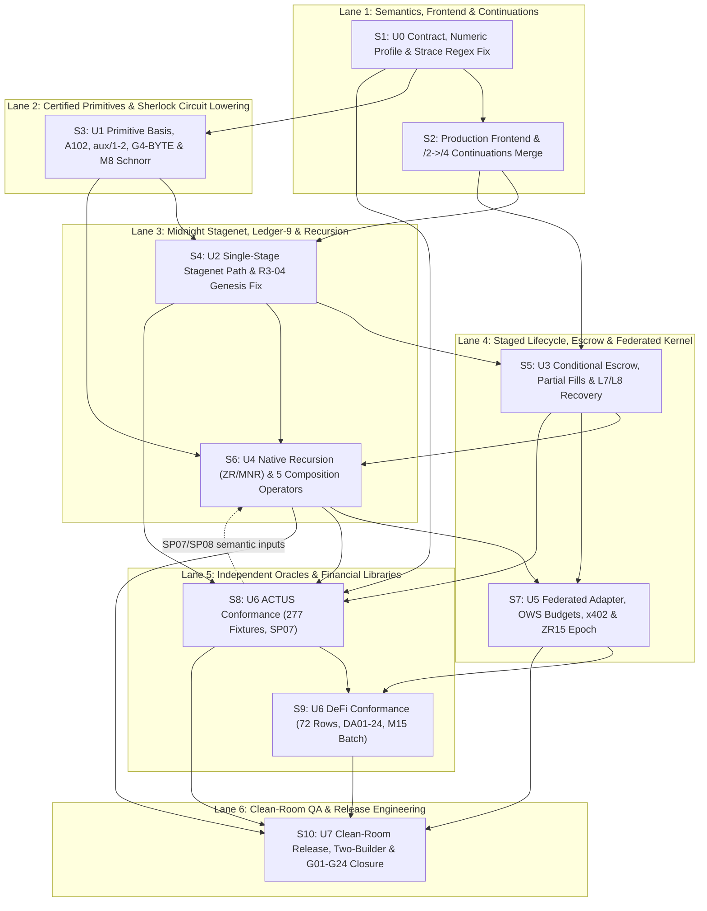

# Moriarty V1 Independent Planning Review & Direct Software Factory Design

**Review Identity:** Gemini 4 Argon (High) — Planning & Factory Architecture Lens  
**Baseline Commit:** GitHub `main` @ `9bcbca52bbfbc58443f6bdb287d73afb7d71f1ab` (PR #95–#101 merged)  
**Scope & Authority Notice:** This document is a planning proposal only. It does not execute builds, tests, models, SDK calls, or native/ledger actions (`native_authority: 0`), does not reset any resource/counter limits, and does not constitute product acceptance or runtime audit approval. All security judgments, cryptographic soundness evaluations, and `OSR-1014` / `M7` / `M8` sign-offs belong exclusively to **Opus**.

---

## 1. Current Evidence versus Incomplete Behavior

### 1.1 Explicit Inspection Limits & Source References
This review is bounded strictly to the supplied prompt context and six canonical text/JSON artifacts (no tools, shell, filesystem reads, or web fetches were executed):
1. `ROADMAP.md` (`SHA256: 0afd1af3851ac4367b453ff28573b176c99b7c8ecfb818ad291524f8b418c256`)
2. `docs/MORIARTY-PRODUCT-CONTRACT.md` (`SHA256: d5674c650741103284e0aa8cded4c0e8a0a1be38faa0c65aedb043710caa4396`)
3. `openspec/changes/consolidated-language-kernel/requirements.md` (`SHA256: aa7b2243bbb27e0420bce24977180eec253d0f8c201c94baa1d14333ca1e4a9a`)
4. `openspec/changes/consolidated-language-kernel/specs/consolidated-language-kernel/spec.md` (`SHA256: 66f85468058830690bd8e0d21e4f76a291dd99c572f1f5224cbf4b49b8de67b1`)
5. `openspec/changes/consolidated-language-kernel/traceability.md` (`SHA256: d549f31a16e3b7c1ef0f1de6a58812f9084aace273939190ff10b3529c84ded0`)
6. `COMPLETE_HEADING_INDEX` (`original_sha256: a361071a458f1486a82bd7256e31cc8b7a94dd69d4ade7dcc90d0cf6861d248f`, indexing 160 headings across 19 OpenSpec paths, all `"open"`)
7. `ROOT_PHASE1_POST_REHASH_AND_NORMAL_OUTPUT` (`observed_at: 2026-10-16T12:54:20.679231+00:00`, `capture_sha256: 4b20fae0447274a5974ba5d21a39d7eac4d6342943de944fe4b5b3708a9a4ebd`, `stdout_sha256: 1ce5a9f5155543591df062d365dbec52248160974ad0b85bb1994e732685ac7b`)

**Inspection Limits:** Clause bodies and individual clause hashes inside the 19 spec files (outside `consolidated-language-kernel/spec.md`), the Opus-authored `security-reconciliation-2026-10-14.md` (`OSR-1014`), `docs/MORIARTY-BACKEND-REQUIREMENTS.md` (`ZR01–ZR16`), and the underlying Rust/Quint/K/Lean source files at `9bcbca52bbfbc58443f6bdb287d73afb7d71f1ab` were not directly inspected. All historical test counts cited in `ROADMAP.md` are treated as source text claims, not fresh independent executions.

### 1.2 Critical Architectural & Baseline Clarifications (`main` @ `9bcbca52...`, PR #95–#101)
1. **`compile_reported` vs. Core Compiler Capabilities:** `compile_reported` invokes the existing Core backend compiler first and then appends a Sherlock projection report. The Sherlock scalar-only projection restriction applies **only** to that appended Sherlock projection layer; it does **not** restrict the Core compiler, which already supports state, assets, transfers, and liabilities (`moriarty/1` / `moriarty-core/1`).
2. **Production vs. `cfg(test)` Draft Frontends:** The private draft source frontend (`docs/audits/2026-10-15/sherlock-draft-source/README.md`) exists only under `cfg(test)`. It uses a cached `rlib` lexer (with unproven source correspondence) to parse/check functions and prepare an indexed image where `Factorial(4) = 24` and tree folding returns `7` across 11 passing tests (with 86 older tests filtered out). It is **not** wired into the production compiler profile or public `mori` CLI. Separately, the Beta authoring/editor/MCP package translates `Source/6` to experimental TypeScript `Core/5` locally, while Rust LSP/MCP remain stubs (`UNI-018`, `UNI-024`).
3. **Latest Arithmetic/Fuel Execution vs. Roadmap Text:** While `ROADMAP.md` (`2026-10-16` entry) states that an internal Unix socket call stopped the arithmetic/fuel sequence after Quint typecheck (`exit 0`) leaving all 18 Quint tests and 33 K checks unrun, the superseding `ROOT_PHASE1_POST_REHASH_AND_NORMAL_OUTPUT` receipt (`2026-10-16T12:54:20Z`) records that Phase 1 normal Quint tests ran once after matching post-rehashes (`63 files, 35 dirs, 40 pairs MATCH`; `4667 files, 79 packages, 3 links, 98 resolutions MATCH`; `tool_proposal_P2_pins: MATCH`). It produced **18 exact named passing outputs** (`arithmeticNormal1Test`..`8Test`, `fuelNormal1Test`..`10Test`), `exit_code: 0`, `parent_timeout: false`, and `zero_failed_and_ignored: "INFERRED_NOT_PRINTED"`. However:
   - **Trace Adjudication is `PENDING`:** The first Root data query used an `execve` regex that rejected ordinary whitespace in reconstructed `unfinished`/`resumed` `strace` text (a query parser bug, not a model failure or trace ambiguity).
   - **Phase 2 is `NEVER_STARTED`:** Blocked on complete Phase 1 post-gates (structured `argv` comparison with whitespace-aware syscall framing) and a fresh Phase 2 P6 gate.
   - **33 K Checks Remain `UNRUN`:** The 33 authored K checks (across 9 distinct fuel requests) have never been executed.
4. **Sherlock & G4 Status across PR #95–#101:**
   - **A102 Registered Fragment (PR #95):** `literal_schema` and `emit_literal_step` (`models/sherlock/literal-step/MAPPING.md`) are registered with 16 authored Rust tests, but the fragment is **not compiled**, all 16 tests are **UNRUN**, and `native_authority` is `0` / `C4`.
   - **`aux/1` Host Packing & `aux/2` Arithmetic/Fuel:** `aux/1` supplies four fixed-shape records to six private normal tests (compilation and all 6 tests **UNRUN**, no production consumer). `aux/2` specifies checked `UInt128` byte relations and fuel handling (232 logical lanes, not measured circuit costs) under Owner `E1–E7` and Muse `E-FUEL`.
   - **G4 & New `G4-BYTE` Draft:** The `G4` source-requirement record (`models/sherlock/machine-circuit/g4-source-requirements-20261016/README.md`) is a conditional source argument under Opus `B1–B13` and Muse reconciliation. The new `G4-BYTE` draft is **unadopted**, with no proof and no stagenet execution claimed.
   - **Lean/Clean Boundary:** Lean/Clean in the private Fenrir fork is strictly **developer QA** (`docs/MORIARTY-PRODUCT-CONTRACT.md`), never a public compiler, runtime, prover, or deployment dependency.

### 1.3 Evidence vs. Incomplete Behavior Matrix

| Subsystem / Milestone Scope | Recorded Child Evidence (Source Text & Phase 1 Receipt) | Incomplete Behavior & Open Parent Exits |
| :--- | :--- | :--- |
| **Core CLI, Reporting & Provenance** (`U0`, `U2`, `U7`, `M10`, `UNI-018`..`024`) | `mori test` passes 4 CLI regressions (unchanged small-report bytes, 256-case ordered output >1 MiB, 3 mismatch exit-1, 87 FeePool cases). Mapped-role provenance exports statement/expression-to-field metadata with byte-identical IR on 1 specimen (10 tests). Offline stagenet readback helper passes 16 JSON assertions without invoking backend. | Mapped-role mode is unauthenticated, unproven, and uninstalled. Production vs. `cfg(test)` frontends are split. Rust LSP/MCP are stubs. No public `mori` stagenet deployment/readback command exists. All `U0`, `U2`, `U7`, `M10`, `MC08` exits remain **OPEN**. |
| **Core Continuations (`moriarty/2` -> `/4`)** (`U2`, `U3`, `MPLR-001`..`002`) | Unpublished local candidate with typed `await` in `moriarty/2` and unsigned `/4` compiler emitting $N+1$ circuits. Partial test captures (58, 78, 86, 88 test cohorts; only subsets rerun in latest captures, e.g., 17/88 in closure, 24/86 in final). Separate Quint QA (11 normal tests) has no established Rust correspondence. | Candidate is **unmerged and unpublished**; final Opus/Muse audits pending; no full 88-test clean rerun; `mori-ledger` native execution does not support `/2`; no signed phase-failure or recovery binding. `U2`, `U3`, `MC04` remain **OPEN**. |
| **Sherlock Interpreter, Host & Models** (`U0`, `U1`, `U2`, `P1`, `P3`, `P4`) | Quint `sherlock-k-a/1` (98 + 126 normal tests, older 98 not rerun), append-model (8 Quint tests, 9 K cases **UNRUN**), host A-profile (46, 79, 82, 86 test closures for flat image, call-helper, source-origin, in-memory cuts), Phase 1 arithmetic/fuel Quint (18 passing tests, trace adjudication `PENDING`, Phase 2 `NEVER_STARTED`). | 33 arithmetic/fuel K checks **UNRUN**; A102 16 Rust tests **UNRUN**; `aux/1` 6 tests **UNRUN**; `G4-BYTE` unadopted; Candidate A P3 arena and full39 map are source designs without circuit compilation or witness placement; canonical serialized checkpoints and Candidate B helpers remain **OPEN**. |
| **Native Proof, Primitives & Ledger** (`U1`, `U2`, `M1`–`M9`, `MC01`–`MC05`) | Lab k13 signed payment (`2026-10-11`): 1 valid local proof + 6 hostile-witness + 6 mutation rejections + existential $R/s$ reuse. Earlier `2026-10-01` attempt refused on excess-NIGHT genesis. | Task 3 full 16-asset/16-duty shape and 1 MiB production-preparation refusal remain unresolved. No certified primitive basis (`U1`), no audited JubJub Schnorr in-circuit splice (`M8`, Opus-owned), no 64 KB / $k \le 19$ target enforcement (`M5`), no Midnight stagenet end-to-end execution, and Fenrir network ID/Anchor/tuple are unestablished (`M2`, `M7`). |
| **Staged Escrow, Recursion, Federation & Conformance** (`U3`–`U6`, `M11`–`M17`, `ZR`, `MNR`, `ACTUS`, `DeFi`) | PR #49 finite FeePool local/static evidence (23 actions, 162 cases). PR #46/#48 bounded local sponsor/hold accounting. DeFiFormal and Mina (`MNR01–08`) studies are specification references only. | Zero native two-step recursion (`U4`/`MC03`), zero private handoff or 5 composition operators (`MC06`/`SP10.1`), zero live federated adapter/solver/epoch migration (`U5`/`M16`–`M17`), incomplete ACTUS (277 fixtures) and DeFi (72 rows + DA01–24) native/target conformance (`U6`/`MC07`). All 160 headings in `COMPLETE_HEADING_INDEX` remain **OPEN**. |

---

## 2. Prioritized Capability Sprints (Full V1 Coverage)

Below are **10 actionable capability sprints** (`S1`–`S10`) covering the entire V1 surface (`U0`–`U7`, `M1`–`M17`, `MC01`–`MC08`, `SP01`–`SP12`, `G01`–`G24`, `ZR01`–`ZR16`, `MNR01`–`MNR08`, `OSR-1014`, `MPLR-001`–`035`, `MOR-001`–`012`, `AEO-001`–`004`, `L1`–`L8`, ACTUS, DeFi, and the 5 composition operators).

> [!IMPORTANT]
> **Security Ownership Rule:** All security clauses (`OSR-1014`), adversarial soundness sign-offs (`UNI-003`), domain/Anchor intent bindings (`M7`), in-circuit JubJub Schnorr audits (`M8`), and federation trust boundaries (`UNI-011`) require **Opus** review and sign-off.

---

### Sprint S1: U0 Semantic Contract, Numeric Profile, Admission Matrix & Trace Adjudication Repair
* **Target Milestones & Lineage:** `U0`, `P0`, `C0`, `K0`, `MC01`, `SP01`–`SP04`, `M2`, `M6`, `L1`, `L3`, `AEO-001`.
* **Prerequisites:** Baseline `9bcbca52bbfbc58443f6bdb287d73afb7d71f1ab`; existing `ROOT_PHASE1_POST_REHASH_AND_NORMAL_OUTPUT` capture (`4b20fae0...`).
* **Owned Source Interfaces:**
  * Root strace query parser (`execve` structured `argv` comparator with whitespace-aware syscall framing for `unfinished`/`resumed` lines).
  * `moriarty-core` semantic relation schema, numeric profile descriptor (canonical price orientation, unit dimensions, per-primitive rounding direction, beneficiary policy), and `compile_reported` admission/lowering comparator (`moriarty/1`, `moriarty/2`, `Source/6`, Sherlock scalar projection vs. full Core state/asset/liability compiler).
  * `openspec/changes/consolidated-language-kernel/` target matrix and `current-requirement-crosswalk.json` atomic predicate mapping.
* **Normative EARS Clauses:**
  * **WHEN** a Root trace adjudication tool parses `strace` output containing reconstructed `<unfinished ...>` and `<... execve resumed>` lines with ordinary internal whitespace, **THE** parser **SHALL** frame syscalls into structured `argv` tokens without regex rejection and write a deterministic Phase 1 trace receipt (`UNI-016`, `UNI-021`).
  * **WHEN** any tool checks, compiles, or simulates a program across `moriarty/1`, `moriarty/2`, `Source/6`, or `compile_reported`, **THE** toolchain **SHALL** emit an admission record naming the exact profile, resolved executable, consumer, admitted construct subset, and unsupported constructs without inferring cross-profile compilation passes (`UNI-018`, `UNI-019`).
  * **WHERE** financial arithmetic or price conversion is specified, **THE** U0 numeric profile **SHALL** bind canonical quote/base orientation, unit dimensions, per-primitive directed rounding, dust beneficiary rules, and field-by-field target enforcement (`UNI-002`, `UNI-014`, `UNI-020`).
  * **WHILE** external Fenrir network ID, Anchor, committee, or deployed tuple facts remain unestablished, **THE** target matrix **SHALL** record those fields explicitly as `UNKNOWN` while pinning current compiler, `ZKIRv3`, verifier, key, and Midnight stagenet/Preview tuples separately (`UNI-022`, `M2`).
* **Positive Contrasting Programs & Complete Effects:**
  * *Program S1-A (`LinearSwapQuote`):* Evaluates an exact positive quote/base ratio with directed floor rounding to user and dust routed to protocol reserve; emits complete effect tuple `(domain, asset_in: -100, asset_out: +97, fee: 2, dust_reserve: +1, liabilities: 0, duties: [])`.
  * *Program S1-B (`AccruingLoanLiability`):* Opens a principal liability with explicit period interest accrual (ceiling rounding in favor of lender) and zero immediate token transfer; emits `(domain, transfers: [], liability_open: +500, liability_accrued: +15, liability_discharged: 0, liability_close: 515, duties: [Repay(515, deadline)])`.
* **Rejection Tests with Valid Positive Controls:**
  * *Positive Control:* `LinearSwapQuote` with explicit quote/base orientation and matching beneficiary rule passes admission and matches independent frozen expectations.
  * *Hostile Rejection:* Mutating `LinearSwapQuote` to invert base/quote spelling (`UNI-014`), taking the reciprocal of an already rounded intermediate integer, or dropping the dust beneficiary field in a legacy lowering path (`UNI-002`) is deterministically rejected with an explicit profile/orientation mismatch diagnostic.
* **Formal / Native / Target Distinctions:**
  * *Formal/Model:* Reconciles Phase 1 Quint receipt (`18/18` passing) by completing trace adjudication and unblocking Phase 2 (`P6`) and the 33 K checks.
  * *Local Host:* Standardizes `mori` admission reporting and `AEO-001` trust/obligation inventory.
  * *Native/Target:* Establishes exact version/key pins for `ZKIRv3` and Midnight stagenet without claiming native execution (`native_authority: 0`).

---

### Sprint S2: Production Frontend Unification & Core Continuations (`moriarty/2` $\rightarrow$ `/4`) Merge
* **Target Milestones & Lineage:** `U0`, `U2`, `U3`, `P2`, `P3`, `MC01`, `MC04`, `SP02`, `M1`, `M6`, `M10`, `MPLR-001`, `MPLR-002`, `MPLR-012`, `MPLR-014`, `AEO-002`, `AEO-003`.
* **Prerequisites:** `S1` (admission matrix and U0 relation freeze).
* **Owned Source Interfaces:**
  * Production parser/lexer/typechecker frontend (promoting the `cfg(test)` draft source frontend into a public, provenance-bound production profile without relying on unverified cached `rlib` shortcuts).
  * Core continuation compiler (`docs/CORE-CONTINUATIONS.md`): merging the unpublished 88-test `/2` $\rightarrow$ `/4` continuation branch into `main` after a single clean rerun of all 88 Rust tests and Quint-to-Rust trace correspondence.
  * `mori simulate`, `mori test`, and `mori verify-intent` public CLI entrypoints (`M10`, `UNI-024`).
* **Normative EARS Clauses:**
  * **WHEN** a developer invokes the production compiler on a `moriarty/1` or `moriarty/2` source file, **THE** production frontend **SHALL** lex, parse, typecheck, and emit source-to-field provenance metadata (`core-source-provenance`) without requiring `cfg(test)` flags or unverified cached artifacts (`UNI-001`, `UNI-018`).
  * **WHEN** a `moriarty/2` program containing $N$ typed `await` boundaries is compiled through the `/4` pipeline, **THE** compiler **SHALL** emit $N+1$ stage circuits binding captured inputs, lexical `let` bindings, prior events, and explicit residual duties at each cut (`MPLR-001`, `MPLR-002`, `UNI-002`).
  * **IF** a stage guard evaluates to false during a `/2` continuation resume, **THEN THE** execution **SHALL** return the unchanged continuation state and preserve all outstanding duties and replay commitments (`UNI-006`, `UNI-008`).
* **Positive Contrasting Programs & Complete Effects:**
  * *Program S2-A (`TwoStageEscrowAwait`):* Stage 0 locks `50 A` and awaits recipient signature (`await sig_B`); Stage 1 releases `50 A` to `B` and pays `1 A` fee. Complete effects across cut: Stage 0 emits `Reserved(50 A)`, `Continuation(c1)`, `Duty(SettleOrRefund, t_exp)`; Stage 1 consumes `c1` and emits `Transfer(B, 50 A)`, `Fee(1 A)`, `Duties([])`.
  * *Program S2-B (`RecursiveTreeFoldAndFact`):* Pure compute-heavy source program (`Factorial(4)` + binary tree fold) compiled through the unified production frontend, invoking `compile_reported` to emit both Core IR and the appended Sherlock scalar projection report.
* **Rejection Tests with Valid Positive Controls:**
  * *Positive Control:* Valid two-stage resume of `TwoStageEscrowAwait` with matching continuation digest and fresh nonce succeeds across all 88 focused continuation tests and Quint trace checks.
  * *Hostile Rejection:* Supplying a stale Stage 0 continuation handle after Stage 1 completion, mutating a captured `let` variable in the serialized continuation frame, or invoking a false guard while claiming duty discharge is rejected with an explicit continuation-integrity or guard failure.
* **Formal / Native / Target Distinctions:**
  * *Formal/Model:* Establishes automated differential equivalence between the 11 Quint continuation traces and the Rust `/2` evaluator (`UNI-019`, `UNI-020`).
  * *Local Host:* Full 88-test Rust suite run in one single capture (`exit 0`), plus Muse and **Opus** reviews to merge the continuation branch.
  * *Native/Target:* Prepares `/4` circuit descriptors for `mori-ledger` binding (achieved in `S4`/`S5`).

---

### Sprint S3: U1 Certified Minimum Primitive Basis, Sherlock A102 & G4-BYTE Lowering
* **Target Milestones & Lineage:** `U1`, `P1`, `P3`, `P4`, `K1`, `MC01`, `MC04`, `SP01`, `SP03`, `M5`, `M8` (Opus-owned audit), `MPLR-020`, `MPLR-021`, `MOR-010`, `ZR01`, `ZR06`, `ZR12`, `ZR13`, `MNR01`–`MNR03`, `MNR05`–`MNR08`.
* **Prerequisites:** `S1` (trace adjudication complete, Phase 2 gate cleared).
* **Owned Source Interfaces:**
  * `models/sherlock/literal-step/` (`literal_schema`, `emit_literal_step` A102 registered fragment and its 16 Rust tests).
  * `models/sherlock/machine-circuit/` (`aux/1` host packing 6 tests, `aux/2` `UInt128` arithmetic/fuel 232-lane witness placement, Candidate A P3 arena policy, `G4` and adopted `G4-BYTE` lowering, full39 semantic source map).
  * In-circuit JubJub Schnorr primitive splice (`M8`) and primitive certificate registry (`MPLR-020`, `MOR-010`).
* **Normative EARS Clauses:**
  * **WHEN** a primitive jet or Sherlock machine-circuit component (`aux/1`, `aux/2`, `G4-BYTE`, `A102`, or JubJub Schnorr `M8`) is registered for `U1`, **THE** certificate **SHALL** bind its input/range preconditions, reference semantics, `ZKIRv3` constraint fragment, measured circuit gate/row cost, valid-witness completeness, and adversarial-witness soundness (`WShape`) under **Opus** security sign-off (`UNI-003`, `UNI-014`, `MPLR-020`).
  * **WHILE** executing `UInt128` arithmetic and fuel accounting under `aux/2` and `E-FUEL`, **THE** circuit and K/Quint models **SHALL** enforce byte-decomposition range constraints and monotonic fuel decrements so that out-of-range witnesses or negative fuel balances are unsatisfiable (`UNI-003`, `ZR12`).
  * **WHEN** compiling any supported single-stage or fraud-proof circuit under `M5`, **THE** backend **SHALL** enforce a hard transaction size ceiling of $\le 64\text{ KB}$, circuit depth $k \le 19$, and bounded step-replay budget, halting promotion if any bound is exceeded (`M5`, `MC04`, `MPLR-021`).
* **Positive Contrasting Programs & Complete Effects:**
  * *Program S3-A (`CheckedU128FeeSplit`):* Exercises `UInt128` checked addition, multiplication, div/rem, and fuel decrement across 9 fuel schedules; produces identical terminal state across Quint (18 tests), K (33 checks), Rust host (`aux/1` + `aux/2`), and `ZKIRv3` constraint satisfaction.
  * *Program S3-B (`SignedIntentSchnorrVerify`):* Exercises the in-circuit JubJub Schnorr verification splice (`M8`) over a canonical domain-separated intent digest alongside A102 `emit_literal_step` transitions.
* **Rejection Tests with Valid Positive Controls:**
  * *Positive Control:* Honest witness produced for `CheckedU128FeeSplit` and `SignedIntentSchnorrVerify` satisfies all `ZKIRv3` gates, passes the native verifier, and stays within $k \le 19$ and $\le 64\text{ KB}$.
  * *Hostile Rejection:* Supplying an adversarial witness (`WShape` violation) that satisfies high-level sum equations via field wrap-around (omitting `G4-BYTE` byte-range checks), mutating a single bit in the JubJub Schnorr $R/s$ witness, or omitting the second boolean gate constraint noted in Opus `B1–B13` is rejected by the constraint system / native verifier (`UNI-003`).
* **Formal / Native / Target Distinctions:**
  * *Formal/Model:* Executes all **33 K checks** and Phase 2 Quint checks for `aux/2`, plus the 9 K append-model checks; reconciles Lean/Clean developer QA proofs in the private Fenrir fork without making Lean a public dependency.
  * *Local Host:* Compiles and runs all 16 A102 Rust tests and 6 `aux/1` packing tests (`exit 0`).
  * *Native/Target:* Produces measured `ZKIRv3` gate/row counts (replacing the unmeasured 232 logical lane estimate) and native verifier certificates under authorized test gates.

---

### Sprint S4: U2 General Single-Stage Source-to-Midnight Stagenet Path & Supply-Consistent Genesis
* **Target Milestones & Lineage:** `U2`, `P2`, `C1`, `K2`, `MC01`, `MC02`, `MC04`, `MC05` (subset), `SP02`–`SP05`, `M1`, `M3`, `M4`, `M7`, `M9`, `M12`, `L2`, `L3`, `L5`, `MPLR-014`, `MPLR-015`, `MPLR-017`, `MPLR-018`, `MPLR-019`, `MPLR-022`, `MPLR-023`, `MOR-001`–`005`, `MOR-009`, `MOR-011`, `MOR-012`, `ZR03`, `ZR05`, `ZR07`, `ZR10`, `ZR11`, `MNR04`, `MNR05`.
* **Prerequisites:** `S2` (unified production frontend), `S3` (`U1` certified primitive basis).
* **Owned Source Interfaces:**
  * `mori-ledger` and Midnight `ZKIRv3` transaction builder (fixing the `R3-04` excess-NIGHT test genesis refusal via an early supply-consistent genesis invariant check and solving the Task 3 16-asset/16-duty 1 MiB production-preparation refusal).
  * Stagenet deployment, invocation, and online/offline effect readback pipeline (`models/sherlock/STAGENET-OFFLINE-README.md` promoted to live Midnight stagenet integration per the October 15 stagenet requirement).
  * Domain-qualified asset identity (`M9`: network, issuer, reference), network ID / Anchor intent binding (`M7`), DUST/sponsorship accounting (`M4`), and Midnight Express Bus Registry anchoring interface (`M12`).
* **Normative EARS Clauses:**
  * **WHEN** a developer compiles and proves any supported single-stage program, **THE** pipeline **SHALL** bind the versioned program hash, canonical signed intent (with explicit network ID, Anchor, asset `(network, issuer, reference)`, gross debit, fee cap, liability cap, and net outcome), predecessor state, and complete effects into a `ZKIRv3` proof verified independently by the Midnight verifier (`UNI-001`, `UNI-002`, `UNI-003`, `M7`, `M9`).
  * **IF** a test or stagenet genesis configuration violates native supply conservation (such as excess-NIGHT allocation) or exceeds the per-stage preparation envelope, **THEN THE** pre-submission validator **SHALL** reject the genesis configuration before proof generation with an explicit supply/envelope invariant diagnostic (`R3-04` repair, `UNI-005`).
  * **WHEN** a transaction executes on Midnight stagenet across guaranteed and fallible phases, **THE** effect readback tool **SHALL** retrieve and verify every committed ledger field against the independent frozen expectation, distinguishing guaranteed-phase fee retention from fallible-phase failure without claiming global rollback (`UNI-006`, `MOR-011`, `ZR11`).
* **Positive Contrasting Programs & Complete Effects (Newly Authored Outside Loan/Swap Fixtures):**
  * *Program S4-A (`RoyaltySplitPayment`):* Transfers `100 ASSET_X` from Alice, splitting `92 ASSET_X` to Creator, `5 ASSET_X` to RoyaltyPool, `2 ASSET_X` guaranteed DUST/fee (`M4`), and `1 ASSET_X` protocol reserve under domain `(stagenet, issuer_A, ref_1)`. Complete effects verified on Midnight stagenet readback.
  * *Program S4-B (`CollateralizedCreditLineDraw`):* Structurally contrasting stateful contract: locks `200 COLLAT_Y` in vault reserve, mints/opens a typed debt liability of `80 CREDIT_Z` (`L5` signed liability cap $\le 100$), and transfers `80 CREDIT_Z` to Borrower while recording persistent duty `MaintainMarginOrRepay(80 CREDIT_Z)`.
* **Rejection Tests with Valid Positive Controls:**
  * *Positive Control:* Both `RoyaltySplitPayment` and `CollateralizedCreditLineDraw` generate valid `ZKIRv3` proofs, pass independent native verification, deploy/execute on Midnight stagenet, and pass full JSON/ledger readback.
  * *Hostile Rejection:* Using `RoyaltySplitPayment` as the valid positive control envelope, six targeted mutations—(1) excess-NIGHT genesis, (2) wrong network ID/Anchor (`M7`), (3) swapped asset issuer (`M9`), (4) fee exceeding signed cap (`UNI-004`), (5) omitted liability entry in `CollateralizedCreditLineDraw` (`UNI-005`), and (6) replayed nonce (`MC04`)—are each independently rejected by the native verifier or ledger state transition check.
* **Formal / Native / Target Distinctions:**
  * *Formal/Model:* Proves source-to-`ZKIRv3` lowering preservation for the admitted single-stage grammar (`M1`, `UNI-019`).
  * *Local Host:* `mori verify-intent` and offline readback comparator match 100% of expected fields.
  * *Native/Target:* Live **Midnight stagenet** deployment, call execution, independent proof verification, and complete effect readback (`docs/SHERLOCK-CORRECTNESS-LOOP.md`), plus separate qualification records for Preview (`MC02`) vs. Fenrir (`M3`, `UNI-022`).

---

### Sprint S5: U3 Conditional Settlement, Partial Fills, Persistent Duties & Recovery Races
* **Target Milestones & Lineage:** `U3`, `P4`, `C1`, `C2`, `C3`, `K2`, `MC04`, `MC05`, `MC06` (lifecycle), `SP10`, `M11` (FeePool/Capacity Exchange L2), `M13`, `M14`, `L1`, `L2`, `L4`, `L5`, `L7`, `L8`, `MPLR-001`–`010`, `MPLR-017`, `MPLR-019`, `MPLR-021`, `MPLR-024`, `MPLR-035`, `MOR-006`, `MOR-008`, `MOR-011`, `MOR-012`, `ZR10`–`ZR12`, `MNR04`.
* **Prerequisites:** `S2` (`/2` continuations merged), `S4` (`U2` single-stage stagenet path).
* **Owned Source Interfaces:**
  * `moriarty/2` $\rightarrow$ `mori-ledger` multi-stage execution adapter (enabling native execution of `/4` continuation circuits).
  * Programmable escrow, partial-fill accumulator, document/recipient predicate verifier, and recovery-authority reserve meter (`L4`, `L7`, `L8` separate meter-counter family with no netting against ordinary counters, respecting the 128-ID state cap).
  * Full `FeePool` and `Capacity Exchange` L2 contract components (`M11`) and single-domain swap fast path (`M14`).
* **Normative EARS Clauses:**
  * **WHEN** a user authorizes the `U3` discriminator intention ("spend at most `11 A` including at most `1 A` fees to receive at least `20 B`"), **THE** runtime **SHALL** admit any independently authored or solver-proposed execution route that satisfies exact recipient, domain, cumulative debit/fee caps, proportional partial-fill accounting, and residual duty retention (`UNI-004`, `UNI-005`, `MPLR-004`, `MPLR-035`).
  * **WHEN** delivery is guarded by recipient acceptance and an authenticated document predicate, **THE** contract **SHALL** distinguish request recording, funding reservation, predicate eligibility, in-flight execution, and final delivery, preventing release until both predicates hold (`UNI-007`, `MPLR-003`).
  * **IF** ordinary execution fuel/work is exhausted, the 128-ID state cap is reached, or the stage deadline expires (`L4`), **THEN** only the designated recovery authority **SHALL** be permitted to consume the isolated recovery reserve (`L8`) to execute refund/compensation without erasing unpaid debt or resetting cumulative spent budgets (`UNI-008`, `MPLR-005`, `MPLR-008`, `MPLR-009`).
* **Positive Contrasting Programs & Complete Effects:**
  * *Program S5-A (`U3DiscriminatorEscrow_Route1_TwoPartFill`):* Route 1 fills `5 A -> 10 B` (fee `0.4 A`) in Stage 1, retaining `6 A` budget (`0.6 A` fee cap) and `Duty(Deliver(10 B) | Refund(5 A))`; Stage 2 supplies authenticated document + recipient consent and fills `5 A -> 11 B` (fee `0.5 A`), closing with total debit `10.9 A <= 11 A`, fee `0.9 A <= 1 A`, net receipt `21 B >= 20 B`, and zero residual duties.
  * *Program S5-B (`U3DiscriminatorEscrow_Route2_PartialThenRecovery`):* Independently authored Route 2 fills `5 A -> 10 B` (fee `0.5 A`) in Stage 1, then hits deadline expiry while a late settlement message races recovery; the recovery authority consumes reserved closure work (`L8`) to refund the remaining `5.5 A` to owner while preserving the settled `10 B` and recording explicit stage closure.
* **Rejection Tests with Valid Positive Controls:**
  * *Positive Control:* Both `Route1` and `Route2` pass objective verification under the identical signed intention without any federation service (`U5`).
  * *Hostile Rejection:* Against the valid `Route1`/`Route2` positive controls, 10 hostile scenarios are rejected: (1) `1.1 A` fee exceeding `1 A` cap, (2) substituting asset `C` for `B`, (3) substituting a document hash/funding receipt or timeout for actual delivery consent (`UNI-007`), (4) ordinary work consuming recovery reserve (`Conflict Disposition`), (5) rollover resetting spent budget (`UNI-008`), (6) expiry erasing accrued liability, (7) exceeding the 128-ID state cap without an authenticated successor episode, (8) netting `L8` meter counters against ordinary counters, (9) uncommitted solver candidate presented as settled (`UNI-006`), and (10) late settlement overwriting a finalized recovery transition (`MPLR-007`).
* **Formal / Native / Target Distinctions:**
  * *Formal/Model:* Full K and Quint lifecycle verification of partial fill + recovery race interleavings (`MPLR-007`, `MPLR-010`).
  * *Local Host:* Deterministic replay of multi-stage cuts and `L7`/`L8` counter separation.
  * *Native/Target:* Multi-transaction `ZKIRv3` proof chain executed on Midnight stagenet with phase-failure and recovery readback.

---

### Sprint S6: U4 Native Recursive History, Legitimate Genesis & 5 Private Composition Operators
* **Target Milestones & Lineage:** `U4`, `P2`, `P4`, `C3`, `K1`, `K2`, `MC03`, `MC04`, `MC05` (native base), `MC06`, `SP04`, `SP06`, `SP09` (subset), `SP10` (`SP10.1`), `L6`, `MPLR-007`, `MPLR-011`, `MPLR-013`, `MPLR-022`, `MPLR-027`–`029`, `MOR-006`–`008`, `ZR02`–`ZR16`, `MNR01`–`MNR08`, `UNI-009`, `UNI-010`, `UNI-015`, `UNI-017`, `UNI-023`.
* **Prerequisites:** `S3` (`U1` recursive feasibility & MNR basis), `S4` (`U2`), `S5` (`U3` lifecycle invariants), plus accepted `SP07`/`SP08` semantic inputs from `S8` (early source preparation).
* **Owned Source Interfaces:**
  * Ledger-9 native recursive verifier / accumulator interface (operating via the user's demonstrated ledger-9 recursion route that does **not** require `VerifyProof`, while satisfying `ZR01–ZR16` and `MNR01–MNR08`: transcript schedule, deferred obligations, authorized keys, verified-value binding, batch soundness).
  * Private witness handoff channel, completeness domain authenticator (`MPLR-029`), and the **5 retained composition operators** (`SP10.1`): (1) `Sequential`, (2) `Disjoint Parallel`, (3) `Shared-State Interleaving`, (4) `Atomic Synchronization`, and (5) `Asynchronous Messaging`.
* **Normative EARS Clauses:**
  * **WHEN** compliant recursive history (`MC03`) or multi-parent fan-in above one (`L6`, `MC06`) is claimed, **THE** proof pipeline **SHALL** establish authenticated genesis origin, compatible predecessor verifier keys, deferred-obligation discharge (`MNR02`), and unique resource consumption through native recursive proofs; ledger induction alone **SHALL NOT** be accepted as `MC03` or `MC06` evidence (`UNI-009`, `UNI-017`).
  * **WHERE** private continuation or multi-party composition is executed across any of the five `SP10.1` operators without the federated kernel, **THE** implementation **SHALL** bind the authenticated completeness domain (ensuring hidden reservations cannot masquerade as absence), enforce noninterference/disclosure rules, and deliver encrypted/isolated witness handoffs to authorized successors (`UNI-010`, `MPLR-013`, `MPLR-029`).
  * **WHEN** a contract or verifier key undergoes semantic evolution (`UNI-015`, `ZR15`), **THE** migration transition **SHALL** preserve all unfulfilled duties, consumed nonces/authority, and beneficiary constraints or require explicit multi-party amendment consent (`MPLR-028`).
* **Positive Contrasting Programs & Complete Effects:**
  * *Program S6-A (`TwoStepRecursivePrivateNoteJoin`):* Executes a legitimate genesis mint, two native recursive financial steps with fan-in $= 2$ (`L6` benchmark), and a private party handoff from Party A to Party B without revealing Party A's prior split amounts in the public statement.
  * *Program S6-B (`FiveOperatorCompositionSuite`):* Demonstrates all five `SP10.1` composition operators—Sequential pipeline, Disjoint Parallel vaults, Shared-State Interleaving orderbook, Atomic Synchronization swap-and-loan, and Asynchronous Messaging settlement—purely on Midnight without the `U5` federated kernel.
* **Rejection Tests with Valid Positive Controls:**
  * *Positive Control:* `TwoStepRecursivePrivateNoteJoin` and `FiveOperatorCompositionSuite` verify end-to-end with retained independent recursive proof verification and complete private/public effect separation.
  * *Hostile Rejection:* Against the positive recursive control, tests reject: (1) fabricated genesis base (`UNI-009`), (2) unauthorized verifier key substitution (`MNR03`), (3) double-spending a parent resource across two branches in `L6` fan-in, (4) omitting final deferred-obligation checks (`MNR02`/`UNI-017`), (5) treating a hidden private reservation as zero liability (`UNI-010`), (6) leaking private witness fields into public circuit inputs, and (7) a key upgrade that resurrects consumed spending authority (`UNI-015`).
* **Formal / Native / Target Distinctions:**
  * *Formal/Model:* Model-checked causality, concurrency, and noninterference across all 5 composition operators (`MPLR-011`, `MPLR-013`).
  * *Local Host:* Witness-handoff serialization and completeness-domain verification.
  * *Native/Target:* Native recursive proof chain verified on ledger-9 / Midnight stagenet (`ZR01–ZR16`, `MNR01–MNR08`).

---

### Sprint S7: U5 Federated DeFi Kernel, Constrained AI Solvers, OWS Delegation & x402 Service Lifecycle
* **Target Milestones & Lineage:** `U5`, `C3`, `K3`–`K5`, `M16`, `M17`, `L7`, `L8`, `MPLR-024`, `MPLR-026`, `MPLR-030`–`035`, `UNI-004`, `UNI-011`–`013`, `UNI-015`, `ZR14`, `ZR15`, `MNR03`, `MNR06`.
* **Prerequisites:** `S5` (`U3` escrow & `L7`/`L8` meters), `S6` (`U4` history/privacy & `ZR15` epoch migration).
* **Owned Source Interfaces:**
  * Exact-byte external adapter and common ZK/MPC/TEE statement binder (`UNI-011`, `MPLR-030`).
  * Federation policy engine naming membership, threshold, ordering, equivocation, availability, and epoch-change rules (`ZR15`, `M17` parameterized for Fenrir committee identity once supplied).
  * OWS attenuated authority delegator and durable concurrent budget manager (`UNI-012`, `MPLR-031`, `MPLR-032`).
  * `x402` service lifecycle state machine separating payment finality, result availability, and recipient delivery (`UNI-013`, `MPLR-033`, `MPLR-034`).
* **Normative EARS Clauses:**
  * **WHEN** the Federated DeFi Kernel requests an external chain or adapter effect, **THE** enforcing signer/adapter **SHALL** bind the exact decoded call bytes and complete effects to the same signed intention, stage, domain, epoch, and common ZK/MPC/TEE evidence policy (`UNI-011`, `MPLR-030`).
  * **WHEN** concurrent delegated AI solver tasks commit funds under an OWS attenuated budget, **THE** budget manager **SHALL** enforce durable aggregate `spent + pending + reserved` limits across retries and failovers so that concurrent requests never exceed the parent cap (`UNI-012`, `MPLR-032`).
  * **WHEN** an `x402` paid service request or result retrieval is retried, **THE** workflow **SHALL** preserve logical paid-request identity, reconcile existing payment without double-charging, and refuse to mark the delivery duty resolved until recipient delivery evidence (not merely payment finality or a TEE-local result) is recorded (`UNI-013`, `MPLR-033`, `MPLR-034`).
  * **WHEN** the federation transitions from Epoch $E$ to Epoch $E+1$, **THE** epoch-migration transition **SHALL** preserve all active duties, consumed nonces, and attenuated budget reservations (`ZR15`, `UNI-015`).
* **Positive Contrasting Programs & Complete Effects:**
  * *Program S7-A (`DualSolverCoordinatedU3Escrow`):* Runs the exact `U3` discriminator program from `S5`, now coordinated through two independent constrained AI solvers (`Solver_Alpha` and `Solver_Beta`) sharing a 10-unit OWS delegated budget (`6 units` + `4 units` including `L7`/`L8` cost-plane fees `M16`), executing across an epoch migration (`E1 -> E2`).
  * *Program S7-B (`X402OracleDeliveryWorkflow`):* Pays an external `x402` attestation service, experiences a network drop after payment finality, retries result retrieval using logical request ID without a second fee charge, and settles the downstream conditional escrow only upon verified recipient delivery.
* **Rejection Tests with Valid Positive Controls:**
  * *Positive Control:* `DualSolverCoordinatedU3Escrow` (`6 + 4 <= 10`) and `X402OracleDeliveryWorkflow` succeed; simultaneously, a direct Midnight submission of the `U3` program without the federation also succeeds (proving no federation dependency for direct Midnight use).
  * *Hostile Rejection:* Against these positive controls, tests reject: (1) concurrent solver requests for `6` and `5` units using copied `10`-unit parent budgets (`UNI-012`), (2) using a valid proof for Intent `X` to sign adapter bytes for Effect `Y` (`UNI-011`), (3) incomplete byte decoding or policy fallback on adapter failure, (4) claiming recipient delivery from a finalized `x402` payment receipt or TEE-local buffer (`UNI-013`), and (5) an epoch change that drops an active duty or resets a solver's spent counter (`ZR15`).
* **Formal / Native / Target Distinctions:**
  * *Formal/Model:* Quint model verification of concurrent budget serialization, equivocation detection, and epoch-migration safety.
  * *Local Host:* Adapter byte-decoding tests and `x402` retry state machine tests.
  * *Native/Target:* Midnight stagenet settlement of solver-completed intents with explicit ZK/MPC/TEE assumption labels (**Opus** security review required on `UNI-011` trust boundary).

---

### Sprint S8: U6 Composable Financial Libraries Part I — Complete ACTUS Conformance (277 Fixtures)
* **Target Milestones & Lineage:** `U6`, `P6`, `C4`, `MC05` (requalification), `MC07`, `SP07`, `SP09`, `SP11`, `MPLR-025`, `MPLR-026`, `UNI-014`, `UNI-020`, `UNI-021`, `UNI-023`.
* **Prerequisites:** `S1` (U0 numeric profile & independent oracle architecture); early semantic outputs feed `S6` (`U4`), while full native/target closure requires `S4` (`U2`), `S5` (`U3`), and `S6` (`U4`).
* **Owned Source Interfaces:**
  * `moriarty-actus` library modules covering all **18 executable ACTUS contract types**, **32 taxonomy dispositions**, **`DS01–DS07`** domain supplements, and all **277 ACTUS fixtures** with every expected schedule/cashflow/state field.
  * Independent frozen ACTUS expectation generator (`UNI-020`, zero shared evaluator code with `moriarty-core`).
* **Normative EARS Clauses:**
  * **WHEN** evaluating any of the 277 ACTUS fixtures across the 18 executable contract types and `DS01–DS07`, **THE** implementation **SHALL** match every independently frozen expected field (event sequence, payoff, nominal value, accrued interest, fee, reserve, and residual liability) under the bound U0 numeric profile without skipping any family (`UNI-014`, `UNI-020`, `UNI-023`).
  * **WHEN** an ACTUS contract transitions state or nets scheduled cashflows, **THE** transition **SHALL** preserve gross economic accounting (separating principal, interest accrual, fees, and explicit liability discharge) and re-verify affected `MC05`/`SP09` mandatory acceptance predicates (`UNI-005`, `MPLR-025`).
* **Positive Contrasting Programs & Complete Effects:**
  * *Program S8-A (`ACTUS_PAM_ANN_Lifecycle`):* Executes Principal at Maturity (`PAM`) and Annuity (`ANN`) schedules across rate resets, fee accruals, and principal redemption with exact directed rounding and complete liability evolution.
  * *Program S8-B (`ACTUS_SWAPS_CEG_Contingent`):* Executes structured multi-leg swap (`SWAPS`) and credit enhancement guarantee (`CEG`) contracts triggered by external credit/default events under conditional settlement (`U3`) and private state handoff (`U4`).
* **Rejection Tests with Valid Positive Controls:**
  * *Positive Control:* All 277 ACTUS fixtures pass against independent frozen expectations across semantic, local, native, and Midnight stagenet/Preview columns (`UNI-023`).
  * *Hostile Rejection:* Against a valid `ANN` fixture control, (1) using opposite price orientation, (2) netting interest accrual directly against token supply instead of typed liability (`docs/MORIARTY-PRODUCT-CONTRACT.md`), (3) silent 1-ulp rounding direction reversal, or (4) citing a shared-evaluator output as the independent oracle (`UNI-020`) fails conformance qualification.
* **Formal / Native / Target Distinctions:**
  * *Formal/Model:* Reconciles DeFiFormal/ACTUS real-number formulas to finite-width `UInt128` directed-rounding bounds.
  * *Local Host:* Full 277-fixture `mori test` aggregate report (`UNI-024`).
  * *Native/Target:* Separate tracking columns in the conformance manifest for semantic, local, native `ZKIRv3`, Preview, and Midnight stagenet/Fenrir execution (`UNI-023`).

---

### Sprint S9: U6 Composable Financial Libraries Part II — Complete DeFi Matrix, Batch Clearing & Held-Outs
* **Target Milestones & Lineage:** `U6`, `P6`, `C4`, `MC05` (full closure with `S6`+`S8`), `MC07`, `SP08`, `SP09` (full closure), `SP11`, `M11`, `M14`, `M15`, `MPLR-025`, `MPLR-026`, `UNI-014`, `UNI-020`, `UNI-021`, `UNI-023`.
* **Prerequisites:** `S5` (`U3`), `S6` (`U4`), `S7` (`U5` interfaces where applicable), `S8` (`SP07` ACTUS basis).
* **Owned Source Interfaces:**
  * `moriarty-defi` library modules covering all **72 original DeFi action rows**, **`DA01–DA24`**, adopted supplementary cases, **3 held-out behaviors**, **8 intent cases**, and **8 regression classes** (`UNI-023`).
  * `M15` batch clearing engine (uniform clearing price, solver bounds, oracle integration, liquidation, margin, redemption/loss allocation, AMMs, vaults, netting) and full `M11` FeePool / Capacity Exchange target integration beyond the finite 23-action PR #49 child.
* **Normative EARS Clauses:**
  * **WHEN** executing batch clearing (`M15`), AMM swaps, vault liquidations, or loss allocations across the 72 DeFi rows and `DA01–DA24`, **THE** contracts **SHALL** enforce uniform clearing prices, solver constraint bounds, gross debit/fee visibility (`MPLR-025`), and persistent unfulfilled duties across all 8 intent cases and 3 held-outs (`UNI-004`, `UNI-005`, `UNI-023`).
  * **WHEN** a library extension modifies or adds financial constructs beyond the initial `U2`/`U4` slice, **THE** qualification suite **SHALL** re-verify `MC05` and `SP09` mandatory claim acceptance across the extended surface before marking `U6` complete (` ROADMAP.md`).
* **Positive Contrasting Programs & Complete Effects:**
  * *Program S9-A (`UniformPriceBatchClear_M15`):* Clears a multi-party batch of 6 buy/sell intents at a single uniform clearing price with single-domain fast-path routing (`M14`), solver surplus bounds, explicit fee pool distribution (`M11`), and partial-fill duty retention.
  * *Program S9-B (`VaultLiquidationAndLossAllocation`):* Executes an undercollateralized vault liquidation with oracle price attestation, proportional bad-debt socialized loss allocation across reserve tranches, and explicit residual liability tracking.
* **Rejection Tests with Valid Positive Controls:**
  * *Positive Control:* `UniformPriceBatchClear_M15` and `VaultLiquidationAndLossAllocation` satisfy all conservation, rounding, and intent bounds across independent frozen expectations and native `ZKIRv3` proofs.
  * *Hostile Rejection:* Against the valid batch clearing and liquidation controls, tests reject: (1) discriminating prices within a uniform batch clear, (2) netting away solver fees to hide a gross cap violation (`UNI-005`), (3) erasing unpaid borrower residual debt after partial collateral seizure, and (4) claiming PR #49's 23-action local FeePool evidence closes full `M11`/`U6` (`UNI-021`).
* **Formal / Native / Target Distinctions:**
  * *Formal/Model:* Independent Python/Quint exact-rational vs. `UInt128` directed-rounding differential oracle frozen prior to runs (`UNI-020`).
  * *Local Host:* Complete `mori test` execution over all 72 DeFi rows, `DA01–24`, 3 held-outs, 8 intent cases, and 8 regression classes.
  * *Native/Target:* Native `ZKIRv3` proof generation and Midnight stagenet verification for every DeFi family without skipping any row.

---

### Sprint S10: U7 Independent Developer Release, Two-Builder Reproducibility & Complete G01–G24 Closure
* **Target Milestones & Lineage:** `U7`, `P5` (optional authoring support), `P7`, `C4`, `K5`, `MC02`, `MC08`, `SP12`, `G01`–`G24`, `M10`, `MPLR-015`, `MPLR-016`, `MOR-001`, `MOR-002`, `AEO-001`–`004`, `ZR16`, `MNR05`, `MNR06`, `MNR08`, `UNI-001`, `UNI-016`, `UNI-018`, `UNI-021`–`024`.
* **Prerequisites:** `S1`–`S9` (`U0`–`U6` and all underlying `M`, `MC`, `SP`, `ZR`, `MNR` acceptance exits).
* **Owned Source Interfaces:**
  * Clean standalone public release package (`mori` CLI, compiler, prover interface, verifier tool, stagenet submitter/readback, and documented developer environment with zero Foreman/Pel/maintainer-receipt hooks).
  * Two-builder deterministic reproducibility harness and clean-room external developer test harness.
  * Complete release dossier indexing `G01–G24`, all 160 OpenSpec headings (`COMPLETE_HEADING_INDEX`), pilots, baselines, licenses, and privacy disclosures.
* **Normative EARS Clauses:**
  * **WHEN** an external developer installs the public release in a clean environment devoid of project metadata, Foreman/Pel records, council keys, or hosted-service accounts, **THE** developer **SHALL** be able to author a novel non-fixture program, inspect its obligations (`AEO-001`), compile to pinned `ZKIRv3`, generate native proofs, submit via their own Midnight wallet/environment, and verify complete ledger effects (`UNI-001`, `MOR-001`, `MOR-002`, `MC08`).
  * **WHEN** two independent builders compile the same source program and target configuration, **THE** toolchain **SHALL** produce byte-identical `ZKIRv3` artifacts, circuit/key digests, and obligation reports (`U7`, `MNR06`).
  * **WHEN** the final release report is generated, **THE** report **SHALL** distinguish `specified`, `inspected`, `tested`, `proved-under-assumptions`, `locally-accepted`, `Preview-finalized`, and `Midnight-stagenet-verified` (and `Fenrir` where target facts exist) for every `U0–U7`, `M1–M17`, `MC01–MC08`, `SP01–SP12`, and `G01–G24` predicate (`UNI-016`, `UNI-021`, `UNI-022`).
* **Positive Contrasting Programs & Complete Effects:**
  * *Program S10-A (`CleanRoomMilestoneGrantStream`):* Newly authored in a clean external environment (outside all loan, swap, escrow, ACTUS, and DeFi fixtures): streams milestone-based grant disbursements with delegated reviewer revocation and prorated clawback liabilities.
  * *Program S10-B (`CleanRoomMutualInsurancePool`):* Newly authored peer-to-peer mutual parametric coverage pool with staged claim evidence, reserve solvency bounds, and pro-rata epoch rollover.
* **Rejection Tests with Valid Positive Controls:**
  * *Positive Control:* Both `CleanRoomMilestoneGrantStream` and `CleanRoomMutualInsurancePool` compile reproducibly across two independent builder environments, prove natively, execute on Midnight stagenet via an external wallet, and pass complete effect readback; stripping any internal project receipt from a repo-built artifact leaves public validity 100% unchanged (`UNI-001`).
  * *Hostile Rejection:* Against these valid clean-room controls, tampering with the compiled `ZKIRv3` bytes, substituting an unverified synthesis candidate that violates a signed constraint (`AEO-004`), or submitting a release report that relabels advisor votes/static checks as native execution (`UNI-016`) is deterministically rejected.
* **Formal / Native / Target Distinctions:**
  * *Formal/Model:* Full traceability closure across all 160 headings in `COMPLETE_HEADING_INDEX`.
  * *Local Host:* Two-builder byte-reproducibility and `AEO-002`/`AEO-003` evaluator-replayed counterexamples.
  * *Native/Target:* Clean-room own-wallet Midnight stagenet deployment, execution, and verified readback closing `U7`, `MC08`, `SP12`, and `G01–G24`.

---

## 3. QA Strategy and Fixture/Requirement Coverage

### 3.1 Strict Separation of Assurance Tiers (`UNI-016`, `UNI-021`)
No QA check may be conflated across tiers. Every test artifact in the repository must carry an automated, machine-checked tier tag in the conformance manifest:
1. **`model-qa` (Quint / K / Lean-Clean):** Finite state-machine typechecking, trace simulation, and formal semantic equivalence.
   - *Immediate Action:* Fix the Root `strace` `execve` whitespace regex bug (`ROOT_PHASE1_POST_REHASH_AND_NORMAL_OUTPUT`), write the Phase 1 trace receipt for the 18 passing Quint arithmetic/fuel tests, pass the Phase 2 `P6` gate, and execute the **33 unrun K arithmetic/fuel checks** and **9 unrun K append-model checks**.
   - *Lean/Clean Rule:* Lean/Clean in the private Fenrir fork is strictly developer QA for semantic/circuit correspondence (`Candidate B` / step circuit); it is never in the public compiler, prover, or user installation path.
2. **`local-host-qa` (Rust Evaluator / CLI / Static Lowering):**
   - Execute a single clean, unfiltered `cargo test` run covering all **88 Core continuation tests** (ending partial-cohort carry-forward), all **86 Sherlock host checkpoint/origin/helper tests** plus **11 draft-frontend tests** together (not filtered out), all **16 A102 literal-step tests**, and all **6 `aux/1` host packing tests**.
   - Enforce `UNI-020`: Independent financial and work expectation files must be generated by a standalone Python/rational reference script frozen prior to test execution—never generated by calling `moriarty-core` or reopening static compiler outputs.
3. **`native-zkir-qa` (Pinned `ZKIRv3` Prover & Independent Verifier):**
   - Every primitive certificate (`U1`) and compiled contract (`U2`–`U7`) must pass both **valid-witness completeness** and **adversarial-witness soundness (`WShape`)**.
   - **Valid Positive Control Rule:** Every hostile witness or byte-mutation rejection test must be paired with an exact valid positive control that passes the native verifier. A rejection caused by a malformed outer transaction envelope, bad serialization, or missing CLI flag is scored as a **test harness failure**, not a passing security/soundness test.
4. **`target-ledger-qa` (Midnight Stagenet / Preview / Fenrir):**
   - Midnight stagenet deployment, transaction execution, and complete effect readback (`docs/SHERLOCK-CORRECTNESS-LOOP.md`) are mandatory for `U2`–`U7`.
   - Separate columns in the coverage manifest track `Preview` vs. `Midnight Stagenet` vs. `Fenrir` (`UNI-022`). Preview evidence never closes a Fenrir or Stagenet cell.

### 3.2 Complete Denominator Preservation (`UNI-023`)
The QA harness validates manifest membership before every CI/merge run so that no requirement or fixture denominator is ever silently reduced:

| Requirement / Conformance Family | Frozen Denominator (Must Reach 100% Verified Coverage Without Skips) | Owning Sprints |
| :--- | :--- | :--- |
| **Top-Level Milestones & Consolidated Specs** | `U0`–`U7` (8), `UNI-001`–`024` (24), `MOR-001`–`012` (12), `AEO-001`–`004` (4), 160 OpenSpec headings | `S1`–`S10` |
| **Fenrir & Multichain L-Rows** | `M1`–`M17` (17), `L1`–`L8` (8, explicitly retaining `L6` fan-in $>1$) | `S1`–`S7`, `S9`, `S10` |
| **Core & Sprint Lineage** | `MC01`–`MC08` (8), `SP01`–`SP12` (12), `P0`–`P7`, `C0`–`C4`, `K0`–`K5` | `S1`–`S10` |
| **Backend, Recursion & Security** | `ZR01`–`ZR16` (16), `MNR01`–`MNR08` (8), `OSR-1014` (Opus-owned security addendum) | `S1`, `S3`, `S4`, `S6`, `S7`, `S10` |
| **MPLR Behavioral Research Clauses** | `MPLR-001`–`035` (all 35 detailed EARS scenarios) | `S1`–`S9` |
| **ACTUS Conformance** | **277 fixtures** (all expected fields), **18 executable types**, **32 dispositions**, **`DS01–DS07`** | `S8` |
| **DeFi Conformance** | **72 original rows**, **`DA01–DA24`**, adopted supplements, **3 held-outs**, **8 intent cases**, **8 regression classes** | `S9` |
| **Private Composition Operators (`SP10.1`)** | **5 operators**: Sequential, Disjoint Parallel, Shared-State Interleaving, Atomic Sync, Async Messaging | `S6` |
| **Release Gate Predicates** | **`G01`–`G24`** (all 24 release gates) | `S10` |

---

## 4. Direct Software Factory Design, Parallel Work, and Bottlenecks (Assigned Lens)

### 4.1 Challenging Delivery Speed: Why Velocity Stalled
Inspecting `ROADMAP.md` reveals a severe delivery pathology: **Moriarty has accumulated massive local/model complexity and audit paperwork while starving end-to-end target integration.**
1. **Unmerged & Fragmented Cohorts:** The Core continuation candidate (`moriarty/2` $\rightarrow$ `/4`) went through four separate observation dossiers (`58`, `78`, `86`, `88` tests) where only small subsets (`17/88` or `24/86`) were rerun per repair, leaving the entire branch unpublished and unmerged on `main`.
2. **Written-but-Unrun Code & Fragile Process Wrappers:** PR #95 merged 16 A102 Rust tests that are **UNRUN**; `aux/1` has 6 tests that are **UNRUN**; `aux/2` has 33 K checks that are **UNRUN**; and Phase 1 Quint arithmetic/fuel tests (`18/18` passing) are stuck in `trace_adjudication: PENDING` because a custom wrapper script's regex choked on ordinary whitespace in `strace` `<unfinished ...>` output!
3. **Test-Only Silos:** The Sherlock draft frontend (`Factorial(4)=24`) was built inside `cfg(test)` while filtering out 86 prior host tests, contributing nothing to the public `mori` CLI.
4. **Orchestration Bureaucracy Overhead:** Prior reliance on Foreman/Pel receipts, multi-pass campaign registers, and wrapper gates created process deadlocks without executing a single live Midnight stagenet transaction.

**Factory Mandate:** **Zero Foreman. Zero Endstop. Zero custom scheduler/campaign daemons. Zero receipt-review bureaucracy.** Every engineering hour must go into production Rust/ZKIRv3 code, deterministic test suites (`cargo test`, Quint, K), and Midnight stagenet verification.

### 4.2 Architectural Comparison of Factory Execution Models

| Dimension | Option A: Subsystem Sequencing (Horizontal Layers) | Option B: Pure Vertical Slices (Feature-by-Feature End-to-End) | Option C: Dependency-Driven Parallel Lanes (RECOMMENDED) |
| :--- | :--- | :--- | :--- |
| **Structure** | Complete all of `U0` across every construct, then all of `U1` circuits, then all of `U2` compiler, then `U3`–`U7`. | Build isolated end-to-end slices (e.g., Slice 1: Loan, Slice 2: Swap, Slice 3: Escrow, Slice 4: ACTUS) from parser to stagenet independently. | **6 disjoint ownership lanes** advancing in parallel behind explicit interface contracts, synchronized at a single trunk integration gate (`S1` $\rightarrow$ `S10`). |
| **Delivery Speed to Working Capability** | **Slowest.** Delays Midnight stagenet validation (`U2`) until every theoretical corner of `U0`/`U1` is finished; late discovery of ledger-9 / 64 KB / 1 MiB limits. | **Fast initial demo, high rework later.** Duplicate lowering hacks per slice (like the historical scoped Preview loan/swap scripts) fail the `U2` general grammar and `UNI-002` single-relation rules. | **Fastest sustainable velocity.** Unblocks `U2` stagenet execution via the minimum certified slice (`S1`+`S2`+`S3` $\rightarrow$ `S4`) while parallel lanes prepare `U3` continuations, `U4` recursion, and `U6` ACTUS/DeFi. |
| **Merge & Integration Risk** | Big-bang integration failures when horizontal layers meet (e.g., `aux/1`, `aux/2`, `A102` written in isolation with zero consumer). | High cross-slice merge conflicts in the shared Core compiler (`moriarty-core`) and `ZKIRv3` emitter. | **Low.** Enforces disjoint directory/interface ownership (`docs/PARALLEL-DEVELOPMENT.md`) with daily trunk merges (`main`). |
| **Fit with Hard Constraints (`native_authority: 0` & Opus Security)** | Blocks the entire team whenever a native gate or Opus security review is queued. | Scatters security-critical changes across every slice, overloading Opus review bandwidth. | Isolates native/security-critical boundaries into dedicated lanes (`Lane 2` & `Lane 3`) so local/formal/library lanes (`Lanes 1, 4, 5, 6`) never stall on native gates. |

### 4.3 Recommended Factory Model: Dependency-Driven Parallel Lanes

We recommend **Option C (Dependency-Driven Parallel Lanes)** organized into **6 disjoint parallel work lanes** (matching the `docs/PARALLEL-DEVELOPMENT.md` six-task disjoint ownership rule) feeding a single **Trunk Integration Owner**.

#### Sprint & Lane Dependency Graph

### 4.4 Review/Merge Cadence, Integration Ownership, and WIP Rules

1. **Single Trunk Integration Owner (No Foreman):**
   - One human/lead **Integration Owner** governs merges to `main`. There are no unmerged multi-week shadow branches (ending the 58/78/86/88 continuation branch anti-pattern).
   - **Disjoint Module Ownership:** Each active lane owns disjoint source directories (e.g., Lane 1: `crates/mori-frontend`, `crates/mori-continuations`; Lane 2: `models/sherlock`, `crates/mori-zkir-jets`; Lane 3: `crates/mori-ledger`, `crates/mori-stagenet`; Lane 4: `crates/mori-escrow`, `crates/mori-federation`; Lane 5: `libraries/actus`, `libraries/defi`, `qa/independent-oracles`; Lane 6: `crates/mori-cli`, `qa/clean-room`). Cross-lane interface edits require an explicit interface PR merged to `main` first.
2. **Review & Merge Cadence (Per `UNI-024` Routing):**
   - **Non-Security PRs:** Authored by `GPT-6.1 Sol high` (or assigned implementer) and reviewed by a fresh non-author `Muse Wonder 1.0 high` instance against the exact git tree and complete test output. Merged to `main` immediately upon passing automated trunk checks.
   - **Security-Critical PRs (`OSR-1014`, `M7`, `M8`, `UNI-003` soundness, `UNI-011` adapters, `U4` recursion):** Routed directly to **Opus** for mandatory security review before merge.
   - **Zero Unfiltered/Partial-Cohort Merges:** A PR is rejected automatically if it filters out existing tests in its crate (e.g., running 11 new tests while skipping 86 existing tests) or relies on "carried-forward call-path projections" instead of executing the full crate test suite.
3. **Bottleneck & Work-In-Progress (WIP) Rules:**
   - **Rule WIP-1 (Max 1 Active PR per Lane, Zero Unrun Code Merges):** No lane may open a second feature PR while its current PR has unrun tests or unmerged code. Authoring tests without running them (like A102's 16 tests or `aux/1`'s 6 tests) is prohibited; if a test requires an external gate (`native_authority`), it must be placed in the gated native test binary, while all host/model tests must run to `exit 0` before merge.
   - **Rule WIP-2 (Batch Native/Prover Gate Requests):** Because native proving and Midnight stagenet execution are subject to strict user authorization (`native_authority: 0` until explicitly granted) and hardware resource limits, Lanes 2, 3, and 4 must validate 100% of witness generation, circuit shape ($\le 64\text{ KB}$, $k \le 19$, $<1\text{ MiB}$ preparation), and offline readback locally first, queuing clean, deterministic native execution packets so that each granted native window verifies a complete batch of predicates at once.
   - **Rule WIP-3 (Stop-the-Line on Tooling/Wrapper Bugs):** Any harness bug (such as the Root `strace` `execve` whitespace regex bug) is a P0 blocker for its lane and must be fixed in a minimal surgical diff before any new model or feature code is written in that lane.

### 4.5 Objective Throughput Metrics (No Arbitrary Percentages or Unbacked Dates)
Per `ROADMAP.md` and `UNI-021`, subjective completion percentages and unbacked calendar dates are banned. Factory throughput is measured exclusively by **monotonic transitions of named atomic predicates across the 7 evidence columns**:

$$\text{State}(p) \in \{\text{Specified}, \text{Inspected}, \text{Model-Tested}, \text{Host-Tested}, \text{Proved-Under-Assumptions}, \text{Native-Verified}, \text{Stagenet/Target-Verified}\}$$

1. **Primary Velocity Metric — Predicate Promotion Count ($\Delta P_{\text{tier}}$ per Merge):** Number of distinct requirement/conformance cells (`U0–U7`, `M1–M17`, `MC01–08`, `SP01–12`, `ZR01–16`, `MNR01–08`, `ACTUS[1..277]`, `DeFi[1..72]`, `DA01–24`, `G01–24`) promoted to a higher evidence column with a bound artifact SHA256 and reproducible command exit `0`.
2. **Trunk Hygiene Metric — Unrun Test Debt ($D_{\text{unrun}}$):** Count of authored tests in `main` with `UNRUN` or `PARTIAL_COHORT` status. Current baseline debt: $D_{\text{unrun}} = 33\text{ (K arith/fuel)} + 9\text{ (K append)} + 16\text{ (A102 Rust)} + 6\text{ (aux/1 Rust)} + 71\text{ (continuation un-rerun subset)} + 86\text{ (draft-frontend filtered subset)} = 221\text{ tests}$. **Target before `S4` entry: $D_{\text{unrun}} = 0$.**
3. **End-to-End Target Metric — Stagenet Verified Programs ($N_{\text{stagenet}}$):** Count of contrasting source programs compiled through the production pipeline, proved natively, deployed/called on Midnight stagenet, and verified via complete effect readback with paired hostile-witness rejections. Current baseline: $N_{\text{stagenet}} = 0$.

---

## 5. Risks, Disagreements, Unknown Facts, and Next Three Deliverables

### 5.1 Technical Risks & Mitigations
1. **Task 3 Production-Preparation Refusal (1 MiB / 16-Asset / 16-Duty Limit) & `M5` ($k \le 19$, $64\text{ KB}$):**
   - *Risk:* Complex multi-asset DeFi (`U6`) or multi-stage continuation circuits (`/4`) may exceed the 1 MiB production-preparation ceiling or the $k \le 19$ fraud/circuit bound.
   - *Mitigation:* Enforce circuit-size and preparation-byte budgets in `S3`/`S4` local CI before native proving; use `/2` $\rightarrow$ `/4` stage cuts (`S2`/`S5`) and bounded 128-ID episodes with authenticated successor handoffs (`S6`) rather than monolithic single-stage circuits.
2. **Sherlock `aux/2` Unmeasured 232 Logical Lanes:**
   - *Risk:* `aux/2` defines 232 logical lanes for `UInt128` arithmetic/fuel, which are not yet measured as `ZKIRv3` PLONK/Halo2 rows and gates.
   - *Mitigation:* Measure actual `ZKIRv3` gate/row expansion in `S3` (`A102` + `G4-BYTE`) before committing full Candidate A/B circuit layouts.
3. **Excess-NIGHT Genesis & Ledger Phase Mismatch (`R3-04`):**
   - *Risk:* Repeating the `2026-10-01` application refusal where valid proofs fail ledger application due to supply-inconsistent test genesis or unhandled fallible-phase fee retention.
   - *Mitigation:* Add a mandatory pre-proving supply conservation check and explicit two-phase (guaranteed vs. fallible) effect accounting in `S4`.

### 5.2 Disagreements & Source Contradictions Identified
1. **`ROADMAP.md` vs. `ROOT_PHASE1_POST_REHASH_AND_NORMAL_OUTPUT` on Arithmetic/Fuel Quint Tests:** `ROADMAP.md` (`2026-10-16`) still states that all 18 Quint arithmetic/fuel tests are `UNRUN` due to an internal Unix socket call in `timeout`, whereas the `2026-10-16T12:54:20Z` Root Phase 1 receipt proves the 18 Quint tests **ran and passed (`exit_code: 0`)**, and the actual remaining blocker is a whitespace regex bug in the Root `strace` `execve` query parser. `ROADMAP.md` must be updated once trace adjudication completes.
2. **Misinterpretation of `compile_reported` Scope:** Earlier notes risked conflating the Sherlock scalar-only projection report appended by `compile_reported` with the capabilities of the Core compiler. Our plan explicitly preserves the fact that the Core compiler already supports state, assets, transfers, and liabilities, and uses the Core compiler immediately for `S2`/`S4`/`S5` while Sherlock circuit components mature in `S3`.
3. **Lean/Clean Role Creep:** `ROADMAP.md` mentions a "required Lean/Clean stage for semantic definitions..." under Sherlock design work, whereas `docs/MORIARTY-PRODUCT-CONTRACT.md` and `traceability.md` explicitly rule that Lean is **not** a Moriarty compiler, developer-tool, proof-production, or deployment dependency. Disposition: Lean/Clean remains strictly internal developer QA in the private Fenrir fork and never blocks or enters the public `mori` toolchain.

### 5.3 Unknown Facts & Security Boundaries
* **Unknown External Fenrir Facts (`UNI-022`):** Fenrir versioning, `network_id`, `Anchor` format/identity, committee public keys (`M17`), Express Bus Registry deployment address (`M12`), and the qualified Fenrir target tuple are **unknown**. They must remain explicitly marked `UNKNOWN` in the `U0` target matrix (never invented or mocked as complete), while **Midnight stagenet** serves as the active required end-to-end target (`2026-10-15` requirement).
* **Opus Security Jurisdiction:** All security judgments—specifically `OSR-1014` clauses, `M7` network/Anchor intent binding security, `M8` in-circuit JubJub Schnorr soundness, `UNI-003` adversarial `WShape` sufficiency, and `UNI-011` ZK/MPC/TEE federation trust boundaries—are reserved exclusively for **Opus**.

### 5.4 The Next Three Concrete Engineering Deliverables

1. **Deliverable 1: Root Phase 1 Trace Adjudication Fix & Unrun Local/Model Debt Burn-Down (`S1` / `S3` Prep)**
   - **Action:** Fix the whitespace-rejecting `execve` regex in the Root `strace` query parser to adjudicate the existing capture (`4b20fae0447274a5974ba5d21a39d7eac4d6342943de944fe4b5b3708a9a4ebd`) and write the Phase 1 trace receipt (`native_authority: 0` preserved). Then execute the 33 unrun K arithmetic/fuel checks, the 9 unrun K append-model checks, the 16 unrun A102 Rust literal-step tests, and the 6 unrun `aux/1` host packing tests.
   - **Observable Acceptance:** Deterministic Phase 1 trace receipt written; K and Rust test suites return `exit 0` with zero skipped/unrun tests ($D_{\text{unrun}}$ reduced by 64 tests immediately).

2. **Deliverable 2: Clean Full-Cohort Verification & Mainline Merge of Core Continuations (`moriarty/2` $\rightarrow$ `/4`) and Production Frontend (`S2`)**
   - **Action:** Run all **88 Core continuation Rust tests** in a single unfiltered capture (replacing partial 17/88 and 24/86 carry-forwards), wire the `cfg(test)` draft source frontend into the production compiler profile alongside all 86 Sherlock host tests (`97/97` passing in one run), complete Muse and **Opus** reviews, and merge the continuation candidate into `main`.
   - **Observable Acceptance:** Single unfiltered `cargo test` receipt with `88/88` continuation tests and `97/97` frontend/host tests passing (`exit 0`); `mori compile` and `compile_reported` publicly support `moriarty/1` and `moriarty/2` with explicit `UNI-018` admission reports.

3. **Deliverable 3: U0 Target/Numeric Matrix Freeze & Midnight Stagenet Supply-Consistent Single-Stage Package (`S1` $\rightarrow$ `S4`)**
   - **Action:** Publish the frozen `U0` numeric profile (canonical price orientation, directed rounding, beneficiary rules) and target matrix (`ZKIRv3` + Midnight stagenet pins; Fenrir fields explicitly marked `UNKNOWN`). Implement the early supply-consistent genesis invariant check in `mori-ledger` (fixing `R3-04` excess-NIGHT refusal) and prepare two contrasting single-stage programs (`RoyaltySplitPayment` and `CollateralizedCreditLineDraw`) with complete offline readback assertions and paired positive-control hostile rejection tests, ready for authorized Midnight stagenet execution.
   - **Observable Acceptance:** Pre-submission genesis validator deterministically rejects excess-NIGHT genesis (`exit 1`) and admits supply-consistent genesis (`exit 0`); both contrasting programs compile to pinned `ZKIRv3` within $\le 64\text{ KB}$ and $k \le 19$ (`M5`) and pass all 16+ offline stagenet readback assertions against independently frozen expectations (`UNI-020`).

