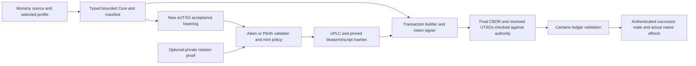

# Moriarty on UTXO/eUTXO ledgers

Research assessment, 2026-10-12. No port, benchmark, proof campaign or ledger transaction was performed. Research findings do not change Moriarty's current sole Midnight Preview execution gate.

## Main finding

**Moriarty's bounded financial semantics are a plausible fit for Cardano eUTXO, but a compatible backend would be a substantial new acceptance and transaction-construction implementation.** The most direct correspondence is between an authenticated Moriarty head and an authenticated state output that must be consumed to advance the agreement. Existing language/profile rules, liabilities, authority, complete-effect projection and privacy requirements must be carried through; a state NFT or successful validator does not supply them automatically.

Midnight already uses UTXOs for value while supporting contract state. The question is therefore how Moriarty's contract-state and certified-acceptance model maps onto different UTXO execution environments. This is more precise than describing the task as introducing UTXOs to Moriarty. [Official Midnight concepts](https://docs.midnight.network/concepts), [ledger implementation](https://github.com/midnightntwrk/midnight-ledger); retained captures under root-sources and inspected local custody/native-effect evidence.

Cardano is the strongest initial target in this collection because its ledger/context features and Marlowe provide relevant implemented references for bounded financial state transitions. This is a compatibility inference, not proof of performance, privacy parity, compiler correspondence or production readiness. Bitcoin and Ergo are separate capabilities to evaluate rather than interchangeable UTXO runtimes.

## The baseline being assessed

Local checkout: `/home/charl/Moriarty`, commit `84f64b30df53ff0b8ccaf475f57324d3d7c6e594`. Read architecture/current source, current acceptance amendment, historical financial results and guarded startup status. Eighteen key local files have exact hashes in [MORIARTY-EVIDENCE.json](MORIARTY-EVIDENCE.json); detailed observations are in [LOCAL-ARCHITECTURE.md](LOCAL-ARCHITECTURE.md).

The typed atomic Core, local evaluator and restricted Compact lowering are reusable boundaries, with distinct successor profiles. The funded custody wrappers implement narrower loan/swap examples. The retained corrected swap includes UTXO linkage and actual native movements; full mandatory acceptance remains open. No local or historical result establishes a Cardano backend.

**Architecture reconciliation:** the September11 amendment selects a ledger-anchored certified state machine. The step relation fuses authorization, transition validity, complete effects, intent refinement and per-step invariant; constrained genesis, audited immutable keys and controlled head succession allow induction over ledger acceptance. Recursion serves bounded off-ledger certificates and imports, not every ordinary on-ledger step. Some README/wiki prose still describes older mechanics. The amendment is specified-only and its second Charter reviewer is pending; this assessment treats it as the latest planning direction, never as delivered acceptance.

## How a Cardano realization could work

This design is **proposed and unimplemented**:

Use one authenticated state UTXO per live head for the first experiment. Its datum carries or commits the head record, program/profile, lifecycle, revision, work and residual obligations. A one-shot mint/genesis policy identifies the instance. Its validator checks the exact prior state, signed authority, complete bounded transition and exact permitted successors. Termination and migration must retain the disposition of liabilities and consumed authority. Splitting requires a separate child-identity/conservation protocol; a single NFT does not encode arbitrary split/join automatically.

The foundation papers provide initialized state-thread constructions and trace/invariant results, but their idealized theorem assumptions and historical pins must remain visible. Current formal-utxo HEAD contains explicit postulates and unfinished terms. The correct conclusion is that a formal construction exists, not that the acquired snapshot proves Moriarty correspondence. [Foundation report](01-foundations/REPORT.md), especially F4/F6 and formal artifact qualifications.

| Existing requirement | Target mechanism | Required new evidence |
|---|---|---|
| Constrained genesis | One-shot state policy and signed initial datum | Duplicate/forged genesis rejection; exact initial liabilities/authority |
| Exact-head uniqueness | Consume identified state out-reference and thread asset | Conflicting spends, successor uniqueness, script substitution and termination controls |
| Immutable acceptance program | Pinned validator/mint-policy hashes and reproducible manifest | Core/script/blueprint/toolchain/cost-model binding and deploy audit |
| Financial transition | Bounded validator or target-compatible certified relation | UInt128 overflow, rounding, debt allocation and complete-effect correspondence |
| Outcome authority | Canonical signed intent and persistent consumed nonce discipline | Cross-head/split/join/migration replay and cancellation controls |
| Complete native effects | Transaction-wide input/output/mint/fee projection | Whole-input gross accounting, unrelated assets, attribution and sponsorship |
| Oracle/time | Authenticated feed and bounded validity interval | Freshness throughout valid interval and correct financial date conversion |
| Composition | Atomically spend distinct states and allocate outputs injectively | Double-satisfaction, shared-budget and obligation-conservation tests |
| Private state/transition | Commitments, compatible proof verifier and encrypted handoff | Full public-input binding, measured resource fit and witness-availability test |
| Off-ledger certified segments | Compatible certificate/import interface | Real retained certificates and import semantics, separate from state chaining |

Reference inputs are useful for shared immutable configuration, scripts or oracle data. They do not consume the head, run its spending authority or spend its value. Inline datums and reference scripts reduce some construction friction without adding confidentiality. A script address does not uniquely identify a contract instance. [Standards report](02-standards/REPORT.md).

## Target/tooling recommendation

For a **public bounded research prototype**, prefer a new lowering to Aiken → PlutusV3/UPLC, with a versioned CIP57 blueprint and Lucid Evolution transaction assembly. Plinth is a credible alternative or independent reference. Choose a released toolchain plus exact protocol/cost-model parameters before execution; research master snapshots are not released-node provenance. Direct UPLC generation increases the custom assurance burden and is better deferred until the first relation is understood. [Toolchain report](04-toolchains/REPORT.md).

The research found documentary PV11 activation and source builtin maps, while some CIP statuses and PDF version tables lag. Keep editorial status, implementation source, release and actual target-node capabilities as separate fields. Do not assume a future PlutusV4 feature is available because master exposes types. The source corpus preserves these discrepancies rather than silently resolving them.

Coin selection/completion can add inputs, fees, change and collateral after the business action is selected. All authority checks must refer to final CBOR and resolved UTXOs. Objects from distinct CML WASM runtimes cannot be mixed casually; pin the builder's actual vendored dependency. Provider or evaluator output is not consensus finality or authenticated history.

## Risks that change the design

**Gross inputs and change.** The inspected Moriarty swap policy counts a whole 100,000-A input against authority even though the trade is10,000 A and change90,000 A. A new adapter must not validate only the business transfer. The local effect checker is not proof that a builder's final input selection preserves this policy. Minimum ADA, unrelated native assets and fee sponsorship must be explicit.

**Collateral on rejection.** PlutusV3 TxInfo excludes collateral inputs, return and total collateral. A wallet/final-transaction policy must bound exposure and actual failed-transaction records must account for collateral. An on-chain validator cannot enforce a check against unavailable fields, and rejecting a script can itself trigger collateral loss. [Toolchain report](04-toolchains/REPORT.md), V3 Contexts and transaction-completion locators.

**Authority preimages and scope.** CIP30 transaction-body signatures and CIP8/COSE message signatures have different preimages. The application must define and verify its outcome payload, key/credential mapping, network/genesis domain, permitted actions, expiry, cancellation and nonce scope. V3 exposes required-signer hashes rather than every witness. A shared signed route intended to fill globally once needs a shared authority resource or equivalent protocol; per-instance consumed nonces only establish per-instance uniqueness. The existing outcome-effect checker does not derive native gross inputs or cap liability creation from its Transfer/Fee list alone. These are new backend obligations, not a reproduced exploit in current Moriarty settlement. [Authority report](09-authority-intents/REPORT.md).

**Oracle freshness.** An authenticated reference state and valid publisher signature do not prove current price age or market truth. The inspected Pyth consumer pattern relies on a validated withdrawal and leaves freshness to the consumer. Pin provider/governance identity and require the accepted interval to fit the observation's trust/freshness window. Reference data cannot serve as consumed authority.

**One payment satisfying multiple states.** Ledger conservation and authentic state tokens do not prove injective effect allocation. Two validators may independently observe the same output. The Marlowe source review identifies a specific current composition question; it is untested and not a claim of a deployed exploit. Require the adversarial multi-head payment test before reusing its patterns. [Marlowe report](03-marlowe/REPORT.md), Composition concern requiring disposition.

**Shared-state contention and liveness.** Independent heads can proceed independently; every write to a shared head competes for that output. Sharding can move the serialization point to shared authority, invariant or nonce state. Minswap/Sundae batch many orders into a sequential pool update, rather than parallel writes to shared reserves. The fine-grained hUTXO paper concerns a custom hybrid ledger/simulator and explicitly excludes parallel swaps against the same AMM reserves; do not import its speedups as Cardano/Moriarty TPS. A finite agreement does not cause a debtor/executor to submit or pay for due transactions. [Concurrency report](05-concurrency/REPORT.md).

**Hydra exit.** Head confirmations use all-party snapshot signatures and L1 close/contest/fanout. Current source documentation identifies oversized outputs and head-minted unburned tokens as obstacles to complete finalization. A Moriarty design minting new state/message assets inside a head needs an explicit L1 exit plan; isomorphic public validation does not automatically provide private execution or cross-head nonce uniqueness. Source claims/benchmarks were inspected, not rerun.

**Public/private parity.** Ordinary Plutus evaluation can validate a public transition. It does not supply Midnight's private witness execution or hide financial state, redeemers, outputs and graph linkage. Pairing builtins and small ZK examples are research leads, not evidence the complete Moriarty relation fits. Pin curve, transcript, setup, verification key, encodings and all public-input commitments; measure the complete verifier and handoff behavior. Recursive/off-ledger certificates remain a separate design obligation.

The private-proof lane found a Foundation slim-Nova example explicitly omitting commitment openings on-chain, plus a static accepting-path candidate in its zero-round gate. No exploit was executed; even its documented partial scope is enough to reject it as complete PCD evidence. IOG's historical recursive Halo2 experiment exceeded resource limits and used18transactions. Producer Groth16 examples report smaller verifiers, but none proves the complete Moriarty relation or private settlement. Actual compatible Halo2 and stricter Groth16 verifier implementations are retained as research leads; they need hostile encoding/key/context controls and current-cost-model measurement. [Private-proof report](08-private-proofs/REPORT.md).

**Unexpected ledger spending paths.** Ergo's inspected storage-rent path can accept an empty-proof spend after1,051,200blocks without normal script validation. Funded boxes may be refreshed under register constraints; sufficiently underfunded boxes can lose their tokens entirely. Thus the ordinary-script transition invariant does not cover every ledger-accepted head movement. Rent-aware funding, liability preservation and recovery are prerequisites for an Ergo backend. Bitcoin's deployed Taproot/Miniscript techniques are useful references for authorization, but general covenant/introspection proposals do not establish a complete Moriarty target. ILLUM explicitly requires Bitcoin extensions. [Other-UTXO report](07-other-utxo/REPORT.md).

## Current Midnight release evidence

Current source and release evidence changes some September11 assumptions: PR738 merged into ledger10 on2026-09-14 and ledger10 alpha was published. The acquired stable ledger remains8.1.3; ledger9 is release-candidate and ledger10 alpha. Merge/publication is not Preview deployment, Moriarty E3 acceptance, toolchain completeness or certificate fit. The alpha source still distinguishes Poseidon inner proofs, Blake2b outer proofs and deferred pairing checks, with a soundness-sensitive decider choice. [Midnight/coverage audit](10-docs-midnight/REPORT.md).

The October ledger8.1.3 notes describe noncanonical-field defects relevant to repeated one-time operations; node1.0.400 carries the corrected native host ledger while on-chain runtime remains1.0.300. Existing malformed stored keys are not repaired automatically. Release overview/SDK compatibility tables lag detailed notes. A future experiment must pin node, compiled host ledger, runtime and compatible client dependencies, and repeat canonical head/nonce controls. One node's RPC ledger version does not attest every producer. This research neither queried current network deployment nor found evidence of exploitation of Moriarty's historical contracts; the historical result remains a scoped record rather than present-runtime assurance.

Private application state is user-local and distinct from public address-indexed contract state; do not interpret general public/private-ledger prose as replicating every private DApp state value on-chain. Actual source boundaries are recorded in researcher10's report.

## Next step

Implement nothing until the target profile and experimental scope are selected and reviewed. The smallest useful experiment is one public loan or escrow state machine with authenticated genesis, a single controlled successor, exact payment/residual debt, final-transaction authority and negative controls. Follow it with multi-head double-satisfaction and outcome replay tests. Only then spend effort on private relation verification and handoff.

[EXPERIMENTS.md](EXPERIMENTS.md) supplies P0–P6, adversarial scenarios, captured artifacts and acceptance predicates. All are specified-only. [CLAIMS.md](CLAIMS.md) separates supported source facts, repository observations, provisional compatibility inference and unsupported guarantees. Full production acceptance, private parity and universal compiler/ledger correspondence remain unestablished.

All ten research reports are retained. [INDEX.md](INDEX.md) provides the final acquisition counts, coverage boundaries, source inventory and documentation indexes. [REFERENCE-APPS.md](REFERENCE-APPS.md) provides a concrete reading route through twelve downloaded app/library/SDK repositories, distinguishing the three focused code inspections from nine later source acquisitions. [DEVELOPER-LEARNING-GUIDE.md](DEVELOPER-LEARNING-GUIDE.md) connects the documentation corpus to the patterns.
