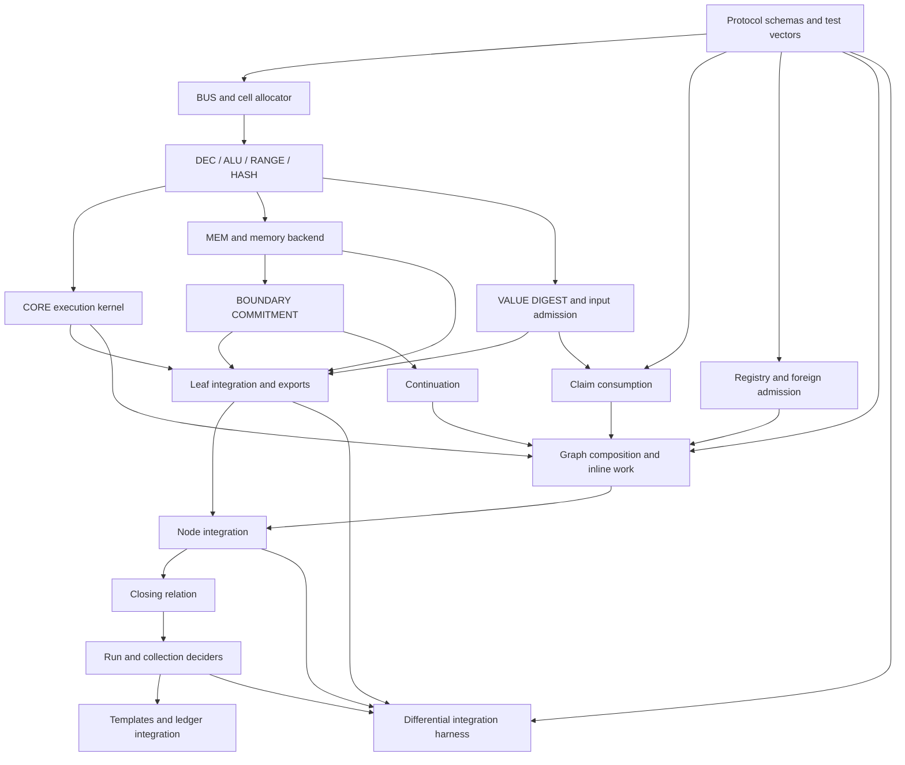

# Area 3: recursion and system architecture

Run: `sherlock-final-design-20261111`  
Status: architecture draft. Interfaces and signatures below are proposed unless identified as existing.

The system composes authenticated execution segments, seals terminal runs into address-free claims and discharges every deferred proof obligation before ledger acceptance. NODE INTEGRATION, DECIDER and CONTINUATION have separate contracts. CLAIM CONSUMPTION, FOREIGN ADMISSION and GRAPH COMPOSITION are separate modules because each introduces a different soundness obligation.

Use dense Merkle memory with Poseidon boundary commitments for the first integrated implementation. Preserve the run-wide LogUp and Horner interfaces, including their precommitment and finalization requirements. Neither backend changes the external run statement:

```text
[prog_d, input_d, outcome_d, n_steps]

claim_d = Poseidon(SHK_RUN, 1, prog_d, input_d, outcome_d)
```

`n_steps` is authenticated metadata outside `claim_d`. Physical state commitments, memory addresses, checkpoint commitments and memory-checking challenges remain internal. This publication rule is adopted, while the chip leaf remains proposed.  
Sources: `openspec/changes/sherlock-vm-consensus-20261107/design.md:138–144`; `research/sherlock-c6-outcome-ledger9-review-20261110/review.md:85–100`.

## 1. Scope and source conventions

The following abbreviations name repository paths. A citation such as `D:125–136` identifies the file and lines in this table.

| Name | Path |
|---|---|
| D | `openspec/changes/sherlock-vm-consensus-20261107/design.md` |
| R | `openspec/changes/sherlock-vm-consensus-20261107/requirements.md` |
| GP | `openspec/changes/sherlock-vm-consensus-20261107/general-purpose.md` |
| DS | `openspec/changes/sherlock-vm-consensus-20261107/dissent.md` |
| C6 | `research/sherlock-c6-outcome-ledger9-review-20261110/review.md` |
| G | `research/sherlock-gp-architecture-20261110/architecture.md` |
| E2 | `research/sherlock-processor-analogy-20261110/experiments-2.md` |
| RL-A through RL-E | `research/sherlock-runlength-consensus-20261111/lanes/{A,B,C,D,E}/round2.md` |
| LC | `research/sherlock-lookup-cache-20261111/lanes/B/round1.md` |
| MC | `/home/hoskinson/.cargo/registry/src/index.crates.io-1949cf8c6b5b557f/midnight-circuits-7.3.0/src/verifier/verifier_gadget.rs` |

Area 3 owns proof composition, closing, publication, continuation authorization, claim consumption and foreign-proof admission. It consumes the processor, memory, value and boundary interfaces from Areas 1 and 2. It does not own their columns or redefine their encodings.

The full target remains GP-1 through GP-4. In particular:

- A fixed key set must support programs and inputs as data.
- Consumption must authenticate another run’s sealed claim.
- Foreign keys must enter through an authenticated registry.
- A node must support two prior proofs plus new work under the same key set.

These are requirements, not properties established by the existing code. `GP:7–58` states the target and the current gaps.

## 2. Shared interface contract

### 2.1 Circuit boundaries

A copy constraint connects cells inside one circuit. Across proof boundaries, the recursive verifier authenticates a child’s public-instance cells, and the parent copy-constrains those cells into its local ports.

A host Rust type, deserialized structure or witness check does not authenticate a port. Every `Verified*` type below must have a private constructor reachable only through circuit constraints or a verified child statement.

Area 3 introduces no leaf BUS chip identifier. Its modules communicate through named cells. When Area 3 needs a hash, range check, boundary opening or inline execution, it calls an exported circuit interface. It must not access another module’s advice, fixed or instance columns.

The spike currently uses the common five-field tuple through two request lanes and two `lookup_any` arguments. This is one tuple protocol, not literally one lookup argument.  
Source: `crates/mori-chip/src/bus.rs:1–20,46–61`.

### 2.2 Common cell types

| Type | Meaning and range | Constraint owner |
|---|---|---|
| `FieldCell` | One element of the circuit scalar field | Circuit assignment and canonical serialization |
| `DigestCell` | A field element computed under a specified domain and encoding | Module that constructs the digest |
| `BitCell` | Integer 0 or 1 | Module introducing the selector |
| `U64Cell` | Integer in `[0, 2^64)` | Producer; NODE also checks arithmetic endpoints and results |
| `U128Cells` | Two `U64Cell` limbs, low then high | Producer or admission module |
| `EnumCell` | Integer in an explicitly listed finite set | Module interpreting the enum |
| `PointCells` | Canonical point encoding with the checks required by its use | Verifier or commitment adapter |
| `AccumulatorCells` | Fixed-order encoding defined by the keyed accumulator schema | NODE and DECIDER |
| `BoundaryCell` | `{context_d, value}` under the boundary scheme fixed by `schema_d` | BOUNDARY COMMITMENT |

A digest has no integer-range meaning. A Rust `u64` witness does not replace an in-circuit range check.

`schema_d` binds the wire ordering, machine profile, state schema, backend configuration, boundary scheme, keyed capacities and transcript conventions. It is pinned by the relation. Backend substitution may change keys; it must not change CORE or MEM’s semantic interfaces. The fixed-key requirement applies across programs, inputs, run lengths and graph shapes within the selected configuration.

### 2.3 Leaf export

The leaf exports the following ordered fields through its public statement. The final encoder must freeze this ordering before key generation.

| Fields | Meaning | Provider guarantee |
|---|---|---|
| `binding` | Proof-system binding input | Encoded and authenticated according to the leaf verifier contract |
| `schema_d` | Exact leaf protocol schema | Equals the relation’s schema |
| `prog_d`, `input_d` | Program and original run-input commitments | Linked to execution and admission |
| `h_pre`, `steps` | Owner-event position and number of enabled events | `h_pre < 2^64`, `1 <= steps <= S`, no wrap |
| `rules_d` | Digest of selected owner rules | Derived from enabled rule selectors |
| `deps_d` | Authenticated dependency collection used by this run | Bound to dependency admission and execution |
| `pre`, `post` | Two `BoundaryCell` values | Commit the complete cross-leaf state |
| `terminal_kind` | `Running=0`, `Halted=1`, `Rejected=2`, `Exhausted=3` | Derived from the last enabled slot |
| `terminal_payload` | Zero, canonical value digest, rejection code or exhaustion kind | Copied from the authenticated terminal projection |
| `memory` | Backend evidence described below | Bound to all memory requests and supplied commitments |

`terminal_payload` is zero for `Running`. A rejection code is an integer below 256. An exhaustion kind must belong to the selected profile’s allowed set. The encoding lists kinds 0 through 7, but profile `/1` currently excludes `LogicalCap=7`; the draft preserves that exclusion until the specification resolves it. `C6:120`; `DS:226`.

The first execution leaf checks `Init(prog_d, input_d)` when `h_pre=0`. NODE must not replace this with equality to a witness-supplied initial digest. `R:46`.

Administrative input-loading or checkpoint-conversion proofs use a separate statement variant. They must not enter this execution-leaf variant with `steps=0`.

### 2.4 Backend evidence

Freeze a common envelope with unused lanes constrained to zero:

```text
BackendEvidence {
    context_d,
    transcript_root,
    gamma_mem,
    alpha_mem,
    gamma_state,
    delta,
    coverage
}
```

`coverage` is an authenticated interval in the precommitment manifest, with the manifest’s total extent and encoding fixed by the backend contract. Its width must accommodate execution and admission chunks without introducing a smaller run-length ceiling. That width remains an Area 2 design decision.

| Configuration | Required evidence |
|---|---|
| Merkle + Poseidon | Backend lanes are zero. Boundary contexts are zero. Memory reads and updates are proved locally. |
| Merkle + Horner | Boundary vectors are committed before `gamma_state`. Manifest coverage authenticates those vectors. Memory remains locally checked. |
| LogUp + Poseidon | Memory tuples, activity bits and multiplicities are committed before `gamma_mem` and `alpha_mem`. `delta` is the segment’s rational-sum contribution. |
| LogUp + Horner | Both sets of precommitments and challenges are required. Memory and boundary challenges use separate domains. |

NODE guarantees:

1. Adjacent segments use the same backend context.
2. Manifest intervals are adjacent, without gaps or overlap.
3. The completed run covers the required manifest exactly.
4. The challenge derivation binds the authenticated manifest root, program, input and schema.
5. Final LogUp balance is zero before the run becomes a sealed claim.
6. Every supplied instance commitment is the commitment actually passed into the child verifier.

A membership proof for one commitment is insufficient without exact coverage. Otherwise a prover could derive challenges from one manifest and prove a different collection of chunks.

The current verifier accepts committed-instance points, checks the total instance-column count and requires one challenge phase. It does not provide the proposed run-wide protocol automatically. `MC:285–310`. The LogUp proposal explicitly requires precommitment before challenges. `LC:98–109,183–199`.

### 2.5 Segment and claim separation

```text
Segment {
    schema_d,
    prog_d,
    input_d,
    deps_d,
    h_lo,
    h_hi,
    pre,
    post,
    terminal_kind,
    terminal_payload,
    memory
}

RunClaim {
    version = 1,
    prog_d,
    input_d,
    outcome_d
}

RunReceipt {
    claim,
    n_steps
}
```

A segment proves execution on `[h_lo, h_hi)`. A run receipt proves a terminal execution starting at height zero, with canonical initialization and all dependencies and backend obligations discharged.

`SHK_CONT_V1`, `SHK_RUN` and foreign-claim domains are disjoint. A continuation or execution segment cannot be coerced into a `RunClaim`.

## 3. Module: NODE INTEGRATION

### Purpose

NODE INTEGRATION authenticates child statements and carries their verification obligations through recursion. It links execution segments and exports a constrained statement with a complete accumulator.

### Interface

Requests:

- One or two child proof slots, each with `enabled`, `key_kind`, proof bytes, committed-instance points and the fixed-width ordinary instance.
- Verified leaf exports from a run lift, or local execution exports from the inline-work port.
- GRAPH COMPOSITION’s constrained relation selection and output payload.
- Backend finalization evidence when sealing a run.

Provides:

- `VerifiedSegment`, `VerifiedClaimCollection` or `VerifiedForeignPending`.
- The node’s constrained key representations, registry root and shape digest.
- `AccumulatorCells` covering every enabled child proof and every inherited obligation.

The child-key selector has the finite values `Off`, `Node`, `RunLift` and `ForeignLift`. The same selector must choose the key representation, permitted payload type and fixed-base coefficient destinations.

Each enabled child provides the same pinned core-key representations and registry root. A disabled slot has canonical neutral statement and accumulator encodings before any accumulation challenge is derived.

### Guarantees and assumptions

NODE guarantees:

- Child instances cannot be substituted independently of the proofs.
- Adjacent execution segments have equal program, input, dependency root, schema, backend context and boundary value.
- `left.h_hi == right.h_lo`.
- Every execution interval has `0 <= h_lo < h_hi < 2^64`.
- A terminal segment cannot have a later execution segment.
- Every inherited accumulator is bound to the child’s verified instance.
- Every new verification obligation and inherited obligation is accumulated.
- Disabled slots contribute the designated neutral accumulator.
- Fixed-base names use a fixed ordering and cannot be selected independently of the key.
- Key representations are ultimately pinned by the closing relation.

NODE assumes:

- The leaf proves its advertised transitions.
- Boundary opening and equality obey the selected backend contract.
- Accumulation and final pairing satisfy their stated cryptographic premises.
- Registry and claim modules authenticate the objects they export.

The current chain already range-checks heights, constrains genesis carry to the neutral encoding and constrains collapsed carry scalars. Preserve these properties when adding slots.  
Sources: `crates/mori-recursion/src/ivc.rs:360–420,506–564`.

Named-key routing needs explicit coefficient constraints because names are not authenticated merely by accumulator encoding. `G:426–437`.

### Row budget

All new-node figures are **ESTIMATE**.

- Existing linear spike-key node: 823,466 measured rows. `D:125–136`.
- Earlier binary-node probe: 730,243 rows, explicitly incomplete. It is an experiment anchor, not the completed binary-node budget. `G:423–425`.
- Budget the completed node as:

```text
R_node =
    R_two_child_verifiers
  + R_key_routing
  + R_statement_binding
  + R_graph
  + R_inline_work
  + R_backend_hooks
```

The acceptance gate remains 950,000 ordinary rows. Measure tables and usable-domain rows separately.

For changes to the leaf verified by a run lift, use the local cost fit only as an estimate:

```text
ΔR ≈ 7,298 Δadvice
    + 8,189 Δequality
    + 6,004 Δfixed
    + 22,600 Δlookups
```

Do not apply that fit directly to an arbitrary new recursive node. Its measured scope is leaf-key variations. `E2:120–136,223–232`.

### Verification kit

Existing model: `models/sherlock/quint/aggregation.qnt`.

Add `models/sherlock/quint/nodeIntegration.qnt` for typed slots, key routing, registry-context equality and inherited obligations. The existing model abstracts verification and accumulation and uses the older slot structure. `aggregation.qnt:5–16,40–43`.

MockProver positives:

- Base execution with neutral absent predecessors.
- Unary extension.
- Two adjacent segments.
- Each permitted key kind in each slot.
- Canonical disabled slots.
- Both backend-context modes.

Named negative mutants:

- `node_unbound_child_instance`
- `node_drop_child_carry`
- `node_genesis_non_neutral`
- `node_wrong_key_destination`
- `node_selector_repr_mismatch`
- `node_disabled_slot_garbage`
- `node_height_wrap`
- `node_overlap_interval`
- `node_gap_interval`
- `node_continue_after_terminal`
- `node_cross_context_join`

Malformed proof encodings must be reported as parser refusals. They do not replace fresh-witness constraint tests. Final-pairing rejection of a bad inherited obligation requires a real proof test after module integration.

### Code skeleton

Owned files:

```text
crates/mori-chip/src/recursion_port.rs
crates/mori-recursion/src/protocol/node.rs
crates/mori-recursion/src/protocol/child_slot.rs
crates/mori-recursion/src/protocol/key_router.rs
```

Signatures only:

```rust
pub trait ChildVerifier {
    type Witness;

    /// Authenticate every enabled child's exact instance and return its obligation.
    fn verify_slot(
        &self,
        cx: &mut RecursionContext<'_>,
        slot: SlotId,
        witness: &Self::Witness,
    ) -> Result<VerifiedChild, CircuitError>;
}

/// Constrain one selector to route the key, statement kind and named coefficients.
pub fn route_child_key(
    cx: &mut RecursionContext<'_>,
    child: &VerifiedChild,
    keys: &PinnedCoreKeyCells,
) -> Result<RoutedChild, CircuitError>;

/// Link adjacent segments with equal execution and backend contexts.
pub fn link_segments(
    cx: &mut RecursionContext<'_>,
    left: &SegmentCells,
    right: &SegmentCells,
) -> Result<SegmentCells, CircuitError>;

/// Fold all enabled proof obligations and inherited carries in canonical order.
pub fn accumulate_children(
    cx: &mut RecursionContext<'_>,
    children: &[RoutedChild; 2],
    local: &LocalObligations,
) -> Result<AccumulatorCells, CircuitError>;

/// Bind the processor's exported cells to the frozen leaf-instance ordering.
pub fn export_leaf_statement(
    cx: &mut LeafContext<'_>,
    ports: &ExecutionPorts,
) -> Result<LeafStatementCells, CircuitError>;
```

### Implementing-agent read scope

Read this module’s kit, the common wire schema, `ivc.rs:360–564`, `inner.rs`’s verification interfaces and the named-key conditions at `G:426–437`.

The agent must not need CORE rules, MEM columns, Poseidon rounds, value serialization internals or the complete foreign verifier.

## 4. Module: DECIDER

### Purpose

DECIDER turns recursive verification obligations into final validity through the pairing check. It binds the accepted run or claim collection to the exact ledger-call transcript.

### Interface

Requests:

- Root proof and authenticated root instance.
- Pinned root key and core-key representations.
- Complete inherited accumulator.
- Terminal boundary opening for `acceptRun`.
- Backend finalization evidence.
- Ledger-template inputs, including the call binding and communications commitment.

Provides:

- C6 run values exactly `[prog_d, input_d, outcome_d, n_steps]`.
- `claim_d` for the contract replay check.
- A ledger-format final proof.
- For GP batching, a separate collection statement containing registry root, claim-collection root and address-free shape digest.

The run-decider entry point and collection-decider entry point have separate schemas. Adding collection fields must not silently change the four-value C6 run statement.

For the run entry point:

- `n_steps` equals the root’s `h_hi`, with `h_lo=0`.
- `terminal_kind` must be `Halted`, `Rejected` or `Exhausted`.
- `outcome_d` is computed from the authenticated kind and payload.
- `claim_d` excludes `n_steps`, state commitments and shape.
- All four values participate in the ledger transcript.

For a Poseidon boundary, DECIDER opens the final state commitment using the Area 2 state schema. For a Horner boundary, an arbitrary vector chosen in DECIDER after the challenge is unsound. The terminal projection must instead be tied to the final precommitted vector through the authenticated child statement and commitment-opening protocol.

### Guarantees and assumptions

DECIDER guarantees:

- Root-key identity is fixed.
- Every accumulated obligation reaches the pairing.
- `Running` cannot settle.
- No physical-state field enters published values or replay identity.
- A changed public value invalidates the call binding.
- Run-wide memory balance and commitment coverage are complete before settlement.
- Claim-collection settlement has no per-claim side effect keyed only by the collection root or shape.

DECIDER assumes that NODE authenticates its payload and carry and that the terminal-opening provider authenticates the complete state projection.

The current implementation pins the node key and performs the pairing, but then accepts only a halted `u128` result and constructs the old five-value statement.  
Sources: `crates/mori-recursion/src/run_decider.rs:201–218,245–301`.

### Closing proof

Keep fixed-base resolution as a separate `ClosingRelation` when the finite union of node, run-lift and foreign-lift names makes direct resolution too expensive.

The closing proof must resolve every named base, carry the resolved obligation and preserve the exact root payload. DECIDER verifies that proof and pairs the resulting obligation. This is the two-stage closing candidate in `G:438–440`; its fit remains unmeasured.

### Row budget

**ESTIMATE:** reserve 1,000–5,000 additional ordinary rows for the revised run opening, outcome wrapper, claim digest and backend-finalization glue, subject to the final state schema.

The measured reference is 929,166 ordinary rows. The project gate is 1,000,000. The same reference has 1,032,467 table rows, leaving only 16,109 domain rows before unusable rows are deducted. A passing ordinary-row gate therefore does not establish domain fit. `C6:213`.

The closing relation, collection decider and wider key-name union need separate measurements. Do not inherit the old 929,166 figure as their predicted cost.

### Verification kit

Add `models/sherlock/quint/deciderOutcome.qnt`.

MockProver positives:

- Halted scalar and structured-value digests.
- Every admitted rejection code and exhaustion kind.
- Correct canonical genesis and terminal opening.
- Finalized LogUp context.
- Collection containing three independently sealed runs.

Named negative mutants:

- `decider_unpinned_root_key`
- `decider_drop_root_carry`
- `decider_skip_pairing`
- `decider_running_as_terminal`
- `decider_unbound_terminal_payload`
- `decider_nonzero_h_lo`
- `decider_nonzero_memory_balance`
- `decider_manifest_gap`
- `decider_horner_postchallenge_opening`
- `decider_steps_in_claim`
- `decider_public_state_digest`
- `decider_unbound_call_value`

Contract integration tests must replay the same claim under different partitions and proof randomness. The second settlement must fail by `claim_d`.

MockProver tests do not establish ledger compatibility. Later qualification must exercise the exact captured Compact template and proof-verifying ledger target. `R:45,105`.

### Code skeleton

Owned files:

```text
crates/mori-recursion/src/protocol/close.rs
crates/mori-recursion/src/protocol/run_decider.rs
crates/mori-recursion/src/protocol/collection_decider.rs
crates/mori-recursion/src/protocol/ledger_statement.rs
```

```rust
/// Resolve every core named base and preserve the authenticated root statement.
pub fn close_root(
    cx: &mut RecursionContext<'_>,
    root: &VerifiedRoot,
    keys: &PinnedCoreKeys,
) -> Result<ClosedRootCells, CircuitError>;

/// Authenticate the final boundary and derive the terminal tag and payload.
pub fn open_terminal(
    cx: &mut RecursionContext<'_>,
    root: &ClosedRootCells,
    opening: &TerminalOpeningWitness,
) -> Result<TerminalCells, CircuitError>;

/// Pair all obligations and bind exactly the four C6 run values.
pub fn decide_run(
    cx: &mut RecursionContext<'_>,
    root: &ClosedRootCells,
    terminal: &TerminalCells,
    call: &LedgerCallCells,
) -> Result<RunPublicCells, CircuitError>;

/// Pair all obligations and bind the collection envelope to its ledger call.
pub fn decide_collection(
    cx: &mut RecursionContext<'_>,
    root: &ClosedRootCells,
    call: &LedgerCallCells,
) -> Result<CollectionPublicCells, CircuitError>;

/// Encode the exact captured template without dropping guarded zero fields.
pub fn encode_run_call(
    template: &RunTemplate,
    statement: &RunStatement,
    binding: F,
    communication: F,
) -> Result<Vec<F>, ProtocolError>;
```

### Implementing-agent read scope

Read the four-value statement contract, the terminal-opening port, accumulator encoding, `run_decider.rs:201–319` and the captured template schema.

The agent must not need memory-tree construction, CORE dispatch, full input loading or foreign proof parsing.

## 5. Module: CONTINUATION

### Purpose

CONTINUATION preserves an authenticated execution across leaf boundaries and interrupted proving sessions. It also defines the stronger conversion proof required when a checkpoint changes physical representation.

### Interface

Tier 1 uses an internal checkpoint:

```text
PhysicalCheckpoint {
    schema_d,
    key_manifest_d,
    prog_d,
    original_input_d,
    deps_d,
    h,
    boundary,
    backend_context_d,
    authenticated_prefix
}
```

`h` is a `U64Cell`. All digests are field elements. `authenticated_prefix` is a verified proof and carry, not a host assertion that a snapshot is trusted.

A resume requests:

- The checkpoint’s authenticated prefix.
- A snapshot opening to its boundary.
- The next segment with matching `h_lo`, program, original input, dependencies and backend context.

It provides a normal `VerifiedSegment`. `SHK_CONT_V1` is an internal envelope and never an externally consumable run claim.

Tier 2 additionally requests and provides:

```text
LogicalCheckpoint {
    machine_profile_d,
    prog_d,
    original_input_d,
    deps_d,
    h,
    logical_state_d
}

Relocation {
    old_boundary,
    logical_state_d,
    new_boundary
}
```

The logical state must include control, environments, frames, tasks, helper state, result state, initial and remaining fuel and every resource counter that affects execution. Values use the Area 2 canonical value encoding. `sherlock-value/1` alone does not encode an entire machine checkpoint.

### Guarantees and assumptions

Tier 1 guarantees:

- Pause, persist and resume do not execute a machine event.
- Fuel and logical counters remain unchanged.
- The original input commitment remains unchanged.
- A later segment joins only to the authenticated predecessor state.
- A prefix alone cannot become a sealed run.
- The full run still starts at canonical genesis.

Tier 2 additionally guarantees:

- Old and new representations decode to the same logical state.
- Every loaded scalar satisfies its range.
- Every reference, type and constructor opening is authenticated.
- Lazy loading cannot interleave with a slice-building protocol in a way that changes the machine’s allocation invariant.
- Loading and relocation administrative work does not silently change owner-event counts.

The two tiers reflect the study’s separation between retained-state continuation and address-free transfer. `RL-B:56–60`; `RL-C:35–37`; `RL-E:38–44`.

### Backend behavior

| Backend | Tier 1 behavior |
|---|---|
| Merkle + Poseidon | Proving can pause and resume from an authenticated prefix while execution continues later. |
| Run-wide LogUp | Resume retains the original precommitted transcript and challenges. Extending an unplanned run changes the precommitment context and requires a new protocol or re-proving. |
| Horner boundary | A fingerprint is meaningful only inside its authenticated challenge context. It is not a portable checkpoint digest. |

A fresh LogUp epoch cannot treat reads of old memory as newly trusted writes. An epoch bridge must authenticate the imported memory against the previous valid state and account for all outstanding memory obligations. This bridge is an open construction, not an implicit property of the backend trait.

Fuel exhaustion remains a terminal outcome. It must not become a checkpoint trigger that refreshes fuel. `RL-D:44,73–75`; `R:18`.

### Row budget

**ESTIMATE:**

- Tier 1 adds no leaf hashing when it reuses the existing boundary.
- Local resume/link checks should fit within a 3,000-row glue allocation, excluding recursive verification and boundary opening.
- Tier 2 costs scale with live checkpoint structure and authenticated loading. No fixed whole-checkpoint row estimate is justified.
- Tier 2 must split conversion work into bounded proofs under fixed keys. The number of proofs can grow; the circuit cannot grow with live state.

### Verification kit

Add:

```text
models/sherlock/quint/continuation.qnt
models/sherlock/quint/checkpointRelocation.qnt
```

Model machine steps and administrative steps separately. A leaf close, checkpoint or relocation preserves the decoded logical state.

MockProver positives:

- Resume after an arbitrary nonterminal event.
- Resume with a nonempty memory tail.
- Resume with nested frames and helper tasks.
- Several sessions producing the same final run statement.
- Tier 2 shared-DAG loading without changing the canonical value digest.

Named negative mutants:

- `cont_refresh_fuel`
- `cont_change_original_input`
- `cont_skip_predecessor`
- `cont_reset_height`
- `cont_publish_as_run`
- `cont_change_dependency_root`
- `cont_change_backend_context`
- `cont_use_horner_as_digest`
- `relocate_drop_live_frame`
- `relocate_unchecked_uint`
- `relocate_unbound_child_digest`
- `relocate_interleave_slice_load`
- `relocate_count_admin_as_owner_step`

### Code skeleton

Owned files:

```text
crates/mori-recursion/src/protocol/continuation.rs
crates/mori-recursion/src/protocol/checkpoint.rs
```

```rust
/// Bind a persisted checkpoint to an authenticated execution prefix.
pub fn bind_checkpoint(
    cx: &mut RecursionContext<'_>,
    prefix: &VerifiedSegment,
    snapshot: &BoundaryOpeningWitness,
) -> Result<CheckpointCells, CircuitError>;

/// Resume only at the authenticated height, state and original run context.
pub fn resume_segment(
    cx: &mut RecursionContext<'_>,
    checkpoint: &CheckpointCells,
    next: &VerifiedSegment,
) -> Result<SegmentCells, CircuitError>;

pub trait CheckpointCodec {
    type Witness;

    /// Prove equality of decoded logical state across physical representations.
    fn prove_relocation(
        &self,
        cx: &mut RecursionContext<'_>,
        before: &BoundaryCells,
        witness: &Self::Witness,
    ) -> Result<RelocationCells, CircuitError>;
}

/// Validate artifact hashes and schema compatibility; this grants no proof validity.
pub fn read_checkpoint_bundle(
    bytes: &[u8],
    expected: &ProtocolManifest,
) -> Result<CheckpointBundle, ProtocolError>;
```

### Implementing-agent read scope

Read the continuation kit, boundary-opening contract, backend lifecycle and logical checkpoint schema.

The agent must not need Merkle-walk gates, LogUp arithmetic, allocator internals or all owner-rule implementations. Tier 2 needs a separate kit for each logical checkpoint record family.

## 6. Module: CLAIM CONSUMPTION

### Purpose

CLAIM CONSUMPTION authenticates a producer’s terminal claim before a consumer uses it. It binds any consumed value to the producer’s outcome and the consumer’s admitted input.

### Interface

Requests:

- `VerifiedClaimCollection`.
- A claim-membership proof.
- `RunClaim` preimage and authenticated `n_steps` metadata.
- An outcome opening.
- If the consumer uses a value, a `sherlock-value/1` opening and input-admission proof.
- The consumer’s original resource-policy parameters.

Provides:

- `ConsumedClaimCells { claim_d, prog_d, input_d, outcome_d }`.
- For a halted producer, `AuthenticatedValueCells { value_d, type_evidence }`.
- An updated or fixed dependency commitment linked to the consumer state.
- An authenticated relation between the producer value and consumer `val_d`.

A `Rejected` or `Exhausted` claim can be consumed as a claim. It cannot be relabeled as a halted value.

The consumer input commitment retains the specified form:

```text
input_d = Poseidon(SHK_IN, val_d, fuel_lo, fuel_hi, stack_limit)
```

The two fuel limbs and stack limit are below `2^64`. The producer’s `outcome_d` is not itself `val_d`; the consumer must open the halted-outcome wrapper. `C6:120–124`.

### Guarantees and assumptions

Guarantees:

- Only sealed claims enter consumption.
- Membership is checked against a verified collection root.
- A consumer cannot substitute a value with the same host type but a different digest.
- Dependency obligations cannot be dropped before sealing the consumer.
- Claim reuse in two proof branches is permitted.
- Ledger side-effect replay is controlled separately by `claim_d`.

Assumptions:

- VALUE DIGEST defines and authenticates canonical value and type encodings.
- Input admission establishes the invariant needed by execution.
- Registry policy is already authenticated where required.

The earlier architecture postpones dependency discharge to sealing through `SEG + SET`. That is usable for deferred proof validity, but the consumer must still bind its admitted input and dependency root before execution begins. `G:131–144`; `R:46,57`.

### Row budget

**ESTIMATE:** one claim hash, one outcome wrapper and a membership path, plus input admission.

For a path with `d` two-input Poseidon nodes, the stdlib hash contribution is approximately `22d` rows before entry hashing, direction-bit checks and copy constraints. The 22-row unit is a measured stdlib calibration. `E2:157–164`.

Input admission is charged to Area 2. Do not report it as constant-cost for an arbitrary input.

### Verification kit

Add `models/sherlock/quint/claimConsumption.qnt`.

MockProver positives:

- Program B consumes the halted result of A.
- A structured value crosses program boundaries.
- Three different runs form one collection.
- One producer feeds two consumers.
- A rejection claim is consumed as metadata without becoming a value.

Named negative mutants:

- `claim_consume_unsealed_segment`
- `claim_wrong_collection_root`
- `claim_swap_outcome`
- `claim_skip_value_opening`
- `claim_foreign_field_as_value`
- `claim_drop_dependency`
- `claim_address_in_identity`
- `claim_steps_in_identity`
- `claim_program_local_type_id`

### Code skeleton

Owned files:

```text
crates/mori-recursion/src/protocol/claims.rs
crates/mori-recursion/src/protocol/consume.rs
```

```rust
/// Authenticate a run claim and its metadata inside a verified collection.
pub fn open_run_claim(
    cx: &mut RecursionContext<'_>,
    collection: &VerifiedClaimCollection,
    opening: &ClaimOpeningWitness,
) -> Result<SealedRunClaimCells, CircuitError>;

/// Open Halted(value_d) and authenticate the consumer's value representation.
pub fn consume_halted_value(
    cx: &mut RecursionContext<'_>,
    producer: &SealedRunClaimCells,
    opening: &ValueOpeningWitness,
) -> Result<AuthenticatedValueCells, CircuitError>;

/// Bind the admitted input and dependency root before execution starts.
pub fn admit_consumer_input(
    cx: &mut RecursionContext<'_>,
    value: &AuthenticatedValueCells,
    dependencies: &VerifiedClaimCollection,
    policy: &InputPolicyCells,
) -> Result<AdmittedInputCells, CircuitError>;
```

### Implementing-agent read scope

Read SRC-021, SRC-022, GP-002, the claim-membership interface and canonical value vectors.

The agent must not need producer execution traces, physical producer memory or recursive-verifier internals.

## 7. Module: FOREIGN ADMISSION

### Purpose

FOREIGN ADMISSION proves that a foreign proof uses a registry-approved verification interpretation. It maps authenticated foreign public inputs into the common claim form through the registered adapter.

### Interface

A registry entry binds:

```text
RegistryEntry {
    entry_kind,
    proof_system_id,
    curve_id,
    commitment_scheme_id,
    srs_id,
    verifier_key_d,
    constraint_system_d,
    transcript_id,
    public_input_schema_d,
    exact_public_input_count,
    verifier_program_d,
    statement_adapter_d,
    format_version,
    policy
}
```

Requests:

- Registry root authenticated by the node and ledger call.
- Canonical entry preimage and membership proof.
- Foreign key bytes and proof bytes.
- Exact ordinary and committed public inputs.
- Adapter execution evidence.
- Any carried verification obligation.

Provides:

```text
ForeignClaim {
    version,
    verifier_identity_d,
    input_d,
    output_d,
    statement_kind
}
```

`exact_public_input_count` is an integer whose supported encoding is fixed by the verifier path. A class-specific native adapter uses a circuit-fixed count. A general verifier must parse and process the count through bounded verification work.

The key identity hashes canonical key material and the full verification interpretation. Registry membership of a key digest alone is insufficient if the transcript, SRS or adapter can vary independently.

### Two verification paths

1. **Native adapter path.** Use `VerifierGadget` where the constraint-system configuration, transcript, instance layout and SRS are supported. Adapter keys are authenticated registry data.
2. **General verification path.** Execute an authenticated verifier program in bounded recursive work units. The program handles configurations outside the native gadget’s fixed class, including complete parsing and transcript processing.

The general path is required to close the full GP-3 scope. A registry over a finite collection of native adapter classes does not establish support for every permitted foreign circuit. The earlier architecture records that gap explicitly. `G:165–185`.

A foreign proof under a different SRS cannot be folded into the core accumulator as though its pairing equation used the core SRS. Its verification path must discharge its own parameterized equation, or use another explicitly proved reduction.

### Guarantees and assumptions

Guarantees:

- Membership authenticates both verifier and statement adapter.
- The adapter consumes the verified public inputs.
- Complete proof parsing rejects trailing or omitted data.
- Point and scalar encodings receive the checks required by the selected verifier.
- A foreign field becomes a Sherlock value digest only through an authenticated adapter relation.
- An unfinished verification computation cannot emit a foreign claim.
- The Sherlock leaf identity also receives registry-policy checking where the GP-3 aggregate requires both claims to be checked against the registry.

A circuit-satisfaction proof does not establish transaction inclusion or application authorization beyond its statement. `G:450–456`.

### Row budget

All figures are **ESTIMATE**.

For a sparse registry keyed by a canonical field digest, a 255-level binary path contributes approximately `255 × 22 = 5,610` stdlib hash rows before entry hashing, key-bit checks and other constraints. Two independent paths contribute approximately 11,220 hash rows.

The fixed depth and canonical key decomposition must be part of the registry schema. They cannot be witness-selected.

Foreign verification and adapter execution remain unmeasured. A class adapter exceeding its row budget must be decomposed or use the general path. The general verifier requires a costed operation inventory before any whole-module estimate is credible.

### Verification kit

Add:

```text
models/sherlock/quint/foreignRegistry.qnt
models/sherlock/quint/foreignVerification.qnt
```

MockProver positives:

- Registered Sherlock claim plus registered Compact claim.
- Two keys of one supported native class.
- Different approved adapters with distinct statement kinds.
- General verification split across several work units.
- Foreign input commitments bound to the actual verifier call.

Named negative mutants:

- `foreign_wrong_registry_root`
- `foreign_key_digest_only`
- `foreign_swap_transcript`
- `foreign_swap_srs`
- `foreign_wrong_input_count`
- `foreign_unbound_committed_instance`
- `foreign_unregistered_adapter`
- `foreign_adapter_ignores_input`
- `foreign_value_relabel`
- `foreign_drop_inner_obligation`
- `foreign_accept_pending_verification`
- `foreign_trailing_proof_bytes`

Parser refusals and circuit refusals must be recorded separately.

### Code skeleton

Owned files:

```text
crates/mori-recursion/src/protocol/registry.rs
crates/mori-recursion/src/protocol/foreign.rs
crates/mori-recursion/src/protocol/foreign_program.rs
```

```rust
/// Authenticate the full verifier interpretation under the supplied registry root.
pub fn open_registry_entry(
    cx: &mut RecursionContext<'_>,
    root: &DigestCell,
    witness: &RegistryOpeningWitness,
) -> Result<AdmittedVerifierCells, CircuitError>;

pub trait ForeignVerifier {
    type Witness;

    /// Verify the exact foreign inputs and return all remaining obligations.
    fn verify(
        &self,
        cx: &mut RecursionContext<'_>,
        admitted: &AdmittedVerifierCells,
        witness: &Self::Witness,
    ) -> Result<VerifiedForeignInputs, CircuitError>;
}

/// Execute the registered statement adapter over authenticated public inputs.
pub fn adapt_foreign_statement(
    cx: &mut RecursionContext<'_>,
    admitted: &AdmittedVerifierCells,
    inputs: &VerifiedForeignInputs,
    witness: &AdapterWitness,
) -> Result<ForeignClaimCells, CircuitError>;

/// Advance bounded verifier work while preserving its authenticated transcript state.
pub fn advance_foreign_verification(
    cx: &mut RecursionContext<'_>,
    previous: &ForeignPendingCells,
    work: &ForeignWorkWitness,
) -> Result<ForeignProgressCells, CircuitError>;
```

### Implementing-agent read scope

The registry agent reads the entry schema, membership contract and identity test vectors. A native-adapter agent additionally reads the exact pinned verifier API for its class.

Neither needs CORE, MEM or continuation internals. The general verifier is divided into separate kits for parsing, transcript processing, field arithmetic, group arithmetic and final equations. It is not a one-session implementation.

## 8. Module: GRAPH COMPOSITION

### Purpose

GRAPH COMPOSITION defines which authenticated objects a node can combine and what statement the combination proves. It binds the proof graph without making graph shape part of run identity.

### Interface

Requests two `VerifiedChild` ports and one `InlineWork` port.

```text
InlineWork =
    Disabled
  | ExecuteOwnerWork
  | AdvanceForeignVerifier
  | ProveAdmission
  | ProveRelocation
```

Each variant has a distinct tag. `Disabled` has zero payload. Administrative work cannot claim owner-step progress.

Provides:

- A constrained relation tag.
- A typed output payload.
- An address-free `shape_d`.
- A complete list of local obligations for NODE.

The minimum relation table is:

| Relation | Inputs | Output and checks |
|---|---|---|
| `LiftExecution` | Local execution or authenticated leaf work | Execution segment |
| `LinkExecution` | Two segments | Adjacent interval with matching boundary and run context |
| `ExtendExecution` | Prior segments plus local owner work | Linked interval including the newly executed events |
| `SealRun` | Complete segment and dependency evidence | Sealed run receipt after terminal and backend checks |
| `JoinClaims` | Two verified collections | Authenticated collection containing both |
| `ConsumeClaim` | Producer collection and consumer work | Consumer segment with authenticated dependencies |
| `ContinueForeign` | Pending verification and local verifier work | Updated pending state or completed foreign claim |
| `Relocate` | Authenticated execution state and conversion work | Equivalent state at the same owner-event height |

Unsupported type combinations are unsatisfiable.

### GP-4 new work

The target node has two predecessor slots and an inline work region. It must demonstrate two enabled prior proofs together with newly constrained owner-machine work in one node.

A construction that takes either two prior proofs or one prior proof plus a fresh lifted proof does not meet that clause. The earlier GP architecture records this distinction at `G:156–164`.

The inline execution region uses the processor’s public execution-kernel contract. If the leaf’s raw Halo2 configuration cannot be embedded in the stdlib node configuration, provide a node emitter for the same rule specification and run the same differential vectors against both emitters. This is an explicit implementation task and cost risk.

### Shape and claim collections

Define:

```text
shape_d = H(
    SHK_SHAPE_V1,
    relation_tag,
    slot_bits,
    child_shape_d[0],
    child_shape_d[1],
    semantic_descriptor
)
```

`semantic_descriptor` contains only the applicable program/input identities, owner-event intervals, claim digests and local work kind. It excludes boundary values, memory roots, transcript commitments, fingerprints, checkpoint roots and raw pointers.

This draft recommends binding execution bracketing through intervals and child shape digests. Bracketing can differ between proofs of the same run. Its disclosure remains the open decision recorded at `DS:218–222`.

The claim collection is a domain-separated authenticated DAG. An opening identifies a claim and its authenticated metadata. The construction need not claim that its root is a canonical mathematical set hash.

Do not carry an authoritative additive occurrence count merely to support membership. Repeated DAG fan-out can grow occurrence counts exponentially. If a count is retained for another purpose, constrain its arithmetic and document its bound separately from GP-4. The earlier collection format counts occurrences. `G:99–100`; `RL-D:41`.

Replay and side effects are keyed by `claim_d`, independently of collection root and shape. Reusing a claim as proof input remains valid. `G:447–449`.

### Row budget

**ESTIMATE:** reserve 1,000–5,000 ordinary rows for relation selection, address-free shape hashing and local interval checks, excluding inline work and child verification.

The inline-work budget is the measured remainder below the 950,000-row node gate. No inspected result establishes that the final two-child node plus a useful owner step fits. The required experiment must use a reachable step with its actual memory and value-digest work.

Failure of that experiment leaves GP-4 incomplete. It does not authorize removing “plus new work.”

### Verification kit

Add `models/sherlock/quint/pcdGraph.qnt`, refining the segment algebra while allowing claim reuse.

MockProver positives:

- Chain, balanced tree and fan-out DAG.
- Unary padding with a distinct authenticated shape.
- Two prior proofs plus a new owner event.
- The same producer claim used by two consumers.
- Equivalent run statements under different segment bracketing.

Named negative mutants:

- `graph_omit_relation_tag`
- `graph_unbound_slot_bits`
- `graph_swap_children`
- `graph_state_root_in_shape`
- `graph_shape_as_replay_key`
- `graph_two_children_disable_work`
- `graph_duplicate_execution_interval`
- `graph_reject_valid_claim_fanout`
- `graph_count_wrap`
- `graph_admin_work_changes_steps`

Depth-eight chain, tree and DAG tests with equal final proof sizes are required for GP-4 acceptance. They are later real-proof tests, not MockProver evidence. `GP:42–50`.

### Code skeleton

Owned files:

```text
crates/mori-recursion/src/protocol/graph.rs
crates/mori-recursion/src/protocol/shape.rs
crates/mori-recursion/src/protocol/inline_work.rs
```

```rust
pub trait InlineExecutionKernel {
    type Witness;

    /// Constrain genuine owner work and export the same execution contract as a leaf.
    fn execute(
        &self,
        cx: &mut RecursionContext<'_>,
        input: &ExecutionInputCells,
        witness: &Self::Witness,
    ) -> Result<ExecutionPorts, CircuitError>;
}

/// Apply one permitted typed relation to two children and bounded local work.
pub fn compose(
    cx: &mut RecursionContext<'_>,
    children: &[VerifiedChild; 2],
    work: &VerifiedInlineWork,
    relation: &RelationSelectorCells,
) -> Result<ComposedPayloadCells, CircuitError>;

/// Hash only the frozen address-free descriptor of the constrained relation.
pub fn bind_shape(
    cx: &mut RecursionContext<'_>,
    relation: &ConstrainedRelationCells,
) -> Result<DigestCell, CircuitError>;
```

### Implementing-agent read scope

Read the relation table, common ports, shape preimage and GP-4 acceptance cases.

The agent must not need child-verifier arithmetic, physical checkpoint formats, memory columns or foreign transcript implementations.

## 9. Dependency graph and build order

The graph shows interface dependencies. It does not imply that all listed components already exist.



Build and verify in this order:

1. **Freeze the protocol skeleton.** Define field order, tags, zero encodings, ownership, domain separators and raw-witness test hooks. Put shared types in a small `mori-sherlock-protocol` crate without circuit-layout dependencies.
2. **Build the harness and pure models.** They can proceed in parallel with primitives. Establish independent reference vectors before implementing new constraints.
3. **Build Area 1 and Area 2 providers.** Their agents work in parallel against the frozen ports.
4. **Integrate the leaf.** Bind every exported field. Verify both honest execution and hostile raw witnesses.
5. **Build claims, registry membership and Tier 1 continuation.** These can proceed in parallel using constrained test fixtures. Fixtures must remain test-only.
6. **Build the run lift and NODE transport.** Test exact statement binding and accumulator routing before adding all graph relations.
7. **Integrate graph relations and inline work.** Measure the two-prior-proof-plus-work case early. Do not wait until deployment preparation.
8. **Build closing and decider relations.** Measure ordinary rows, table rows, key size and public-input count using the final schemas.
9. **Integrate the ledger templates.** Keep C6 run settlement distinct from the GP collection entry point.
10. **Complete the experimental paths.** Run-wide LogUp/Horner, Tier 2 relocation and general foreign verification each require their own completed soundness kit.

Key generation follows actual verification dependencies. Native lifts are keyed before the node that selects their representations. The closing relation pins the finite key set. Dynamic foreign registry entries never become constants in the core node relation.

Serialize every keyed capacity and protocol choice. The current node relation serialization writes its column count, `k` and leaf key but does not serialize `S_MAX`.  
Source: `crates/mori-recursion/src/ivc.rs:571–588`; `D:165`.

## 10. Whole-leaf integration harness

### Purpose and ownership

The harness compares constrained leaf execution with the owner machine and the independent `sherlock-k-a/1` reference. It runs a bounded differential suite on every module change and records which semantic boundary each check covers.

Proposed files:

```text
crates/mori-chip/tests/system_differential.rs
crates/mori-chip/tests/support/reference_driver.rs
crates/mori-chip/tests/support/partition_cases.rs
crates/mori-recursion/tests/protocol_composition.rs
```

### Reference layers

Use two explicit comparisons:

1. **Owner-event parity:** compare each enabled chip event with `sherlock-helper-microstep/1`, including dispatch, resource accounting and publication.
2. **Reference semantics:** compare decoded logical boundaries against an independently executed `sherlock-k-a/1` program, with an explicit mapping from helper intervals to reference events.

Do not equate helper-event count with reference-machine step count without that mapping. `n_steps` counts enabled owner events, including free terminal publication and excluding padding. `R:28`.

The existing reference projection is diagnostic and does not execute the source machine itself. It also reports unsupported generic constructs. Its output cannot be treated as admission or as complete language coverage.  
Source: `crates/mori-core/src/sherlock/helper_machine/reference_projection.rs:1–11,921–974`.

### Required procedure

For each test program and input:

1. Execute the independent reference and owner trace.
2. Construct leaf witnesses from the application witness stream.
3. Decode leaf boundary state independently of the witness generator.
4. Run MockProver on each complete leaf.
5. Compare every enabled owner event and every mapped logical boundary.
6. Repeat under maximal legal packing, one event per leaf and a mixed legal partition.
7. Compare `prog_d`, `input_d`, `outcome_d` and `n_steps`.
8. Compose the same segments as a chain and tree in the protocol harness.
9. Inject hostile witnesses through a raw assignment path that bypasses host validation.

“Maximal legal packing” respects all chip capacities. A trace needing more memory work than one leaf can provide cannot be forced into an invalid full partition.

### Fixture matrix

Include:

- Arithmetic and zero-allocation loops.
- Nested calls with frame and task spills.
- Constructor building across a leaf boundary.
- Nonempty tails and simultaneous boundary conditions for the chosen arena layout.
- Shared and duplicated equal subvalues.
- Structured input admission.
- Halted, rejected and exhausted runs.
- A checkpoint during helper work.
- Producer-to-consumer value transfer.
- Registered foreign claim aggregation.
- Two predecessors plus inline owner work.
- Raw height and resource-counter boundary cases.

A typed projection gap is a failing coverage item for the relevant qualification claim. It must not silently skip the test. Generic constructors require independent oracle support before their full-language claim is marked covered.

### Harness skeleton

```rust
/// Execute independent reference semantics and retain explicit event correspondence.
pub fn reference_case(
    case: &ProgramCase,
) -> Result<ReferenceTrace, HarnessError>;

/// Produce legal cuts without changing owner events or logical resource policy.
pub fn partitions(
    trace: &OwnerTrace,
    capacities: &LeafCapacities,
) -> Result<Vec<Partition>, HarnessError>;

/// Check complete leaf constraints and compare decoded execution to both references.
pub fn check_leaf_partition(
    case: &ProgramCase,
    reference: &ReferenceTrace,
    partition: &Partition,
    backend: BackendChoice,
) -> Result<DifferentialReport, HarnessError>;

/// Assign a hostile witness directly and report its actual rejection boundary.
pub fn check_mutant(
    baseline: &RawSystemWitness,
    mutant: SystemMutant,
) -> Result<RejectionEvidence, HarnessError>;
```

This harness adds no production circuit rows. Its runtime budget must be measured after the first complete leaf exists.

## 11. Module kit template

Each implementation assignment receives this template, populated for one bounded unit.

```markdown
# Module <name>, interface version <version>

## Purpose
Two sentences.

## Owned files
Exact production and test paths.

## Required reading
This kit, imported interface definitions, model and named source windows.

## Excluded reading
Modules whose internals are unnecessary.

## Exported interface
- Ordered bus tuples or named cells.
- Field meaning, range and range-check owner.
- Domains, tags and canonical inactive encodings.
- Cross-proof instance ordering where applicable.

## Assumptions
Each assumption names its provider.

## Guarantees
Each guarantee names its constraint, test and model property.

## Skeleton
Public types and signatures only.
Each function has Requires and Ensures.
No implementation body is supplied.

## Cost
ESTIMATE rows, columns, lookups, degree, rotations and table footprint.
State which costs are shared and must not be counted twice.

## Verification
Positive vectors.
Named hostile-witness mutants.
Quint model and finite bounds.
Real-proof checks deferred to integration, with reasons.

## Completion evidence
Interface compatibility.
No unexplained unconstrained export.
Positive and negative results at their actual boundaries.
Measured costs where required.
Remaining assumptions and unsupported cases.
```

An agent implements against this kit and imported contracts. It must not infer another module’s invariant from a test fixture or a host-side helper.

The local skeleton pilot already uses fixed interfaces and per-function `Requires`/`Ensures` contracts. Its review warns that memory consistency, state chaining, accumulator validity and decider binding remain cross-module obligations.  
Sources: `research/skeleton-coding-20261108/pilot/prompts/builder-skeleton-section.md:2–8`; `research/skeleton-coding-20261108/review.md:38–50`.

Large modules are split into kits along their existing interfaces. General foreign verification and logical checkpoint conversion each need several sessions; labeling either as one module does not make it a one-session task.

## 12. Open decisions and recommendations

| Decision | Options | Recommendation |
|---|---|---|
| First integrated backend | Merkle/Poseidon; run-wide LogUp/Horner | Merkle/Poseidon first. Preserve both experimental interfaces and measure them with the same harness. |
| LogUp proving lifecycle | Preplan the whole run; authenticated epochs; a separate streaming construction | Implement whole-run precommitment first. Treat epoch import as a separate proof obligation. |
| GP-4 new work | Inline execution; third proof slot; two nodes | Implement and measure inline execution. Two nodes do not satisfy the literal one-node requirement. |
| Closing | Direct resolution in DECIDER; separate closing proof | Keep both behind `ClosedRootCells`. Prefer separate closing if named-base resolution consumes decider headroom. |
| Foreign scope | Native class adapters only; general verifier work | Native adapters provide the first integration test. General verification remains required for full GP-3. |
| Checkpoint scope | Retained physical snapshot; logical relocation | Tier 1 first. Tier 2 requires an explicit logical-state encoding and refinement proof. |
| Claim count | Occurrence count; distinct count; no authoritative count | Omit count from the correctness-critical collection interface unless a consumer requires it. |
| Public shape | Inter-claim graph only; execution bracketing as well | Bind address-free execution intervals and bracketing. Keep the disclosure choice open until resolved. |
| Input dependencies | Empty at Init; authenticated admission before execution | Authenticate dependencies before execution and amend the conflicting empty-dependency clause. |
| Backend compatibility | Same key for all backends; independent manifests behind one API | Independent keyed configurations behind one API. Fixed keys remain independent of programs and execution shape. |

## 13. Specification conflicts and study corrections

1. **Native two-slot composition does not establish GP-4 plus new work.**  
   `G:156–164` identifies the mismatch with `GP:46`. The target here includes inline owner work. Cost remains open.

2. **Native foreign adapters do not cover the full foreign-circuit scope.**  
   `G:165–185` lists configuration, transcript and input-count restrictions. A registry does not remove those restrictions. General verification remains an explicit deliverable.

3. **The older GP claim hashes step count into its outcome.**  
   `G:99` conflicts with `DS:209–212` and `C6:89`. This draft excludes step count from `claim_d`.

4. **The older shape preimage includes an undefined “local statement.”**  
   `G:101` permits an accidental inclusion of state commitments. `R:59` and `DS:218–222` forbid that. This draft gives an explicit address-free preimage.

5. **Current M3 advances memory on leaf close.**  
   `crates/mori-chip/src/m3.rs:20–32` sets `len_post=base+8`. The proposed dense backend must preserve logical state at close. Area 3 assumes the replacement contract, not the current implementation.

6. **Run-length lanes disagree on one arena versus four.**  
   `RL-B:12,28–46` recommends four arenas with two flush units. `RL-E:21–32` recommends one tagged arena. NODE and CONTINUATION consume the selected state schema without choosing either physical layout.

7. **The single-phase verifier does not forbid every precommitted LogUp construction.**  
   Some run-length discussion treats offline checking as blocked. `RL-C:43` also cites a nonexistent local `crates/mori-recursion/src/verifier_gadget.rs`. The checked source is `MC:285–310`: it permits supplied committed-instance points and requires one phase. A two-pass construction remains a proposal requiring its own proof.

8. **Horner replacement changes the terminal-opening obligation.**  
   SRC-006 requires the decider to open a final state digest. `R:32`. A Horner fingerprint is not a collision-resistant digest with freely chosen later preimages. Its implementation needs an authenticated precommitted terminal projection and a matching specification amendment.

9. **Dependency admission conflicts with the literal empty `deps_d` initialization.**  
   `R:46` says Init has empty dependencies and also requires dependency authentication before execution. GP-2 needs a concrete admission relation that resolves this. An unchecked host-installed dependency root is insufficient.

10. **Administrative loading conflicts with the ordinary nonzero-step rule if represented as an execution leaf.**  
    `R:29` requires positive steps. `LC:122–125` proposes loader leaves before execution. This draft assigns loaders a distinct relation with separate progress and no owner-event contribution.

11. **The existing formal statement is physical-state based.**  
    `clean/fork/Clean/Sherlock/Aggregation.lean:1136–1164` proves equality of final physical digests under its premises. SRC-023 requires equality of logical outcomes across representations and partitions. Preserve the existing theorem where applicable and add a decoded-state refinement theorem.

12. **Proof bytes need not be identical across continuation schedules.**  
    `RL-A:44` describes on-chain indistinguishability as bit-for-bit. The required equality is the run statement and claim identity. Proof randomness and graph shape may differ.

13. **The C6 contract and universal contract have different program policies.**  
    SRC-007 retains a sealed program identity, while GP-1 requires one contract for programs supplied as data. `R:33`; `GP:9–16`. The GP contract migration is separate from the four-value publication change.

14. **Profile `/1` and exhaustion kind 7 remain inconsistent.**  
    `DS:226` records the conflict. Until resolved, the profile gate rejects kind 7 for `/1`.

15. **The current code and cost baselines are not the finished architecture.**  
    `D:136` lists stand-in rules and missing components. The revised node, general foreign path, complete leaf and new ledger template require new measurements.

## 14. Evidence limits

No files were written. No build, test, model check, key generation or proof was run.

The draft inspected the architecture brief, modularity requirement, relevant specification sections, run-length round-two positions, lookup-cache proposal, recursion studies, spike interfaces, current node and decider code, reference-projection interface and pinned verifier source windows.

Neither study directory contained a `CONSENSUS.md` in the inspected file listing. Lane positions are therefore cited as proposals, including their disagreements.

Not established by this draft:

- Full correctness of any proposed module.
- Final binary-node or inline-work row fit.
- LogUp/Horner soundness under the completed transcript and coverage protocol.
- A concrete arbitrary-depth PCD security bound.
- General foreign-verifier feasibility and cost.
- Complete logical checkpoint serialization.
- Full-language reference-oracle coverage.
- Compatibility of revised proofs with a live ledger deployment.

The existing formal model assumes cryptographic verification and accumulator soundness. The Lean accumulator interface also records accumulation validity as a premise. Those assumptions remain explicit rather than becoming claims of this modular design.  
Sources: `models/sherlock/quint/aggregation.qnt:12–16,40–43`; `clean/fork/Clean/Sherlock/Aggregation.lean:1226–1244`.