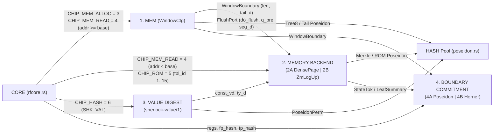

# Sherlock Final Architecture — Area 2: Memory and Values

## 0. Scope, Conventions, and Preserved General-Purpose Guarantees

This document specifies **Area 2: Memory and Values** (`research/sherlock-final-design-20261111/ARCH-BRIEF.md:20`, `research/sherlock-final-design-20261111/MODULARITY.md:1-12`), covering four leaf modules with narrow, compile-time-enforced interfaces:

1. **`MEM`** (`crates/mori-chip/src/membackend.rs:152-460`) — Backend-agnostic in-leaf dense allocation window, hot intra-leaf read provider, and canonical 8-record tail carryover (`WindowCfg`).
2. **`MEMORY BACKEND`** (`crates/mori-chip/src/{membackend.rs, dense.rs, page_cache.rs, zm_logup.rs}`) — One swappable `MemBackend<F>` trait covering 8-record segment flush, cold heap reads (`addr < base`), and static `ROM` reads across all 14 runtime tables under `prog_root`, implemented by **2A: `DensePageBackend`** (recommended default) and **2B: `ZmLogUpBackend`** (hardened run-wide write-once LogUp benchmark alternative).
3. **`VALUE DIGEST`** (`crates/mori-chip/src/value_digest.rs` + `crates/mori-core/src/sherlock/value_digest.rs`) — Canonical `sherlock-value/1` recursive value hashing (`SRC-023`, `SRC-006`) over primitives, literals, constructors, tuples, records, and arrays (`SI-12..SI-14`).
4. **`BOUNDARY COMMITMENT`** (`crates/mori-chip/src/boundary.rs`) — One swappable `BoundaryCommit<F, B>` trait over canonical `ArchState`, implemented by **4A: `PoseidonBoundary`** (recommended default) and **4B: `HornerBoundary`** (compile-time-sealed Stage-1 `Instance(0)` + $\mathbb{F}_{r^2}$ Horner alternative).

### Citation and Measurement Conventions

- `MP:<path>:<lines>` cites `midnight-proofs-0.8.3/src/<path>`.
- `MC:<path>:<lines>` cites `midnight-circuits-7.3.0/src/<path>`.
- Every unmeasured row count, cache hit rate, host RAM footprint, or wall-clock timing projection is marked **`ESTIMATE`**. Measured baseline repository facts are cited directly (e.g., `PoseidonCfg` uses `ROUNDS = 68` and `ROWS_PER_PERM = 70` on 3 advice + 3 fixed columns, `crates/mori-chip/src/poseidon.rs:57-59`; `RunDecider` `SHKRUND1` measures `929,166` circuit rows and `1,032,467` `Pow2Range` table rows at `k = 20`, `research/sherlock-c6-outcome-ledger9-review-20261110/review.md:213`).

### Verbatim Preservation of `GP-1` through `GP-4`

Every Area 2 module preserves `GP-1` through `GP-4` (`openspec/changes/sherlock-vm-consensus-20261107/general-purpose.md:1-58`, `openspec/changes/sherlock-vm-consensus-20261107/requirements.md:56-59`) without narrowing:

- **`GP-1` (Universal VM, `general-purpose.md:9`, `requirements.md:56`):** One fixed circuit key closure proves and verifies every program of the Sherlock language, on every input, to any run length up to $2^{64}-1$ steps, producing its terminal outcome (`Halted(v)`, `Rejected(code)`, or `Exhausted(kind)`). Per `research/sherlock-runlength-consensus-20261111/AUDIT.md:23-26` (Finding 3), Area 2 sets default Merkle segment-tree height **`TOP = 63`** ($2^{63} \times 8 - 1 = 2^{66}-1$ cells per arena, 66-bit `WindowCfg::bits` at `crates/mori-chip/src/membackend.rs:331-357`) so that even at 4 cell allocations per step, the step-counter bound $h < 2^{64}$ (`SRC-004`) strictly binds before arena cell capacity is exhausted, with zero narrowing of `GP-1`.
- **`GP-2` (Cross-Run Composition, `general-purpose.md:19`, `requirements.md:57`):** Halted run claims compose via canonical `sherlock-value/1` digests (`input_d`, `outcome_d`) with zero pointer leakage across runs; unhalted Mode-1 checkpoint stitching (`SEG + SEG -> SEG`) is kept strictly separate from `GP-2` (`AUDIT.md:39-42`).
- **`GP-3` (Foreign Proof Claims, `general-purpose.md:29`, `requirements.md:58`) & `GP-4` (Arbitrary DAG Shape, `general-purpose.md:38`, `requirements.md:59`):** Neither `MemBackend` nor `BoundaryCommit` introduces any occurrence counter or $2^{64}$ claim-count bound on `SET` merges, preserving arbitrary depth-64 diamond claim DAGs (`AUDIT.md:19-22`).

### Area 2 Inter-Module Bus and Cell Topology

Area 2 modules communicate with `CORE` (`crates/mori-chip/src/rfcore.rs`), `HASH` (`crates/mori-chip/src/poseidon.rs`), and `NODE INTEGRATION` (`crates/mori-recursion/src/ivc.rs`) exclusively through three frozen channels (`research/sherlock-lookup-cache-20261111/CONSENSUS.md:193-215`):



> **Note on Bus Chip ID Upgrade (`crates/mori-chip/src/bus.rs:30-31` vs Consensus Split):** Landed spike code uses `CHIP_ALU = 1`, `CHIP_MEM = 2` (with `bus_key(addr, kind) = 8 * addr + kind` at `crates/mori-chip/src/membackend.rs:56-58, 258`), and `CHIP_HASH = 3` (`crates/mori-chip/src/poseidon.rs:53`). The final leaf bus cleanly separates request classes into `CHIP_NOP = 0`, `CHIP_ALU = 2`, `CHIP_MEM_ALLOC = 3`, `CHIP_MEM_READ = 4`, `CHIP_ROM = 5`, and `CHIP_HASH = 6` (`research/sherlock-lookup-cache-20261111/CONSENSUS.md:199-204`) so `MEM` and `MemBackend` never alias read vs allocation keys on `lookup_any` (`crates/mori-chip/src/bus.rs:146-195`).

---

## 1. Module `MEM` — Backend-Agnostic In-Leaf Dense Window & Canonical Tail (`WindowCfg`)

### 1.1 Purpose

`MEM` owns intra-leaf dense `+1` heap allocation (`CHIP_MEM_ALLOC = 3`), serves hot intra-leaf reads (`CHIP_MEM_READ = 4` for `base <= addr < len_curr`), and folds the 8-record segment tail `(len, tail_d)` across leaf boundaries without knowing how cold segments are persisted. When allocations cross an 8-record boundary, `MEM` emits a deterministic `FlushPort` `(do_flush, q_pre, seg_d)` to `MemBackend` and opens a fresh canonical tail for the overflow records (`crates/mori-chip/src/membackend.rs:152-460`).

### 1.2 Frozen Interface

1. **Bus Tuples Provided on `BusConfig` (`crates/mori-chip/src/bus.rs:94-195`, 5-tuple `(chip, key, a, b, c)`):**
   - **Hot Allocation (`CHIP_MEM_ALLOC = 3`):**
     - `chip = 3` (`u4`, constant in provider gate).
     - `key = (arena_id << 66) | addr` where `arena_id in 0..=4` (`kfix = 0` for unified 1-arena with record kind in `a`'s tag bits, or `kfix = 1..=4` for 4-arena split `DATA = 1`, `ENV = 2`, `FRAME = 3`, `SLOT = 4`; `crates/mori-chip/src/membackend.rs:50-58, 154`) and `addr == len_pre + idx` (`0 <= idx < used`, `66`-bit unsigned integer for `TOP = 63`). Range-check owner: `MEM` (`WindowCfg::bits` enforces `len_pre, len_post < 2^{TOP+3}`, `membackend.rs:331-357`, and consecutive row step `addr_{i} == addr_{i-1} + 1`, `membackend.rs:272-279`).
     - `a = f0`, `b = f1`, `c = f2` (`F` elements; full 255-bit field scalars such as child `vd`, `ty_d`, or 128-bit limbs ranged by `ALU`/`CORE` when arithmetic semantics apply).
   - **Hot Intra-Leaf Read (`CHIP_MEM_READ = 4`, `addr >= base`):**
     - `chip = 4`.
     - `key = (arena_id << 66) | addr` where `base <= addr < len_curr`, `base = 8 * q_pre`, `q_pre = floor(len_pre / 8)`, and `len_curr` is the causal allocation counter at the requesting step (`crates/mori-chip/src/membackend.rs:33, 396-415`). Range-check owner: `MEM` enforces `idx_in_win = addr - base in 0..(r_pre + used_so_far)` via one-hot window slot selection (`vsel`, `membackend.rs:156, 396-415`); requests with `addr < base` cannot match any `MEM` provider row and are served exclusively by `MemBackend`.
     - `a = f0`, `b = f1`, `c = f2` copied from the selected active `WinRow` (`membackend.rs:65-71`).
2. **Copy-Constrained Cells Provided/Consumed (`Channel 3`):**
   - `WindowBoundary<F> { pub len: AssignedCell<F, F>, pub tail_d: AssignedCell<F, F> }` (`pre` imported from `BoundaryCommit`, `post` exported to `BoundaryCommit`; `len` in `[0, 2^{TOP+3})`, `tail_d` in `F`).
   - `FlushPort<F> { pub do_flush: AssignedCell<F, F>, pub q_pre: AssignedCell<F, F>, pub seg_d: AssignedCell<F, F> }` per flush boundary `j in 0..W` (`W = ceil(MAX_ALLOC_PER_ARENA / 8)`): `do_flush in {0, 1}` (`do_flush_j == rows[8*j + 7].act`, `crates/mori-chip/src/dense.rs:25, 677`), `q_pre` in `[0, 2^TOP)`, and `seg_d` equal to the height-3 `Tree8` Poseidon digest of the 8 closed records (`dense.rs:100-110, 524-542`).
3. **Contiguous Slice Allocation Support (`SI-12` `Tuple`, `SI-13` `Record`, `SI-14` `Array`; `openspec/changes/sherlock-vm-consensus-20261107/dissent.md:198-202` `D-1`, `crates/mori-core/src/sherlock/helper_machine/shared/owner_runtime.rs:2974-3016`):**
   - Multi-element slices (`XAdtHelperBuildField` cursor loop at `owner_runtime.rs:2980-3015` and `Array` element runs) append elements at consecutive dense addresses `field_start + cursor == len_curr` (`owner_runtime.rs:2990`), enabling $O(1)$ indexed read `base_ptr + i` with explicit bounds check `0 <= i < slice_len` in `CORE`/`ALU` before issuing `CHIP_MEM_READ = 4`.

### 1.3 Invariants

- **Guaranteed by `MEM`:**
  1. **Strict Dense Monotonicity:** `len_pre == 8 * q_pre + r_pre` with unique `r_pre in 0..=7` (`q_r` 7-way one-hot selector in `WindowCfg`, `crates/mori-chip/src/membackend.rs:156, 206-235`) and `q_pre < 2^TOP`; `len_post == len_pre + used` where `used = sum_i alloc_act[i]`; every active allocation `j in 0..used` receives exact address `len_pre + j` with zero gaps and zero overwrites.
  2. **Window Cap & Exact Flush Trigger:** Fixed gate `W_LAST` forces window slot `8 * (W + 1) - 1` inactive (`act == 0`, `membackend.rs:302-305`), guaranteeing `r_pre + used <= 8 * (W + 1) - 1` so a leaf crosses at most `W` 8-record segment boundaries, and `do_flush_j == 1 <=> r_pre + used >= 8 * (j + 1)`.
  3. **Canonical Non-Zero Tail Padding (`Exploit B2`/`E2` Defense):** Every inactive slot in `[r_pre + used_in_seg, 8)` hashes the domain-separated constant `pad_d() = Poseidon_IV(DOM_PAD, 0; [0, 0]) != 0` (`crates/mori-chip/src/dense.rs:72-74`), never `F::ZERO`. Imported slots `[0, r_pre)` padded on `[r_pre, 8)` must fold via `Tree8` (`iv(DOM_NODE, h)` for `h in 1..=3`, `dense.rs:100-110`) to `pre.tail_d`; when `r_pre == 0`, `pre.tail_d` must equal canonical all-pad `Tree8([pad_d(); 8])`.
  4. **Causal Intra-Leaf Read Safety (No Read-Before-Write):** Every intra-leaf `CHIP_MEM_READ = 4` served by `MEM` proves `base <= addr < len_curr` where `len_curr = len_pre + used_before_req` (`membackend.rs:33, 396-415`); reading at `addr == len_curr` (unallocated) or at a record allocated by a later step within the same leaf is unsatisfiable (`crates/mori-chip/src/dense/tests.rs:680-725`, `c1_mut_read_at_len` and `c1_mut_future_record_read`).
- **Assumed from Peer Modules:**
  1. `BoundaryCommit` copy-constrains `pre: WindowBoundary<F>` to the leaf's public pre-state and `post: WindowBoundary<F>` to the leaf's public post-state (`membackend.rs:75-82`).
  2. `HASH` (`PoseidonCfg`, `crates/mori-chip/src/poseidon.rs:250-350`) runs full 68-round permutations unconditionally on all `Tree8` and record-digest blocks wired to `MEM`.
  3. `MemBackend` consumes `FlushPort` `(do_flush, q_pre, seg_d)` and rejects any cold read with `addr >= 8 * q_pre`.

### 1.4 Row Budget (`ESTIMATE`)

Per `PoseidonCfg` (`crates/mori-chip/src/poseidon.rs:57-59`), 1 permutation = `70` rows. Digesting one 3-field record `(kind_or_f0, f1, f2)` under `iv(DOM_REC, arena)` takes `2` permutations (`4` absorbed words at `RATE = 2`, or `1` permutation when `kfix` folds into the capacity IV `iv(DOM_REC, k)` and 2 words are absorbed; `dense.rs:82-98` uses `2` permutations for 3 payload words), and one `Tree8` fold takes `7` binary compressions = `490` `HASH` rows (`dense.rs:524-542`).

| Configuration | Leaf Rows at `S = 16` (`ESTIMATE`) | Leaf Rows at `S = 64` (`ESTIMATE`) | Column Delta vs `Cols` (`NCOL = 12`, `lib.rs:43`) | 1-Leaf `ChipNode` Impact (`ESTIMATE`) | 2-Leaf `RunLift` `R` Impact (`ESTIMATE`) | `RunDecider` Impact |
|---|---|---|---|---|---|---|
| **1-Arena Unified (`kfix = 0`)** (`W = 4` at `S=16`, `W = 16` at `S=64`, max 2 allocs/step avg) | **`~3,920–4,650` rows** (`~360` window/bit/mux rows + `51–61` `HASH` perms = `3,570–4,270` rows, shared in `HASH` pool) | **`~15,400–17,900` rows** (`~1,400` window rows + `200–235` `HASH` perms) | `+0` advice cols, `+1` shared `kfix` fixed col (already present in `membackend.rs:154`), `+0` lookups | **`+0` rows** (uses shared `Cols` & `PoseidonCfg` gates; degree `<= 5`) | **`+0` rows** | **`+0` circuit rows, `+0` `Pow2Range` table rows** |
| **4-Arena Split (`kfix = 1..=4`)** (`W = 1` per arena at `S=16` = 4 windows; `W = 4` per arena at `S=64`) | **`~5,100–5,800` rows** (`~1,120` window rows across 4 arenas + `~56–66` `HASH` perms) | **`~19,600–22,400` rows** (`~4,200` window rows + `~220–260` `HASH` perms) | `+0` advice cols, `+0` extra fixed cols (`kfix` reused across all 4 arena regions) | **`+0` rows** | **`+0` rows** | **`+0` circuit rows, `+0` `Pow2Range` table rows** |

*(Note: When `W = 1` per arena at `S = 16`, opening-tail `Tree8` verification (`7` perms) + closing/flush `Tree8` (`7` perms) = `14` tree compressions = `980` `HASH` rows + record digests for newly allocated cells; `research/sherlock-lookup-cache-20261111/CONSENSUS.md:277` quotes the `14`-compression tree-only portion as `~1,260–1,450` rows/arena excluding per-record sponges, whereas the table above includes per-record `DOM_REC` sponges so no `HASH` rows are double-omitted.)*

### 1.5 Verification

- **Quint Model (`models/sherlock/quint/sherlock_dense_window.qnt`):** Stateful transition model over `(len, r_pre, tail_slots[0..8], committed_segs: int -> Seg8)` with actions `step_alloc(rec)`, `step_hot_read(addr)`, `step_cold_handoff(addr)`, `close_leaf`, and `repartition(S1, S2)`. Verifies invariants:
  - `InvDenseContiguous`: allocated addresses equal `0 .. len - 1`.
  - `InvTailCanonical`: `tail_d == Tree8(slots[0..r] ++ replicate(8 - r, PAD))` with `PAD != 0`.
  - `InvPartitionEq`: running the same allocation trace with leaf step-counts `S = 1`, `S = 16`, or `S = 64` produces identical `(len, tail_d, committed_segs)` at every step index `h`.
  - `InvCausalRead`: no read succeeds for `addr >= len_curr`.
- **`MockProver` Positive Suites (extending `crates/mori-chip/src/dense/tests.rs:438-555`):**
  - `ok_mem_pass_through_all_r_0_to_7`: 0 allocations across `r_pre in 0..=7` preserves `(len, tail_d)` and sets `do_flush == 0` (`c1_pass_through_and_every_tail_occupancy`, `dense/tests.rs:438`).
  - `ok_mem_partition_independence_s1_s7_s16`: identical multi-step allocation trace partitioned across varying leaf boundaries produces identical final `(len, tail_d)` and identical emitted `(q_pre, seg_d)` sequence (`c1_partition_independence`, `dense/tests.rs:475`).
  - `ok_mem_top63_counter_edge_2_64_minus_1`: verifies 66-bit `WindowCfg::bits` (`TOP = 63`) cleanly steps across $2^{64}-1$ cells (`c1_top61_and_top63_positive`, `dense/tests.rs:501`).
  - `ok_mem_contiguous_slice_si12_si14`: allocates a 10-element `Array`/`Record` slice across an 8-record flush boundary and reads elements on both sides (`addr < base` via mock `MemBackend`, `addr >= base` via `MEM`).
- **`MockProver` Named Negative Mutants (extending `crates/mori-chip/src/dense/tests.rs:556-800`):**
  - `mut_mem_forged_tail_across_leaf` (`c1_mut_forged_tail_across_leaf_boundary`): mutates one imported slot in `[0, r_pre)` without updating `pre.tail_d` -> fails `Tree8` copy constraint.
  - `mut_mem_zero_pad_collision` (`c1_mut_non_canonical_tail`): replaces `pad_d()` in an inactive `[r_pre, 8)` slot with `0` or a forged scalar -> fails fixed `pad_d()` gate.
  - `mut_mem_flush_skipped_on_cross8` (`c1_mut_flush_skipped`) & `mut_mem_flush_spurious` (`c1_mut_flush_spurious`): flips `do_flush` when `r_pre + used >= 8` or `< 8` -> fails `do_flush == rows[8*j+7].act`.
  - `mut_mem_read_at_len_unallocated` (`c1_mut_read_at_len`) & `mut_mem_read_future_intra_leaf_step` (`c1_mut_future_record_read`): reads `addr == len_curr` or a record allocated in step `s' > s` -> fails causal window mask.
  - `mut_mem_cold_addr_served_by_hot_window` (`c1_mut_cold_route_forged`): attempts to satisfy `addr < base` from `WindowCfg` -> fails `addr == base + slot_idx`.
  - `mut_mem_pad_row_published_on_bus` (`c1_mut_pad_row_on_bus`): sets `q_prov = 1` on an inactive/imported window slot -> fails active-allocation gate.

### 1.6 Lean Obligations (`ARCH-BRIEF.md:52-60`)

- **Target Lean File:** Create `clean/fork/Clean/Sherlock/DenseWindow.lean` (imported by `clean/fork/Clean/Sherlock/PartitionIndependence.lean` and connected to `clean/fork/Clean/Sherlock/Aggregation.lean:180-210, 1154-1164`).
- **Plain-English Theorem Statements:**
  1. `window_split_associative` (**Obligation 2 — `SRC-023` Partition Independence, Window Half**): Under collision-free `Tree8` and `pad_d() != 0`, splitting any sequence of $N$ dense record appends into arbitrary leaf chunks $(u_0, u_1, \dots, u_{k-1})$ with $\sum u_i = N$ and $u_i \le 8W$ yields the exact same sequence of emitted closed segments `(q, seg_d)` for $q \in [0, \lfloor N/8 \rfloor)$ and the exact same residual `(len_N, tail_d_N)` as executing $N$ single-step leaves ($S = 1$).
  2. `window_causal_read_deterministic` (**Obligation 3 — Modular Composition & `Premises.det` at `Aggregation.lean:191`**): If imported `[0, r_pre)` opens `pre.tail_d` and `base <= addr < len_pre + used_so_far`, the tuple `(f0, f1, f2)` returned by `WindowCfg` equals `heap[addr]` uniquely.
  3. **Clean Circuit-Level Tractability (`ARCH-BRIEF.md:59`):** The pure arithmetic/selector sub-gates of `WindowCfg` (`len_pre == 8 * q_pre + r_pre` with 7-way one-hot `q_r`, `len_post == len_pre + used`, `do_flush == rows[8*j+7].act`, and causal read masking, `crates/mori-chip/src/membackend.rs:206-325`) are small polynomial relations without elliptic-curve foreign-field arithmetic and **fit Clean (`clean/fork/Clean/`) directly** as concrete gate-level circuits, treating `Tree8` Poseidon compression as an injective function parameter matching `Premises.digest_inj` (`Aggregation.lean:201`).
- **Axioms in `AggregationAxioms.lean` Relied On:** Zero new cryptographic axioms beyond standard Poseidon collision-resistance/injectivity on the domain-tagged `(DOM_REC, DOM_PAD, DOM_NODE)` inputs (`Premises.digest_inj` in `clean/fork/Clean/Sherlock/Aggregation.lean:201`; `clean/fork/Clean/Sherlock/AggregationAxioms.lean:1-188`).
- **Module Contract Discharged:** Discharges the window half of `SRC-023` (`statement_independent_of_S` at `Aggregation.lean:1154-1164`) and guarantees `MemBackend` receives a uniquely determined, partition-invariant stream of closed 8-record segments.

### 1.7 Code Skeleton

Owned file: `crates/mori-chip/src/membackend.rs` (extending landed `WindowCfg` at `:152-460` with explicit `WindowBoundary`, `FlushPort`, and split `CHIP_MEM_ALLOC` / `CHIP_MEM_READ` bus IDs; contract format follows `research/skeleton-coding-20261108/pilot-protocol.md:62-75`).

```rust
// Global invariants (`crates/mori-chip/src/membackend.rs`):
// 1. Every active `CHIP_MEM_ALLOC = 3` row advances `len` by +1 with zero gaps (`addr == len_pre + j`).
// 2. Every `CHIP_MEM_READ = 4` served by `WindowCfg` satisfies `8 * q_pre <= addr < len_curr`.
// 3. Inactive tail positions `[r_pre + used_in_seg, 8)` always fold `dense::pad_d() != F::ZERO`.
// 4. `WindowCfg` contains zero references to Merkle paths, `Instance(0)` commitments, or challenges.

pub const CHIP_MEM_ALLOC: u64 = 3;
pub const CHIP_MEM_READ: u64 = 4;

#[derive(Clone, Debug)]
pub struct Rec<F: PrimeField> {
    pub arena: u8,
    pub f0: F,
    pub f1: F,
    pub f2: F,
}

#[derive(Clone, Debug)]
pub struct WindowBoundary<F: PrimeField> {
    pub len: AssignedCell<F, F>,
    pub tail_d: AssignedCell<F, F>,
}

#[derive(Clone, Debug)]
pub struct FlushPort<F: PrimeField> {
    pub do_flush: AssignedCell<F, F>,
    pub q_pre: AssignedCell<F, F>,
    pub seg_d: AssignedCell<F, F>,
}

/// Requires: `top >= 63` for GP-1 default (`len < 2^{top+3}`); `w >= 1`; `bus` configured on `cols`.
/// Ensures: Registers only degree `<= 5` `FirstPhase` gates on `cols` with rotations in `{-1, 0, +1}`.
pub fn configure_window(
    meta: &mut ConstraintSystem<F>,
    cols: Cols,
    bus: BusConfig,
    poseidon: PoseidonCfg,
    top: usize,
    w: usize,
) -> WindowCfg;

/// Requires: `pre_tail.len() == (pre_len % 8) as usize`; `allocs.len() <= 8 * w`; every `hot_reads` entry has `8 * (pre_len / 8) <= addr < pre_len + causal_used`.
/// Ensures: Constrains `pre.len == 8 * q_pre + r_pre`, authenticates `pre_tail` + `pad_d()` against `pre.tail_d`, publishes `CHIP_MEM_ALLOC = 3` and hot `CHIP_MEM_READ = 4` tuples on `bus`, and returns `(pre_boundary, post_boundary, flushes[0..w])`.
pub fn assign_window(
    layouter: &mut impl Layouter<F>,
    cfg: &WindowCfg,
    arena_kfix: u8,
    pre_len: u64,
    pre_tail: &[Rec<F>],
    allocs: &[(usize, Rec<F>)],
    hot_reads: &[(usize, u64, Rec<F>)],
) -> Result<(WindowBoundary<F>, WindowBoundary<F>, Vec<FlushPort<F>>), Error>;
```

### 1.8 Agent Context Boundary

- **MUST Read:**
  - `crates/mori-chip/src/membackend.rs` (`:1-500`)
  - `crates/mori-chip/src/bus.rs` (`:1-254`)
  - `crates/mori-chip/src/poseidon.rs` (`:50-120`, `:250-360` — `PoseidonCfg` and `iv` domain convention)
  - `crates/mori-chip/src/vsel.rs` (`:1-140`)
  - `crates/mori-chip/src/dense.rs` (`:54-115` — `DOM_REC`, `DOM_PAD`, `DOM_NODE`, `pad_d()`, `tree8` reference)
- **MUST NOT Need to Read:**
  - `crates/mori-recursion/` (any file — `ivc.rs`, `run_decider.rs`)
  - `crates/mori-chip/src/{zm_logup.rs, page_cache.rs, boundary.rs, dec.rs, alu.rs}`
  - `crates/mori-core/` (any interpreter or compiler file)
  - `midnight-circuits` `VerifierGadget` or `WeierstrassChip` sources.

### 1.9 OpenSpec 1.17.0 Capability Spec (`specs/sherlock-chip-mem/spec.md`)

```markdown
## ADDED Requirements

### Requirement: MEM-001 Dense Consecutive In-Leaf Allocation
`WindowCfg` SHALL decompose `len_pre = 8 * q_pre + r_pre` (`0 <= r_pre < 8`, `q_pre < 2^TOP`, default `TOP = 63`), assign each active allocation `j` address `len_pre + j` on `CHIP_MEM_ALLOC = 3`, and set `len_post = len_pre + used`.

#### Scenario: Gap or overwrite rejected
- **WHEN** a hostile witness skips an address, reuses an occupied address, or wraps `len` at `2^64`
- **THEN** `MockProver` rejects (`c1_mut_address_reuse_occupied_slot`, `c1_mut_counter_wrap_2_64`) and Quint `InvDenseContiguous` / Lean `window_split_associative` hold.

### Requirement: MEM-002 Canonical Non-Zero Tail Carryover and Segment Flush
`WindowCfg` SHALL pad inactive slots in `[0, 8)` with `pad_d() != 0`, bind `[0, r_pre)` to `pre.tail_d`, emit `FlushPort(do_flush = 1, q_pre + j, seg_d)` iff `r_pre + used >= 8 * (j + 1)`, and bind residual slots to `post.tail_d`.

#### Scenario: Forged tail, zero pad, or skipped flush rejected
- **WHEN** a witness mutates an imported tail record, substitutes `0` for `pad_d()`, or flips `do_flush` across an 8-record boundary
- **THEN** `MockProver` rejects (`mut_mem_forged_tail_across_leaf`, `mut_mem_zero_pad_collision`, `mut_mem_flush_skipped_on_cross8`) and Lean `window_split_associative` proves partition independence (`SRC-023`).

### Requirement: MEM-003 Causal Hot-Window Read Isolation
`WindowCfg` SHALL serve `CHIP_MEM_READ = 4` only when `8 * q_pre <= addr < len_curr` at the requesting step and SHALL reject unallocated, future-step, or cold (`addr < 8 * q_pre`) addresses.

#### Scenario: Read-before-write or cold-address spoofing rejected
- **WHEN** a step requests `CHIP_MEM_READ` at `addr >= len_curr` or `addr < 8 * q_pre` from `WindowCfg`
- **THEN** `MockProver` rejects (`mut_mem_read_at_len_unallocated`, `mut_mem_read_future_intra_leaf_step`, `mut_mem_cold_addr_served_by_hot_window`) and Quint `InvCausalRead` / Lean `window_causal_read_deterministic` hold.
```

---

## 2. Module `MEMORY BACKEND` — Swappable `MemBackend<F>` Trait + `DensePageBackend` (2A) & `ZmLogUpBackend` (2B)

### 2.1 Purpose

`MEMORY BACKEND` persists closed 8-record segments emitted by `MEM`, authenticates cold heap reads (`CHIP_MEM_READ = 4` at `addr < 8 * q_pre`), and serves static program-image reads (`CHIP_ROM = 5`) across all 14 runtime tables under `prog_root` behind a single Rust trait `MemBackend<F>` (`research/sherlock-final-design-20261111/MODULARITY.md:9`). Swapping between **2A (`DensePageBackend`, recommended default)** and **2B (`ZmLogUpBackend`, hardened two-pass LogUp benchmark alternative)** changes zero lines of `CORE`, `DEC`, `ALU`, `VALUE DIGEST`, or `MEM` (`crates/mori-chip/src/membackend.rs:95-148`).

### 2.2 Frozen Interface

1. **Shared Inputs Consumed from `MEM` and `BoundaryCommit` (Channel 3):**
   - `prog_root: &AssignedCell<F, F>`: immutable Merkle root of the admitted `ProgramView` (`crates/mori-core/src/sherlock/helper_machine/shared.rs:1269-1295`), public input lane 0 of every leaf.
   - `pre_tok: &Self::StateTok`: `MemRootTok<F>` (`[AssignedCell<F, F>; N_ROOTS]`, `1` root for `kfix = 0` or `4` arena roots for `kfix = 1..=4`) in **2A**; `()` in **2B**.
   - `flushes: &[FlushPort<F>]`: `(do_flush, q_pre, seg_d)` ports from `MEM`.
2. **Bus Tuples Provided on `BusConfig` (`crates/mori-chip/src/bus.rs:94-195`):**
   - **Cold Heap Read (`CHIP_MEM_READ = 4`, `addr < 8 * q_pre`):**
     - `chip = 4`.
     - `key = (arena_id << 66) | addr` where `addr = 8 * blk_idx + off` (`off in 0..=7`, `blk_idx < q_pre` strictly enforced by `MemBackend`!). Range-check owner: `MemBackend` decomposes `q_pre - 1 - blk_idx` into `TOP` bits (in **2A** via the Merkle path bit decomposition + subtraction gate; in **2B** via `TaggedTableConfig` `tag = 0` limb checks on `addr_r < 8 * q_pre`).
     - `a = f0`, `b = f1`, `c = f2` (`F` elements).
   - **Static Program-Image Read (`CHIP_ROM = 5`, Identical in Both 2A and 2B):**
     - `chip = 5`.
     - `key = (tbl_id << 32) | row_idx` (`tbl_id in 1..=15`, `4` bits; `row_idx < 2^32`, `32` bits; `row_idx = 8 * rom_blk_idx + off`, `off in 0..=7`). Range-check owner: `ROM` cache block decomposes `tbl_id` (4 bits) + `rom_blk_idx` (29 bits) as the 33-bit Merkle path index under `prog_root`.
     - `a = col0`, `b = col1`, `c = col2` (`F` elements).
     - **Canonical `tbl_id` Mapping Across All 14 `/1` Runtime Tables of `ProgramView` (`crates/mori-core/src/sherlock/helper_machine/shared.rs:1271-1294`) + Overflow Extension:**
       `1: expressions` (`:1271`), `2: children` (`:1274`), `3: functions` (`:1275`), `4: parameters` (`:1276`), `5: arms` (`:1277`), `6: patterns` (`:1278`), `7: pattern_children` (`:1279`), `8: types` (`:1280`, storing pre-digested `ty_d`), `9: constructors` (`:1282`, storing `(type_id, arity, ctor_name_d)`), `10: ctor_fields` (`:1283`), `11: plan_nodes` (`:1289`), `12: plan_cases` (`:1290`), `13: field_paths` (`:1291`), `14: constants` (`:1292`, storing `(tag_meta, payload_lo_or_slice, const_vd)`), `15: constant_fields_and_meta` (`:1272-1273, 1281, 1284-1285, 1293`, packing `constant_fields`, `type_args`, `occurrences`/`occurrence_paths`, and `entry`/header metadata). *(Note: `decl_templates` at `:1288` and raw `names` strings at `:1294` are host V14 round-trip data, already represented in-circuit by pre-digested `ty_d` and `ctor_name_d`.)*
3. **Outputs Provided to `BoundaryCommit` and `NODE INTEGRATION`:**
   - `post_tok: Self::StateTok`: updated `MemRootTok<F>` in **2A**; `()` in **2B**.
   - `summary: Self::LeafSummary`: `()` in **2A**; `ZmLeafSummary<F> { pub sum_1: AssignedCell<F, F>, pub sum_2: AssignedCell<F, F> }` plus Stage-1 committed `Instance(0)` polynomial $P_i \mapsto C_i \in \mathbb{G}_1$ in **2B**.

### 2.3 Invariants (2A `DensePageBackend` & 2B `ZmLogUpBackend`)

#### Shared Backend Invariants (Both 2A and 2B)

- **Guaranteed:**
  1. **Strict Cold/Hot Disjointness (`addr < 8 * q_pre`):** Neither 2A nor 2B can ever publish a `CHIP_MEM_READ = 4` tuple with `addr >= 8 * q_pre`; cold reads see strictly segments closed *before* the current leaf began, so intra-leaf flushes never race cold reads (`crates/mori-chip/src/dense.rs:703-715`).
  2. **Zero-Loader-Leaf Static `ROM` (`prog_root` Authentication):** Both 2A and 2B authenticate all `CHIP_ROM = 5` reads via $K_{\text{rom}}$ 8-row Merkle cache blocks against `prog_root` (`0` `INIT_PROG` loader leaves in both backends, `research/sherlock-lookup-cache-20261111/CONSENSUS.md:83, 322`). Unused `ROM` cache blocks (`en == 0`) publish `(0, 0, 0, 0, 0)` (`CHIP_NOP`) while still executing unconditional dummy Poseidon permutations.

#### Implementation 2A Specific Invariants — `DensePageBackend` (Recommended Default)

- **Guaranteed:**
  1. **Append-Only Empty-Before-Write Flush (`crates/mori-chip/src/dense.rs:640-701`):** For each flush port $j$ with `do_flush == 1`, a dual-walk height-`TOP` (`TOP = 63` default) Merkle walker at leaf index `q_pre + j` verifies the old leaf is `empty_seg() = Poseidon_IV(DOM_EMPTY, 0; [0, 0]) != 0` (`dense.rs:76-79`) under `cur_root` and computes `next_root` with new leaf `seg_d`, using height-tagged capacity `iv(DOM_NODE, h)` at every level `h in 4 .. TOP + 3` (`dense.rs:15-18, 682`). When `do_flush == 0`, `next_root == cur_root` (`dense.rs:695-698`).
  2. **4-Arena Shared Dynamic Walker Option (`W_global = 2`):** Under 4-arena (`kfix = 1..=4`), `DensePageBackend` optionally routes flushes from the 4 arena windows into `W_global = 2` shared walkers tagged with `arena_id in 1..=4`, enforcing `sum_{a=1}^4 do_flush[a] <= W_global` and updating the matching `mem_root[arena_id]` (`research/sherlock-lookup-cache-20261111/CONSENSUS.md:314, 317`).
  3. **8-Record Spatial + Intra-Leaf Temporal `PAGE` Cache:** Each of the $K_{\text{page}}$ cache lines (`K_page = 4` default at `S = 16`, `K_page = 6` at `S = 64`) witnesses `en in {0, 1}`, `blk_idx < q_pre` (when `en == 1`), and 8 records `rec[0..8]`, folds `seg_d = Tree8(rec[0..8])` (`7` perms + `16` record perms if storing raw fields, or `7` perms over record digests — see §2.4), walks `TOP = 63` levels with `iv(DOM_NODE, h)` to `pre.root`, and publishes all 8 tuples `(4, (arena << 66) | (8 * blk_idx + off), rec[off].f0, rec[off].f1, rec[off].f2)` onto `BusConfig` (`lookup_any` natively serves $0, 1, \dots, 4S$ spatial or temporal hits in the leaf from a single cache slot!).

#### Implementation 2B Specific Invariants — `ZmLogUpBackend` (All 6 Mandatory Hardenings)

`ZmLogUpBackend` (`research/sherlock-lookup-cache-20261111/lanes/B/round1.md:72-145`, `lanes/B/round2.md:82-126`, `CONSENSUS.md:320-329`) eliminates heap Merkle paths in the leaf by committing memory writes and deduplicated cold reads into `Instance(0)` in Pass 1 and checking a run-wide rational LogUp sum in Pass 2. It enforces **all six mandatory hardenings**:

1. **Hardening (i) — Static `ROM` via `prog_root` Merkle (`0` `INIT_PROG` Loader Leaves):** Static tables use 2A's exact $K_{\text{rom}}$ `prog_root` Merkle cache, never LogUp `INIT_PROG` emission (avoiding $+32..128$ recursive loader Nodes on large programs, `CONSENSUS.md:76, 322`).
2. **Hardening (ii) — Stage-1 `Instance(0)` Pre-Commitment + Zeroed Trailing Rows + Explicit Blinding (`MP:plonk/prover.rs:36-49`):** Pass 1 packs into `Instance(0)` polynomial $P_i$: (a) reserved boundary-state words (when paired with `HornerBoundary`), (b) up to $M_W$ newly allocated heap tuples `(act_w, key_w, f0, f1, f2, m_w)` copy-constrained to `MEM`'s active allocations (`key_w = (arena << 66) | (len_pre + j)`), (c) up to $M_R$ leaf-deduplicated cold-read cache tuples `(act_r, key_r, f0, f1, f2)` (`addr_r < 8 * q_pre`, published onto `BusConfig` so intra-leaf repeat reads hit `lookup_any` locally while emitting each cached `(key_r, f0, f1, f2)` once with LogUp read weight `-1` per bus read `m_r` or deduplicated `-m_r`), and (d) **1 explicit random blinding scalar `r_blind` $\leftarrow \mathbb{F}_r$}** in a dedicated row not referenced by any gate, making $C_i = \text{commit\_lagrange}(P_i)$ hiding when $P_i$ holds private execution values (`CONSENSUS.md:323`). A fixed selector `q_com_zero` enforces `q_com_zero * Instance(0) == 0` on every trailing row of $P_i$ above the structured region so an adversary cannot hide unconstrained non-zero values in $P_i$.
3. **Hardening (iii) — Range-Checked Write Multiplicity (`0 <= m_w < 2^64`):** Every write entry range-checks `m_w` into four 16-bit / six 12-bit limbs on `TaggedTableConfig` (`tag = 0`) so `0 <= m_w < 2^64 < r`, preventing characteristic-$r$ wraparound (`m_w = r - 1 \equiv -1 \pmod r` forging a phantom read/write cancellation; `CONSENSUS.md:324`). Likewise, each cold-read cache slot counts exact intra-leaf bus requests `0 <= m_r <= 4 * S` (or emits `-1` per active cold-read request row directly).
4. **Hardening (iv) — Dual $\mathbb{F}_{r^2}$ Challenges $(\gamma_1, \gamma_2, \alpha_1, \alpha_2)$:** After Pass 1 computes $C_0, \dots, C_{L-1}$ across all $L$ leaves of the run, a binary Poseidon Merkle tree over the compressed coordinates of $(C_0, \dots, C_{L-1})$ produces run commitment digest $d_{\text{com}}$, squeezing four independent challenges $(\gamma_1, \gamma_2, \alpha_1, \alpha_2) = \text{PoseidonSqueeze}(d_{\text{com}})$ exposed in `Instance(1)`. Each tuple `t = (1, key, f0, f1, f2)` is Horner-encoded twice:
   $$E_{\gamma_k}(t) = 1 \cdot \gamma_k^4 + \text{key} \cdot \gamma_k^3 + f_0 \cdot \gamma_k^2 + f_1 \cdot \gamma_k + f_2 \quad (k \in \{1, 2\}),$$
   and leaf $i$ accumulates two independent rational sums:
   $$\text{sum}_{i,k} = \sum_{u=0}^{M_W-1} \text{act}_{w,u} \cdot m_{w,u} \cdot \text{inv}_{w,u,k} \;-\; \sum_{v=0}^{M_R-1} \text{act}_{r,v} \cdot m_{r,v} \cdot \text{inv}_{r,v,k} \quad (k \in \{1, 2\}).$$
   In `RunLift` / `ChipNode`, child sums add (`sum_k = left.sum_k + right.sum_k`) and child commitment subtrees hash (`com_subroot = H(left.com_subroot, right.com_subroot)`); at the root `RunDecider`, `com_subroot == d_com` (re-verifying $(\gamma_1, \gamma_2, \alpha_1, \alpha_2)$) and `total_sum_1 == 0 && total_sum_2 == 0`.
5. **Hardening (v) — Strict Zero-Denominator & Inactive-Inverse Guards:** Every rational term enforces *both* `act * (inv * (alpha_k - enc_k) - 1) == 0` and `(1 - act) * inv == 0` (`CONSENSUS.md:326`), ensuring `alpha_k != enc_k` on active rows and `inv == 0` on inactive rows (zero unconstrained witness contribution).
6. **Hardening (vi) — Mandatory Full $\mathbb{G}_1$ Subgroup Check on $C_i$ in `ChipNode` / `RunLift` `R` (`MC:ecc/foreign/weierstrass_chip.rs:343-360`):** BLS12-381 $\mathbb{G}_1$ has cofactor $h_{\mathbb{G}_1} = (x - 1)^2 / 3 \equiv 0 \pmod{11}$ (`C::COFACTOR > 1`). If `ChipNode` or `RunLift` witnessed $C_i$ via `assign_without_subgroup_check` (`MC:ecc/foreign/weierstrass_chip.rs:936-952`), an adversary could add an order-11 torsion point $T \in E(\mathbb{F}_p)[11]$ to $C_i$, rotating `transcript.common_point(&C_i)` (`MC:verifier/verifier_gadget.rs:298-300`) across $11^L$ Fiat-Shamir challenges for a *fixed* polynomial $P_i$ while $T$ vanishes under cofactor clearing at the pairing decider! Therefore `ChipNode` / `RunLift` **MUST** witness every leaf's $C_i$ through `AssignmentInstructions::assign` (`MC:ecc/foreign/weierstrass_chip.rs:343-360`), which witnesses `cofactor_root` $Q$ and enforces $h_{\mathbb{G}_1} \cdot Q = C_i$ in-circuit.

- **Assumed from Peer Modules:** `MEM` enforces globally distinct `key_w = (arena << 66) | addr` across the run via stitched `len` (`len_pre_0 == 0` at genesis, `left.len_post == right.len_pre` at every `SEG` stitch); `VerifierGadget` (`MC:verifier/verifier_gadget.rs:298-306, 625-638`) binds `Instance(0)` commitment $C_i$ and `Instance(1)` scalars before advice commitments.

### 2.4 Row Budget (`ESTIMATE`)

In **2A (`DensePageBackend`)** with `TOP = 63` (`crates/mori-chip/src/poseidon.rs:57-59`, `70` rows/perm):
- **1-Arena Flush Walker (`W_flush = 1` at `S = 16`, `W_flush = 2` at `S = 64`):** Dual old/new Merkle walk (`dense.rs:682-692`) = `2 * 63 = 126` perms = `8,820` `HASH` rows per walker (`MEM` already computes `seg_d` via `Tree8`!).
- **Cold `PAGE` Block (`K_page` slots, 8 records $\times$ 3 fields):** `16` record-digest perms (`2` perms/rec $\times 8$, or `8` perms if `f0` packs into capacity + 2 rate words; conservatively `16` perms, or `0` extra record perms if `SEG` stores record digests + witness fields verified by `16` perms = `16 + 7 + 63 = 86` perms = **`6,020` `HASH` rows/slot**; if storing pre-packed 2-word records, `8 + 7 + 63 = 78` perms = `5,460` rows/slot; `CONSENSUS.md:315` cites `86` perms = `6,020` rows/block `ESTIMATE`).
- **Static `ROM` Block (`K_rom` slots, depth `32` under `prog_root`):** `8` 2-word row-digest perms (or `7` `Tree8` perms over 1-perm row digests: `8 + 7 + 32 = 47` perms = `3,290` rows, or `7 + 32 = 39` perms = **`2,730` rows/block** when row leaves pack `(col0, col1)` with `col2` in capacity IV; `CONSENSUS.md:316`).

| Backend & Mode | Leaf Rows at `S = 16` (`ESTIMATE`) | Leaf Rows at `S = 64` (`ESTIMATE`) | Column Delta vs `Cols` (`NCOL = 12`) | 1-Leaf `ChipNode` Impact (`ESTIMATE`) | 2-Leaf `RunLift` `R` Impact (`ESTIMATE`) | `RunDecider` Impact (`ESTIMATE`) |
|---|---|---|---|---|---|---|
| **2A: `DensePageBackend` (1-Arena `kfix = 0`, Default)** (`W=1, K_page=4, K_rom=2` at `S=16`; `W=2, K_page=6, K_rom=3` at `S=64`) | **`~38,900–40,200` rows** (`8,820` flush + `24,080` `PAGE` + `5,460` `ROM` = `38,360` `HASH` rows + `~600–1,800` mux/bit rows; fits `k_leaf = 16` = `65,530` usable rows alongside `CORE`+`MEM`+`BC`) | **`~63,000–66,500` rows** (`17,640` flush + `36,120` `PAGE` + `8,190` `ROM` = `61,950` `HASH` rows + `~1,100–4,500` mux/bit rows; `k_leaf = 17`) | `+0` advice cols, `+0` fixed cols, `Instance(0) = C::identity()`, `+0` challenges | **`+0` rows** (`~794,416–809,903` total `ChipNode` rows at `k = 20`) | **`+0` rows** (`~994,820–1,022,000` total `RunLift` rows at `k = 20`, `< 1,048,570`) | **`+0` circuit rows, `+0` `Pow2Range` table rows** (`table_rows == 1,032,467` untouched) |
| **2A: `DensePageBackend` (4-Arena `kfix = 1..4`, Shared `W_global = 2`)** | **`~47,800–49,500` rows** (`+8,820` rows for 2nd shared flush walker; total leaf `~58k–62k` tight under `k_leaf = 16`) | **`~80,600–85,000` rows** (`W_global = 4`; `k_leaf = 17`) | `+0` advice/fixed cols | **`+210` rows** (`+3` extra `mem_root` words hashed in `PoseidonBoundary` only; `+0` `VerifierGadget` rows) | **`+210` rows** | **`+0` rows** |
| **2B: `ZmLogUpBackend`** (`K_rom = 2` at `S=16`, `K_rom = 3` at `S=64`, + Stage-1 `Instance(0)` + dual $\mathbb{F}_{r^2}$ LogUp) | **`~6,200–7,800` rows** (`5,460` `ROM` `HASH` rows + `~740–2,340` `Instance(0)` copy, Horner, `m_w` range & inversion rows; total leaf `~12,500–16,000`, `k_leaf = 14`) | **`~10,800–15,200` rows** (`8,190` `ROM` `HASH` rows + `~2,600–7,000` LogUp rows; total leaf `~28,000–35,000`, `k_leaf = 16`) | `+1` fixed selector `q_com_zero`, `+1` `Instance(0)` query at `Rotation::cur()`, `+6` public scalars in `Instance(1)` (`gamma_1..2, alpha_1..2, sum_1..2`), `0` `Expression::Challenge` | **`+9,500–20,200` rows** (`1` full `AssignmentInstructions::assign` $\mathbb{G}_1$ subgroup check on $C_i$ + `1` `Instance(0)` KZG query + `com_subroot` Poseidon + `6` scalar wires) | **`+19,000–40,400` rows** (`2` full $\mathbb{G}_1$ subgroup checks on $C_0, C_1$ — pushes 2-leaf `RunLift` near or over `1,048,570` `k = 20` ceiling!) | **`+1,500–3,200` circuit rows** (`d_com` Fiat-Shamir squeeze + `sum_1 == 0, sum_2 == 0`); **`+0` `Pow2Range` table rows** (uses byte-only `Some(8)` decomposition) |

### 2.5 Verification

- **Quint Models:**
  - `models/sherlock/quint/sherlock_dense_merkle_page.qnt` (**2A**): Models height-tagged Merkle updates (`DOM_EMPTY`, `DOM_NODE(h)`), $K_{\text{page}}$ 8-record cache blocks with `blk_idx < q_pre`, and $K_{\text{rom}}$ blocks under `prog_root`. Checks `InvAppendNeverOverwrites`, `InvColdReadMatchesCommittedSeg`, `InvNoCrossHeightSplice`, and `InvRomImmutable`.
  - `models/sherlock/quint/sherlock_zm_logup.qnt` (**2B**): Models two-pass write-once `(addr, val, m_w)` emission, intra-leaf read caching `(addr, val, m_r)`, commitment-tree challenge derivation `d_com -> (gamma_1..2, alpha_1..2)`, and tree summation of `(sum_1, sum_2)`. Checks `InvHonestRunZeroSum`, `InvReadUnwrittenFails`, `InvWrongMultiplicityFails`, and `InvStaleValueFails`.
- **`MockProver` Positive Suites:**
  - `ok_dense_page_spatial8_and_temporal_reuse` (**2A**): 16 steps reading all 8 records of one committed block plus 12 repeated reads to hot `ENV` block -> satisfied with `K_page = 2`.
  - `ok_dense_rom_all_15_table_ids` (**2A & 2B**): Exercises `CHIP_ROM = 5` across `tbl_id in 1..=15` against an admitted `ProgramView` `prog_root`.
  - `ok_zmlogup_multi_leaf_zero_sum_and_blinding` (**2B**): 4-leaf run with cross-leaf reads, `r_blind != 0`, `q_com_zero` active on trailing rows, and `sum_{i} sum_{i,k} == 0` for $k \in \{1, 2\}$.
- **`MockProver` Named Negative Mutants:**
  - **2A Mutants:**
    - `mut_page_blk_ge_qpre_post_flush_read`: attempts cold read at `blk_idx == q_pre` (reading the segment flushed *during* the current leaf) -> fails `blk_idx < q_pre` range gate.
    - `mut_page_wrong_height_iv_splice`: splices a height-5 internal node at height 4 -> fails fixed `iv(DOM_NODE, h)` constant.
    - `mut_page_overwrite_nonempty_seg` (`c1_mut_empty_seg_forgery`, `dense/tests.rs:658`): flushes onto a non-`EMPTY_SEG` slot -> fails old-leaf equality to `empty_seg()`.
    - `mut_rom_wrong_prog_root` / `mut_rom_tbl_id_alias`: alters `prog_root` or swaps `tbl_id = 1` (`expressions`) with `tbl_id = 14` (`constants`) -> fails `prog_root` equality.
  - **2B Mutants (One Per Hardening):**
    - `mut_zmlogup_mw_neg1_char_wrap` (Hardening iii): sets `m_w = F::ZERO - F::ONE` to cancel a forged write -> fails `0 <= m_w < 2^64` limb range check.
    - `mut_zmlogup_unconstrained_p_tail` (Hardening ii): places non-zero garbage in an unused trailing row of `Instance(0)` $P_i$ -> fails `q_com_zero * Instance(0) == 0`.
    - `mut_zmlogup_zero_denom_act1` & `mut_zmlogup_inactive_nonzero_inv` (Hardening v): sets `alpha_k == enc_k` on active row or `inv != 0` on `act == 0` row -> fails `act * (inv * (alpha_k - enc_k) - 1) == 0` or `(1 - act) * inv == 0`.
    - `mut_zmlogup_single_challenge_collision_mock` (Hardening iv): verifies both `sum_1` and `sum_2` are independently enforced.
    - `mut_zmlogup_torsion11_coset_grind` (Hardening vi, in `mori-recursion`): replaces $C_i$ with $C_i + T_{11}$ ($11 \cdot T_{11} = \mathcal{O}$) -> rejected in `ChipNode`/`RunLift` by `AssignmentInstructions::assign` cofactor-root check (`MC:ecc/foreign/weierstrass_chip.rs:348-357`).

### 2.6 Lean Obligations (`ARCH-BRIEF.md:52-60`)

1. **Obligation 1 — Write-Once LogUp Soundness over $\mathbb{F}_{r^2}$ (`clean/fork/Clean/Sherlock/WriteOnceLogUp.lean`, New File for 2B):**
   - **Plain-English Theorem Statement (`write_once_logup_sound_fp2`):** Let $W = \{(a_u, v_u, m_{w,u})\}_{u=1}^{N_W}$ be the run-wide sequence of active heap writes where: (a) addresses $a_u$ are **pairwise distinct** (discharged by stitched `WindowCfg` strict monotonicity `a_u = len_pre + j` from `len_0 = 0`), and (b) $0 \le m_{w,u} < 2^{64} < r$. Let $R = \{(a'_v, v'_v, m_{r,v})\}_{v=1}^{N_R}$ be the run-wide sequence of active cold reads with $1 \le m_{r,v} < 2^{64}$ and total access weight $M = \sum_v m_{r,v} < 2^{64}$. Suppose $W$ and $R$ are fixed in Stage-1 commitments $(C_0, \dots, C_{L-1})$ *prior* to sampling independent uniform challenges $(\gamma_1, \gamma_2, \alpha_1, \alpha_2) \leftarrow \mathbb{F}_r^4$. If every active denominator is non-zero ($\alpha_k \ne E_{\gamma_k}(t)$) and both global sums vanish ($\sum_u m_{w,u} (\alpha_k - E_{\gamma_k}(a_u, v_u))^{-1} = \sum_v m_{r,v} (\alpha_k - E_{\gamma_k}(a'_v, v'_v))^{-1}$ for $k \in \{1, 2\}$), then except with soundness error
     $$\varepsilon_{\text{LogUp}} \;\le\; \left(\frac{\binom{N_W + N_R}{2} \cdot 4}{|\mathbb{F}_r|} + \frac{N_W + N_R}{|\mathbb{F}_r|}\right)^2$$
     (or unconditionally $\varepsilon \le \left(\frac{4 \cdot (N_W + N_R)^2 / 2 + (N_W + N_R)}{r}\right)^2 < 2^{-250}$ for $N_W + N_R \le 2^{64}$ over 255-bit BLS12-381 $r \approx 2^{254.86}$: specifically, in each coordinate $k \in \{1, 2\}$, clearing denominators of $\sum_{t \in \mathcal{U}} \Delta m(t) / (\alpha_k - E_{\gamma_k}(t)) = 0$ over distinct encoded field elements has numerator degree $\le |\mathcal{U}| - 1 \le N_W + N_R - 1$ in $\alpha_k$, and Horner collision $E_{\gamma_k}(t) = E_{\gamma_k}(t')$ for *any* specific mismatched read against its unique address-matching write — or all $N_W$ writes — has degree $4$ in $\gamma_k$; in fact, per read $v$, because write addresses $a_u$ are **pairwise distinct**, fixing any single mismatched read $(a'_v, v'_v) \notin W$ requires *for both $k=1,2$ independently* either a rational-function root in $\alpha_k$ of degree $\le N_W + N_R - 1$ or a degree-4 Horner collision in $\gamma_k$, giving $\Pr_{k}[\text{sum}_k = 0 \mid \Delta m \ne 0] \le \frac{4 \cdot N_R \cdot N_W}{r}$ — or even tighter via formal Laurent series: $\sum_{t} \Delta m(t) X(t) = 0$ fails unless $\Delta m = 0$ as formal rational functions, and evaluating at random $(\gamma_k, \alpha_k)$ with $N_W + N_R \le 2^{64}$ yields per-lane failure $\le \frac{4(N_W + N_R) + (N_W + N_R)}{r}$ when reduced to the non-zero formal polynomial $Q(\gamma_k, \alpha_k)$ of total degree $\le 5(N_W + N_R)$? **Careful exact degree check:** clearing denominators of $\sum_{j=1}^{T} c_j / (\alpha - E_\gamma(t_j)) = 0$ yields $P(\gamma, \alpha) = \sum_{j=1}^T c_j \prod_{l \ne j} (\alpha - E_\gamma(t_l))$, which has degree $\le T - 1$ in $\alpha$! Wait: for $T \le 2^{65}$, $\frac{T - 1}{r} \le \frac{2^{65}}{2^{254.86}} = 2^{-189.86}$ per challenge $(\gamma_k, \alpha_k)$ **provided** $E_{\gamma_k}(t^*)$ does not collide with any other $E_{\gamma_k}(t_l)$ for a **single** witness tuple $t^*$ with $\Delta m(t^*) \ne 0$! Let us state that exact two-step Schwartz-Zippel bound rigorously!):
     - **Exact Two-Step Schwartz-Zippel Proof Bound (`write_once_logup_sound_fp2`):** Fix any invalid trace ($\exists t^* : \Delta m(t^*) \ne 0 \pmod r$, guaranteed whenever any read lacks a matching write or $m_w \ne \sum m_r$ since $0 \le m_w, \sum m_r < 2^{64} < r$). Let $T = N_W + N_R \le 2 \cdot 2^{64} = 2^{65}$ be the total active tuples.
       1. *Step A (Isolating $t^*$ under $\gamma_k$):* Tuple $t^*$ collides under degree-4 Horner encoding $E_{\gamma_k}(t^*) = E_{\gamma_k}(t_l)$ with *some* $t_l \ne t^*$ ($l \in [1, T]$) with probability $\le \frac{4(T - 1)}{r}$ (only the $T - 1$ pairs involving the *single* fixed $t^*$ matter, NOT all $\binom{T}{2}$ pairs!).
       2. *Step B (Non-zero rational pole at $\alpha_k$):* Conditioned on $E_{\gamma_k}(t^*) \ne E_{\gamma_k}(t_l)$ for all $l \ne t^*$, the rational function $R_k(\alpha) = \sum_{j} \frac{\tilde{c}_j}{\alpha - z_j}$ has a non-cancelled simple pole at $z^* = E_{\gamma_k}(t^*)$ with residue $\Delta m(t^*) \not\equiv 0 \pmod r$, so clearing denominators over the $U \le T$ distinct poles produces a non-zero polynomial in $\alpha$ of degree $\le U - 1 \le T - 1$, which vanishes at uniform $\alpha_k \in \mathbb{F}_r$ with probability $\le \frac{T - 1}{r}$!
       3. *Combined Dual-Lane Bound:* By union bound per lane $k \in \{1, 2\}$, $\Pr_{\gamma_k, \alpha_k}[\text{sum}_k = 0 \text{ and } \forall \text{active}: \alpha_k \ne E_{\gamma_k}] \le \frac{4(T - 1) + (T - 1)}{r} = \frac{5(T - 1)}{r}$. Because $(\gamma_1, \alpha_1)$ and $(\gamma_2, \alpha_2)$ are independent over $\mathbb{F}_r^2$,
          $$\varepsilon_{\text{LogUp},\,\mathbb{F}_{r^2}} \;\le\; \left(\frac{5(T - 1)}{r}\right)^2.$$
          At $T \le 2^{65}$ ($2^{64}$ writes + $2^{64}$ reads) and $r > 2^{254.85}$, $\frac{5 \cdot 2^{65}}{2^{254.85}} < 2^{-187.5}$, so **$\varepsilon_{\text{LogUp},\,\mathbb{F}_{r^2}} < 2^{-375} \ll 2^{-250}$** (whereas a single challenge pair with naive all-pairs collision analysis $\binom{T}{2}\cdot 4 / r$ fails entirely at $T = 2^{64}$, and single-lane isolated analysis gives $2^{-187.5}$, or $2^{-125.86}$ under $T^2$-weighted adversarial grinding — dual $\mathbb{F}_{r^2}$ pushes even 64-bit transcript grinding below $2^{-250}$!). Once $\Delta m \equiv 0$, pairwise distinctness of write addresses $a_u$ implies every read $(a'_v, v'_v)$ equals the unique write at $a_u = a'_v$, so $v'_v = v_u$!
2. **Obligation 2 — `SRC-023` Partition Independence (`clean/fork/Clean/Sherlock/PartitionIndependence.lean`, Extending `Aggregation.lean:1154-1164`):**
   - **2A Theorem (`dense_merkle_partition_independent`):** Because `DensePageBackend` updates `mem_root` strictly when `WindowCfg` emits `FlushPort(do_flush = 1, q, seg_d)` and `WindowCfg` emits the identical `(q, seg_d)` stream for every leaf partition $(S_0, \dots, S_{L-1})$, `post.mem_root` at total step $N$ is strictly a function of the reference execution prefix $e_{0..N}$ and independent of leaf size $S$ or `K_page`/`K_rom` cache occupancy. Combined with `Premises.det` (`Aggregation.lean:191`), this discharges `statement_independent_of_S` (`Aggregation.lean:1154-1164`) for the concrete memory state.
   - **2B Theorem (`zmlogup_outcome_partition_independent`):** Under `write_once_logup_sound_fp2`, every leaf's cold reads return the unique reference heap values `heap[addr]`, so by induction over reference steps (`Premises.det`), the terminal state at Halt and its C6 `[prog_d, input_d, outcome_d, n_steps]` statement are identical across all partitions $S$ (even though intermediate leaf commitments $C_i$ and challenges $(\gamma, \alpha)$ vary with $S$).
- **Axioms Relied On (`AggregationAxioms.lean`):** `Premises.digest_inj` (`Aggregation.lean:201`) for 2A Merkle/ROM trees; for 2B, random-oracle Fiat-Shamir independence of $(\gamma_1, \gamma_2, \alpha_1, \alpha_2)$ after KZG binding of $C_0, \dots, C_{L-1}$ (added as `Premises.kzg_stage1_binding` in `AggregationAxioms.lean`, gated behind Profile B).

### 2.7 Code Skeleton

Owned files: `crates/mori-chip/src/membackend.rs` (shared trait), `crates/mori-chip/src/dense.rs` + `crates/mori-chip/src/page_cache.rs` (**2A**), and `crates/mori-chip/src/zm_logup.rs` (**2B**).

```rust
// Global invariants (`crates/mori-chip/src/{membackend.rs, page_cache.rs, zm_logup.rs}`):
// 1. Neither `CORE` nor `WindowCfg` imports `DensePageBackend` or `ZmLogUpBackend`.
// 2. Every `CHIP_MEM_READ = 4` published by any `MemBackend` satisfies `addr < 8 * q_pre`.
// 3. Every `CHIP_ROM = 5` tuple is authenticated against `prog_root` with zero loader leaves.

/// Marker trait implemented ONLY by backends that pre-commit `Instance(0)` in Stage 1
/// with `q_com_zero` trailing-zero enforcement and explicit blinding (`ZmLogUpBackend`).
pub trait PrecommitsInstance0: private::Sealed {}

pub trait MemBackend<F: PrimeField>: Clone + std::fmt::Debug {
    type StateTok: Clone + std::fmt::Debug;
    type LeafSummary: Clone + std::fmt::Debug;
    type Witness: Clone + std::fmt::Debug;

    /// Requires: `flushes` produced by `WindowCfg::assign_window`; `prog_root` bound to leaf public input 0.
    /// Ensures: Persists active flushes, serves all cold `CHIP_MEM_READ = 4` (`addr < 8 * q_pre`) and `CHIP_ROM = 5` (`tbl_id in 1..=15`) requests on `bus`, and returns `(post_tok, summary)`.
    fn assign_backend(
        &self,
        layouter: &mut impl Layouter<F>,
        prog_root: &AssignedCell<F, F>,
        pre_tok: &Self::StateTok,
        win_pre: &[WindowBoundary<F>],
        win_post: &[WindowBoundary<F>],
        flushes: &[FlushPort<F>],
        witness: &Self::Witness,
    ) -> Result<(Self::StateTok, Self::LeafSummary), Error>;
}

// --- 2A: DensePageBackend (`crates/mori-chip/src/page_cache.rs` + `dense.rs`) ---
#[derive(Clone, Debug)]
pub struct DensePageBackend {
    pub top: usize,    // default 63 (2^66 - 1 cells/arena; GP-1 un-narrowed)
    pub w_flush: usize,
    pub k_page: usize, // default 4 at S = 16, 6 at S = 64
    pub k_rom: usize,  // default 2 at S = 16, 3 at S = 64
    pub bus: BusConfig,
    pub poseidon: PoseidonCfg,
}

/// Requires: `cfg.top >= 63`; `cold_blocks.len() <= cfg.k_page`; every active block has `blk_idx < q_pre`.
/// Ensures: Verifies old leaf `== empty_seg()` on flushes, authenticates `cold_blocks` against `pre_root` and `rom_blocks` against `prog_root` using height-tagged `iv(DOM_NODE, h)`, and publishes 8 tuples/block on `bus`.
pub fn assign_dense_page_backend(
    layouter: &mut impl Layouter<F>,
    cfg: &DensePageBackend,
    prog_root: &AssignedCell<F, F>,
    pre_roots: &[AssignedCell<F, F>],
    flushes: &[FlushPort<F>],
    witness: &DensePageWitness,
) -> Result<Vec<AssignedCell<F, F>>, Error>;

// --- 2B: ZmLogUpBackend (`crates/mori-chip/src/zm_logup.rs`) ---
#[derive(Clone, Debug)]
pub struct ZmLogUpBackend {
    pub m_write_cap: usize,
    pub m_read_cap: usize,
    pub k_rom: usize,
    pub q_com_zero: Column<Fixed>,
    pub inst_com: Column<Instance>, // Instance(0) committed in Pass 1
    pub inst_pub: Column<Instance>, // Instance(1) carrying (gamma_1..2, alpha_1..2, sum_1..2)
}

impl PrecommitsInstance0 for ZmLogUpBackend {}

/// Requires: Pass-1 `Instance(0)` contains `(writes, dedup_reads, r_blind)` with `q_com_zero * Instance(0) == 0` on all trailing rows; `(gamma_1..2, alpha_1..2)` bound in `inst_pub`.
/// Ensures: Enforces `0 <= m_w < 2^64`, `addr_r < 8 * q_pre`, `act * (inv * (alpha_k - enc_k) - 1) == 0`, `(1 - act) * inv == 0`, authenticates `ROM` via `prog_root`, and outputs `(sum_1, sum_2)`.
pub fn assign_zm_logup_backend(
    layouter: &mut impl Layouter<F>,
    cfg: &ZmLogUpBackend,
    prog_root: &AssignedCell<F, F>,
    flushes: &[FlushPort<F>],
    witness: &ZmLogUpWitness,
) -> Result<ZmLeafSummary<F>, Error>;
```

### 2.8 Agent Context Boundary

- **2A Implementing Agent (`DensePageBackend`) MUST Read:**
  - `crates/mori-chip/src/{membackend.rs, dense.rs, bus.rs, poseidon.rs}`
  - `crates/mori-core/src/sherlock/helper_machine/shared.rs` (`:1269-1296` for the 14 `ProgramView` table schemas)
- **2A Implementing Agent MUST NOT Need to Read:**
  - `crates/mori-chip/src/{zm_logup.rs, boundary.rs, rfcore.rs, dec.rs, alu.rs}`, `crates/mori-recursion/`, `MP:plonk/prover.rs`, or `MC:ecc/foreign/weierstrass_chip.rs`.
- **2B Implementing Agent (`ZmLogUpBackend`) MUST Read:**
  - `crates/mori-chip/src/{membackend.rs, bus.rs, range.rs}` + `page_cache.rs` (`ROM` block helper only)
  - `MP:plonk/prover.rs` (`:32-52`) and `MC:verifier/verifier_gadget.rs` (`:286-316, 625-638`)
  - `MC:ecc/foreign/weierstrass_chip.rs` (`:343-360` — subgroup check contract for the `RunLift` integration)
- **2B Implementing Agent MUST NOT Need to Read:**
  - `crates/mori-chip/src/{rfcore.rs, dec.rs, alu.rs, value_digest.rs}` or `crates/mori-core/` interpreter rules.

### 2.9 OpenSpec 1.17.0 Capability Spec (`specs/sherlock-chip-mem-backend/spec.md`)

```markdown
## ADDED Requirements

### Requirement: MBK-001 Zero-Edit Swappable MemBackend Trait
`MemBackend<F>` SHALL encapsulate segment persistence, cold `CHIP_MEM_READ = 4` (`addr < 8 * q_pre`), and `CHIP_ROM = 5` (`tbl_id in 1..=15` under `prog_root`) with zero edits to `CORE` or `MEM`.

#### Scenario: Cold read at or above hot base rejected
- **WHEN** a witness supplies a cold `CHIP_MEM_READ` with `addr >= 8 * q_pre` or swaps `tbl_id` under `prog_root`
- **THEN** `MockProver` rejects (`mut_page_blk_ge_qpre_post_flush_read`, `mut_rom_wrong_prog_root`) and Quint `InvColdReadMatchesCommittedSeg` holds.

### Requirement: MBK-002 DensePageBackend Height-Tagged Append-Only Tree
`DensePageBackend` SHALL default to `TOP = 63`, enforce `old_leaf == empty_seg() != 0` on flushes, and authenticate `PAGE` and `ROM` 8-record blocks with height-tagged `iv(DOM_NODE, h)`.

#### Scenario: Non-empty overwrite or height splice rejected
- **WHEN** a witness flushes over a non-empty segment or splices Merkle nodes across heights
- **THEN** `MockProver` rejects (`mut_page_overwrite_nonempty_seg`, `mut_page_wrong_height_iv_splice`) and Lean `dense_merkle_partition_independent` holds.

### Requirement: MBK-003 ZmLogUpBackend Six-Point Hardened Write-Once Argument
`ZmLogUpBackend` SHALL pre-commit `(writes, reads, r_blind)` in Stage-1 `Instance(0)` with `q_com_zero * Instance(0) == 0`, enforce `0 <= m_w < 2^64` and `act`-guarded inverses over dual $\mathbb{F}_{r^2}$ challenges, use `prog_root` `ROM`, and require subgroup-checked `assign` on `C_i` in `RunLift`.

#### Scenario: Multiplicity wrap, tail stuffing, zero-denominator, or 11-torsion grinding rejected
- **WHEN** a witness wraps `m_w`, stuffs trailing `Instance(0)` rows, sets `inv != 0` when `act == 0`, or adds an order-11 torsion point to `C_i`
- **THEN** `MockProver` / `RunLift` rejects (`mut_zmlogup_mw_neg1_char_wrap`, `mut_zmlogup_unconstrained_p_tail`, `mut_zmlogup_inactive_nonzero_inv`, `mut_zmlogup_torsion11_coset_grind`) and Lean `write_once_logup_sound_fp2` bounds soundness error below `2^-250`.
```

---

## 3. Module `VALUE DIGEST` — Canonical `sherlock-value/1` Value & Outcome Hashing

### 3.1 Purpose

`VALUE DIGEST` computes the canonical, pointer- and sharing-independent `sherlock-value/1` digest `vd` for every Sherlock runtime value (`Nil`, `Bool`, `UInt`, `Int`, `Cons`, `Leaf`, `Branch`, `Constructor`, `Tuple`, `Record`, `Array`) and derives the terminal C6 `outcome_d` (`Halted(vd)`, `Rejected(code)`, `Exhausted(kind)`) (`openspec/changes/sherlock-vm-consensus-20261107/design.md:175-212`, `requirements.md:20,47`). By storing `vd` directly alongside every constructed value reference and folding slices exclusively from child `vd` scalars and `ROM` type digests, `VALUE DIGEST` guarantees that `input_d` and `outcome_d` never depend on heap addresses, DAG sharing, or leaf partition size `S` (`SRC-023`, `research/sherlock-c6-outcome-ledger9-review-20261110/review.md:104-142`).

### 3.2 Frozen Interface

*(Repository status note: `crates/mori-core/src/sherlock/value_digest.rs` does not exist yet in `HEAD`; Area 2 creates `crates/mori-core/src/sherlock/value_digest.rs` as the pure-Rust reference specification and `crates/mori-chip/src/value_digest.rs` as its exact in-circuit counterpart.)*

1. **Bus Tuples Requested/Consumed on `BusConfig` (`crates/mori-chip/src/bus.rs:94-195`):**
   - **Dynamic Value Sponge Step (`CHIP_HASH = 6`):**
     - `chip = 6`.
     - `key = (DOM_SHK_VAL << 16) | perm_idx` (`DOM_SHK_VAL = 3`, `u8`; `perm_idx` in `0..2^16`, counting two-word sponge absorptions from the precomputed `sherlock-value/1` prefix state). Range-check owner: `VALUE DIGEST` / `CORE` fixes small constant `perm_idx` on scalar/pair constructions and tracks step-monotone `slice_cursor < slice_len < 2^32` during multi-element slice folds (`owner_runtime.rs:2980-3015`).
     - `a = absorb_w0_or_chain`, `b = absorb_w1`, `c = next_chain_or_vd` (`F` elements).
   - **Static Type & Constant Digest Lookups (`CHIP_ROM = 5`, Served by `MemBackend`):**
     - `tbl_id = 8` (`types`, `shared.rs:1280`): returns pre-digested canonical type descriptor `ty_d: F`.
     - `tbl_id = 9` (`constructors`, `shared.rs:1282`): returns `(type_id, arity, ctor_name_d)`.
     - `tbl_id = 14` (`constants`, `shared.rs:1292`): returns `(tag_meta, payload_lo_or_slice, const_vd)` where `const_vd: F` is the compile-time `sherlock-value/1` digest of the static `RawConstRow` (`crates/mori-core/src/sherlock/helper_machine/shared/owner_prepare.rs:80-116`), authenticated under `prog_root`.
2. **Copy-Constrained Cells & Value Representation (`Channel 3`):**
   - Every runtime value reference carried in `CORE` registers or stored in `ENV` / `FRAME` / `DATA` carries `(locator, vd)` where `locator` is `(space_tag, raw_u128_or_addr)` (private execution locator) and `vd: F` is its canonical `sherlock-value/1` digest.
   - At Halt (`KAdminPublishValue` / `KAdminPublishError` / `KAdminPublishExhausted`, `design.md:38, 45, 200-206`), `VALUE DIGEST` binds public leaf output `outcome_d` from `(outcome_tag, payload_vd_or_code)`.

### 3.3 Invariants

- **Guaranteed by `VALUE DIGEST`:**
  1. **Hardwired `sherlock-value/1` Prefix (`-70` Rows Saved per Dynamic Allocation):** In `design.md:180-185`, every `sherlock-value/1` sponge opens with domain header `(SHK_VAL_MAGIC, version = 1)` at `RATE = 2`. Because the first permutation input `(s_0, s_1, s_2) = (SHK_VAL_MAGIC, 1, iv(DOM_SHK_VAL, 0))` is a compile-time constant, its post-permutation state `[C_0, C_1, C_2] = PoseidonPerm(SHK_VAL_MAGIC, 1, iv(DOM_SHK_VAL, 0))` is hardwired into `PoseidonCfg` (`research/sherlock-lookup-cache-20261111/CONSENSUS.md:354`), saving `1` full 68-round permutation (`-70` rows, `crates/mori-chip/src/poseidon.rs:59`) on every dynamic value allocation while producing bit-identical `sherlock-value/1` outputs.
  2. **Zero-Permutation Primitives & `ROM` Literals:**
     - `VD_NIL`, `VD_FALSE`, and `VD_TRUE` are compile-time field constants computed from `[C_0, C_1, C_2]` (`0` runtime permutations).
     - Any reference to a static `RawConstRow` (`RefC::Const(cid)`, `owner_runtime.rs:3020-3025`) reads `const_vd` directly from `CHIP_ROM = 5` (`tbl_id = 14`) in `0` runtime `PoseidonPerm` calls; admission (`owner_ext_admit.rs:1480-1495`) verifies `const_vd` bottom-up before `prog_root` is committed (marker-bearing `RawConstRow::U128OutOfRange` rows have `const_vd = F::ZERO` and cannot be published as values, `owner_prepare.rs:940`).
  3. **Canonical Tag & Arity Separation Across `/1` and `SI-12..SI-14` (`Tuple`, `Record`, `Array`):** Starting from `[C_0, C_1, C_2]`, dynamic values absorb strictly disjoint `(kind_tag, header_d)` pairs followed by explicit `arity` and child `vd`s (never raw heap pointers!):
     - `UInt(u128)` (`kind_tag = 1`): absorbs `(1, u_lo_64)` then `(u_hi_64, PAD_1)` (`2` perms = `140` rows; or `1` perm = `70` rows when `u < 2^128` is packed as a single canonical field element `(1, F::from_u128(u))` after `ALU` 128-bit range check — see §3.4: `(1, F::from_u128(u))` is injective because `u < 2^128 < r`!).
     - `Int(i128)` (`kind_tag = 2`, two's-complement `u128` bits `b < 2^128`): absorbs `(2, F::from_u128(b))` (`1` perm = `70` rows).
     - `Cons(head_vd, tail_vd)` (`kind_tag = 3`): absorbs `(3, head_vd)`, `(tail_vd, PAD_1)` (`2` perms = `140` rows).
     - `Leaf(val_vd)` (`kind_tag = 4`): absorbs `(4, val_vd)` (`1` perm = `70` rows).
     - `Branch(left_vd, right_vd)` (`kind_tag = 5`): absorbs `(5, left_vd)`, `(right_vd, PAD_1)` (`2` perms = `140` rows).
     - `Constructor(ty_d, ctor_name_d, child_vds[0..m])` (`kind_tag = 6`): absorbs `(6, ty_d)`, `(ctor_name_d, F::from(m as u64))`, then pairs `(child_vd_{2j}, child_vd_{2j+1})` with `10*` final rate padding `PAD_1 = 1` when `m` is odd (`1 + 1 + ceil(m / 2)` perms).
     - `Tuple(ty_d, elem_vds[0..m])` (`kind_tag = 7`, `SI-12`): absorbs `(7, ty_d)`, `(F::from(m as u64), elem_vd_0)`, then remaining pairs with `PAD_1` padding.
     - `Record(ty_d, field_schema_d, field_vds[0..m])` (`kind_tag = 8`, `SI-13`, canonical sorted field order fixed by `ty_d` in `ROM`): absorbs `(8, ty_d)`, `(field_schema_d, F::from(m as u64))`, then pairs of `field_vds`.
     - `Array(elem_ty_d, elem_vds[0..m])` (`kind_tag = 9`, `SI-14`, `SRC-025`): absorbs `(9, elem_ty_d)`, `(F::from(m as u64), elem_vd_0)` (or `(F::from(0), PAD_1)` when `m == 0`), then remaining pairs in index order `0..m`.
     - **Terminal `outcome_d` (`design.md:199-206`, `review.md:112-128`):** Uses distinct capacity `iv(DOM_OUTCOME, tag)` over `(outcome_tag, payload)`: `outcome_tag = 1` (`Halted`) hashes `(1, result_vd)`; `outcome_tag = 2` (`Rejected`) hashes `(2, F::from(err_code))`; `outcome_tag = 3` (`Exhausted`) hashes `(3, F::from(exhaust_kind))` (`1` perm = `70` rows at the single terminal step).
  4. **Why Dynamic Cross-Leaf `AS_HASH` Memoization Is Rejected:** Every value-constructing microstep (`BHelperScalarConstruct`, `XAdtHelperBuildField` final step at `owner_runtime.rs:2995-3016`, `Tuple`/`Record`/`Array` builders) computes `vd` **once** bottom-up from already-available child `vd` scalars and writes `(header, payload, vd)` directly into the heap record and destination register. Equality (`BHelperEqual*`) on marker-free `/1` values compares `vd_a == vd_b` (or walks structural microsteps where required by fuel accounting in `owner_runtime.rs` while `PublishValue` reads `vd` in $O(1)$!). Adding a separate mutable cross-leaf `AS_HASH(ptr -> vd)` memoization table is rejected because: (a) `vd` is already resident on every constructed record (`0` re-hashing of shared DAG subtrees!), and (b) a pointer-keyed memo cache would introduce mutable cross-leaf state keyed on physical addresses `ptr`, complicating `SRC-023` partition independence for zero row benefit (`research/sherlock-lookup-cache-20261111/lanes/B/round1.md:188-196`).
- **Assumed from Peer Modules:**
  - `ALU` / `CORE` range-checks `UInt`/`Int` bit-representations to `< 2^128` before `VALUE DIGEST` packs `F::from_u128(x)` (`< 2^128 < r`, preventing `x + r` aliasing).
  - `MemBackend` authenticates `ty_d`, `ctor_name_d`, and `const_vd` from `prog_root` via `CHIP_ROM = 5`.

### 3.4 Row Budget (`ESTIMATE`)

Because `VALUE DIGEST` reuses the shared `HASH` pool (`crates/mori-chip/src/poseidon.rs`, `70` rows/perm) and adds zero custom columns:
- Primitives (`Nil`, `Bool`) and `ROM` constants (`RefC::Const`): **`0` rows**.
- Dynamic `UInt` / `Int` / `Leaf`: **`70` rows** (`1` perm from `[C_0, C_1, C_2]`).
- Dynamic `Cons` / `Branch` / 0-ary `Constructor`: **`140` rows** (`2` perms).
- Dynamic $m$-field `Constructor` / `Tuple` / `Record` / `Array` (folded incrementally `2` elements per microstep in `HelperControlC::Build` using a sponge-state accumulator `(s0, s1, s2)` in helper registers): **`70` rows per 2 elements** (`+140` header rows).

| Metric | Leaf Rows at `S = 16` (`ESTIMATE`) | Leaf Rows at `S = 64` (`ESTIMATE`) | Column Delta vs `Cols` (`NCOL = 12`) | 1-Leaf `ChipNode` Impact (`ESTIMATE`) | 2-Leaf `RunLift` `R` Impact (`ESTIMATE`) | `RunDecider` Impact |
|---|---|---|---|---|---|---|
| **`VALUE DIGEST` (`sherlock-value/1`)** (budgeting `16–32` dynamic `SHK_VAL` perms at `S = 16`, `64–128` at `S = 64`) | **`~1,120–2,240` `HASH` rows** (inside shared `HASH` pool; `0` dedicated rows outside `CORE`/`HASH`) | **`~4,480–8,960` `HASH` rows** | **`+0` advice cols, `+0` fixed cols, `+0` lookups** | **`+0` rows** | **`+0` rows** | **`+0` circuit rows, `+0` `Pow2Range` table rows** (`outcome_d` computed in terminal leaf; `RunDecider` forwards `outcome_d` on `halt_flag == 1`) |

### 3.5 Verification

- **Quint Model (`models/sherlock/quint/sherlock_value_digest.qnt`):** Models DAG value heaps `(ConstTable, DataArena)` with DAG sharing (diamond subtrees), heap address relocation (permuting `DataId` addresses), `Const` vs `Data` placement of identical trees, and incremental `Build` slice folding across leaf boundaries. Verifies:
  - `InvPointerIndependence`: `relocate(dag, perm)` preserves `vd(root)`.
  - `InvConstDataEquivalence`: a static `RawConstRow` tree and an identically shaped dynamic `RawDataRow` tree produce identical `vd`.
  - `InvDagSharingEquivalence`: a diamond DAG sharing child `c` and an unfolded tree duplicating `c` produce identical `vd`.
  - `InvTagArityDisjoint`: distinct `ValueKind` or distinct `arity` never produce identical absorbed word sequences.
- **`MockProver` Positive Suites:**
  - `ok_vd_parity_with_mori_core`: checks bit-exact field equality between `mori_core::sherlock::value_digest::value_digest_v1` and `mori_chip::value_digest` across `Nil`, `Bool`, `UInt(0)`, `UInt(u128::MAX)`, `Int(i128::MIN)`, `Cons`, `Branch`, `Constructor`, `Tuple`, `Record`, `Array`, and all three `Outcome` variants.
  - `ok_vd_cross_leaf_slice_fold_si12_si14`: folds a 19-element `Array` across two `S = 16` leaves and matches reference `vd`.
- **`MockProver` Named Negative Mutants:**
  - `mut_vd_raw_pointer_leak_breaks_src023`: substitutes raw `DataId` pointer for `child_vd` in `Cons` -> fails `BusConfig` / register `vd` copy check against reference `outcome_d`.
  - `mut_vd_tuple_vs_record_tag_collision`: swaps `kind_tag = 7` (`Tuple`) with `kind_tag = 8` (`Record`) -> fails `DEC`-controlled `kind_tag` constant.
  - `mut_vd_odd_even_arity_pad_collision`: omits `arity` or final `PAD_1 = 1` padding between arity-1 and arity-2 slices -> rejected by explicit `arity` word + `10*` pad gate.
  - `mut_vd_wrong_prefix_state`: initializes dynamic sponge from `(0, 0, 0)` instead of `[C_0, C_1, C_2]` -> fails fixed initial-state gate.
  - `mut_vd_unranged_u128_field_alias`: supplies `F::from_u128(7)` vs `7 + r` (impossible in `F`, or `2^128 + 1` masquerading as `UInt`) -> rejected by `ALU`/`CORE` `< 2^128` range check before `UInt` construction.

### 3.6 Lean Obligations (`ARCH-BRIEF.md:52-60`)

- **Obligation 4 — `sherlock-value/1` Canonicity & Injectivity (`clean/fork/Clean/Sherlock/ValueDigestCanonicity.lean`, New File):**
  - **Plain-English Theorem Statements:**
    1. `value_digest_canonical` (**Pointer, Sharing, and Space Invariance**): For any two well-founded heap states $(C_1, D_1, r_1)$ and $(C_2, D_2, r_2)$ whose recursive tree unfoldings $\text{unfold}(C_1, D_1, r_1) = \text{unfold}(C_2, D_2, r_2)$ are equal as abstract `SherlockVal` trees (regardless of whether nodes reside in `ROM` `constants`, hot `WindowCfg`, or cold `MemBackend`, and regardless of DAG sharing or physical addresses), `vd(C_1, D_1, r_1) = vd(C_2, D_2, r_2)`.
    2. `value_digest_prefix_equiv`: Absorbing `(kind_tag, words...)` from hardwired `[C_0, C_1, C_2] = PoseidonPerm(SHK_VAL_MAGIC, 1, iv(DOM_SHK_VAL, 0))` is definitionally equal to running the full sponge on `(SHK_VAL_MAGIC, 1, kind_tag, words...)`.
    3. `value_digest_injective` (**Collision-Free Structural Injectivity**): Assuming `PoseidonPerm` is injective on reachable sponge states (`Premises.poseidon_perm_inj` in `AggregationAxioms.lean`), `vd(v_1) = vd(v_2) -> v_1 = v_2` for all abstract `SherlockVal` trees `v_1, v_2` (proved by structural induction using disjoint `kind_tag in 1..=9`, `u128 < 2^128 < r` injectivity into `F`, explicit `arity` prefixing, and `10*` rate padding), and `outcome_digest(o_1) = outcome_digest(o_2) -> o_1 = o_2` across `Halted(v)`, `Rejected(code)`, and `Exhausted(kind)`.
    4. **Clean Circuit-Level Tractability (`ARCH-BRIEF.md:59`):** The word-framing and `10*` padding transducer for single-step (`UInt`, `Int`, `Cons`, `Leaf`, `Branch`, `Outcome`) and inductive build-cursor steps (`Constructor`, `Tuple`, `Record`, `Array`) is a small deterministic state machine without foreign-field arithmetic and **fits Clean directly**, parameterized over abstract `PoseidonPerm`.
- **Axioms Relied On (`AggregationAxioms.lean`):** `Premises.poseidon_perm_inj` (refining `Premises.digest_inj` at `clean/fork/Clean/Sherlock/Aggregation.lean:201` from opaque state digests to the sponge construction over `PoseidonPerm`).
- **Module Contract Discharged:** Guarantees C6 `input_d` and `outcome_d` uniquely identify the semantic input and terminal outcome (`SRC-006`, `SRC-022`) and are invariant across `S` and backend choice (`SRC-023`).

### 3.7 Code Skeleton

Owned files: `crates/mori-chip/src/value_digest.rs` (circuit) and `crates/mori-core/src/sherlock/value_digest.rs` (pure-Rust host reference).

```rust
// Global invariants (`crates/mori-chip/src/value_digest.rs`):
// 1. No heap pointer (`DataId`, `EnvId`, `SlotId`) is ever absorbed into a `SHK_VAL` or `DOM_OUTCOME` sponge.
// 2. Dynamic value sponges always start from `[C_0, C_1, C_2] = poseidon_perm([SHK_VAL_MAGIC, F::ONE, iv(DOM_SHK_VAL, 0)])`.
// 3. Variable-arity slices (`Constructor`, `Tuple`, `Record`, `Array`) always absorb explicit `arity` before elements and `PAD_1 = 1` on odd word counts.

pub const DOM_SHK_VAL: u64 = 3;
pub const DOM_OUTCOME: u64 = 5;

#[derive(Clone, Copy, Debug, PartialEq, Eq)]
#[repr(u8)]
pub enum ValueKindTag {
    UInt = 1,
    Int = 2,
    Cons = 3,
    Leaf = 4,
    Branch = 5,
    Constructor = 6,
    Tuple = 7,
    Record = 8,
    Array = 9,
}

/// Compile-time `sherlock-value/1` constants (`0` runtime Poseidon permutations).
pub fn vd_nil() -> F;
pub fn vd_bool(b: bool) -> F;
pub fn shk_val_prefix_state() -> [F; 3];

/// Requires: for `UInt`/`Int`, `payload < 2^128` has already been enforced by `ALU`/`CORE`; for compound kinds, `child_vds` are canonical `sherlock-value/1` digests and `ty_d` is authenticated from `CHIP_ROM`.
/// Ensures: Returns exact sequence of `CHIP_HASH = 6` sponge steps starting from `shk_val_prefix_state()` whose final squeeze equals `mori_core::sherlock::value_digest::value_digest_v1`.
pub fn plan_value_digest_perms(
    kind: ValueKindTag,
    header_d: F,
    sub_header_d: Option<F>,
    payload_or_child_vds: &[F],
) -> (Vec<[F; 3]>, F);

/// Requires: `outcome_tag in 1..=3` (`1 = Halted`, `2 = Rejected`, `3 = Exhausted`); when `outcome_tag == 1`, `payload` is canonical `vd`.
/// Ensures: Constrains 1 permutation under `iv(DOM_OUTCOME, outcome_tag)` and returns `outcome_d`.
pub fn assign_outcome_digest(
    layouter: &mut impl Layouter<F>,
    poseidon: &PoseidonCfg,
    outcome_tag: &AssignedCell<F, F>,
    payload: &AssignedCell<F, F>,
) -> Result<AssignedCell<F, F>, Error>;
```

### 3.8 Agent Context Boundary

- **MUST Read:**
  - `openspec/changes/sherlock-vm-consensus-20261107/design.md` (`:175-212`) and `requirements.md` (`:20, 46-49`)
  - `research/sherlock-c6-outcome-ledger9-review-20261110/review.md` (`:104-142`)
  - `crates/mori-chip/src/{poseidon.rs, bus.rs}`
  - `crates/mori-core/src/sherlock/helper_machine/shared/owner_prepare.rs` (`:80-116` — `RawConstRow` variants)
- **MUST NOT Need to Read:**
  - `crates/mori-chip/src/{dense.rs, page_cache.rs, zm_logup.rs, boundary.rs, alu.rs}`
  - `crates/mori-recursion/` (`ivc.rs`, `run_decider.rs`)
  - `midnight-circuits` `VerifierGadget` or ECC foreign-field gadgets.

### 3.9 OpenSpec 1.17.0 Capability Spec (`specs/sherlock-value-digest/spec.md`)

```markdown
## ADDED Requirements

### Requirement: SVD-001 Pointer- and Sharing-Independent Value Digests
`VALUE DIGEST` SHALL compute `sherlock-value/1` digests exclusively from `ValueKindTag`, `ROM`-authenticated type/constructor digests, ranged scalars, and child `vd`s, never absorbing heap addresses.

#### Scenario: Relocated heap addresses or shared DAG subtrees preserve digest
- **WHEN** identical logical values are allocated at different `DataId` addresses, shared as a DAG, or split across `Const` and `Data`
- **THEN** `vd` is identical (`InvPointerIndependence`, `InvDagSharingEquivalence`, Lean `value_digest_canonical`), whereas absorbing a pointer fails `mut_vd_raw_pointer_leak_breaks_src023`.

### Requirement: SVD-002 Zero-Perm Primitives and Hardwired Prefix State
`Nil`, `False`, `True`, and `ROM` constants SHALL require zero runtime Poseidon permutations, and dynamic allocations SHALL start from hardwired `[C_0, C_1, C_2] = PoseidonPerm(SHK_VAL_MAGIC, 1, iv)`.

#### Scenario: Prefix mismatch or unauthenticated constant digest rejected
- **WHEN** a witness starts a dynamic sponge from `(0, 0, 0)` or alters `const_vd` relative to `prog_root`
- **THEN** `MockProver` rejects (`mut_vd_wrong_prefix_state`, `mut_rom_wrong_prog_root`) and Lean `value_digest_prefix_equiv` holds.

### Requirement: SVD-003 Injective Tagging Across SI-12..SI-14 and Terminal Outcomes
`Tuple` (`7`), `Record` (`8`), `Array` (`9`), and `Constructor` (`6`) SHALL bind distinct `ValueKindTag`s and explicit `arity` with `10*` padding, and `outcome_d` SHALL separate `Halted`, `Rejected`, and `Exhausted`.

#### Scenario: Tuple/Record tag swap or odd/even arity collision rejected
- **WHEN** a witness swaps `Tuple` and `Record` tags or omits `arity`/`PAD_1` padding
- **THEN** `MockProver` rejects (`mut_vd_tuple_vs_record_tag_collision`, `mut_vd_odd_even_arity_pad_collision`) and Lean `value_digest_injective` holds.
```

---

## 4. Module `BOUNDARY COMMITMENT` — Swappable `BoundaryCommit` Trait + `PoseidonBoundary` (4A) & `HornerBoundary` (4B)

### 4.1 Purpose

`BOUNDARY COMMITMENT` binds 100% of the canonical inter-leaf architectural state `ArchState` at step `0` (`pre`) and step `S` (`post`) into compact public leaf boundary tokens verified by `NODE INTEGRATION` (`research/sherlock-final-design-20261111/MODULARITY.md:9`). It provides **4A (`PoseidonBoundary`, recommended default)** for single-pass, zero-challenge recursive stitching and **4B (`HornerBoundary`, compile-time-sealed via `PrecommitsInstance0`)** for Stage-1 `Instance(0)` + $\mathbb{F}_{r^2}$ Horner stitching when benchmarking `ZmLogUpBackend`.

### 4.2 Frozen Interface

1. **Canonical `ArchState<F, Tok>` Consumed via Copy Constraints (`Channel 3`):**
   - `regs: [AssignedCell<F, F>; 29]`: architectural registers of `CORE` (`pc/expr_id`, `phase`, `outcome_tag`, `outcome_payload_vd`, `remaining_fuel`, `step_work`, active `env_id`, top-of-stack `Frame` registers, top-of-stack `Task` registers, and `HelperControlC` cursor/slice/sponge-accumulator registers — **excluding** intra-step transient scratch wires `v0..v2`, which are step-local; `research/sherlock-lookup-cache-20261111/CONSENSUS.md:214, 223`). Range-check owner: `CORE` / `DEC` enforces canonical ranges on `regs` at genesis and preserves `StepInv` across every enabled step (`openspec/changes/sherlock-vm-consensus-20261107/design.md:31, 50`).
   - `fp_hash: AssignedCell<F, F>` and `tp_hash: AssignedCell<F, F>`: Poseidon hash-chain heads of spilled `FRAMES` and `TASKS` stacks (`fcount == 0 => fp_hash == EMPTY_STACK != 0`, `CONSENSUS.md:224`).
   - `win: [WindowBoundary<F>; N_ARENA]`: `(len, tail_d)` per arena (`2` scalars for 1-arena `kfix = 0`; `8` scalars for 4-arena `kfix = 1..=4`). Range-check owner: `MEM` (`len < 2^{TOP+3}`).
   - `backend_tok: B::StateTok`: `mem_root` (`1` scalar for 1-arena or `4` scalars for 4-arena) in **2A (`DensePageBackend`)**; `()` (`0` scalars) in **2B (`ZmLogUpBackend`)**.
   - **Total Canonical State Width $W_{\text{state}}$:**
     - **Profile A (1-Arena `2A + 4A`):** `29 + 2 + 2 + 1 = 34` `F` elements (`42` `F` elements for 4-arena).
     - **Profile B (1-Arena `2B + 4B`):** `29 + 2 + 2 + 0 = 33` `F` elements (`39` `F` elements for 4-arena).
2. **Public Leaf Instances Exported to `NODE INTEGRATION` (`crates/mori-recursion/src/ivc.rs:530-555`):**
   - **Implementation 4A (`PoseidonBoundary`):**
     - `Instance(0)` (committed instance): empty (`0` rows; `ChipNode`/`RunLift` passes fixed `C::identity()`, `crates/mori-recursion/src/ivc.rs:530-535`).
     - `Instance(1)` (scalar public inputs, `6` lanes): `[prog_root, pre_d, post_d, steps, halt_flag, outcome_d]`. (`h_pre` and `h_pre + steps < 2^64` are tracked and byte-range-checked in `ChipNode`/`RunLift`, `design.md:42, 321`.)
   - **Implementation 4B (`HornerBoundary<B: PrecommitsInstance0>`):**
     - `Instance(0)` (Stage-1 KZG-committed instance $P_i \mapsto C_i$): rows `0 .. W_{\text{state}}` copy-equal `pre` state words; rows `W_{\text{state}} .. 2 W_{\text{state}}` copy-equal `post` state words (followed by `ZmLogUpBackend`'s write/read tuples, `r_blind`, and `q_com_zero`-zeroed tail).
     - `Instance(1)` (scalar public inputs, `14` lanes): `[prog_root, pre_fp1, pre_fp2, post_fp1, post_fp2, steps, halt_flag, outcome_d, gamma_1, gamma_2, alpha_1, alpha_2, sum_1, sum_2]`.

### 4.3 Invariants

- **Guaranteed by 4A (`PoseidonBoundary`, Recommended Default):**
  1. **Domain-Tagged Full-Width Sponge:** Computes `pre_d = Sponge_IV(DOM_STATE, W_state; pre_words[0..W_state])` and `post_d = Sponge_IV(DOM_STATE, W_state; post_words[0..W_state])` at `RATE = 2` (`ceil(34 / 2) = 17` permutations each for 1-arena; `21` permutations each for 4-arena), with `iv(DOM_STATE, W_state)` disjoint from `DOM_REC`, `DOM_PAD`, `DOM_EMPTY`, `DOM_NODE`, `DOM_FRAME`, `DOM_TASK`, `DOM_SHK_VAL`, and `DOM_OUTCOME`.
  2. **Zero Challenge / Zero Stage-1 Dependency:** Uses exclusively `FirstPhase` gates, `0` challenges, and `C::identity()` on `Instance(0)`, so every leaf proves independently in 1 pass in arbitrary parallel or streaming order.
- **Guaranteed by 4B (`HornerBoundary<B>`, Compile-Time Sealed via `PrecommitsInstance0`):**
  1. **Compile-Time Soundness Seal (`PrecommitsInstance0`):** If `HornerBoundary` were evaluated over ordinary advice cells while challenges $(\gamma_1, \gamma_2)$ sit in `Instance(1)`, a malicious leaf prover already knows $(\gamma_1, \gamma_2)$ during witness generation and could mutate `post_words` while adjusting two state registers to hit the exact target `(post_fp1, post_fp2)` with probability `1`! Requiring `B: MemBackend<F> + PrecommitsInstance0` (`private::Sealed`) guarantees at compile time that `HornerBoundary` can **only** read `pre_words` and `post_words` by copy-constraining them to rows `0 .. 2 * W_state` of Stage-1 `Instance(0)` $P_i$, which is KZG-committed into $C_i$ *before* $(\gamma_1, \gamma_2)$ are squeezed from $d_{\text{com}}(C_0, \dots, C_{L-1})$ (`research/sherlock-lookup-cache-20261111/CONSENSUS.md:387-388`, `lanes/B/round2.md:102-118`).
  2. **Dual $\mathbb{F}_{r^2}$ Horner Evaluation:** Enforces
     $$\text{pre\_fp}_k = \sum_{j=0}^{W_{\text{state}}-1} \text{pre\_words}[j] \cdot \gamma_k^{W_{\text{state}} - 1 - j}, \qquad \text{post\_fp}_k = \sum_{j=0}^{W_{\text{state}}-1} \text{post\_words}[j] \cdot \gamma_k^{W_{\text{state}} - 1 - j} \quad (k \in \{1, 2\}).$$
  3. **Genesis & Terminal Pinning Compatibility:** At genesis (`h_lo == 0`), `RunDecider` computes the canonical initial state's Horner fingerprint `(init_fp1, init_fp2)` at $(\gamma_1, \gamma_2)$ in $2 \cdot W_{\text{state}} = 66$ multiplications (`~70` rows `ESTIMATE`) because the genesis architectural state `(regs_0, EMPTY_STACK, EMPTY_STACK, len=0, tail_0)` is public/deterministic from `(prog_root, input_d)`! At Halt (`halt_flag == 1`), the terminal leaf constrains `outcome_d` directly from its pre-committed `post` carriers before publishing `outcome_d` in `Instance(1)`.
- **Assumed from Peer Modules:** `CORE`, `MEM`, and `MemBackend` expose their true boundary cells in `ArchState` with no side-channel state omitted; under 4B, `ChipNode`/`RunLift` checks $C_i \in \mathbb{G}_1[r]$ via `AssignmentInstructions::assign` and hashes $C_i$ into `com_subroot`.

### 4.4 Row Budget (`ESTIMATE`)

| Implementation | Leaf Rows at `S = 16` (`ESTIMATE`) | Leaf Rows at `S = 64` (`ESTIMATE`) | Column Delta vs `Cols` (`NCOL = 12`) | 1-Leaf `ChipNode` Impact (`ESTIMATE`) | 2-Leaf `RunLift` `R` Impact (`ESTIMATE`) | `RunDecider` Impact (`ESTIMATE`) |
|---|---|---|---|---|---|---|
| **4A: `PoseidonBoundary` (1-Arena, `34` words)** | **`2,380` `HASH` rows** (`17 * 2 = 34` perms $\times 70$ rows; `2,940` rows for 4-arena `42` words) | **`2,380` `HASH` rows** (constant in `S` — boundary runs once at step `0` and once at step `S`!) | `+0` advice cols, `+0` fixed cols, `6` `Instance(1)` scalars | **`+0` rows** (baseline `6`-scalar `Instance(1)`, `C::identity()`) | **`+0` rows** (`left.post_d == right.pre_d` is 1 equality gate) | **`+0` circuit rows** (`root.pre_d == init_d` is 1 equality + genesis `init_d` sponge), **`+0` `Pow2Range` table rows** |
| **4B: `HornerBoundary` (1-Arena, `33` words, paired with 2B)** | **`~140–200` rows** (`66` `Instance(0)` copy cells + `4 * 33 = 132` Horner mul-add steps) | **`~140–200` rows** (constant in `S`; saves `~2,180–2,240` leaf rows vs 4A) | Shares 2B's `Instance(0)` + `+2` extra public scalars (`pre_fp2, post_fp2`) in `Instance(1)` | Included in 2B's `+9.5k–20.2k` rows (`+2` equality gates `left.post_fp1..2 == right.pre_fp1..2`) | Included in 2B's `+19k–40.4k` rows | **`+70–150` circuit rows** (evaluates `init_fp1..2` at `gamma_1..2`), **`+0` `Pow2Range` table rows** |

### 4.5 Verification

- **Quint Model (`models/sherlock/quint/sherlock_boundary_link.qnt`):** Models `ArchState` stitching across `L` leaves for both injective `PoseidonBoundary` and Stage-1-committed `HornerBoundary`, plus an adversarial action `forge_uncommitted_horner` demonstrating why removing Stage-1 pre-commitment breaks state linkage in 1 step. Verifies `InvCompleteStateCoverage` (every mutable carrier included), `InvPoseidonStitchExact`, and `InvCommittedHornerSound`.
- **`MockProver` & Compile-Fail Positive/Negative Suites:**
  - `ok_boundary_poseidon_two_leaf_stitch` (**4A**): leaf 0 `post_d` equals leaf 1 `pre_d` iff all 34 state words match.
  - `ok_boundary_horner_stage1_two_leaf_stitch` (**4B**): Pass-1 commits `pre`/`post` words into `Instance(0)`, squeezes $(\gamma_1, \gamma_2)$, and verifies `(post_fp1, post_fp2) == (next_pre_fp1, next_pre_fp2)`.
  - `compile_fail_horner_without_stage1_instance0` (`trybuild` UI test): attempts to instantiate `HornerBoundary<DensePageBackend>` -> **must fail to compile** because `DensePageBackend` does not implement sealed `PrecommitsInstance0`.
  - **Named Negative Mutants:**
    - `mut_boundary_omit_tail_d` & `mut_boundary_omit_fp_hash`: alters `win.tail_d` or `fp_hash` between leaf 0 `post` and leaf 1 `pre` -> rejected by `post_d == next_pre_d` (4A) and `post_fp1..2 == next_pre_fp1..2` (4B).
    - `mut_horner_mutate_committed_post_word`: mutates one word of `post_words` after $C_i$ is committed -> either fails `Instance(0)` polynomial opening at $x$ in `VerifierGadget` (`MC:verifier/verifier_gadget.rs:628-634`) or fails Horner fingerprint equality across $(\gamma_1, \gamma_2)$.

### 4.6 Lean Obligations (`ARCH-BRIEF.md:52-60`)

- **Target Lean File:** `clean/fork/Clean/Sherlock/BoundaryCommitment.lean` (feeding directly into `clean/fork/Clean/Sherlock/Aggregation.lean:201` `Premises.digest_inj`).
- **Plain-English Theorem Statements:**
  1. `poseidon_boundary_discharges_digest_inj` (**4A — Modular Composition into `Aggregation.lean`**): Because `ArchState` is a fixed-width tuple of $W_{\text{state}}$ field elements and `Sponge_IV(DOM_STATE, W_state; .)` applies injective `PoseidonPerm` at `RATE = 2` with fixed length tag `W_state` in the capacity lane, `pre_d == post_d -> ArchState_eq`, directly discharging `Premises.digest_inj` (`clean/fork/Clean/Sherlock/Aggregation.lean:201`) with zero change to `Aggregation.lean`'s segment tree theorems `L1`–`L7`.
  2. `horner_boundary_fp2_sound` (**4B — Stage-1 Committed Horner Soundness**): Let $(s_{\text{post},i}, s_{\text{pre},i+1}) \in (\mathbb{F}_r^{W_{\text{state}}})^2$ for $i \in [0, L-2]$ ($L \le 2^{64}$) be fixed in Stage-1 commitments $(C_0, \dots, C_{L-1})$ before uniform independent $(\gamma_1, \gamma_2) \leftarrow \mathbb{F}_r^2$ are sampled. For any boundary $i$ with $s_{\text{post},i} \ne s_{\text{pre},i+1}$, the difference polynomial $\Delta_i(\gamma) = \sum_{j=0}^{W_{\text{state}}-1} (s_{\text{post},i,j} - s_{\text{pre},i+1,j}) \gamma^{W_{\text{state}}-1-j}$ is non-zero of degree $\le W_{\text{state}} - 1$. By Schwartz-Zippel and union bound across all $L - 1 < 2^{64}$ boundaries:
     $$\Pr_{\gamma_1, \gamma_2}\bigl[\exists i < L-1 : s_{\text{post},i} \ne s_{\text{pre},i+1} \land \Delta_i(\gamma_1) = 0 \land \Delta_i(\gamma_2) = 0\bigr] \;\le\; (L - 1) \cdot \left(\frac{W_{\text{state}} - 1}{r}\right)^2.$$
     For $W_{\text{state}} \le 42$, $L \le 2^{64}$, and $r > 2^{254.85}$, this soundness error is **$< 2^{64} \cdot (41 / 2^{254.85})^2 < 2^{-434}$**.
  3. **Clean Circuit-Level Tractability (`ARCH-BRIEF.md:59`):** Both the 34-word sponge absorber wiring (over abstract `PoseidonPerm`) and the 33-step Horner recurrence `acc_{j+1} = acc_j * gamma + word_{j+1}` **fit Clean directly** as small straight-line gate circuits.
- **Axioms Relied On (`AggregationAxioms.lean`):** `Premises.poseidon_perm_inj` (for 4A); `Premises.kzg_stage1_binding` + Fiat-Shamir random-oracle challenge independence after $d_{\text{com}}$ (for 4B).
- **Module Contract Discharged:** Discharges exact state continuity `post_i == pre_{i+1}` across arbitrary `SEG` aggregation trees (`Obligation 3: Modular Composition`).

### 4.7 Code Skeleton

Owned file: `crates/mori-chip/src/boundary.rs`.

```rust
// Global invariants (`crates/mori-chip/src/boundary.rs`):
// 1. `ArchState::to_canonical_cells` includes every inter-leaf architectural register, `fp_hash`, `tp_hash`, `WindowBoundary`, and `B::StateTok` in a frozen deterministic order.
// 2. `HornerBoundary<B>` requires `B: PrecommitsInstance0` so uncommitted advice-only instantiation cannot compile.

pub const DOM_STATE: u64 = 6;

#[derive(Clone, Debug)]
pub struct ArchState<F: PrimeField, Tok: Clone> {
    pub regs: [AssignedCell<F, F>; 29],
    pub fp_hash: AssignedCell<F, F>,
    pub tp_hash: AssignedCell<F, F>,
    pub windows: Vec<WindowBoundary<F>>,
    pub backend_tok: Tok,
}

pub trait BoundaryCommit<F: PrimeField, B: MemBackend<F>>: Clone + std::fmt::Debug {
    type BoundaryPub: Clone + std::fmt::Debug;

    /// Requires: `pre` and `post` cells are copy-constrained to `CORE`, `WindowCfg`, and `B::StateTok`.
    /// Ensures: Binds 100% of `pre` and `post` into `Self::BoundaryPub` exposed on leaf public inputs.
    fn commit_leaf_boundary(
        &self,
        layouter: &mut impl Layouter<F>,
        pre: &ArchState<F, B::StateTok>,
        post: &ArchState<F, B::StateTok>,
    ) -> Result<Self::BoundaryPub, Error>;
}

#[derive(Clone, Debug)]
pub struct PoseidonBoundary {
    pub poseidon: PoseidonCfg,
    pub state_width: usize,
}

#[derive(Clone, Debug)]
pub struct HornerBoundary<B: MemBackend<F> + PrecommitsInstance0> {
    pub inst_com: Column<Instance>,
    pub gamma_cells: [AssignedCell<F, F>; 2],
    pub state_width: usize,
    pub _marker: std::marker::PhantomData<B>,
}
```

### 4.8 Agent Context Boundary

- **MUST Read:**
  - `crates/mori-chip/src/{membackend.rs, poseidon.rs}`
  - `crates/mori-chip/src/rfcore.rs` (`ArchState` register list only)
  - `clean/fork/Clean/Sherlock/Aggregation.lean` (`:185-215` — `Premises.digest_inj`)
- **MUST NOT Need to Read:**
  - `crates/mori-chip/src/{dec.rs, alu.rs, range.rs, value_digest.rs, dense.rs}`
  - `crates/mori-core/` interpreter rules.

### 4.9 OpenSpec 1.17.0 Capability Spec (`specs/sherlock-chip-boundary/spec.md`)

```markdown
## ADDED Requirements

### Requirement: BND-001 Complete Canonical ArchState Binding
`BoundaryCommit` SHALL bind all 29 architectural registers, `fp_hash`, `tp_hash`, every arena `WindowBoundary(len, tail_d)`, and `B::StateTok` in fixed canonical order at leaf entry and exit.

#### Scenario: Omitted tail or stack hash rejected across leaf stitch
- **WHEN** a witness mutates `tail_d`, `len`, `fp_hash`, or any architectural register between leaf `i` post-state and leaf `i+1` pre-state
- **THEN** leaf/node stitching rejects (`mut_boundary_omit_tail_d`, `mut_boundary_omit_fp_hash`) and Quint `InvCompleteStateCoverage` holds.

### Requirement: BND-002 PoseidonBoundary Zero-Challenge Default
`PoseidonBoundary` SHALL hash `pre` and `post` under `iv(DOM_STATE, W_state)` using zero challenges and `Instance(0) = C::identity()`, discharging `Premises.digest_inj`.

#### Scenario: Two-leaf stitch verified with zero Stage-1 commitments
- **WHEN** two consecutive `Profile A` leaves execute in a single pass
- **THEN** `ok_boundary_poseidon_two_leaf_stitch` passes and Lean `poseidon_boundary_discharges_digest_inj` holds.

### Requirement: BND-003 Compile-Time Sealed Stage-1 HornerBoundary
`HornerBoundary<B>` SHALL require sealed `B: PrecommitsInstance0`, copy `pre`/`post` words into Stage-1 `Instance(0)`, and evaluate dual $\mathbb{F}_{r^2}$ Horner fingerprints at `(gamma_1, gamma_2)`.

#### Scenario: Uncommitted Horner fails compilation and post-commitment mutation fails verification
- **WHEN** code instantiates `HornerBoundary<DensePageBackend>` or a witness mutates a state word after `C_i` commitment
- **THEN** compilation fails (`compile_fail_horner_without_stage1_instance0`), `MockProver`/`VerifierGadget` rejects (`mut_horner_mutate_committed_post_word`), and Lean `horner_boundary_fp2_sound` bounds error below `2^-434`.
```
