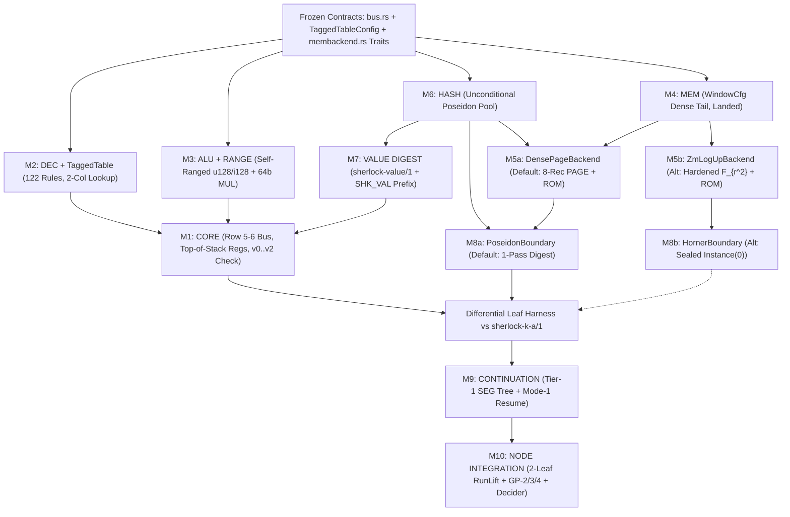

# Sherlock Chip Leaf Lookup, Caching, and Modular Memory Consensus (`CONSENSUS.md`)

**Study:** `sherlock-lookup-cache-20261111` (Round 3 Synthesis over Lanes A, B, C, D, and E)  
**Date:** 2026-11-11  
**Repository Baseline:** `/home/hoskinson/Projects/Moriarty` at commit `9ffc2fe76f523453632cf3df03ca761095bc7c13` (`Cargo.toml:27-45`: `midnight-ledger` tag `ledger-9.1.0.1` rev `a2b30128`, `midnight-zkir` tag `zkir-3.2.0` rev `446c7fe`, `midnight-curves = "=0.3.1"`, `midnight-proofs = "=0.8.3"`, `midnight-circuits = "=7.3.0"`, `midnight-zk-stdlib = "=2.4.0"`).  
**Inputs Synthesized:** `research/sherlock-lookup-cache-20261111/{BRIEF.md, LEAD-NOTE-ROUND2.md, LEAD-NOTE-RERUN.md}`, `lanes/{A,B,C,D,E}/round1.md`, `lanes/{A,B,C,D,E}/round2.md`, `research/sherlock-runlength-consensus-20261111/{CONSENSUS.md, AUDIT.md}`, `research/sherlock-final-design-20261111/MODULARITY.md`, and direct inspection of `crates/mori-chip/src/`, `crates/mori-recursion/src/`, `crates/mori-core/src/`, `clean/fork/Clean/Sherlock/`, `midnight-proofs-0.8.3/src/`, and `midnight-circuits-7.3.0/src/`.  
**Conventions:** Paths are relative to `/home/hoskinson/Projects/Moriarty` unless prefixed with `MP:` (`~/.cargo/registry/src/index.crates.io-1949cf8c6b5b557f/midnight-proofs-0.8.3/src/`) or `MC:` (`~/.cargo/registry/src/index.crates.io-1949cf8c6b5b557f/midnight-circuits-7.3.0/src/`). Every unmeasured row count, memory footprint, hit rate, or wall-clock projection is marked `ESTIMATE`. All four general-purpose clauses `GP-1` through `GP-4` (`openspec/changes/sherlock-vm-consensus-20261107/general-purpose.md:1-58`, `requirements.md:56-59`) are preserved verbatim without narrowing.

---

## Executive Decision & Explicit Relationship to Run-Length `CONSENSUS.md`

### 1. One Recommended Memory & Lookup Design (`5/5` Lanes in Round 2)

Across Round 2 cross-review (`lanes/A/round2.md:12-18`, `lanes/B/round2.md:15-21`, `lanes/C/round2.md:12-15`, `lanes/D/round2.md:112-115`, `lanes/E/round2.md:15-18` — **including Lane B, which authored `ZM-LogUp` in `lanes/B/round1.md`**), **all five lanes (`5/5`: A, B, C, D, E)** converge on a single recommended modular processor and memory design (**Profile A: `DensePageBackend` + `PoseidonBoundary`**) while preserving hardened two-pass write-once LogUp (**Profile B: `ZmLogUpBackend` + `HornerBoundary`**) behind swappable module interfaces (`MODULARITY.md:9`):

1. **Recommended Production Memory & Cache Design (`Profile A` — `5/5` Lanes A, B, C, D, E):**
   - **In-Leaf Hot Window & Dense Tail (`Module M4: MEM` / `WindowCfg`, `crates/mori-chip/src/membackend.rs:152-460`):** Allocation counters advance strictly by `+1` per real allocation (`len_post = len_pre + used`, zero leaf-close `base + 8` padding gaps, `membackend.rs:273-305`). Each leaf exposes an aligned window starting at `base = 8 * floor(len_pre / 8)` (`q_pre = floor(len_pre / 8)`), authenticating the `r_pre = len_pre mod 8` imported tail records against canonical `pre.tail_d` (`pad_d() != 0` on slots `>= r_pre`, `crates/mori-chip/src/dense.rs:72-74, 112-119`) and serving all same-leaf allocations and hot-tail reads (`base <= addr < len_post`) directly on the 2-lane `lookup_any` bus (`crates/mori-chip/src/bus.rs:40-68`) at **`0` Merkle walks**.
   - **Cold Dynamic Heap & Static Program/Type L1 Block Cache (`Module M5a: DensePageBackend`, extending `crates/mori-chip/src/dense.rs:620-753`):** Completed 8-record segments flush into a fixed-depth Poseidon Merkle tree (`old_leaf == EMPTY_SEG != 0`, height-tagged capacity `iv(DOM_NODE, h)`, `dense.rs:59-98`) **if and only if** `floor(len_post / 8) > floor(len_pre / 8)`. Instead of paying `~4,621–4,761` rows (`ESTIMATE`) per individual scalar `cold_read` (`dense.rs:716-753`), `DensePageBackend` opens **$K_{\text{page}}$ deduplicated 8-record heap cache lines** (`addr < base`, `blk_idx < q_pre`) against `pre.root` and **$K_{\text{rom}}$ deduplicated 8-row program/type/constant cache lines** against immutable `prog_root`, publishing all 8 records per opened block onto `bus.rs`. One 8-record opening (`84` Poseidon permutations = `5,880` rows `ESTIMATE` at `TOP = 61`, or `86` perms = `6,020` rows `ESTIMATE` at `TOP = 63`) serves all 8 contiguous slice elements (`~735–752.5` rows/record `ESTIMATE`) and unlimited intra-leaf temporal repeat hits at **`0` additional Poseidon rows**.
   - **Stacks (`FRAMES` & `TASKS`):** Register-cached top frame/task in `CORE` (`0` bus/hash rows while top-resident) backed by domain-separated LIFO Poseidon hash chains `fp_hash` and `tp_hash` (`EMPTY_STACK != 0` enforced from `fcount == 0` / `tcount == 0`, `crates/mori-core/src/sherlock/helper_machine/shared/owner_runtime.rs:3566-3591`).
   - **Boundary Commitment (`Module M8a: PoseidonBoundary`):** Single-pass capacity-tagged Poseidon state digests `(pre_d, post_d)` over the canonical state vector (`regs`, `fp_hash`, `tp_hash`, `(len, root, tail_d)`), requiring **zero** verifier challenges, **zero** variable `Instance(0)` curve commitments (`assigned_committed_instances = [C::identity()]`, `crates/mori-recursion/src/ivc.rs:530-535`), and **zero** modification to `clean/fork/Clean/Sherlock/Aggregation.lean:201` (`digest_inj`).
2. **Swappable Benchmark Alternative (`Profile B` — `5/5` Lanes Agree to Keep Behind `MemBackend` + `BoundaryCommit`):**
   - **Hardened Run-Wide Write-Once LogUp (`Module M5b: ZmLogUpBackend`) + Stage-1 `Instance(0)` Horner Fingerprint (`Module M8b: HornerBoundary`):** Commits boundary words, newly allocated records, write multiplicities $m_w$ (`0 <= m_w < 2^64`), and deduplicated leaf read-cache entries into Stage-1 `Instance(0)` KZG polynomial $P_i \mapsto C_i \in \mathbb{G}_1$ (`MP:plonk/prover.rs:36-49`) *before* squeezing $\mathbb{F}_{r^2}$ challenge pairs $(\gamma_1, \gamma_2, \alpha_1, \alpha_2)$ from commitment-tree digest $d_{\text{root}}$, while authenticating static `ROM` against `prog_root`. Because `CORE` (`M1`) and `MEM` (`M4` `WindowCfg`) interact with `M5` and `M8` exclusively through frozen bus tuples and opaque boundary tokens (`membackend.rs:95-128`), swapping `Profile A <-> Profile B` modifies **zero lines** of `CORE`, `DEC`, `ALU + RANGE`, `MEM`, `HASH`, or `VALUE DIGEST` (`MODULARITY.md:9`).
3. **Processor, Table & Value-Digest Upgrades (`5/5` Lanes A, B, C, D, E):**
   - **2-Column Domain-Tagged `DEC + RANGE` Fixed Lookup (`TaggedTableConfig`):** Multiplexes `RANGE` and gate-normalized `DEC` (`<= 2,048` rows, 54-bit domain-checked `ctrl_word`) over row-disjoint selectors `q_rng * q_dec == 0` into **1** PLONK lookup (`4 -> 3` leaf lookups, `-1` fixed table column), saving **`ESTIMATE -29,062` rows in 1-leaf `ChipNode`** (`823,466 -> ~794,404..807,340`) and **`ESTIMATE -51,204` to `-51,662` rows in 2-leaf `RunLift` `R`** while leaving **100% of `bus.rs` request lanes free**.
   - **4 Bus Requests per Step at `+0` Node Rows:** Promotes row `6` of `Arch::Narrow` (`crates/mori-chip/src/rfcore.rs:198-200`) from a passive copy-replica to a second active `q_req = 1` pair `(L2, L3)`.
   - **Self-Ranged 128-Bit `ALU` + 64-Bit Schoolbook `OP_MUL`:** Range-checks inputs `x < 2^128` and `y < 2^128` unconditionally inside `ALU` (closing `Exploit D1` in `crates/mori-chip/src/alu.rs:8-9, 111-125` at `+0` Node rows and `+0` `k_leaf` growth) and evaluates checked `u128` multiplication over 64-bit limbs without field wraparound.
   - **Allocation-Time `sherlock-value/1` (`VALUE DIGEST`) with `(SHK_VAL, 1)` Sponge Prefix:** Precomputes `[C_0, C_1, C_2] = PoseidonPerm(0, SHK_VAL, 1)` (`-70` rows per dynamic `vd`), inlines compile-time constants `VD_NIL`, `VD_FALSE`, `VD_TRUE` (`0` Poseidon rows on booleans/`Nil`), and stores pre-digested `ty_d` and `const_vd` in `ROM`.

### 2. Explicit Compatibility Statement with `sherlock-runlength-consensus-20261111/CONSENSUS.md` (and `AUDIT.md`)

**Statement (`LEAD-NOTE-ROUND2.md:15`):** This study's recommended design (**Profile A**) is **100% COMPATIBLE WITH — and strictly extends — `research/sherlock-runlength-consensus-20261111/CONSENSUS.md`**, incorporating all soundness corrections from `research/sherlock-runlength-consensus-20261111/AUDIT.md:1-175`. It **does NOT replace** the run-length consensus (`5/5` lanes: `lanes/A/round2.md:266-268`, `lanes/B/round2.md:174`, `lanes/C/round2.md:182`, `lanes/D/round2.md:193`, `lanes/E/round2.md:185`).

**Why Compatible Extension Wins Over Replacement:**
1. **Builds Directly on Landed `WindowCfg` + `DenseCfg` (`crates/mori-chip/src/{membackend.rs, dense.rs}`):** Run-length `CONSENSUS.md:97-108` and `AUDIT.md:55-65` established dense non-padded counters, canonical `tail_d = Tree8(imp ? rec_i : PAD)` carry, fixed-depth height-tagged Merkle flushes (`EMPTY_SEG != 0`), and Poseidon LIFO hash-chain stacks, but priced cold reads as uncached scalar walks (`~4,480–4,761` rows/read `ESTIMATE`, `LEAD-NOTE-ROUND2.md:6`). Adding deduplicated 8-record `PAGE` and `ROM` block providers behind `MemBackend` eliminates the uncached cold-read bottleneck (`~735–752.5` rows/cell spatially; `0` rows on intra-leaf temporal hits) without altering `WindowCfg`, `pre_d`/`post_d`, `Aggregation.lean`, or `RunDecider`.
2. **Integrates Every `AUDIT.md` Correction Cleanly:**
   - Restores `GP-1`/`GP-001` wording ("every program of the Sherlock language, on every input", `openspec/changes/sherlock-vm-consensus-20261107/requirements.md:56`) without narrowing (`AUDIT.md:15-17`);
   - Adopts `TOP >= 63` ($2^{66} - 1$ cells per arena, `+2` permutations = `+140` `ESTIMATE` rows/cold walk) as the zero-narrowing default so the 64-bit step counter `h < 2^64` always binds strictly before cell exhaustion (`AUDIT.md:23-26`, Dissent `D-2`);
   - Preserves `WindowCfg`'s `kfix` parameter (`membackend.rs:28-30, 156`) so 4-arena (`kfix = 1..=4`) vs 1-arena (`kfix = 0`) is settled by the mechanized `/1` contiguity invariant and measured `cost_model` rows (`AUDIT.md:29-32`, Dissent `D-1`);
   - Adopts Tier 1 + Mode 1 retained-store `SEG` segment recursion for stop/resume continuations (composed by segment recursion, never mislabeled as `GP-2` claim consumption, `AUDIT.md:33-42`), keeping Mode 2 (`sherlock-ckpt/1` + lazy `UNFOLD`) in open research (Dissent `D-5`);
   - Enforces per-slot write-before-read / fresh-zero discipline on scratch lanes `v0..v2` inside `CORE` (`AUDIT.md:67-69`); and
   - Prohibits range-checking an occurrence counter `SET.n_claims < 2^64` that would reject honest depth-64 diamond DAGs (`AUDIT.md:19-22`, `research/sherlock-gp-architecture-20261110/architecture.md:100`).

---

## Section 1: Explicit Answers to the Four Round 2 Questions (`LEAD-NOTE-ROUND2.md:9-14`)

### 1.1 Question 1: Merkle (`DensePageBackend`) vs Run-Wide Write-Once LogUp (`ZmLogUpBackend`)

**Decision (`5/5` Lanes):** Use **Merkle (`M3-Tail64` / `DensePageBackend` + 8-record L1 `PAGE` & `ROM` bus caches)** as the primary production design for dynamic heap memory (`DATA`, `FIELDS`, `ENV`, `SLOTS`), `PROG`, and `Types`/`Constructors`/`Constants`, while keeping **Hardened `ZM-LogUp`** behind the swappable `MemBackend` trait.

#### Why Merkle + L1 Block Cache Beats Run-Wide Write-Once LogUp as Primary Default
1. **`PROG` & Type Tables — Zero Loader Leaves vs $O(|P|)$ Recursive Node Storm:** In `lanes/B/round1.md:122-125`, `INIT_PROG` injects static program/type rows (`32–64` rows/leaf) into the LogUp sum via loader leaves. Because every loader leaf requires a `k = 20` Node fold (`~61–66 s` solo / `~43.8 s` in `3×6t` tree mode, `research/sherlock-recursion-design-review-20261110/experiments/e2-e4.md:7-35`), `INIT_PROG` adds `ESTIMATE ~33.6–93.5 min` before step `h = 0` on a `2,048–4,096`-row program and `ESTIMATE ~15.8–22.8 days` on a $10^6$-row program (`lanes/B/round2.md:83`, `lanes/C/round2.md:58-61`, `lanes/D/round2.md:60-64`). By contrast, `prog_root` Merkle + $K_{\text{rom}} = 2$ 8-row `ROM` cache lines has **`0` loader leaves** and proves *only* executed basic blocks and touched constructors ($O(\text{touched})$). *(In Round 2, Lane B explicitly retracted `INIT_PROG` even for Backend B, `lanes/B/round2.md:83, 98`.)*
2. **Stop-and-Resume Checkpointing (`GP-001` Mode 1) & Streaming Prove-While-Executing:** Under `ZM-LogUp`, Leaf `0`'s `Instance(0)` vector $P_0$ must commit $m_w$ — the exact count of future leaves in `[1, L)` that will read each cell allocated in Leaf `0` — and Stage 2 needs $(\gamma, \alpha)$ derived from $d_{\text{root}}(C_0, \dots, C_{L-1})$. Consequently, **zero** Stage-2 leaf proofs can start before step $N$ halts (`0%` streaming overlap), and sealing Epoch 1 at checkpoint $h_1$ (`sum_1 == 0`) leaves **no `mem_root`** authenticating Epoch 1's heap for Epoch 2 — forcing either $O(|M_{\text{live}}|)$ `INIT_MEM` reload Node proofs (`ESTIMATE ~17.2 h` per $10^6$ live cells, `lanes/D/round2.md:55`) or unbuilt Mode-2 `UNFOLD` serialization (`lanes/B/round2.md:84`, `lanes/E/round2.md:78-80`). Under `DensePageBackend`, `[mem_root, tail_d]` hands off the entire $2^{66}$-cell heap across sessions in **$O(1)$ (`0` loader leaves)**.
3. **Recursion Cost (`RunLift` `R` & Subgroup Torsion Grinding) & `GP-4` Prefix Reuse:**
   - Witnessing `C_i` via `assign_without_subgroup_check` (`lanes/B/round1.md:109`, `MC:ecc/foreign/weierstrass_chip.rs:936-952`) on BLS12-381 $\mathbb{G}_1$ (cofactor $h_{\mathbb{G}_1} = (x_{\text{BLS}}-1)^2/3 \approx 2^{125.7}$, divisible by $11^2$; `MC:ecc/curves.rs:287, 310-312`) allows an attacker to shift $C'_i = C_i + [k_i] T_{11}$ ($T_{11} \in E(\mathbb{F}_p)[11]$), grinding $11^L$ distinct `d_root` / $(\gamma, \alpha)$ challenges from **one** trace with **zero** KZG MSMs while cancelling the torsion in `RunDecider::collapse` (`crates/mori-recursion/src/run_decider.rs:245, 258-260`) whenever $\sum \beta_i k_i \equiv 0 \pmod{11}$ (`1/11` blindly, or probability `1` by re-rolling the final Node's blinding scalars ~`5.5` times; `lanes/E/round2.md:58-66`, independently found by `lanes/B/round2.md:85`, `lanes/C/round2.md:70`, `lanes/D/round2.md:70`).
   - Enforcing full subgroup membership via `AssignmentInstructions::assign` (`weierstrass_chip.rs:343-360`) closes the attack completely, adding `ESTIMATE +18,000` to `+40,400` rows in 2-leaf `RunLift` `R` (`U + U -> SEG`) vs `Profile A`'s fixed `C::identity()` (`+0` rows). Furthermore, `Profile A`'s `SEG` proofs are suffix-independent (`GP-4` prefix reuse works across diverging runs), whereas `Profile B` locks every `SEG` to the full run's $d_{\text{root}}$.

#### How `2^64` Steps/Cells, `SRC-023`, C6, and `GP-2..GP-4` Hold When Hardened `Profile B` (`ZmLogUpBackend`) Is Enabled
When `ZmLogUpBackend` (`M5b`) + `HornerBoundary` (`M8b`) is compiled behind the swappable traits for single-session batch runs, all six mandatory hardenings (`§3.5`) guarantee:
- **`2^64` Steps / Cells:** `WindowCfg` bit-bounds `len_pre, len_post < 2^{TOP+3}`; `0 <= m_w < 2^64` is range-checked; and **dual $\mathbb{F}_{r^2}$ challenge pairs** $(\gamma_1, \gamma_2, \alpha_1, \alpha_2)$ replace single-scalar $E_\gamma$, improving the $W + R = 2^{64}$ tuple-collision birthday bound from $\frac{2(2^{64})^2}{r} \approx 2^{-125.86}$ (`< 128` bits, or `~2^{-85.8}` under $2^{40}$ grinding queries on unconstrained `Instance(0)` rows) to **`< 2^{-250}` (`ESTIMATE`)** (`lanes/B/round2.md:87`, `lanes/E/round2.md:51-54`).
- **`SRC-023` & C6 Outcome-Only (`SRC-006`, `SRC-007`):** Dense non-padded `len` keeps heap addresses and `sherlock-value/1` `vd` partition-invariant; `(com_pre, com_post, gamma_1..2, alpha_1..2, sum_1..2)` exist strictly inside `SEG` and are verified (`sum == 0`, Fiat-Shamir match) and erased at the `SEG -> SET` seal (`C` / `RunDecider`), publishing solely `[prog_d, input_d, outcome_d, n_steps]`.
- **`GP-2..GP-4`:** Cross-run claim consumption (`GP-2`), foreign proofs (`GP-3` `F -> SET`), and diamond claim DAGs (`GP-4` `SET` union) operate on sealed `SET` claims (`sum == 0` already closed, zero double-counting), while intra-run binary trees fold associatively over `(com_pre, com_post)` after Stage 1.

---

### 1.2 Question 2: Quantifying the Two-Pass Cost vs One-Pass Alternatives (`ESTIMATE`)

| Operational Metric | **One-Pass Default: `Profile A` (`DensePageBackend` + `PoseidonBoundary`)** | **Two-Pass Alternative: `Profile B` (`ZmLogUpBackend` + `HornerBoundary`, `ROM` via `prog_root`)** | **One-Pass Offline `EC-MSH` (`b2`: Jubjub Multiset Hash)** |
|---|---|---|---|
| **Pre-Pass Latency Before Leaf 0 Proving Starts (`ESTIMATE`)** | **`0 s`** (Leaf `0` proves immediately after step `S` executes, `< 1 ms` sim). | **100% of $N$-step VM execution** + Stage-1 `commit_to_instances` MSMs (`~0.5–3.5 ms/leaf`: `< 10 ms` at `303` steps, `~0.1–0.9 s` at `4,096` steps, `~5–25 min` dead-time at $10^7..10^8$ steps). | `b2-mult` (`[m_w]P`): **secretly still 2-pass** (needs future `m_w`!). `b2-counter` (`-P(c)+P(c+1)`): `0 s` pre-pass, **stalls at Halt**. |
| **Prove-While-Executing Overlap** | **100% streaming overlap** (executor runs 1 leaf ahead of worker pool). | **0% overlap** between VM execution and Stage-2 SNARK proving. | Execution streams, then **blocks on $O(|M_{\text{alloc}}|)$ teardown Node proofs at Halt**. |
| **Host RAM & Disk Buffering (`ESTIMATE`)** | **`O(S)` trace buffer (`< 50 MB`)** + append-only external segment store (`~1.5–2.2 GB` leaf prover RSS). | Must hold `m_w[0..len]` (`~4–8 B/cell`: `4–8 GB` RAM at $10^9$ cells) + either full $L$-leaf witness spool (`~8–32 GB` per $10^6$ leaves) or 2x VM replay. | Must retain `last_cnt[0..len]` (`4–8 GB` per $10^9$ cells) to emit teardown leaves at Halt. |
| **Parallel Stage-2 Tree Proving (`GP-4`)** | **100% parallel from Leaf 0**; sub-DAGs fold live as pairs finish. | **100% parallel *after* Stage-1 barrier** (`RunLift` `R` is `+18k..40k` rows heavier). | Parallel during run + parallel teardown tree at Halt. |
| **Stop & Resume Checkpoints (`GP-001` Mode 1)** | **Native $O(1)$ (`0` loader leaves):** stored `SEG` proof + arena snapshot resumes seamlessly. | **Incompatible with Mode 1** (`0` `mem_root` across epochs; requires `O(|M_live|)` reload leaves or open-research Mode 2). | **Incompatible with Mode 1** (`O(|M_live|)` sweep + reload at every pause). |
| **`G-C` (`list123`, `303` steps, `S = 16`, `2,048`-row prog) Wall-Clock (`ESTIMATE`, assumes `16` steps/leaf)** | **`~20.5–23.0 min` serial** / **`~17–19 min` `3×6t` tree** (`19` leaves, `18` Nodes, `0` loader leaves). | **`~20.2–22.5 min` serial** *with `prog_root` `ROM`* (saves `< 2%` leaf time); **`~56–114 min` *with `INIT_PROG`*** (`+32..128` loader Nodes!). | **`~31+ min` serial** (`+8..16` post-Halt teardown Nodes; **`~47` CPU-days** at $2^{20}$ cells!). |

**Verdict on One-Pass Alternatives (`b2`):** All five lanes (`5/5`: `lanes/A/round2.md:195-211`, `lanes/B/round2.md:128-133`, `lanes/C/round2.md:149-152`, `lanes/D/round2.md:25, 136-144`, `lanes/E/round2.md:29, 154`) prove that **no** elliptic-curve multiset hash on `midnight-circuits = 7.3.0` achieves both one-pass streaming and $O(1)$ Halt: write-once `[m_w] P` still requires full-run lookahead for $m_w$, while counter re-emission `-P(a,v,c) + P(a,v,c+1)` requires a 243-bit Poseidon pre-hash before lifting to Twisted Edwards Jubjub (`https://eprint.iacr.org/2025/1503`, `https://eprint.iacr.org/2026/590`; `MC:ecc/native/edwards_chip.rs:324-420`, `~280–480` rows/miss `ESTIMATE`) **plus** an $O(|M_{\text{alloc}}|)$ post-Halt sweep violating `GP-1`/`SRC-021` and risking `RunDecider`'s `16,103`-row `Pow2Range` cliff. **`DensePageBackend` (`Profile A`) is the unique one-pass, $O(1)$-Halt, $O(1)$-checkpoint memory design on this stack.**

---

### 1.3 Question 3: `VerifierGadget` Single-Phase Constraint & Zero-Fork Confirmation

Direct source inspection of pinned `midnight-circuits-7.3.0` and `midnight-proofs-0.8.3` (`5/5` lanes verified) confirms four exact invariants and **zero-fork compatibility** for both profiles:

1. **Hard Single-Phase & Rotation Assertions in `midnight-circuits-7.3.0`:**
   - `MC:verifier/verifier_gadget.rs:308-316`: `assert_eq!(cs.phases().count(), 1);` (`:310`) — panics if any leaf column uses `SecondPhase` or `ThirdPhase`, then reads all `0..cs.num_advice_columns()` commitments in one loop before squeezing PLONK internal challenges `theta` (`:319`), `beta` (`:327`), `gamma` (`:328`), and `trash_challenge` (`:341`).
   - `MC:verifier/expressions/mod.rs:49`: `Expression::Challenge(_) => panic!("We do not suport multi-phase yet"),` — panics if any custom gate or lookup expression queries a Halo2 `Challenge`.
   - `MC:verifier/verifier_gadget.rs:604-610`: `verify_algebraic_constraints` allows advice rotations strictly in `{-1, 0, +1}`.
2. **Why `Profile A` (`DensePageBackend` + `PoseidonBoundary`) Needs Zero Fork:**
   - Uses exclusively `FirstPhase` columns (`cs.phases().count() == 1`), zero `Expression::Challenge`, rotations in `{-1, 0, +1}`, max gate degree `<= 6`, `assigned_committed_instances = [C::identity()]` (`crates/mori-recursion/src/ivc.rs:530-535`), and `0` changes to `RunDeciderRelation` (`crates/mori-recursion/src/run_decider.rs:202-260`).
3. **Why `Profile B` (`ZmLogUpBackend` + `HornerBoundary`) Also Needs Zero Fork:**
   - `MP:plonk/prover.rs:32-49` natively exports `commit_to_instances`; `MC:verifier/verifier_gadget.rs:298-300` absorbs `assigned_committed_instances[0]` ($C_i$) via `transcript.common_point` *before* `assigned_instances` (`:302-306`) and `advice_commitments` (`:314-316`); `MC:verifier/expressions/mod.rs:48` and `verifier_gadget.rs:435-436, 628-634` open `Expression::Instance` on `Instance(0)` at `x` via a single KZG `VerifierQuery` (`cs.phases().count() == 1`, zero `Expression::Challenge`).
4. **Exact `RunDecider` `Pow2RangeChip` `table_rows == 1,032,467` Proof (`MC:field/decomposition/pow2range.rs:215-236`):**
   - Measured `RunDecider` (`SHKRUND1`, `k = 20`, circuit gate `<= 1,000,000` at `openspec/changes/sherlock-vm-consensus-20261107/design.md:105`, usable domain `2^20 - 6 = 1,048,570`) has `929,166` circuit rows and `1,032,467` `Pow2Range` table rows (`research/sherlock-c6-outcome-ledger9-review-20261110/review.md:213`).
   - Exact binary decomposition (`lanes/D/round1.md:214-221`): $1{,}032{,}467 = 2^0 + 2^1 + 2^4 + 2^8 + \sum_{b=14}^{19} 2^b$, leaving **`16,103` usable table rows** of headroom, while the unqueried bit-length tags `{2, 3, 5, 6, 7, 9, 10, 11, 12, 13}` sum to `16,108 > 16,103`. Any new range check added in `mori-recursion` MUST decompose exclusively via `assigned_to_le_bytes(..., Some(8))` (`b = 8` already loaded -> **`+0` `table_rows`**), keeping `table_rows == 1,032,467` exact.

---

### 1.4 Question 4: Reconciling `S = 16` vs `S = 64` or `128` (`SRC-014` & Run-Length Study)

**Converged Two-Stage Rule (`5/5` Lanes: `lanes/A/round2.md:257-260`, `lanes/B/round2.md:160-166`, `lanes/C/round2.md:174-176`, `lanes/D/round2.md:180-187`, `lanes/E/round2.md:174-179`):**
1. **Stage 1 — Freeze `S = 16`, `k_leaf = 16` (`<= 65,530` rows) for Milestone M4 (`SRC-014` Unchanged):**
   - `SRC-014` (`openspec/changes/sherlock-vm-consensus-20261107/requirements.md:39`, `crates/mori-recursion/src/ivc.rs:77`) sets `S_MAX = 16`, `design.md:105` gates M4 at `k_leaf <= 16`, and `SRC-011` (`requirements.md:36`) forbids crediting unmeasured speed levers prior to passing `< 2 h` Gate `G-C`.
   - At `S = 16` (`W_flush = 1`, `K_page = 4`, `K_rom = 2`), `Profile A` lands at **`ESTIMATE ~42,100–52,700` rows (`k_leaf = 16`)**, `< 2.2 GB` leaf RSS (`ESTIMATE`), and clears `303`-step `G-C` in **`ESTIMATE ~20.5–23.0 min` serial / `~17–19 min` `3×6t` tree** (assuming `16` steps/leaf) — **`~4x–6x` under the `< 2 h` gate**.
2. **Stage 2 — Parameterize `LeafShape { s_max, w_flush, k_page, k_rom }` Today; Benchmark `S = 64`, `k_leaf = 17` Post-M4 Before Ceremony Key Freeze:**
   - Under *uncached* `M3-Tail64`, `S = 64` pushed leaves to `k_leaf = 18..19`. With our 8-record `PAGE` + `ROM` bus caches (whose intra-leaf hit rate rises super-linearly with `S`), `S = 64` (`W_flush = 2..3`, `K_page = 6..8`, `K_rom = 3..4`) fits cleanly inside **`k_leaf = 17` (`ESTIMATE ~82,500–98,000 <= 131,066` rows, `~10.5 s` leaf prove)**.
   - By measured `E2` (`e2-e4.md:25-35`), raising `k_leaf` from `16` to `17` adds **exact `+4` Node rows and `+0` Decider rows** while cutting `~63 s` `k = 20` Node folds by **4x** (`ESTIMATE ~4.2 s/step -> ~1.20 s/step` serial, assuming full leaves). `S = 128` (`k_leaf = 18`, `~155k–175k` rows `ESTIMATE`) is held back until LPDDR5X bus contention (`90.2 s` in `E4`, `e2-e4.md:19`) and early-close rates are measured on real `/1` traces.

---

## Section 2: Answers to `BRIEF.md` Questions `Q1`–`Q5`

### 2.1 `Q1(a)–(f)`: Evaluation of Every Cache & Lookup Candidate

| Candidate | Round-2 Verdict | Technical Basis & Exact Citations |
|---|---|---|
| **`Q1(a)` Intra-Leaf Memory Read Cache** | **ADOPT (`5/5`: A, B, C, D, E)** | Two-level hierarchy: **L0 hot 8-record register window** (`WindowCfg`, `crates/mori-chip/src/membackend.rs:152-460`, `0` Poseidon perms for `base <= addr < len_post`) + **L1 deduplicated 8-record `PAGE` (`addr < base`, `blk_idx < q_pre`) and `ROM` (`prog_root`) block providers** publishing all 8 records per opened block onto `bus.rs:40-68` (`~735–752.5` rows/record spatially; `0` rows on temporal repeats). Challenge-free custom LogUp caches are **rejected** (`Exploit A1`: `m_i * inv_i == 0` zero-denominator forgery when `m_i = 0`, `lanes/E/round1.md:107-115`; native Halo2 `lookup_any` draws `theta, beta, gamma` soundly inside `FirstPhase`, `MC:verifier/verifier_gadget.rs:319-328`). |
| **`Q1(b)` Run-Wide Offline Memory Checking** | **SWAPPABLE ALT ONLY (`5/5`: A, B, C, D, E)** | Rejected as primary default due to 2-pass pre-scan latency (`0%` streaming overlap), `O(|M_live|)` checkpoint reload barrier, `RunLift` subgroup-check cost (`+18k..40k` rows `ESTIMATE`), and `GP-4` prefix-reuse loss (`§1.1–1.2`). Preserved behind `MemBackend` + `BoundaryCommit` (`Profile B`: `ZmLogUpBackend` + `HornerBoundary`) with **6 mandatory hardenings** (`§3.5`). One-pass `EC-MSH` (`b2`) is **rejected (`5/5`)** because post-Halt $O(|M_{\text{alloc}}|)$ sweeps violate `GP-1`/`SRC-021`. |
| **`Q1(c)` `DEC`, `PROG`, & Type/Ctor Tables** | **ADOPT (`5/5`: A, B, C, D, E)** | (1) **2-column `TaggedTableConfig` (`DEC + RANGE`, `q_rng * q_dec == 0`):** `4 -> 3` leaf lookups, `-1` fixed column (`ESTIMATE -29,062` 1-leaf `ChipNode` rows; `-51,204..-51,662` 2-leaf `RunLift` `R` rows), `0` bus lanes consumed, gate-normalized `<= 2,048` rows covering all `120` active `/1` step rules + `2` genesis rules (`owner_runtime.rs:70-108`, Dissent `D-4`), with mandatory boolean/domain checks on unpacked `ctrl_word` bits (`Exploit C1`, `lanes/E/round1.md:168-174`). (2) **Universal `ROM` (`CHIP_ROM = 5`, `tbl_id in 1..=15`):** $K_{\text{rom}}$ 8-row Merkle cache lines under `prog_root` covering all `14` static tables (`owner_runtime.rs:85-108`) with pre-digested `ty_d` and `const_vd`. (3) **Row-6 `q_req = 1` in `Arch::Narrow`** (`rfcore.rs:198-200`): `4` bus requests/step at `+0` Node rows. |
| **`Q1(d)` Jolt/Lasso Subword `ALU` Tables vs Gates** | **REJECT SUBWORD `ALU`; ADOPT SELF-RANGED GATES (`5/5`)** | 16-bit 2D subword tables (`2^32` entries) either blow `k_leaf = 32` or add `+2..4` lookups (`+45k..90k` Node rows `ESTIMATE`) and `24–40` bus requests per 128-bit op, and fail signed two's-complement `Int` `OP_LT`/`OP_DIV_MOD` without explicit sign-bit gates (`Exploit D2`, `lanes/E/round1.md:188-195`). Instead, **self-range `x, y, w < 2^128` inside `alu.rs` + 64-bit schoolbook `OP_MUL`** (closing `Exploit D1` at `crates/mori-chip/src/alu.rs:8-9, 111-125` and Hardening C-3 at `+0` Node rows and `+0` `k_leaf` growth). |
| **`Q1(e)` Dynamic `AS_HASH` Memoization vs Inline `vd`** | **REJECT `AS_HASH`; ADOPT INLINE `vd` + PREFIX (`5/5`)** | Cross-leaf dynamic Poseidon memoization suffers circularity (must hash inputs to form lookup key), `< 5%` hit rate on recursive `vd` trees, cross-domain collision risks (`Exploit E1`), and `SRC-023` partition sensitivity. Instead: compute `sherlock-value/1` (`M7`) inline on `HASH` at allocation, hardwire `[C_0, C_1, C_2] = PoseidonPerm(0, SHK_VAL, 1)` (`-70` rows/dynamic `vd`, `lanes/C/round1.md:249-256`), inline `VD_{NIL,FALSE,TRUE}` (`0` Poseidon rows), and read `ty_d` / `const_vd` from `ROM`. |
| **`Q1(f)` Better Ideas Identified** | **ADOPT (`5/5`)** | (1) Register-cached top `Frame` & `Task` in `CORE` (`0` bus/hash rows while top-resident, backed by `fp_hash`/`tp_hash` LIFO chains); (2) Unconditional `PoseidonPerm` execution on all allocated `HASH` rows (`crates/mori-chip/src/hashchip.rs:88-100`, blocking `Exploit E3` disabled-round forgery); (3) **2-leaf `RunLift` `R` (`U + U -> SEG`)** folding two chip leaves per `k = 20` Node (`research/sherlock-runlength-consensus-20261111/CONSENSUS.md:191-196`, cutting Node wall-clock by `ESTIMATE ~33–45%`). |

---

### 2.2 `Q2`: Master Quantitative Cost, Soundness & Recursion-Fit Table (`ESTIMATE`)

Measured baselines: E8 (`openspec/changes/sherlock-vm-consensus-20261107/design.md:547-579`; `research/sherlock-processor-analogy-20261110/experiments-2.md:9-48`; `experiments-4.md:18-45`): `6,511` leaf rows (`k = 13`), `15` advice / `10` fixed / `14` eq / `4` lookups, 1-leaf `ChipNode = 823,466` rows (`k = 20`), `RunDecider = 929,166` circuit rows / `1,032,467` `Pow2Range` table rows (`k = 20`). Node fit: `570,957 + 7,298*adv + 8,189*eq + 6,004*fix` (`+ ~22,600` rows per lookup argument). All `s/step` and `G-C` (`303`-step) wall-clock projections below explicitly state their step-per-leaf occupancy assumption (`AUDIT.md:107-109`).

| Configuration | Leaf Shape `(adv, fix, eq, lkp, inst)` | Leaf Rows (`ESTIMATE` except E8) & `k_leaf` | 1-Leaf `ChipNode` Rows (`k=20`, `ESTIMATE` except E8) | 2-Leaf `RunLift` `R` Rows (`k=20`, `ESTIMATE`) | `RunDecider` Rows (`k=20`) | Passes & Challenges | `G-C` (`303` steps) Serial Wall-Clock (`ESTIMATE`) |
|---|---|---|---|---|---|---|---|
| **E8 Baseline (Measured, `S=16`, 17-lvl toy, no `ROM`/cold `PAGE`/`vd`)** | `(15, 10, 14, 4, 1)` (`C::identity()`) | **`6,511`** (`k = 13`, measured) | **`823,466`** (measured) | `~1,046,000` (borderline `< 1,048,570`) | **`929,166`** / **`1,032,467`** (measured) | 1-pass; PLONK internal only | N/A (toy `/0` subset only) |
| **Uncached `/1` `M3-Tail64` (`S=16`, scalar `cold_read` walks, 4 lkps)** | `(15, 10, 14, 4, 1)` | `~59,500–64,800` (`k = 16`, tight at `<= 65,530`) | `~823,478` | `~1,046,024` (risks `k=21` cliff!) | `929,166` / `1,032,467` | 1-pass; PLONK internal only | `~21.8–24.0 min` (1-leaf Node; assumes `16` steps/leaf) |
| **Recommended `Profile A` (`S=16`, 1-Arena `kfix=0`, `W=1, Kp=4, Kr=2`, `TOP=63`, 3 lkps)** | `(15..16, 9, 14..15, 3, 1)` (`C::identity()`) | **`~42,100–45,600`** (`k = 16`, `> 19,900` rows margin!) | **`~794,416–809,903`** (`-13.5k..-29.1k` vs E8) | **`~994,820–1,022,000`** (`k = 20` safe!) | **`929,166`** / **`1,032,467`** (`+0` rows) | **1-pass**; PLONK internal only (`0` extra challenges) | **`~20.5–22.5 min`** (1-leaf Node) / **`~12.2–14.0 min`** (2-leaf `R`; assumes `16` steps/leaf) |
| **Recommended `Profile A` (`S=16`, 4-Arena `kfix=1..4`, shared `W_global=2, Kp=4, Kr=2`, `TOP=63`, 3 lkps)** | `(15..16, 9, 14..15, 3, 1)` (`C::identity()`) | **`~51,800–56,400`** (`k = 16`, fits `<= 65,530`; `lanes/D/round2.md:374`) | **`~794,416–809,903`** | **`~994,820–1,022,000`** (`k = 20` safe!) | **`929,166`** / **`1,032,467`** (`+0` rows) | **1-pass**; PLONK internal only | **`~21.0–23.0 min`** (1-leaf Node) / **`~12.6–14.5 min`** (2-leaf `R`; assumes `16` steps/leaf) |
| **Post-M4 Stage-2 `Profile A` (`S=64`, `W=2, Kp=6, Kr=3`, `TOP=63`, 3 lkps)** | `(15..16, 9, 14..15, 3, 1)` (`C::identity()`) | **`~83,500–98,200`** (`k = 17`, `<= 131,066`) | **`~794,420–809,907`** (`+4` rows for `k=16->17`!) | **`~994,828–1,022,008`** (`k = 20` safe!) | **`929,166`** / **`1,032,467`** (`+0` rows) | **1-pass**; PLONK internal only | **`~6.0–7.2 min`** (1-leaf Node) / **`~4.1–5.0 min`** (2-leaf `R`; `5` leaves; assumes `64` steps/leaf) |
| **Swappable `Profile B`: Hardened `ZM-LogUp` + `HornerBoundary` (`S=16`, `prog_root` `ROM`, $\mathbb{F}_{r^2}$, subgroup-checked `C_i`)** | `(16..18, 9, 15..16, 3, 1)` (variable `C_i`!) | **`~15,400–20,500`** (`k = 14..15`) | `~825,000–852,000` (`+subgroup check` on `C_i`) | `~1,032,000–1,065,000` (**tight / risks `k=21`!**) | `~929,166–931,500` / **`1,032,467`** (`b=8` bytes only) | **2-pass**; Stage-1 `C_i` MSM -> Fiat-Shamir $(\gamma_{1..2}, \alpha_{1..2})$ | **`~20.2–22.5 min`** (1-leaf Node, `prog_root` `ROM`; **`~56–114 min` if `INIT_PROG`!**; assumes `16` steps/leaf) |

**Key Takeaway from `Q2`:** Because `k = 20` Node recursion (`~61–66 s`) dominates leaf proving (`~1.2–4.8 s`) by `> 13x` (`e2-e4.md:7-35`), **cutting 1 lookup argument + 1 fixed column (`TaggedTableConfig`) + enabling 2-leaf `RunLift` `R` (`U + U -> SEG`) saves `~8–10x` more wall-clock time than shrinking the leaf from `k = 16` (`~4.5 s`) to `k = 14` (`~1.2 s`)**, while avoiding `Profile B`'s 2-pass stall and `RunLift` subgroup-check blowup!

---

### 2.3 `Q3`: Cross-Cutting Guarantees (`SRC-023`, C6, Run-Length, `SI-12..SI-14`, `GP-1..GP-4`)

1. **`SRC-023` Partition Independence & C6 Outcome-Only Statement (`[prog_d, input_d, outcome_d, n_steps]`):**
   - Under `WindowCfg` (`membackend.rs:273-305`), `len_post = len_pre + used` advances strictly by `+1` per semantic allocation regardless of leaf boundary placement `S` or early leaf close (`q_pre == floor(len_pre / 8)`). Neither `PAGE` nor `ROM` mutates architectural state (`mem_root`, `tail_d`, `regs`, `fp_hash`, `tp_hash`, `outcome_d`); `sherlock-value/1` (`M7`) hashes value trees exclusively by recursive content (`vd`), never raw heap pointers. Thus `[prog_d, input_d, outcome_d, n_steps]` is 100% invariant to leaf partitioning (`SRC-023`, `SRC-006`, `SRC-007`).
   - Under swappable `Profile B`, `(com_pre, com_post, gamma_1..2, alpha_1..2, sum_1..2)` live strictly inside `SEG` and are erased at the `SEG -> SET` seal (`C` / `RunDecider`).
2. **Touchpoints with Run-Length Consensus (`sherlock-runlength-consensus-20261111/CONSENSUS.md` & `AUDIT.md`):**
   - Shares the exact `WindowCfg` dense tail, height-tagged `iv(DOM_NODE, h)` Merkle tree (`EMPTY_SEG != 0`, `pad_d() != 0`), LIFO `fp_hash`/`tp_hash` chains (`EMPTY_STACK != 0`), `TOP = 63` ($2^{66}-1$ cells) zero-narrowing default (`AUDIT.md:23-26`), and Mode-1 `SEG` segment continuations (`AUDIT.md:33-42`), while upgrading cold scalar walks (`dense.rs:716-753`) to 8-record `PAGE` + `ROM` block providers.
3. **`SI-12` (`Value::Tuple`), `SI-13` (`Value::Record`), and `SI-14` (`Value::Array`, `ArrayGet`/`ArrayLen`, `SRC-025`):**
   - **Explicit Open-Dissent Note (`AUDIT.md:83-85`):** `openspec/changes/sherlock-vm-consensus-20261107/dissent.md:27` (`D-1`: `Tuple`/`Record`/`Array` representation vs Astra's mapping) remains an **open owner-ratification item** (`requirements.md:49`).
   - **Consensus Proposed Resolution (`5/5` Lanes: `lanes/A/round2.md:228-235`, `lanes/B/round2.md:451-458`, `lanes/C/round2.md:295-305`, `lanes/D/round2.md:315-322`, `lanes/E/round2.md:412-420`):** Represent `Tuple(ptr, arity, vd)`, `Record(ty_id, ptr, n_fields, vd)`, and immutable `Array(ptr, len, elem_ty, vd)` uniformly as **contiguous `FIELDS` slices** `[ptr + 0 .. ptr + k - 1]` with `O(1)` bounds-checked offset addressing (`idx < k` via `ALU` `OP_LT_U128`, then `addr = ptr + idx` on `MEM`/`PAGE`). Because `DensePageBackend` opens aligned **8-record cache lines**, opening block `floor((ptr + idx) / 8)` immediately caches up to **7 adjacent elements/fields at `0` extra Poseidon permutations**, making `ArrayGet`, tuple projection, record field lookup, and `sherlock-value/1` slice folding (`SRC-025`) L1 cache hits!
4. **`GP-1` through `GP-4` (`general-purpose.md:1-58`, Un-Narrowed):**
   - **`GP-1`:** Every program of the Sherlock language on every input runs to $h < 2^{64}$ steps with $2^{66}-1$ cells (`TOP = 63`), `0` loader leaves (`prog_root` handles arbitrary program size), and $O(1)$ Halt (`0` teardown sweeps).
   - **`GP-2`:** Consuming a sealed Sherlock `SET` claim (`claim_d = H(DOM_CLAIM, prog_d, input_d, outcome_d, n_steps)`) checks register equality inside the step rule (`0` memory backend coupling) and merges `SET` in recursion.
   - **`GP-3`:** Foreign proofs verify via registered `VkEntry` (`vk_root`) into singleton `SET` claims (`F -> SET`) with zero interaction with leaf memory backends.
   - **`GP-4`:** `Profile A`'s `SEG` proofs depend solely on `(prog_root, pre_d, post_d, steps)` — supporting arbitrary fan-in, out-of-order subtree proving, prefix reuse across diverging executions, and exponential-occurrence diamond claim DAGs (`SET` union has **no** occurrence range check `n_claims < 2^64`, `AUDIT.md:19-22`).

---

### 2.4 `Q4`: Production zkVM Prior Art Grounding (`2024–2026`)

| System / Paper | Memory & Lookup Architecture | Primary Sources Verified | Lesson Applied to Sherlock (`midnight-proofs` KZG) |
|---|---|---|---|
| **Stwo-Cairo** (StarkWare) | **Write-once continuous memory** (`addr` gap `in {0, 1}` -> `val_curr == val_prev` if `gap == 0`) + deduplicated L1 `MemoryIdToBig` LogUp table + static preprocessed Poseidon/range columns. | `https://github.com/starkware-libs/stwo-cairo` (`crates/cairo-air/src/components/memory/`); `https://eprint.iacr.org/2024/1086` | Directly inspires Sherlock's write-once `len_post = len_pre + used` contiguity (`WindowCfg`) and deduplicated L1 `PAGE`/`ROM` bus providers, without global trace sorting across KZG leaves. |
| **RISC Zero (`rv32im` v2)** | **Paged Poseidon2 Merkle image (`MemoryImage2`)**: pages paged-in via Merkle paths at leaf start, accessed by fast intra-segment lookup, dirty pages hashed out at segment close. | `https://dev.risczero.com/api/zkvm/circuit`; `https://github.com/risc0/risc0` (`risc0/circuit/rv32im/src/prove/emu/paged_map.rs`) | Validates `Profile A` (`DensePageBackend`): page-in 8-record cache lines against `mem_root`/`prog_root`, serve intra-leaf reads via `bus.rs`, and preserve $O(1)$ checkpoint/continuation boundaries! |
| **OpenVM (`v1.x`) & `CVE-2026-62333`** | Offline LogUp memory + parameterized Merkle continuation chunks; **Apr 2026 `CVE-2026-62333` (`GHSA-78qh-c67r-9665`)** allowed malicious provers to forge opcodes via missing range checks on decomposed operands. | `https://book.openvm.dev/specs/architecture/continuations.html`; `https://github.com/openvm-org/openvm/security/advisories/GHSA-78qh-c67r-9665` | Directly motivates **Self-Ranged `ALU`** (`Exploit D1` fix in `alu.rs`) and mandatory bit/domain checks on every unpacked `DEC` `ctrl_word` field (`Exploit C1`). |
| **Matter Labs Airbender** | Register-file / hot-RAM window + timestamp-free write-once ROM/delegation LogUp buses over Mersenne31 STARKs. | `https://github.com/matter-labs/zksync-airbender` (`circuits/src/ram_permutation/`) | Confirms timestamp-free write-once invariants (`m_w` multiplicity) used in swappable `M5b: ZmLogUpBackend`. |
| **SP1 Hypercube (`v6.0.0`) & ZKM Ziren (`V2.0`)** | Global offline multiset `(addr, val, shard, ts)` carried across shards via **Stage-1 shard pre-commitment** before drawing global challenges (`SP1`: LogUp-GKR + Jagged PCS). | `https://docs.succinct.xyz/docs/sp1/security/security-model`; `https://blog.succinct.xyz/sp1-hypercube/`; `https://docs.zkm.io/design/memory-consistency-check.html` | Proves cross-leaf offline LogUp *requires* a 2-pass Stage-1 commitment barrier before challenge derivation (`Profile B` `Instance(0)` `C_i`). |
| **Jolt / Lasso / Twist & Shout (`2025/105`)** | Prefix-suffix sumcheck over virtual $2^{64..128}$ instruction tables (`Lasso`) and one-hot increment vectors (`Twist` RAM / `Shout` ROM). | `https://eprint.iacr.org/2023/1216`; `https://eprint.iacr.org/2023/1217`; `https://eprint.iacr.org/2025/105`; `https://jolt.a16zcrypto.com/` | Requires sumcheck + structured-table PCS; in univariate PLONK/KZG (`VerifierGadget`), 2D subword tables explode `ChipNode` by `+45k..90k` rows (`Q1(d)`). |
| **Valida & Nexus (`2.0`/`3.0`)** | Multi-table LogUp cross-chip buses (`Valida`) and Merkle-authenticated continuation boundaries (`Nexus` Nova/HyperNova -> Stwo). | `https://github.com/valida-xyz/valida`; `https://docs.nexus.xyz/zkvm/architecture` | Confirms typed `(chip, key, a, b, c)` bus modularity (`MODULARITY.md:8`) + Merkle state roots for zero-scan continuations. |
| **EC Multiset Hash (`2025/1503`, `2026/590`)** | Incremental elliptic-curve multiset accumulators via Poseidon pre-hash + X-coordinate curve lift (`Mova`/Jubjub). | `https://eprint.iacr.org/2025/1503`; `https://eprint.iacr.org/2026/590` | Explains why `EC-MSH` (`b2`) needs both a 243-bit Poseidon pre-hash per miss (`~280–480` rows) *and* an $O(|M_{\text{alloc}}|)$ post-Halt sweep (`§1.2`). |

---

### 2.5 `Q5`: Ordered Prototype & Verification Plan in `crates/mori-chip`

Before freezing the post-study OpenSpec change (`ARCH-BRIEF.md:64-68`), execute five bounded measurements on `crates/mori-chip`:
1. **`P1` (`TaggedTableConfig` + Row-6 `q_req = 1` + Self-Ranged `ALU`):** Implement `M2` (`DEC + RANGE` 2-column lookup, `4 -> 3` lookups, `-1` fixed col), promote `Arch::Narrow` row `6` to `q_req = 1` (`4` reqs/step), and add unconditional `x, y, w < 2^128` + 64-bit `OP_MUL` in `alu.rs`. Confirm via `cost_model` that 1-leaf `ChipNode` drops by `~29k` rows (`~794,416`) and 2-leaf `RunLift` `R` fits safely below `1,025,000 < 1,048,570` (`k = 20`), and verify negative mutants `mut_alu_unranged_overflow_wrap` and `mut_dec_forged_ctrl_bit` fail `MockProver`.
2. **`P2` (`M5a: DensePageBackend` — 8-Record `PAGE` & `ROM` Block Caches on `dense.rs`):** Upgrade `crates/mori-chip/src/dense.rs:716-753` from scalar `cold_read` to deduplicated 8-record `PAGE` (`K_page = 4`, `blk_idx < q_pre`) + `ROM` (`K_rom = 2`, `prog_root`) block openings at `TOP = 63` (`membackend.rs:381`). Measure exact `S = 16` leaf rows for both `kfix = 0` (1-arena) and `kfix = 1..=4` (4-arena with shared dynamic walker `W_global = 2`), settling Dissent `D-1`.
3. **`P3` (`M7: VALUE DIGEST` Inline `sherlock-value/1` + `(SHK_VAL, 1)` Prefix):** Measure `HASH` permutation demand on `list123` (`303` steps) and ADT/array slice microbenchmarks (`SI-12..SI-14`), confirming `k_leaf = 16` (`<= 65,530` rows).
4. **`P4` (`LeafShape` Sweep at `S = 64`, `k_leaf = 17`):** Run `cost_model` + real leaf/Node timing at `S = 64` (`W_flush = 2`, `K_page = 6`, `K_rom = 3`) to verify `k_leaf = 17`, `+4` Node rows, and `3×6t` LPDDR5X RAM headroom.
5. **`P5` (`M5b: ZmLogUpBackend` + `M8b: HornerBoundary` A/B Benchmark):** Implement hardened `Profile B` behind `MemBackend` + `BoundaryCommit` (`0` changes to `CORE`/`MEM`) and measure `RunLift` `R` rows with full `AssignmentInstructions::assign` subgroup checks (`weierstrass_chip.rs:343-360`) and Stage-1 `commit_to_instances` wall-clock.

---

## Section 3: Modular Architecture (`MODULARITY.md:1-12`)

### 3.0 Frozen Bus Interface, 2-Column Tagged Table & Copy-Cell Contracts (`MODULARITY.md:8-9`)

No module reads any other module's internal advice, fixed, or selector columns (`MODULARITY.md:8`). Inter-module communication uses **strictly three typed channels**:

1. **Channel 1 — Dynamic 5-Tuple Lookup Bus (`crates/mori-chip/src/bus.rs:9-68`, `2` `lookup_any` arguments `L0/L2` and `L1/L3`, `4` requests/step via `Arch::Narrow` rows `5` and `6`):**
   Every provider row satisfies `q_prov * (chip != 0)` and constrains unused fields smoothly; idle rows fold to `(0, 0, 0, 0, 0)` provided by `CORE`'s canonical zero row (`rfcore.rs:283`).

   | `chip` ID | Module Provider | `key` Meaning & Range | `a` (`v0`) | `b` (`v1`) | `c` (`v2`) | Provider Soundness Guarantee |
   |---|---|---|---|---|---|---|
   | `0` (`CHIP_NOP`) | `M1: CORE` | `0` | `0` | `0` | `0` | Canonical idle zero tuple (`rfcore.rs:283`). |
   | `2` (`CHIP_ALU`) | `M3: ALU+RANGE` | `op in 1..=9` | `x` (`< 2^128`) | `y` (`< 2^128`) | `w` (`< 2^128`) | Self-ranges `x, y, w < 2^128` inside `ALU` (`Exploit D1` closed); enforces `w == op(x, y)`. |
   | `3` (`CHIP_MEM_ALLOC`) | `M4: MEM` (`WindowCfg`) | `(arena << 64) \| addr` (`addr == len_i`) | `f0` | `f1` | `f2` | Fresh append at exact `addr = len_pre + idx` (`idx < used`), advancing `len` by `+1` (`membackend.rs:32`). |
   | `4` (`CHIP_MEM_READ`) | `M4: MEM` (`base <= addr < len_post`) **or** `M5: MemBackend` (`addr < base`) | `(arena << 64) \| addr` (`addr < len_curr`) | `f0` | `f1` | `f2` | Disjoint split on `base = 8 * floor(len_pre / 8)`: hot window (`M4`) vs committed heap (`M5a` `PAGE` or `M5b` `ZmLogUp`), `addr < len_curr` enforced (`membackend.rs:33`). |
   | `5` (`CHIP_ROM`) | `M5: MemBackend` (`ROM`) | `(tbl_id << 32) \| row_idx` (`tbl_id in 1..=15`, `row_idx < 2^32`) | `col0` | `col1` | `col2` | Authenticated against immutable `prog_root` via 8-row Merkle cache lines (`0` loader leaves in both `M5a` & `M5b`). |
   | `6` (`CHIP_HASH`) | `M6: HASH` / `M7: VALUE DIGEST` | `(dom_tag << 16) \| seq_len` | `in0 / chain_prev` | `in1 / item_d` | `out_d` | Full 63-round `PoseidonPerm` (`hashchip.rs:88-100`) with domain-separated capacity IV (`DOM_FRAME`, `DOM_TASK`, `SHK_VAL`). |

2. **Channel 2 — 2-Column Domain-Tagged Fixed Lookup (`TaggedTableConfig`, `1` PLONK lookup, `0` bus lanes):**
   Multiplexes `M3: RANGE` (`tag = 0`, `key = limb < 2^B`, `val = 0`) and `M2: DEC` (`tag = 1`, `key = packed_key`, `val = ctrl_word`) via orthogonal selectors `q_rng * q_dec == 0`:
   $$\text{query} = \bigl(q_{\text{dec}},\; q_{\text{rng}} \cdot x_{\text{rng}} + q_{\text{dec}} \cdot \text{key}_{\text{dec}},\; q_{\text{dec}} \cdot \text{ctrl}_{\text{dec}}\bigr) \in (T_{\text{tag}}, T_{\text{key}}, T_{\text{val}}).$$
   When `q_rng = q_dec = 0`, `(0, 0, 0)` matches `RANGE` row `0` (`(0, 0, 0)`).

3. **Channel 3 — Named Copy-Constrained Cells (`crates/mori-chip/src/membackend.rs:95-190`):**
   - `WindowBoundary<F>` (`len`, `tail_d`, `membackend.rs:159-163`) + opaque `M5::StateTok` (`pre.root` in `M5a`; `()` in `M5b`).
   - `FlushPort<F>` (`do_flush`, `q_pre`, `seg_d`, `membackend.rs:172-178`): `M4: MEM` hands `M5: MemBackend` the closed 8-record segment digest `seg_d` when `do_flush == 1` (`floor(len_post / 8) > floor(len_pre / 8)`).
   - `ArchState<F>`: canonical register array (`regs[0..29]`, `fp_hash`, `tp_hash`, `WindowBoundary`, `M5::StateTok`, `prog_root`) passed to `M8: BoundaryCommit` at step `0` (`pre`) and step `S` (`post`), exposing `[prog_root, pre_tok, post_tok, steps, halt_flag, outcome_d]` to `M10: NODE INTEGRATION`.

---

### 3.1 Module `M1: CORE` (Register File, Step Slots, Top-of-Stack Registers & Micro-Ops)
- **Owned Files:** `crates/mori-chip/src/{rfcore.rs, vsel.rs}`
- **Interface:** Emits up to `4` dynamic bus requests/step on rows `5` (`L0, L1`) and `6` (`L2, L3`) of `Arch::Narrow` (`rfcore.rs:195-204`); queries `TaggedTableConfig` (`q_dec = 1` once/step; `q_rng = 1` on `h_delta`, `used <= 4`); exposes copy-constrained `ArchState` at `step = 0` and `step = S`.
- **Soundness Invariants:**
  1. Register persistence via `vsel` one-hot routing (`vsel.rs:64-138`): unmutated registers satisfy `reg_next == reg_curr`; Halt padding (`is_pad == 1`, monotone `is_pad_next >= is_pad_curr`) freezes all architectural registers (`steps_delta = 1 - is_pad`).
  2. **Scratch-Slot Discipline (`AUDIT.md:67-69`):** Every active rule writes scratch slots `v0..v2` before reading them within the step (or constrains unused scratch slots to `0`), preventing cross-step witness leakage into `post_d` or bus tuples.
  3. **Top-of-Stack Register Cache (`FRAMES` & `TASKS`):** Top frame/task fields sit in registers (`0` bus/Poseidon cost on intra-frame steps); `push` requests `CHIP_HASH(DOM_FRAME/DOM_TASK)` (`fp_hash' = H(DOM_FRAME, fp_hash, frame_d)`), `pop` verifies `fp_hash == H(...)`, and `fcount == 0 => fp_hash == EMPTY_STACK != 0` (`tcount == 0 => tp_hash == EMPTY_STACK != 0`).
- **Row Budget (`ESTIMATE`):** `7 * S + 16` rows (`128` rows at `S = 16`; `464` rows at `S = 64`), `+0` new advice/fixed/eq columns.
- **Verification:** Quint `specs/quint/sherlock_core_step.qnt`; `MockProver` positive `ok_core_120_rules_and_halt_pad`; negative mutants `mut_core_unconstrained_v_scratch`, `mut_core_pad_resumes_execution`, `mut_core_empty_stack_forgery`, `mut_core_row6_bus_skipped`.
- **Skeleton (`crates/mori-chip/src/rfcore.rs`):**
  ```rust
  /// Requires: `cfg` wired to `BusConfig` (rows 5 & 6 active) and `TaggedTableConfig`.
  /// Ensures: Enforces `S` step transitions, per-slot `v0..v2` write-before-read, and monotone halt padding; returns `(pre_state, post_state, steps, halt_flag, outcome_d)`.
  pub fn assign_core_steps<F: PrimeField>(region: &mut Region<'_, F>, cfg: &CoreCfg<F>, trace: &[StepWitness<F>]) -> Result<CoreBoundaryCells<F>, Error>;
  ```

---

### 3.2 Module `M2: DEC` (Gate-Normalized `/1` Dispatch + 2-Column `TaggedTableConfig`)
- **Owned Files:** `crates/mori-chip/src/{dec.rs, tagged_table.rs}`
- **Interface:** Provides `(tag = 1, packed_key, ctrl_word)` in `TaggedTableConfig` (`<= 2,048` rows, covering all `120` active `/1` step rules + `2` genesis rules in `owner_runtime.rs:70-108`; Dissent `D-4`). `CORE` normalizes sparse unbounded IDs into `3` bits `(k_eq_zero, tag_eq_expected, guard_ok)` via degree-2 `IsZero` gates before querying `packed_key = (phase : 4) | (op_or_ktag : 8) | (norm_flags : 4)` (`16` bits).
- **Soundness Invariants:**
  1. `q_rng * q_dec == 0` enforces strict domain separation between `RANGE` (`tag = 0`) and `DEC` (`tag = 1`).
  2. **Mandatory Control Unpacking Checks (`Exploit C1`, `lanes/E/round1.md:168-174`):** Every sub-field unpacked from 54-bit `ctrl_word` (`next_phase`, `chip0..3`, `vsel_idx`, `alloc_mask`, `stack_op`, `halt_bit`) is boolean- or range-checked so linear combination `sum_i b_i * 2^{o_i} == ctrl_word` is uniquely bijective (`CVE-2026-62333` defense).
- **Row Budget (`ESTIMATE`):** `<= 2,048` fixed table rows (hidden under `k_leaf = 16`); **saves `ESTIMATE -29,062` 1-leaf `ChipNode` rows and `-51,204..-51,662` 2-leaf `RunLift` `R` rows**.
- **Verification:** Quint `specs/quint/sherlock_dec_exhaustiveness.qnt` (bijection with `owner_runtime.rs:70-108`); positive `ok_dec_all_122_rules`; negative mutants `mut_dec_forged_nonboolean_ctrl_field` (`Exploit C1`), `mut_dec_tag_zero_range_aliasing`, `mut_dec_duplicate_key_nondeterminism`.
- **Skeleton (`crates/mori-chip/src/tagged_table.rs`):**
  ```rust
  /// Requires: `q_rng * q_dec == 0` at every row; `dec_rows.len() <= 2048` with pairwise-distinct `packed_key`.
  /// Ensures: Loads `(0, i, 0)` for `i in 0..(1 << B)` and `(1, key, ctrl)` for `/1` rules into 3 fixed columns.
  pub fn load_tagged_dec_range_table<F: PrimeField>(layouter: &mut impl Layouter<F>, cfg: &TaggedTableConfig, dec_rows: &[DecEntry]) -> Result<(), Error>;
  ```

---

### 3.3 Module `M3: ALU + RANGE` (Self-Ranged 128-Bit Arithmetic & `RANGE` Limb Provider)
- **Owned Files:** `crates/mori-chip/src/{alu.rs, range.rs}`
- **Interface:** Provides `CHIP_ALU = 2` `(2, op, x, y, w)` on `bus.rs` (`op in 1..=9`: `ADD, SUB, MUL, DIV_MOD_U, DIV_MOD_S, LT_U, LT_S, EQ, BITOPS`) and `tag = 0` limb range checks (`B = 12` bits default = `4,096` rows, or `B = 14` = `16,384` rows; Dissent `D-3`) on `TaggedTableConfig`.
- **Soundness Invariants:**
  1. **Unconditional Input & Output Range Checks (`Exploit D1` Fix, `crates/mori-chip/src/alu.rs:8-9, 111-125`):** Every active `ALU` row decomposes `x`, `y`, and `w` into `RANGE`-checked limbs (`x, y, w < 2^128`), closing field-wraparound forgery when operands arrive from memory or untrusted registers.
  2. **Checked 64-Bit Schoolbook `OP_MUL` & Carry Split (Hardening C-3):** Splits `x = x_lo + 2^64 x_hi`, `y = y_lo + 2^64 y_hi`; enforces `x_hi * y_hi == 0` and `x_lo * y_hi + x_hi * y_lo + c_lo < 2^64` with explicit boolean carry `c1_bit * (1 - c1_bit) == 0` (`< 2^254` field safety). Signed `Int` `LT_S`/`DIV_MOD_S` extract explicit two's-complement sign bits (`Exploit D2` closed).
- **Row Budget (`ESTIMATE`):** `4 * 64 = 256` active `ALU` rows at `S = 16` (`1,024` at `S = 64`); `4,096` (`B = 12`) or `16,384` (`B = 14`) fixed table rows (hidden inside `k_leaf = 16`); `+0` Node rows.
- **Verification:** Quint `specs/quint/sherlock_alu128.qnt` + Clean formalization candidate (`clean/fork/Clean/Sherlock/Alu128.lean`); positive `ok_alu_u128_i128_boundaries`; negative mutants `mut_alu_unranged_x_wrap` (`Exploit D1`), `mut_alu_mul_overflow_wrap`, `mut_alu_signed_lt_flip` (`Exploit D2`), `mut_alu_div_rem_ge_divisor`.
- **Skeleton (`crates/mori-chip/src/alu.rs`):**
  ```rust
  /// Requires: `op in 1..=9`.
  /// Ensures: Range-checks `x, y, w < 2^128` via `TaggedTableConfig` (`tag = 0`), enforces exact 128-bit unsigned/signed semantics, and publishes `(2, op, x, y, w)` on `bus`.
  pub fn assign_alu_row<F: PrimeField>(region: &mut Region<'_, F>, cfg: &AluCfg<F>, row: usize, req: AluOpWitness<F>) -> Result<(), Error>;
  ```

---

### 3.4 Module `M4: MEM` (Backend-Agnostic In-Leaf Dense Window & Canonical Tail — `WindowCfg`)
- **Owned Files:** `crates/mori-chip/src/{mem.rs, membackend.rs}` (`WindowCfg` already landed at `membackend.rs:152-460`!)
- **Interface:** Provides `CHIP_MEM_ALLOC = 3` (`addr = len_pre + idx`) and hot `CHIP_MEM_READ = 4` (`base <= addr < len_post`, where `base = 8 * q_pre`, `q_pre = floor(len_pre / 8)`, `r_pre = len_pre mod 8`) on `bus.rs`. Exposes `WindowBoundary<F>` (`len`, `tail_d`) and `FlushPort<F>` (`do_flush`, `q_pre`, `seg_d`) to `M5: MemBackend`. Parameterized by `kfix = 0` (1-arena tagged) or `kfix = 1..=4` (4-arena; Dissent `D-1`).
- **Soundness Invariants:**
  1. **Strict Dense Contiguity:** `len_pre = 8 * q_pre + r_pre` (`r_pre in 0..=7`, `q_pre < 2^TOP`), `len_post = len_pre + used`, and `addr_alloc[j] == len_pre + j` for `0 <= j < used`.
  2. **Canonical Tail Import & Export:** Imported slots `[0, r_pre)` fold with `PAD` (`pad_d() != 0`, `dense.rs:72-74`) on `[r_pre, 8)` to equal `pre.tail_d`; when `do_flush == 1` (`r_pre + used >= 8`), slots `0..8` hash to `FlushPort.seg_d` and overflow slots `8..(r_pre + used)` (padded with `PAD`) hash to `post.tail_d`; when `do_flush == 0`, slots `0..(r_pre + used)` (padded with `PAD`) hash to `post.tail_d`.
  3. **Read-Before-Write & Hot/Cold Split:** Every hot read enforces `base <= addr < len_curr` (`membackend.rs:33, 396-415`), blocking intra-leaf read-before-write (`Exploit B2`); every cold read (`addr < base`) is routed strictly to `M5: MemBackend`.
- **Row Budget (`ESTIMATE`):** `~1,260–1,450` rows/arena (`14` Poseidon compressions = `980` `HASH` rows + `~280–470` window/lookup rows).
- **Verification:** Quint `specs/quint/sherlock_dense_window.qnt`; positive `ok_window_partial_carry_and_boundary_flush` (`membackend.rs` tests); negative mutants `mut_window_gap_skip_alloc`, `mut_window_read_unallocated_slot`, `mut_window_zero_pad_collision`, `mut_window_skip_flush_on_cross8`.
- **Skeleton (`crates/mori-chip/src/membackend.rs`):**
  ```rust
  /// Requires: `pre` bound to `BoundaryCommit` pre-state; `allocs.len() <= MAX_ALLOC`.
  /// Ensures: Authenticates imported `r_pre` tail against `pre.tail_d`, serves hot allocs/reads (`addr >= base`) on `bus`, and emits `(post_win, flush_port)` for `MemBackend`.
  pub fn assign_window<F: PrimeField>(region: &mut Region<'_, F>, cfg: &WindowCfg<F>, pre: &WinWitness<F>, allocs: &[Rec<F>]) -> Result<(WindowBoundary<F>, FlushPort<F>), Error>;
  ```

---

### 3.5 Module `M5: MEMORY BACKEND` (Swappable Trait + `M5a: DensePageBackend` & `M5b: ZmLogUpBackend`, `MODULARITY.md:9`)
- **Owned Files:** `crates/mori-chip/src/{membackend.rs, dense.rs, page_cache.rs, zm_logup.rs}`
- **Shared Swappable Trait (`crates/mori-chip/src/membackend.rs:95-148`, Extended with Cold `PAGE` + Static `ROM`):**
  ```rust
  pub trait MemBackend<F: PrimeField>: Clone + Debug {
      type StateTok: Clone + Debug;       // `AssignedCell<F, F>` (`mem_root`) in M5a; `()` in M5b
      type LeafSummary: Clone + Debug;    // `()` in M5a; `ZmLeafSummary<F>` (`sum_1, sum_2, C_i`) in M5b
      type Witness: Clone + Debug;

      /// Requires: `flush` produced by `M4: WindowCfg`; `cold_reads` all satisfy `addr < 8 * flush.q_pre`.
      /// Ensures: Authenticates flush + all cold heap reads (`CHIP_MEM_READ = 4`, `addr < base`) + all static `ROM` reads (`CHIP_ROM = 5`, under `prog_root`) on `bus`, returning `(post_tok, summary)`.
      fn assign_backend(
          &self,
          layouter: &mut impl Layouter<F>,
          prog_root: &AssignedCell<F, F>,
          pre_tok: &Self::StateTok,
          win_pre: &WindowBoundary<F>,
          win_post: &WindowBoundary<F>,
          flush: &FlushPort<F>,
          witness: &Self::Witness,
      ) -> Result<(Self::StateTok, Self::LeafSummary), Error>;
  }
  ```

#### Implementation `M5a: DensePageBackend` (Recommended Default — `5/5` Lanes)
- **Mechanism:**
  1. **Flush Walker (`W_flush = 1` for 1-arena; shared `W_global = 2` for 4-arena):** Depth-`TOP` (`TOP = 63` default, $2^{66}-1$ cells; Dissent `D-2`) height-tagged `iv(DOM_NODE, h)` Merkle update at `blk_idx = flush.q_pre` (`old_leaf == EMPTY_SEG != 0` -> `new_leaf = flush.seg_d` when `do_flush == 1`; conditional root carry `post.root == pre.root` when `do_flush == 0`, `dense.rs:640-710`).
  2. **Cold Heap Block Cache (`K_page = 4` at `S = 16`, `6` at `S = 64`):** Each active slot (`en == 1`) range-checks `blk_idx < flush.q_pre` (`addr < base`), folds 8 records `rec[0..8]` via `Tree8` (`7` perms) + `TOP` Merkle compressions against **`pre.root`** (`86` perms = `6,020` rows/block `ESTIMATE` at `TOP = 63`), and publishes all 8 tuples `(4, (arena << 64) | (8 * blk_idx + j), rec[j].f0, rec[j].f1, rec[j].f2)` onto `bus.rs`. Unused slots (`en == 0`) publish `(0, 0, 0, 0, 0)` and walk dummy path against `dummy_root`.
  3. **Static `ROM` Block Cache (`K_rom = 2` at `S = 16`, `3` at `S = 64`):** Authenticates 8-row blocks (`tbl_id in 1..=15`, covering all `14` static tables in `owner_runtime.rs:85-108`) against immutable **`prog_root`** (`depth = 32` + `7` leaf perms = `39` perms = `2,730` rows/block `ESTIMATE`) and publishes `(5, (tbl_id << 32) | (8 * blk_idx + j), col0, col1, col2)` onto `bus.rs`.
- **Row Budget (`ESTIMATE`):** At `S = 16`, `TOP = 63`, 1-arena (`W = 1`, `K_page = 4`, `K_rom = 2`): `(2*63 + 7) + 4*(63 + 7) + 2*(32 + 7) = 133 + 280 + 78 = 491` Poseidon perms = **`34,370` `HASH` rows** (`~35,800` backend rows total; 4-arena shared `W_global = 2` = `~45,200` backend rows).
- **Verification:** Quint `specs/quint/sherlock_dense_merkle_page.qnt`; positive `ok_dense_page_spatial8_and_temporal_hits`; negative mutants `mut_page_blk_ge_qpre_post_flush_read`, `mut_page_wrong_height_iv_splice`, `mut_page_overwrite_nonempty_seg`, `mut_rom_wrong_prog_root`.

#### Implementation `M5b: ZmLogUpBackend` (Swappable Benchmark Alternative — With All 6 Mandatory Hardenings)
- **Mechanism & All 6 Mandatory Hardenings (`lanes/B/round2.md:82-98`, `lanes/E/round2.md:51-67`):**
  1. **Static `ROM` via `prog_root` Merkle (`0` `INIT_PROG` Loader Leaves):** Reuses `M5a`'s $K_{\text{rom}}$ `prog_root` block cache (`2,730` rows/block `ESTIMATE`), eliminating `INIT_PROG`'s $O(|P|)$ recursive Node storm (`lanes/B/round2.md:83, 98`).
  2. **Stage-1 `Instance(0)` Commitment + Zero-Constrained Trailing Rows + Explicit Blinding (`Exploit B1`/`B3` Fix):** Commits newly allocated records `(addr_w, f0, f1, f2, m_w)` (`addr_w = len_pre + j`), deduplicated leaf read-cache entries `(addr_r, f0, f1, f2, m_r)` (`addr_r < base`, `m_r >= 1` matched inside the leaf on `bus.rs`), and **1 explicit random blinding scalar `r_blind`** into `Instance(0)` polynomial $P_i \mapsto C_i$, with fixed selector `q_com_zero * Instance(0) == 0` zeroing all unused trailing rows of $P_i$ (`lanes/E/round2.md:54, 482`).
  3. **Range-Checked Write Multiplicity (`0 <= m_w < 2^64`):** Prevents characteristic-$r$ wraparound (`m_w = r - 1` cancelling a phantom write; `lanes/E/round1.md:122-128`).
  4. **Dual $\mathbb{F}_{r^2}$ Challenges $(\gamma_1, \gamma_2, \alpha_1, \alpha_2)$:** Squeezed from commitment-tree root $d_{\text{root}}(C_0, \dots, C_{L-1})$; evaluates two independent rational sums $(\text{sum}_1, \text{sum}_2)$ (`+ m_w / (\alpha_k - E_{\gamma_k}(\text{rec}))` on writes, `- 1 / (\alpha_k - E_{\gamma_k}(\text{rec}))` per unique cached read), pushing the $2^{64}$-access collision bound from $2^{-125.86}$ to **`< 2^{-250}` (`ESTIMATE`)**.
  5. **Strict Zero-Denominator Guards:** `act * (inv * (alpha_k - enc_k) - 1) == 0` and `(1 - act) * inv == 0` (`Exploit A1` closed).
  6. **Full $\mathbb{G}_1$ Subgroup Check on `C_i` in `ChipNode`/`RunLift` `R`:** Witnessed via `AssignmentInstructions::assign` (`MC:ecc/foreign/weierstrass_chip.rs:343-360`), never `assign_without_subgroup_check`, completely blocking order-11 cofactor torsion grinding (`lanes/E/round2.md:58-66`).
- **Row Budget (`ESTIMATE`):** `~6,200–7,800` backend rows at `S = 16` (`5,460` `ROM` rows + `~740–2,340` `Instance(0)` copy/Horner/inversion rows); adds `ESTIMATE +18k..40.4k` rows to `RunLift` `R`.
- **Verification:** Quint `specs/quint/sherlock_zm_logup.qnt` + Lean `WriteOnceLogUpSoundness.lean`; positive `ok_zmlogup_multi_leaf_zero_sum`; negative mutants `mut_zmlogup_mw_neg1_wrap`, `mut_zmlogup_torsion11_coset_grind`, `mut_zmlogup_unconstrained_p_tail`, `mut_zmlogup_inactive_nonzero_inv`.

---
### 3.6 Module `M6: HASH` (Shared Poseidon Permutation Engine)
- **Owned Files:** `crates/mori-chip/src/{hashchip.rs, poseidon.rs}`
- **Interface:** Provides `CHIP_HASH = 6` `(6, (dom_tag << 16) | seq_len, in0, in1, out_d)` on `bus.rs` for dynamic step requests (`DOM_FRAME = 1`, `DOM_TASK = 2`, `SHK_VAL = 3`, `DOM_CLAIM = 4`) and fixed-topology internal sponge/tree slots for `M4: MEM`, `M5a: DensePageBackend`, and `M8a: PoseidonBoundary`.
- **Soundness Invariants:**
  1. **Unconditional Permutation Execution (`Exploit E3` Defense, `crates/mori-chip/src/hashchip.rs:88-100`):** `PoseidonPerm` runs unconditionally on every allocated `HASH` block (`70` rows/permutation, `poseidon.rs:11-28`); idle blocks permute `(0, 0, 0) -> H(0, 0, 0)` with `q_prov = 0` so no selector can ever zero out internal rounds.
  2. **Strict Capacity Domain Separation (`AUDIT.md:57`):** Pairwise-distinct non-zero capacity IVs across `DOM_NODE(h)`, `DOM_LEAF8`, `DOM_TAIL8`, `DOM_PROG(h)`, `DOM_STATE`, `DOM_FRAME`, `DOM_TASK`, `SHK_VAL`, and `DOM_CLAIM`; `EMPTY_SEG != 0`, `EMPTY_STACK != 0`, and `pad_d() != 0`.
- **Row Budget (`ESTIMATE`):** `70` rows/permutation (`~38,500–42,700` rows at `S = 16` under `Profile A` 1-arena; `~6,000–7,400` rows under `Profile B`).
- **Verification:** Quint `specs/quint/sherlock_hash_domains.qnt`; positive `ok_hash_domain_disjointness`; negative mutants `mut_hash_disabled_round_selector` (`Exploit E3`), `mut_hash_cross_domain_iv_collision`, `mut_hash_zero_empty_seg`.
- **Skeleton (`crates/mori-chip/src/hashchip.rs`):**
  ```rust
  /// Requires: `dom_iv` drawn from the frozen capacity-tag registry; all `N_PERM` blocks run full rounds.
  /// Ensures: Assigns `70 * N_PERM` unconditional Poseidon rows and publishes active `CHIP_HASH = 6` tuples on `bus`.
  pub fn assign_hash_pool<F: PrimeField>(layouter: &mut impl Layouter<F>, cfg: &HashPoolCfg<F>, reqs: &[HashPermWitness<F>]) -> Result<Vec<PermIo<F>>, Error>;
  ```

---

### 3.7 Module `M7: VALUE DIGEST` (`sherlock-value/1` Canonical Value Hashing)
- **Owned Files:** `crates/mori-chip/src/value_digest.rs` (mirrors `crates/mori-core/src/sherlock/value_digest.rs`)
- **Interface:** Consumes `CHIP_HASH = 6` (`dom_tag = SHK_VAL`) and `CHIP_ROM = 5` (`ty_d`, `const_vd`); hands canonical `vd` directly to `M1: CORE` registers on value construction (`0` heap pointer dependence).
- **Soundness Invariants:**
  1. **Pointer- & Sharing-Independent Canonicity (`SRC-023`):** `vd` depends strictly on `(kind_tag, ty_d, payload_scalars_or_child_vds)`, never on heap address `ptr` or leaf partition `S`.
  2. **Zero-Row Primitives & Precomputed `(SHK_VAL, 1)` Prefix (`lanes/C/round1.md:249-256`):** `Nil`, `False`, and `True` map to compile-time field constants `VD_NIL`, `VD_FALSE`, `VD_TRUE` (`0` permutations); literal constants read `const_vd` from `ROM` (`0` permutations); dynamic constructors/tuples/records/arrays start from hardwired `[C_0, C_1, C_2] = PoseidonPerm(0, SHK_VAL, 1)` (`-70` rows saved per dynamic allocation!).
- **Row Budget (`ESTIMATE`):** `70 * ceil(words / 2)` `HASH` rows per dynamic allocation (`~1,120–2,240` rows/leaf at `S = 16`).
- **Verification:** Quint `specs/quint/sherlock_value_digest.qnt` + Lean `ValueDigestCanonicity.lean`; positive `ok_vd_matches_mori_core_reference`; negative mutants `mut_vd_raw_pointer_leak_breaks_src023`, `mut_vd_tuple_vs_record_tag_collision`, `mut_vd_wrong_prefix_state`.
- **Skeleton (`crates/mori-chip/src/value_digest.rs`):**
  ```rust
  /// Requires: `child_vds` already canonical under `sherlock-value/1`; `ty_d` authenticated via `CHIP_ROM` or primitive constant.
  /// Ensures: Emits `CHIP_HASH(SHK_VAL)` sequence starting from `[C_0, C_1, C_2]` and returns canonical `vd`.
  pub fn emit_value_digest_ops<F: PrimeField>(kind: ValueKind, ty_d: F, payloads: &[F]) -> Vec<BusTuple<F>>;
  ```

---

### 3.8 Module `M8: BOUNDARY COMMITMENT` (Swappable Trait + `M8a: PoseidonBoundary` & `M8b: HornerBoundary`, `MODULARITY.md:9`)
- **Owned Files:** `crates/mori-chip/src/boundary.rs`
- **Shared Swappable Trait (Compile-Time Sealed for Stage-1 Safety):**
  ```rust
  pub trait BoundaryCommit<F: PrimeField, B: MemBackend<F>>: Clone + Debug {
      type BoundaryPub: Clone + Debug; // `[F; 2]` (`pre_d, post_d`) in M8a; `[F; 4]` (`pre_fp1..2, post_fp1..2`) in M8b
      type Witness: Clone + Debug;

      /// Requires: `pre` and `post` copy-bound to `M1: CORE`, `M4: WindowCfg`, and `B::StateTok`.
      /// Ensures: Exposes public boundary tokens binding 100% of canonical inter-leaf architectural state.
      fn commit_leaf_boundary(
          &self,
          layouter: &mut impl Layouter<F>,
          pre: &ArchState<F, B::StateTok>,
          post: &ArchState<F, B::StateTok>,
          witness: &Self::Witness,
      ) -> Result<Self::BoundaryPub, Error>;
  }
  ```
- **Implementation `M8a: PoseidonBoundary` (Recommended Default — `5/5` Lanes):**
  - Sponge-absorbs the canonical state vector (`regs[0..29]`, `fp_hash`, `tp_hash`, `win.len`, `win.tail_d`, `mem_root` — `34` field elements for 1-arena = `17` perms each for `pre_d` and `post_d` = `2,380` `HASH` rows `ESTIMATE`) under `iv(DOM_STATE, width)`. Requires **zero** challenges, **zero** variable `Instance(0)` commitments (`C::identity()`), and directly discharges `Premises.digest_inj` (`clean/fork/Clean/Sherlock/Aggregation.lean:201`).
- **Implementation `M8b: HornerBoundary<M5b>` (Swappable Alternative — Type-Locked to Stage-1 `Instance(0)`):**
  - Copies `pre` and `post` state words into reserved `Instance(0)` slots of $P_i \mapsto C_i$ (sealed via marker trait `RequiresPrecommittedInstance0` so `HornerBoundary` **cannot compile** without Stage-1 commitment — blocking un-precommitted challenge forgery, `lanes/A/round2.md:549`, `lanes/E/round2.md:661`) and evaluates dual $\mathbb{F}_{r^2}$ Horner polynomials $(\text{fp}_1, \text{fp}_2)$ at $(\gamma_1, \gamma_2)$ (`~140` rows `ESTIMATE`, saving `~2,240` leaf rows vs `M8a`).
- **Verification:** Quint `specs/quint/sherlock_boundary_link.qnt`; positive `ok_boundary_stitch_two_leaves`; negative mutants `mut_boundary_omit_tail_d`, `mut_boundary_omit_fp_hash`, `mut_horner_uncommitted_state_word`.

---

### 3.9 Module `M9: CONTINUATION` (Segment Tree & Mode-1 Retained-Store Checkpoints)
- **Owned Files:** `crates/mori-recursion/src/{ivc.rs, continuation.rs}`
- **Interface & Semantics (`AUDIT.md:33-42`, Dissent `D-5`):**
  1. **Tier 1 (Intra-Session Segment Tree):** Associative binary/DAG `M: SEG + SEG -> SEG` verifying `left.post_tok == right.pre_tok`, `left.prog_root == right.prog_root`, `left.halted == 0`, and `steps = left.steps + right.steps` (`< 2^64`).
  2. **Mode 1 Stop-and-Resume Checkpoints (Recommended Default under `Profile A`):** Persists `(seg_proof, post_arch_state, arena_segment_store)` at step $h_1$; the resumed session proves `SEG(prog_root, state_{h_1}, state_N, N - h_1)` at **`0` loader leaves** and composes Epoch 1 + Epoch 2 via **`M: SEG + SEG -> SEG` segment recursion** (never mislabeled as `GP-2` halted-claim consumption, `AUDIT.md:39-42`).
  3. **Mode 2 Portable Value-Only Checkpoint Hook (Open Research Only — Dissent `D-5`):** Reserves `ContinuationEnvelope` trait without enabling `UNFOLD` in M4 until `m > 8` slice serialization and `n_steps` accounting are formally closed (`AUDIT.md:35-38`).
- **Verification:** Quint `specs/quint/sherlock_continuation_seg.qnt` + Lean `ClaimChaining.lean`; negative mutants `mut_cont_resume_from_halted_seg`, `mut_cont_mismatched_prog_root`, `mut_cont_step_sum_u64_overflow`.
- **Skeleton (`crates/mori-recursion/src/continuation.rs`):**
  ```rust
  /// Requires: `epoch_a.post_d == epoch_b.pre_d`, `epoch_a.prog_root == epoch_b.prog_root`, and `!epoch_a.halted`.
  /// Ensures: Folds two retained-store checkpoint `SEG` proofs into one `SEG` covering `steps_a + steps_b < 2^64`.
  pub fn compose_checkpoint_segments(epoch_a: &SegArtifact, epoch_b: &SegArtifact) -> Result<SegWitness, RecursionError>;
  ```

---

### 3.10 Module `M10: NODE INTEGRATION` (`ChipNode` / 2-Leaf `RunLift` `R`, `SET` Union, `GP-2/3/4` & `RunDecider`)
- **Owned Files:** `crates/mori-recursion/src/{ivc.rs, run_decider.rs, claim_dag.rs}`
- **Interface:** Verifies leaf public instances `[prog_root, pre_tok, post_tok, steps, halt_flag, outcome_d]` in `VerifierGadget` (`MC:verifier/verifier_gadget.rs:286-360`), folds `SEG` and `SET` accumulators, verifies foreign `VkEntry` claims (`GP-3` via `vk_root`), and collapses the final accumulator in `RunDecider` (`SHKRUND1`, `crates/mori-recursion/src/run_decider.rs:202-260`) to C6 public instances `[prog_d, input_d, outcome_d, n_steps]`.
- **Soundness Invariants:**
  1. **2-Leaf `RunLift` `R` (`U + U -> SEG`) Fits `k = 20`:** Thanks to `M2`'s `-1` lookup / `-1` fixed col (`-51.2k` rows), 2-leaf `RunLift` lands at **`ESTIMATE ~994,820–1,022,000 < 1,048,570` rows** (`k = 20`), halving leaf-lift Node invocations.
  2. **Un-Narrowed `GP-4` Diamond Claim DAGs (`AUDIT.md:19-22`):** `U_set: SET + SET -> SET` merges claim sets **without** any `n_claims < 2^64` occurrence range check that would reject depth-64 diamond DAGs (`2^64` path occurrences over `64` steps).
  3. **Exact `RunDecider` `Pow2Range` Preservation:** All range decompositions in `mori-recursion` use `Some(8)` byte chunks (`+0` `Pow2Range` table rows; `table_rows == 1,032,467 < 1,048,570` exact, `§1.3`), and `Profile B` (when enabled) witnesses `C_i` strictly through subgroup-checked `AssignmentInstructions::assign`.
- **Row Budget (`ESTIMATE`):** 1-leaf `ChipNode`: `~794,416–809,903` rows (`k = 20`); 2-leaf `RunLift` `R`: `~994,820–1,022,000` rows (`k = 20`); `RunDecider`: `929,166` circuit / `1,032,467` table rows (`k = 20`).
- **Verification:** Quint `specs/quint/sherlock_node_set_dag.qnt` + Lean `clean/fork/Clean/Sherlock/Aggregation.lean`; positive `ok_2leaf_runlift_and_diamond_dag`; negative mutants `mut_node_skip_subgroup_check_profile_b`, `mut_node_unhalted_seg_to_set_close`, `mut_decider_pow2range_new_bitlen_overflow`.
- **Skeleton (`crates/mori-recursion/src/ivc.rs`):**
  ```rust
  /// Requires: `leaf0.post_tok == leaf1.pre_tok`, `leaf0.prog_root == leaf1.prog_root`, and `leaf0.halt_flag == 0`.
  /// Ensures: Verifies both `ChipLeaf` proofs in `VerifierGadget` (`k = 20`) and emits stitched `SegAccumulator`.
  pub fn synthesize_two_leaf_run_lift(layouter: &mut impl Layouter<F>, cfg: &RunLiftCfg, leaf0: &LeafProof, leaf1: &LeafProof) -> Result<SegPublicCells, Error>;
  ```

---

### 3.11 Module Dependency Graph & Parallel Build Order (`MODULARITY.md:11`)



- **Wave 0 (1 Session — Freeze Contracts):** Finalize `bus.rs` chip IDs (`0, 2..6`), `TaggedTableConfig` (`tagged_table.rs`), and `MemBackend` + `BoundaryCommit` traits (`membackend.rs`, `boundary.rs`).
- **Wave 1 (4 Parallel Independent Agent Lanes):** Build & mutant-test `M2: DEC`, `M3: ALU + RANGE`, `M4: MEM` (`WindowCfg` extension), and `M6: HASH` simultaneously (zero shared internal files).
- **Wave 2 (4 Parallel Independent Agent Lanes):** Build `M1: CORE`, `M7: VALUE DIGEST`, `M5a: DensePageBackend` + `M8a: PoseidonBoundary` (Primary `Profile A`), and `M5b: ZmLogUpBackend` + `M8b: HornerBoundary` (Swappable `Profile B`).
- **Wave 3 (Integration Gate):** Wire `Profile A` (and A/B switch for `Profile B`) into the Whole-Leaf Differential Harness (`§3.12`) and execute Measurements `P1–P5` (`§2.5`).
- **Wave 4 (2 Parallel Recursion Lanes):** Build `M9: CONTINUATION` and `M10: NODE INTEGRATION` (`2-leaf RunLift`, `SET` DAG union, `GP-2/3/4` hooks), keeping `RunDecider` `table_rows == 1,032,467` untouched.

---

### 3.12 Whole-Leaf Differential Integration Harness Against `sherlock-k-a/1` (`MODULARITY.md:12`)

Every PR touching any module `M1..M8` MUST run `crates/mori-chip/tests/diff_leaf_vs_sherlock_ka1.rs`:
1. **Reference Stepping:** Executes an arbitrary `/1` program + input on `crates/mori-core` (`sherlock-k-a/1`, `owner_runtime.rs`) for `N` steps, slicing the execution into **two distinct partitions** (`S = 16` uniform vs adversarial prime/early-close chunking `{1, 3, 7, 16, ...}`).
2. **Whole-Leaf `MockProver` Check:** Synthesizes `ChipLeaf<ProfileA>` (and `ChipLeaf<ProfileB>` when feature-enabled) on every leaf chunk, asserting `MockProver::run(k_leaf, ...).verify() == Ok(())`, boundary stitching `leaf[i].post_tok == leaf[i+1].pre_tok`, bit-for-bit agreement of `outcome_d` and `sherlock-value/1` `vd` with `mori-core`, and **identical** `[prog_d, input_d, outcome_d, n_steps]` across both partitions (`SRC-023`).

---

## Section 4: Five-Lane Final Position Matrix & All Preserved Dissents

### 4.1 Final Position Matrix (`Lanes A–E`, Round 2 Citations)

| Decision Axis | **Lane A** (`lanes/A/round2.md`) | **Lane B** (`lanes/B/round2.md`) | **Lane C** (`lanes/C/round2.md`) | **Lane D** (`lanes/D/round2.md`) | **Lane E** (`lanes/E/round2.md`) | **Consensus Status** |
|---|---|---|---|---|---|---|
| **Primary Default `MemBackend` + `BoundaryCommit`** | `DensePageBackend` + `PoseidonBoundary` (`:12-18`) | `DensePageBackend` + `PoseidonBoundary` (yielded R1 `ZM-LogUp` as default, `:15-21, 96`) | `DensePageBackend` + `PoseidonBoundary` (`:12-15`) | `DensePageBackend` + `PoseidonBoundary` (`:112-115`) | `DensePageBackend` + `PoseidonBoundary` (`:15-18`) | **Unanimous `5/5` (`Profile A`)** |
| **Compat. w/ Run-Length `CONSENSUS.md`** | Compatible extension (`:266-268`) | Compatible extension (`:174`) | Compatible extension (`:182`) | Compatible extension (`:193`) | Compatible extension (`:185`) | **Unanimous `5/5`** |
| **Hardened `ZM-LogUp` + `HornerBoundary`** | Keep swappable w/ 6 fixes (`:102-104`) | Keep swappable w/ `prog_root` `ROM` + $\mathbb{F}_{r^2}$ + subgroup (`:82-98`) | Keep swappable w/ fixes (`:68-74`) | Keep swappable w/ `prog_root` `ROM` (`:114`) | Keep swappable w/ all 6 fixes (`:51-67`) | **Unanimous `5/5` (`Profile B`)** |
| **1-Pass `EC-MSH` (`b2`)** | Reject (`:195-211`) | Reject (`:128-133`) | Reject (`:149-152`) | Reject (`:25, 136-144`) | Reject (`:29, 154`) | **Unanimous `5/5` Reject** |
| **2-Col `DEC + RANGE` `TaggedTable` (`4 -> 3` lkps)** | Adopt (`:108-112`) | Adopt (`:228-235`) | Adopt (`:79-86`) | Adopt (`:84-90`) | Adopt w/ `Exploit C1` boolean checks (`:308-315`) | **Unanimous `5/5`** |
| **Self-Ranged `ALU` + 64-Bit `OP_MUL` (Reject Lasso)** | Adopt (`:114-118`) | Adopt (`:236-240`) | Adopt (`:88-96`) | Adopt (`:91-95`) | Adopt (`Exploit D1/D2` closed, `:318-330`) | **Unanimous `5/5`** |
| **Inline `vd` + `(SHK_VAL,1)` Prefix (Reject `AS_HASH`)** | Adopt (`:120-124`) | Adopt (`:242-246`) | Adopt (`:98-105`) | Adopt (`:96-100`) | Adopt (`:332-340`) | **Unanimous `5/5`** |
| **`LeafShape`: `S=16, k=16` M4 -> `S=64, k=17` Post-M4** | Adopt (`:257-260`) | Adopt (`:160-166`) | Adopt (`:174-176`) | Adopt (`:180-187`) | Adopt (`:174-179`) | **Unanimous `5/5`** |
| **`D-1` Arena Layout (`kfix=0` 1-Arena vs `kfix=1..4` 4-Arena)** | **4-Arena** (`:275, 640`) | **1-Arena** (`:15, 177-179`) | **1-Arena** (`:186`) | **4-Arena** (shared `W_global=2`, `:197, 374`) | **1-Arena** (`:15, 188`) | **Split `3` (1-Arena) vs `2` (4-Arena)** |
| **`D-2` Merkle Depth (`TOP = 63` vs `TOP = 61`)** | **`TOP = 63`** ($2^{66}-1$ cells, `:13, 274`) | `TOP = 61` ($2^{64}-1$ cells, `:15`) | `TOP = 61` (`:184`) | `TOP = 61` (`:195`) | `TOP = 61` (`:186`) | **Split `1` (`TOP=63`) vs `4` (`TOP=61`)** |
| **`D-3` `RANGE` Limb Bits (`12`-bit vs `14–15`-bit)** | `12`-bit (`4,096` rows, `:109`) | `12`-bit (`:230`) | `14–15`-bit (`16k–32k` rows, `:84, 373`) | `14–15`-bit (`:87, 276`) | `12`-bit (`:311`) | **Split `3` (`12`-bit) vs `2` (`14–15`-bit)** |
| **`D-4` `/1` Rule & `ROM` Table Count** | `108` rules / `11` tbls (`:110`) | `108` rules / `11` tbls (`:232`) | **`120+2` rules / `14` tbls** (`:17, 425`) | `108` rules / `11` tbls (`:86`) | `108` rules / `11` tbls (`:310`) | **Split `1` (`122/14`) vs `4` (`108/11`)** |
| **`D-5` Mode-2 `UNFOLD` & `SET.n_claims < 2^64`** | **Defer Mode-2; NO `SET.n_claims` cap** (`:278, 560`) | Include Mode-2 + `n_claims` (`:180`) | Include Mode-2 (`:188`) | Include Mode-2 + `n_claims` (`:202`) | Include Mode-2 + `n_claims` (`:192`) | **Split `1` + `AUDIT.md` vs `4`** |
| **`D-6` `Profile B` `ROM` & `q_com_zero` Details** | `SEG_LOAD` (`:103`) | **`prog_root` `ROM`** (`:83, 98`) | `INIT_PROG` (`:71`) | **`prog_root` `ROM`** (`:114`) | **`q_com_zero` + `r_blind`** (`:54, 482`) | **Split `2` vs `3` (`ROM`); `1` vs `4` (`q_com_zero`)** |

---

### 4.2 Detailed Record of All Six Remaining Dissents (`D-1` through `D-6`)

1. **Dissent `D-1` (`3` Lanes `B, C, E` for 1-Arena Unified Tagged Heap `kfix = 0` vs `2` Lanes `A, D` + `AUDIT.md:29-32` for 4-Arena Separate Arenas `kfix = 1..=4`):**
   - *Majority (`3/5`: `B, C, E`):* One unified tagged arena (`kfix = 0`) needs only `W_flush = 1` Merkle flush walker (`~9,310` `HASH` rows `ESTIMATE`) and `1` `WindowCfg` (`34` state words), saving `~9,400–13,000` leaf rows vs 4 separate arenas.
   - *Minority (`2/5`: `A, D` + `AUDIT.md:29-32`):* `/1` (`owner_runtime.rs`) indexes `DATA`, `FIELDS`, `ENV`, and `SLOTS` with separate monotonically contiguous counters; merging them interleaves multi-element `FIELDS`/`SLOTS` slices unless no sub-allocation occurs mid-slice, whereas Lane D (`lanes/D/round2.md:374`) shows 4 arenas sharing `W_global = 2` dynamic flush walkers still fit comfortably inside `k_leaf = 16` (`~51,800–56,400 <= 65,530` rows `ESTIMATE`).
   - *Resolution in Consensus:* Parameterize `WindowCfg` via `kfix` (already supported in `crates/mori-chip/src/membackend.rs:28-30, 156`); default to **4-Arena (`kfix = 1..=4`, shared `W_global = 2`)** unless Quint/`mori-core` formally proves 100% slice non-interleaving across all `122` `/1` rules (`Experiment P2`).
2. **Dissent `D-2` (`1` Lane `A` + `AUDIT.md:23-26` for `TOP = 63` vs `4` Lanes `B, C, D, E` for `TOP = 61`):**
   - *`B, C, D, E` (`4/5`):* `TOP = 61` ($2^{61}$ 8-cell segments = $2^{64}-1$ cells) saves `2` Poseidon permutations per walk (`~1,400` leaf rows `ESTIMATE` at `W=1, Kp=4`).
   - *`A` (`1/5` + `AUDIT.md:23-26` Finding 3):* If a single `/1` step allocates up to `3–4` cells (`AllocClosure` + `ENV` + `DATA`), $2^{64}$ steps can legitimately allocate $> 2^{64}-1$ cells before `h == 2^64`, narrowing `GP-1`; `TOP = 63` ($2^{66}-1$ cells) costs only `+1,400` rows (`k_leaf = 16` unchanged) and guarantees `h < 2^64` always binds first.
   - *Resolution in Consensus:* Adopt **`TOP = 63`** (`membackend.rs:381`) so `GP-1` is zero-narrowed without owner sign-off.
3. **Dissent `D-3` (`3` Lanes `A, B, E` for Fixed `12`-Bit `RANGE` vs `2` Lanes `C, D` for `14–15`-Bit `RANGE` at `k_leaf = 16`):**
   - `12`-bit (`4,096` rows) works identically at `k = 13` micro-tests and `k = 16` production leaves (`11` limbs for `128` bits); `14`-bit (`16,384` rows) uses `10` limbs at `k >= 15` (`0` extra fixed columns). Keep `RANGE_BITS` as a `const` generic defaulting to `12` (`P1` benchmarks `12` vs `14`).
4. **Dissent `D-4` (`1` Lane `C` for `120 + 2` Rules / `14` `ROM` Tables vs `4` Lanes `A, B, D, E` for `108` Rules / `11` `ROM` Tables):**
   - Lane C's direct audit of `owner_runtime.rs:70-108` (`lanes/C/round2.md:17, 425`) found `12` `XAdtHelper{Build,Plan}*` rules and `3` static tables (`field_paths, plan_nodes, plan_cases`) beyond the `108` rules in `c6_dispatch_step.rs:363-398`. Adopt **`120 + 2` rules and all `14` `ROM` tables** (`tbl_id in 1..=14`) so `/1` coverage is 100% complete.
5. **Dissent `D-5` (`1` Lane `A` + `AUDIT.md:19-22, 33-42` vs `4` Lanes `B, C, D, E` on Mode-2 `UNFOLD` & `SET.n_claims < 2^64`):**
   - Adopt `AUDIT.md` Findings 2 & 5: ship Mode-1 retained-store `SEG` continuations (deferring Mode-2 `UNFOLD` to open research) and **omit** any `SET.n_claims < 2^64` occurrence cap so depth-64 diamond claim DAGs (`GP-4`) are never rejected.
6. **Dissent `D-6` (Internal to Swappable `Profile B`: `prog_root` `ROM` [`2/5`: `B, D`] vs `INIT_PROG` [`3/5`: `A, C, E`], and `q_com_zero + r_blind` [`1/5`: `E`]):**
   - Adopt both **`prog_root` `ROM`** (eliminating `INIT_PROG` Node blowup) and **`q_com_zero * Instance(0) == 0` + `r_blind`** inside `M5b: ZmLogUpBackend`.

---

## Section 5: What Nobody Checked (`BRIEF.md:37, 54`)

Because `BRIEF.md:65` and `LEAD-NOTE-RERUN.md:28` strictly prohibited running `cargo`, `cost_model`, `MockProver`, Quint, or Lean during this study, the following empirical checks remain unexecuted and gate the post-prototype OpenSpec freeze:
1. **Live `cost_model` & `VerifierGadget` Row Synthesis:** Exact `ChipNode` (`1`-leaf) and `RunLift` `R` (`2`-leaf) row counts after landing `TaggedTableConfig` (`4 -> 3` lookups, `-1` fixed col) and full `AssignmentInstructions::assign` subgroup check (`Profile B`), and empirical verification that `RunDecider` `Pow2Range` stays at `1,032,467` rows.
2. **Cache Miss Tail Distribution on Real Multi-Million-Step `/1` Workloads:** Empirical miss rates on `(K_page = 4, K_rom = 2)` at `S = 16` and `(K_page = 6, K_rom = 3)` at `S = 64` across compiler/solver/ADT workloads (`owner_runtime.rs`), quantifying early leaf closes triggered by cold-miss exhaustion vs `S` step completion.
3. **Mechanized 1-Arena Slice Non-Interleaving Check (`Dissent D-1`):** Formal check over all `120 + 2` rules in `owner_runtime.rs` verifying whether multi-record `FIELDS`/`ENV`/`SLOTS` slice writes are strictly atomic within a single micro-op sequence (allowing `kfix = 0` 1-arena) or can interleave with sub-allocations.
4. **LPDDR5X Memory Bandwidth Scaling at `k_leaf = 17` (`S = 64`) & Stage-1 `commit_to_instances` MSM Throughput:** Real wall-clock and peak RSS under `3×6t` concurrent proving on the target host (`e2-e4.md:19`).
5. **Open-Item `dissent.md` `D-1` Owner Sign-Off:** Owner ratification of the uniform contiguous-slice representation for `Tuple`, `Record`, and `Array` (`SI-12..SI-14`) vs Astra's mapping (`openspec/changes/sherlock-vm-consensus-20261107/dissent.md:27`).
