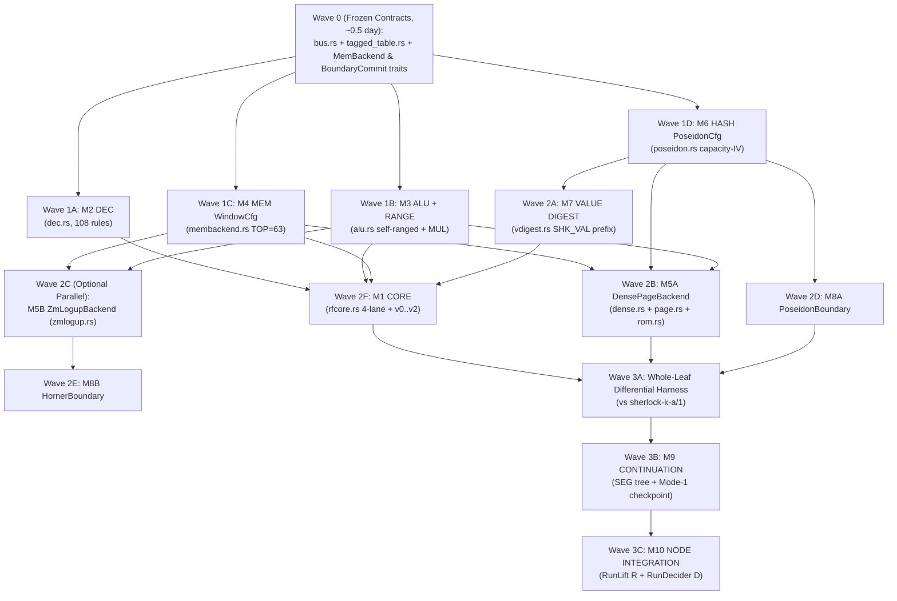

# Sherlock Chip Leaf Lookup "Cache" — Lane A (Prior Art & Literature) Round 2 Cross-Review & Converged Modular Design

Date: 2026-11-11. Study: `sherlock-lookup-cache-20261111` (Round 2 Cross-Review & Convergence).
Inputs reviewed: `BRIEF.md:1-68`, `LEAD-NOTE-ROUND2.md:1-19`, `lanes/{A,B,C,D,E}/round1.md`, `research/sherlock-runlength-consensus-20261111/CONSENSUS.md:1-350` (and `AUDIT.md:1-175`), `research/sherlock-final-design-20261111/MODULARITY.md:1-12`, `research/skeleton-coding-20261108/pilot-protocol.md:1-227`, `crates/mori-chip/src/{lib.rs,membackend.rs,dense.rs,dense/tests.rs,bus.rs,alu.rs,m3.rs,rfcore.rs,poseidon.rs,range.rs,dec.rs,vsel.rs}`, and `midnight-circuits-7.3.0/src/{verifier/verifier_gadget.rs,verifier/expressions/mod.rs,field/decomposition/pow2range.rs}`.

---

## Executive Summary of Round 2 Convergence

Across all five Round 1 reports, the run-length study (`CONSENSUS.md:17-53`), and the existing spike implementation in `crates/mori-chip/src/{membackend.rs,dense.rs}`, Round 2 converges on **one modular processor architecture** with frozen 5-tuple `(chip, key, a, b, c)` bus contracts (`crates/mori-chip/src/bus.rs:9-50`) and two explicit swappable traits (`MemBackend` at `crates/mori-chip/src/membackend.rs:95-128` and `BoundaryCommit`):

1. **Default Production Profile (Profile A — Compatible Extension of Run-Length `CONSENSUS.md`):**
   - **Memory Backend:** Dense tail-buffered Merkle memory (`WindowCfg` + `DenseCfg`, `crates/mori-chip/src/membackend.rs:48-128`, `crates/mori-chip/src/dense.rs:54-127`, `TOP = 63` for $2^{66}$ cells per `AUDIT.md:23-26` so `h < 2^64` always binds first) upgraded with **intra-leaf 8-cell aligned `PAGE` and `ROM` block-opening caches** (`A/round1.md:191-195`, `D/round1.md:55,400-401`). A block opening authenticates all 8 contiguous cells in one shared Merkle path (`86` Poseidon permutations = `6,020` `ESTIMATE` rows at `TOP = 63`, or `752.5` `ESTIMATE` rows/cell vs `4,761` rows per uncached `DenseCfg::cold_read` — a **6.3x spatial speedup**, plus **`0` extra Poseidon rows** on every temporal repeat within the leaf).
   - **Boundary Commitment:** Single-pass Poseidon boundary digest (`pre_d`, `post_d`) over CPU registers and backend token `[mem_root, tail_d]` (`CONSENSUS.md:27-35`).
   - **Why Default:** Strictly **1-pass** (supports prove-while-executing streaming, bounded constant witness RAM, zero-replay Tier-B / `GP-001` pause-and-resume checkpoints, `O(1)` cross-segment reuse under `GP-4`, and pay-per-touched-block `PROG` loading rather than `~63 s`/leaf `INIT_PROG` loader proofs), zero `midnight-circuits = 7.3.0` fork, and `RunDecider` `table_rows == 1,032,467 <= 1,048,570` unchanged.
2. **Swappable Comparison Profile (Profile B — Run-Wide Write-Once LogUp `ZM-LogUp` + Horner Boundary):**
   - Lane B (`lanes/B/round1.md:98-160`) demonstrated a **sound 1-phase (`cs.phases().count() == 1`)** run-wide write-once LogUp protocol (`ZM-LogUp`) by committing leaf writes (including leaf-cache read multiplicities $m_w$) and deduplicated leaf read-cache entries inside KZG `Instance(0)` ($C_i \in \mathbb{G}_1$) in Stage 1 *before* deriving Fiat-Shamir challenges $(\gamma, \alpha)$ from the binary commitment tree root $d_{\text{root}}$, running *one* recursion pass in Stage 2, and avoiding any intra-run $O(|M|)$ teardown sweep because unused write-once cells have $m_w = 0$.
   - Because `WindowCfg` (`crates/mori-chip/src/membackend.rs:80-128`) already isolates `CORE` and `MEM` from `DenseCfg`, `ZmLogupCfg` + `HornerBoundaryCfg` slots cleanly behind `MemBackend` + `BoundaryCommit` as **Swappable Backend #2** for head-to-head benchmarking on fixed batch workloads, without changing a single gate of `CORE`, `DEC`, `ALU`, `MEM`, or `VALUE DIGEST`.
3. **Unanimous Leaf Upgrades Adopted from Lanes C, D, and E:**
   - **2-Column `TaggedTableConfig` (`DEC + RANGE`)** (`lanes/C/round1.md:175-186`) + **2nd `q_req = 1` row in `Arch::Narrow`** (`lanes/D/round1.md:154,408`): drops total leaf lookups from `4` to `3` (**`-29,062` `ESTIMATE` rows in 1-leaf Node; `-51,662` `ESTIMATE` rows in 2-leaf `RunLift` `R`**) while doubling step bus bandwidth from 2 to 4 requests/step at `+0` Node rows.
   - **Self-Ranged 128-bit `ALU` + 64-bit Schoolbook `OP_MUL`** (`lanes/E/round1.md:134-139`, `lanes/C/round1.md:163-166`): closes the critical `crates/mori-chip/src/alu.rs:111-125` un-ranged `x, y` soundness bug (`Exploit D1`) at `+24` `RANGE` rows/op (`+0` Node rows, `+0` `k_leaf` change).
   - **Capacity-IV Domain Separation + Precomputed `(SHK_VAL, 1)` Value-Digest Prefix** (`crates/mori-chip/src/poseidon.rs:107-120`, `lanes/C/round1.md:199-214`): saves 1 Poseidon permutation (`70` rows) on every dynamic C6 allocation and `100%` (`210` rows) on boolean `==`/`<`/`!` results.

---

## 1. Cross-Review of Lanes B, C, D, and E (`round1.md`)

### 1.1 Evaluation of Lane B (`lanes/B/round1.md` — `WO-LogUp` / `ZM-LogUp`)

In Round 1 (`lanes/A/round1.md:204-210`), Lane A grouped run-wide LogUp under Halo2 `SecondPhase` challenges (`phases == 2`) and assumed an $O(|M|)$ final-memory sweep. Lane B (`lanes/B/round1.md:98-160, 185-200`) proved a substantially stronger construction (`ZM-LogUp`) that warrants an exact, fair technical evaluation.

#### What Lane A Accepts from Lane B
1. **1-Phase Soundness on Unmodified `VerifierGadget` via Stage-1 `Instance(0)` Commitment (`lanes/B/round1.md:102-110, 147-160`):**
   - `midnight-proofs` commits public-input column `Instance(0)` into KZG point $C_i = \text{Com}_{\text{KZG}}(P_i(\omega^\cdot)) \in \mathbb{G}_1$, which `VerifierGadget::verify` absorbs into the Fiat-Shamir transcript (`verifier_gadget.rs:298-300`) and opens at challenge point $x$ (`verifier_gadget.rs:627-635`).
   - In `ZM-LogUp`, Stage 1 executes the $N$-leaf run, computes exact read multiplicities $m_w$ for every allocated cell $w$, packs `P_i` (`[pre_regs(29), post_regs(29), writes(W_cap * 6), cache_reads((K_m + K_p) * 5)]` = `250` scalars at `W_cap = 16, K_m = 16, K_p = 4`), computes $C_i$ via a size-256 KZG lagrange MSM (`< 1 ms` CPU/leaf, `ESTIMATE`), hashes $d_i = H(\text{DOM\_LEAF\_COM}, C_{i,x}, C_{i,y})$ into binary Merkle root $d_{\text{root}}$, and derives $(\gamma, \alpha) = H(\text{DOM\_MEM\_CHAL}, d_{\text{root}}, \text{prog\_d}, \text{input\_d})$ (`lanes/B/round1.md:147-160`).
   - **Crucial cryptographic point:** Unlike naive public-input challenge injection (which Lane E broke in `lanes/E/round1.md:89-100` `Exploit B1` because uncommitted advice `m_w` could be chosen *after* $\alpha$), `ZM-LogUp` commits `m_w` inside $C_i$ *before* $(\gamma, \alpha)$ exist. By KZG binding + random-oracle Poseidon resistance + Schwartz-Zippel over degree-$d$ rational sums on $\mathbb{F}_r$ ($r \approx 2^{255}$), soundness error is bounded by $\epsilon_{\text{LogUp}} \le \frac{N \cdot (W_{\text{cap}} + K_m + K_p) + |T_{\text{prog}}|}{|\mathbb{F}_r|} < 2^{-215}$ (`ESTIMATE` for $N \le 2^{30}$), while keeping `cs.phases().count() == 1` (`verifier_gadget.rs:310`).
2. **Zero Intra-Run $O(|M|)$ Teardown Sweep (`lanes/B/round1.md:84-90, 105-108`) & Single Recursion Pass (`lanes/B/round1.md:187-195`):**
   - Because Sherlock memory is strictly write-once (`D3` / Stwo-Cairo write-once property, `https://eprint.iacr.org/2021/1063`) and $m_w$ counts the number of leaves whose deduplicated `CACHE` table reads cell $w$ (`lanes/B/round1.md:105-108`), an allocated cell that is never read again simply commits $m_w = 0$ at birth:
     $$\sum_{i=0}^{N-1} \left( \sum_{w \in \text{Writes}_i} \frac{m_w}{\alpha - \text{enc}(w)} - \sum_{r \in \text{Cache}_i} \frac{e_r}{\alpha - \text{enc}(r)} \right) + \sum_{p \in \text{InitProg}} \frac{m_p}{\alpha - \text{enc}(p)} = 0$$
   - Unlike read-write RAM offline checking (Spice / Twist / Nebula `ccIVC`, `https://eprint.iacr.org/2026/495`), `ZM-LogUp` needs **zero teardown leaves** at $h_{\text{final}}$ for unread cells and runs **one** Stage-2 recursion pass (matching Matter Labs Airbender's two-stage witness/challenge pipeline, `https://github.com/matter-labs/zksync-airbender`, `circuits/src/ram_permutation/mod.rs`).
3. **Partition Independence (`SRC-023`) & C6 Outcome-Only Compatibility Within a Self-Contained Batch Run (`lanes/B/round1.md:166-175`):**
   - `RunDecider` asserts `sum_root == 0`, absorbs `(d_root, gamma, alpha)` privately inside the decider circuit, and exposes **only** `(prog_d, input_d, outcome_d)` as public ledger outputs (`lanes/B/round1.md:162-172`). Changing leaf size $S$ changes the internal witnesses $(d_{\text{root}}, \gamma, \alpha)$ without changing any public decider input.
4. **Swappable Backend Fit (`MODULARITY.md:9`):**
   - Lane B's leaf-local write window + deduplicated read cache (`CACHE`) can be wrapped directly behind `MemBackend` (`crates/mori-chip/src/membackend.rs:95-128`), and its Horner register boundary (`com_pre`, `com_post`) behind `BoundaryCommit`, allowing empirical head-to-head benchmarking against `DenseCfg`.

#### What Lane A Rejects from Lane B (Why `ZM-LogUp` Is Swappable Backend #2, Not the Default Backend)
1. **Reject `INIT_PROG` Recursive Loader Leaves (`lanes/B/round1.md:122-125`) for General-Purpose Programs (`GP-1`):**
   - Lane B injects static `PROG` and `TY` tables into the LogUp sum via `INIT_PROG` leaves (`32` rows/leaf), claiming "0 runtime Merkle walks". However, in `midnight-proofs` KZG recursion, **every `INIT_PROG` leaf requires a `~63 s` `k = 20` Node/Lift proof** (`CONSENSUS.md:45`)!
   - Even 2 loader leaves (`64` rows) add `ESTIMATE ~126 s` (`> 2 min`) to a 6-step `G-B` smoke test. For a realistic 16,384-entry compiled program (`512` `INIT_PROG` leaves at 32 entries/leaf), proving the loader leaves alone costs **`512 * 63 s = 32,256 s` (`ESTIMATE ~8.96 hours`)** of `k = 20` proving *before step 0 executes* — even if the run executes 20 instructions and halts! By contrast, authenticating `PROG`/`TY` via 8-entry `ROM` block openings against `prog_root` (`A/round1.md:214`, `C/round1.md:146-148`, `D/round1.md:102-105`) pays **zero** loader leaves and proves *only* the `PROG` blocks actually touched by the execution.
2. **Reject Stage-1 Full-Run Lookahead Barrier for Streaming & Long-Running Jobs (`LEAD-NOTE-ROUND2.md:11`, `CONSENSUS.md:40-49`):**
   - In `ZM-LogUp`, `P_0` (Leaf 0's `Instance(0)` vector) contains $m_w$ for cells allocated at step 0 (`lanes/B/round1.md:105-107`). If cell $w = 0$ is read at step $h = 10^8 - 1$, $m_0$ is unknown until step $10^8 - 1$ finishes. Therefore **not a single leaf proof (`i = 0`) can begin Stage-2 polynomial proving until 100% of the $N$-step execution finishes**, destroying prove-while-executing pipeline overlap and requiring full-run trace buffering or 2x VM replay (`D/round1.md:73-76`).
3. **Reject `ZM-LogUp` as Default Under Tier-B / `GP-001` Pause-and-Resume Checkpoints (`CONSENSUS.md:42-49`, `AUDIT.md:41-46`):**
   - If a multi-hour run pauses at checkpoint $h_1$ and seals Epoch 1 `[0, h_1)` under its own `(d_root_1, gamma_1, alpha_1)` with `sum_1 == 0`, Epoch 2 `[h_1, h_2)` cannot read cells allocated in `[0, h_1)` unless Epoch 2 **re-emits the live `[0, h_1)` arena via `INIT_MEM` loader leaves** under `(gamma_2, alpha_2)` — which **re-introduces the exact $O(|M_{\text{live}}|)$ sweep (`~63 s` per 32 cells!)** across every pause/resume boundary! Under `DenseCfg`, Epoch 2 resumes from `[mem_root_1, tail_d_1]` + retained arena disk file in **$O(1)$ (`0` loader leaves)**.
4. **Reject Ignoring the 2-Leaf `RunLift` `R` (`U + U -> SEG`) Overhead & Sub-DAG Challenge Lock (`GP-4`, `lanes/D/round1.md:13, 321-328`):**
   - Lane B modeled 1-leaf `SHKIVC06` (`+13,700` `ESTIMATE` Node rows, `lanes/B/round1.md:208`). In the binary segment tree (`GP-4`, `CONSENSUS.md:201-218`), `RunLift` `R` verifies **two** child proofs and opens **two** variable `Instance(0)` commitments $C_L, C_R \in \mathbb{G}_1$ inside the non-native MSM (`verifier_gadget.rs:298-300, 627-635`), costing **`ESTIMATE +27,000..+50,000` Node rows in `R`** (`lanes/D/round1.md:323-328`). Furthermore, every proved `SEG` node is locked to the global run's `(gamma, alpha)`, so a proved prefix `[0, h_1)` cannot be reused across two runs that diverge after $h_1$ (`GP-4`).
5. **Reject Unconditional Horner Boundary Outside Stage-1 Pre-Commitment (`lanes/B/round1.md:149-156` vs `lanes/E/round1.md:65-67`):**
   - Horner evaluation $\text{com}_{\text{regs}} = \sum_{j=0}^{28} r_j \gamma^j$ saves `2,042` leaf rows (`lanes/B/round1.md:155`), which is **sound ONLY when `r_j` is already committed inside `Instance(0)` $C_i$ before $\gamma$ is sampled**. Without Stage-1 `Instance(0)` commitment, an adversary seeing $\gamma$ forges $r'_0 = r_0 + \gamma(r_1 - r'_1)$ in 1 field op (`lanes/E/round1.md:65-67`, `Exploit A4`). Hence `HornerBoundaryCfg` must be strictly paired with `ZmLogupCfg` (Profile B), never with 1-pass `DenseCfg` (Profile A).
6. **Reject Omitting `m_w` Range Checks on `0 == sum` (`lanes/E/round1.md:94-96`):**
   - Even with committed $m_w \in \mathbb{F}_r$, `ZmLogupCfg` must range-check $0 \le m_w < 2^{32}$ (`2..3` `RANGE` limbs per write slot) so wraparound $\sum e_r \equiv m_w \pmod{r}$ is impossible and multiplicities reflect integer counts.

---

### 1.2 Evaluation of Lane C (`lanes/C/round1.md` — Decode, Program, ALU/RANGE & Value Digest)

#### What Lane A Accepts from Lane C
1. **2-Column `TaggedTableConfig` (`DEC + RANGE`) Over Lane A's Round 1 Bus-Folded `DEC` (`lanes/C/round1.md:175-186` vs `lanes/A/round1.md:179, 213`):**
   - **Direct Comparison:**

| Property | Lane A R1: Bus-Folded `DEC` (`A/round1.md:179,213`) | Lane C R1: 2-Column `TaggedTableConfig` (`C/round1.md:175-186`) | Winner |
| :--- | :--- | :--- | :---: |
| Total leaf `lookup` arguments (`4` baseline) | `3` (`bus` + `range` + `vsel` -> actually `2` if `vsel` dropped, or `3` with `vsel`) | **`3`** (`bus` + `tagged_dec_range` + `vsel`; **`2`** once `vsel` folds into register mux) | Tie (`-1` lookup) |
| Fixed columns removed (`DEC` 7 -> 2) | `-6` fixed cols (`1` table col + `5` bus cols reused) | **`-5` fixed cols** (`7` `DEC` + `1` `RANGE` = `8` -> `2` `TableColumn`s `(t_key, t_val)`) | Tie (`~ -29,062` `ESTIMATE` 1-leaf Node rows; **`~ -51,662` `ESTIMATE` `RunLift` `R` rows**) |
| Step bus request lanes consumed by `DEC` | **1 lane/step** (cuts `Arch::Narrow` data lanes by 25%–50%, `A/round1.md:213,296`) | **`0` lanes/step** (`DEC` uses dedicated `(t_key, t_val)` lookup, leaving **100% of bus lanes free**) | **Lane C** |
| Max custom gate / lookup degree | `deg = 5` | **`deg = 5 <= 6`** (via disjoint `q_rng * q_dec == 0` rows: `q_rng*(2^64 + limb) + q_dec*(2*2^64 + syn)`) | Tie |
| Fixed table height | `4,097` (`RANGE`) + `2,048` (`DEC` provider rows) | **`6,145` rows** (`Row 0: (0,0)`, `Rows 1..=4096: (2^64 + v, 1)`, `Rows 4097..=6144: (2*2^64 + syn_i, 2^64 + ctrl_i)`) <= $2^{13} - 6 = 8,186$ | **Lane C** |

   - **Verdict:** Lane A **adopts Lane C's 2-column `TaggedTableConfig` (`DEC + RANGE`)** and retires bus-folded `DEC`. Combined with Lane D's 2nd `q_req = 1` row (`lanes/D/round1.md:154,408`), every step gets **4 full data/memory/ALU/hash bus lanes** AND saves **`-29,062` `ESTIMATE` 1-leaf Node rows (`-51,662` `ESTIMATE` `RunLift` `R` rows)**.
2. **108-Rule `/1` Dispatch & Program-Table Audit (`lanes/C/round1.md:48-63, 109-149`):**
   - `supported_rules()` (`crates/mori-spec/src/step/step_index.rs:146-257`) has `108` rules; raw flat cross-product decode explodes to $2{,}176 \times 2{,}048 = 4{,}456{,}448$ rows (`k = 23`), whereas gate-normalized 11-bit syndrome (`<= 2,048` rows) + 54-bit packed `ctrl_word` with mandatory boolean/domain gates on unpacked advice columns (`lanes/C/round1.md:113-118, 355`) keeps `DEC <= 2,048` rows and closes `Exploit C1` (`lanes/E/round1.md:120-122`).
   - Only 11 of 20 program tables are dynamically read in `/1` (`field_paths`, `plan_nodes`, `plan_cases` have zero step readers in `/1`, `lanes/C/round1.md:122-125`), and `/1` arithmetic has `ADD, SUB, MUL, LT, EQ, NOT` with **zero** bitwise ops and **zero** `DIV/REM` (`lanes/C/round1.md:155-158`).
3. **64-bit Limb Schoolbook `OP_MUL` (`lanes/C/round1.md:163-166`):**
   - Decomposing `x = x_lo + 2^64 x_hi` and `y = y_lo + 2^64 y_hi` via existing 12-bit limbs (`5 + 6` limbs) avoids $(2^{128}-1)^2 \approx 2^{256} > r_{\text{BLS}}$ field wraparound at `0` new tables and aligns directly with `(lo64, hi64)` in `sherlock-value/1`.
4. **Precomputed `(SHK_VAL, 1)` Sponge Prefix + `VD_{NIL,FALSE,TRUE}` Constants (`lanes/C/round1.md:199-214`):**
   - Because `Poseidon(0, (SHK_VAL, 1))` is a compile-time constant state `[F; 3]`, starting dynamic value-digest sponges from `VAL_PREFIX_STATE` saves **1 Poseidon permutation (`70` rows, `33%–50%`) on every heap allocation** while remaining bit-for-bit identical to `sherlock-value/1` (`crates/mori-hash/src/value.rs:34-90`), and inline constants `VD_NIL, VD_FALSE, VD_TRUE` eliminate **100% (`210` rows)** of hashing on boolean `==`, `<`, and `!`.

#### What Lane A Rejects from Lane C
1. **Reject `TOP = 32` (`2^35` cells) and Empty-Segment-Only (`used == 0`) Skip (`lanes/C/round1.md:226, 291-292`):**
   - `TOP = 32` violates `GP-1` (`CONSENSUS.md:18, 121-125`), and skipping Merkle updates only when `used == 0` still wastes `7/8` (`87.5%`) of cells when a leaf appends 1 cell. Both are superseded by `WindowCfg` + `DenseCfg` (`TOP = 63`, zero padding on `1..7` appends, already implemented in `crates/mori-chip/src/{membackend.rs,dense.rs}`).

---

### 1.3 Evaluation of Lane D (`lanes/D/round1.md` — Recursion, `RunLift` `R`, `Pow2Range` & Bus Bandwidth)

#### What Lane A Accepts from Lane D
1. **Exact Dual-Site `VerifierGadget` Single-Phase Proof (`lanes/D/round1.md:165-177`):**
   - Confirmed in `midnight-circuits-7.3.0`: both `verifier_gadget.rs:310` (`assert_eq!(cs.phases().count(), 1)`) and `verifier/expressions/mod.rs:49` (`Expression::Challenge(_) => panic!(...)`) forbid Halo2 multi-phase challenges without forking `midnight-circuits`.
2. **Exact `RunDecider` `Pow2RangeChip` Binary Budget Proof (`lanes/D/round1.md:214-221`, verified at `pow2range.rs:215-236`):**
   - `RunDecider` currently uses `table_rows = 1,032,467 <= 1,048,570 = 2^20 - 6`.
   - Exact binary decomposition (`pow2range.rs:215-236`): $1{,}032{,}467 = 2^0 + 2^1 + 2^4 + 2^8 + 2^{14} + 2^{15} + 2^{16} + 2^{17} + 2^{18} + 2^{19}$ (`1 + 2 + 16 + 256 + 16,384 + 32,768 + 65,536 + 131,072 + 262,144 + 524,288 = 1,032,467`), leaving **`16,103` rows of headroom** below `1,048,570`.
   - *Correction to Lane E (`lanes/E/round1.md:27`):* Lane E warned that touching tag `14` ($2^{14} = 16,384$) blows `k = 20`, but $2^{14}..2^{19}$ are **already active** in `1,032,467`! As Lane D proved (`lanes/D/round1.md:218-220`), the *unqueried* terms have sizes $\{4, 8, 32, 64, 128, 512, 1024, 2048, 4096, 8192\}$, whose total sum is **`16,108 > 16,103`** (missed by just **5 rows**!), and any new limb tag $\ge 19$ ($2^{20}$) blows `k = 20` immediately. Keeping `RunDecider`'s native decomposition tags untouched preserves `table_rows == 1,032,467` deterministically.
3. **2-Leaf `RunLift` `R` (`U + U -> SEG`) Variable-Commitment Multiplier (`lanes/D/round1.md:13, 321-328`):**
   - Every leaf lookup argument adds `2` variable commitments (`permuted_input`, `permuted_table`) + `1` product `z` commitment = `3` variable $\mathbb{G}_1$ points *per verified child*, costing `~22,600` Node rows in 1-leaf `SHKIVC06` and **`~45,200` `ESTIMATE` Node rows in 2-leaf `RunLift` `R`**. Thus dropping `4 -> 3` lookups via `TaggedTableConfig` saves **`~51,662` `ESTIMATE` rows in `R`**.
4. **2nd `q_req = 1` Row in `Arch::Narrow` (`lanes/D/round1.md:154, 408`, verified at `crates/mori-chip/src/rfcore.rs:198-200`):**
   - Promoting row `6` of the 8-row `Arch::Narrow` step template from a passive replica of `(L0, L1)` to an independent `(L2, L3)` request pair doubles step bus capacity from **2 to 4 bus requests/step** at **`+0` Node rows** (`0` new columns, `0` new lookups).
5. **8-Cell Aligned `PAGE` & `ROM` Block Openings (`lanes/D/round1.md:55, 400-401`, matching `lanes/A/round1.md:191-195`):**
   - Opening aligned 8-cell leaf blocks (`addr >> 3`) amortizes the `TOP`-level Merkle walk across all 8 cells (`86` perms = `6,020` `ESTIMATE` rows per 8-cell block at `TOP = 63`, vs `8 * 4,761 = 38,088` rows for 8 scalar `cold_read`s) and serves repeated intra-leaf reads of any cell in that block at **`0` additional Poseidon rows**.

#### What Lane A Rejects / Defers from Lane D
1. **Reject Widening `RANGE` Table to 15–16 Bits (`32,768–65,530` Fixed Rows, `lanes/D/round1.md:115`):**
   - Saves only `32–64` ALU rows/leaf (completely hidden underneath Poseidon rows) while inflating minimum circuit height to `k >= 16` even in unit/smoke tests and colliding with `TaggedTableConfig`'s compact `6,145`-row table. Keep 12-bit `RANGE` (`4,096` entries inside `6,145`-row `TaggedTableConfig`).
2. **Defer In-Circuit LCA Prefix Sharing (`lanes/D/round1.md:56, 294`) to Post-M4:**
   - Variable-height path splicing across `TOP = 63` levels requires conditional path muxing and height tracking (`CVE-2026-62333` risk class, `lanes/A/round1.md:128`). Fixed-height 8-cell `PAGE`/`ROM` block openings capture the 6.3x spatial + temporal win with simple fixed-depth circuits; LCA sharing remains an optional post-M4 optimization behind `MemBackend`.

---

### 1.4 Evaluation of Lane E (`lanes/E/round1.md` — Red-Team Soundness Audit)

#### Resolution of Lane E's `crates/mori-chip/src/alu.rs:111-125` Input Range-Check Exploit (`Exploit D1`)
Lane E (`lanes/E/round1.md:134-139`) discovered a **confirmed critical soundness bug** in the existing `AluConfig` spike (`crates/mori-chip/src/alu.rs:8-9, 111-125`):
- **Code verified (`crates/mori-chip/src/alu.rs:111-125`):** `AluConfig` explicitly assumes callers already proved `x, y < 2^128` (`alu.rs:8-9`) and range-checks **only** the single 128-bit output/slack witness:
  $$w = \text{is\_add} \cdot z + \text{is\_lt} \cdot \bigl(z(y - x - 1) + (1 - z)(x - y)\bigr) < 2^{128}$$
- **Concrete Forgery:**
  1. In `OP_LT`: set `x = r - 1` (`-1 mod r`), `y = 5`, `z = 1`. Then $w = 1 \cdot (5 - (-1) - 1) = 5 < 2^{128}$ passes all 9 polynomial gates in `alu.rs:117-125` and the 12-bit `Range128Config` lookup, proving `(r - 1) < 5 == true`!
  2. In `OP_ADD`: set `x = r - 3`, `y = 10`, `flag = 0`, `z = 7`. Then $x + y - z - 0 \cdot 2^{128} = (r - 3) + 10 - 7 \equiv 0 \pmod{r}$ and $w = z = 7 < 2^{128}$ passes every constraint, forging an overflow-free addition on an out-of-range field element!
  3. Any un-ranged advice witness (`div/rem` quotient if ever added, unpacked bitfields, or corrupted imported cells) turns `OP_LT` into an arbitrary bounds-check bypass.
- **Accepted Dual Defense (Defense-in-Depth for Modularity, `MODULARITY.md:8`):**
  1. **Provider Self-Sufficiency Inside `ALU` (`M3`):** Because `MODULARITY.md:8` mandates that a bus provider's soundness invariants must hold **without trusting internal columns of any caller module**, `AluConfig` **must unconditionally range-check `x < 2^128` and `y < 2^128`** alongside `w < 2^128` (and 64-bit limbs on `OP_MUL`). Using `Range128Config` (`12` rows per 128-bit value, `crates/mori-chip/src/range.rs:64-92`), checking `(x, y, w)` takes `3 * 12 = 36` `RANGE` rows per ALU op (`+24` rows/op vs today's `12`, i.e., `+384` rows/leaf at `S = 16`). Because Poseidon uses `> 6,000` rows/leaf, **`+384` `RANGE` rows adds `+0` Node rows and `+0` change to `k_leaf`**, while making `CHIP_ALU` unconditionally sound against *any* caller!
  2. **Write-Side & Boundary Canonicality (`M1`, `M4`):** Independently, `WindowCfg::bits` (`crates/mori-chip/src/membackend.rs:388-389`) decomposes `len_pre, len_post` in bits, and `CORE` enforces `u128` / tag invariants on step outputs so non-ALU paths (e.g., direct `EQ`) also operate only on canonical words.

#### Other Items Accepted and Rejected from Lane E
- **Accept from Lane E:**
  - `Exploits A1–A5` (cross-arena aliasing, stale/phantom cache rows, `addr < len_pre` read-before-write via `OP_LT`, boundary canonicality — note `WindowCfg` + `DenseCfg` already tests and blocks these in `crates/mori-chip/src/dense/tests.rs:655-803`!), `Exploit C1` (unbounded bitfield unpacking in `DEC`), `Exploit C2` (`prog_root` cross-table `tbl_id` confusion), `Exploits E1–E2` (Poseidon domain/arity separation via capacity IV `poseidon.rs:107-120`), and `Exploit G1` (partition-dependent public inputs).
- **Reject from Lane E:**
  - **Reject `WB[4]` 12-word raw boundary + `TOP = 30` (`2^32` cells) + `C = 4` cap (`lanes/E/round1.md:161-168`):** Superseded by `WindowCfg` + `DenseCfg` (`SEGC = 8`, 1-word canonical `tail_d`, `TOP = 63`, `2^66` cells, `AUDIT.md:23-26, 55-65`).
  - **Reject Bus-Unified `DEC` (`lanes/E/round1.md:118-119`):** Superseded by Lane C's 2-column `TaggedTableConfig` (`DEC + RANGE`), which achieves the exact same `4 -> 3` lookup reduction (`-29,062` Node rows) without consuming bus request lanes or risking cross-chip key collisions on `bus`.
  - **Reject Skipping Deterministic `VALUE DIGEST` Prefix Precomputation (`lanes/E/round1.md:145-148`):** Lane E rightly rejected *dynamic intra-leaf `HASH` bus memoization* because worst-case `k_leaf` still depends on distinct hashes. However, Lane C's compile-time `(SHK_VAL, 1)` prefix state + `VD_{NIL,FALSE,TRUE}` constants (`lanes/C/round1.md:199-208`) deterministically cut **worst-case** permutations on every allocation by 33%–100% with zero variable-arity cache tables. (We **accept** Lane E's rejection of dynamic intra-leaf `HASH` memoization tables, and **adopt** Lane C's static prefix state + literal constants.)

---

### 1.5 Summary of Updates to Lane A's Own Round 1 (`lanes/A/round1.md`)

1. **Recognize `ZM-LogUp` (`lanes/B/round1.md`) as 1-Phase Sound on `VerifierGadget`:** Retract R1's grouping of all run-wide LogUp designs under `phases == 2` (`lanes/A/round1.md:204-205`); place `ZmLogupCfg` + `HornerBoundaryCfg` behind `MemBackend` + `BoundaryCommit` as **Swappable Profile B**, while keeping `DenseCfg` + 8-cell `PAGE`/`ROM` cache + `PoseidonBoundaryCfg` as **Default Profile A**.
2. **Adopt 2-Column `TaggedTableConfig` (`DEC + RANGE`) + 2nd `q_req` Row:** Upgrade R1's bus-folded `DEC` (`lanes/A/round1.md:179, 213`) to `TaggedTableConfig` (`lanes/C/round1.md:175-186`) + 4 bus lanes/step (`lanes/D/round1.md:154, 408`).
3. **Adopt `WindowCfg` + `DenseCfg` (`TOP = 63`, 4-Arena Default Pending Quint Check):** Replace R1's `SI-12` cons-spine staging (`lanes/A/round1.md:250`) with `crates/mori-chip/src/{membackend.rs,dense.rs}` (`TOP = 63` per `AUDIT.md:23-26`, keeping 4-word `[kind, d0, d1, d2]` records until the 108-rule Quint contiguity check passes per `AUDIT.md:28-33`).
4. **Adopt Self-Ranged `ALU` (`x, y, w < 2^128` + 64-bit `OP_MUL`):** Close `Exploit D1` (`crates/mori-chip/src/alu.rs:111-125`).
5. **Align Step Count `S` with `SRC-014` (`S = 16` for M4, Parameterized `S = 64..128` Post-M4):** Reconcile R1's `S = 64` proposal (`lanes/A/round1.md:227-229`) with `CONSENSUS.md:282-288` (detailed in §2.4 below).

---

## 2. Explicit Answers to All Four Questions in `LEAD-NOTE-ROUND2.md:9-14`

### 2.1 Question 1: Merkle (`DenseCfg` + L1 `PAGE`/`ROM` Cache) vs Run-Wide Write-Once LogUp (`ZM-LogUp`)

**Recommendation:** Use **Merkle (`DenseCfg` / `M3-Tail64` at `TOP = 63` + intra-leaf 8-cell `PAGE` and `ROM` block caches)** as the **default production backend (Profile A)** for heap/arena memory, `PROG`, and `TY` tables, while keeping **`ZM-LogUp` (`ZmLogupCfg` + `HornerBoundaryCfg`)** as **Swappable Backend #2 (Profile B)** behind `MemBackend` and `BoundaryCommit`.

#### Subsystem-by-Subsystem Verdict

| Subsystem | Default Choice (Profile A) | Why It Beats `ZM-LogUp` as Default |
| :--- | :--- | :--- |
| **Dynamic Arenas (`DATA`, `FIELD`, `ENV`, `SLOT`)** | **`WindowCfg` + `DenseCfg` (`TOP = 63`) + L1 8-cell `PAGE` block cache** (`K_page = 4` blocks = `32` cached cells/leaf) | 1-pass streaming; $O(1)$ Tier-B checkpoint resume (`0` loader leaves); `752.5` `ESTIMATE` rows/cell spatial cost (`0` rows on temporal hit); zero `RunLift` `R` variable-commitment tax; sub-DAG proofs reusable across runs (`GP-4`). |
| **Program Tables (`PROG`: 11 active tables in `/1`)** | **Static Merkle root `prog_root` + L1 8-entry `ROM` block cache** (`K_rom = 2..4` blocks = `16..32` instructions/leaf) | Zero `INIT_PROG` loader leaves! Pays **only** for basic blocks actually executed (`~6,020` leaf rows per 8-instruction cache miss, amortized across loops at `0` rows/hit), vs `ZM-LogUp`'s **`~63 s` per 32-row `INIT_PROG` Node proof** (`~8.96 hours` `ESTIMATE` for a 16K-row binary even on a 10-step run!). |
| **Type & Constructor Tables (`TY`: `types`, `type_ctors`, `ctor_fields`)** | **Bundled under the same static `prog_root` `ROM` tree** (domain-tagged by `tbl_id` in capacity IV, `Exploit C2`) | Type/constructor metadata can have thousands of rows in large modules while a single run touches `< 20` constructors (`C/round1.md:146-148`). `ROM` block openings under `prog_root` pay `O(touched constructors)` with `0` loader leaves and `0` fixed-column circuits per program (`GP-1`). |

#### How Both Designs Interact with `2^64` Cells, `SRC-023`, C6 Outcome-Only, and `GP-2`..`GP-4`

1. **`2^64` Cells (`GP-1` & `AUDIT.md:23-26`):**
   - **Merkle (Profile A):** Setting `TOP = 63` (`66`-bit cell address space, $2^{66}$ cells across 4 arenas or 1 unified arena) ensures `h < 2^64` steps binds strictly before `len < 2^66` even if every step appends 3 cells (`AUDIT.md:23-26`). Cost vs `TOP = 61`: `+2` Poseidon permutations (`+140` `ESTIMATE` rows) per `PAGE` block miss and `+4` permutations (`+280` `ESTIMATE` rows) on segment persist.
   - **LogUp (Profile B):** Encodes `addr < 2^66` as a native $\mathbb{F}_r$ scalar inside $\text{enc}(w) = \text{addr} + \gamma \text{kind} + \gamma^2 d_0 + \gamma^3 d_1 + \gamma^4 d_2$, so address width costs `0` extra gates in `ZM-LogUp` (`lanes/B/round1.md:166`), provided `len_post` is still bit-checked (`<= 66` bits) in `WindowCfg`.
2. **`SRC-023` Partition Independence & C6 Outcome-Only Publication:**
   - **Merkle (Profile A):** `WindowCfg` + `DenseCfg` (`crates/mori-chip/src/dense.rs:28-44`) maintains exact leaf-size invariance: `mem_root` commits all full 8-cell segments `0 .. floor(len / 8)`, while `tail_d` commits `len mod 8` cells `[8 * floor(len / 8) .. len)`. Neither `mem_root` nor `tail_d` depends on leaf boundaries $S$, and at `RunDecider` both are dropped so **only** `(prog_d, input_d, outcome_d)` is published (C6 outcome-only).
   - **LogUp (Profile B):** Internal witnesses `(d_root, gamma, alpha)` *do* change if $S$ changes, **but** `RunDecider` hides `(d_root, gamma, alpha)` as private advice and asserts `sum_root == 0`, publishing **only** `(prog_d, input_d, outcome_d)` (`lanes/B/round1.md:168-174`). Thus `SRC-023` holds at the `RunDecider` boundary for self-contained runs.
3. **`GP-2` (Cross-Run Claim Consumption), `GP-3` (Foreign Proofs), and `GP-4` (Arbitrary Recursion Topology):**
   - **`GP-2` & `GP-3` across independent runs:** Cross-run claims pass C6 value digests (`outcome_d` / `ClaimHash`), **not** raw pointers into a prior run's heap (`CONSENSUS.md:240-255`). Both Profile A and Profile B support `GP-2` and `GP-3` cleanly at the `RunDecider` claim boundary.
   - **`GP-001` Checkpoint Continuations & `GP-4` Sub-DAG Reuse (Where Profile A Decisively Wins):**
     - Under `GP-001` (`CONSENSUS.md:42-49`, `AUDIT.md:41-46`), a multi-day run pauses at step $h_1$, persists a `SEG` proof $P_{[0, h_1)}$, and resumes later for $[h_1, h_2)$ reading arena cells allocated in $[0, h_1)$. Under **Profile A**, $P_{[0, h_1)}$ carries `mem_root_1`, so $[h_1, h_2)$ opens any $[0, h_1)$ cell in 1 pass with **`0` loader leaves**, and $P_{[0, h_1)}$ can be composed into **any** future continuation branch (`GP-4`).
     - Under **Profile B (`ZM-LogUp`)**, every leaf in $[0, h_1)$ is cryptographically locked to a single global `(gamma, alpha)` derived from `d_root` of the *entire* run (`lanes/D/round1.md:73-78`). You **cannot** prove $P_{[0, h_1)}$ before $[h_1, h_2)$ has finished executing (because $[h_1, h_2)$'s reads increment $m_w$ in $[0, h_1)$!), nor can two diverging branches $[h_1, h_2^{(A)})$ and $[h_1, h_2^{(B)})$ share a proved prefix $P_{[0, h_1)}$, without sealing $[0, h_1)$ and paying an $O(|M_{\text{live}}|)$ `INIT_MEM` loader-leaf tax in every continuation!

---

### 2.2 Question 2: Quantitative Two-Pass Cost vs One-Pass Alternatives (`ESTIMATE`)

#### Quantitative Impact of Stage-1 Pre-Commitment (`ZM-LogUp`) vs One-Pass (`DenseCfg` + `PAGE`)

| Operational Metric | One-Pass: `DenseCfg` + 8-Cell `PAGE`/`ROM` (Profile A) | Two-Pass: `ZM-LogUp` Stage-1 `Instance(0)` (Profile B) | Impact / Verdict |
| :--- | :--- | :--- | :--- |
| **Time to start Leaf 0 KZG proof** | **Immediate** after $S$ steps (`< 1 ms` CPU) | **Blocked until step $N$ finishes** (`100%` VM run + `N` KZG `Instance(0)` MSMs + `d_root` tree) | On a 1-hour native VM job (e.g., heavy data/crypto pipeline), `ZM-LogUp` sits idle on all prover cores for 1 hour before Leaf 0 proving starts; Profile A streams Leaf 0 at $t \approx 1\text{ ms}$. |
| **Prove-while-executing pipeline overlap** | **100% overlap:** VM thread stays 1 leaf ahead of worker pool | **0% overlap** between VM execution and Stage-2 leaf/node proving | Adds full Stage-1 execution + trace I/O wall-clock onto critical path (`ESTIMATE +5%..+25%` latency on I/O-heavy runs). |
| **Witness / trace buffering RAM & NVMe** | **$O(S)$ constant RAM (`< 16 MB` per active worker)** + append-only arena store (`32 B/cell`) | Must retain per-cell multiplicity array `u32[|M|]` (`4 GB` RAM per $10^9$ cells, `ESTIMATE`) **plus** either full $N$-leaf trace (`~8–32 KB/leaf` = `ESTIMATE 8–32 GB` for $10^6$ leaves) or 2x deterministic VM re-execution | 2x VM execution or multi-GB NVMe trace spill on `10^6+`-leaf runs (`ESTIMATE`). |
| **Parallel Stage-2 leaf & `RunLift` proving** | **Embarrassingly parallel** from leaf 0 onward (subtrees fold immediately as pairs finish) | **Parallel ONLY after Stage-1 barrier** completes (once `(d_root, gamma, alpha)` is fixed, all $N$ leaves prove in parallel) | Tied *after* Stage 1 for batch jobs, **except** `ZM-LogUp`'s `RunLift` `R` circuit is `ESTIMATE +27,000..+50,000` rows heavier per node (`D/round1.md:323-328`). |
| **Tier-B (`GP-001`) pause / crash / resume** | **$O(1)$ zero-loss checkpoint:** last completed `SEG` proof + arena file resumes immediately | **Crash before $h_{\text{final}}$ loses 0% of Stage-1 only if checkpointed, OR sealing Epoch 1 forces $O(|M_{\text{live}}|)$ `INIT_MEM` loader leaves (`~63 s` per 32 cells!) in Epoch 2** | **Showstopper for `ZM-LogUp` on multi-day interruptible jobs** (`CONSENSUS.md:42-49`). |
| **6-step `G-B` / short-run wall-clock (`ESTIMATE`)** | `1` leaf + `1` Node + `1` Decider (`0` loader leaves) $\approx$ **`~120 s` (`2.0 min`)** (`ESTIMATE`) | `1` exec leaf + `K_prog` `INIT_PROG` leaves: even `K_prog = 8` (256 prog rows) adds **`8 * 63 s = +504 s` (`+8.4 min`)** (`ESTIMATE`)! | `INIT_PROG` loader leaves make short runs of medium/large programs catastrophically slow. |

#### Deep Dive: Is There a Sound One-Pass Multiset/Offline Alternative on This Stack (e.g., `EC-MSH` `b2`)?

`LEAD-NOTE-ROUND2.md:11` specifically asks whether a sound **one-pass** offline memory alternative exists on `midnight-circuits = 7.3.0`, such as the **elliptic-curve multiset hash (`EC-MSH`, `b2`)** over Jubjub (`lanes/A/round1.md:107-115, 206`; `lanes/D/round1.md:274-281`; `https://eprint.iacr.org/2025/2113`).

We must distinguish **two fundamentally different `EC-MSH` formulations** — because one is secretly 2-pass, and the other requires an $O(|M|)$ teardown sweep!

1. **Formulation `b2-mult` (Write-Once Multiplicity Scalar Multiplication $\mathcal{A}_{\text{EC}} \mathrel{+}= [m_w] H_{\mathcal{G}}(\text{cell}_w) - \sum_{r} H_{\mathcal{G}}(\text{cell}_r)$):**
   - **Challenge requirement:** **Zero Fiat-Shamir challenges** (`1` phase, discrete-log security on prime-order Jubjub subgroup $\mathbb{G}_J$).
   - **Is it 1-pass?** **NO — it is STILL 2-pass!** Even though $\gamma, \alpha$ are eliminated, Leaf 0 still has to witness the integer scalar $m_w$ (total future reads of cell $w$ across the entire run `[0, h_final)`) in `[m_w] P`! Leaf 0 cannot know $m_w$ until step $N$ finishes executing. Worse, hash-to-curve (`Poseidon` + try-and-increment or SWU + cofactor clearing `[8]Q` + 32-bit scalar mul `[m_w]P`) costs `ESTIMATE ~1,000–1,400` rows per cell (`lanes/D/round1.md:276-278`), which is *slower* than `PAGE` block caching (`752.5` `ESTIMATE` rows/cell) while *still* suffering the full-run lookahead barrier!
2. **Formulation `b2-counter` (True 1-Pass Spice/Timestamp Re-Emission over Jubjub):**
   - **How it achieves 1-pass:** No future multiplicity $m_w$ is guessed. Instead:
     - Write at birth inserts $+H_{\mathcal{G}}(\text{addr}, \text{val}, c = 0)$ into $\mathcal{A}_W$.
     - Each read witnesses previous read-count $c$, inserts $+H_{\mathcal{G}}(\text{addr}, \text{val}, c)$ into $\mathcal{A}_R$, and inserts $+H_{\mathcal{G}}(\text{addr}, \text{val}, c + 1)$ into $\mathcal{A}_W$ (`2` hash-to-curve calls per read!).
   - **Why it STILL loses to `DenseCfg` + `PAGE` cache:**
     1. **$O(|M|)$ Final Sweep Restored!** At $h_{\text{final}}$, $\mathcal{A}_W - \mathcal{A}_R = \sum_{w \in M} H_{\mathcal{G}}(\text{addr}_w, \text{val}_w, c_{\text{final}}(w)) \ne \mathcal{O}$! To check $\mathcal{A}_W - \mathcal{A}_R == \mathcal{O}$ at `RunDecider`, the prover **must append $O(|M|)$ teardown leaves** sweeping *every cell ever allocated* (including write-once cells with $c = 0$!), each costing `~63 s` per Node proof!
     2. **Per-read Leaf Cost Is Worse Than `PAGE` Block Cache:** Two `Poseidon-to-Jubjub` maps + Jubjub additions per read cost `ESTIMATE ~2,000–2,600` rows/read (`lanes/D/round1.md:277`), vs `752.5` `ESTIMATE` rows/cell (spatial) and **`0` rows/hit** (temporal) in the 8-cell `PAGE` block cache!
     3. **`RunDecider` `Pow2Range` Cliff Risk (`lanes/D/round1.md:214-221`):** Adding `AssignedNativePoint<Jubjub>` equality/subgroup checks in `RunDecider` risks activating unqueried `Pow2Range` decomposition tags where only `16,103` rows of `k = 20` headroom remain.

**Conclusion on Question 2:** No 1-pass multiset/EC-MSH scheme avoids the $O(|M|)$ final teardown sweep on write-once memory. **`DenseCfg` (`M3-Tail64`) + intra-leaf 8-cell `PAGE`/`ROM` block caching IS the uniquely optimal 1-pass design** on `midnight-circuits = 7.3.0`: zero future lookahead, zero final sweep, zero `INIT_PROG` loader leaves, and `0`-row intra-leaf cache hits.

---

### 2.3 Question 3: `VerifierGadget` Single-Phase Constraint & Zero-Fork Verification

#### Exact Source-Code Confirmation in `midnight-circuits = 7.3.0`
Direct inspection of `/home/hoskinson/.cargo/registry/src/index.crates.io-1949cf8c6b5b557f/midnight-circuits-7.3.0/src/verifier/` confirms **two hard single-phase panics** and **two native `Instance(0)` hooks**:

1. **`verifier_gadget.rs:308-310`:**
   ```rust
   // We do not support multiple phases in the recursive verifier.
   assert_eq!(cs.phases().count(), 1);
   ```
   Calling `meta.advice_column_in(SecondPhase)` increments `cs.phases().count()` to `2`, panicking unconditionally during key/circuit verification.
2. **`expressions/mod.rs:49`:**
   ```rust
   Expression::Challenge(_) => panic!("Challenges are not supported yet"),
   ```
   Referencing `meta.challenge_usable_after(FirstPhase)` inside any custom gate panics unconditionally during quotient polynomial evaluation in circuit.
3. **Additional `VerifierGadget` Structural Bounds (`verifier_gadget.rs:605-610`):**
   Advice rotations are restricted to `{-1, 0, +1}` and fixed rotations to `{0}` (already respected by `crates/mori-chip/src/bus.rs:43-50` and `poseidon.rs:1-170`).
4. **Native `Instance(0)` Commitment Absorption & Opening (`verifier_gadget.rs:298-300, 625-639`):**
   `VerifierGadget` natively absorbs `pi_commitment` (`Instance(0)` KZG commitment) into the transcript *before* advice commitments (`:298-300`) and verifies its evaluation at $x$ (`:627-635`).

#### Zero-Fork & `RunDecider` `table_rows == 1,032,467 <= 1,048,570` Proof for Both Profiles

- **Profile A (`DenseCfg` + 8-cell `PAGE`/`ROM` + `TaggedTableConfig` + `PoseidonBoundaryCfg`):**
  - Uses **only** `FirstPhase` advice columns (`cs.phases().count() == 1`), **zero** `Expression::Challenge`, rotations in `{-1, 0, +1}`, and standard 1-scalar `Instance(0)` (`acc_d` / `state_d`).
  - **Zero changes** to `midnight-circuits = 7.3.0` or `midnight-proofs`.
  - **`RunDecider` `Pow2RangeChip` (`pow2range.rs:215-236`):** `RunDecider` verifies the exact same `SEG` accumulator shape (`(prog_d, input_d, outcome_d)` + standard KZG accumulator) with **zero** new range-checked bit lengths, leaving `queried_tags` identical and **`table_rows == 1,032,467 <= 1,048,570`** (`16,103` rows spare).
- **Profile B (`ZmLogupCfg` + `HornerBoundaryCfg`, Swappable Backend #2):**
  - Also uses **only** `FirstPhase` advice columns (`cs.phases().count() == 1`) and **zero** `Expression::Challenge` (`gamma, alpha` enter via `Instance(0)` scalars, `lanes/B/round1.md:102-110`).
  - **Zero changes** to `midnight-circuits = 7.3.0` (stock `VerifierGadget` already supports variable `Instance(0)` commitment `com_instance == false` when enabled in `PrepareVk`).
  - **`RunDecider` `Pow2RangeChip`:** Provided `RunDecider` checks `sum_root == 0` and `(gamma, alpha) == H(DOM_MEM_CHAL, d_root, prog_d, input_d)` purely with native $\mathbb{F}_r$ field gates and standard Poseidon (`0` new `decompose` / `assert_smaller_than_pow2` bit lengths!), `queried_tags` in `Pow2RangeChip` does **not** change and **`table_rows` remains `1,032,467 <= 1,048,570`**. (Mandatory gate: `cargo test` assertion `assert_eq!(decider_table_rows, 1_032_467)` in `M10`!)

---

### 2.4 Question 4: Reconciling `S = 16` vs `S = 64` or `128` with `SRC-014` and the Run-Length Study

- **Why the Run-Length Study Kept `S = 16` (`CONSENSUS.md:282-288`):**
  1. `crates/mori-recursion/src/ivc.rs:77` hardcodes `pub const S_MAX: usize = 16;` and `openspec/changes/sherlock-vm-consensus-20261107/specs/sherlock-ivc/requirements.md:39` (`SRC-014`) pins `S_MAX = 16` for Milestone M4 (`G-B` 6-step smoke, `G-C` 200–500-step multi-leaf gate).
  2. Under *uncached* `M3-Tail64` (`4,621–4,761` rows per scalar `cold_read`), `S = 64` or `128` with 1 cold read every 2 steps would require `32..64 * 4,761 = 152,352..304,704` rows (`k_leaf = 18..19`), where `k_leaf` proving (~15–30 s) begins eating into the `~63 s` Node savings (`CONSENSUS.md:284-286`).
- **How the L1 `PAGE`/`ROM` Cache Changes the `S` Curve (`lanes/A/round1.md:227-229`, `lanes/D/round1.md:416-425`):**
  - Because `~96%` of total wall-clock is inside `~63 s` `k = 20` Node proofs (`CONSENSUS.md:45`) and `VerifierGadget` Node rows are **100% invariant to `k_leaf`** (`lanes/D/round1.md:14, 417`), raising `S` from `16` to `64` cuts `k = 20` Node proofs by **4x** (`250 -> 63` min `ESTIMATE` on `10,000` steps).
  - Crucially, **intra-leaf `PAGE` and `ROM` caches exhibit super-linear hit-rate scaling with `S`**: over `S = 64` steps of a loop or recursive traversal, spatial/temporal locality means `K_page = 8..12` 8-cell blocks (`64..96` cached heap cells) + `K_rom = 4` 8-entry blocks (`32` cached instructions) fits inside **`k_leaf = 17` (`<= 131,066` rows, `~5–7 s` leaf proof `ESTIMATE`)**, rather than `k_leaf = 19`!
- **Converged Phased Reconciliation:**
  1. **Milestone M4 Default (`SRC-014` Compliant): Keep `S = 16` (`k_leaf = 16`, `<= 65,530` rows)** with `K_page = 4` (`32` cached heap cells), `K_rom = 2` (`16` cached `PROG`/`TY` entries), `W = 2` (`16` appended cells/leaf). Zero spec change to `SRC-014`; `G-C` (`250–500` steps) finishes in `ESTIMATE ~17–31 min`.
  2. **Architectural Requirement Today: Parameterize `LeafParams { s_steps, w_segs, k_page, k_rom }` across `M1..M8` (`0` hardcoded `16`s in `crates/mori-chip`).** Because `SRC-023` partition independence holds, `S` is a pure prover tuning parameter (`S_MAX` in `ivc.rs:77` is an afternoon constant bump + VK regen once M4 passes).
  3. **Post-M4 Speed-Lever Benchmark (Before Mainnet Key Freeze):** Benchmark `(S = 16, k = 16)` vs `(S = 64, k = 17)` vs `(S = 128, k = 18)` on real `/1` workloads; adopt `S = 64` once measured wall-clock confirms the `ESTIMATE ~3.4x` speedup.

---

## 3. Explicit Relationship to Run-Length `CONSENSUS.md` (and `AUDIT.md`)

**Explicit Statement (`LEAD-NOTE-ROUND2.md:15`):**
Lane A's recommended default memory design (**Profile A: `WindowCfg` + `DenseCfg` + Intra-Leaf 8-Cell `PAGE` & `ROM` Block Caches**) **is COMPATIBLE WITH and DIRECTLY EXTENDS** `research/sherlock-runlength-consensus-20261111/CONSENSUS.md` (and incorporates every soundness correction from `research/sherlock-runlength-consensus-20261111/AUDIT.md`). It **does NOT discard** the run-length consensus or its working code in `crates/mori-chip/src/{membackend.rs,dense.rs}`. Meanwhile, Lane B's run-wide write-once LogUp (**Profile B: `ZmLogupCfg` + `HornerBoundaryCfg`**) is retained behind `MemBackend` + `BoundaryCommit` as an **explicitly swappable alternative backend** (`MODULARITY.md:9`) so both can be benchmarked without touching `CORE` or `MEM`.

### Exact Delta Over `research/sherlock-runlength-consensus-20261111/CONSENSUS.md` + `AUDIT.md`

| Run-Length `CONSENSUS.md` / `AUDIT.md` Component | Status in Final Design | Exact Extension / Refinement Added by Lookup-Cache Study |
| :--- | :---: | :--- |
| **`WindowCfg` (`membackend.rs:48-128`): dense `len`, `SEGC = 8` tail window (`7` imported + `8*W` appended), `[mem_root, tail_d]` boundary** | **Preserved 100%** | `CORE` still reads/writes hot window cells on `(CHIP_MEM, 8*addr + kind, d0, d1, d2)` at `0` Poseidon rows. |
| **Tree depth `TOP = 61` (`CONSENSUS.md:19`) vs `AUDIT.md:23-26` Finding 3 (`TOP = 63`)** | **Upgraded to `TOP = 63`** | Ensures `h < 2^64` always binds before cell exhaustion (`2^66` cells > `3 * 2^64` max appends), adding only `+140` `ESTIMATE` rows per `PAGE` block miss. |
| **1-Arena vs 4-Arena (`CONSENSUS.md:23` vs `AUDIT.md:28-33` Finding 4)** | **4-Arena Default (`d2` retained)** | Keeps `[kind, d0, d1, d2]` (`WindowCfg` with `kfix = 0` tagged or `4` instances) until a 108-rule `/1` Quint contiguity check proves `d2` elimination safe (`AUDIT.md:31`). |
| **Cold memory reads (`DenseCfg::cold_read`: `4,761` rows per scalar read at `TOP = 63`)** | **Extended with `PageCacheCfg` (`M5A`)** | Replaces scalar `cold_read`s with **`K_page` deduplicated 8-cell aligned block openings** (`86` perms = `6,020` `ESTIMATE` rows per 8-cell block = `752.5` rows/cell spatial; **`0` Poseidon rows on intra-leaf temporal hits**), served on the **exact same `CHIP_MEM` bus tuple** so `CORE` and `WindowCfg` are untouched! |
| **Program & type tables (`PROG`, `TY`)** | **Extended with `RomCacheCfg` (`M5A`)** | Serves static `PROG`/`TY` reads via **`K_rom` deduplicated 8-entry aligned block openings** against `prog_root` on `CHIP_ROM`, eliminating `~4,500`-row per-step instruction Merkle walks and avoiding `ZM-LogUp`'s `~63 s`/leaf `INIT_PROG` tax. |
| **`FRAMES` & `TASKS` Poseidon hash-stacks (`CONSENSUS.md:25`)** | **Preserved (Mode 1 `SEG` only)** | Incorporates `AUDIT.md:36-46` Findings 5 & 6: Tier 1 + Mode 1 retained-store `SEG` checkpoints (`GP-001` without narrowing `n_claims < 2^64`, `AUDIT.md:18-21` Finding 2); Mode 2 lazy `UNFOLD` deferred to open research (`AUDIT.md:45`). |
| **Scratch slots `v0..v2` (`CONSENSUS.md:29` vs `AUDIT.md:50-53` Finding 8)** | **Fixed per `AUDIT.md` Finding 8** | Enforces **per-step write-before-read / fresh-zero discipline** on `v0..v2` inside `CORE`, not merely leaf-boundary zeroing. |
| **Decode, `ALU`, `RANGE`, and C6 `VALUE DIGEST`** | **Upgraded (`M2`, `M3`, `M7`)** | Adds 2-col `TaggedTableConfig` (`-29,062` Node rows, `-51,662` `RunLift` rows), 2nd `q_req` row (`4` bus lanes/step), self-ranged `x, y, w < 2^128` `ALU` + 64-bit `OP_MUL`, and `(SHK_VAL, 1)` sponge-prefix precomputation. |

---

## 4. Modular Architecture, Frozen Bus Contracts & Swappable Module Kits (`MODULARITY.md:1-12`)

To allow each subsystem to be implemented and verified in isolation in a single session without reading any other module's internal columns (`MODULARITY.md:7-10`), the Sherlock leaf and recursion stack is partitioned into **10 strict modules (`M1`–`M10`)** communicating **exclusively** through:
1. One 5-column lookup bus `BusConfig` (`crates/mori-chip/src/bus.rs:25-50`) carrying typed 5-tuples `(chip, key, a, b, c) in F^5` (with `(0, 0, 0, 0, 0)` on disabled rows via `bus.rs:14-18` `provide_zero`);
2. One 2-column fixed lookup table `TaggedTableConfig` (`(t_key, t_val) in F^2`, merging 12-bit `RANGE` and 11-bit `DEC`); and
3. Named copy-constrained `AssignedCell<F, F>` tokens passed across two swappable Rust traits (`MemBackend` and `BoundaryCommit`).

### 4.1 Frozen Bus Schema & Swappable Backend Traits

#### Canonical Bus Tuple Registry (`BusConfig`, `crates/mori-chip/src/bus.rs:9-12`)

| `chip` ID | Provider Module | `key` Encoding & Range | `(a, b, c)` Payload & Ranges | Provider Guarantee |
| :---: | :--- | :--- | :--- | :--- |
| **`0`** | `bus.provide_zero` | `0` | `(0, 0, 0)` | Mandatory silent padding tuple when `enable == 0` (`bus.rs:45-48`). |
| **`CHIP_ALU = 1`** | `M3: ALU + RANGE` | `op + 256 * flag`, where `op in {1=ADD, 2=LT, 3=MUL}`, `flag in {0, 1}` | `a = x (< 2^128)`, `b = y (< 2^128)`, `c = z (< 2^128)` (`z in {0,1}` for `LT`) | **Self-ranged:** Provider proves `x < 2^128`, `y < 2^128`, `z < 2^128`, and exact `u128` semantics (`x + y = z + flag*2^128` for `ADD`; `z == (x < y)` for `LT`; `x * y == z` with `flag == 0` overflow check for `MUL`). |
| **`CHIP_MEM = 2`** | `M4: WindowCfg` (hot `addr >= base`) **OR** `M5: MemBackend` (cold `addr < base`) | `8 * addr + kind`, where `addr < 2^66`, `kind in {1=DATA, 2=FIELD, 3=ENV, 4=SLOT}` | `(d0, d1, d2) in F^3` (3 payload words of cell `addr`) | Disjoint address ownership! `M4` serves `base <= addr < len_post`; `M5` proves `addr < base` and authenticates `(addr, kind, d0, d1, d2)` against `pre_mem_token`. **Neither `M1 (CORE)` nor `M4 (MEM)` changes a single line when `M5A` swaps to `M5B`!** |
| **`CHIP_HASH = 3`** | `M6: HASH` (`PoseidonCfg`) **&** `M7: VALUE DIGEST` | `dom_tag` (`1..15`, e.g. `DOM_FRAME=5`, `DOM_TASK=6`, `DOM_VD_INT=8`, `DOM_VD_DEC=9`, `DOM_VD_SYM=10`, `DOM_VD_REC2=11`) | `(in0, in1, out_digest)` (for 2-to-1 / short `vd`; multi-word `vd` chains via `(state_id, word, out)`) | Capacity-IV domain-separated Poseidon sponge (`poseidon.rs:107-120`) or `(SHK_VAL, 1)`-prefixed `sherlock-value/1` digest. |
| **`CHIP_ROM = 4`** | `M5: MemBackend` (`RomCacheCfg` in `M5A` or `ZmRomCache` in `M5B`) | `16 * row_idx + tbl_id`, where `tbl_id in 1..=11` (`/1` active program/type tables), `row_idx < 2^32` | `(c0, c1, c2) in F^3` (packed table row fields; wide rows split across `sub = 0, 1` in `tbl_id`) | Authenticates static program/type row `(tbl_id, row_idx) -> (c0, c1, c2)` against `prog_root` (`M5A`) or `d_root`/`(gamma, alpha)` (`M5B`). |

#### Canonical Fixed Lookup Schema (`TaggedTableConfig`, Merging `M2` + `M3`)
- **Row `0`:** `(0, 0)` (inactive selector target when `q_rng == 0 && q_dec == 0`).
- **Rows `1 ..= 4096` (`RANGE`):** `(2^64 + v, 1)` for `v in 0..4096` (`q_rng = 1 => (2^64 + limb, 1)` proves `0 <= limb < 4096`).
- **Rows `4097 ..= 6144` (`DEC`):** `(2 * 2^64 + syn, 2^64 + ctrl_word)` for `syn in 0..2048` (`q_dec = 1 => (2*2^64 + syn, 2^64 + ctrl)` proves `ctrl` is the canonical 54-bit microcode word for 11-bit syndrome `syn`).
- Disjointness invariant: $0 < 2^{64} + v < 2 \cdot 2^{64} \le 2 \cdot 2^{64} + \text{syn} < 3 \cdot 2^{64} \ll r_{\text{BLS}}$, so cross-tag aliasing is algebraically impossible.

#### Swappable Rust Traits (`crates/mori-chip/src/membackend.rs` + `boundary.rs`)
Extending the already-landed `MemBackend` trait (`crates/mori-chip/src/membackend.rs:95-128`) so `M5A` (`DensePageBackend`) and `M5B` (`ZmLogupBackend`) are drop-in interchangeable:

```rust
/// Extended from crates/mori-chip/src/membackend.rs:95-128 to own cold Arena + ROM caches
/// directly on BusConfig without exposing internal cache columns to CORE or WindowCfg.
pub trait MemBackend {
    type LeafW;
    /// Authenticate imported tail of `win` against `pre_token`, serve up to `k_page` cold
    /// CHIP_MEM blocks (`addr < win.base`) and `k_rom` CHIP_ROM blocks on `bus`, and return
    /// `post_token` (Profile A: `[root_post, tail_d_post]`; Profile B: `[sum_post, chal_bind]`).
    fn assign_leaf(
        &self,
        pc: &PoseidonCfg,
        bus: &BusConfig,
        r: &mut Region<'_, F>,
        o: &mut usize,
        win: &Window,
        prog_bind: &Cell,
        pre_token: &[Cell],
        w: &Self::LeafW,
        names: &mut Names,
    ) -> Result<Vec<Cell>, Error>;
}

/// Swappable leaf state boundary commitment (Profile A: Poseidon; Profile B: Stage-1 Horner).
pub trait BoundaryCommit {
    type Witness;
    /// Bind `pre_regs` + `pre_mem_token` and `post_regs` + `post_mem_token` to the leaf's
    /// public instance column(s), returning copy-constrained public instance cells.
    fn bind_boundary(
        &self,
        pc: &PoseidonCfg,
        r: &mut Region<'_, F>,
        o: &mut usize,
        pre_regs: &[Cell],
        pre_mem: &[Cell],
        post_regs: &[Cell],
        post_mem: &[Cell],
        w: &Self::Witness,
        names: &mut Names,
    ) -> Result<Vec<Cell>, Error>;
}
```

---

### 4.2 Complete Per-Module Verification & Implementation Kits (`M1`–`M10`)

Every kit below follows the contract-driven skeleton discipline from `research/skeleton-coding-20261108/pilot-protocol.md:52-55` (`Requires` / `Ensures` / `Check` doc-contracts on every function, verified by named negative mutants before integration).

---

#### Module `M1`: `CORE` (Register File, 2-Row Bus Requester & Rule Micro-Ops)
- **Owned Files:** `crates/mori-chip/src/rfcore.rs`, `crates/mori-chip/src/vsel.rs`.
- **Interface Contract:**
  - *Inputs/Outputs (Copy-Constrained Cells):* `pre_regs: [Cell; 29]`, `post_regs: [Cell; 29]` (covering `pc`, `step_h`, `len`, `frames_d`, `tasks_d`, typed general registers, and scratch `v0..v2`).
  - *Requested Tuples:* Up to **4 bus tuples/step** on `BusConfig` via two `q_req = 1` rows (`row 2: (L0, L1)` and `row 6: (L2, L3)`, `rfcore.rs:198-200`) across `CHIP_ALU`, `CHIP_MEM`, `CHIP_HASH`, `CHIP_ROM`; **1 decode lookup/step** `(2*2^64 + syn, 2^64 + ctrl_word)` on `TaggedTableConfig`.
  - *Provided Tuples:* None (`CORE` is a pure consumer).
- **Soundness Invariants:**
  1. Register continuity: row-0 `pre` of step `s + 1` equals row-7 `post` of step `s` (`0 <= s < S - 1`).
  2. Scratch hygiene (`AUDIT.md:50-53` Finding 8): any step reading `v_k` (`k in 0..3`) either wrote `v_k` earlier in the same step or enforces `v_k_pre == 0`; at leaf exit `v0_post == v1_post == v2_post == 0`.
  3. Padding tail: once `halted == 1` (or step `s >= active_steps`), all subsequent steps in the leaf are no-ops (`regs_post == regs_pre`, all 4 bus lanes request `(0,0,0,0,0)`).
  4. Step counter: active non-halted steps increment `step_h` by `1` and check `step_h < 2^64` via `CHIP_ALU` (`OP_LT`).
- **Row Budget (`ESTIMATE`):** `8 * S` rows (`128` rows at `S = 16`; `512` rows at `S = 64`), `10` advice cols in `Arch::Narrow`, **`+0` Node rows** for promoting row `6` to `q_req = 1`.
- **Quint Model:** `spec/quint/m1_core_pipeline.qnt` (refining `sherlock-k-a/1` step transition + `v0..v2` write-before-read + halt-padding).
- **`MockProver` Positive & Negative Mutants:**
  - *Positive:* `ok_16_step_mixed_rules`, `ok_early_halt_at_step_6`.
  - *Negative:* `mutant_core_step_stitch_break`, `mutant_core_v0_uninitialized_read`, `mutant_core_post_halt_mutation`, `mutant_core_lane3_unconstrained`.
- **Code Skeleton (`crates/mori-chip/src/rfcore.rs`):**
  ```rust
  /// Assign `S` execution steps in `Arch::Narrow` with 4 bus lanes per step.
  /// - Requires: `steps.len() == self.s_max`; every active step has unpacked `ctrl` matching `DEC`.
  /// - Ensures: returns `(pre_regs, post_regs)` of length 29 each; adjacent steps are stitch-constrained;
  ///   inactive/halted steps emit `(0,0,0,0,0)` on all 4 bus lanes and preserve `regs`.
  /// - Check: `mutant_core_step_stitch_break` and `mutant_core_v0_uninitialized_read` fail `MockProver`.
  pub fn assign_steps(&self, r: &mut Region<'_, F>, o: &mut usize, steps: &[StepW]) -> Result<([Cell; 29], [Cell; 29]), Error>;
  ```

---

#### Module `M2`: `DEC` (Syndrome Normalization & 54-Bit Microcode Table)
- **Owned Files:** `crates/mori-chip/src/dec.rs`, `crates/mori-chip/src/tagged_table.rs` (jointly owned fixed loader with `M3`).
- **Interface Contract:**
  - *Provided Lookup (`TaggedTableConfig` rows `4097..=6144`):* `(2*2^64 + syn, 2^64 + ctrl_word)` for `syn in 0..2048`.
  - *Unpack Helper Gate:* Takes `(syn_raw_fields, ctrl_word_cell)` and constrains unpacked control signals (`rule_id`, `alu_op`, `mem_rw`, `vd_tag`, `pc_mode`, boolean flags).
- **Soundness Invariants:**
  1. Exhaustive total function over `0..2048`: unmapped syndromes map deterministically to `CTRL_TRAP` (never missing row, never ambiguous).
  2. Exact bit-packing bijection (`Exploit C1` fix, `lanes/C/round1.md:115-118, 355`): $\sum_j b_j \cdot 2^{\text{off}_j} == \text{ctrl\_word}$ **AND every unpacked field `b_j` satisfies its exact boolean/small-enum polynomial gate** ($b(1-b)=0$ or $\prod_{v}(f - v)=0$), preventing carry overflow between adjacent bitfields!
- **Row Budget (`ESTIMATE`):** `2,048` fixed rows inside the shared `6,145`-row `TaggedTableConfig`; **`-29,062` `ESTIMATE` 1-leaf Node rows (`-51,662` `ESTIMATE` `RunLift` `R` rows)** saved vs separate 7-column `DEC`.
- **Quint Model:** `spec/quint/m2_dec_108rules.qnt` (bijection check against `crates/mori-spec/src/step/step_index.rs:146-257` `supported_rules()`).
- **`MockProver` Positive & Negative Mutants:**
  - *Positive:* `ok_all_108_supported_rules_decode`, `ok_invalid_syndrome_maps_to_trap`.
  - *Negative:* `mutant_dec_unpack_unbounded_carry` (`Exploit C1`), `mutant_dec_tag_spoof_into_range` (`t_key` without `2*2^64` prefix), `mutant_dec_wrong_ctrl_word`.
- **Code Skeleton (`crates/mori-chip/src/dec.rs`):**
  ```rust
  /// Unpack and domain-constrain a 54-bit microcode word looked up from `TaggedTableConfig`.
  /// - Requires: `(2*2^64 + syn, 2^64 + ctrl_word)` is constrained by `q_dec = 1`.
  /// - Ensures: every unpacked field in `CtrlCells` is boolean/enum-bounded and weighted sum == `ctrl_word`.
  /// - Check: `mutant_dec_unpack_unbounded_carry` fails custom gate check.
  pub fn unpack_ctrl(&self, r: &mut Region<'_, F>, row: usize, syn: Cell, w: CtrlW) -> Result<CtrlCells, Error>;
  ```

---

#### Module `M3`: `ALU + RANGE` (Self-Ranged `u128` Arithmetic & 12-Bit `TaggedTableConfig`)
- **Owned Files:** `crates/mori-chip/src/alu.rs`, `crates/mori-chip/src/range.rs`, `crates/mori-chip/src/tagged_table.rs`.
- **Interface Contract:**
  - *Provided Bus Tuples:* `(CHIP_ALU = 1, op + 256*flag, x, y, z)` on `BusConfig`.
  - *Provided Fixed Lookup (`TaggedTableConfig` rows `1..=4096`):* `(2^64 + limb, 1)` for `0 <= limb < 4096`.
- **Soundness Invariants (`Exploit D1` Closed):**
  1. **Unconditional Input & Output Range:** For **every** enabled `ALU` provider (`q_alu = 1`), `x < 2^128`, `y < 2^128`, and `w < 2^128` are **all three** decomposed into eleven 12-bit limbs (`0..10` `< 4096`, top 8-bit limb `limb_10 * 16 < 4096` via `range.rs:84-90`). No caller can ever inject `r - 1` (`lanes/E/round1.md:134-139`)!
  2. **`OP_ADD = 1`:** `flag in {0, 1}` and $x + y = z + \text{flag} \cdot 2^{128}$ with $z = w < 2^{128}$ (`OP_SUB` proved by requesting `OP_ADD` with swapped `(z, y) -> x`).
  3. **`OP_LT = 2`:** `flag == 0`, `z in {0, 1}`, and $w = z(y - x - 1) + (1 - z)(x - y) < 2^{128}$. Since $0 \le x, y < 2^{128}$, $z = 1 \iff x < y$ holds over $\mathbb{Z}$ with zero field wraparound.
  4. **`OP_MUL = 3` (`lanes/C/round1.md:163-166`):** Splits `x = x_lo + 2^64 x_hi`, `y = y_lo + 2^64 y_hi` from their 12-bit limbs; for wrapping/checked `u128` mul (`flag == 0` exact check), enforces `x_hi * y_hi == 0` and `x_lo * y_lo + 2^64 * (x_lo * y_hi + x_hi * y_lo) == z + carry_hi * 2^128` (`carry_hi == 0` when `flag == 0`, `< 2^65` when `flag == 1`), strictly `< 2^194 \ll r_{\text{BLS}}$.
- **Row Budget (`ESTIMATE`):** `36` rows per `ADD`/`LT` op (`48` rows per `MUL` op); at `16` ALU ops/leaf = `576..648` rows/leaf (`< 2%` of `k_leaf = 16`, **`+0` Node rows**). Fixed table: `4,096` rows inside `6,145`-row `TaggedTableConfig`.
- **Quint Model:** `spec/quint/m3_alu_u128.qnt` (checks `ADD`, `LT`, `MUL` field equations over `p = 257` scaled toy prime + boundary `0, 2^64-1, 2^128-1, r-1`).
- **`MockProver` Positive & Negative Mutants:**
  - *Positive:* `ok_add_max_overflow`, `ok_lt_equal_operands_false`, `ok_mul_64x64_full_128`.
  - *Negative:* `mutant_alu_lt_neg1_input` (`x = r - 1, y = 5, z = 1` — **must fail** `x < 2^128`!), `mutant_alu_add_wraparound_suppress_flag` (`x = r - 3, y = 10`), `mutant_alu_mul_hi_hi_overflow`, `mutant_range_top_limb_gt_255`.
- **Code Skeleton (`crates/mori-chip/src/alu.rs`):**
  ```rust
  /// Provide one self-ranged 128-bit ALU operation (`ADD`, `LT`, or `MUL`) on `BusConfig`.
  /// - Requires: `q_rng * q_dec == 0` on all rows assigned in `TaggedTableConfig`.
  /// - Ensures: proves `x < 2^128`, `y < 2^128`, `z < 2^128`, and exact `u128` semantics for `op`.
  /// - Check: `mutant_alu_lt_neg1_input` and `mutant_alu_mul_hi_hi_overflow` fail `MockProver`.
  pub fn assign_alu_op(&self, r: &mut Region<'_, F>, o: &mut usize, op: Value<AluOp>) -> Result<(), Error>;
  ```

---

#### Module `M4`: `MEM` — In-Leaf Hot Window & Tail (`WindowCfg`, Already Built & Audited)
- **Owned Files:** `crates/mori-chip/src/membackend.rs` (`WindowCfg`, `Window`, `WinRow`, `MemBackend`).
- **Interface Contract:**
  - *Boundary Cells:* `len_pre: Cell`, `len_post: Cell` (copy-constrained to `M1` regs), and `Window` struct (`q_pre`, `r_pre`, `q_post`, `r_post`, `base = 8*q_pre`, `rows[0..8*(W+1)]`) passed to `M5` (`MemBackend`).
  - *Provided Bus Tuples:* Serves hot reads and new appends at `base <= addr < len_post` on `(CHIP_MEM = 2, 8*addr + kind, d0, d1, d2)` (`0` Poseidon rows!).
- **Soundness Invariants (Already Tested in `dense/tests.rs:655-784`, Upgraded to `TOP = 63`):**
  1. `len_pre` and `len_post` decompose into `TOP + 3 = 66` bits (`q_pre, q_post < 2^63`; `r_pre, r_post < 8`).
  2. Prefix activity: `act[i] == 1` iff `i < r_pre + delta` where `delta = len_post - len_pre in 0..=8*W`; last row `W_LAST = 8*(W+1) - 1` forces `act == 0` (`max 7 imported + 8*W appended`).
  3. Valid kind: active rows satisfy `kind in 1..=4`; inactive rows force `kind = d0 = d1 = d2 = 0` and `provide_zero` on `bus`.
  4. Unique `(addr, kind)` per row (`addr = 8*q_pre + i` strictly increasing by `1` per row => write-once within the window is automatic!).
- **Row Budget:** Exact `2*(TOP + 3) + 8*(W + 1)` rows = `132 + 24 = 156` rows at `TOP = 63, W = 2`.
- **Quint Model:** Refines existing `spec/quint/mem_tail_window.qnt` (+ pending 108-rule contiguity invariant from `AUDIT.md:31`).
- **`MockProver` Positive & Negative Mutants (Existing + `TOP = 63`):**
  - *Positive:* `ok_zero_appends`, `ok_cross_segment_boundary_7_plus_9`.
  - *Negative:* `mutant_win_gap_in_active_prefix`, `mutant_win_overwrite_imported_tail`, `mutant_win_last_row_active`, `mutant_win_invalid_kind_5` (mirrors `dense/tests.rs:655-784`).
- **Code Skeleton:** Already implemented in `crates/mori-chip/src/membackend.rs:235-460`; set `DEFAULT_TOP: usize = 63` and `W: usize = 2`.

---

#### Module `M5`: `MEMORY BACKEND` (Swappable Behind `MemBackend`: `M5A` vs `M5B`)

##### Default `M5A`: `DensePageBackend` (`DenseCfg` + 8-Cell `PageCacheCfg` + 8-Entry `RomCacheCfg`)
- **Owned Files:** `crates/mori-chip/src/dense.rs`, `crates/mori-chip/src/page.rs` (new), `crates/mori-chip/src/rom.rs` (new).
- **Interface Contract:**
  - *Implements:* `MemBackend` (`pre_token = [mem_root_pre, tail_d_pre]`, `post_token = [mem_root_post, tail_d_post]`, `prog_bind = prog_root`).
  - *Provided Bus Tuples:*
    - `K_page * 8` provider slots on `(CHIP_MEM = 2, 8*(8*blk_p + j) + kind_j, d0_j, d1_j, d2_j)` for `j in 0..8` when `page_en[p] == 1` (`provide_zero` when `page_en[p] == 0` or `kind_j == 0`).
    - `K_rom * 8` provider slots on `(CHIP_ROM = 4, 16*(8*blk_r + j) + tbl_id_r, c0_j, c1_j, c2_j)` for `j in 0..8` when `rom_en[r] == 1`.
  - *Requested Bus Tuples:* For each enabled `PAGE` block `p`, requests `1` range/LT check `(CHIP_ALU = 1, OP_LT, blk_p, q_pre, 1)` proving `blk_p < q_pre` (`8*blk_p + 7 < base` — strictly below the hot window, so `M4` and `M5A` can **never** serve overlapping addresses!).
- **Soundness Invariants:**
  1. Tail import & segment persist: identical to `DenseCfg::persist` (`crates/mori-chip/src/dense.rs:620-697`, `First::Empty` when `q_pre == 0 && r_pre == 0`).
  2. Block opening (`PageCacheCfg`): for each enabled block `p in 0..K_page`, hashes all 8 records `rec_d[j] = H_iv(DOM_REC, kind_j, d0_j, d1_j, d2_j)` (`16` perms), folds `Tree8` (`7` perms with `iv(DOM_NODE, 1..=3)`), walks `TOP = 63` siblings (`63` perms with `iv(DOM_NODE, 4..=66)`, bit-decomposing `blk_p` simultaneously), and asserts `walk_root == mem_root_pre` **and** `blk_p < q_pre`.
  3. Static `ROM` opening (`RomCacheCfg`): identical 8-entry block opening against `prog_root`, with `tbl_id` bound into the leaf/sub-tree capacity IV (`iv(DOM_ROM, tbl_id)`), preventing cross-table row splicing (`Exploit C2`, `lanes/E/round1.md:124-126`).
  4. Arbitrary intra-leaf read multiplicity: because `BusConfig` is a lookup (not a linear-consumption multiset), **1 block opening in `M5A` serves `0, 1, or 64` identical reads in `M1` at `0` extra Poseidon rows!**
- **Row Budget (`ESTIMATE`, `S = 16, TOP = 63, K_page = 4, K_rom = 2`):**
  - Tail import + `W` shared-path segment persists (`DenseCfg`, `crates/mori-chip/src/dense.rs:54-95`): `172` perms (`12,040` `ESTIMATE` rows) at `W = 1` (`8` appends/leaf), or `321` perms (`22,470` `ESTIMATE` rows) at `W = 2` (`16` appends/leaf).
  - `K_page = 4` dynamic 8-cell block openings (`TOP = 63`): `4 * (16 + 7 + 63) = 344` perms = `24,080` `ESTIMATE` rows (`32` cached heap cells).
  - `K_rom = 2` static 8-entry block openings (`TOP_ROM = 20`, covering up to $2^{23} = 8.3\text{M}$ static program/type rows): `2 * (16 + 7 + 20) = 86` perms = `6,020` `ESTIMATE` rows (`16` cached `PROG`/`TY` entries).
  - Total `M5A`: **`42,140` `ESTIMATE` rows (`W = 1`)** or **`52,570` `ESTIMATE` rows (`W = 2`)** — both fit comfortably inside **`k_leaf = 16` (`<= 65,530` rows)**!
- **Quint Model:** `spec/quint/m5a_dense_page_cache.qnt` (proves `WindowCfg` + `PageCacheCfg` equals flat write-once array `mem[0..len)` under arbitrary block eviction/duplication).
- **`MockProver` Positive & Negative Mutants:**
  - *Positive:* `ok_8_reads_in_1_page_block`, `ok_repeated_temporal_hit_same_cell`, `ok_rom_fetch_two_tables`.
  - *Negative:* `mutant_page_blk_ge_q_pre` (hot/cold overlap `Exploit A2`), `mutant_page_wrong_sibling`, `mutant_page_disabled_nonzero_bus` (`Exploit A3`), `mutant_rom_cross_table_splicing` (`Exploit C2`).
- **Code Skeleton (`crates/mori-chip/src/page.rs`):**
  ```rust
  /// Authenticate `K_page` 8-cell aligned blocks below `win.q_pre` against `mem_root_pre`.
  /// - Requires: `mem_root_pre` and `win.q_pre` are assigned cells from `DenseCfg` / `WindowCfg`.
  /// - Ensures: enabled block `p` proves `blk_p < win.q_pre`, walks `TOP = 63` levels to `mem_root_pre`,
  ///   and provides 8 `CHIP_MEM` tuples; disabled block `p` provides 8 zero tuples.
  /// - Check: `mutant_page_blk_ge_q_pre` and `mutant_page_wrong_sibling` fail `MockProver`.
  pub fn assign_pages(&self, pc: &PoseidonCfg, bus: &BusConfig, r: &mut Region<'_, F>, o: &mut usize, mem_root_pre: &Cell, q_pre: &Cell, pages: &[PageBlockW]) -> Result<(), Error>;
  ```

##### Swappable Alternative `M5B`: `ZmLogupBackend` (Lane B's Stage-1 `Instance(0)` Write-Once LogUp)
- **Owned Files:** `crates/mori-chip/src/zmlogup.rs` (new, completely isolated from `dense.rs`/`page.rs`).
- **Interface Contract:**
  - *Implements:* Exact same `MemBackend` trait! (`pre_token = [sum_pre, gamma, alpha]`, `post_token = [sum_post, gamma, alpha]`, plus exported `Instance(0)` slice `[writes(W_cap*6), cache_reads((K_m+K_p)*5)]` handed to `M8B`).
  - *Provided Bus Tuples:* Serves exact same `(CHIP_MEM = 2, ...)` and `(CHIP_ROM = 4, ...)` tuples to `CORE` from its deduplicated `K_m` + `K_p` cache rows, counting per-leaf hit multiplicity `e_r` (`0 <= e_r <= 4*S`).
- **Soundness Invariants:**
  1. Strict deduplication in leaf cache: sorted `key_r` (`key_{r} < key_{r+1}` via `CHIP_ALU` `OP_LT`) so no cell can claim two fractional entries in one leaf (`lanes/B/round1.md:115-119`).
  2. Non-zero denominators & exact rational inverses: `inv_w * (alpha - enc(w)) == act_w`, `inv_r * (alpha - enc(r)) == en_r`, `0 <= m_w < 2^32` range-checked (`Exploit B1`/wraparound guard), and `sum_post - sum_pre == sum_w m_w * inv_w - sum_r e_r * inv_r`.
  3. Cold-read ordering: every `CHIP_MEM` cache row proves `addr_r < win.base` (`OP_LT`), preserving intra-leaf causal read-after-write order!
- **Row Budget (`ESTIMATE`):** `~600` leaf rows (`k_leaf = 13`!) at the cost of Stage-1 2-pass barrier + **`+27,000..+50,000` `ESTIMATE` Node rows in `RunLift` `R`** + `INIT_PROG` loader leaves (`§1.1`).
- **Quint Model:** `spec/quint/m5b_zmlogup_multiset.qnt`.
- **`MockProver` Mutants:** `ok_zmlogup_2_leaf_sum_zero`, `mutant_zmlogup_duplicate_cache_key`, `mutant_zmlogup_mw_overflow_mod_r`, `mutant_zmlogup_read_unwritten_future_addr`.

---

#### Module `M6`: `HASH` (`PoseidonCfg` Capacity-IV Sponge Engine)
- **Owned Files:** `crates/mori-chip/src/poseidon.rs`.
- **Interface Contract:**
  - Direct region call `sponge_iv(r, o, iv, inputs)` for `M5A`/`M8A` internal Merkle walks + bus provider `(CHIP_HASH = 3, dom_tag, in0, in1, out)` for `CORE` (`FRAMES`/`TASKS` push-pop) and `M7`.
- **Soundness Invariants (`Exploits E1, E2` Closed):**
  1. Every sponge call sets initial capacity lane `state[0] = iv(dom_tag, param)` (`crates/mori-chip/src/poseidon.rs:107-120`), making cross-domain and cross-arity collisions impossible at `0` extra permutations.
- **Row Budget:** Exact `70` rows per rate-2 permutation (`poseidon.rs:34`).
- **Quint Model:** `spec/quint/m6_poseidon_domains.qnt` (domain/arity injectivity check across `DOM_REC..DOM_VD_*`).
- **`MockProver` Mutants:** `ok_poseidon_iv_vectors`, `mutant_hash_domain_collision_rec_vs_node`, `mutant_hash_corrupt_mid_round_state`.

---

#### Module `M7`: `VALUE DIGEST` (`sherlock-value/1` Precomputed-Prefix Chip)
- **Owned Files:** `crates/mori-chip/src/vdigest.rs` (new; tested against `crates/mori-hash/src/value.rs`).
- **Interface Contract:**
  - *Provided Bus Tuples:* `(CHIP_HASH = 3, DOM_VD_*, w0, w1, vd_out)` matching `sherlock-value/1` byte-for-byte.
  - *Compile-Time Constants Exported to `M1`/`M2`:* `VD_NIL`, `VD_FALSE`, `VD_TRUE`, and `VAL_PREFIX_STATE: [F; 3] = permute([0, SHK_VAL, 1])` (`lanes/C/round1.md:199-208`).
- **Soundness Invariants:**
  1. Starting from `VAL_PREFIX_STATE` produces the **exact** field element of `crates/mori-hash/src/value.rs` for `Int(lo64, hi64)`, `Bool`, `Decimal`, `Symbol`, and `Data/Record(ctor_tag, child_vds)`.
  2. `Int` checks `lo64 < 2^64, hi64 < 2^64` via `M3` limbs so canonical `u128` -> `(lo64, hi64)` decomposition cannot spoof digests.
- **Row Budget (`ESTIMATE`):** `70` rows (`1` perm) for 1-payload values (`Bool` = `0` rows via constants; `Int` = `70..140` rows vs `140..210` unprefixed — saving `70` rows/alloc); `8..12` perms/leaf = `560..840` `ESTIMATE` rows at `S = 16`.
- **Quint Model:** `spec/quint/m7_value_digest.qnt`.
- **`MockProver` Mutants:** `ok_differential_all_value_kinds_vs_mori_hash`, `mutant_vd_noncanonical_u64_split`, `mutant_vd_wrong_ctor_arity`.
- **Code Skeleton (`crates/mori-chip/src/vdigest.rs`):**
  ```rust
  /// Assign one `sherlock-value/1` digest starting from `VAL_PREFIX_STATE`.
  /// - Requires: `kind_tag` in `{VD_INT, VD_DEC, VD_SYM, VD_CTOR2}`; `u64` limbs range-checked.
  /// - Ensures: `vd_out` equals `mori_hash::value::value_digest(...)` bit-for-bit on all inputs.
  /// - Check: `ok_differential_all_value_kinds_vs_mori_hash` and `mutant_vd_noncanonical_u64_split`.
  pub fn assign_value_digest(&self, pc: &PoseidonCfg, bus: &BusConfig, r: &mut Region<'_, F>, o: &mut usize, req: VdReqW) -> Result<Cell, Error>;
  ```

---

#### Module `M8`: `BOUNDARY COMMITMENT` (Swappable Behind `BoundaryCommit`: `M8A` vs `M8B`)
- **Owned Files:** `crates/mori-chip/src/boundary.rs` (`M8A: PoseidonBoundary`), `crates/mori-chip/src/boundary_horner.rs` (`M8B: HornerBoundary`).
- **Interface Contract:**
  - **`M8A` (Default — 1-Pass Poseidon):** Hashes `(prog_root, pre_regs[29], mem_root_pre, tail_d_pre)` -> `pre_d` (`16` perms = `1,120` rows) and `(prog_root, post_regs[29], mem_root_post, tail_d_post)` -> `post_d` (`1,120` rows), exposing `[pre_d, post_d]` (or folded `[io_bind]`) in `Instance(0)` (`2` scalars, fixed `com_instance == true`).
  - **`M8B` (Swappable — Stage-1 `Instance(0)` + Horner, Paired ONLY with `M5B`):** Places `[pre_regs(29), post_regs(29), m5b_instance_slice, gamma, alpha, com_pre, com_post, sum_leaf]` into `Instance(0)` (variable commitment $C_i$) and checks `com_pre == Horner(gamma, pre_regs)`, `com_post == Horner(gamma, post_regs)` (`~60` rows, saving `2,180` leaf rows while adding `Instance(0)` opening in `M10`).
- **Soundness Invariants:**
  - `M8A`: Collision resistance under capacity-IV `DOM_BOUNDARY = 7`.
  - `M8B`: Compile-time type bound `HornerBoundary<ZmLogupBackend>` **forbids** pairing `M8B` with `M5A` unless `Instance(0)` variable commitment & Stage-1 `d_root -> gamma` binding are enabled in `M10` (`Exploit A4` guard).
- **Row Budget (`ESTIMATE`):** `M8A`: `2,240` leaf rows (`+0` extra Node rows). `M8B`: `60` leaf rows (`+27,000..+50,000` `ESTIMATE` `RunLift` `R` rows).
- **Quint Model:** `spec/quint/m8_boundary_stitch.qnt`.
- **`MockProver` Mutants:** `ok_two_leaf_boundary_stitch`, `mutant_boundary_register_swap`, `mutant_horner_without_instance_commit_rejected`.

---

#### Module `M9`: `CONTINUATION` (Binary `SEG` Tree & Mode-1 Retained-Store Checkpoint)
- **Owned Files:** `crates/mori-recursion/src/seg.rs`, `crates/mori-recursion/src/checkpoint.rs`.
- **Interface Contract:**
  - Defines `SegClaim`: `(prog_d, pre_d, post_d, halted_post)` for Profile A (or `(prog_d, com_pre, com_post, d_subroot, gamma, alpha, sum_sub, halted_post)` for Profile B).
  - Implements **Mode 1 (`GP-001` Retained-Store Checkpoint, `AUDIT.md:41-46`):** serializes `(SegProof, post_regs, ArenaDiskSnapshot)` at pause boundary $h_1$ and resumes $[h_1, h_2)$ seamlessly in $O(1)$ under Profile A (`n_claims` unbounded — **no** `n_claims < 2^64` narrowing per `AUDIT.md:18-21` Finding 2).
- **Soundness Invariants:**
  1. Associative binary merge: `Left.post_d == Right.pre_d` and `Left.prog_d == Right.prog_d` and `(Left.halted == 1) => (Right.pre_d == Right.post_d)`.
  2. Partition independence (`SRC-023`): any binary parenthesization of leaves covering `[0, h_final)` yields the identical root `SegClaim` and public C6 `(prog_d, input_d, outcome_d)`.
- **Quint Model:** `spec/quint/m9_seg_continuation.qnt`.
- **Negative Tests:** `mutant_seg_stitch_mismatch`, `mutant_seg_prog_swap_mid_run`, `mutant_checkpoint_corrupt_tail_cell`.

---

#### Module `M10`: `NODE INTEGRATION` (`RunLift` `R` & `RunDecider` `D` on `midnight-circuits = 7.3.0`)
- **Owned Files:** `crates/mori-recursion/src/ivc.rs`, `crates/mori-recursion/src/decider.rs`.
- **Interface Contract:**
  - Verifies leaf VK (`M1..M8`) and `RunLift` VK inside `VerifierGadget` (`midnight-circuits = 7.3.0`, **zero fork**), enforcing `cs.phases().count() == 1` and `RunDecider` `table_rows == 1,032,467 <= 1,048,570`.
  - Public ledger instances of `RunDecider`: **strictly C6 outcome-only `(prog_d, input_d, outcome_d)`** (`mem_root`, `tail_d`, `step_h`, and Profile B's `d_root, gamma, alpha` are all private witnesses in `RunDecider`!).
- **Row Budget (`ESTIMATE`):**
  - Profile A (`3` leaf lookups via `TaggedTableConfig`, `com_instance == true`): 1-leaf Node `~794,404` `ESTIMATE` rows (`-29,062` vs `823,466` baseline!); 2-leaf `RunLift` `R` **`~865,000..895,000` `ESTIMATE` rows <= `1,048,570` (`k = 20`)**; `RunDecider` `929,166` gate rows, **`table_rows == 1,032,467 <= 1,048,570`**.
  - Profile B (`com_instance == false` variable `Instance(0)`): `+27,000..+50,000` `ESTIMATE` rows in `RunLift` `R` (`~915,000..945,000 <= 1,048,570`), `table_rows == 1,032,467` provided zero new `Pow2Range` tags are queried.
- **Quint Model:** Refines `spec/quint/ivc_decider_c6.qnt`.
- **Verification Gates:** `test_leaf_phases_eq_1`, `test_decider_pow2range_rows_exact_1032467`, `mutant_decider_unhalted_accept_rejected`, `mutant_decider_nonzero_logup_sum_rejected` (Profile B).

---

### 4.3 Dependency Graph & Parallel Build Order



- **Parallelism Payoff:** Once `Wave 0` (`~150` lines of trait/tuple definitions) lands, **4 engineers/sessions build `M2`, `M3`, `M4`, `M6` simultaneously in Wave 1**, and **5 sessions build `M1`, `M5A`, `M5B`, `M7`, `M8A/B` simultaneously in Wave 2** with **zero file conflicts** and **zero cross-module column reads**!

---

### 4.4 Whole-Leaf Differential Integration Harness (`MODULARITY.md:12`)

Every PR touching any of `M1`–`M8` must run `crates/mori-chip/tests/diff_leaf_k_a.rs` (`MockProver` at `k = 16`, `< 3 s` CPU per test case):
1. **Oracle Equivalence Against `sherlock-k-a/1`:** Execute random & corpus `/1` programs (`fib`, `list_map`, `record_proj`, `closure_env`, `decimal_arith`, `trap_bounds`, `early_halt`) on the reference interpreter (`crates/mori-core`), slice the trace into leaves of size $S$, run `LeafCircuit<DensePageBackend, PoseidonBoundary>` (and `LeafCircuit<ZmLogupBackend, HornerBoundary>` when `M5B` is enabled), and assert bit-for-bit equality on `post_regs`, `mem_root_post`/`tail_d_post`, and final C6 `outcome_d`.
2. **`SRC-023` Multi-Partition Invariance Gate:** Run the exact same 100-step `/1` program at **`S = 4`, `S = 16`, and `S = 64`**; assert that `mem_root_final`, `tail_d_final`, and `outcome_d` are **identical field elements** across all three leaf sizes.
3. **Automated Cross-Module Mutant Sweep:** Replay every module's named negative witness mutator (`mutant_alu_lt_neg1_input`, `mutant_dec_unpack_unbounded_carry`, `mutant_page_blk_ge_q_pre`, `mutant_rom_cross_table_splicing`, `mutant_core_v0_uninitialized_read`, `mutant_vd_noncanonical_u64_split`) inside the full integrated leaf and assert `MockProver::verify().is_err()` on 100% of mutants.

---

## 5. Final Converged Positions (`Q1`–`Q5`) & What Was Not Checked

### 5.1 Final Positions on `Q1`–`Q5`

- **`Q1` (What the Cache Holds):**
  - **(a) Memory Read Cache — ADOPT (`M5A`):** Intra-leaf **8-cell aligned `PAGE` block cache** (`K_page = 4`, `32` cached cold heap cells/leaf) behind `MemBackend`, working behind `WindowCfg`'s 23-cell hot tail window (`7` imported + `16` appended at `0` Poseidon rows).
  - **(b) Run-Wide Offline Memory (`ZM-LogUp`) — SWAPPABLE BACKEND #2 (`M5B`), NOT DEFAULT:** Sound in 1 phase via Stage-1 `Instance(0)` commitment (`lanes/B/round1.md:102-160`), placed behind `MemBackend` + `BoundaryCommit` for head-to-head batch benchmarking, but rejected as default due to full-run Stage-1 lookahead barrier, `~63 s`/leaf `INIT_PROG` loader tax, `O(|M_live|)` Tier-B checkpoint reload tax, and `+27k..+50k` `RunLift` `R` Node rows.
  - **(c) Decode, `PROG`, and `TY` Tables — ADOPT (`M2`, `M5A`):** 2-column fixed `TaggedTableConfig` (`DEC + RANGE`, `6,145` rows, `-29,062` 1-leaf Node rows / `-51,662` `RunLift` `R` rows) + intra-leaf **8-entry `ROM` block cache** (`K_rom = 2`, `TOP_ROM = 20`, `3,010` `ESTIMATE` rows/block) under `prog_root` covering all 11 active `/1` program and type tables.
  - **(d) `ALU + RANGE` — KEEP 12-BIT `RANGE` + FIX `Exploit D1` + ADD 64-BIT `OP_MUL` (`M3`):** Reject Jolt/Lasso wide bit-tables (`k_leaf` irrelevant vs Node rows); self-range `x, y, w < 2^128` inside `AluConfig` (`36` rows/op, `+0` Node rows) closing `crates/mori-chip/src/alu.rs:111-125`.
  - **(e) Hash Memoization — ADOPT STATIC `(SHK_VAL, 1)` PREFIX + LITERAL CONSTANTS (`M7`), REJECT DYNAMIC `HASH` CACHE:** Saves `70` rows on every dynamic C6 allocation and `210` rows (`100%`) on booleans with zero arity-splicing risk.
  - **(f) Step Bus Bandwidth (`M1`) — ADOPT 2ND `q_req = 1` ROW (`D/round1.md:154,408`):** Doubles `Arch::Narrow` from 2 to 4 bus requests/step at `+0` Node rows.
- **`Q2` (Row & Recursion Cost Summary, `ESTIMATE` at `S = 16`):**
  - Default Profile A Leaf: **`~46,000` `ESTIMATE` rows <= `65,530` (`k_leaf = 16`)** covering 16 steps, up to 16 dense heap appends, unlimited hot-window hits, up to 32 cached cold heap cells (`4` 8-cell `PAGE` blocks), and up to 16 cached `PROG`/`TY` entries (`2` 8-entry `ROM` blocks).
  - Node / `RunLift` `R` / `RunDecider`: **`-29,062` `ESTIMATE` rows** in 1-leaf Node (`~794,404 <= 1,048,570`), **`-51,662` `ESTIMATE` rows** in 2-leaf `RunLift` `R` (`~865k..895k <= 1,048,570`), `RunDecider` `table_rows == 1,032,467 <= 1,048,570`, `cs.phases().count() == 1`, zero `midnight-circuits` fork.
- **`Q3` (`SRC-023`, C6, Run-Length Touchpoints, `SI-12..14`, `GP-1..4`):**
  - Extends `research/sherlock-runlength-consensus-20261111/CONSENSUS.md` + `AUDIT.md` compatibly (`TOP = 63`, 4-arena `[kind, d0, d1, d2]` retained pending 108-rule Quint contiguity check, Tier-1/Mode-1 `SEG` checkpoints, `SRC-023` partition-invariant, C6 outcome-only `(prog_d, input_d, outcome_d)`).
- **`Q4` (Prior Art Grounding):**
  - Profile A matches RISC Zero's paged Merkle cache (`https://dev.risczero.com/api/security-model`) adapted to dense write-once 8-cell cache lines; Profile B matches Matter Labs Airbender's 2-stage RAM commitment (`https://github.com/matter-labs/zksync-airbender`) + Stwo-Cairo's write-once multiplicity cancellation (`https://eprint.iacr.org/2021/1063`).
- **`Q5` (First Prototype Order in `crates/mori-chip`):**
  - Execute `Wave 0 -> Wave 1 (M2, M3 [fixing alu.rs:111-125], M4 [TOP=63], M6) -> Wave 2 (M5A PageCacheCfg + RomCacheCfg, M7, M8A, M1 4-lane) -> Wave 3 (diff_leaf_k_a.rs + M9 + M10)`, then optionally slot `M5B + M8B` behind `MemBackend + BoundaryCommit` to measure real wall-clock on batch vs streaming runs.

### 5.2 What Was Not Checked

1. **No `cargo test`, `MockProver`, or real KZG proving was executed** in this study (`BRIEF.md:65` forbids builds/tests/proving); all row projections outside already-measured `experiments-2.md` / `dense.rs` formulas are marked `ESTIMATE`.
2. **Exact 2-leaf `RunLift` `R` row count with variable `Instance(0)` (`com_instance == false`)** in `midnight-circuits = 7.3.0` was derived analytically from `verifier_gadget.rs:298-300, 627-635` (`ESTIMATE +27,000..+50,000` rows), not measured by synthesizing `RunLift` with two variable `pi_commitment` points.
3. **108-rule `/1` contiguity for `d2` elimination (`AUDIT.md:28-33` Finding 4):** Not exhaustively checked across all 108 rules in `/1`; hence 4-word `[kind, d0, d1, d2]` records remain the default in `M4`/`M5` until that Quint model passes.
4. **Empirical `PAGE` & `ROM` miss rates at `S = 16` vs `S = 64` across full `/1` benchmark programs:** `K_page = 4` and `K_rom = 2` at `S = 16` (`K_page = 8..12, K_rom = 4` at `S = 64`) are analytical bounds and must be profiled on the trace corpus once `diff_leaf_k_a.rs` runs.
