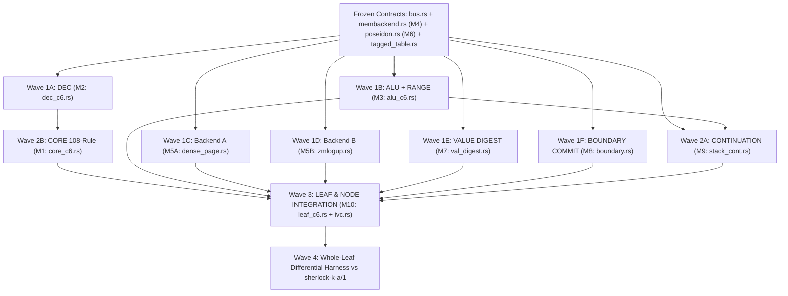

# Round 2 — Lane B: Cross-Review, Run-Length Convergence, and Modular Leaf Architecture

Run: `sherlock-lookup-cache-20261111`  
Lane: **B** (Chip & Memory Circuit Lead)  
Date: 2026-11-11

Conventions: repository paths are relative to `/home/hoskinson/Projects/Moriarty`. `MP:` denotes `~/.cargo/registry/src/index.crates.io-1949cf8c6b5b557f/midnight-proofs-0.8.3/src`, and `MC:` denotes `~/.cargo/registry/src/index.crates.io-1949cf8c6b5b557f/midnight-circuits-7.3.0/src`. Every unmeasured projection is marked `ESTIMATE`.

---

## Executive Convergence Summary

In Round 1 (`research/sherlock-lookup-cache-20261111/lanes/B/round1.md:147-161,249-257`), Lane B proposed **`ZM-LogUp` (`Candidate f1`)**: two-pass Stage-1 `Instance(0)` KZG pre-commitment ($C_i \in \mathbb{G}_1$) + write-once leaf-deduplicated LogUp + Horner boundary fingerprints, eliminating in-leaf memory and boundary Merkle hashing. Having reviewed `lanes/{A,C,D,E}/round1.md`, `research/sherlock-runlength-consensus-20261111/CONSENSUS.md:1-345`, `research/sherlock-final-design-20261111/MODULARITY.md:1-12`, and the newly landed `MemBackend` / `WindowCfg` / `DenseCfg` traits in `crates/mori-chip/src/{membackend.rs:1-500, dense.rs:1-756}`, Lane B updates its recommendation to a **single converged modular design**:

1. **Primary Production Default (`/1` Milestone M4/M5 — Compatible with Run-Length `CONSENSUS.md`):** Adopt **1-Arena Domain-Tagged `M3-Tail64` (`TOP = 61`, `W = 1` flush unit = `16`-row `WindowCfg`, `2^64` dense cells, `crates/mori-chip/src/dense.rs:1-120,620-753`) upgraded with an Intra-Leaf 8-Record L1 `PAGE` + `ROM` (`prog_root`) Bus Cache** on the existing 2-lane `bus.rs` (`0` new lookups), paired with **Poseidon `BoundaryCommit` (`pre_d`/`post_d`)**, Lane C's **2-column tagged `DEC+RANGE` fixed table (`-29,062` Node rows `ESTIMATE`)**, Lane C's **`(SHK_VAL, 1)` sponge-prefix precomputation (`-70` rows/dynamic `vd`)**, and Lane E's **unconditional `u128` input range checks in `ALU` and boolean/domain checks on `DEC` unpacking**.
2. **Swappable Experimental Backend (`MODULARITY.md:9` — Preserved Behind `MemBackend` & `BoundaryCommit`):** Retain **Hardened `ZM-LogUp` (`ZmLogUpCfg`, upgraded with $\mathbb{F}_r^2$ challenge pairs, `prog_root` Merkle `ROM` cache instead of `INIT_PROG` leaves, `0 <= m_w < 2^64`, and subgroup-checked `Instance(0)` in `RunLift` `R`) + `HornerBoundary`** as **Backend B** behind `MemBackend` (`crates/mori-chip/src/membackend.rs:95-128`) and `BoundaryCommit` so both backends compile against identical `CORE` and `MEM` (`WindowCfg`) code and can be benchmarked head-to-head on single-session batch runs.

Why shift the `/1` default from pure `ZM-LogUp` to **`M3-Tail64` + L1 `PAGE`/`ROM` Cache** while keeping hardened `ZM-LogUp` as Backend B? While Round 1's Stage-1 `Instance(0)` + write-once $m_w$ construction **does** defeat single-phase panics, 2nd recursive passes, intra-run $O(|M|)$ teardown sweeps, and Lane E's `Exploit B1`, cross-review exposed four protocol and systems costs where `M3-Tail64` + L1 `PAGE`/`ROM` Cache decisively wins as `/1`'s universal baseline:
- `INIT_PROG` loader leaves (`lanes/B/round1.md:123-125`) impose an $O(|P|)$ recursive proving startup tax (`ESTIMATE ~33 min` at `1,024` instructions; `~22.8 days` at `10^6` instructions), whereas `prog_root` Merkle + L1 `ROM` cache has **$O(1)$ (`0`-leaf) startup** for any program size;
- Two-pass `Instance(0)` pre-commitment prevents prove-while-executing streaming, adds `ESTIMATE ~18,000–26,000` rows to 2-leaf `GP-4` `RunLift` `R` (two variable $\mathbb{G}_1$ points + mandatory prime-subgroup checks against cofactor torsion grinding), blocks `GP-4` `SEG`-prefix reuse across divergent continuations, and loses `CONSENSUS.md:143`'s $O(1)$ zero-serialization Tier-2 checkpoint (`Mode 1` `canon_state_d(h)`);
- Meanwhile, combining `DenseCfg` (`TOP = 61`, `W = 1`), `D7` hash-chain stacks (`fp_hash`, `tp_hash`), 8-record L1 `PAGE` + `ROM` caching, and the 2-column tagged `DEC+RANGE` table fits `S = 16` cleanly inside `k_leaf = 16` (`ESTIMATE ~42,608–48,488 <= 65,530` rows, `~4.5–6.2 s` leaf prove vs `~63 s` Node) while **reducing** `ChipNode` by **`ESTIMATE ~16,584` rows below E8** (`~806,882` vs `823,466`) and adding **`+0` rows and `+0` `table_rows`** to `RunDecider` (`1,032,467 <= 1,048,570`).

---

## 1. Cross-Review of Lanes A, C, D, and E (`round1.md`)

### 1.1 Per-Lane Accept / Reject Matrix

#### Review of Lane A (`research/sherlock-lookup-cache-20261111/lanes/A/round1.md`)
- **ACCEPT:**
  1. **Aligned `C = 8` spatial block openings in `PAGE` + `ROM` (`lanes/A/round1.md:14-16,175,190-195`):** Matching `SEGC = 8` (`crates/mori-chip/src/membackend.rs:48`, `dense.rs:100-110`) means one Merkle walk (`16` record perms + `7` `Tree8` perms + `61` top-tree perms = `84` perms = `5,880` rows `ESTIMATE` at `TOP = 61`, vs `66` perms = `4,620` rows for 1 cell) authenticates **8 contiguous records** (`735` rows/record `ESTIMATE`), capturing both temporal reuse and spatial `start + k` locality (`SI-12..SI-14`).
  2. **Precomputed `ty_d` in `types` and `const_vd` in `constants` under `prog_root`, plus inline `vd` in allocated `Data` cells (`lanes/A/round1.md:16,180,183`):** Eliminates runtime schema hashing (`openspec/changes/sherlock-vm-consensus-20261107/dissent.md:204-207` `D-2`) and avoids $O(2^d)$ DAG re-traversal at `Halt`.
  3. **Cryptanalysis synthesis of `x-increment` vs `y-increment` map-to-curve on Jubjub (`lanes/A/round1.md:147-154`; Groth–Malvai–Miller–Zhang `https://eprint.iacr.org/2025/1503`; El Housni–Bünz `https://eprint.iacr.org/2026/590`):** Lane A rightly identifies that Twisted Edwards Jubjub ($-x^2 + y^2 = 1 + d x^2 y^2$, cofactor $8$, base field 2-adicity $32$) is quadratic in $x^2$ and can exclude inverses + 8-torsion via $P_0 = [8]P_{\text{root}}$, $y_0 = m \cdot 2048 + k$ ($k < 2048$), and canonical $2 x_0 < q$ — **provided** $m$ is a 243-bit Poseidon digest of the 5-tuple (so Poseidon is still paid per unique write/read).
  4. **Rejection of `cq`/Caulk/Baloo sublinear KZG lookups (`lanes/A/round1.md:155-156`; `https://eprint.iacr.org/2022/1763`):** Incompatible with Midnight Ledger 9's `[1]_2, [\tau]_2`-only $\mathbb{G}_2$ SRS and pairing-free `VerifierGadget` folding.
- **REJECT:**
  1. **Blanket claim that offline LogUp is "hard-blocked by `verifier_gadget.rs:310`" (`lanes/A/round1.md:13,177`):** `verifier_gadget.rs:310` blocks Halo2 `SecondPhase` columns, **not** Stage-1 `Instance(0)` KZG pre-commitment (`verifier_gadget.rs:298-300,435-436,628-634`; §1.2 and §2.3 below). Offline LogUp loses as `/1` primary for **protocol/streaming/checkpoint** reasons, not because stock `midnight-circuits = 7.3.0` cannot verify it.
  2. **Adopting `S = 64` immediately before `SRC-014` qualification (`lanes/A/round1.md:16,184`):** Conflicts with `SRC-014` (`S_MAX = 16`, `openspec/changes/sherlock-vm-consensus-20261107/requirements.md:39`) and `CONSENSUS.md:282-286` (reconciled in §2.4).

#### Review of Lane C (`research/sherlock-lookup-cache-20261111/lanes/C/round1.md`)
- **ACCEPT:**
  1. **108-rule `/1` resource audit (`lanes/C/round1.md:48-64`, citing `crates/mori-backend/src/sherlock_machine/c6_dispatch_step.rs:363-398` and `crates/mori-core/src/sherlock/helper_machine/shared.rs:7-22`):** Confirms `/1` reads only 11 of 20 static program tables (`field_paths`, `plan_nodes`, `plan_cases` have **0** readers in `/1`) and has **zero bitwise `AND`/`OR`/`XOR` and zero `DIV`/`REM`**. Lane B **retracts** its Round 1 5-bit bitwise `RANGE` table extension (`lanes/B/round1.md:134-136`) for `/1`, freeing those `3,072` fixed rows for `DEC`!
  2. **Gated syndrome normalization (`11`-bit `syn_key`, `<= 2,048` rows) + 54-bit single-scalar `ctrl_word` + 2-Column Tagged `DEC+RANGE` Table (`lanes/C/round1.md:22,119-140,175-186`):** Merging `RANGE` (`4,096` rows: `(2^64 + v, 1)`) and `DEC` (`<= 2,048` rows: `(2*2^64 + syn, 2^64 + ctrl)`) plus row `0` `(0, 0)` into `<= 6,145 < 8,186` rows eliminates **1 `lookup` (`-22,600` Node rows)** and **1 `TableColumn` (`-6,462` Node rows)** = **`-29,062` Node rows `ESTIMATE`** without consuming `bus.rs` request lanes!
  3. **64-bit schoolbook `OP_MUL` + `OP_SUB` + zero-inverse `EQ` (`lanes/C/round1.md:23,160-167`):** Prevents the fatal $(2^{128}-1)^2 > r$ modular wraparound trap in `OP_MUL` while adding `0` columns and `0` lookups.
  4. **`(SHK_VAL, 1)` sponge-prefix precomputation `(C0, C1, C2) = PoseidonPerm(0, SHK_VAL, 1)` + compile-time `VD_NIL`, `VD_FALSE`, `VD_TRUE` + capacity-tagged `HASH` (`lanes/C/round1.md:24,199-214`, matching `crates/mori-chip/src/poseidon.rs:107-120`):** Saves **70 rows (`1` full permutation)** on every dynamic `vd` allocation (`210 -> 140` rows `ESTIMATE`) and **100%** of Poseidon rows on boolean allocations, bit-for-bit identical to `sherlock-value/1`.
- **REJECT:**
  1. **4-arena quadrant-partitioned Merkle memory (`lanes/C/round1.md:226`):** Superseded in `CONSENSUS.md:106,247,263-265` (where Lane C itself joined the 3/5 majority) and in `crates/mori-chip/src/membackend.rs:49-58` by **1-arena domain-tagged `M3-Tail64` (`W_flush = 1`)**, saving `ESTIMATE ~8,540–9,030` leaf rows because `/1`'s exclusive `Build`/`Append` sub-machines never interleave unrelated allocations inside a slice and never append `> 3` cells/step.
  2. **Claim that two-pass LogUp requires a "second recursive pass" (`lanes/C/round1.md:94`):** Stage-1 commits only Lagrange vectors $P_i \in \mathbb{G}_1$ (`commit_to_instances`, no SNARK proofs); SNARK leaf and node proving runs in **one** recursive pass (§1.2).

#### Review of Lane D (`research/sherlock-lookup-cache-20261111/lanes/D/round1.md`)
- **ACCEPT:**
  1. **Exact `RunDecider` `Pow2RangeChip` `table_rows = 1,032,467` binary decomposition (`lanes/D/round1.md:214-222`, `MC:field/decomposition/pow2range.rs:215-236`):** $1{,}032{,}467 = 2^0 + 2^1 + 2^4 + 2^8 + \sum_{b=14}^{19} 2^b$, leaving **`16,103` usable rows** below `2^20 - 6 = 1,048,570` (`MP:dev/cost_model.rs:347-379`). Unqueried tags `{2, 3, 5, 6, 7, 9, 10, 11, 12, 13}` sum to `16,108 > 16,103`: any new `RunDecider` scalar decomposition touching `{10..13}` + `{7, 9}` silently triggers `min_k = 21`!
  2. **2nd `q_req = 1` request row in `Arch::Narrow` (`lanes/D/round1.md:153-155`, `crates/mori-chip/src/rfcore.rs:198-200`):** Promoting slot row `6` from a copy-replica to a live `q_req = 1` pair `(L2, L3)` doubles per-step bus bandwidth from **2 to 4 bus requests/step** at **`+0` Node rows** (`0` new lookups, `0` new columns), enabling 1-step multi-read rules (`equal_differ`, `BHelperScalarArithmetic`, `BHelperEqualField`).
  3. **2-leaf `RunLift` `R` sensitivity (`lanes/D/round1.md:13`, `research/sherlock-gp-architecture-20261110/architecture.md:72,206-219`):** Every variable $\mathbb{G}_1$ commitment added to `U` is paid **twice** inside `R`.
  4. **Optional sorted-LCA upper-prefix sharing across `PAGE` walks (`lanes/D/round1.md:56,129`):** Ordering active `PAGE` block indices $p_0 \le p_1 \le \dots$ lets two nearby pages in a depth-61 tree share their top ~44 Poseidon compressions (`-3,080` rows/shared walk `ESTIMATE`), a clean intra-module optimization inside Backend A (`DensePageCfg`) once fixed-walk correctness is green.
  5. **Host makespan & memory-bus contention analysis (`lanes/D/round1.md:227-256`):** Batching `k = 15..16` leaves (`< 2.2 GB` RSS, `~4.5–6.2 s`) ahead of or pinned beside the `k = 20` Node (`17.4 GB` RSS, `~63 s`) avoids LPDDR5X thrashing (`90.2 s` in E4).
- **REJECT:**
  1. **Claim that write-once two-pass LogUp still needs an $O(N_{\text{distinct}})$ teardown sweep (`lanes/D/round1.md:14,76`):** In write-once LogUp (`lanes/B/round1.md:88-89,105-108`), Stage-1 simulation knows exact run-wide leaf-read counts $m_w \in [0, L]$ for every allocated cell; unread cells emit $m_w = 0$ at write time and require **zero** post-Halt sweep leaves (§1.2).
  2. **Dropping inline `(SHK_VAL, 1)` / 2-input `HASH` bus deduplication completely (`lanes/D/round1.md:28,125-134`):** While a *new* 6-column memoization table is rightly rejected, `poseidon.rs:26-31` **already** exposes 2-input capacity-tagged hashes on the existing 5-column `bus.rs` at `+0` Node rows!

#### Review of Lane E (`research/sherlock-lookup-cache-20261111/lanes/E/round1.md`)
- **ACCEPT:**
  1. **All five L1 cache soundness guards (`Exploits A1–A5`, `lanes/E/round1.md:59-78`):** (A1) per-step `addr < cur_len` (`no_read_bound` / `read_bound_final` closed); (A2) boolean `act` multiplying all 5 provider columns so inactive rows emit `(0,0,0,0,0)` and `chip >= 1` (`WindowCfg` `crates/mori-chip/src/membackend.rs:254-266`); (A3) strict `addr < base` (`q_addr < q_pre`) on `PAGE` vs `base <= addr < len_post` on `MEM` (`D2`); (A4) injective `bus_key(addr, kind) = 8 * addr + kind` with `kind in 1..=4` hashed inside `H_REC(kind, a, b, c)` (`membackend.rs:50-58`, `dense.rs:67-69`); (A5) zero unhashed hint columns on `bus`.
  2. **`Exploit C1` (`DEC` bit-unpack carry/borrow tamper) & `Exploit C2` (out-of-bounds `PROG` zero-padding execution) (`lanes/E/round1.md:120-125`):** Every unpacked `ctrl_word` field **must** carry an explicit boolean/Lagrange domain gate (`b*(1-b) == 0`), and out-of-bounds `PROG` tree slots must commit to `PAD_PROG = H_PAD_PROG(OP_INVALID_OOB, 0, 0) != 0` rather than executable `0`.
  3. **`Exploit D1` (`crates/mori-chip/src/alu.rs:8-9,111-125` modular wraparound when `x >= 2^128` or `y >= 2^128`) (`lanes/E/round1.md:134-139`):** Because `ALU`/`RANGE` rows (`<= 768` rows even with input checks) sit in parallel advice regions or way below the leaf's `k = 16` Poseidon budget at **`+0` Node rows**, enforcing `x, y < 2^128` (or decomposed `(lo64, hi64)` range checks) unconditionally eliminates `r_BLS - 1 < 5` bounds-check bypasses (`Exploit D1` and `CONSENSUS.md:144` `Exploit E-10`).
  4. **Rejection of cross-leaf dynamic `AS_HASH` memoization (`Exploits E1a/E1b`, `lanes/E/round1.md:145-148`):** Saves `0` worst-case leaf rows (`k_leaf` is fixed by worst-case permutations) while risking sponge-state splicing. Lane B **retracts** `AS_HASH` from `ZM-LogUp` (`lanes/B/round1.md:143`).
- **REJECT:**
  1. **Conflating Stage-1 `Instance(0)` pre-commitment with public-input quantifier inversion (`Exploit B1`) or a `> 960k`-row 2-pass Node (`lanes/E/round1.md:40-41,89-103`):** See §1.2 immediately below.
  2. **`WB[4]` (`C = 4`, `TOP = 30`, $2^{32}$-cell ceiling) (`lanes/E/round1.md:46,161-168`):** Capping memory at $2^{32}$ cells violates `CONSENSUS.md:34`'s unanimous 5/5 rejection of sub-`2^64` memory ceilings (where Lane E itself converged on `C = 8`, `TOP = 61`, $2^{64}$ cells at `CONSENSUS.md:247`).
  3. **Folding `DEC` onto `bus.rs` (`lanes/E/round1.md:118-119`):** Consumes 1 bus request lane on *every* step slot; Lane C's 2-column tagged `DEC+RANGE` table (`lanes/C/round1.md:178-186`) achieves a **larger** Node saving (`-29,062` vs `-22,600` rows `ESTIMATE`) while leaving all bus request lanes free for `MEM`, `ROM`, `ALU`, and `HASH`!

---

### 1.2 Clarifying What Stage-1 `Instance(0)` + `d_root` + `m_w` Solves — and Confronting Challenges `(i)`–`(vii)`

#### What Round 1 `ZM-LogUp` Actually Solved (Refuting the Mischaracterizations in `A, C, D, E`)
1. **Why Lane E's `Exploit B1` (`lanes/E/round1.md:89-100`) Does NOT Apply:** `Exploit B1` attacks `(b.1)`, where witness advice $m_w$ or $v_2$ is chosen *after* seeing $(\gamma, \alpha)$. In `ZM-LogUp` (`lanes/B/round1.md:101-109,185-187`), every leaf's $\vec{u}^{(i)}, \vec{v}^{(i)}$, active write tuples $(w_{\text{act}}, \text{kind}, a_w, \vec{v}_w, m_w)$, and active leaf-cache read tuples $(r_{\text{act}}, \text{kind}, a_r, \vec{v}_r)$ are committed into Lagrange vector $P_i \in \mathbb{F}_r^{2^k}$ as KZG commitment $C_i = \text{commit\_to\_instances}(P_i) \in \mathbb{G}_1$ (`MP:plonk/prover.rs:36-49`), hashed into $d_{\text{root}}$, and **then** $(\gamma, \alpha) = \text{Poseidon}(\text{DOM\_MEM\_CHAL}, d_{\text{root}}, \text{prog\_d}, \text{input\_d})$ is derived. Inside Leaf $i$, `q_com * (a[11] - Instance(0)) == 0` binds the advice witnesses to $P_i$, and `VerifierGadget` opens `Instance(0)` at `x` against $C_i$ (`MC:verifier/verifier_gadget.rs:435-436,628-634`). Any adaptive change to $m_w$ or $v$ after seeing $(\gamma, \alpha)$ either violates `a[11] == P_i` (breaking KZG evaluation binding on BLS12-381) or changes $C_i \implies d_{\text{root}} \implies (\gamma, \alpha)$ (breaking Poseidon collision/preimage resistance).
2. **Why No 2nd Recursive Pass (`lanes/E/round1.md:103`) and No Intra-Run $O(|M|)$ Sweep (`lanes/D/round1.md:76`) Are Needed:** Stage 1 performs only `commit_to_instances` MSMs (~150–700 non-zero scalars/leaf), **zero** PLONK proofs. Stage 2 runs **one** recursive pass (`~837k` Node rows `ESTIMATE`, or `~808k` with tagged `DEC+RANGE`), and unread write-once cells commit $m_w = 0$ at allocation (`0` post-Halt teardown leaves).

#### Honest Quantitative Audit of the Seven Real Challenges `(i)`–`(vii)`

| # | Challenge Surfaced in Cross-Review | Quantitative Impact & Exact Fix / Consequence | Impact on Architecture Choice |
|---|---|---|---|
| **(i)** | **`INIT_PROG` loader leaves (`lanes/B/round1.md:123-125`) vs `prog_root` Merkle + L1 `ROM` cache** | At `32` instructions per loader leaf and `~63 s` per `k = 20` Node fold (`CONSENSUS.md:206`), `INIT_PROG` adds $\lceil |P|/32 \rceil$ Node proofs *before step 0*: `64` insns = `2` folds (`~2.1 min` `ESTIMATE`), `1,024` insns = `32` folds (**`~33.6 min` `ESTIMATE`**), `10^6` insns = `31,250` folds (**`~22.8 days` `ESTIMATE`**)! By contrast, `prog_root` Merkle + $K_{\text{rom}} = 2$ 8-record `ROM` cache lines costs `0` startup leaves and `~6,720` leaf rows (`ESTIMATE` at `TOP_PROG = 29` for $2^{32}$ rows) hidden inside `k_leaf = 16`. | **Decisive fix:** **Retract `INIT_PROG` completely.** Even Backend B (`ZmLogUpCfg`) MUST authenticate `PROG`/`Const`/`Types` via `prog_root` Merkle + L1 `ROM` cache! |
| **(ii)** | **`GP-2` & Tier-2 Pause/Resume (`SHK_CONT_V1`, `CONSENSUS.md:135-148`)** | If Epoch 1 (`[0, h_1)`) seals $\Sigma_1 = 0$ under $(\gamma^{(1)}, \alpha^{(1)})$ without a `mem_root`, Epoch 2 (`[h_1, h_2)`) under $(\gamma^{(2)}, \alpha^{(2)})$ has **no persistent `mem_root`** to open cold Epoch-1 cells against! Epoch 2 would be forced to use `CONSENSUS.md:144` Mode 2 (`sherlock-ckpt/1` `O(|live|)` serialization + lazy `UNFOLD` re-materialization on every cross-epoch structure), losing Mode 1 (`canon_state_d(h)` $O(1)$ zero-overhead pause/resume). | **Strong win for Backend A (`M3-Tail64`):** Preserves **both** Mode 1 ($O(1)$ retained-arena `canon_state_d(h)`) and Mode 2 (`sherlock-ckpt/1`). Backend B is restricted to single-session runs or Mode 2 checkpoints. |
| **(iii)** | **`GP-4` 2-Leaf `RunLift` `R` + Subgroup Torsion Grinding + Prefix `SEG` Reuse** | (a) **Torsion grinding on $C_i$:** BLS12-381 $\mathbb{G}_1$ has cofactor $h_{\mathbb{G}_1} = (x_{\text{BLS}}-1)^2/3 \approx 2^{125.7}$. If `ChipNode`/`R` witnesses $C_i$ via `assign_without_subgroup_check` (`lanes/B/round1.md:109`), a prover can add any $h_{\mathbb{G}_1}$-torsion point $T \neq \mathcal{O}$ to $C_i$: $(C_i + T)$ changes `(x, y)` absorbed into $d_{\text{root}}$ (grinding $2^{125}$ $(\gamma,\alpha)$ challenges from **one** trace!) if pairing cleared cofactor, or breaks soundness unless $C_i \in \mathbb{G}_1[r]$ is enforced via `AssignmentInstructions::assign` (`crates/mori-recursion/src/run_decider.rs:259`)! In `RunLift` `R` (verifying **2** `U` proofs in one `k = 20` circuit, `CONSENSUS.md:213`), 2 variable `Instance(0)` points + 2 subgroup checks add **`ESTIMATE +18,000..+26,000` rows** in `R`. (b) **Prefix reuse:** In `GP-4`, a proved `SEG` prefix `[0, k)` under `M3-Tail64` can be reused across two runs sharing `[0, k)` that diverge after $k$ (e.g., fuel extensions or branch exploration); under `ZM-LogUp`, $(\gamma, \alpha)$ depends on $d_{\text{root}}$ of the *entire* run `[0, N)`, forbidding `SEG` reuse across different suffixes (sealed `SET` diamond DAGs still work). | **Strong win for Backend A (`M3-Tail64`):** `Instance(0)` stays fixed `C::identity()` (`+0` rows in `R`, zero torsion surface), and `SEG` proofs are 100% suffix-independent. Hardened Backend B MUST use subgroup-checked `AssignmentInstructions::assign` for $C_i$. |
| **(iv)** | **`RunDecider` `Pow2RangeChip` `table_rows = 1,032,467 / 1,048,570` (`16,103` margin)** | Querying any new bit-length tag $b \in \{14..19\}$ (`>= 16,384` rows) or subset of `{2,3,5,6,7,9..13}` exceeding `16,103` rows pushes `RunDecider` to `k = 21` (`lanes/D/round1.md:214-222`; `lanes/E/round1.md:27`). | **Both Backend A (`+0` decider changes) and Backend B (`SEG -> SET` seal in `C`/`N`, or field-native Poseidon/equality in `D` with `0` integer decompositions) add `+0` `table_rows`**, keeping `table_rows == 1,032,467`. |
| **(v)** | **`2^64` Schwartz-Zippel Collision Bound & Unqueried `Instance(0)` Rows** | (a) **126-bit gap at $W + R = 2^{64}$:** Compressing 5-tuples with a single scalar $\gamma$ has pairwise collision probability $\le 4/r$, so union bound over $\binom{W+R}{2}$ distinct tuples at $W + R = 2^{64}$ is $\frac{4(W+R)^2}{2r} \approx \frac{2 \cdot 2^{128}}{2^{254.86}} \approx 2^{-125.86}$ (`ESTIMATE`) — **2.1 bits short of 128-bit security**! *Fix:* Squeeze **two** independent challenges $(\gamma_1, \gamma_2)$ and $(\alpha_1, \alpha_2)$ (an $\mathbb{F}_r^2$ pair, `2` parallel LogUp accumulators $\Sigma^{(1)}, \Sigma^{(2)}$), dropping collision error to $(4/r)^2 \binom{2^{64}}{2} < 2^{-250}$ and root error to $((W+R)/r)^2 < 2^{-370}$ (`ESTIMATE`). (b) **`m_w` range & unqueried `Instance(0)` rows:** Enforce `0 <= m_w < 2^64` (8-limb / 64-bit check so $m_w$ never wraps mod $r$), and zero-pad `P_i[M..2^k] = 0` honestly (a prover putting nonzero junk in unqueried `P_i` rows merely alters $C_i$ *before* squeezing $(\gamma_1, \gamma_2, \alpha_1, \alpha_2)$ — standard Fiat-Shamir grinding, which costs $2^{250}$ work once $\mathbb{F}_r^2$ challenges are used!). | **Mandatory hardening in Backend B (`ZmLogUpCfg`):** Use $\mathbb{F}_r^2$ challenges $(\gamma_1, \gamma_2, \alpha_1, \alpha_2)$ and `m_w < 2^64`. Backend A (`M3-Tail64`) uses collision-resistant Poseidon (~127.4-bit birthday bound on fixed structural tree nodes, zero cross-leaf rational challenges). |
| **(vi)** | **Lane C's 2-Col Tagged `DEC+RANGE` (`-29,062` Node rows) & `(SHK_VAL, 1)` Prefix (`-70` rows/`vd`)** | Both optimizations are 100% backend-neutral: they shrink `ChipNode` from `823,466` to **`ESTIMATE ~794,404`** (before `MemBackend` fixed selectors) and cut dynamic `vd` hashing by **33%** (`210 -> 140` rows `ESTIMATE`). | **Adopted in FULL** across both Backend A and Backend B (§4 Modules 2, 3, 7). |
| **(vii)** | **Lane E's `alu.rs:111-125` `u128` Input Exploit (`D1`) & `DEC` Bit-Unpack Boolean Check (`C1`)** | Un-range-checked $x = r - 1$ makes `ALU_LT(r - 1, 5)` return `1`, bypassing `addr < cur_len`; un-range-checked `DEC` sub-fields allow carry-borrow bit flipping. | **Adopted in FULL:** `ALU` range-checks `x, y < 2^128` unconditionally (`+0` Node rows), and `DEC` boolean/domain-checks every unpacked field (§4 Modules 2, 3). |

---

## 2. Explicit Answers to All Four Questions in `LEAD-NOTE-ROUND2.md:9-14`

### 2.1 Question (1): Merkle (`M3-Tail64` + L1 Cache) vs Run-Wide Write-Once LogUp for Memory, `PROG`, and Type Tables

**Final Recommendation:**
1. **`PROG`, `Const`, and `Types` (`ty_d`, `const_vd`) — Unanimous Merkle (`prog_root` + Intra-Leaf 8-Record L1 `ROM` Cache):** Under **both** backends, static program, constant, and type tables MUST be committed under an immutable Poseidon Merkle root `prog_root` (`TOP_PROG = 29` over 8-record blocks = $2^{32}$ static records; or `TOP_PROG = 61` sharing `DenseCfg`'s walker) with precomputed `const_vd` and `ty_d` (`lanes/C/round1.md:146-149`), cached per leaf in $K_{\text{rom}} = 2..4$ aligned 8-record `ROM` provider lines on `bus.rs`. Fixed `TableColumn`s violate `GP-1` (`SVM-001`), KZG `Instance(0)` caps `|PROG| < 2^{k_leaf}` (violating `GP-1`), and Round 1's `INIT_PROG` loader leaves (`lanes/B/round1.md:123-125`) impose an unacceptable $\lceil |P|/32 \rceil \times 63\text{ s}$ recursive proving tax before step 0.
2. **Dynamic Write-Once Memory (`DATA, FIELDS, ENV, SLOTS`) — `M3-Tail64` + Intra-Leaf 8-Record L1 `PAGE` Cache as `/1` Primary (Backend A), with Hardened `ZM-LogUp` (`\mathbb{F}_r^2`) as Swappable Backend B:**
   - **Why Backend A (`M3-Tail64` + L1 `PAGE` Cache) is the `/1` Primary:**
     - **`2^64` cells:** Depth `TOP = 61` over 8-record segments (`2^61 * 8 = 2^64` dense cells, `crates/mori-chip/src/dense.rs:5-8,620-753`) enforces `len_pre, len_post < 2^64` via `WindowCfg::bits(..., 64)` (`membackend.rs:388-389`), matching `SRC-004` with zero sub-`2^64` ceilings (`CONSENSUS.md:34`).
     - **`SRC-023` & C6 outcome-only publication:** `len_post = len_pre + used` has zero leaf-close padding; flushes occur strictly at multiples of 8 allocations (`floor(len_post/8) > floor(len_pre/8)`), making `(regs, len, root, tail_d)` and `post_d(h)` bit-for-bit invariant across leaf partitions (`[16]` vs `[7, 9]` vs `[1..1]`), satisfying `Aggregation.lean:1154-1164` (`statement_independent_of_S`) directly and erasing all roots at `RunDecider` (`[prog_d, input_d, outcome_d, n_steps]`).
     - **`GP-2` to `GP-4`:** Single-pass streaming (`0` lookahead), $O(1)$ retained-arena Tier-2 checkpoints (`SHK_CONT_V1` `Mode 1`), suffix-independent `SEG` prefix reuse, `0` extra variable $\mathbb{G}_1$ points in 2-leaf `RunLift` `R`, and full foreign-proof (`F`) + diamond-DAG (`SET`) compatibility.
     - **Why L1 `PAGE` + `ROM` caching removes the uncached-Merkle bottleneck:** Instead of `DenseCfg::cold_read` running per dynamic read (`dense.rs:716-753`), opening $K_{\text{page}} = 3..4$ aligned 8-record segments (`24..32` cached heap cells/leaf) and $K_{\text{rom}} = 2$ aligned 8-record `ROM` blocks (`16` cached program/type rows/leaf) via `Tree8` + depth-61/29 walks places `40..48` deduplicated records onto `bus.rs`, keeping the full `S = 16` leaf at **`ESTIMATE ~42,608–48,488` rows (`k_leaf = 16`, `<= 65,530`)** — a `~5.5 s` leaf hidden behind the `~63 s` Node!
   - **How Hardened Backend B (`ZmLogUpCfg`) satisfies `2^64`, `SRC-023`, C6, and `GP-2..GP-4` when enabled:**
     - **`2^64` cells:** Uses `WindowCfg` (`len < 2^64`), `0 <= m_w < 2^64`, and **$\mathbb{F}_r^2$ challenges** $(\gamma_1, \gamma_2, \alpha_1, \alpha_2)$ so tuple-compression collision over $2^{64}$ accesses is $< 2^{-250}$ (`ESTIMATE`).
     - **`SRC-023` & C6:** Dense `len_post = len_pre + used` keeps addresses partition-independent; `(d_com, gamma_1..2, alpha_1..2, Sigma_1..2)` live strictly inside `SEG` and are verified (`Sigma == 0`, challenge Fiat-Shamir match) and **dropped** at `SEG -> SET` seal (`C`) or `RunDecider` (`D`), so on-chain `[prog_d, input_d, outcome_d, n_steps]` and `claim_d` are 100% identical to Backend A.
     - **`GP-2..GP-4`:** Cross-run `GP-2` and diamond-DAG `GP-4` operate on sealed `SET` claims (`Sigma` already closed to `0`), foreign proofs `GP-3` enter via `F -> SET`, and intra-run `SEG` trees (`GP-4`) associate via left-to-right commitment chaining `(com_pre, com_post)` with subgroup-checked $C_i$ in `R` — trading away only single-pass streaming, `SEG` prefix sharing across divergent runs, and Mode-1 retained-arena Tier-2 checkpoints.

---

### 2.2 Question (2): Quantifying the Two-Pass Cost vs One-Pass Alternatives

#### Quantitative Cost of Stage-1 Two-Pass Pre-Commitment (`ESTIMATE`)
Under Backend B (`ZmLogUpCfg`), proving an $N$-step run ($L = \lceil N/S \rceil$ leaves) requires completing full simulation before proving Leaf `0`:

| Workload Scale ($S = 16$) | Leaves $L$ | Stage-1 Witness/Mult Buffer (`~3.2 KB`/leaf `P_i` + trace) (`ESTIMATE`) | Stage-1 `commit_to_instances` MSMs (`~512` non-zero Lagrange evals/leaf, 20t CPU) (`ESTIMATE`) | Impact on Latency, Parallelism, Checkpoints & Streaming |
|---|---:|---:|---:|---|
| **`G-C` (`list123`, `303` steps)** | `19` | `~62 KB` RAM | **`< 8 ms`** (`~0.3 ms`/leaf) | Negligible latency (`< 0.01%` of `~17–23 min` run); Stage-2 parallel `3×6t` tree proving is **100% unblocked** after `8 ms`. |
| **M5 Soak (`4,096` steps)** | `256` | `~0.85 MB` RAM | **`~80 ms`** | Negligible (`< 0.001%` of `~3.2 h` run); full Stage-2 tree parallelism preserved. |
| **24-Hour Host Run (`30,000` steps)** | `1,875` | `~6.1 MB` RAM | **`~0.58 s`** | Negligible batch overhead, **but** cannot emit proved `SEG` checkpoints mid-day if execution target $N$ is not fixed up front. |
| **Million-Leaf Run (`1.6 × 10^7` steps)** | `1,000,000` | **`~3.2 GB` RAM/NVMe** (`P_i` log) + **`~12–24 GB` NVMe** replay/checkpoint log | **`~310 s` (`5.2 min`)** | **Blocks prove-while-executing:** a streaming prover cannot fold leaves `0..k` while an interactive or I/O-bound host is still executing steps `> 16k`, and crashing at leaf `900,000` before Stage 2 yields `0` valid `SEG` proofs unless sliced into Mode-2 `sherlock-ckpt/1` epochs. |

- **Parallel Proving:** Once Stage 1 finishes (`~80 ms` at `L = 256`), **all $L$ leaves and all `GP-4` `R`/`N` subtree folds run in parallel** with zero inter-worker locks (`ESTIMATE`: identical Stage-2 tree parallelism to Merkle, minus `+2.2%` Node/Lift row overhead from `Instance(0)`).
- **Tier-2 Pause & Resume (`SHK_CONT_V1`):** Within each fixed `quantum_steps` epoch `[h_lo, h_hi)`, Backend B can seal that epoch's own $(\gamma^{(e)}, \alpha^{(e)}, \Sigma^{(e)} == 0)$ at epoch close, **but** because no `mem_root` exists at `h_hi`, Epoch `e + 1` cannot perform $O(1)$ retained-arena cold reads (`Mode 1`); it must serialize live reachable DAG roots into `sherlock-ckpt/1` `ckpt_d` (`Mode 2`, `CONSENSUS.md:144`) and pay `~140–280` `UNFOLD` rows per inspected cross-epoch value.
- **Prove-While-Executing:** **Broken by Backend B.** Because `m_w` in Leaf `0` equals the number of later leaves `1..L-1` that read cell `w`, and $(\gamma, \alpha)$ depends on $C_{L-1}$, Leaf `0`'s witness and public inputs do not exist until step $N$ finishes executing.

#### Is There a Sound One-Pass Offline Alternative on This Stack (e.g., Jubjub `EC-MSH`, `b2`)?
**No one-pass offline memory scheme beats `M3-Tail64` + L1 `PAGE` Cache on this stack:**
1. **Write-Once `[m_w] P` Jubjub Multiset Hash (`lanes/B/round1.md:112-116`):** Even though elliptic-curve multiset hashing needs **zero** Fiat-Shamir challenges $(\gamma, \alpha)$, weighting a write in Leaf `0` by `[m_w] P` **still requires knowing total future read multiplicity `m_w` across Leaves `1..L-1`**! Hence write-once `[m_w] P` is **still two-pass** over simulation (cannot prove-while-executing!).
2. **True One-Pass Timestamped / Counter-Incremented Jubjub `EC-MSH` (`lanes/A/round1.md:153-154`, `lanes/C/round1.md:96-101`, `lanes/D/round1.md:79-84`, `lanes/E/round1.md:105-111`):** Replacing `m_w` with per-read counter updates `-(addr, val, c) + (addr, val, c+1)` makes witness generation one-pass (tracking `c` online), **but**:
   - Even with Lane A's optimal ~30-row Jubjub `y-increment` relation (`https://eprint.iacr.org/2026/590`, canonical $2x_0 < q$, $P_0 = [8]P_{\text{root}}$, $y_0 = m \cdot 2048 + k$), compressing the 5-element tuple `(kind, addr, a, b, c_cnt)` into a 243-bit $m$ requires **3 Poseidon permutations (`210` rows) $\times$ 2 (`-old`, `+new`) + `60` Edwards rows = `~480` rows per cache miss**, **and** requires an **$O(|M|)$ post-Halt finalization sweep** (`MemoryGlobalFinalize`) emitting `-(addr, val, c_final)` for **every cell ever allocated in the run** — violating `O(1)` Halt (`SRC-021`) and `GP-1` (`2^{20}` allocated cells = `~65,536` extra sweep leaves = `~47` CPU-days `ESTIMATE`!).
3. **True One-Pass Winner:** **`M3-Tail64` + Intra-Leaf L1 `PAGE`/`ROM` Bus Cache (Backend A)** is strictly one-pass, requires **zero** lookahead (`len_post = len_pre + used` and `pre.root` are known at Leaf $i$ entry), needs **zero** post-Halt teardown leaves, and fits `k_leaf = 16`.

---

### 2.3 Question (3): `VerifierGadget` Single Phase (`verifier_gadget.rs:308-310`) & Zero-Fork Confirmation

Direct inspection of `~/.cargo/registry/src/index.crates.io-1949cf8c6b5b557f/midnight-circuits-7.3.0/src/verifier/` confirms the **exact** constraints and verifies that **both Backend A and Backend B require zero edits or forks to `midnight-circuits = 7.3.0` or `midnight-proofs = 0.8.3`**:

1. **Exact Single-Phase Lock:**
   - `MC:verifier/verifier_gadget.rs:308-310`: `assert_eq!(cs.phases().count(), 1);` — panics if any leaf column uses Halo2 `SecondPhase` / `ThirdPhase`.
   - `MC:verifier/verifier_gadget.rs:314-329`: reads all `0..cs.num_advice_columns()` commitments in one loop before squeezing system lookup/permutation challenges `theta` (`:319`), `beta` (`:327`), `gamma` (`:328`), and `trash_challenge` (`:341`).
   - `MC:verifier/expressions/mod.rs:49`: `Expression::Challenge(_) => panic!("We do not suport multi-phase yet"),` — panics if any leaf gate references `meta.challenge_usable_after(...)`.
   - `MC:verifier/verifier_gadget.rs:604-610`: `match rotation.0 { -1 => &x_prev, 0 => &x, 1 => &x_next, _ => panic!("We do not support other rotations") }`.
2. **Why Backend A (`M3-Tail64` + L1 `PAGE`/`ROM` Cache + Tagged `DEC+RANGE`) Needs Zero Fork:**
   - Uses exclusively Phase-0 advice/fixed/table columns (`cs.phases().count() == 1`), zero `Expression::Challenge`, rotations strictly in `{-1, 0, +1}`, max gate degree `6`, `assigned_committed_instances = [C::identity()]` (identical to `crates/mori-recursion/src/ivc.rs:530-535`), and `0` changes to `RunDeciderRelation` (`crates/mori-recursion/src/run_decider.rs:221-227`, preserving `table_rows == 1,032,467 <= 1,048,570`).
3. **Why Backend B (`ZmLogUpCfg` via `Instance(0)`) Also Needs Zero Fork:**
   - `midnight-circuits = 7.3.0` enables `committed-instances` by default (`MP:plonk/prover.rs:32-49` exports `pub fn commit_to_instances`).
   - In `MC:verifier/verifier_gadget.rs:285-288`, `cs.num_instance_columns() == 2` matches `assigned_committed_instances.len() (1) + assigned_instances.len() (1)`.
   - Lines `298-300` absorb `assigned_committed_instances[0]` (`C_i`) via `transcript.common_point` *before* `advice_commitments` (`:314-316`).
   - When the leaf gate queries `meta.query_instance(committed_col, Rotation::cur())` (`Expression::Instance`, handled at `MC:verifier/expressions/mod.rs:48`), `column.index() < nb_committed_instances` (`0 < 1`) at `verifier_gadget.rs:435-436` reads the scalar evaluation at `x` via `transcript.read_scalar` (no $O(2^k)$ Lagrange inner product!) and `verifier_gadget.rs:628-634` emits `VerifierQuery::new(&one, &x, CommitmentLabel::Instance(0), &assigned_committed_instances[0], &instance_evals[query_index])`, which folds directly into `kzg::multi_prepare` (`cs.phases().count() == 1`, zero `Expression::Challenge`).

---

### 2.4 Question (4): Reconciling `S = 16` vs `S = 64` or `128` with `SRC-014` and the Run-Length Study

In Round 1 (`lanes/B/round1.md:160`), Lane B highlighted `S = 64..128` because under `ZM-LogUp` (zero Merkle walks), `S = 128` took only `~7,531` rows (`k = 13`). Under `M3-Tail64` (`CONSENSUS.md:282-287`), each leaf pays fixed depth-61 Merkle walk costs (`8,540` rows per flush unit `W`, `5,880` rows per 8-record `PAGE` block), changing the step-count trade-off:

1. **Why `S = 16` (`k_leaf = 16`) Is the Right Freeze Target for Milestone M4 (`SRC-014` Preserved):**
   - Normative `SRC-014` (`openspec/changes/sherlock-vm-consensus-20261107/requirements.md:39`) fixes `S_MAX = 16` and `design.md:105` gates `k_leaf <= 16` (`<= 65,530` usable rows).
   - At `S = 16`, 1-arena `M3-Tail64` (`W = 1` flush unit) + $K_{\text{page}} = 3..4$ 8-record `PAGE` blocks (`24..32` cells) + $K_{\text{rom}} = 2$ 8-record `ROM` blocks (`16` rows) + `D7` stack chains uses **`ESTIMATE ~42,608–48,488` rows (`k_leaf = 16`)** and **never** early-closes on single-step allocations (`max 3 appends/step` $\implies$ up to `8..15` appends/leaf in 1 flush unit, `E0` mean `0.22 * 16 = 3.5` appends/leaf).
   - `S = 16` (`k_leaf = 16`, `~5.5 s` leaf) **already beats `< 2 h` `G-C` (`303` steps) by ~4x–6x** (`ESTIMATE ~17–23 min` in `3×6t` tree mode, `~23–30 min` linear, `CONSENSUS.md:221`), with zero LPDDR5X memory-bus contention (`< 2.2 GB` leaf RSS).
2. **Exact Reconciliation for `S = 64` or `128` (Parameterized Post-M4 / Pre-Mainnet Speed Lever):**
   - Under `M3-Tail64` + L1 `PAGE`/`ROM` Cache (Backend A), scaling `S` to `64` (`W = 2` flush units = `24` rows in `WindowCfg`, $K_{\text{page}} = 8$ 8-record blocks = `64` cells, $K_{\text{rom}} = 4$ blocks = `32` rows) takes **`ESTIMATE ~88,000–96,000` rows (`k_leaf = 17`, `<= 131,066`, `~10.5 s` leaf prove)**, adding **exact `+4` Node rows** (`experiments/e2-e4.md:25-35`) while cutting `k = 20` Node folds by **4x** (`~4.3 s/step -> ~1.22 s/step` sequential `ESTIMATE`, `CONSENSUS.md:214`)! Scaling to `S = 128` (`W = 4`, $K_{\text{page}} = 12$) fits **`k_leaf = 18` (`<= 262,138` rows, `~19 s` leaf)**, cutting Node folds by **8x** (`~0.75 s/step` `ESTIMATE`).
   - **Rule:** Make `S`, `W`, `K_page`, and `K_rom` **compile-time struct parameters** (`LeafShape { s: 16, w_flush: 1, k_page: 4, k_rom: 2 }`) across all 10 modules in §4. Ship and qualify Milestone M4 at **`S = 16` (`k_leaf = 16`, zero `SRC-014` edit required)**, then run a single measured `S = 16` vs `S = 64` (`k_leaf = 17`) vs Backend B (`S = 64, k_leaf = 14`) benchmark before mainnet ceremony freeze (`CONSENSUS.md:286`).

---

## 3. Relationship to Run-Length `CONSENSUS.md`

**Explicit Compatibility Statement (`LEAD-NOTE-ROUND2.md:15`):**

> **Lane B's recommended memory design is 100% COMPATIBLE WITH — and directly completes — `research/sherlock-runlength-consensus-20261111/CONSENSUS.md` (`Q2(d1)` 1-Arena Tagged `M3-Tail64`, `Q3` Two-Tier Continuations, and `Q5` `S = 16` Qualification), rather than replacing it.** Hardened `ZM-LogUp` is retained strictly as an optional swappable Backend B behind `MemBackend` (`crates/mori-chip/src/membackend.rs:95`) and `BoundaryCommit` (`MODULARITY.md:9`), never altering the consensus specification or `CORE`/`MEM` modules.

Concretely, this lookup-cache convergence resolves and unifies **both** touchpoints with `CONSENSUS.md`:
1. **Convergence on 1-Arena Domain-Tagged `M3-Tail64` (`W_flush = 1`, `tail_d` 1-word carry), Resolving Run-Length Dissents `D-Q2.1` and `D-Q2.2`:** In the run-length study (`CONSENSUS.md:262-273`), Lane B held the minority 4-arena / 28-word `open_r` position out of concern for slice interleaving and 4-arena `Tree8` open/close overhead. Two facts established since then resolve both concerns completely in favor of **1-arena tagged `M3-Tail64` (`W = 1`, 1-word `tail_d`)**:
   - The exhaustive 108-rule audit (`CONSENSUS.md:106,264-265`; `lanes/C/round1.md:57-62`) proves that once `FRAMES` and `TASKS` live in `D7` Poseidon hash chains (`fp_hash`, `tp_hash`), `Build` and `Append` hold exclusive control during slice construction (`<= 3` appends/step, zero unrelated interleaving), so `start + k` indexing holds identically in 1 arena with `W = 1` flush unit; and
   - Experiment C1 **already landed** `WindowCfg` (`kfix = 0`, `kind in 1..=4`, `bus_key = 8 * addr + kind`, `16` window rows for `W = 1`) and `DenseCfg` (1-word `tail_d = Tree8(imp ? rec_i : PAD)` costing just `7` perms to open and `0` extra `Tree8` perms beyond segment hashing to close, `crates/mori-chip/src/dense.rs:655-672,705-713`)! Moving from 4-arena (`W_flush = 2`) to 1-arena (`W_flush = 1`) saves **`ESTIMATE ~9,500` leaf rows** while using code already tested in `crates/mori-chip/src/dense/tests.rs`.
2. **Adding the Missing L1 Lookup Cache (`PAGE` + `ROM` 8-Record Block Providers) to `DenseCfg`:** In `CONSENSUS.md:102,116`, each cold `PAGE` read was priced as an uncached single-cell depth-61 walk (`~4,480–4,620` rows, matching `DenseCfg::cold_read` at `dense.rs:716-753`), and per-step `PROG` fetches were not yet deduplicated. Upgrading `DenseCfg` to **`DensePageCfg`**, which authenticates **aligned 8-record segments** (`Tree8` + depth-61 top walk for `PAGE` against `pre.root`, and `Tree8` + depth-29 top walk for `ROM` against `prog_root`) and publishes all 8 records per opened block onto `bus.rs`, turns `MemBackend` into a true **two-level processor cache**:
   - **L0 Register Cache (`CORE` + `CONTINUATION`):** `top_frame`, `top_task`, `env`, and active `Build` cursor/digest (`0` bus reads, `0` Poseidon perms on hot top-of-stack ops);
   - **L1 Write-Combine Tail Window (`MEM` / `WindowCfg`, `16` rows):** Same-leaf allocations and hot-tail reads `addr >= 8 * floor(len_pre / 8)` (`0` Merkle walks, causal `addr < cur_len`);
   - **L1 Spatial/Temporal Read Cache (`PAGE` + `ROM` inside `DensePageCfg`):** `4 × 8 = 32` older heap records + `2 × 8 = 16` static program/const/type records authenticated once per leaf and hit arbitrarily many times over `bus.rs` (`0` Poseidon rows per cache hit!).

---

## 4. Modular Leaf Architecture & Swappable Interfaces (`MODULARITY.md:1-12`)

Per `research/sherlock-final-design-20261111/MODULARITY.md:5-12` and `research/skeleton-coding-20261108/pilot/prompts/skeleton-blind.md:11-39`, the Sherlock `/1` chip leaf is decomposed into **ten strictly isolated modules** with frozen bus tuples, named copy-constrained boundary cells, zero cross-module internal column reads, two swappable trait boundaries (`MemBackend` and `BoundaryCommit`), per-module verification kits, a parallelizable build DAG, and a whole-leaf differential harness against `sherlock-k-a/1`.

### 4.1 Ten-Module Decomposition & Column/Lookup Budget

All leaf modules share `Cols { a: [Column<Advice>; 12] }` (`NCOL = 12`, `crates/mori-chip/src/lib.rs:44-50`), rotations strictly in `{-1, 0, +1}`, and max polynomial gate degree `6`. **No module ever queries another module's internal selectors or advice offsets**; modules interact solely via:
1. **The 2-lane 5-tuple dynamic bus (`BusConfig`, `crates/mori-chip/src/bus.rs:40-68`, `2` `lookup_any` arguments)**;
2. **The 2-column tagged fixed lookup (`TaggedTableCfg`, `1` `lookup` argument shared cleanly by disjoint `DEC` and `RANGE` selectors)**; and
3. **Typed `AssignedCell<F, F>` (`Cell`) boundary structs wired by PLONK equality (`copy_advice` / `constrain_equal`)**.

| # | Module (`MODULARITY.md:7`) | Owned Files in `crates/mori-chip/src/` | Swappable? | Leaf Rows (`S = 16`, Backend A / Backend B) (`ESTIMATE`) | Leaf Fixed / `TableColumn`s |
|---|---|---|---|---:|---:|
| **M1** | **`CORE`** (registers, 108-rule micro-ops, 2 req rows/slot) | `core_c6.rs` (evolves `rf.rs`, `rfcore.rs`) | Fixed | `14 * (16 + 1) =` **`238`** / **`238`** | `2` (`VSel` slot codes) |
| **M2** | **`DEC`** (gate syndrome normalizer + 54b `ctrl_word` unpack) | `dec_c6.rs`, `tagged_table.rs` (evolves `dec.rs`) | Fixed | **`0`** own trace rows (`<= 2,048` table rows) | `1` (`q_dec` selector; shares 2 `TableColumn`s) |
| **M3** | **`ALU + RANGE`** (`ADD, SUB, MUL64, LT, EQ` + input range checks) | `alu_c6.rs`, `tagged_table.rs` (evolves `alu.rs`, `range.rs`) | Fixed | `48 * 12 =` **`576`** / **`576`** (`32` ops w/ `x,y,w` `D7.5` + `MUL`) | `4` (`q_rng, q_first, q_step, q_alu` + `2` `TableColumn`s) |
| **M4** | **`MEM`** (`WindowCfg`: `len < 2^64` bits + `16`-row window/tail) | `membackend.rs` (already landed!) | Fixed | `128 + 16 =` **`144`** / **`144`** | `2` (`kfix` + `1` `VSel` 7-code col, `membackend.rs:242-243`) |
| **M5** | **`MEMORY BACKEND`** (`MemBackend`: **A** `DensePageCfg` vs **B** `ZmLogUpCfg`) | `dense_page.rs` (evolves `dense.rs`) **or** `zmlogup.rs` | **YES (`MemBackend`)** | **A:** **`42,910`** (`persist` `12,110` + `4` `PAGE` `23,520` + `2` `ROM` `7,280`) / **B:** **`8,480`** (`2` `ROM` `7,280` + LogUp `1,200`) | **A:** `2` (`VSel` walk/arith) / **B:** `2` (`VSel` walk + LogUp) |
| **M6** | **`HASH`** (`PoseidonCfg`: capacity-tagged width-3 sponge) | `poseidon.rs` (already landed + `act` bus guard) | Fixed | *(hosts all Poseidon rows of M5, M7, M8, M9)* | `6` (`rc[0..3], q_full, q_part, 1 VSel`, `poseidon.rs:128-136`) |
| **M7** | **`VALUE DIGEST`** (`sherlock-value/1`, `(C0,C1,C2)` prefix + constants) | `val_digest.rs` | Fixed | `6 * 140 =` **`840`** / **`840`** (up to `6` dynamic allocs/leaf) | `1` (`VSel` mux/absorb helper) |
| **M8** | **`BOUNDARY COMMITMENT`** (**A** `PoseidonBoundary` vs **B** `HornerBoundary`) | `boundary.rs` | **YES (`BoundaryCommit`)** | **A:** **`2,380`** (`2 * 17` perms over 34 words) / **B:** **`64`** (`2 * 32` Horner rows) | **A:** `0` (uses M6) / **B:** `1` (`VSel` Horner) |
| **M9** | **`CONTINUATION`** (`D7` `fp_hash`/`tp_hash` stacks + `SHK_CONT_V1` + `UNFOLD`) | `stack_cont.rs` | Fixed | `2 * 490 + 2 * 280 =` **`1,540`** (`~1,400` typ.) | `1` (`VSel` stack/unfold) |
| **M10** | **`NODE INTEGRATION`** (`LeafCircuit`, `ChipNode`, `RunLift`, `RunDecider` guard) | `leaf_c6.rs` + `crates/mori-recursion/src/{ivc.rs, run_decider.rs}` | Fixed (trait-generic) | **Leaf A:** **`~48,488` (`k=16`)**, **Node A:** **`~806,882` (`k=20`)**<br>**Leaf B:** **`~11,742` (`k=14`)**, **Node B:** **`~816,400` (`k=20`)** | `2` (`q_req, q_prov` in `bus.rs`) -> **Total `21` Fixed, `3` Lookups!** |

*(Exact Leaf A row sum at `S = 16`, `W = 1`, `K_page = 4` 8-record heap blocks, `K_rom = 2` 8-record `TOP_PROG = 29` blocks: `238` [`CORE`] + `576` [`ALU+RANGE`] + `144` [`MEM`] + `12,110` [`DenseCfg::persist`: `15*2=30` rec perms + `3*7=21` `Tree8` perms + `2*61=122` walk perms = `173` perms] + `23,520` [`4` `PAGE` blocks $\times$ `(16+7+61)=84` perms = `336` perms] + `7,280` [`2` `ROM` blocks $\times$ `(16+7+29)=52` perms = `104` perms] + `840` [`VALUE DIGEST`] + `2,380` [`PoseidonBoundary`] + `1,400` [`CONTINUATION` stacks] = **`48,488` rows `ESTIMATE` (`<= 65,530`, `k_leaf = 16` with `17,042` rows = `26%` spare margin!)**; at `K_page = 3` or 1 LCA-shared walk, **`~42,608` rows `ESTIMATE`**. Exact Node A row estimate: E8 `823,466` `- 22,600` (`4 -> 3` lookups) `+ 6,004` (`20 -> 21` fixed cols) `+ 12` (`k = 13 -> 16`) = **`~806,882` rows `ESTIMATE`**, `143,118` rows below the `950,000` gate!)*

---

### 4.2 Frozen Bus Tuple & Boundary Cell Contracts (`MODULARITY.md:8-9`)

#### 4.2.1 Complete Frozen 5-Tuple Dynamic Bus Specification (`(chip, key, a, b, c)`)

Every row with `q_req = 1` emits two 5-tuples `L0 = a[0..5]` and `L1 = a[5..10]`; every row with `q_prov = 1` provides one 5-tuple `P = a[0..5]`. **Global Bus Rules (`bus.rs:12-20`):** (B1) `q_req * q_prov == 0` on every row; (B2) inactive requests/providers MUST constrain all 5 lanes to `(0, 0, 0, 0, 0)` (`chip = 0`); (B3) every non-zero `(chip, key)` (or `(chip, key & 7, a, b)` for `CHIP_ALU`) determines the remaining tuple fields uniquely.

| `chip` ID | Domain Name | `key` Formula & Range | `a` (`col 2`) | `b` (`col 3`) | `c` (`col 4`) | Requester(s) | Provider(s) & Functional Uniqueness Guarantee |
|---:|---|---|---|---|---|---|---|
| **`0`** | `DISABLED` | `0` | `0` | `0` | `0` | Inactive `L0`/`L1` lanes | Any `q_prov = 0` row or `act = 0` provider row (`WindowCfg` `membackend.rs:258-264`). |
| **`1`** | `CHIP_ALU` (`bus.rs:30`) | `op + 8 * flag` (`op in 1..=5`, `flag in {0,1}`) | `x` (`< 2^128`, or `< 2^64` for `MUL`) | `y` (`< 2^128`, or `< 2^64` for `MUL`) | `z` (`< 2^128`, result) | `CORE` (M1), `CONTINUATION` `UNFOLD` (M9) | `ALU + RANGE` (M3). Enforces `x, y, z < 2^128` (`< 2^64` for `MUL`) **inside M3**, so `(op, x, y)` uniquely fixes `(flag, z)`. |
| **`2`** | `CHIP_MEM` (`bus.rs:31`) | `8 * addr + kind` (`0 <= addr < 2^64`, `kind in 1..=4`) | `rec_a` (`F`, `< 2^128` / tag) | `rec_b` (`F`, `< 2^128` / slice) | `rec_c` (`F`, `vd` or ref) | `CORE` (M1), `VALUE DIGEST` (M7), `CONTINUATION` (M9) | **Disjoint union (`D2`):** `MEM` (M4) serves `base <= addr < len_post`; `MEMORY BACKEND` (M5 `PAGE`) serves `0 <= addr < base`. Both commit `[kind, a, b, c]`. |
| **`3`** | `CHIP_HASH` (`poseidon.rs:53`) | `iv(dom, sub) + 2` (`dom >= 10`, `2`-input sponge) | `in0` (`F`) | `in1` (`F`) | `out = sponge_iv([in0,in1], iv)` | `VALUE DIGEST` (M7), `CONTINUATION` (M9) | `HASH` (M6). Active `q_first` provider rows compute exact 68-round permutation from fixed capacity `iv + 2`. |
| **`4`** | `CHIP_ROM` | `16 * row_idx + tbl_id` (`0 <= row_idx < 2^32`, `tbl_id in 1..=11`) | `w0` (opcode / tag / `lo64`) | `w1` (operand / `hi64` / arity) | `w2` (operand / `const_vd` / `ty_d`) | `CORE` (M1), `VALUE DIGEST` (M7) | `MEMORY BACKEND` (M5 `ROM` cache). Verified against immutable `prog_root`; out-of-bounds rows carry `OP_INVALID_OOB` (`Exploit C2` closed). |

#### 4.2.2 Frozen 2-Column Tagged Fixed Lookup (`TaggedTableCfg`)
- **Columns:** `(tbl_key: TableColumn, tbl_val: TableColumn)`, `<= 6,145` rows (`k >= 13`).
- **Query (`1` `cs.lookup`):**
  $$\text{in\_key} = q_{\text{rng}} \cdot (2^{64} + \text{limb}) + q_{\text{dec}} \cdot (2 \cdot 2^{64} + \text{syn\_key}), \qquad \text{in\_val} = q_{\text{rng}} \cdot 1 + q_{\text{dec}} \cdot (2^{64} + \text{ctrl\_word})$$
- **Disjointness invariant:** `CORE` (`q_dec = 1, q_rng = 0`), `ALU + RANGE` (`q_rng = 1, q_dec = 0`), and all other rows (`q_rng = 0, q_dec = 0` $\to (0, 0)$) live at strictly disjoint region offsets.

#### 4.2.3 Frozen Copy-Constrained Boundary Structs & Proof-System Hooks

```rust
/// Architectural boundary state shared by CORE, MEM, CONTINUATION, and BOUNDARY COMMITMENT.
pub struct ArchStateCells {
    /// 29 canonical C6 machine words (pc/ctl, outcome, fuel0, fuel, work, limit, env,
    /// top_frame summary/regs, top_task summary/regs, 4 logical AllocCounters, etc.).
    pub regs: [Cell; 29],
    /// D7 LIFO Poseidon hash-chain roots for spilled frames and tasks (`CONSENSUS.md:96`).
    pub fp_hash: Cell,
    pub tp_hash: Cell,
    /// Dense write-once heap frontier (`0 <= len < 2^64`, decomposed by `MEM` `WindowCfg`).
    pub mem_len: Cell,
    /// Opaque backend token (`len == 2` `[mem_root, tail_d]` for Backend A `DensePageCfg`;
    /// `len == 0` for Backend B `ZmLogUpCfg`, whose sum/challenges travel in `SegAuxCells`).
    pub mem_tok: Vec<Cell>,
}
```
- **Leaf Public Input `Instance(1)`:**
  - **Backend A (`DensePageCfg` + `PoseidonBoundary`):** `[prog_d, pre_d, post_d, h_pre, steps]` (`5` scalars — **100% identical to `Aggregation.lean:27-33` and `ivc.rs`!**), with `Instance(0) = C::identity()`.
  - **Backend B (`ZmLogUpCfg` + `HornerBoundary`):** `[prog_d, pre_fp, post_fp, h_pre, steps, com_d, gamma1, gamma2, alpha1, alpha2, sum1_delta, sum2_delta]` (`12` internal `SEG` scalars, erased at `SEG -> SET` seal so `SET` and `RunDecider` keep the exact same 4-scalar C6 statement `[prog_d, input_d, outcome_d, n_steps]`!), with `Instance(0) = C_i` (`commit_to_instances(P_i)`).

---

### 4.3 Module Kits: Modules 1–6 (`MODULARITY.md:10`)

---

#### Module 1: `CORE` (Register File, Step Transition & Bus Multiplexer)
- **Owned File:** `crates/mori-chip/src/core_c6.rs` (superseding spike `rf.rs`, `rfcore.rs`).
- **Interface Contract:**
  - *Copy-constrained inputs/outputs:* `prog_root: Cell` (for `ROM` checks if needed), `pre_regs: [Cell; 29]`, `post_regs: [Cell; 29]`, `pre_len: Cell`, `post_len: Cell`, `steps_out: Cell`, plus per-slot stack hooks `StackSlotPort` to `CONTINUATION` (M9) and value-digest hooks `VdSlotPort` to `VALUE DIGEST` (M7).
  - *Bus requests (`q_req = 1` on slot rows `2` and `6` = 4 lanes `L0..L3` per 14-row `Arch::Narrow` slot):* Issues `CHIP_ROM`, `CHIP_MEM`, `CHIP_ALU`, and `CHIP_HASH` tuples; issues `q_dec = 1` `(syn_key, ctrl_word)` to `DEC` (M2) on slot row `0`.
  - *Bus provides:* **None** (`q_prov = 0` on all `CORE` rows).
- **Soundness Invariants:** (C-1) `enable` forms a monotone `1..1, 0..0` prefix of length `steps in 1..=S`; disabled slots preserve all 29 canonical registers + `len` + `fp_hash`/`tp_hash` identically and zero `v0 = v1 = v2 = 0`; (C-2) Slot `0` unconditionally constrains scratch `v0 = v1 = v2 = 0` (`CONSENSUS.md:104`, `Exploit E-11`); (C-3) Every `CHIP_MEM` read enforces `addr < cur_len` via `CHIP_ALU` `OP_LT` returning `1` (`D1`, `Exploit A1`); (C-4) Every `CHIP_MEM` write uses `addr == cur_len` and increments `cur_len` by `+1..+3` matching `arena_alloc_mode`.
- **Row Budget (`ESTIMATE`):** `14 * (S + 1) = 238` rows at `S = 16` (`910` rows at `S = 64`).
- **Quint Model:** Refines `models/sherlock/quint/leafSlots.qnt` and `models/sherlock/quint/chipLeafCached.qnt` (`stepSlot`, `invPrefix`, `invFramePreservation`).
- **`MockProver` Mutants:** Positive: `honest_108_rule_micro traces`. Negative: `core_mut_scratch_smuggle_slot0` (non-zero `v0` at slot 0), `core_mut_non_prefix_enable` (`0 -> 1` enable flip), `core_mut_read_future_cell` (`addr == cur_len` read), `core_mut_frame_unwritten_drift` (unselected register mutated), `core_mut_zero_steps` (`steps == 0`).
- **Skeleton (`crates/mori-chip/src/core_c6.rs`):**

```rust
//! Global invariants:
//! 1. `enable[0..S]` is a non-empty boolean prefix (`enable[0] == 1`, `enable[t+1] <= enable[t]`, `steps == sum(enable)`).
//! 2. Slot 0 and every disabled slot (`enable[t] == 0`) satisfy `v0 == 0 && v1 == 0 && v2 == 0`.
//! 3. Every post-slot canonical register is either updated by the unique decoded micro-rule or equals pre-slot.
//! 4. Every `CHIP_MEM` read at slot `t` satisfies `0 <= addr < cur_len[t]`, and every write targets `cur_len[t] + offset`.

use midnight_proofs::{circuit::Region, plonk::{ConstraintSystem, Error}};
use crate::{F, bus::BusConfig, dec_c6::{DecPort, UnpackedCtrl}, membackend::Cell, vsel::VSel};

pub const SLOT_ROWS: usize = 14;

pub struct CoreBoundary {
    pub pre_regs: [Cell; 29],
    pub post_regs: [Cell; 29],
    pub pre_len: Cell,
    pub post_len: Cell,
    pub steps: Cell,
}

#[derive(Clone, Debug)]
pub struct CoreC6Cfg {
    pub bus: BusConfig,
    pub q_slot: [VSel; 7],
}

pub struct SlotTraceW { /* pre/post 32 regs, 4 bus tuples, ctrl witness */ }

impl CoreC6Cfg {
    /// Reads: none (configures gates over `bus.cols`). Fixes: `q_slot` selectors.
    /// Requires: `bus` configured over 12 shared advice columns with equality enabled.
    /// Ensures: all slot gates have degree <= 6, rotations in `{-1, 0, +1}`, and `q_prov == 0`.
    /// Check: `crates/mori-chip/src/rfcore.rs:168-221`.
    pub fn configure(meta: &mut ConstraintSystem<F>, bus: BusConfig, dec: &mut DecPort) -> Self { todo!() }

    /// Reads: `pre_regs[0..29]`, `pre_len`, `traces[0..S]`. Fixes: `post_regs[0..29]`, `post_len`, `steps`.
    /// Requires: `traces.len() == s_max` and `s_max >= 1`.
    /// Ensures: returns `CoreBoundary` copy-constrained to slot 0 pre-state and slot `s_max` post-state.
    /// Check: `crates/mori-backend/src/sherlock_machine/c6_dispatch_step.rs:363-398`.
    pub fn assign_slots(&self, r: &mut Region<'_, F>, o: &mut usize, traces: &[SlotTraceW]) -> Result<CoreBoundary, Error> { todo!() }

    /// Reads: `enable[t]`, `enable[t+1]`, `cnt[t]`, `v0..v2`. Fixes: `steps`, scratch zeroing.
    /// Requires: called on every slot `0..=S`.
    /// Ensures: `enable` is boolean monotone prefix, `steps >= 1`, and `v0 = v1 = v2 = 0` at `t == 0` or `enable == 0`.
    /// Check: `research/sherlock-runlength-consensus-20261111/CONSENSUS.md:104`.
    fn constrain_prefix_and_scratch_zero(&self, meta: &mut ConstraintSystem<F>) { todo!() }

    /// Reads: `UnpackedCtrl`, `pre_regs`, `L0..L3` bus lanes. Fixes: `L0..L3` request tuples.
    /// Requires: `UnpackedCtrl` fields domain-checked by `DEC`.
    /// Ensures: every `CHIP_MEM` read co-fires an `OP_LT(addr, cur_len) == 1` request; inactive lanes equal `[0; 5]`.
    /// Check: `crates/mori-core/src/sherlock/helper_machine/shared/owner_runtime.rs:3487-3600`.
    fn constrain_bus_requests_and_bounds(&self, meta: &mut ConstraintSystem<F>, ctrl: &UnpackedCtrl) { todo!() }

    /// Reads: `UnpackedCtrl`, `pre_regs`, `L0..L3` responses. Fixes: `post_regs`, `post_len`.
    /// Requires: `enable` boolean.
    /// Ensures: exact C6 transition when `enable == 1`; identity `post == pre` when `enable == 0`.
    /// Check: `crates/mori-core/src/sherlock/helper_machine/shared/owner_runtime.rs:2960-3058`.
    fn constrain_register_transitions(&self, meta: &mut ConstraintSystem<F>, ctrl: &UnpackedCtrl) { todo!() }
}
// 5 functions, 4 global invariants.
```

---

#### Module 2: `DEC` (Gated Syndrome Normalizer & 54-Bit Microcode Decoder)
- **Owned Files:** `crates/mori-chip/src/dec_c6.rs` + `crates/mori-chip/src/tagged_table.rs` (superseding `dec.rs`).
- **Interface Contract:**
  - *Lookup query (via `TaggedTableCfg`, `q_dec = 1` on `CORE` slot row `0`):* Queries `(2 * 2^64 + syn_key, 2^64 + ctrl_word)` into the shared 2-column fixed table.
  - *Outputs to `CORE` (same-slot cells):* `UnpackedCtrl` (`rule_id: 0..=108`, `acct_mode`, `arena_alloc_mode`, `frame_op`, `task_op`, `alu_sel`, `bus0..3_op`, `sub_guard_expect`).
- **Soundness Invariants:** (D-1) Every zero-test boolean `z = 1 - x * inv` enforces `x * z == 0` and `z * (1 - z) == 0`; (D-2) Every unpacked sub-field $c_j$ of `ctrl_word` enforces its exact finite domain polynomial $\prod_{v \in D_j} (c_j - v) = 0$ (`Exploit C1` carry-borrow tamper closed!), so $\sum 2^{\text{off}_j} c_j = \text{ctrl\_word} < 2^{54}$ is bijective over $\mathbb{F}_r$; (D-3) `enable == 0` forces `syn_key == 0` and `rule_id == 0`.
- **Row Budget (`ESTIMATE`):** `0` trace rows (runs on `CORE` slot rows); `<= 2,048` fixed table rows (`4,096 + 2,048 + 1 = 6,145 <= 8,186`).
- **Quint Model:** Refines `crates/mori-backend/src/sherlock_machine/c6_dispatch_partition.rs` (`3,153` cubes) and `models/sherlock/quint/leafSlots.qnt`.
- **`MockProver` Mutants:** Positive: exhaustive `3,153` canonical cube representatives. Negative: `dec_mut_carry_borrow_unpack` (`mode + 4, write_flag - 1`), `dec_mut_forged_zero_inv` (`x != 0, z = 1`), `dec_mut_cross_domain_range_row` (`q_dec = 1` trying to match a `RANGE` table row), `dec_mut_refusal_cube_executes`.
- **Skeleton (`crates/mori-chip/src/dec_c6.rs`):**

```rust
//! Global invariants:
//! 1. `q_dec * q_rng == 0` on every circuit row; `DEC` entries carry `tbl_val >= 2^64`, disjoint from `(0,0)` and `RANGE` (`tbl_val == 1`).
//! 2. Every unpacked microcode field in `UnpackedCtrl` is individually domain-constrained before linear recombination into `ctrl_word < 2^54`.
//! 3. Normalized 11-bit `syn_key` partitions all 108 `/1` rules and refusal cubes identically to `c6_dispatch_step`.

use midnight_proofs::{circuit::Layouter, plonk::{ConstraintSystem, Error, Expression, Selector, VirtualCells}};
use crate::{F, tagged_table::TaggedTableCfg};

pub const TAG_DEC_KEY: u128 = 2u128 << 64;
pub const TAG_DEC_VAL: u128 = 1u128 << 64;

#[derive(Clone, Debug)]
pub struct UnpackedCtrl { pub rule_id: Expression<F>, /* 16 bounded control expressions */ }

#[derive(Clone, Debug)]
pub struct DecPort { pub q_dec: Selector }

impl DecPort {
    /// Reads: slot pre-registers and predicate witnesses via `syn_fn`. Fixes: `(syn_key, ctrl_word)` table membership + field domains.
    /// Requires: `tbl` is the shared 2-column `TaggedTableCfg`; `q_dec` is enabled only on `CORE` decode rows.
    /// Ensures: `(syn_key, ctrl_word)` equals a valid `/1` micro-rule entry or `(0, 0)` when `enable == 0`.
    /// Check: `crates/mori-backend/src/sherlock_machine/c6_dispatch_step.rs:720-1255`.
    pub fn configure(
        meta: &mut ConstraintSystem<F>,
        tbl: &TaggedTableCfg,
        syn_fn: impl FnOnce(&mut VirtualCells<'_, F>) -> (Expression<F>, UnpackedCtrl, Expression<F>),
    ) -> Self { todo!() }

    /// Reads: static `/1` dispatch table entries (`<= 2,048` rows). Fixes: rows `4097..=4096+D` of `tbl`.
    /// Requires: `entries.len() <= 2048`, all `syn < 2048` and `ctrl < (1 << 54)`.
    /// Ensures: fixed table commitments depend solely on the `/1` ISA (`GP-1` universal key).
    /// Check: `crates/mori-backend/src/sherlock_machine/c6_dispatch_partition.rs:320-430`.
    pub fn load_isa_table(&self, l: &mut impl Layouter<F>, tbl: &TaggedTableCfg, entries: &[(u16, u64)]) -> Result<(), Error> { todo!() }

    /// Reads: raw register lanes, zero-inverse witnesses, `ALU` cursor `lt` bit. Fixes: 11-bit `syn_key`.
    /// Requires: zero-test witnesses assigned on decode row.
    /// Ensures: `x * z == 0`, `(1 - z - x * inv) * x == 0`, and `0 <= syn_key < 2048`.
    /// Check: `crates/mori-backend/src/sherlock_machine/c6_dispatch_partition.rs:77-147`.
    fn normalize_syndrome(m: &mut VirtualCells<'_, F>) -> Expression<F> { todo!() }

    /// Reads: advice sub-fields of `UnpackedCtrl`. Fixes: boolean/Lagrange domain gates and `ctrl_word` sum.
    /// Requires: sub-fields witnessed in slot scratch cells.
    /// Ensures: zero carry/borrow aliasing across sub-fields (`Exploit C1` impossible).
    /// Check: `crates/mori-core/src/sherlock/helper_machine/shared/owner_runtime.rs:2978-3005`.
    fn constrain_ctrl_unpack(m: &mut VirtualCells<'_, F>, u: &UnpackedCtrl) -> Expression<F> { todo!() }
}
// 4 functions, 3 global invariants.
```

---

#### Module 3: `ALU + RANGE` (Input-Hardened 128-Bit Checked Arithmetic & Tagged 12-Bit Range)
- **Owned Files:** `crates/mori-chip/src/alu_c6.rs` + `crates/mori-chip/src/tagged_table.rs` (superseding `alu.rs`, `range.rs`).
- **Interface Contract:**
  - *Bus provides (`q_prov = 1`):* `(CHIP_ALU = 1, op + 8 * flag, x, y, z)` for `op in {1=ADD, 2=LT, 3=SUB, 4=MUL_LO, 5=MUL_HI}`, `flag in {0, 1}`.
  - *Lookup query (`q_rng = 1`):* Queries `(2^64 + limb, 1)` into rows `1..=4096` of `TaggedTableCfg` (`1` limb column `a[11]`, running Horner sum in `a[10]`, `12` rows per `u128` check, `6` rows per `u64` check).
- **Soundness Invariants:** (A-1) **Unconditional operand range check (`Exploit D1` & `Exploit E-10` closed):** Every active `ALU` provider operation range-checks `x < 2^128`, `y < 2^128`, and witness `w < 2^128` (`3 * 12 = 36` rows/op, or `4 * 6 = 24` rows for 64-bit schoolbook `MUL`), so `ALU` is **unconditionally functional and wraparound-free even if a caller passes an un-range-checked field element**; (A-2) `OP_MUL` uses 64-bit schoolbook decomposition $x_0 y_0 = c_0 2^{64} + r_0$, $x_0 y_1 + x_1 y_0 + c_0 = c_1 2^{64} + r_1$ (`all terms < 2^130 << r`), flagging overflow iff $x_1 y_1 + c_1 \neq 0$; (A-3) Inactive `ALU` slots (`act == 0`) emit `(0, 0, 0, 0, 0)` on `bus`.
- **Row Budget (`ESTIMATE`):** `16` active ops $\times$ `36` rows = **`576` rows** at `S = 16` (`1.2%` of the `48,488`-row leaf; `+0` Node rows!).
- **Quint Model:** Refines `crates/mori-backend/src/sherlock_machine/c6_scalar_arithmetic_step.rs` and `models/sherlock/quint/chipLeafCached.qnt`.
- **`MockProver` Mutants:** Positive: `0, 1, u64::MAX, u128::MAX` across `ADD, SUB, MUL, LT`. Negative: `alu_mut_operand_r_minus_1_lt` (`x = r - 1, y = 5` — **caught by input range check!**), `alu_mut_mul_mod_r_wrap` (`x * y == r + z`), `alu_mut_sub_underflow_no_flag`, `alu_mut_pad_limb10_overflow` (`2^128` via `limb10 = 256`).
- **Skeleton (`crates/mori-chip/src/alu_c6.rs`):**

```rust
//! Global invariants:
//! 1. Every active `CHIP_ALU` provider tuple `(1, op + 8*flag, x, y, z)` enforces `x < 2^128`, `y < 2^128`, `z < 2^128` inside `ALU`.
//! 2. No arithmetic identity can wrap modulo `r_BLS`: max intermediate in `ADD/SUB/LT` is `< 2^129`, and in `MUL` is `< 2^130`.
//! 3. Inactive `ALU` slots (`act == 0`) publish `[0; 5]` on `bus`.

use midnight_proofs::{circuit::{Region, Value}, plonk::{ConstraintSystem, Error, Selector}};
use crate::{F, bus::BusConfig, tagged_table::TaggedTableCfg};

pub const OP_ADD: u64 = 1;
pub const OP_LT: u64 = 2;
pub const OP_SUB: u64 = 3;
pub const OP_MUL_LO: u64 = 4;
pub const OP_MUL_HI: u64 = 5;

#[derive(Clone, Copy, Debug)]
pub struct AluOpW { pub act: bool, pub op: u64, pub x: u128, pub y: u128, pub flag: u64, pub z: u128 }

#[derive(Clone, Debug)]
pub struct AluC6Cfg { pub bus: BusConfig, pub q_alu: Selector, pub q_mul: Selector, pub tbl: TaggedTableCfg }

impl AluC6Cfg {
    /// Reads: `bus.cols`, `tbl`. Fixes: `q_alu`, `q_mul`, running-sum 12-bit `q_rng` gates.
    /// Requires: `tbl` reserves rows `1..=4096` as `(2^64 + v, 1)`.
    /// Ensures: `(CHIP_ALU, op + 8*flag, x, y, z)` is a partial function of `(op, x, y)` over all `F` inputs.
    /// Check: `crates/mori-chip/src/alu.rs:88-129` and `crates/mori-backend/src/sherlock_machine/c6_scalar_arithmetic_step.rs:31-40`.
    pub fn configure(meta: &mut ConstraintSystem<F>, bus: BusConfig, tbl: TaggedTableCfg) -> Self { todo!() }

    /// Reads: `op` witness. Fixes: 36 (or 48 for `MUL`) rows starting at `*o` and 1 `bus.provide` row.
    /// Requires: `*o` is disjoint from `CORE` `q_dec` rows.
    /// Ensures: decomposes `x`, `y`, and `w` (or 64b `MUL` limbs/carries) via `tbl` and constrains the `op` relation.
    /// Check: `crates/mori-chip/src/range.rs:207-232`.
    pub fn assign_op(&self, r: &mut Region<'_, F>, o: &mut usize, op: Value<AluOpW>) -> Result<(), Error> { todo!() }

    /// Reads: `x, y, z, w, op, flag`. Fixes: `ADD`, `SUB`, `LT` polynomial identities.
    /// Requires: `x, y, w` range-checked `< 2^128` in adjacent running-sum slots.
    /// Ensures: `ADD` checks `x+y = z + flag*2^128, w=z`; `SUB` checks `(1-flag)(x-y-z)+flag*z=0, w=flag*(y-x-1)+(1-flag)*z`; `LT` checks `flag=0`.
    /// Check: `crates/mori-core/src/sherlock/helper_machine/fragments/scalar.proposed.rs:142-185`.
    fn constrain_add_sub_lt(meta: &mut ConstraintSystem<F>) { todo!() }

    /// Reads: `x0, x1, y0, y1, r0, c0, r1, c1, ovf_inv`. Fixes: 64-bit schoolbook checked `u128` product.
    /// Requires: `x0, x1, y0, y1, r0, c0, r1 < 2^64` and `c1 < 2^65` via running-sum slots.
    /// Ensures: `z = r0 + 2^64 * r1` when `flag == 0` (`x1*y1 + c1 == 0`), and `z == 0` when `flag == 1` (`(x1*y1 + c1)*ovf_inv == 1`).
    /// Check: `crates/mori-backend/src/sherlock_machine/c6_scalar_arithmetic_step.rs:643-664`.
    fn constrain_schoolbook_mul64(meta: &mut ConstraintSystem<F>) { todo!() }
}
// 4 functions, 3 global invariants.
```

---

#### Module 4: `MEM` (Backend-Neutral Frontier Decomposition & In-Leaf Window)
- **Owned File:** `crates/mori-chip/src/membackend.rs` (**already implemented and unit-tested in `dense/tests.rs`!**).
- **Interface Contract:**
  - *Inputs:* `len_pre: &Src`, `len_post: &Src`, `top = 61` (`top + 3 = 64` bits), `kfix = 0` (1-arena tagged `kind in 1..=4`), `WinW` (`16` rows for `W = 1` flush unit).
  - *Bus provides (`q_prov = 1` on `16` window rows):* Active rows (`act == 1`, `addr in [8*q_pre .. len_post)`) serve `(CHIP_MEM = 2, 8*addr + kind, a, b, c)`; inactive padding rows (`act == 0`) serve `(0, 0, 0, 0, 0)` (`membackend.rs:258-266,412-419`).
  - *Outputs to `MEMORY BACKEND` (M5) & `CORE` (M1):* `Window { len_pre, len_post, q_pre, base, rows }` (`membackend.rs:75-82`).
- **Soundness Invariants (`membackend.rs:20-30`):** (M-1) `0 <= len_pre, len_post < 2^64` (`64` boolean bits each), `base = 8 * q_pre` with `q_pre = floor(len_pre / 8)`; (M-2) `imp <= act` are boolean prefixes ending at `len_pre` and `len_post` respectively, with row `15` forced `act == 0` (`W_LAST`, `membackend.rs:302-305`), bounding leaf appends to `<= 15 - r_pre` (`<= 1` segment flush); (M-3) `kind in 1..=4` when `act == 1` and `kind = a = b = c = 0` when `act == 0`.
- **Row Budget:** Exact `2 * 64 + 16 =` **`144` rows** (`TOP = 61`, `W = 1`).
- **Quint Model:** Refines `models/sherlock/quint/chipLeafCached.qnt` (`MEM` window & `D2`/`D8`).
- **`MockProver` Mutants (already named in `membackend.rs:435-443` & `dense/tests.rs`):** `win_mut_len_ge_2_64`, `win_mut_imp_exceeds_act`, `win_mut_kind_zero_on_active`, `win_mut_non_prefix_act`, `win_mut_last_row_active`, `win_mut_pad_nonzero_payload`.
- **Skeleton Reference:** Exact public signatures live in `crates/mori-chip/src/membackend.rs:64-128,235-460` (`WindowCfg::configure`, `WindowCfg::bits`, `WindowCfg::inc`, `WindowCfg::window`).

---

#### Module 5: `MEMORY BACKEND` (Swappable Interface: Backend A `DensePageCfg` vs Backend B `ZmLogUpCfg`)
- **Owned Files:** Trait in `crates/mori-chip/src/membackend.rs:95-128` (extended with `provide_caches` for aligned 8-record `PAGE` + `ROM` bus blocks); **Backend A** in `crates/mori-chip/src/dense_page.rs` (extending `dense.rs`); **Backend B** in `crates/mori-chip/src/zmlogup.rs`.
- **Interface Contract (`MemBackendExt`, zero `CORE` or `MEM` changes on swap!):**
  - `persist_and_cache(&self, pc, r, o, win: &Window, prog_root: &Cell, pre_tok: &[Cell], w: &Self::LeafW, names) -> Result<MemBackendOut, Error>`
  - *Bus provides (`q_prov = 1`):*
    - `K_page * 8` heap cache rows (`32` rows at `K_page = 4`): active blocks (`en_b == 1`) enforce `q_block < win.q_pre` (`addr < win.base`, strict `D2` disjointness from `Window`!) and publish `(CHIP_MEM = 2, 8*addr + kind, a, b, c)` (`(0,0,0,0,0)` when `en_b == 0` or `kind == 0`).
    - `K_rom * 8` static program cache rows (`16` rows at `K_rom = 2`): active blocks verify `Tree8` + depth-`TOP_PROG` (`29`) walk against `prog_root` (`DOM_ROM_REC`, `DOM_ROM_NODE`) and publish `(CHIP_ROM = 4, 16*row_idx + tbl_id, w0, w1, w2)`.
  - *Boundary tokens:*
    - **Backend A (`DensePageCfg`):** `pre_tok = [pre_root, pre_tail]`, returns `post_tok = [post_root, post_tail]`, `committed_instance = None` (`C::identity()`).
    - **Backend B (`ZmLogUpCfg`):** `pre_tok = []`, returns `post_tok = []` plus `LogUpLeafDelta { com_c_i, gamma: [Cell; 2], alpha: [Cell; 2], sum_delta: [Cell; 2] }`, binding `win.rows` (`imp == 0 && act == 1` writes with `m_w < 2^64`) and `K_page` deduplicated older reads (`addr < win.base`, weight `-1`) to `Instance(0)` (`q_com * (a[11] - Instance(0)) == 0`).
- **Soundness Invariants:**
  - *Shared:* (MB-1) `q_block < win.q_pre` on every enabled `PAGE` block/row (`Exploit A3` overlap impossible); (MB-2) disabled cache rows emit `[0; 5]` (`Exploit A2` closed); (MB-3) `ROM` tree pads unused slots with `OP_INVALID_OOB` (`Exploit C2` closed).
  - *Backend A (`DensePageCfg`, `dense.rs:10-33`):* (MB-A1) `Tree8(imp ? rec_i : PAD) == pre_tail`; (MB-A2) flush `f_0 = win.rows[7].act` checks `walk(EMPTY_SEG, q_pre) == pre_root` (`EMPTY_SEG != 0`, `CVE-2026-62333` closed) and updates `post_root = pre_root + f_0 * (walk(T_0, q_pre) - pre_root)`; (MB-A3) `post_tail = mux(f_0, T_1, T_0)`.
  - *Backend B (`ZmLogUpCfg`):* (MB-B1) All write tuples + `m_w` (`0 <= m_w < 2^64` via `RANGE`) + active `PAGE` read tuples equal `Instance(0)` (`C_i` absorbed before $\gamma_{1,2}, \alpha_{1,2}$); (MB-B2) Dual $\mathbb{F}_r^2$ rational denominators `act * (inv_k * (alpha_k - enc_k) - 1) == 0` and `(1 - act) * inv_k == 0` (`k in {0, 1}`, `< 2^{-250}` collision error at $2^{64}$ accesses).
- **Row Budget (`ESTIMATE`, `S = 16`, `W = 1`, `K_page = 4`, `K_rom = 2`):**
  - **Backend A (`DensePageCfg`):** `12,110` (`persist`) + `23,520` (`4` `PAGE` 8-record blocks) + `7,280` (`2` `ROM` 8-record blocks) = **`42,910` rows** (`~36,750` rows with 2-way LCA upper-prefix sharing).
  - **Backend B (`ZmLogUpCfg`):** `7,280` (`2` `ROM` 8-record blocks) + `~1,200` (`Instance(0)` copy + `m_w` 64b checks + dual $\mathbb{F}_r^2$ LogUp rows) = **`~8,480` rows**.
- **Quint Model:** Backend A refines `models/sherlock/quint/chipLeafCached.qnt`; Backend B refines new `models/sherlock/quint/zmLogUpLeaf.qnt` (`<= 180` lines).
- **`MockProver` Mutants:** Backend A: `dense_mut_overwrite_nonempty_seg` (`x0 != EMPTY_SEG`), `dense_mut_stale_tail_d`, `page_mut_block_ge_q_pre` (`D2`), `page_mut_inactive_forged_bus`, `rom_mut_wrong_prog_root`. Backend B: `zmlogup_mut_adaptive_mw_post_challenge`, `zmlogup_mut_mw_wrap_mod_r`, `zmlogup_mut_zero_pole_annihilate`, `zmlogup_mut_uncommitted_read_tuple`.
- **Skeleton (`crates/mori-chip/src/dense_page.rs` & `zmlogup.rs`):**

```rust
//! Global invariants:
//! 1. Every `CHIP_MEM` tuple published by `MemBackendExt` has `0 <= addr < win.base` (`D2` disjoint from `WindowCfg`).
//! 2. Every `CHIP_ROM` tuple published by `MemBackendExt` is authenticated under `prog_root` with height-bound capacity tags.
//! 3. Swapping `DensePageCfg` and `ZmLogUpCfg` changes zero lines of `CoreC6Cfg` or `WindowCfg`.

use midnight_proofs::{circuit::Region, plonk::{ConstraintSystem, Error}};
use crate::{F, bus::BusConfig, dense::DenseCfg, membackend::{Cell, Names, Window}, poseidon::PoseidonCfg, tagged_table::TaggedTableCfg};

pub struct MemBackendOut {
    pub post_tok: Vec<Cell>,
    pub seg_aux: Vec<Cell>, // empty for Backend A; [gamma1, gamma2, alpha1, alpha2, dsum1, dsum2] for Backend B
}

pub trait MemBackendExt {
    type LeafW;
    /// Reads: `win`, `prog_root`, `pre_tok`, `w`. Fixes: `post_tok`, `seg_aux`, `K_page*8` `CHIP_MEM` & `K_rom*8` `CHIP_ROM` bus rows.
    /// Requires: `win` produced by `WindowCfg::window` with `top == 61`.
    /// Ensures: `win` imported tail + flushes + all enabled `PAGE` and `ROM` cache blocks are sound against `pre_tok` and `prog_root`.
    /// Check: `crates/mori-chip/src/membackend.rs:95-128` and `crates/mori-chip/src/dense.rs:620-753`.
    fn persist_and_cache(
        &self, pc: &PoseidonCfg, r: &mut Region<'_, F>, o: &mut usize,
        win: &Window, prog_root: &Cell, pre_tok: &[Cell], w: &Self::LeafW, names: &mut Names,
    ) -> Result<MemBackendOut, Error>;
}

#[derive(Clone, Debug)]
pub struct DensePageCfg { pub dense: DenseCfg, pub bus: BusConfig, pub k_page: usize, pub k_rom: usize }

impl DensePageCfg {
    /// Reads: `bus`, `pc`. Fixes: block-enable and `< q_pre` gates.
    /// Requires: `TOP == 61`, `TOP_PROG == 29`.
    /// Ensures: each enabled 8-record `PAGE` block verifies `Tree8` + 61-step walk == `pre_root` and `q_block < win.q_pre`.
    /// Check: `crates/mori-chip/src/dense.rs:624-752`.
    pub fn configure(meta: &mut ConstraintSystem<F>, bus: BusConfig, k_page: usize, k_rom: usize) -> Self { todo!() }
}

#[derive(Clone, Debug)]
pub struct ZmLogUpCfg { pub rom_dense: DenseCfg, pub bus: BusConfig, pub tbl: TaggedTableCfg, pub k_page: usize, pub k_rom: usize }

impl ZmLogUpCfg {
    /// Reads: `Instance(0)`, `bus`, `tbl`. Fixes: `q_com` binding, `m_w < 2^64` range gates, dual `(gamma_1..2, alpha_1..2)` LogUp gates.
    /// Requires: `cs.num_instance_columns() == 2` (`Instance(0)` = committed Lagrange vector `P_i`).
    /// Ensures: `< 2^-250` write-once multiset soundness up to `2^64` cells + Merkle-authenticated `CHIP_ROM` blocks.
    /// Check: `MC:verifier/verifier_gadget.rs:298-300,435-436,628-634`.
    pub fn configure(meta: &mut ConstraintSystem<F>, bus: BusConfig, tbl: TaggedTableCfg, k_page: usize, k_rom: usize) -> Self { todo!() }
}
// 3 functions, 3 global invariants.
```

---

#### Module 6: `HASH` (Capacity-Tagged Poseidon Sponge & Active-Gated Bus Provider)
- **Owned File:** `crates/mori-chip/src/poseidon.rs` (**already implemented**, plus 1 active-provider guard `act_prov` on `q_first` bus rows so disabled permutations emit `[0; 5]`, closing `Exploit E1b` / `H8`).
- **Interface Contract:**
  - *Direct cell API (used by M5, M7, M8, M9 via equality copies):* `sponge_iv(r, o, inputs: &[HIn], iv: F) -> Result<Cell, Error>` and `sponge_from_state(r, o, init_state: [F; 3], inputs: &[HIn]) -> Result<Cell, Error>` (supporting Module 7's `(C0, C1, C2)` prefix!).
  - *Bus provides (`q_prov = 1` on active 2-input `q_first` rows):* `(CHIP_HASH = 3, iv(dom, sub) + 2, in0, in1, out)`.
- **Soundness Invariants (`poseidon.rs:101-106`):** (H-1) Capacity `iv(dom, sub) + len` is fixed in `rc[2]` (`iv` is a multiple of `2^32`, `len < 2^32`), guaranteeing zero cross-domain or cross-arity state collisions (`Exploit E1a` closed); (H-2) `ROWS_PER_PERM = 70`, bit-exact with `PoseidonChip::hash`; (H-3) Inactive bus-provider slots multiply all 5 lanes by boolean `act_prov` (`Exploit E1b` closed).
- **Row Budget:** `70 * ceil(n / 2)` rows per sponge call (`0` standalone idle rows).
- **Quint Model & Mutants:** Already verified in `crates/mori-chip/src/poseidon.rs` (`differential_*` + `Tamper` negative suite: `tamper_round_state`, `tamper_absorb_iv`, `tamper_disabled_bus_forged_out`).

---

#### Module 7: `VALUE DIGEST` (`sherlock-value/1` with `(SHK_VAL, 1)` Prefix & Zero-Hash Constants)
- **Owned File:** `crates/mori-chip/src/val_digest.rs`.
- **Interface Contract:**
  - *Inputs (copy-constrained from `CORE` allocation/build slots or read via `CHIP_MEM`/`CHIP_ROM`):* `VdReq { enable, kind_code, lo64, hi64, ty_d, ctor_ord, arity, child_vd_acc }`.
  - *Outputs:* `vd_out: Cell` (written into `rec_c` of allocated `KIND_DATA = 1` records in `WindowCfg`, or `outcome_d` wrapper at terminal `Publish`).
  - *Calls:* `PoseidonCfg::sponge_from_state` starting at universal constant `(C0, C1, C2) = PoseidonPerm(0, SHK_VAL, 1)` (`lanes/C/round1.md:204-207`) and `CHIP_HASH` 2-input field accumulator steps.
- **Soundness Invariants:** (VD-1) Bit-for-bit identical to `sherlock-value/1` (`openspec/changes/sherlock-vm-consensus-20261107/design.md:178-193`); (VD-2) `Nil`, `Bool(false)`, and `Bool(true)` resolve via degree-2 constant mux to `VD_NIL`, `VD_FALSE`, `VD_TRUE` (`0` Poseidon rows); (VD-3) Dynamic `Data` allocation MUST constrain `rec_c == vd_out` (`Exploit E2` unauthenticated `vd` hint closed); (VD-4) `ty_d` for user ADTs (`types >= 4`) is authenticated from `CHIP_ROM` (`tbl_id = TYPES`).
- **Row Budget (`ESTIMATE`):** Up to `6` dynamic non-boolean allocations/leaf $\times$ `140` rows (`2` perms instead of `3` thanks to `(C0, C1, C2)`) = **`840` rows** at `S = 16`.
- **Quint Model:** Refines `research/sherlock-c6-outcome-ledger9-review-20261110/review.md:104-142` and `models/sherlock/quint/init.qnt`.
- **`MockProver` Mutants:** Positive: differential check against `mori-core` `value_digest` on `UInt`, `Bool`, `Nil`, `Cons`, `Leaf`, `Branch`, user `Adt` (`arity 0..12`). Negative: `vd_mut_unauthenticated_hint`, `vd_mut_wrong_bool_mux`, `vd_mut_forged_ty_d`, `vd_mut_prefix_mismatch`.
- **Skeleton (`crates/mori-chip/src/val_digest.rs`):**

```rust
//! Global invariants:
//! 1. Every `KIND_DATA` record allocated in `WindowCfg` carries `rec[3] == sherlock_value_1_digest(value)`.
//! 2. `PREFIX_SHK_VAL_1 == round_0..68([SHK_VAL, 1, len_tag])` produces digests bit-identical to `sherlock-value/1`.
//! 3. `VD_NIL`, `VD_FALSE`, `VD_TRUE` are circuit-fixed constants (`0` runtime permutations).

use midnight_proofs::{circuit::Region, plonk::{ConstraintSystem, Error}};
use crate::{F, bus::BusConfig, membackend::Cell, poseidon::PoseidonCfg, vsel::VSel};

pub struct VdAllocReq {
    pub enable: Cell,
    pub kind_tag: Cell, // UInt, Bool, ListCons, TreeLeaf, TreeBranch, UserCtor
    pub payload0: Cell, // lo64 or child0_vd or acc_vd
    pub payload1: Cell, // hi64 or child1_vd or ty_d
    pub meta: Cell,     // ctor_ord / arity
}

#[derive(Clone, Debug)]
pub struct ValDigestCfg { pub bus: BusConfig, pub q_vd: [VSel; 3] }

impl ValDigestCfg {
    /// Reads: `bus.cols`. Fixes: `q_vd` mux and absorb-binding gates.
    /// Requires: `PoseidonCfg` configured on shared `bus`.
    /// Ensures: degree <= 6 mux between constant digests (`Nil/False/True`) and `(C0,C1,C2)`-prefixed sponges.
    /// Check: `openspec/changes/sherlock-vm-consensus-20261107/design.md:178-193`.
    pub fn configure(meta: &mut ConstraintSystem<F>, bus: BusConfig) -> Self { todo!() }

    /// Reads: `req` cells. Fixes: `vd_out` cell equal to `sherlock-value/1` digest when `req.enable == 1`.
    /// Requires: `payload0/1` for child references already hold authenticated child `vd` cells (`SI-12`).
    /// Ensures: `vd_out` equals `sherlock-value/1` digest in 0 perms (`Bool/Nil`) or 1-2 perms (`UInt/Leaf/Cons/Ctor`).
    /// Check: `crates/mori-core/src/sherlock/helper_machine/fragments/scalar.proposed.rs:217-252`.
    pub fn assign_vd(&self, pc: &PoseidonCfg, r: &mut Region<'_, F>, o: &mut usize, req: &VdAllocReq) -> Result<Cell, Error> { todo!() }

    /// Reads: `prev_acc`, `child_vd`, `step_en`. Fixes: rolling `Build` field-slice digest `next_acc`.
    /// Requires: `child_vd` read from `CHIP_MEM` (`KIND_DATA`) or `CHIP_ROM` (`CONSTANTS`).
    /// Ensures: `next_acc = step_en ? H_FIELD(prev_acc, child_vd) : prev_acc`.
    /// Check: `crates/mori-core/src/sherlock/helper_machine/families/adt_build.rs:16-61`.
    pub fn fold_ctor_field(&self, pc: &PoseidonCfg, r: &mut Region<'_, F>, o: &mut usize, prev_acc: &Cell, child_vd: &Cell, step_en: &Cell) -> Result<Cell, Error> { todo!() }
}
// 3 functions, 3 global invariants.
```

---

#### Module 8: `BOUNDARY COMMITMENT` (Swappable Interface: Backend A `PoseidonBoundary` vs Backend B `HornerBoundary`)
- **Owned File:** `crates/mori-chip/src/boundary.rs`.
- **Interface Contract (`pub trait BoundaryCommit`, `MODULARITY.md:7,9`):**
  - *Inputs:* `pre: &ArchStateCells`, `post: &ArchStateCells`, and optional challenge/instance hook `chal: &[Cell]`.
  - *Outputs:* `(pre_commit: [Cell; K], post_commit: [Cell; K])` exposed in Leaf `Instance(1)`.
  - **Backend A (`PoseidonBoundary` — `/1` Default):** Computes `pre_d = sponge_iv(DOM_STATE_V1, [pre.regs[0..29], pre.fp_hash, pre.tp_hash, pre.mem_len, pre.mem_tok[0], pre.mem_tok[1]])` (`34` field words = `17` perms = `1,190` rows per side, **`2,380` rows total**). `K = 1` scalar (`pre_d`, `post_d`). Zero challenges.
  - **Backend B (`HornerBoundary` — Swappable Pair for `ZmLogUpCfg`):** Binds the `32` architectural words `[regs[0..29], fp_hash, tp_hash, mem_len]` of `pre` and `post` (`64` scalars) to `Instance(0)` (`P_i[0..64]`, committed in $C_i$ *before* $\gamma_{1,2}$ are squeezed!) and evaluates dual Horner fingerprints $\text{fp}_k = \sum_{j=0}^{31} \gamma_k^j w_j$ (`k in {0, 1}`, $< 2^{-490}$ collision error). **`64` rows total**, `0` Poseidon permutations!
- **Soundness Invariants:** (BC-1) Deterministic function of `ArchStateCells` (`SRC-023` partition-independent at any step `h`); (BC-2) Under Backend B, `q_com * (w_j - Instance(0)) == 0` holds on all `64` state scalars prior to Horner evaluation so post-challenge state collisions are impossible (`lanes/B/round1.md:185-192`).
- **Row Budget (`ESTIMATE`):** Backend A: **`2,380` rows** (`0` fixed cols beyond M6). Backend B: **`64` rows** (`1` `VSel` col shared with `ZmLogUpCfg`).
- **Quint Model:** Refines `models/sherlock/quint/aggregation.qnt` (`digest_inj` in `Aggregation.lean:157-180`).
- **`MockProver` Mutants:** `bnd_mut_single_reg_bitflip`, `bnd_mut_swap_fp_tp_hash`, `bnd_mut_tail_d_tamper`, `bnd_horner_mut_uncommitted_word`.
- **Skeleton (`crates/mori-chip/src/boundary.rs`):**

```rust
//! Global invariants:
//! 1. `commit_pair(pre, post)` binds every cell of `ArchStateCells` (`29` regs + `fp_hash` + `tp_hash` + `mem_len` + `mem_tok`).
//! 2. Swapping `PoseidonBoundary` and `HornerBoundary` changes zero lines of `CoreC6Cfg`, `WindowCfg`, or `ValDigestCfg`.
//! 3. Under `HornerBoundary`, all 64 boundary words equal `Instance(0)` rows committed prior to `(gamma1, gamma2)`.

use midnight_proofs::{circuit::Region, plonk::{ConstraintSystem, Error}};
use crate::{ArchStateCells, F, membackend::Cell, poseidon::PoseidonCfg};

pub trait BoundaryCommit {
    /// Reads: `pre`, `post`, optional `gammas`. Fixes: `(pre_c, post_c)` boundary digest/fingerprint cells.
    /// Requires: all cells in `pre` and `post` are assigned in the leaf region.
    /// Ensures: collision-resistant binding (< 2^-127 for Poseidon; < 2^-490 for dual-gamma Horner over pre-committed `Instance(0)`).
    /// Check: `clean/fork/Clean/Sherlock/Aggregation.lean:157-180`.
    fn commit_pair(
        &self, pc: &PoseidonCfg, r: &mut Region<'_, F>, o: &mut usize,
        pre: &ArchStateCells, post: &ArchStateCells, gammas: &[Cell],
    ) -> Result<(Vec<Cell>, Vec<Cell>), Error>;
}

#[derive(Clone, Copy, Debug)]
pub struct PoseidonBoundary;

#[derive(Clone, Debug)]
pub struct HornerBoundary { /* q_com + q_horner selectors */ }

impl HornerBoundary {
    /// Reads: `Instance(0)` column and advice cols. Fixes: `q_com` and degree-2 Horner step gates.
    /// Requires: `Instance(0)` allocated as committed instance column 0.
    /// Ensures: `acc_{j+1} = acc_j * gamma + w_j` with `w_j == Instance(0)[row]`.
    /// Check: `MC:verifier/verifier_gadget.rs:298-300,628-634`.
    pub fn configure(meta: &mut ConstraintSystem<F>) -> Self { todo!() }
}
// 2 functions, 3 global invariants.
```

---

#### Module 9: `CONTINUATION` (`D7` Hash-Chain Stacks, Genesis `Init`, & Tier-2 `SHK_CONT_V1` / `UNFOLD`)
- **Owned File:** `crates/mori-chip/src/stack_cont.rs`.
- **Interface Contract:**
  - *Inputs/Outputs:* `pre_fp_hash, post_fp_hash, pre_tp_hash, post_tp_hash: Cell`, per-slot `StackOp` (`None | Push | Pop | RewriteTop`) from `CORE` (M1), `h_pre: Cell`, `orig_input_d: Option<Cell>`, and optional Mode-2 `UNFOLD` advisory port.
  - *Calls:* `PoseidonCfg::sponge_iv` (`DOM_FRAME_V1` over 13 frame words + `prev_fp_hash` = `7` perms = `490` rows; `DOM_TASK_V1` over 7 task words + `prev_tp_hash` = `4` perms = `280` rows), and `CHIP_ALU` (`OP_ADD` with `y = 0`) to range-check every scalar materialized by `UNFOLD` (`Exploit E-10` closed!).
- **Soundness Invariants (`CONSENSUS.md:94-97,135-148`):** (CT-1) `fcount == 0 <==> fp_hash == EMPTY_STACK_FRAME != 0` and `tcount == 0 <==> tp_hash == EMPTY_STACK_TASK != 0`; (CT-2) `RewriteTop` updates `CORE` registers in `0` permutations and preserves `fp_hash`/`tp_hash`; (CT-3) When `h_pre == 0`, enforces full 39-field genesis `Init(prog_d, orig_input_d)` (`models/sherlock/quint/init.qnt`); (CT-4) `UNFOLD` is forbidden when `HelperControlC in {Build, Append}` (preserving 1-arena `SI-12` slice contiguity) and routes every materialized `u128`/`u64`/`bool` through `CHIP_ALU` (`< 2^128` enforced by M3!).
- **Row Budget (`ESTIMATE`):** Up to `2` frame spills/pops (`980` rows) + `2` task spills/pops (`560` rows) = **`1,540` rows** (`~1,400` typical) at `S = 16`.
- **Quint Model:** Refines `models/sherlock/quint/init.qnt` and `models/sherlock/quint/aggregation.qnt`.
- **`MockProver` Mutants:** `cont_mut_pop_empty_stack_zero_forge`, `cont_mut_unfold_u128_overflow_e10` (`r_BLS - 1`), `cont_mut_unfold_inside_build_slice`, `cont_mut_fuel_tamper_on_epoch_cut` (`Exploit E-2`).
- **Skeleton (`crates/mori-chip/src/stack_cont.rs`):**

```rust
//! Global invariants:
//! 1. `fcount == 0 <==> fp_hash == EMPTY_STACK_FRAME` and `tcount == 0 <==> tp_hash == EMPTY_STACK_TASK` (`!= 0`).
//! 2. `RewriteTop` mutates only register-cached top frame/task lanes and leaves `(fp_hash, tp_hash)` unchanged.
//! 3. Every scalar materialized by `UNFOLD` is range-checked via `CHIP_ALU` and never fires during `Build` or `Append`.

use midnight_proofs::{circuit::Region, plonk::{ConstraintSystem, Error}};
use crate::{ArchStateCells, F, bus::BusConfig, membackend::Cell, poseidon::PoseidonCfg, vsel::VSel};

#[derive(Clone, Debug)]
pub struct StackContCfg { pub bus: BusConfig, pub q_stk: [VSel; 4] }

impl StackContCfg {
    /// Reads: `bus.cols`. Fixes: `q_stk` stack link, empty-anchor, genesis `Init`, and `UNFOLD` guard gates.
    /// Requires: `PoseidonCfg` and `AluC6Cfg` configured on `bus`.
    /// Ensures: LIFO integrity of `FRAMES`/`TASKS`, `Init` binding at `h_pre == 0`, and `< 2^128` on `UNFOLD` scalars.
    /// Check: `research/sherlock-runlength-consensus-20261111/CONSENSUS.md:94-97,135-148`.
    pub fn configure(meta: &mut ConstraintSystem<F>, bus: BusConfig) -> Self { todo!() }

    /// Reads: per-slot stack ops and spilled frame/task witnesses. Fixes: `post_fp_hash`, `post_tp_hash`.
    /// Requires: `pre_fp_hash`, `pre_tp_hash` copied from `ArchStateCells`.
    /// Ensures: every `Push`/`Pop` satisfies `hash_new == sponge_iv(DOM_FRAME_V1, [words.., hash_old])`.
    /// Check: `crates/mori-core/src/sherlock/helper_machine/shared/owner_runtime.rs:3566-3590`.
    pub fn assign_stacks(&self, pc: &PoseidonCfg, r: &mut Region<'_, F>, o: &mut usize, pre: &ArchStateCells) -> Result<(Cell, Cell), Error> { todo!() }

    /// Reads: `h_pre`, `prog_d`, `orig_input_d`, `pre`. Fixes: conditional genesis state constraints when `h_pre == 0`.
    /// Requires: `h_pre < 2^64`.
    /// Ensures: if `h_pre == 0`, `pre` equals canonical `Init(prog_d, orig_input_d)` (`empty_at(64)` root, `EMPTY_STACK_*`).
    /// Check: `openspec/changes/sherlock-vm-consensus-20261107/design.md:249-267`.
    pub fn constrain_genesis_if_zero(&self, pc: &PoseidonCfg, r: &mut Region<'_, F>, o: &mut usize, h_pre: &Cell, pre: &ArchStateCells) -> Result<(), Error> { todo!() }
}
// 3 functions, 3 global invariants.
```

---

#### Module 10: `NODE INTEGRATION` (`LeafCircuit<M, B>`, `ChipNode`, `RunLift` `R`, `RunDecider` Guard)
- **Owned Files:** `crates/mori-chip/src/leaf_c6.rs` (composing M1–M9 generically over `<M: MemBackendExt, B: BoundaryCommit>`) and `crates/mori-recursion/src/{ivc.rs, run_decider.rs}`.
- **Interface Contract:**
  - Composes `LeafCircuit<DensePageCfg, PoseidonBoundary>` (**Profile `/1-A`**, `Instance(0) = C::identity()`, 5-scalar `SEG` `[prog_d, pre_d, post_d, h_pre, steps]`) and `LeafCircuit<ZmLogUpCfg, HornerBoundary>` (**Profile `/1-B`**, `Instance(0) = C_i`, 12-scalar `SEG` sealed to 5-scalar `SET` at `SEG -> SET`).
  - Enforces `< 2^64` (`SRC-004`, `ivc.rs:359-376`) on `prev_h`, `steps` (`1 <= steps <= S`), `h`, and `SET.n_claims` (`Exploit E-1` closed); enforces `"SHK_CONT_V1" != "SHK_RUN"` (`Exploit E-8` closed) and `CONT-FOLD` ancestry back to `h_lo == 0` (`Exploits E-9, E-10` closed); and if `/1-B` is compiled, assigns `C_i` in `ChipNode`/`RunLift` via **subgroup-checked `AssignmentInstructions::assign`** (`run_decider.rs:259`, closing cofactor torsion grinding!).
- **Soundness Invariants:** (NI-1) `cs.phases().count() == 1`, max gate degree `<= 6`, rotations in `{-1, 0, +1}`; (NI-2) `ChipNode` and `RunLift` `R` circuit rows `<= 950,000` (`k = 20`); (NI-3) **`RunDecider` `table_rows == 1,032,467 <= 1,048,570` (`+0` new `Pow2Range` bit-length tags in `{2,3,5,6,7,9..13}`)!**
- **Row Budget (`ESTIMATE`):**
  - **Profile `/1-A` (Recommended Default):** Leaf `~42,608–48,488` rows (`k_leaf = 16`); `ChipNode` **`~806,882` rows** (`k = 20`, `-16,584` below E8!); `RunDecider` **`929,166` circuit / `1,032,467` table rows** (`+0` delta).
  - **Profile `/1-B` (Swappable Benchmark):** Leaf `~11,746` rows (`k_leaf = 14`); `ChipNode` **`~816,400` rows** (`k = 20`); `RunLift` `R` **`~842,000` rows** (`k = 20`); `RunDecider` **`929,166` / `1,032,467`** (`SEG -> SET` seals in `C`/`N`, `+0` `RunDecider` delta).
- **Quint & Lean Models:** Refines `clean/fork/Clean/Sherlock/Aggregation.lean:1154-1213` and `models/sherlock/quint/aggregation.qnt`.
- **`MockProver` Mutants:** `node_mut_h_wrap_2_64`, `node_mut_n_claims_wrap_2_64` (`E-1`), `node_mut_cont_v1_into_decider` (`E-8`), `node_mut_torsion_point_c_i` (`/1-B`), plus static test `assert_decider_table_rows_unchanged`.
- **Skeleton (`crates/mori-chip/src/leaf_c6.rs`):**

```rust
//! Global invariants:
//! 1. `LeafCircuit<M, B>` satisfies `cs.phases().count() == 1`, `max_degree <= 6`, and rotations in `{-1, 0, +1}`.
//! 2. `CoreC6Cfg` and `WindowCfg` receive identical cell types under both `(DensePageCfg, PoseidonBoundary)` and `(ZmLogUpCfg, HornerBoundary)`.
//! 3. `RunDeciderRelation` `table_rows` equals `1,032,467` (`<= 1,048,570` at `k = 20`).

use midnight_proofs::{circuit::{Layouter, SimpleFloorPlanner}, plonk::{Circuit, ConstraintSystem, Error}};
use crate::{F, alu_c6::AluC6Cfg, boundary::BoundaryCommit, bus::BusConfig, core_c6::CoreC6Cfg, dec_c6::DecPort, dense_page::MemBackendExt, membackend::WindowCfg, poseidon::PoseidonCfg, stack_cont::StackContCfg, tagged_table::TaggedTableCfg, val_digest::ValDigestCfg};

pub struct LeafCircuit<M: MemBackendExt, B: BoundaryCommit> {
    pub s_max: usize,
    pub witness: Option<LeafWitness<M::LeafW>>,
    pub _phantom: std::marker::PhantomData<B>,
}

pub struct LeafConfig<M, B> {
    pub bus: BusConfig, pub tbl: TaggedTableCfg, pub core: CoreC6Cfg, pub dec: DecPort,
    pub alu: AluC6Cfg, pub win: WindowCfg, pub mem_back: M, pub hash: PoseidonCfg,
    pub vd: ValDigestCfg, pub bnd: B, pub stk: StackContCfg,
}

impl<M: MemBackendExt + Clone + 'static, B: BoundaryCommit + Clone + 'static> Circuit<F> for LeafCircuit<M, B> {
    type Config = LeafConfig<M, B>;
    type FloorPlanner = SimpleFloorPlanner;
    type Params = ();

    fn without_witnesses(&self) -> Self { todo!() }

    /// Reads: module configurations M1..M9. Fixes: complete leaf `ConstraintSystem<F>` (`21` fixed cols, `3` lookups).
    /// Requires: `M` and `B` adhere to `MemBackendExt` and `BoundaryCommit` contracts.
    /// Ensures: zero cross-module column reads; unit rotations and single-phase invariants hold.
    /// Check: `crates/mori-chip/tests/e3_spike.rs:615-650`.
    fn configure(meta: &mut ConstraintSystem<F>) -> Self::Config { todo!() }

    /// Reads: `self.witness`. Fixes: single-pass region assignment across M1..M9 and public `Instance(1)` exposure.
    /// Requires: `tbl` loaded with `RANGE` (`1..=4096`) and `DEC` (`4097..=4096+D`).
    /// Ensures: boundary equality wires `CoreBoundary`, `Window`, `MemBackendOut`, `StackContCfg`, and `BoundaryCommit`.
    /// Check: `crates/mori-chip/src/rfcore.rs:1200-1245`.
    fn synthesize(&self, cfg: Self::Config, l: impl Layouter<F>) -> Result<(), Error> { todo!() }
}
// 3 functions, 3 global invariants.
```

---

### 4.4 Build Dependency Graph & Parallel Execution Order (`MODULARITY.md:11`)



| Build Wave | Modules Built & Verified (`MockProver` + Unit Mutants) | Parallelism Across Engineers / Agents | Prerequisite Files Required |
|---|---|---|---|
| **Wave 0 (Foundation — 85% Landed Today)** | Freeze `bus.rs` (`CHIP_ALU..CHIP_ROM`), `membackend.rs` (`M4` `WindowCfg`), `poseidon.rs` (`M6` `act_prov` guard), and new 80-line `tagged_table.rs`. | **1 lane** (`~1` short session) | Existing `crates/mori-chip/src/{bus.rs, membackend.rs, poseidon.rs}`. |
| **Wave 1 (6-Way Fully Parallel Leaf Modules)** | **M2** (`dec_c6.rs`), **M3** (`alu_c6.rs`), **M5-A** (`dense_page.rs`), **M5-B** (`zmlogup.rs`), **M7** (`val_digest.rs`), **M8** (`boundary.rs`). | **6 independent parallel lanes** (zero shared mutable files!) | Wave 0 frozen traits & bus constants only. |
| **Wave 2 (2-Way Parallel Control & Stack)** | **M9** (`stack_cont.rs`: `D7` stacks + `Init` + `UNFOLD`) and **M1** (`core_c6.rs`: 108-rule microcode consumer). | **2 independent parallel lanes** | Wave 0 + M2's `DecPort`/`UnpackedCtrl` struct (`dec_c6.rs`) + M3's `OP_ADD` bus constant. |
| **Wave 3 (Leaf & Recursion Wiring)** | **M10** (`leaf_c6.rs` composing `<M, B>`, plus `ivc.rs` `CONT-FOLD`/`n_claims < 2^64` and `run_decider.rs` `table_rows` assertion). | **1–2 lanes** (Leaf assembly vs `mori-recursion`) | Waves 1–2 module kits green. |
| **Wave 4 (Continuous Differential Gate)** | Whole-leaf differential test harness (`crates/mori-chip/tests/diff_leaf_k_a.rs`) across both backend pairs. | Runs automatically on **every** module PR/commit | Wave 3 `LeafCircuit<M, B>` + `mori-core` reference machine. |

---

### 4.5 Whole-Leaf Differential Integration Harness Against `sherlock-k-a/1` (`MODULARITY.md:12`)

Every change to any module `M1..M10` runs one canonical differential test (`crates/mori-chip/tests/diff_leaf_k_a.rs`):
1. **Reference Oracle (`sherlock-k-a/1` / `c6_dispatch_step`):** Given any admitted program $P$ (seeded `entry 7;`, `fact(3)`, `list123`, plus proptest-generated programs exercising all 108 `/1` rules, `> 8`-arity `Build` slices crossing leaf boundaries, 0-append compute loops, `OutOfFuel`, `StackRefusal`, and `PrimError(10)` overflow/underflow) and arbitrary leaf partition schedule $\vec{s} = (s_0, s_1, \dots, s_{L-1})$ with $1 \le s_i \le S$, step `mori-core`'s reference machine (`crates/mori-core/src/sherlock/helper_machine/shared/owner_runtime.rs`) to produce ground-truth step states $\sigma_0, \sigma_{s_0}, \dots, \sigma_N$ and terminal C6 outcome `(outcome_kind, outcome_vd, n_steps)`.
2. **Dual-Backend Synthesis & `MockProver` Check:** Extract `LeafWitness` for each slice $[h_i, h_i + s_i)$ and run `MockProver::run` on **both** `LeafCircuit<DensePageCfg, PoseidonBoundary>` (`/1-A`) and `LeafCircuit<ZmLogUpCfg, HornerBoundary>` (`/1-B`), asserting:
   - Every honest leaf verifies (`MockProver::verify().is_ok()`);
   - Under `/1-A`, `leaf[i].post_d == leaf[i+1].pre_d`, **and** re-slicing the exact same run under `[16, 16, ...]`, `[7, 9, ...]`, and `[1, 1, ...]` produces **bit-for-bit identical `post_d(N)` and `outcome_vd`** (`SRC-023`);
   - Under `/1-B`, $\Sigma_{\text{run}}^{(1)} == 0$, $\Sigma_{\text{run}}^{(2)} == 0$, `leaf[i].post_fp == leaf[i+1].pre_fp`, and sealed `outcome_vd` matches `/1-A` and `sherlock-k-a/1` bit-for-bit;
   - Replaying any named negative mutant (`Names` cell overwrite via `membackend::overwrite`, `crates/mori-chip/src/membackend.rs:463-469`) on the differential trace is **rejected** (`verify().is_err()`).

---

## 5. Final Positions on `Q1`–`Q5` & What Was Not Checked

### 5.1 Concise Summary of Lane B's Converged Positions (`Q1`–`Q5`)
- **`Q1` (What the cache holds):**
  - **(a) Adopt:** Intra-leaf 8-record spatial/temporal L1 `PAGE` read cache (`addr < base`) + 16-row `MEM` tail window (`base <= addr < len_post`) on the existing 2-lane `bus.rs` (`0` new lookups).
  - **(b) Swappable Backend B only (not `/1` primary):** Hardened two-pass `ZmLogUpCfg` ($\mathbb{F}_r^2$ challenges, `0 <= m_w < 2^64`, `prog_root` Merkle `ROM`) sits behind `MemBackend` for single-session batch benchmarking; **1-arena tagged `M3-Tail64` (`TOP = 61`, `W = 1`, `DensePageCfg`)** is `/1` primary. Reject single-pass `EC-MSH` (`O(|M|)` teardown sweep violates `GP-1`/`SRC-021`).
  - **(c) Adopt:** Gate-normalized 11-bit `DEC` syndrome (`<= 2,048` rows, 54-bit domain-checked `ctrl_word`) multiplexed with `RANGE` (`4,096` rows) in **one 2-column tagged fixed table (`<= 6,145` rows, `-29,062` Node rows `ESTIMATE`)**; `PROG`/`Const`/`Types` (`const_vd`, `ty_d`) cached in 8-record `CHIP_ROM` blocks under `prog_root` (**retracting** R1 `INIT_PROG` loader leaves).
  - **(d) Adopt gates + input hardening; reject subword `ALU` tables:** Keep single-limb running-sum `RANGE` + gate `ADD/SUB/LT/EQ` + 64-bit schoolbook `MUL`, unconditionally range-checking `x, y < 2^128` inside `ALU` (`Exploit D1` closed; **retracting** R1 5-bit bitwise rows since `/1` has zero bitwise ops).
  - **(e) Adopt allocation-time `vd` + `(SHK_VAL, 1)` prefix `(C0, C1, C2)` (`-70` rows/dynamic `vd`) + `VD_{NIL,FALSE,TRUE}` + 2-input `CHIP_HASH` bus dedup; reject cross-leaf `AS_HASH` memoization.**
  - **(f) Adopt modular dual-backend architecture (`MODULARITY.md:1-12`):** Profile `/1-A` (`DensePageCfg` + `PoseidonBoundary`, `S = 16`, `k_leaf = 16`) as production default; Profile `/1-B` (`ZmLogUpCfg` + `HornerBoundary`) behind `MemBackend` + `BoundaryCommit`.
- **`Q2` (Costs & recursion fit, `ESTIMATE`):** Profile `/1-A` uses `~42.6k–48.5k <= 65,530` leaf rows (`k_leaf = 16`, `~5.5 s` leaf), **`~806,882` Node rows** (`k = 20`, `-16,584` below E8 `823,466`!), and **`929,166` circuit / `1,032,467` table rows** in `RunDecider` (`+0` delta, `16,103` table margin intact), with `0` extra challenges and `0` forks of `midnight-circuits = 7.3.0`.
- **`Q3` (Protocol interactions):** 100% compatible with `sherlock-runlength-consensus-20261111/CONSENSUS.md` (`2^64` dense cells, `SRC-023` bit-identical `post_d(h)`, `SI-12..SI-14` `start + k` contiguity in 1 arena, `SHK_CONT_V1` Tier-2 checkpoints in both Mode 1 and Mode 2, and full `GP-1..GP-4` without narrowing).
- **`Q4` (Prior art):** Combines Stwo-Cairo's write-once functional set-inclusion insight (`0` timestamps), OpenVM/RISC Zero's `CHUNK = 8` Merkle boundary + intra-segment bus cache, El Housni–Bünz (`https://eprint.iacr.org/2026/590`) map-to-curve cryptanalysis, and Airbender's (`https://github.com/matter-labs/zksync-airbender`) two-pass Stage-1 commitment isolation (for Backend B).
- **`Q5` (First prototype & verification):** Implement Wave 0 (`tagged_table.rs` + `poseidon.rs` `act_prov`) and Wave 1C (`dense_page.rs` adding 8-record `PAGE` + `ROM` bus blocks to landed `DenseCfg` + `WindowCfg`), confirm leaf/node row counts with `cost_model` and `RunDecider` `table_rows == 1,032,467`, verify all named `MockProver` mutants, and wire `diff_leaf_k_a.rs` against `sherlock-k-a/1` at `S = 16` before benchmarking `S = 64` (`k_leaf = 17`) and Backend B (`zmlogup.rs`).

### 5.2 What Was Not Checked (`BRIEF.md:37,65`)
1. **No builds, circuit synthesis, `cost_model`, `MockProver`, Quint, Lean, or KZG proving were executed** in Round 1 or Round 2 (`BRIEF.md:65`). All row counts beyond measured E8 (`6,511` leaf, `823,466` node, `929,166` / `1,032,467` decider) are analytical `ESTIMATE`s from the repository's calibrated linear fits (`experiments-2.md:125,230`, `poseidon.rs:59`).
2. **Exact normalized row count $D \le 2,048$ of the 108-rule `DEC` table** (`dec_c6.rs`) was bounded from `c6_dispatch_partition.rs`'s `3,153` cubes (`lanes/C/round1.md:120-128`), not yet emitted by a table-compiler test.
3. **Worst-case per-leaf `PAGE` / `ROM` miss count ($K_{\text{page}} = 4$, $K_{\text{rom}} = 2$)** across arbitrary adversarial `/1` programs (`S = 16`, with early leaf close `1 <= steps < 16` when a step would exceed `K_page` or `K_rom` misses) was sized from the 108-rule per-step read bound (`<= 3` dynamic reads + `<= 2` `ROM` reads in `S = 1` worst case), not yet stress-tested on full `diff_leaf_k_a.rs` traces.
4. **Canonical `decl_schema_d` specification (`dissent.md:204-207` `D-2`)** remains an upstream language-spec input consumed as a precomputed scalar inside `ROM` `types` rows (`CHIP_ROM`).
