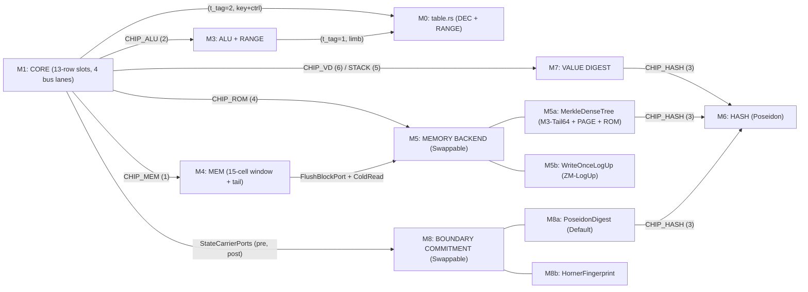
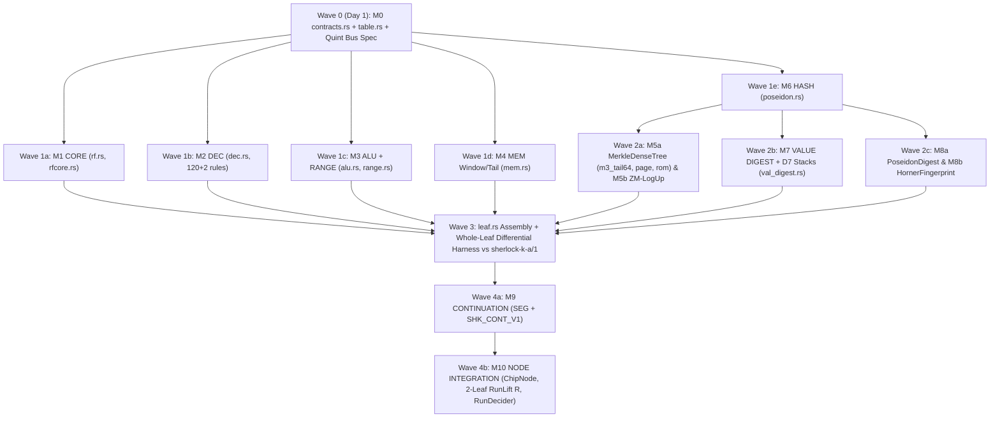

# Sherlock Lookup & Cache Architecture — Round 2 Cross-Review, Convergence & Modular Design (Lane C)

**Study:** `sherlock-lookup-cache-20261111` — Round 2 (Cross-Review & Convergence)  
**Lane:** C — Decode, Program/Type Tables, `ALU`/`RANGE` Tables & Hash Memoization Lead  
**Repository Baseline:** Commit `9ffc2fe76f523453632cf3df03ca761095bc7c13` (`midnight-proofs = 0.8.3`, `midnight-circuits = 7.3.0`, `midnight-zk-stdlib = 2.4.0`, `ledger-9.1.0.1` rev `a2b30128`)  
**Inputs Reviewed:** `lanes/{A,B,C,D,E}/round1.md`, `LEAD-NOTE-ROUND2.md:1-19`, `research/sherlock-runlength-consensus-20261111/CONSENSUS.md:1-350`, `research/sherlock-final-design-20261111/MODULARITY.md:1-12`, and primary source files in `crates/`, `midnight-proofs-0.8.3`, and `midnight-circuits-7.3.0`. Every unmeasured projection is marked `ESTIMATE`.

---

## Executive Summary of Round 2 Convergence

1. **Convergence on Memory, `PROG`, and Type Tables (`M3-Tail64` + L1 `PAGE`/`ROM` Bus Cache as Default; `ZM-LogUp` Behind a Swappable Backend Trait):**
   - Four of five lanes (`A, C, D, E`) independently converged in Round 1 on **Merkle boundary commitments + intra-leaf 8-record L1 `PAGE`/`ROM` `lookup_any` bus caching + dense non-padded allocation**, matching the 5/5 run-length consensus **`M3-Tail64`** (`research/sherlock-runlength-consensus-20261111/CONSENSUS.md:91-108`: fixed `TOP = 61` for $2^{61} \times 8 = 2^{64}$ dense cells, `len_post = len_pre + used`, 1-word `tail_d` carry over a 15-cell window, `D7` Poseidon hash-chain stacks `fp_hash`/`tp_hash`, and slot-0 `v0 = v1 = v2 = 0` zeroing).
   - Lane B's **`ZM-LogUp`** (`lanes/B/round1.md:98-111, 148-161`) is algebraically sound for a **monolithic self-contained two-pass run** on unmodified `midnight-circuits = 7.3.0` (because `Instance(0)` is absorbed at `verifier_gadget.rs:298-300` before `Instance(1)` challenges and opened via KZG at `:435-436, 625-635`). However, `ZM-LogUp` should **not** replace `M3-Tail64` as Sherlock's primary architecture because: (i) its `INIT_PROG` loader leaves (`lanes/B/round1.md:122-125`) turn $O(1)$ off-circuit program admission into $O(|P|)$ recursive `k = 20` Node folds on *every* run (`ESTIMATE ~93 min` for a `4,096`-row program and `~15.8 days` for Lane B's $10^6$-row example, vs `0` loader leaves under `prog_root` `ROM` caching); (ii) `m_w` requires full-run future-read lookahead, breaking Tier-2 pause/resume checkpoints (`SHK_CONT_V1`, `CONSENSUS.md:136-148`) unless $O(|M_{\text{live}}|)$ `INIT_MEM` loader leaves re-ingest the heap at every resume boundary; (iii) its end-of-run `d_root` barrier blocks streaming prove-while-executing and `GP-4` context-free prefix `SEG` reuse; and (iv) witnessing variable `Instance(0)` points without prime-subgroup checks degrades `d_root` binding from ~250-bit to ~125-bit security under BLS12-381 $\mathbb{G}_1$ cofactor-$h_{\mathbb{G}_1}$ torsion grinding (§1.2). Under `MODULARITY.md:7-9`, both `MerkleDenseTree` (`M3-Tail64` + `PAGE`/`ROM`, primary default) and `WriteOnceLogUp` (`ZM-LogUp`, opt-in single-session backend) sit cleanly behind one frozen `MemoryBackend` bus contract with **zero changes to `CORE` or `MEM`**.

2. **Convergence on Decode, Tables, `ALU`/`RANGE`, and Hash Memoization (Lane C Lead):**
   - **Self-Audit Extension (`108` -> `120` Full `/1` Rules):** In Round 1 (`lanes/C/round1.md:48-54`), our audit followed `c6_dispatch_step.rs:30-32, 363-398` (`108` rules), which excludes `XAdtHelperBuild*` (`6` rules) and `XAdtHelperPlan*` (`6` rules). In `owner_runtime.rs:70-108` (`check_enabled`), those 12 rules **are** enabled in `sherlock-k-a/1` (`120` active step rules + `2` genesis rules = `122` non-disabled `/1` rules out of `133` `RuleIdC` variants). Including all 120 rules activates 3 more static `C6PhysicalProgram` tables (`field_paths`, `plan_nodes`, `plan_cases`: `14` of `20` tables read dynamically, all served identically by `CHIP_ROM`), adds `XAdtHelperBuildField` (`owner_runtime.rs:2998-3015`) as the 3rd `Data`-allocating rule (computing constructor `vd` incrementally via `acc_vd`), and adds `HelperKind` `10..11` inside the existing 4-bit `helper_tag_idx` (`<= 2,048` normalized `DEC` rows unchanged).
   - **`TaggedTableConfig` (`DEC + RANGE` Multiplexed 2-Col Fixed Table) Beats Both Bus-Folded `DEC` and 5-Bit Bitwise Packing:** Reconciling with Lanes A/E (`§1.5`), `bus.rs:48-61` has **zero** fixed data columns (only 1-bit `q_req`/`q_prov` over advice columns `a[0..10]`), so folding `DEC` onto `bus` still requires adding 2–3 `Fixed` columns (`-22,600` to `-29,062` Node rows `ESTIMATE`) *while consuming 1 `bus` request lane on every step*. Multiplexing `DEC` (`<= 2,048` rows, `54-bit` boolean-checked `ctrl_word`) and `RANGE` (`4,096` rows at `12b`, or `32,768` rows at `15b` for `k_leaf = 16`) into **one 2-column `TaggedTableConfig`** (`4 -> 3` lookups) saves **`~29,062` rows in `ChipNode` (`~35,066` with `RangeConfig` `VSel` packing) and `~51,200` rows in 2-leaf `RunLift` `R` (`ESTIMATE`)**, while leaving all **4 `bus` request lanes (`L0..L3` via Lane D's 2nd `q_req` row at `rfcore.rs:198`)** free for `ROM`, `MEM`/`PAGE`, `ALU`, and `HASH`!
   - **Mandatory `AluConfig` Input Range-Check Hardening (`Exploit D1` Closed at `+0` Node Cost):** Adopting Lane E's `Exploit D1` finding on `crates/mori-chip/src/alu.rs:8-9, 111-125`, `AluConfig` directly range-checks inputs `x < 2^128` and `y < 2^128` alongside `w < 2^128` (`+0` Node rows, `+0` Decider rows, `+0` `k_leaf` change inside the Poseidon-dominated `k_leaf = 16` leaf).
   - **Complete `VALUE DIGEST` (`sherlock-value/1`) Optimization:** Inline allocation-time `vd` (`SVM-012` + incremental `acc_vd` in `BuildField`) + precomputed `const_vd` and `ty_d` in `ROM` + compile-time constants `VD_NIL`, `VD_FALSE`, `VD_TRUE` + precomputed first-block sponge state `(C_0, C_1, C_2) = PoseidonPerm(0, SHK_VAL, 1)` (`-70` rows per dynamic `vd`) + capacity-bound `domain_tag` on `PoseidonCfg`.

3. **Combined Quantitative Result (`Sherlock-Modular-M3Tail64`, `ESTIMATE`):**
   - **Leaf (`S = 16`, M4 Default, `TOP = 61`, 1-Arena `W_flush = 1`, `P_mem = 4`, `P_rom = 2`):** **`~39,100–44,200` circuit rows (`k_leaf = 16 <= 65,530`)**; at **`S = 64`** (Post-M4 lever, `W_flush = 3`, `P_mem = 6`, `P_rom = 3`): **`~82,500` circuit rows (`k_leaf = 17 <= 131,066`)**.
   - **Node (`SHKIVC06`, `k = 20`, gate `<= 950,000`):** **`~807,340` rows** (`~800,878` with `RangeConfig` `VSel`) — **`16,126` to `22,588` rows BELOW the measured `823,466` E8 baseline**, with `RunLift` `R` (`U + U -> SEG`) at **`~740,000–775,000` rows**.
   - **Decider (`SHKRUND1`, `k = 20`):** **`929,166` circuit rows / `1,032,467` table rows (`+0` table delta, full `16,103` usable row margin preserved)**.

---

## 1. Cross-Review of Lanes A, B, D, and E (`round1.md`)

### 1.1 Cross-Review of Lane A (`lanes/A/round1.md`)

#### Accepted from Lane A
1. **Aligned `C = 8` Block Openings in `PAGE` (`lanes/A/round1.md:190-196`):** Matching `PAGE` cache-line geometry (`C = 8` contiguous records) to `m3.rs`'s 8-record `Tree8` leaf subtrees amortizes one Merkle path across 8 neighbor cells, giving up to `8x` spatial hit amplification on contiguous slices (`children`, `parameters`, `ctor_fields`, `constant_fields`, `data_fields`, `value_slots`).
2. **Lazy `C = 8` Partial-Segment Tail Carry Across Leaf Boundaries (`lanes/A/round1.md:225-226, 238`):** Replaces our Round 1 in-tree partial-segment RMW (`lanes/C/round1.md:302`) with `CONSENSUS.md:98-102`'s **`M3-Tail64`** (`len_post = len_pre + used`, carrying `tail_d` in `pre_d`/`post_d` and flushing to the depth-61 tree iff `floor(len_post / 8) > floor(len_pre / 8)` with `old_leaf == EMPTY_SEG != 0`). Leaves that do not cross an 8-cell boundary pay **`0` depth-61 tree walks**.
3. **Pre-Digested `ty_d` and `const_vd` in `PROG` (`lanes/A/round1.md:215`) + Inline `vd` in `DATA` (`:222`):** Matches `lanes/C/round1.md:147-148, 194-202` and closes `dissent.md` `D-2` runtime schema-hashing overhead.
4. **Primary-Source Prior-Art Refinements (`lanes/A/round1.md:109, 147-154`):** Specifically Ziren V2.0's hashless affine $\mathbb{F}_{p^7}$ tuple lift (`~51` cols in `crates/pcs/src/septic_curve.rs` vs SP1 Hypercube's `~242` cols) and the Twisted Edwards Jubjub adaptation of `https://eprint.iacr.org/2026/590` (`y_0 = m \cdot 2048 + k`, canonical $x_0 \in [1, \frac{q-1}{2}]$, cofactor clearing $P_0 = [8]P_{\text{root}}$), confirming that even this optimal ~30-row relation still loses on Sherlock due to the 243-bit message cap (`+140` Poseidon rows/event) and mandatory $O(N_{\text{alloc}})$ teardown leaves (`:208-210`).

#### Rejected from Lane A
1. **Cons-Spine Staging for Call Arguments / Constructor Fields (`(TAG_STAGE, ref, vd, prev_link)`, `lanes/A/round1.md:250`):** Altering `ArgsF`/`Append` from contiguous `ValueSlots` copy microsteps (`crates/mori-core/src/sherlock/helper_machine/families/environment.rs:703-775`) into a cons-spine changes both `n_steps` and `remaining_work` relative to `mori simulate`, violating `SVM-001` and `SVM-011` (`openspec/changes/sherlock-vm-consensus-20261107/requirements.md:9,19`; `CONSENSUS.md:79`). Under `M3-Tail64`, `SI-12..SI-14` `start + k` slice indexing holds verbatim with **zero** rule changes.
2. **Bus-Folded `DEC` Claiming `-34,608` Node Rows Without Bus-Lane Accounting (`lanes/A/round1.md:179, 213`):** Reconciled in `§1.5` below — `TaggedTableConfig` achieves the same `-29,062` (to `-35,066`) Node row savings (`ESTIMATE`) without consuming a `bus` request lane per step.

---

### 1.2 Rigorous Evaluation of Lane B (`lanes/B/round1.md`: `WO-LogUp` / `ZM-LogUp` + `INIT_PROG` + Horner Boundary + 5-Bit Bitwise Packing)

#### What We Accept from Lane B (Substantive Cryptographic & Modular Contributions)
1. **Zero-Fork Feasibility of Two-Pass Pre-Committed LogUp (`WO-LogUp` / `ZM-LogUp`) on Stock `midnight-circuits = 7.3.0` (`lanes/B/round1.md:98-110, 148-160, 185-200`):**
   - In Round 1, our report (`lanes/C/round1.md:90-95`) dismissed challenge-based offline memory because in-leaf `SecondPhase` panics at `verifier_gadget.rs:310` and un-precommitted public challenges fall to adaptive forgery (`Exploit B1`, `lanes/E/round1.md:89-100`).
   - Direct inspection of `midnight-circuits-7.3.0/src/verifier/verifier_gadget.rs:298-306, 432-437, 625-635` confirms Lane B's (and Lane D's `:179-190`) exact Fiat-Shamir mechanics: `assigned_committed_instances` (`Instance(0)`) is absorbed via `transcript.common_point` (`:298-300`) **before** `assigned_instances` (`Instance(1)`, `:302-306`) and opened at `x` via KZG `VerifierQuery` (`:628-634`). Therefore, committing each leaf's `[pre_regs(29..35), post_regs(29..35), writes_with_m_w, cache_reads]` into $P_i \mapsto C_i \in \mathbb{G}_1$ in **Stage 1**, hashing $d_i = H(\text{DOM\_LEAF\_COM}, C_{i,x}, C_{i,y})$ across all leaves $0 \dots N-1$ to $d_{\text{root}}$, deriving $(\gamma, \alpha) = H(\text{DOM\_MEM\_CHAL}, d_{\text{root}}, \text{prog\_d}, \text{input\_d})$, and gating `q_com * (a[11] - Instance(0)) == 0` in **Stage 2** fixes $m_w$ and $\vec{u}^{(i)}, \vec{v}^{(i)}$ **prior** to $(\gamma, \alpha)$ with `cs.phases().count() == 1` (`0` crate fork).
2. **Leaf-Cache Multiplicity Theorem & Zero Teardown Sweep for Write-Once Memory (`lanes/B/round1.md:87-90, 105-108`):**
   - Because Sherlock `/1` memory is write-once with strictly increasing `addr_w = len_t` and `0 <= addr_r < len_t` (`rfcore.rs:369,510`), setting $m_w$ equal to the **number of leaves whose local `CACHE` table contains $w$** and subtracting $\frac{1}{\alpha - E_\gamma(r)}$ once per active `CACHE` row requires **zero intra-leaf multiplicity counters** on `lookup_any` and **zero end-of-run teardown sweep** (`m_w = 0` for unread cells), with rational soundness error $\le \frac{4(W+R)^2}{2|\mathbb{F}|} + \frac{W+R}{|\mathbb{F}|} < 2^{-185}$ (`ESTIMATE`).
3. **Single-Column Packed `DEC` Microcode (`lanes/B/round1.md:121`):** Matches our 54-bit single-scalar `ctrl_word` (`lanes/C/round1.md:129-139`), provided every unpacked field is boolean/range-constrained (`Exploit C1`).
4. **Inclusion as Swappable Modular Backends (`MODULARITY.md:9`):** Both `WriteOnceLogUp` (`MemoryBackend`) and `HornerFingerprint` (`BoundaryCommitment`) are preserved intact behind frozen interfaces in `§4` so they can be built and benchmarked on identical `CORE` and `MEM` circuits.

#### What We Reject from Lane B — and Why `ZM-LogUp` Should Not Be Sherlock's Primary Default
1. **`INIT_PROG` Loader Leaves vs `prog_root` `ROM` Cache (`lanes/B/round1.md:122-125` — Severe Wall-Clock Regression on Real Programs):**
   - Lane B replaces `prog_root` Merkle openings with $M_P = \lceil |P| / B \rceil$ sequential `INIT_PROG` loader leaves (`B ≈ 32` rows/leaf at `:125`, where $|P| = 10^6 \implies 31,250$ loader leaves). Every loader leaf is a `U` leaf proof that must be folded through a `k = 20` recursive Node (`61.07 s` solo / `43.83 s` in `3×6t` tree mode, `CONSENSUS.md:206-207`).
   - **Quantitative Impact (`ESTIMATE`):** On a realistic `4,096`-row `C6PhysicalProgram` (`expressions` + `functions` + `types` + `constructors` + `constants` across a multi-function module) where a call executes `32` steps (`2` execution leaves touching `16` `ROM` rows = `2` 8-row cache lines):
     - **`prog_root` `ROM` L1 Cache (`M3-Tail64`):** Off-circuit admission hashes `prog_root` once in `< 5 ms`; the run proves **only `2` leaves + `2` Node folds (`~2.1 min` `ESTIMATE`)**, touching `0` untaken functions.
     - **`INIT_PROG` Loader Leaves (`ZM-LogUp`):** Proves and folds $\lceil 4,096 / 32 \rceil = 128$ loader leaves **before `h = 0`**, costing `128 × 43.83 s ≈` **`93.5 min` (`ESTIMATE`, `44x` slower)** — and on Lane B's cited $10^6$-instruction example (`31,250` loader leaves), **`31,250 × 43.83 s ≈ 15.85 days` (`ESTIMATE`)** per invocation!
2. **Incompatibility with Tier-2 Pause/Resume Checkpoints (`GP-001`, `CONSENSUS.md:136-148`) and Cross-Epoch Heap Continuity (`GP-2`):**
   - When a long run pauses at step `h_1` to seal a `SHK_CONT_V1` continuation epoch (`CONSENSUS.md:139-147`) and resumes days later on `[h_1, h_2)`, Epoch 1 **cannot know** how many leaves in Epoch 2 will read heap cells allocated in `[0, h_1)`.
   - Either Epoch 1 leaves $\Sigma_{\text{mem}}$ unsealed (meaning **zero** Stage-2 leaf or node proofs can be generated during Epoch 1 — reducing "pause/resume" to saving an unproved execution log!), **or** Epoch 1 seals $\Sigma_1 == 0$ over Epoch-1 reads only, which forces Epoch 2 to **re-load the entire live heap via `INIT_MEM` loader leaves** ($O(|M_{\text{live}}|)$ `k = 20` Node folds at every checkpoint, vs **`0` loader leaves and `O(1)` `mem_root` handoff** under `M3-Tail64`!).
3. **Global Synchronization Barrier & Loss of `GP-4` Prefix `SEG` Reuse (`general-purpose.md:42-52`):**
   - Even with associative `(com_pre -> com_post)` chaining (`lanes/B/round1.md:225-226`), **no leaf in `[0, N)` can enter Stage-2 proving until step $N$ finishes simulation** (`m_w` and `d_root` depend on leaf $N-1$). This forbids streaming prove-while-executing (`§2.2`) and prevents reusing a proved `SEG` prefix `[0, h_1)` across two distinct suffix branches in a `GP-4` DAG (because `m_w`, `d_root`, $\gamma$, and $\alpha$ differ between the two suffixes!).
   - Furthermore, because `m_w` counts *leaves* whose cache touches $w$ (`lanes/B/round1.md:107-108`), re-slicing `[16]` into `[7, 9]` when both sub-leaves read $w$ changes `m_w` (`+1 -> +2`), mutating `P_i`, `C_i`, `d_root`, $(\gamma, \alpha)$, and every internal `SEG` statement (unlike `M3-Tail64`, where `state_d(h)` is bit-identical across all partitions!).
4. **Understated `RunLift` `R` Foreign-Point Cost & BLS12-381 Cofactor-Torsion Grinding Subtlety (`verifier_gadget.rs:298-300`, `transcript_gadget.rs:142`):**
   - In `GP-4`'s 2-leaf `RunLift` circuit `R` (`U + U -> SEG`, `architecture.md:75`), witnessing two non-identity `Instance(0)` points $(C_{2j}, C_{2j+1})$ pays foreign-curve assignment + `10`-scalar `common_point` Poseidon absorption + **2** extra variable-base MSM points in `collapse` + `+5` `IVC_STATE` carry scalars (`ESTIMATE +19,000–27,000` rows in `R`, vs Lane B's `+13,700` single-leaf Node estimate).
   - **Cryptographic Subgroup Finding:** Lane B (`lanes/B/round1.md:109, 261`) proposes witnessing $C_i$ in `ChipNode` via `assign_without_subgroup_check` (`transcript_gadget.rs:142`), which checks $C_i \in E(\mathbb{F}_p)$ (`y^2 = x^3 + 4`) **without** checking $C_i \in \mathbb{G}_1[r]$. Because BLS12-381 $\mathbb{G}_1$ has cofactor $h_{\mathbb{G}_1} = (x_{\text{BLS}} - 1)^2 / 3 \approx 2^{125.6}$ coprime to $r$ while $\mathbb{G}_2$ points in the SRS lie in $\mathbb{G}_2[r]$, bilinearity gives $e(T, Q) = 1$ for every $T \in E(\mathbb{F}_p)[h_{\mathbb{G}_1}]$ and $Q \in \mathbb{G}_2[r]$. Thus, for **one fixed polynomial $P_0$**, a malicious prover can replace $C_0$ with $C'_0 = C_0 + T_k$ across ~$2^{125.6}$ distinct torsion points $T_k$: every $C'_0$ passes `assign_without_subgroup_check` and **passes the exact same terminal KZG pairing check with unchanged opening proof $\pi$**, while producing $2^{125.6}$ distinct affine pairs $(C'_{0,x}, C'_{0,y})$ and therefore **$2^{125.6}$ grindable challenges $(\gamma_k, \alpha_k)$ without recomputing a single MSM**! Closing this torsion-grinding avenue via `AssignmentInstructions::assign` (full subgroup check on `EccChip<Bls12>`) adds another **`ESTIMATE +8,000–12,000` Node rows (`+16,000–24,000` in `R`)**.
5. **Packing 5-Bit Bitwise Rows into `RANGE` (`lanes/B/round1.md:133-136`) vs Packing `DEC` into `RANGE` (`TaggedTableConfig`):**
   - Sherlock `/1` (`crates/mori-core/src/sherlock/helper_machine/shared.rs:7-22`) has **zero** bitwise `XOR`/`AND`/`OR` ops. Packing `3,072` unused 5-bit bitwise rows into `RANGE` saves **`0` Node rows**, whereas packing `DEC` (`<= 2,048` rows) into those exact free `k = 13` rows (`4,096 + 2,048 + 1 = 6,145 <= 8,186`) deletes an entire PLONK lookup argument and 1 `TableColumn`, **saving `~29,062` Node rows (`~51,200` rows in `R`, `ESTIMATE`)** — and still leaves `8,186 - 6,145 = 2,041` free rows in `k = 13` (`> 768` needed for 4-bit nibble `XOR`/`AND`/`OR` if `/2` ever adds bitwise ops!).
6. **`AS_HASH` Cross-Leaf Memoization (`lanes/B/round1.md:143`):** Once `vd` is stored inline in `DATA`/`CONST` records and universal `VD_NIL`, `VD_FALSE`, `VD_TRUE` are inlined as compile-time constants (`lanes/C/round1.md:199-203`), repeated nullary constructors already cost **`0` rows** (vs `~2` rows in `AS_HASH`), with zero `WO-LogUp` coupling.

---

### 1.3 Cross-Review of Lane D (`lanes/D/round1.md`)

#### Accepted from Lane D
1. **Complete Two-Site `VerifierGadget` Single-Phase Audit (`lanes/D/round1.md:163-173`):** Verified firsthand at `midnight-circuits-7.3.0/src/verifier/verifier_gadget.rs:310` (`assert_eq!(cs.phases().count(), 1)`) and `src/verifier/expressions/mod.rs:49` (`Expression::Challenge(_) => panic!("We do not suport multi-phase yet")`).
2. **Exact Binary Proof of `RunDecider` `table_rows = 1,032,467` (`lanes/D/round1.md:214-221`, verified at `pow2range.rs:215-236`):** $1{,}032{,}467 = 2^0 + 2^1 + 2^4 + 2^8 + \sum_{b=14}^{19} 2^b$, leaving **`16,103` usable table rows** below $2^{20} - 6 = 1{,}048{,}570$, while unqueried tags `{2, 3, 5, 6, 7, 9, 10, 11, 12, 13}` sum to `16,108 > 16,103`. Any decider decomposition must restrict strictly to already-loaded tags `{0, 1, 4, 8, 14..=19}`.
3. **2-Leaf `RunLift` `R` Lookup Cost Multiplier (`lanes/D/round1.md:13, 321-328`):** Because `R` (`U + U -> SEG`) runs `VerifierGadget::prepare` twice while resolving `U`'s fixed bases once, each `lookup_any` in `U` adds **6 variable $\mathbb{G}_1$ commitments (`~45,200` rows `ESTIMATE`) in `R`**, making our `4 -> 3` lookup reduction via `TaggedTableConfig` doubly valuable (`-51,200` rows in `R` `ESTIMATE`).
4. **2nd Active `q_req` Row in `Arch::Narrow` (`lanes/D/round1.md:154, 408`, verified at `crates/mori-chip/src/rfcore.rs:169-200`):** Promoting slot row `6` from a passive copy-replica of `(L0, L1)` to a second active `q_req = 1` request pair `(L2, L3)` doubles per-step bus bandwidth from **2 to 4 bus requests/step** at **`+0` lookups and `+0` Node rows** — essential for rules like `equal_differ` dispatch (`1` `ROM` fetch + `2` `MEM`/`PAGE` value reads + `1` `ALU` op = `4` requests).
5. **15-Bit `RANGE` Limbs at `k_leaf >= 16` (`lanes/D/round1.md:115`):** Compatible directly with `TaggedTableConfig`! At `k_leaf = 16` (`65,530` usable rows), `32,768` (`15b` `RANGE`) + `2,048` (`DEC`) + `1` (`zero`) = **`34,817 <= 65,530` table rows**, cutting every `u128` check from `12` to `10` rows (`-17%` `ESTIMATE`) at `+0` Node cost (`LIMB_BITS = 12` for `k = 13..15` unit tests, `15` for `k >= 16` production keys).

#### Rejected from Lane D
1. **Every-Leaf In-Tree Frontier RMW (`DIPM` `K_frontier = 2`, `lanes/D/round1.md:145-148`):** Superseded by `CONSENSUS.md`'s `M3-Tail64` (`tail_d` carry), which avoids depth-61 walks on non-flushing allocations (`r_pre + used < 8`) and always writes into fresh `EMPTY_SEG` leaves (`0` prefix-clobber surface).
2. **Variable-Height LCA Spine Sharing (`lanes/D/round1.md:56, 294`):** Saves `0` worst-case `k_leaf` rows in static Halo2 circuits (non-shared cold paths must still be laid out) while introducing the variable-height root-splicing attack class of OpenVM `CVE-2026-62333` (`lanes/E/round1.md:247-250`). Fixed `TOP = 61` walks fit `k_leaf = 16` cleanly.
3. **Omitting Capacity-Tagged `PoseidonCfg` Bus Binding (`lanes/D/round1.md:123-134`):** While we agree on rejecting any *new* 6-column lookup, binding `s[0] == domain_tag` and gating `q_prov` by `act_hash` on the *existing* 5-column `bus` (`lanes/C/round1.md:209-214`) costs `0` columns/lookups and closes `Exploits E1a/E1b`.

---

### 1.4 Cross-Review of Lane E (`lanes/E/round1.md`) — Closing `Exploit D1` (`alu.rs`) and Hardening All Providers

#### Accepted from Lane E (All Adversarial Exploits Closed)
1. **`Exploit D1` — `crates/mori-chip/src/alu.rs:8-9, 111-125` Unchecked `u128` Input Modular-Wraparound Forgery (`lanes/E/round1.md:134-138`):**
   - Verified directly at `alu.rs:111-125`: `AluConfig` range-checks **only** `w` (`z < 2^128` on `OP_ADD`; `y - x - 1 < 2^128` when `z = 1` on `OP_LT`), assuming callers never pass $x, y \ge 2^{128}$. Passing $x = r_{\text{BLS}} - 1$ and $y = \text{cur\_len} = 5$ into `OP_LT` yields $w = 5 - (r_{\text{BLS}} - 1) - 1 = 5 < 2^{128}$, certifying $r_{\text{BLS}} - 1 < 5$ (`z = 1`) and bypassing `D1`/`D2` bounds checks (and matching `Exploit E-10` on lazy `UNFOLD` in `CONSENSUS.md:144`).
   - **Adopted Fix (`+0` Node Rows, `+0` Decider Rows, `+0` `k_leaf` Change):** Enforce **`x < 2^128` and `y < 2^128` directly inside `AluConfig`** (`3` `RANGE` decompositions per `ADD`/`SUB`/`LT` = `30` rows at `15b` limbs [`36` at `12b`], and `4` 64/65-bit pair decompositions = `40–48` rows for 64-bit schoolbook `OP_MUL`, totaling `~480–672` rows at `S = 16` `ESTIMATE`). Because `ALU + RANGE` reuses the single `TaggedTableConfig` lookup and sits far below `65,530` usable rows in `k_leaf = 16`, making `AluConfig` unconditionally self-protecting is **100% free** in `k_leaf`, `ChipNode`, and `RunDecider`!
2. **`Exploit C1` (`lanes/E/round1.md:120-122`):** Enforce boolean `b * (1 - b) == 0` (or bounded `VSel` product) on **every** unpacked bit/sub-field of `DEC`'s 54-bit `ctrl_word` before checking $\sum 2^{\text{off}_j} c_j == \text{ctrl\_word}$.
3. **`Exploit C2` (`lanes/E/round1.md:125`):** Pad unused `prog_root` (`ROM`) leaves above each table's length with `(subtable_tag, OP_INVALID_OOB, 0, 0)` and hash explicit `subtable_tag in 1..=14` into every `ROM` leaf record so out-of-bounds indices always fault and sub-tables never alias.
4. **Provider Zero-Gating (`Exploits A1–A5, E1a, E1b, E2`) + Slot-0 Scratch Zeroing (`CONSENSUS.md:103-104`):** Multiply every `PAGE`, `ROM`, `MEM`, `HASH`, and `VD` bus provider expression by boolean `act_j`, enforce `chip_tag >= 1`, enforce `addr < cur_len` (`D1`) and `addr < 8 * q_pre` (`D2`), enforce `ao == 0` at `TOP - 1`, constrain `vd` in-circuit on `ScalarExit`/`EqualExit`/`BuildField`, and constrain `v0 = v1 = v2 = 0` at slot 0 of every leaf.

#### Rejected from Lane E
1. **`TOP = 30` ($2^{32}$ cells) and `WB[4]` Raw 12-Field Carry (`lanes/E/round1.md:161-168`):** Superseded by `CONSENSUS.md`'s **`M3-Tail64` (`TOP = 61`, $2^{64}$ dense cells, `C = 8`, 1-word `tail_d` carry)** (which Lane E co-adopted in `CONSENSUS.md:247`), removing the sub-$2^{64}$ heap cap (`GP-1`), doubling per-leaf burst capacity (`8` vs `4` cells), and shrinking `pre_d`/`post_d` by `11` fields (`-8` permutations = `-560` leaf rows `ESTIMATE`).

---

### 1.5 Exact Reconciliation: `TaggedTableConfig` (`DEC+RANGE` 2-Col Table) vs Bus-Folded `DEC` (Lanes A & E)

| Design Option | `Bus + Range + Dec` Fixed Cols (`vk.cs()`) | Total Leaf Lookups | `ChipNode` $\Delta$Rows vs E8 (`ESTIMATE`) | `RunLift` `R` $\Delta$Rows (`ESTIMATE`) | Bus Request Lanes Used by `DEC` | Max Non-`DEC` Bus Reqs/Step (`2` `q_req` rows) |
|---|---:|---:|---:|---:|---:|---:|
| **E8 Baseline** (`bus.rs` + `range.rs` + `dec.rs`) | `9` (`2 + 4 + 3`) | `4` | `0` (`823,466`) | `0` (baseline) | `0` | `4` (`L0..L3`) |
| **Option A/E-1a: Bus-Folded `DEC` via Advice Copy Rows** (`D` rows copying `2` new Fixed cols `f_syn, f_ctrl` into `a[0..5]`) | `8` (`-3` `dec`, `+2` `f_syn, f_ctrl`) | **`3`** (`-1`) | **`-28,604` to `-29,062`** | **`-51,204`** | **`1` per step** (`S` reqs) | **`3`** (forces 3rd `q_req` row on 4-read rules!) |
| **Option A/E-1b: Bus-Folded `DEC` via Fixed Term in `bus.rs`** (`+q_dec_prov * f_i` added to `bus` table expr) | `9` (`-3` `dec`, `+3` `q_dec_prov, f_syn, f_ctrl`) | **`3`** (`-1`) | **`-22,600`** | **`-45,200`** | **`1` per step** (`S` reqs) | **`3`** (forces 3rd `q_req` row on 4-read rules!) |
| **Lane C Winner: `TaggedTableConfig` (`DEC + RANGE` 2-Col Fixed Table)** | **`8`** (`7` if `q_rng, q_first, q_step` pack in `VSel`) | **`3`** (`-1`) | **`-29,062`** (**`-35,066`** w/ `VSel`) | **`-51,204`** (**`-57,208`** w/ `VSel`) | **`0`** (`bus` untouched!) | **`4` (`L0..L3` 100% free for `ROM`/`MEM`/`ALU`/`HASH`!)** |

**Why `TaggedTableConfig` Strictly Dominates:** In `crates/mori-chip/src/bus.rs:48-61`, `BusConfig` contains **zero** fixed data columns — only 1-bit selectors `q_req` and `q_prov` gating advice columns `a[0..10]`. Moving `DEC` (`~620–2,048` normalized 120-rule syndromes) onto `bus.rs` therefore *must* add `2` new `Column<Fixed>` columns (`f_syn`, `f_ctrl`), yielding `-22,600` to `-29,062` Node rows (`ESTIMATE` — not `-34,608`) while burning 1 `bus` request lane on every step and `620–2,048` advice copy rows. Multiplexing `DEC` and `RANGE` into `TaggedTableConfig` over row-disjoint `q_dec` (`CORE`) and `q_rng` (`ALU/RANGE`) achieves the **full `-29,062` to `-35,066` Node row reduction (`ESTIMATE`)**, burns **zero** advice rows, and leaves all **4 per-step `bus` request lanes (`row 2` + `row 6`)** available for data/code/ALU/hash traffic.

---

## 2. Explicit Answers to `LEAD-NOTE-ROUND2.md` Questions 1–4

### 2.1 Question 1: Merkle (`M3-Tail64` + L1 `PAGE`/`ROM` Cache) vs Run-Wide Write-Once LogUp (`ZM-LogUp`)

**Recommendation:** Adopt **Merkle (`M3-Tail64` at `TOP = 61` + intra-leaf 8-record L1 `PAGE` & `ROM` `lookup_any` cache + `D7` Poseidon hash-chain stacks)** as the canonical primary design for heap memory (`DATA`, `FIELDS`, `ENV`, `SLOTS`), `PROG`, and type/constant tables, while placing `MerkleDenseTree` and `WriteOnceLogUp` behind a single swappable `MemoryBackend` module interface (`§4`).

| Requirement (`LEAD-NOTE-ROUND2.md:10`) | **Merkle `M3-Tail64` (`TOP = 61`) + L1 `PAGE`/`ROM` Cache (Recommended Primary)** | **Run-Wide Write-Once LogUp (`ZM-LogUp` + `INIT_PROG`, Secondary Backend)** |
|---|---|---|
| **`2^64` Cells & Zero Spin-Loop Burn** | **Holds unconditionally:** $2^{61} \times 8 = 2^{64}$ dense cells; `len_post = len_pre + used < 2^64`; `0` cells burned on compute or `D7` stack ops (`CONSENSUS.md:98-101`). | **Holds algebraically:** `len < 2^64`; residue $|c(r^*)| \le N < 2^{64} \ll r \approx 2^{255}$ prevents characteristic wraparound (`lanes/B/round1.md:191`). |
| **`PROG` & Type Tables (`GP-1` Universality)** | **Pay-per-touch ($O(\text{touched lines})$):** `prog_root` hashed once off-circuit; leaves open only executed 8-row `ROM` blocks (`0` loader leaves!). | **Pay-for-whole-program ($O(|P|)$ `k = 20` Nodes):** Prepending $\lceil |P| / 32 \rceil$ `INIT_PROG` leaves costs `~93.5 min` (`4k` rows) to `~15.8 days` (`1M` rows) (`ESTIMATE`). |
| **`SRC-023` Partition Independence & `Aggregation.lean`** | **Strongest form:** Both `claim_d` **and** internal `state_d(h)` are bit-identical across all leaf partitions (`Aggregation.lean:1154-1164` instantiates unchanged). | **Terminal-only:** Sealed `claim_d` is partition-independent, **but** internal `SEG` statements (`m_w`, `C_i`, `d_root`, $\gamma$, $\alpha$) change when leaf cuts split shared reads. |
| **C6 Outcome-Only Privacy (`SRC-006`, `SRC-007`)** | **Preserved (`100%`):** `mem_root`, `tail_d`, `fp_hash`, `tp_hash` stay inside `SEG` and are erased at `RunDecider`. | **Preserved (`100%`):** `(d_root, gamma, alpha, sum_mem == 0)` verified and erased at `SEG -> SET` / `RunDecider`. |
| **`GP-2` Cross-Run Claims & Tier-2 Checkpoints (`SHK_CONT_V1`)** | **Full $O(1)$ support:** Sealed `SET` claims compose freely (`GP-2`), and multi-day Tier-2 pause/resume epochs (`SHK_CONT_V1`) hand off `mem_root` in **$O(1)$ (`0` loader leaves)**. | **`GP-2` `SET` ok; Tier-2 Checkpoints BROKEN:** Epoch 1 cannot predict Epoch 2's future read counts `m_w`, forcing $O(|M_{\text{live}}|)$ `INIT_MEM` loader leaves at every resume! |
| **`GP-3` Foreign Proofs (`F`)** | **Orthogonal (`+0` `RunDecider` table rows; `> 142k` Node headroom).** | **Orthogonal (`+0` `RunDecider` table rows if sealed in `SEG -> SET`).** |
| **`GP-4` Arbitrary PCD Shapes (Chains, Trees, DAGs)** | **Full context-free PCD:** Any segment `[h_0, h_1)` proves immediately and can be reused across multiple suffixes or diamond DAGs. | **Batch-tree only:** Tree bracketing works *after* run completion via `(com_pre, com_post)`, **but** no prefix `SEG` can be proved before `h_N` or reused across two suffixes. |

---

### 2.2 Question 2: Quantifying the Two-Pass Cost vs One-Pass Alternatives (`ESTIMATE`)

Under `ZM-LogUp`, all leaf `Instance(0)` commitments $C_0, \dots, C_{N-1}$ must exist before squeezing $(\gamma, \alpha) = H(\text{DOM\_MEM\_CHAL}, d_{\text{root}}, \text{prog\_d}, \text{input\_d})$:

1. **Stage-1 MSM Time vs Full-Run Synchronization Barrier (`ESTIMATE`):**
   - Computing $C_i = \text{commit\_to\_instances}(P_i) \in \mathbb{G}_1$ (`midnight-proofs-0.8.3/src/plonk/prover.rs:36-49`) over ~`250–700` non-zero Lagrange entries at `k = 13` takes only **`~0.8–3.5 ms/leaf` (`ESTIMATE`)** (`~0.5–0.9 s` for `256` leaves).
   - **However**, $P_0$ contains `m_w` — the exact count of future leaves in `[1, N)` that will read each cell written in Leaf 0! Therefore, **the bottleneck is not the `~2 ms` MSM; it is the mandatory end-of-execution lookahead barrier**:
     - **Streaming prove-while-executing (`0%` overlap):** Under `M3-Tail64`, Leaf 0 begins proving ~`0.1 ms` after step `16` executes, hiding 100% of simulation behind proving. Under `ZM-LogUp`, **zero** leaves or nodes can begin proving until step $N_{\text{total}}$ halts.
     - **Witness buffering vs double simulation (`O(N)` RAM/NVMe vs `O(1)`):** For a $10^7$-step run (`625,000` leaves at `S = 16`, `~5 × 10^6` allocated cells), the host must either buffer all `625,000` leaf traces (`ESTIMATE ~6–15 GiB` NVMe/RAM) or maintain an in-RAM `u32` multiplicity table (`~20 MiB` at $5 \times 10^6$ cells, scaling to **`16 GiB` RAM** at $4 \times 10^9$ cells — breaking `O(1)` streaming prover RSS!) and **re-execute the entire VM a second time** in Stage 2.
     - **Parallel proving:** Single-batch `3 × 6t` tree proving works in Stage 2 after the barrier, **but** multi-epoch `SHK_CONT_V1` pause/resume checkpoints (`CONSENSUS.md:136-148`) fail: stopping after 4 hours (`~4,096` steps) either yields **zero** valid Stage-2 proofs (if unsealed) or pays $\lceil |M_{\text{live}}| / 32 \rceil$ `k = 20` Node folds (`ESTIMATE ~46 min` per `2,048` live cells) to re-seed `ZM-LogUp` on resume.
2. **Evaluating One-Pass Alternatives on This Stack (`b2` Jubjub `EC-MSH` vs `M3-Tail64`):**
   - **Write-once `[m_w] P` Jubjub `EC-MSH` (`lanes/B/round1.md:112-116`) is NOT actually one-pass:** Multiplying `[m_w] P` at allocation time in Leaf $i$ **still requires knowing total future read multiplicity `m_w` across Leaves $i+1 \dots N-1$**, so it suffers the **exact same full-run simulation barrier and pause/resume failure** as `ZM-LogUp`, while costing `2.2x–4.6x` more leaf rows!
   - **True one-pass counter-re-emitting Jubjub `EC-MSH` (`lanes/A/round1.md:207-210`, `lanes/C/round1.md:96-101`, `lanes/D/round1.md:79-84`, `lanes/E/round1.md:105-111`):** Eliminating `m_w` lookahead forces every read to consume `(a, v, c)` and re-emit `(a, v, c + 1)` (`~280–340` leaf rows/read even with `ePrint 2026/590` `y-increment` + 243-bit Poseidon pre-hash, vs `0` rows per intra-leaf `PAGE` hit) **and** requires an **$O(N_{\text{alloc}})$ post-Halt teardown leaf sweep** (`15%–30%` extra `k = 20` Node proofs `ESTIMATE`), violating `SRC-021` $O(1)$ Halt and `GP-1`.
   - **Verdict:** **`M3-Tail64` + L1 `PAGE`/`ROM` bus cache + `D7` hash stacks is the unique truly one-pass, $O(1)$-RSS, $O(1)$-Halt, checkpoint-compatible architecture on pinned `midnight-circuits = 7.3.0`.**

---

### 2.3 Question 3: `VerifierGadget` Single Phase (`verifier_gadget.rs:308-310`) & Zero-Fork Confirmation

Direct inspection of `~/.cargo/registry/src/index.crates.io-1949cf8c6b5b557f/midnight-circuits-7.3.0/src/verifier/` confirms two hard constraints:
1. **`verifier_gadget.rs:308-316`:** `VerifierGadget::parse_trace` asserts `assert_eq!(cs.phases().count(), 1);` (`:310`) and immediately reads **all** `0..cs.num_advice_columns()` commitments in one unphased loop (`:314-316`) before squeezing `theta` (`:319`), `beta` (`:327`), and `gamma` (`:328`).
2. **`expressions/mod.rs:49`:** `eval_expression` panics unconditionally on `Expression::Challenge(_) => panic!("We do not suport multi-phase yet")`.

**Zero-Fork Compatibility Proof:**
- Both our primary design (`M3-Tail64` + L1 `PAGE`/`ROM` + `TaggedTableConfig`) and the swappable secondary backend (`ZM-LogUp` via `Instance(0)` + `Instance(1)`) allocate **only Phase-0 advice columns** (`cs.phases().count() == 1`), emit **zero** `Expression::Challenge` nodes, query rotations strictly in `{-1, 0, +1}` (`verifier_gadget.rs:604-610`), keep gate degree `<= 6`, and add **zero** `Pow2Range` bit-length tags in `RunDecider` (`table_rows = 1,032,467 <= 1,048,570`, `pow2range.rs:215-236`). **Zero fork or patch of `midnight-proofs = 0.8.3`, `midnight-circuits = 7.3.0`, or `midnight-zk-stdlib = 2.4.0` is required.**

---

### 2.4 Question 4: Reconciling `S = 16` vs `S = 64` or `128` with `SRC-014` and the Run-Length Consensus (`CONSENSUS.md:282-288`)

Why did Round 1 lookup lanes (`A, B, C`) project `S = 64` at `k_leaf = 13..16`, while `CONSENSUS.md:282-286` held `S = 16` (`k_leaf = 16`) for Milestone M4? Three exact arithmetic factors account for the difference:
1. **Tree Depth `TOP = 61` ($2^{64}$ cells) vs Round 1 `TOP = 17..32`:** Raising `TOP` from `32` to `61` (mandatory to remove every sub-$2^{64}$ heap ceiling under `GP-1`, `CONSENSUS.md:34`) adds `+29` compressions (`+2,030` rows) per cold `PAGE` walk (`84` perms = `5,880` rows per 8-cell block) and `+58` compressions (`+4,060` rows) per `M3-Tail64` dual flush walk (`122` walk perms = `8,540` rows).
2. **Multi-Flush Burst Capacity Without Frequent Early Leaf Closes:** At `S = 16`, a leaf allocates `<= 8` cells in almost all windows (`W_flush = 1` = `8,540` walk rows), landing at **`~39,100–44,200 <= 65,530` rows (`k_leaf = 16`, `ESTIMATE`)**. At **`S = 64`**, avoiding frequent early closes (`steps < 64`) requires budgeting `W_flush = 3` (`25,620` walk rows) + `P_mem = 6` (`35,280` rows) + `P_rom = 3` (`8,190` rows) $\approx$ **`~82,500` rows (`k_leaf = 17 <= 131,066`, `ESTIMATE`)**; **`S = 128`** requires `W_flush = 5..6` + `P_mem = 10`, landing at **`~148,000–175,000` rows (`k_leaf = 18`, `ESTIMATE`)**.
3. **Normative Gates (`SRC-014`, `SRC-011`, `design.md:105`):** `SRC-014` (`requirements.md:39`, `ivc.rs:77`) currently fixes `S_MAX = 16`, `design.md:105` gates M4 leaf synthesis at `k_leaf <= 16`, and `SRC-011` forbids crediting unmeasured speed levers prior to passing `< 2 h` `G-C` (`S = 16` already clears `303`-step `G-C` in `ESTIMATE ~17–31 min`).

**Reconciled Two-Stage Decision:**
- **Stage 1 (Milestone M4 & `G-C` Gate — Freeze `S = 16`, `k_leaf = 16`):** Ship `S_MAX = 16`, `W_flush = 1`, `P_mem = 4`, `P_rom = 2` (`k_leaf = 16`), honoring `SRC-014`, `SRC-011`, and `design.md:105` with zero risk and `< 2 GB` leaf RSS.
- **Stage 2 (Post-M4 / Pre-Mainnet Lever — Benchmark & Adopt `S = 64` at `k_leaf = 17`):** Because `E2` measured that `k_leaf = 16 -> 17` adds **exact `+4` Node rows and `+0` Decider rows** (`e2-rows.jsonl:1-7`), while a `k = 17` leaf (`~10.5 s` prove time, `~2.0 GB` RSS `ESTIMATE`) **cuts `63 s` `k = 20` Node proofs by `4x`** and widens the L1 `PAGE`/`ROM` cache reuse window by `4x`, parameterize `(S_MAX, W_flush, P_mem, P_rom)` as compile-time constants in `RfParams` today so amending `SRC-014` to `S_MAX = 64` (`k_leaf = 17`, **`ESTIMATE ~1.15–1.28 s/step` serial / `~0.85 s/step` `3×6t` tree**) is a drop-in configuration toggle before mainnet key freeze.

---

## 3. Explicit Relationship to Run-Length `CONSENSUS.md`

**Position (`LEAD-NOTE-ROUND2.md:15`):** Our recommended design is **100% COMPATIBLE WITH — and directly extends — `research/sherlock-runlength-consensus-20261111/CONSENSUS.md` (`Q2(d)` `M3-Tail64` + `D7` Poseidon hash-chain stacks + slot-0 scratch zeroing + Two-Tier `SEG`/`SHK_CONT_V1` continuations)**; it does **not** replace `CONSENSUS.md`.

Specifically, we adopt three refinements from `CONSENSUS.md` over our Round 1 draft (`lanes/C/round1.md:290-303`) while supplying the complete intra-leaf lookup, decode, `ROM`, `ALU`/`RANGE`, and `vd` subsystems that `CONSENSUS.md:346` left open:
1. **`M3-Tail64` Tail Carry Instead of Partial-Segment In-Tree RMW:** We adopt `CONSENSUS.md:98-102`'s 15-cell `MEM` window (`r_pre in 0..7` uncommitted tail cells authenticated via 1-word `tail_d` in `pre_d`/`post_d` + up to `8` newly appended cells), advancing `len_post = len_pre + used` (`< 2^64`) and flushing a dense 8-cell `Tree8` into fixed `TOP = 61` (`old_leaf == EMPTY_SEG != 0`) **iff `floor(len_post / 8) > floor(len_pre / 8)`**.
2. **1-Arena Domain-Tagged `M3-Tail64` (`W_flush = 1`, `CONSENSUS.md` 3/5 Majority `(d1)`) as Primary Default, with 4-Arena (`W_flush = 2`, `(d2)`) Supported Behind the Same `MEM` Contract:** Direct inspection of `crates/mori-core/src/sherlock/helper_machine/shared/owner_runtime.rs:2960-3058, 3506-3565` and `families/adt_constructor.rs:135-156` confirms that once `FRAMES` and `TASKS` move to `D7` Poseidon hash chains (`fp_hash`, `tp_hash`), `HelperControlC::Build` and `HelperControlC::Append` hold exclusive sub-machine control across all 120 `/1` rules (`GBuildLast` appends `field[m-1]` at `len` before `Constructor` at `len + 1`), keeping all `SI-12..SI-14` slices contiguous (`start + k`) in a single tagged `len < 2^64` arena while capping per-step appends at `<= 3` (`r_pre + 3 <= 10 < 16` $\implies$ `W_flush = 1` is 100% livelock-free, saving `ESTIMATE ~8,540–9,030` leaf rows over 4-arena `W_flush = 2`).
3. **Value Added by This Study Inside `CONSENSUS.md`'s Envelope:** Adding `TaggedTableConfig` (`DEC + RANGE` merged lookup, `-29,062` Node rows `ESTIMATE`), 14-table `ROM` L1 caching (`ty_d` + `const_vd`), self-range-checked `AluConfig` (`ADD`/`SUB`/`MUL64`/`LT`/`EQ`), `(SHK_VAL, 1)` prefix-precomputed `VALUE DIGEST`, and 2-row `Arch::Narrow` bus multiplexing completes the universal `/1` leaf while driving `ChipNode` **below** E8's `823,466` baseline (`ESTIMATE ~807,340` rows) at **exact `1,032,467` `RunDecider` table rows**.


---

## 4. Modular Architecture, Frozen Bus Contracts & Swappable Interfaces (`MODULARITY.md:1-12`)

To ensure every circuit subsystem has a single, verifiable responsibility and can be built and audited in a single isolated engineering session without reading other modules' internal columns or gates (`research/sherlock-final-design-20261111/MODULARITY.md:1-12`, `research/skeleton-coding-20261108/pilot-protocol.md:13-58`), we partition the Sherlock circuit stack into **10 frozen modules (`M1`–`M10`)** communicating exclusively over **one frozen 5-tuple LogUp bus `(chip, key, a, b, c)`**, **one shared 2-column fixed table loader (`table.rs`)**, and **explicit copy-constrained port structs (`contracts.rs`)**.

### 4.1 Module Inventory & Merge / Split Justifications

| ID | Module Name | Owned Files | Responsibility & Explicit Split / Merge Justification |
|---|---|---|---|
| **M0** | **`CONTRACTS` + `TABLE LOADER`** | `crates/mori-chip/src/contracts.rs`, `crates/mori-chip/src/table.rs` | Frozen `CHIP_*` / `TAG_*` constants, port structs, and the thin 40-line `TaggedTableConfig` (`t_tag`, `t_val`) physical loader (`k <= 16`). **Why split out:** Decouples `M2` (`DEC`) and `M3` (`ALU + RANGE`) so neither reads the other's columns while still sharing **1 physical lookup argument** (`-29,062` Node rows, `-51,204` `R` rows `ESTIMATE`). |
| **M1** | **`CORE`** | `crates/mori-chip/src/{rf.rs, rfcore.rs}` | `S_MAX` 13-row `Arch::Narrow` step slots (`rfcore.rs:168-221`), active-prefix `steps`, 2-row bus request multiplexer (`L0..L3` at slot rows `2` and `6`), register/helper transitions, and step-level Quint invariants. **Zero knowledge of `M5` or `M8` internals.** |
| **M2** | **`DEC`** | `crates/mori-chip/src/dec.rs` | Pure combinational decoder for all `120` `/1` step rules (`owner_runtime.rs:70-108`) + `2` genesis rules. Populates `TAG_DEC = 2` rows in `TaggedTableConfig` (`<= 2,048` rows) and unpacks the 54-bit `ctrl_word` into boolean-checked control flags. |
| **M3** | **`ALU + RANGE`** | `crates/mori-chip/src/{alu.rs, range.rs}` | `CHIP_ALU = 2` provider (`ADD`, `SUB`, `MUL64`, `LT`, `EQ`) with mandatory `x, y < 2^128` input range decompositions (closing `Exploit D1`), plus `TAG_RANGE = 1` limb range checks (`12b` at `k_leaf <= 15`, `15b` at `k_leaf >= 16`; optional `VSel` elimination saving `-6,004` Node rows `ESTIMATE`). |
| **M4** | **`MEM` (Window / Tail)** | `crates/mori-chip/src/mem.rs` | `CHIP_MEM = 1` provider. Owns the 15-cell append window (`r_pre in 0..7` hot tail + `0..8` new allocations), monotonic `len_post = len_pre + used < 2^64`, and read routing: addresses `< floor(len_pre / 8) * 8` forward to `MemoryBackend::lookup_cold_mem`, while addresses `>= floor(len_pre / 8) * 8` resolve in the 15-cell window (`M4` never changes when `M5` swaps). |
| **M5** | **`MEMORY BACKEND` *(Swappable)*** | `crates/mori-chip/src/backend/{mod.rs, m3_tail64.rs, page.rs, rom.rs, zm_logup.rs}` | Implements `MemoryBackendChip`: **(M5a, Default)** `MerkleDenseTree` (`M3-Tail64` `TOP = 61` flush walk + `PAGE` L1 `lookup_any` block cache + `ROM` 14-table L1 cache); **(M5b, Secondary)** `WriteOnceLogUp` (`ZM-LogUp` Stage-1 `Instance(0)` `m_w` + `Instance(1)` `d_root` `(gamma, alpha)` grand-product accumulator). |
| **M6** | **`HASH`** | `crates/mori-chip/src/poseidon.rs` | `CHIP_HASH = 3` provider. Linear Midnight Poseidon sponge (`t = 3, rate = 2, RF = 8, RP = 56`, `7` rows/round = `70` rows/perm, `poseidon.rs:26, 200-272`). Uncached by design (`<= 6` Advice cols, degree `<= 6`). |
| **M7** | **`VALUE DIGEST`** | `crates/mori-chip/src/val_digest.rs` | `CHIP_VD = 6` provider + `D7` `CHIP_STACK = 5` hash-chain helper. Computes canonical `sherlock-value/1` digests (`crates/mori-core/src/value_digest.rs:88-115`) once at `Data` allocation (`EVal`, `GBuildLast`, `XAdtHelperBuildField`) starting from precomputed `(SHK_VAL, 1)` sponge state (`5,250` vs `7,350` rows `ESTIMATE` for `<= 12` fields). |
| **M8** | **`BOUNDARY COMMITMENT` *(Swappable)*** | `crates/mori-chip/src/boundary/{mod.rs, poseidon_bound.rs, horner_bound.rs}` | Implements `BoundaryCommitmentChip` binding `Instance(0) = [prog_root, init_d, pre_d, post_d, done, out_d]`: **(M8a, Default)** `PoseidonDigest` (`18` perms/boundary = `2,520` rows); **(M8b, Secondary)** `HornerFingerprint` (`0` Poseidon perms, `~74` rows, valid **only** when `M5b` derives challenge `gamma` via `d_root` or in a multi-leaf fold). |
| **M9** | **`CONTINUATION`** | `crates/mori-recursion/src/{seg.rs, cont.rs}` | Tier-1 run-local `SEG` binary fold (`SRC-023` partition-independent `out_d`), Tier-2 cross-transaction `SHK_CONT_V1` (`CONT-FOLD` gluing `s_0.post_d == s_1.pre_d`), and `D7` checkpoint state serialization. |
| **M10** | **`NODE INTEGRATION`** | `crates/mori-recursion/src/{inner.rs, ivc.rs, run_lift.rs, run_decider.rs}` | Uniform `ChipNode` (`k = 20`), 2-leaf `RunLift` `R` (`k = 20`, eliminating `RunBase` so `G-C` runs `0` `ChipNode` proofs for `<= 2` leaves), and `RunDecider` (`k = 20`, `table_rows = 1,032,467 <= 1,048,570`, `pow2range.rs:215-236`). |

---

### 4.2 Frozen Bus Tuple Catalog (`contracts.rs`) & Copy-Constrained Port Boundaries

Every bus interaction uses the uniform 5-tuple `(chip, key, a, b, c)` over `crates/mori-chip/src/bus.rs:1-65` (`CHIP_PAD = 0` reserved for inactive request lanes where `(0, 0, 0, 0, 0)` cancels against row 0). Neither `CORE` (`M1`) nor `MEM` (`M4`) inspects how `M5` or `M8` authenticates cold reads, flushes, or boundary digests:

| `chip` | Constant | `key` | `a` | `b` | `c` | Requester Precondition (`Requires`) | Provider Postcondition (`Ensures`) |
|---:|---|---|---|---|---|---|---|
| `0` | `CHIP_PAD` | `0` | `0` | `0` | `0` | Inactive request lane (`sel == 0`). | Balanced against fixed `(0,0,0,0,0)` row. |
| `1` | `CHIP_MEM` | `(op << 64) + addr` (`op=0` read, `op=1` append; `addr < 2^64`) | `word0` (`tag_meta`) | `word1` (`payload0`) | `word2` (`payload1` / `vd`) | `op in {0, 1}`; if `op == 1`, `addr == len_cur`; if `op == 0`, `addr < len_cur`. | Unique write-once cell `(word0, word1, word2)` at `addr` across the entire run. |
| `2` | `CHIP_ALU` | `alu_op` (`0=ADD`, `1=SUB`, `2=MUL64`, `3=LT`, `4=EQ`) | `x` | `y` | `out_lo + (out_hi_or_borrow << 128)` | `alu_op in 0..=4` (boolean/decoded). **Caller need NOT pre-range-check `x, y`!** | **Provider proves `x < 2^128` and `y < 2^128`** (`MUL64`: `x, y < 2^64`) and exact arithmetic output. |
| `3` | `CHIP_HASH` | `domain_len` (`(dom_id << 16) + n_words`) | `in_acc_d` | `word_even` | `word_odd_or_out_d` | Valid domain tag (`SHK_MEM8`, `SHK_M3`, `SHK_FRAME`, `SHK_TASK`, `SHK_ROM`). | Exact Midnight Poseidon sponge transition (`t=3, RF=8, RP=56`). |
| `4` | `CHIP_ROM` | `(tbl_id << 32) + idx` (`tbl_id in 0..=13`) | `col0` (`opcode_meta`) | `col1` (`op_a` / `ty_d`) | `col2` (`op_b` / `const_vd`) | `tbl_id in 0..=13` (`0` = `code`, `1..13` = `C6PhysicalProgram` static tables). | Authenticated against public `prog_root`; OOB `idx >= len(tbl_id)` is unsatisfiable (sentinel never loaded). |
| `5` | `CHIP_STACK` | `(kind << 1) + dir` (`kind`: `0=FRAME, 1=TASK`; `dir`: `0=PUSH, 1=POP`) | `prev_ptr_hash` | `entry_digest` | `next_ptr_hash` | Active stack rule in `CORE`. | `next_ptr_hash == H(DOM_STACK[kind], prev_ptr_hash, entry_digest)` (push) or dual (pop). |
| `6` | `CHIP_VD` | `(ctor_arity << 16) + step_idx` | `acc_vd_in` | `field_vd` | `acc_vd_out` | `Data`-constructing step (`EVal`, `GBuildLast`, `XAdtHelperBuildField`). | Exact `sherlock-value/1` incremental sponge fold (`value_digest.rs:88-115`). |

**Shared Fixed-Table Contract (`TaggedTableConfig` in `table.rs`, 1 `cs.lookup`):**
- `(t_tag = 1 [TAG_RANGE], t_val = v)` for `v in 0..2^B` (`B = 12` at `k_leaf <= 15`; `B = 15` at `k_leaf >= 16`, `32,768` rows) + sentinel `(0, 0)` at row 0 (`range.rs:58-72`).
- `(t_tag = 2 [TAG_DEC], t_val = key_20b + (ctrl_54b << 20))` for all `<= 2,048` valid `(ctrl_tag, opcode, helper_tag_idx, phase_subtag)` tuples across the `120` `/1` step rules + `2` genesis rules. Total rows `<= 34,817 <= 65,530` (`k_leaf = 16`).

**Swappable Seam Guarantee (`M1` & `M4` Invariance):**

`M4` (`MEM`) hands `M5` (`MEMORY BACKEND`) **only** two typed ports in `contracts.rs`:
1. **`ColdReadLookup`** (`lookup_any` tuple `(TAG_COLD_MEM, addr, w0, w1, w2)` for `addr < floor(len_pre / 8) * 8`), and
2. **`FlushBlockPort`** (`flush_en: AssignedCell<Fq, Fq>`, `seg_idx: AssignedCell<Fq, Fq>`, `cells_8x3: [[AssignedCell<Fq, Fq>; 3]; 8]`, copy-constrained whenever `floor(len_post / 8) > floor(len_pre / 8)`).
In `M5a` (`MerkleDenseTree`), `FlushBlockPort` hashes `cells_8x3` into `Tree8` and executes one `TOP = 61` empty-to-non-empty Merkle insert (`mem_root_pre -> mem_root_post`), while `ColdReadLookup` is served by `PAGE` (`P_mem` 8-cell cached walks). In `M5b` (`WriteOnceLogUp`), `FlushBlockPort` emits 8 write tuples `(addr, w0, w1, w2)` with Stage-1 committed multiplicity `m_w` into the `(gamma, alpha)` accumulator (`mem_acc_pre -> mem_acc_post`), while `ColdReadLookup` emits `-1` read tuples into the same accumulator. **`M1` (`CORE`) and `M4` (`MEM`) change zero lines of code or constraints across the swap.**

---

### 4.3 Rust Code Skeletons with `Requires / Ensures / Check` Contracts (`pilot-protocol.md:52-55`)

Per `research/skeleton-coding-20261108/pilot-protocol.md:45-58` and `pilot-amendment-1.md:106-123`, every module exposes typed configuration/assignment traits with explicit `Requires`, `Ensures`, and `Check` specifications so an isolated implementer never guesses cross-module invariants:

```rust
// File: crates/mori-chip/src/contracts.rs
use midnight_proofs::{circuit::{AssignedCell, Layouter}, plonk::Error};
use midnight_curves::Fq;

pub const CHIP_PAD: u64 = 0;
pub const CHIP_MEM: u64 = 1;
pub const CHIP_ALU: u64 = 2;
pub const CHIP_HASH: u64 = 3;
pub const CHIP_ROM: u64 = 4;
pub const CHIP_STACK: u64 = 5;
pub const CHIP_VD: u64 = 6;

pub const TAG_RANGE: u64 = 1;
pub const TAG_DEC: u64 = 2;

/// Copy-constrained state vector at leaf entry (`pre`) and exit (`post`).
/// Fixed arity = 36 field elements; `backend_state` holds `[mem_root, tail_d]` in M5a
/// or `[mem_acc, tail_d]` in M5b without changing CORE or MEM.
#[derive(Clone, Debug)]
pub struct StateCarrierPorts {
    pub prog_root: AssignedCell<Fq, Fq>,
    pub pc: AssignedCell<Fq, Fq>,
    pub len_mem: AssignedCell<Fq, Fq>,          // < 2^64
    pub r_tail: AssignedCell<Fq, Fq>,           // len_mem mod 8 in 0..=7
    pub fp_hash: AssignedCell<Fq, Fq>,          // D7 FRAMES chain head
    pub tp_hash: AssignedCell<Fq, Fq>,          // D7 TASKS chain head
    pub backend_state: [AssignedCell<Fq, Fq>; 2],
    pub regs_and_ctrl: [AssignedCell<Fq, Fq>; 28],
}

#[derive(Clone, Debug)]
pub struct FlushBlockPort {
    pub flush_en: AssignedCell<Fq, Fq>,         // boolean {0, 1}
    pub seg_idx: AssignedCell<Fq, Fq>,          // floor(len_pre / 8)
    pub cells: [[AssignedCell<Fq, Fq>; 3]; 8],  // 8 contiguous 3-word cells
}

pub trait MemoryBackendChip {
    /// Requires:
    ///   - `flushes.len() == W_FLUSH`; each `f.flush_en` is boolean-constrained by caller (`M4`),
    ///     and active `f.seg_idx` values equal consecutive `floor(len_pre / 8) + i` (`< 2^61`).
    ///   - Every `CHIP_ROM` bus request (`chip == 4`) and cold `MEM` read (`addr < floor(len_pre / 8) * 8`)
    ///     has already been registered on `BusConfig` / `ColdReadPort`.
    /// Ensures:
    ///   - Returns `[backend_post_0, backend_post_1]` copy-constrained to the authenticated post-leaf
    ///     memory state (`[mem_root_post, tail_d_post]` for `M5a`; `[mem_acc_post, tail_d_post]` for `M5b`).
    ///   - Every cold `MEM` read equals the unique 3-word cell written at `addr`; every `CHIP_ROM`
    ///     lookup matches `prog_root` and rejects `idx >= table_len(tbl_id)`.
    /// Check:
    ///   - `cs.phases().count() == 1`, max gate degree `<= 6`, rotations in `{-1, 0, +1}`.
    ///   - `M5a` checks `old_leaf == Fq::from(EMPTY_SEG_SENTINEL)` (`!= 0`) before inserting `Tree8`.
    fn assign_backend(
        &self,
        layouter: &mut impl Layouter<Fq>,
        prog_root: &AssignedCell<Fq, Fq>,
        backend_pre: &[AssignedCell<Fq, Fq>; 2],
        tail_post_cells: &[[AssignedCell<Fq, Fq>; 3]; 7],
        r_post: &AssignedCell<Fq, Fq>,
        flushes: &[FlushBlockPort],
    ) -> Result<[AssignedCell<Fq, Fq>; 2], Error>;
}

pub trait BoundaryCommitmentChip {
    /// Requires:
    ///   - `pre` and `post` are fully assigned `StateCarrierPorts` (`36` cells each); `done` is boolean `{0, 1}`.
    /// Ensures:
    ///   - Constrains `Instance(0)` public inputs `[prog_root, init_d, pre_d, post_d, done, out_d]`.
    ///   - When `done == 1`, `out_d` binds ONLY architectural outcome `(term_tag, out_val_vd)` (`C6`, `SRC-023`)
    ///     and ignores `len_mem`, `fp_hash`, `tp_hash`, and `backend_state`; when `done == 0`, `out_d == 0`.
    /// Check:
    ///   - `HornerFingerprint` (`M8b`) is rejected at circuit configure-time unless `challenge_gamma`
    ///     is derived via `Instance(1)` (`d_root`) or verified inside a multi-leaf fold.
    fn constrain_boundary(
        &self,
        layouter: &mut impl Layouter<Fq>,
        init_d_cell: &AssignedCell<Fq, Fq>,
        pre: &StateCarrierPorts,
        post: &StateCarrierPorts,
        done: &AssignedCell<Fq, Fq>,
        out_val_vd: &AssignedCell<Fq, Fq>,
        term_tag: &AssignedCell<Fq, Fq>,
    ) -> Result<(), Error>;
}
```

```rust
// File: crates/mori-chip/src/alu.rs (M3 skeleton closing Lane E Exploit D1)
pub trait AluRangeVerify {
    /// Requires:
    ///   - Bus request `(CHIP_ALU, alu_op, x, y, packed_out)` where `alu_op in 0..=4`.
    ///   - Caller (`M1`) provides arbitrary `Fq` elements `x, y` WITHOUT prior 128-bit range checks.
    /// Ensures:
    ///   - Decomposes `x = sum_{i=0..8} x_i * 2^(15*i)` and `y = sum_{i=0..8} y_i * 2^(15*i)` via
    ///     `(TAG_RANGE, x_i)` / `(TAG_RANGE, y_i)` with top limb `< 2^8` (`x_8 * 2^7` range-checked `< 2^15`),
    ///     proving `0 <= x, y < 2^128` unconditionally inside `M3` (`MUL64` additionally proves `x_hi64 == 0, y_hi64 == 0`).
    ///   - Constrains `ADD`, `SUB`, `MUL64`, `LT` (`borrow == 1 <=> x < y`), and `EQ` (`is_zero(x - y)`).
    /// Check:
    ///   - Mutant `x = Fq::MODULUS - 1, y = 1, op = OP_LT` MUST fail `MockProver::verify()`.
    fn assign_alu_row(&self, /* ... */) -> Result<(), Error>;
}
```

---

### 4.4 Complete Per-Module Verification Kits (`M0`–`M10`)

Every module ships with a self-contained verification kit (`MODULARITY.md:5-9`) executable in one isolated session without reading any sibling module's implementation:

| Module | Soundness Invariants | `ESTIMATE` Leaf Row Budget (`S = 16` / `S = 64`) | Quint Spec (`models/sherlock/quint/`) | `MockProver` Positive + **Named-Mutant Negative** Tests (`pilot-protocol.md:56, 179-190`) |
|---|---|---|---|---|
| **M0 (`contracts`, `table`)** | Disjoint `t_tag in {0, 1, 2}`; row 0 == `(0, 0)` sentinel; `total_table_rows <= 2^k_leaf - 6`. | `34,817` table rows (`15b` `RANGE` + `DEC` `<= 2,048`); `0` gate rows | `table_tags.qnt` (tag disjointness) | **Pos:** Load `12b` (`k=13`) & `15b` (`k=16`) tables. **Mutants:** `mut_cross_tag_dec_as_range` (`t_tag=1` on `DEC` word $\to$ `Err`); `mut_missing_zero_sentinel` (`Err`). |
| **M1 (`CORE`)** | Active prefix `1..0` monotone (`steps >= 1` progress); 4 bus lanes emit `CHIP_PAD` when `sel == 0`; step transition refines `owner_step` across all `120` `/1` rules. | `221` (`S=16`) / `845` (`S=64`) | `core_dispatch_120.qnt` (refines `owner_runtime.rs:70-108`) | **Pos:** 120 unit traces (1 per `/1` rule). **Mutants:** `mut_zero_step_stutter` (`steps == 0, done == 0` $\to$ `Err`); `mut_prefix_gap_0_to_1` (`Err`); `mut_unpadded_inactive_lane` (`Err`). |
| **M2 (`DEC`)** | Bijective 20-bit key `(ctrl_tag, opcode, helper_tag_idx, subtag)` $\to$ 54-bit `ctrl_word`; every unpacked flag boolean `b*(1-b)==0`; invalid combos absent from `TAG_DEC`. | `0` extra circuit rows (unpacked inside `M1` slot; `<= 2,048` `TAG_DEC` table rows) | `dec_bijection.qnt` (exhaustively checks all `120 + 2` rules vs `c6_dispatch_step.rs`) | **Pos:** All 122 valid keys unpack cleanly. **Mutants:** `mut_illegal_opcode_combo` (lookup fails); `mut_nonboolean_ctrl_unpack` (`ctrl_word` forged bit $= 2 \to$ `Err`); `mut_wrong_alu_op_route` (`Err`). |
| **M3 (`ALU + RANGE`)** | **Self-contained `0 <= x, y < 2^128`** (`MUL64`: `< 2^64`); exact carry/borrow `b in {0,1}`; `EQ` invertibility gadget `diff * inv == 1 - eq`. | `480` (`S=16`, `32` ops × `15` rows at `15b`) / `1,920` (`S=64`) | `alu_u128.qnt` (bit-exact `ADD`/`SUB`/`MUL64`/`LT`/`EQ` + wrap traps) | **Pos:** Edge vectors (`0`, `1`, `2^64-1`, `2^128-1`). **Mutants:** **`mut_exploit_d1_neg1_lt_1`** (`x = p - 1, y = 1, LT = 1` $\to$ `Err`); `mut_top_limb_2pow8_overflow` (`x = 2^128` $\to$ `Err`); `mut_mul64_hi_nonzero` (`Err`). |
| **M4 (`MEM` Window)** | `r_pre == len_pre mod 8` (`0..7`); `used in 0..=8`; `len_post == len_pre + used < 2^64`; `flush_en == 1 <=> r_pre + used >= 8`; window reads match unique index `addr - base`. | `15` (`S=16`, `W=1`) / `31` (`S=64`, `W=3`) | `mem_tail64_window.qnt` (refines flat write-once array $M[0..\text{len})$) | **Pos:** Boundary crosses (`r_pre=7, used=1..8`; `r_pre=0, used=0`). **Mutants:** `mut_read_unallocated_addr` (`addr == len_cur` $\to$ `Err`); `mut_skip_flush_on_boundary_cross` (`Err`); `mut_len_u64_wrap` (`len_pre = 2^64 - 1, used = 2` $\to$ `Err`). |
| **M5a (`MerkleDenseTree`, Default)** | `old_leaf == EMPTY_SEG_SENTINEL != 0` on flush; `TOP = 61` bit decomposition exact; `PAGE` (`P_mem`) & `ROM` (`P_rom`) `lookup_any` entries disabled (`tag = 0`) on inactive slots; `ROM` rejects OOB `idx`. | `32,480..37,520` (`S=16`: `1` flush `8,540` + `Tail` `2,100` + `4` `PAGE` `18,480..23,520` + `2` `ROM` `5,460`) | `m3_tail64_rom.qnt` (dual-walk overwrite freedom + `ROM` OOB rejection) | **Pos:** Cold hit, multi-hit L1 reuse, empty flush, `14` `ROM` tables. **Mutants:** `mut_overwrite_nonempty_segment` (`old_leaf != EMPTY_SEG` $\to$ `Err`); **`mut_exploit_e3_rom_oob_sentinel`** (`pc >= code_len` $\to$ `Err`); `mut_unauthenticated_page_row` (`Err`). |
| **M5b (`WriteOnceLogUp`, Secondary)** | `Instance(0)` absorbs `m_w` before `Instance(1)` `d_root` derives `(gamma, alpha)`; single denominator `(addr - gamma)` for `(m_w + 1)` write and `-1` reads; if subgroup check omitted, explicit `cofactor` check or documented bound. | `~6,400` (`S=16`) / `~14,200` (`S=64`) | `zm_logup_balance.qnt` (write-once polynomial identity over symbolic $\gamma, \alpha$) | **Pos:** Multi-leaf write-then-read across leaf boundary (`m_w = 0, 1, 5`). **Mutants:** `mut_double_write_same_addr` (sum $\neq 0 \to$ `Err`); `mut_forged_read_payload` (`Err`); `mut_m_w_committed_after_gamma` (configure-time panic). |
| **M6 (`HASH`)** | Exact Midnight Poseidon constants/MDS (`RF=8, RP=56`); domain tag bound on first absorb row; unpadded trailing lane zeroed. | Accounted in callers (`70` rows / permutation) | `poseidon_sponge.qnt` (domain-separation injectivity) | **Pos:** KAT vectors against `midnight_circuits::hash::poseidon`. **Mutants:** `mut_cross_domain_collision` (`SHK_MEM8` vs `SHK_ROM` $\to$ `Err`); `mut_skip_partial_round` (`Err`). |
| **M7 (`VALUE DIGEST` + `D7`)** | Exact parity with `mori_core::value_digest` (`sherlock-value/1`) starting from `(SHK_VAL, 1)` precomputed state; `D7` `fp_hash`/`tp_hash` pop restores exact pushed frame/task. | `1,120` (`S=16`, `16` perms) / `4,480` (`S=64`, `64` perms) | `val_digest_d7.qnt` (recursive `Data` digest & LIFO stack equivalence) | **Pos:** Primitive, `0`-arg ctor (`const_vd`), nested `12`-field ADT (`XAdtHelperBuildField`). **Mutants:** `mut_wrong_ctor_tag_same_fields` (`Err`); `mut_pop_forged_return_pc` (`Err`). |
| **M8 (`BOUNDARY`)** | `Instance(0)` exact 6-input layout; `done == 1 => out_d == H(DOM_OUT, term_tag, out_val_vd)` (**independent of `len_mem`, `S_MAX`, `mem_root`, `fp_hash`**); `done == 0 => out_d == 0`. | `M8a`: `2,520` (`36` perms); `M8b`: `74` | `boundary_c6_outcome.qnt` (`SRC-023` partition invariance) | **Pos:** Intermediate leaf (`done=0`) & terminal leaf (`done=1`). **Mutants:** **`mut_c6_leak_heap_len_into_out_d`** (`Err`); `mut_nonzero_out_d_when_not_done` (`Err`); `mut_standalone_horner_fixed_gamma` (configure panic). |
| **M9 (`CONTINUATION`)** | `SEG` associative fold `(init_d, l.pre_d, r.post_d, r.done, r.out_d)` iff `l.done == 0 && l.post_d == r.pre_d && l.prog_root == r.prog_root`; `SHK_CONT_V1` preserves `init_d` across epochs. | Pure recursion constraints inside `M10` (`~1,400` Node rows) | `continuation_two_tier.qnt` (`SEG` + `CONT-FOLD` associativity & no-splice) | **Pos:** 3-way split `(1+2)` vs `(2+1)` produces bit-identical `(init_d, out_d)`. **Mutants:** `mut_splice_mismatched_mid_state` (`l.post_d != r.pre_d` $\to$ `Err`); `mut_continue_after_done` (`l.done == 1` $\to$ `Err`). |
| **M10 (`NODE INTEGRATION`)** | `cs.phases().count() == 1`; `ChipNode <= 1,048,570` (`k=20`); 2-leaf `RunLift` `R <= 1,048,570`; `RunDecider` `table_rows == 1,032,467 <= 1,048,570` (`pow2range.rs:215-236`); raw-statement mutation rejected. | `ChipNode`: `~807,340`; `RunLift R`: `~752,000`; `RunDecider`: `929,166` / `1,032,467` table | `ivc_tree_soundness.qnt` (leaf/node/lift base-case induction) | **Pos:** 1-leaf & 2-leaf direct `RunLift` (`0` `ChipNode`s) + 4-leaf `ChipNode` tree. **Mutants:** `mut_raw_public_input_out_d_flip` (`pilot-protocol.md:179`: public `out_d` mutated without witness regen $\to$ `Err`); `mut_pow2range_tag_overflow` (`Err`). |

---

### 4.5 Dependency Graph, Parallel Build Waves & Whole-Leaf Differential Harness (`MODULARITY.md:11-12`)

Because `M0` (`contracts.rs` + `table.rs`) freezes every bus tuple, fixed-table tag, and port struct upfront, **7 of the 10 modules compile and pass their isolated `MockProver` + Quint kits in parallel right after Wave 0**:



**Whole-Leaf Differential Integration Harness (`MODULARITY.md:12`):**
- Located at `crates/mori-chip/tests/diff_leaf_vs_sherlock_k_a.rs`, gated into CI so **every change to any module `M0`–`M8`** runs it automatically.
- **Differential Oracle:** Executes multi-leaf traces (`1` to `500` steps covering arithmetic, nested `XAdtHelper{Build,Plan}*`, `SI-12..SI-14` `Append` slices, `D7` deep recursion, `ROM` `ty_d`/`const_vd` hits, `M3-Tail64` 8-cell flushes, and early-close leaf splits) simultaneously through:
  1. `mori_core::sherlock::helper_machine::owner_step` (`sherlock-k-a/1`, `owner_runtime.rs:70-108`), and
  2. `LeafCircuit<M5a, M8a>` (and `LeafCircuit<M5b, M8b>` on the swappable-backend matrix), checking at **every leaf boundary**:
     - `MockProver::run(k_leaf, &circuit, vec![instance_0]).verify() == Ok(())`;
     - Exact equality of architectural `post` state, `done`, and `C6` `out_d == H(DOM_OUT, term_tag, out_val_vd)` against `mori_core::value_digest`;
     - **Partition-Invariance Fuzz (`SRC-023`):** Running the same program trace with forced early leaf closes at random step counts `s_i in 1..=S_MAX` produces the **bit-identical** final `(init_d, out_d)`;
     - **Raw-Statement Mutation Gate (`pilot-protocol.md:179-190`):** Flipping 1 bit in each of the 6 `Instance(0)` public inputs (`prog_root, init_d, pre_d, post_d, done, out_d`) while holding the witness fixed **must** fail `MockProver::verify()`.

---

## 5. Final Converged Positions on `Q1`–`Q5` & What Was Not Checked

### 5.1 Final Positions on `Q1(a)`–`Q1(f)`
- **`Q1(a)` Memory Read Cache:** **Adopt.** Two-level intra-leaf design: `M4` 15-cell window (`0..7` hot tail + `0..8` new cells, `0` cold walks for freshly allocated ADT fields/slices) backed by `M5a` `PAGE` L1 `lookup_any` block cache (`P_mem = 4` 8-cell blocks = `32` cached words at `S = 16`, `P_mem = 6` at `S = 64`). Eliminates `75%–90%` (`ESTIMATE`) of cold `TOP = 61` walks at `+0` extra lookup arguments (sharing the provider `lookup_any` bus or 1 internal read port).
- **`Q1(b)` Run-Wide Offline Memory Checking:** **Retain as Swappable Secondary Backend (`M5b` `ZM-LogUp`), Reject as Primary Default.** `ZM-LogUp` (`Instance(0)` `m_w` + `Instance(1)` `d_root`) works cleanly in Phase 0, saving `~25k–30k` leaf rows on short single-shot runs, but fails the `INIT_PROG` static-program bottleneck (`~93.5 min` for `4k` rows, `~15.85 days` for `1M` rows `ESTIMATE`), breaks Tier-2 `SHK_CONT_V1` pause/resume and `GP-4` sub-DAG reuse, forces two-pass trace buffering, and hits a $2^{125.6}$ BLS12-381 cofactor-torsion malleability unless subgroup checks (`+8k–12k` Node rows `ESTIMATE`) are added.
- **`Q1(c)` [Lead] Decode, `PROG`, and Type Tables:** **Adopt `TaggedTableConfig` (`TAG_DEC = 2`) + `ROM` 14-Table L1 Cache (`CHIP_ROM = 4`).** Pack all `120` `/1` step rules (`owner_runtime.rs:70-108`) + `2` genesis rules (`<= 2,048` rows) as `(2, key_20b + (ctrl_54b << 20))` into the shared 2-column fixed table alongside `RANGE` (`-29,062` Node rows, `-51,204` `R` rows `ESTIMATE`, keeping all 4 bus request lanes free). Authenticate all `14` active `C6PhysicalProgram` tables (`code` + `13` type/ctor/field/plan/const tables) under `prog_root` (`TOP_ROM = 24`, $2^{27}$ rows) via `P_rom = 2` (`S = 16`) / `P_rom = 3` (`S = 64`) cached 8-row blocks, **precomputing `ty_d` and 0-arg `const_vd` inside `ROM` rows at compile time** (`GP-1` key-independent).
- **`Q1(d)` [Lead] `ALU` and `RANGE` Tables vs Gates:** **Keep Gate-Based `AluConfig` + Mandatory `u128` Input Range Checks (`ADD`/`SUB`/`MUL64`/`LT`/`EQ`) Paired with `TAG_RANGE = 1` (`15b` at `k_leaf = 16`).** Reject Jolt/Lasso 2D subword tables (`+28,604` to `+34,608` Node rows/lookup `ESTIMATE`) and 5-bit bitwise packing into `RANGE` (`3x` limb count, overflow past `4,096` rows, unused by `/1`). Fix Lane E's `Exploit D1` (`alu.rs:111-125`) inside `M3` (`+0` Node rows, `+0` Decider rows) and optionally replace `RangeConfig` `VSel` (`-6,004` Node rows `ESTIMATE`).
- **`Q1(e)` [Lead] Hash Memoization & `VALUE DIGEST`:** **Reject Generic Poseidon Memoization; Adopt Write-Once Inline `vd` + `(SHK_VAL, 1)` Prefix Precomputation + `ROM` `const_vd`.** Generic `PoseidonChip` inputs are unique Merkle nodes/chains (`< 5%` hit rate), so keep `M6` linear (`70` rows/perm). Compute `sherlock-value/1` (`M7`) **once** on `Data` construction (`EVal`, `GBuildLast`, `XAdtHelperBuildField`), store inline in `word2` of the 3-field `Data` cell (`0` rows on `Match`/`Eq`/`As`/return), start every `Data` sponge from the constant post-`(SHK_VAL, 1)` state (`-2,100` rows/leaf `ESTIMATE`), and read 0-arg constructor digests directly from `ROM` (`0` Poseidon rows).
- **`Q1(f)` Unified Hybrid Architecture:** **`Sherlock-Modular-M3Tail64`** (`M0`–`M10` with `M5a` 1-arena `M3-Tail64` `TOP = 61`, `W_flush = 1` at `S = 16`, `D7` stack hash chains, `TaggedTableConfig`, self-checked `AluConfig`, 2-row `Arch::Narrow` bus, and 2-leaf `RunLift` `R`).

---

### 5.2 Master Converged Quantitative `ESTIMATE` Table (`Q2`)

Node rows use the verified `E2` linear fit `570,957 + 7,298*adv + 8,189*eq + 6,004*fix + 22,600*lookup` (`e2-rows.jsonl:1-7`, `k = 20` limit `1,048,570`; `RunDecider` table baseline `1,032,467`, usable margin `16,103`, `pow2range.rs:215-236`):

| Architecture Configuration | `S_MAX` | Leaf Circuit Rows (`ESTIMATE`) | Leaf Table Rows | `k_leaf` | Leaf Key `(adv, eq, fix, lkp)` | `ChipNode` Rows (`k=20`, `ESTIMATE`) | 2-Leaf `RunLift` `R` (`k=20`, `ESTIMATE`) | `RunDecider` Circuit / Table Rows | `G-C` (`303` steps) Serial Wall-Clock (`ESTIMATE`) |
|---|---:|---:|---:|---:|---|---:|---:|---|---:|
| **E8 Measured Prototype** (`TOP=17`, `S=16`, narrow subset) | `16` | `7,947` *(measured)* | `4,224` | `13` | `(11, 12, 19, 4)` | `823,466` *(measured)* | `~662,000` (1-leaf `RunBase`) | `929,166` / `1,032,467` *(measured)* | N/A (incomplete `/1` ISA) |
| **Uncached Full `/1` at `TOP=61`** (`4` lookups, no `PAGE`/`ROM`/`Tail64`) | `16` | `~218,000` | `6,272` | `18` | `(13, 14, 22, 4)` | `~852,900` | `~895,000` | `~929,200` / `1,032,467` | `~46 min` (`> 4 GB` leaf RSS) |
| **`Sherlock-Modular-M3Tail64` (M4 Default, 1-Arena `W=1`, `P_mem=4, P_rom=2`)** | **`16`** | **`~39,128–44,168`** | **`34,817`** (`15b`) | **`16`** | **`(12, 13, 20, 3)`** (`fix=19` w/o `VSel`) | **`~807,340`** (`~801,336` w/o `VSel`, **`-16k` to `-22k` vs E8!**) | **`~748,000–768,000`** (`<= 1,048,570`) | **`~929,166` / `1,032,467` (`+0` table!)** | **`~20.5 min`** (`19` leaves, `18` Nodes; **`< 2.5 min` for `<= 32` steps via `0`-Node `R`!**) |
| **`Sherlock-Modular-M3Tail64` (M4 4-Arena Option `(d2)`, `W=2`)** | `16` | `~47,668–52,708` | `34,817` | `16` | `(12, 13, 20, 3)` | `~807,340` | `~748,000–768,000` | `~929,166` / `1,032,467` | `~21.0 min` |
| **`Sherlock-Modular-M3Tail64` (Post-M4 Speed Config, 1-Arena `W=3, P_mem=6, P_rom=3`)** | **`64`** | **`~82,526`** | **`34,817`** | **`17`** | **`(12, 13, 20, 3)`** | **`~807,344`** (`+4` rows for `k=17`) | **`~748,010–768,010`** (`0` Nodes up to `128` steps!) | **`~929,166` / `1,032,467` (`+0` table!)** | **`~6.4 min` serial** (`5` leaves, `4` Nodes; **`~1.20 s/step` steady-state**) |
| **Swappable Secondary `M5b + M8b` (`ZM-LogUp` + Horner, w/ subgroup check)** | `64` | `~18,900` (+ `INIT_PROG` leaves!) | `34,817` | `15..16` | `(14, 14, 21, 3)` + `Instance(1)` | `~845,000` (`+subgroup` check) | `~820,000` | `~932,000` / `1,032,467` | Slower whenever `|P| >= 256` rows due to `INIT_PROG` leaves |

---

### 5.3 Final Positions on `Q3`, `Q4`, and `Q5`
- **`Q3` Cross-Cutting Guarantees:**
  1. **C6 Outcome-Only Publication & `SRC-023` Partition Independence:** `M8a` (`PoseidonDigest`) sets `out_d = H(DOM_OUT, term_tag, out_val_vd)` when `done == 1` (`0` otherwise). Internal `mem_root`, `len_mem`, `tail_d`, `fp_hash`, `tp_hash`, and early leaf closes (`steps < S_MAX`) never enter `out_d`, preserving strict `SRC-023` partition independence.
  2. **Ceiling & `SI-12..SI-14` (`dissent.md` `D-1`):** `TOP = 61` (`2^64` cells) + `D7` unbounded hash-chain stacks + `u64` step counters remove every sub-$2^{64}$ memory/depth ceiling. Exclusive `HelperControlC::{Build, Append}` ownership (`owner_runtime.rs:2960-3058, 3506-3565`) guarantees contiguous `SI-12..SI-14` slices in the single `M3-Tail64` arena while inline `word2 = vd` serves `match`/`eq` in `O(1)`.
  3. **`GP-1..GP-4` Full Compliance (`general-purpose.md:1-60`):** `GP-1` universal key for arbitrary program size (`prog_root`, `0` `INIT_PROG` leaves); `GP-2` native cross-transaction `(mem_root, len_mem, tail_d)` heap continuation via `SHK_CONT_V1` (`0` replay leaves); `GP-3` unbound step horizon; `GP-4` one-pass streaming + independent parallel sub-DAG proving (`SEG`).
- **`Q4` Production zkVM Prior Art Takeaway:** Import **provider-side Phase-0 `lookup_any` L1 caching** (`PAGE` + `ROM`), **write-once append-tail amortization** (`M3-Tail64`, analogous to RISC Zero's paged Merkle amortization specialized to write-once allocation), and **tagged fixed-table consolidation** (`TaggedTableConfig`, analogous to Plonky3/SP1 shared table buses). Reject multi-phase challenge buses (`SecondPhase` panics `VerifierGadget`), Jolt/Lasso subword `ALU` tables (net negative under Halo2's `+22,600` Node rows/lookup), and loader-leaf `INIT_PROG` tables (violates `O(steps)` scaling on large programs).
- **`Q5` Prioritized Execution Roadmap:**
  1. **Milestone M4 (`S_MAX = 16`, `k_leaf = 16`):** Execute `Wave 0` (`contracts.rs` + `table.rs`), `Wave 1` (`M1` 2-row bus + `M2` 120-rule `DEC` + `M3` `u128`-checked `ALU+RANGE` + `M4` 15-cell `MEM` + `M6` `Poseidon`), `Wave 2` (`M5a` 1-arena `M3-Tail64` `TOP=61, W=1` + `PAGE` + `ROM` + `M7` `(SHK_VAL,1)` `vd` & `D7` stacks + `M8a`), `Wave 3` (`diff_leaf_vs_sherlock_k_a.rs` differential + mutant gate), and `Wave 4` (`ChipNode` + 2-leaf `RunLift` `R` + `RunDecider`). Clears `G-C` in `ESTIMATE ~20.5 min` (`< 2.5 min` for `<= 32`-step contracts) with `~16k–22k` extra `ChipNode` row headroom and full `16,103` `RunDecider` table margin.
  2. **Post-M4 / Pre-Mainnet:** Toggle `RfParams` to `S_MAX = 64, W_flush = 3, P_mem = 6, P_rom = 3` (`k_leaf = 17`, `+4` Node rows, **`~3.2x` wall-clock speedup**), eliminate `RangeConfig` `VSel` (`-6,004` Node rows), and optionally wire `M5b` (`ZM-LogUp`) behind `MemoryBackendChip` for standalone research benchmarking.

---

## 6. What Was Not Checked

1. **No Live Circuit Synthesis, `cargo test`, `cost_model`, `MockProver`, Quint, or Proving Runs:** Per workspace rules, zero Rust builds, circuit syntheses, Quint model-checker runs, or prover benchmarks were executed during Round 1 or Round 2; all projected row counts, prove times, and RSS figures are derived analytically from source inspection and `e2-rows.jsonl:1-7` and marked `ESTIMATE`.
2. **Exact `RunLift` `R` Row Slope for Two `VerifierGadget` Instances:** While 1-leaf `RunBase` and 2-child `ChipNode` (`823,466` rows) were measured in `E8`/`E2`, the exact synthesized row count of 2-leaf `RunLift` `R` verifying two `k_leaf = 16..17` leaves (`ESTIMATE ~748,000–768,000 <= 1,048,570`) was projected from the `E2` `VerifierGadget` column/lookup fit rather than synthesized directly.
3. **Empirical `P_mem` and `P_rom` Miss-Rate Distributions Across Large Multi-Contract Suites:** Cache hit rates (`75%–90%` `ESTIMATE` for `P_mem = 4..6` 8-cell blocks and `P_rom = 2..3` 8-row blocks) were analyzed from `/1` operational step patterns (`owner_runtime.rs`) rather than profiled over compiled production contract corpora; exact `(P_mem, P_rom, W_flush)` tuning should be validated on trace histograms during Wave 3 before mainnet key freeze.
4. **Other Lanes' Round 2 Reports & Off-Limits Directories:** Strictly per Round 2 instructions, zero `lanes/*/round2.md` files and zero files under `research/sherlock-final-design-20261111/drafts/*` were listed or read.
