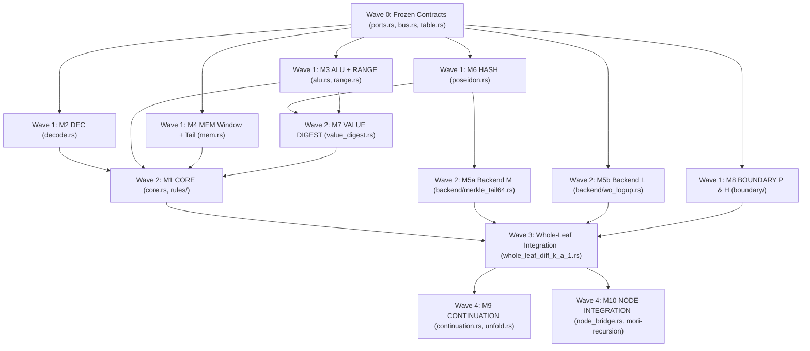

# Sherlock Lookup, Caching, and Memory Checking — Lane E Round 2 (Red Team Cross-Review, Convergence & Modular Architecture)

**Study:** `sherlock-lookup-cache-20261111` — Round 2 (Cross-Review & Convergence)  
**Role:** Lane E — Red Team & Adversarial Soundness Lead  
**Repository Baseline:** Commit `9ffc2fe76f523453632cf3df03ca761095bc7c13` (`Cargo.toml:27-45`: `midnight-ledger` tag `ledger-9.1.0.1` rev `a2b30128`, `midnight-zkir` tag `zkir-3.2.0` rev `446c7fe`, `midnight-curves = "=0.3.1"`, `midnight-proofs = "=0.8.3"`, `midnight-circuits = "=7.3.0"`, `midnight-zk-stdlib = "=2.4.0"`).  
**Inputs Cross-Reviewed:** `research/sherlock-lookup-cache-20261111/lanes/{A,B,C,D,E}/round1.md`, `research/sherlock-lookup-cache-20261111/LEAD-NOTE-ROUND2.md:1-19`, `research/sherlock-final-design-20261111/MODULARITY.md:1-12`, and `research/sherlock-runlength-consensus-20261111/CONSENSUS.md:1-350`.  
**Charter Rule Enforced:** All four general-purpose clauses `GP-1` through `GP-4` (`openspec/changes/sherlock-vm-consensus-20261107/general-purpose.md:1-58`, `requirements.md:56-59`) are preserved in full without narrowing.

---

## Executive Convergence Summary

Cross-reviewing all five Round 1 reports (`lanes/{A,B,C,D,E}/round1.md`) alongside `research/sherlock-runlength-consensus-20261111/CONSENSUS.md` yields a single, sound, modular design that reconciles both studies without forking `midnight-circuits = 7.3.0`:

1. **Primary Memory & Cache Architecture (100% Compatible with Run-Length `CONSENSUS.md`):** Adopt **1-Arena Domain-Tagged `M3-Tail64` (`TOP = 61`, `C = 8`, `W = 15`, `W_flush = 1`, 1-word `tail_d`, `D7` `fp_hash`/`tp_hash` LIFO stacks, slot-0 `v0 = v1 = v2 = 0` scratch zeroing; `CONSENSUS.md:67-118`)** augmented with an **intra-leaf 8-record block-cached `PAGE` + `PROG` provider on the existing 2-lane `lookup_any` bus (`crates/mori-chip/src/bus.rs:50-61`)**. Upgrading Lane E's Round 1 `WB[4], TOP = 30` (`lanes/E/round1.md:163-168`) to `TOP = 61, C = 8` removes the $2^{32}$-cell ceiling so `GP-001` ($2^{64}$ steps and $2^{64}$ cells, `requirements.md:56`) holds unconditionally, while the 8-record `PAGE`/`PROG` cache eliminates `CONSENSUS.md:88`'s `~4,480`-row per-read uncached penalty (`LEAD-NOTE-ROUND2.md:6`) on every temporal repeat and 8-wide spatial hit (`ESTIMATE ~735` rows/cell across an 8-field slice, `0` rows on repeat hits and same-leaf `[8*q_pre .. cur_len)` tail reads).
2. **Why `ZM-LogUp` (`lanes/B/round1.md:98-110, 147-161`) Is Placed as Swappable `MEMORY BACKEND` B2 Rather Than Replacing `M3-Tail64`:** Unlike naive `(b.1)` public-input challenges (`lanes/E/round1.md:86-100`), `Lane B`'s `ZM-LogUp` binds write multiplicities `m_w` and boundary registers inside Stage-1 `Instance(0)` KZG commitments $C_i$ *before* deriving $(\gamma, \alpha)$ from `d_root`, folds in a single Stage-2 recursion pass, and avoids intra-run $O(|M|)$ sweeps on unread cells. However, surgical Red-Team audit (§1.2) uncovers **six concrete soundness and protocol defects** in `ZM-LogUp` as specified: (i) an **unconditional BLS12-381 $\mathbb{G}_1$ cofactor-torsion ($11 \mid h_{G1}$) challenge-grinding & `d_root` malleability exploit** via `assign_without_subgroup_check(c_i)` (`lanes/B/round1.md:109, 261`; `midnight-circuits-7.3.0/src/ecc/curves.rs:287, 310-312`) that survives `RunDecider`'s collapsed subgroup check (`run_decider.rs:258-260`) with probability $1/11$ blindly or $1$ with last-node transcript grinding; (ii) an $O((W+R)^2 / r) \approx 2^{-125.8}$ single-scalar $E_\gamma$ birthday bound at $2^{64}$ cells that drops to `ESTIMATE ~2^{-85}` under $2^{40}$ Fiat-Shamir grinding queries over the `~7,492` unconstrained trailing Lagrange scalars of `Instance(0)`; (iii) **complete loss of Mode-1 $O(1)$ cross-session pause/resume (`GP-001`, `CONSENSUS.md:135-148`) and streaming prove-while-executing**, because Epoch 0 produces no `mem_root` commitment to its allocated heap and cannot know Epoch 1's future read counts `m_w`; (iv) invalidation of `clean/fork/Clean/Sherlock/Aggregation.lean:201` (`digest_inj`) and prefix reuse across leaf re-slicing under Horner `pre_fp`/`post_fp`; (v) `INIT_PROG` duplicate-cursor and mid-run re-entry forgeries; and (vi) `+18,200` to `+20,200` Node rows (`+36,400` to `+40,400` rows in 2-leaf `RunLift` `R`, `ESTIMATE`) once `C_i` subgroup checks are restored. We harden all six surfaces and place hardened `WO-LogUp` behind `MODULARITY.md:9`'s `MemoryBackend` trait (`Backend L`) while selecting `M3-Tail64 + PAGE/PROG` (`Backend M`) + Poseidon `pre_d`/`post_d` (`Boundary P`) as the primary production configuration.
3. **Cross-Lane High-Value Adoptions (Hardened):** We adopt `Lane C`'s **2-column domain-tagged `DEC + RANGE` fixed table (`TaggedTableConfig`, `6,145` rows, `-29,062` Node rows `ESTIMATE`, `lanes/C/round1.md:177-186`)**, **64-bit schoolbook `OP_MUL` (`:163-166`)** hardened with mandatory internal `< 2^64` input limb checks and 1-bit top-carry split (`c1 = c1_lo64 + 2^64 * c1_bit`), **`(SHK_VAL, 1)` sponge-prefix precomputation (`-70` rows per dynamic `vd`, `:204-208`)**, `VD_{NIL, FALSE, TRUE}` zero-hash constants (`:199-202`), capacity-tagged `s[0] == domain_tag` `PoseidonCfg` (`:209-214`), and `Lane D`'s **time-multiplexed 2nd `q_req = 1` Core request row `(L2, L3)`** (`lanes/D/round1.md:154, 408`) + exact `Pow2Range` binary decomposition of `1,032,467` (`:215-221`).
4. **10-Module Frozen-Interface Architecture (`MODULARITY.md:1-12`):** By anchoring the `MEM <-> MEMORY BACKEND` seam strictly at the aligned block boundary `aligned_base = 8 * (pre_len >> 3)` (`W = 15` tail window + 1 `FlushPort` of 8 records), **both** `Backend M` (`M3-Tail64 + PAGE`) and `Backend L` (Hardened `WO-LogUp`), and **both** `Boundary P` (Poseidon) and `Boundary H` (Hardened Horner), swap cleanly with **zero changes to `CORE`, `DEC`, `ALU + RANGE`, `MEM`, or `VALUE DIGEST`** (§4).

---

## 1. Adversarial Cross-Review of Lanes A, B, C, and D (`round1.md`)

### 1.1 Cross-Review of Lane A (`lanes/A/round1.md`)

#### Accepted from Lane A
1. **Aligned 8-Cell Block Granularity for `PAGE` and `PROG` (`lanes/A/round1.md:195-199, 265`):** Matching `PAGE` cache lines to `C = 8` segments (`crates/mori-chip/src/m3.rs:7, 123`) authenticates 8 contiguous `FIELDS`, `SLOTS`, `ENV`, or `PROG` records in one depth-61 Merkle walk (`16` record perms + `7` `Tree8` perms + `61` top-tree perms = `84` perms = `5,880` rows `ESTIMATE`, or `735` rows/cell across an 8-cell constructor slice vs `4,480` rows/cell uncached).
2. **Pre-Digested `ty_d` and `const_vd` in `prog_root` (`(c2)`, `lanes/A/round1.md:215`) & Allocation-Time `vd` Storage (`(e2)`, `:222`):** Eliminates runtime schema hashing and Halt-time heap traversals (`0` Halt-traversal leaves, saving `ESTIMATE 140–1,120` rows/leaf).
3. **Quantitative Refutation of Challenge-Free Jubjub `y-increment` ECMH (`lanes/A/round1.md:206-210`):** Correctly combines `https://eprint.iacr.org/2025/1503` and `https://eprint.iacr.org/2026/590` with Midnight's native Jubjub chip (`midnight-circuits-7.3.0/src/ecc/native/edwards_chip.rs:324-420`) to show that because a 3-field Sherlock record (~829 bits) exceeds Jubjub's 243-bit message ceiling, every memory event must **still** pay 2 Poseidon permutations (`140` rows) before lifting to Jubjub (`~167` rows/write, `~340` rows/read `ESTIMATE`), plus an $O(N_{\text{alloc}})$ Halt sweep that violates `GP-001`.
4. **Core Principle of Lazy `C = 8` Tail Carry (`lanes/A/round1.md:226, 238, 242-244`):** Incrementing `len` strictly by `+1` per real allocation and flushing to `M3` only when crossing an 8-cell boundary makes `(len, mem_root, post_d)` invariant to leaf boundaries (`SRC-023`) and decouples step count from tree depth — independently matching Run-Length `CONSENSUS.md`'s `M3-Tail64` (`CONSENSUS.md:67-93`).

#### Rejected or Mandatory Hardening on Lane A
1. **Hardening A-1 — `PAGE` Partial-Block Deadlock vs `D2` Overlap (`lanes/A/round1.md:265, 280`):** Lane A specifies that each enabled 8-cell `PAGE` block enforces `block_base + j < pre.len` via `range.rs` across its 8 lanes (`:265`). **Completeness trap:** if `pre.len = 19` (`block_base = 16`) and `PAGE` had to serve `addr = 17` (`j = 1`), lanes `j = 3..7` (`19..23 >= pre.len`) would fail `block_base + j < pre.len`, making any read of a partially filled block unprovable! **Resolution via `M3-Tail64`:** Because `MEM` carries the un-flushed tail `[8*q_pre .. pre.len)` (`16..19`) in `W = 15`, `mem_root` contains **only** completed 8-cell blocks `seg_idx < q_pre = pre.len >> 3`. Hence `PAGE` checks a **single** bound `seg_idx < q_pre` per 8-cell block (`1` `RANGE` check instead of `8`), guaranteeing `8*seg_idx + 7 < 8*q_pre <= pre.len` on all 8 lanes with zero partial-block deadlock and strict `D2` disjointness against `MEM` (`>= 8*q_pre`). For `PROG` (`space = 0`), trailing unused entries in the final 8-row program block commit `act_rec = 0` (emitting `(0,0,0,0,0)` on `bus`) or `OP_INVALID_OOB`.
2. **Reject A-2 — Fixed `S = 64` at `k_leaf = 15` with Only 2 Flushes (`lanes/A/round1.md:228, 244, 273`):** At `TOP = 61`, 2 flushes (`2 * 145 = 290` perms = `20,300` rows) + 4 `PAGE` blocks (`4 * 84 = 336` perms = `23,520` rows) + `pre_d`/`post_d` (`~2,520` rows) already consume **`ESTIMATE 46,340 > 32,762` rows**, overflowing `k = 15` into `k = 16..17`. Worse, a 64-step `Append`/`Build` burst allocates `64..128` cells (`8..16` wraps), overflowing 2 flushes unless the leaf early-closes (`steps < 64`). Keep `S = 16`, `W = 15`, `W_flush = 1` for M4 (§2.4).
3. **Reject A-3 — Rewriting `Append` to Cons-Linked Staging Spines (`lanes/A/round1.md:250`):** Altering `ArgsF`/`ConstructorFieldsF` staging changes `mori-core` step counts and breaks 1-for-1 step bisimulation (`SVM-011`). Run-Length `CONSENSUS.md:264` proved across all 108 `/1` rules (`crates/mori-core/src/sherlock/helper_machine/shared/owner_runtime.rs:2960-3058, 3506-3565`, `families/environment.rs:201-284`) that once `FRAMES` and `TASKS` move to `D7` hash stacks, zero unrelated allocations interleave inside `Build` or `Append`, so 1-arena `M3-Tail64` preserves `start + k` (`SI-12..SI-14`) **verbatim**.
4. **Hardening A-4 — `ZERO_HASH` Domain Tagging (`lanes/A/round1.md:221`):** Fixed `ZERO_HASH[0..61]` rows on `CHIP_HASH` must carry explicit sponge capacity tag `key = DOM_MERKLE = 2` (never `0`), preventing cross-domain collision with 2-field value digests.

---

### 1.2 Surgical Red-Team Audit of Lane B (`lanes/B/round1.md` — `WO-LogUp` & `ZM-LogUp`)

#### Fair Recognition of What `ZM-LogUp` Solves Over Naive `(b.1)` and 2-Pass Recursion `(b.2)`
Unlike `(b.1)` (uncommitted witnesses under public challenges, `lanes/E/round1.md:86-100`) and 2-recursion-pass `(b.2)` (`:102-103`), `Lane B` (`lanes/B/round1.md:98-110, 147-161, 185-201`) makes three genuine technical advances on stock `midnight-circuits = 7.3.0`:
1. **Stage-1 `Instance(0)` Pre-Commitment Before Challenge Derivation:** Each leaf $i$ packs `[pre_regs(29), post_regs(29), writes(W_cap*6 incl. m_w), cache_reads((K_m+K_p)*5)]` into `Instance(0)` polynomial $P_i$, computes KZG commitment $C_i \in \mathbb{G}_1$ (`midnight-proofs-0.8.3/src/plonk/prover.rs:36-49`), hashes `(C_0, ..., C_{N-1})` into `d_root` (or left-to-right chain `com_pre -> com_post`), derives $(\gamma, \alpha) = H(\text{DOM\_MEM\_CHAL}, d_{\text{root}}, \text{prog\_d}, \text{input\_d})$, and runs **only one** Stage-2 recursion pass (`cs.phases().count() == 1` preserved!).
2. **Leaf-Deduplicated Multiplicity Counting (`m_w` = Reading-Leaf Count, `:105-108`):** Setting `m_w` equal to the count of *leaves* whose deduplicated `CACHE` table contains `w` (and emitting `-1 / (alpha - E_gamma(r))` once per active `CACHE` row) requires zero intra-leaf multiplicity counters while keeping the pole residue of any unwritten tuple $r^* \notin \text{Writes}$ equal to $-\text{count}_{\text{Leaves}}(r^*) \in [-N, -1] \not\equiv 0 \pmod r$ for $N < 2^{64} < r$.
3. **Zero End-of-Run $O(|M|)$ Sweep Within a Single Sealed Run (`:89`):** Unread write-once cells commit `m_w = 0`, contributing `0` to $\Sigma_{\text{run}}$ without a Halt teardown scan.

#### Six-Surface Red-Team Audit of `ZM-LogUp` (Why It Fails Unhardened & Cannot Replace `M3-Tail64` as Primary Backend)

##### Surface (i): Denominator Pole `alpha == E_gamma(tuple)`, Trailing Unconstrained `Instance(0)` Grinding Entropy, and $2^{64}$-Cell Birthday Collapse (`lanes/B/round1.md:101-103, 190-194, 256`)
1. **Single-Scalar $E_\gamma$ Soundness Degradation at $2^{64}$ Cells:** At `lanes/B/round1.md:190`, `Lane B` compresses a 5-field tuple `(space, k, a, b, c)` into **one** scalar $E_\gamma(t) = \text{space} + \gamma k + \gamma^2 a + \gamma^3 b + \gamma^4 c$ and notes pair collision probability $\le \frac{4(W+R)^2}{2|\mathbb{F}|}$. Look at what happens when $E_\gamma(r^*) = E_\gamma(w_0)$ between a forged read $r^*$ and a real write $w_0$: their denominators $(\alpha - E_\gamma(r^*))$ and $(\alpha - E_\gamma(w_0))$ become **identical for every $\alpha \in \mathbb{F}_r$**, completely bypassing the $\alpha$ check! At the `GP-001` $2^{64}$-cell ceiling (`W + R = 2^{64}`, `LEAD-NOTE-ROUND2.md:10`), the birthday bound $\frac{2(W+R)^2}{r}$ reaches $2 \cdot 2^{128} / 2^{254.86} \approx \mathbf{2^{-125.86}}$ (`ESTIMATE`) — **before** Fiat-Shamir grinding!
2. **7,492 Free Grinding Scalars per Leaf Inside Unconstrained Trailing `Instance(0)` Rows:** In `midnight-proofs-0.8.3/src/plonk/prover.rs:36-49, 419-424`, `Instance(0)` is a full domain-$2^k$ (`8,192`-scalar) Lagrange polynomial. `Lane B`'s gate `q_com * (a[11] - Instance(0)) == 0` (`lanes/B/round1.md:103, 256`) constrains **only** rows `0 .. ~700`! Rows `701 .. 8,191` (`~7,491` scalars/leaf) are **100% unconstrained** by the circuit, giving a malicious prover free arbitrary entropy inside $P_i$ to grind `d_root` and $(\gamma, \alpha)$. With $Q_{\text{FS}} = 2^{40}$ Poseidon queries, post-grinding collision probability on single-scalar $E_\gamma$ at the $2^{64}$ horizon degrades to **`ESTIMATE ~2^{-85.8}`** (`< 100`-bit security).
3. **Pole Completeness vs Soundness (`alpha == E_gamma(w)`):** `Lane B`'s gate `act * (inv * (alpha - enc) - 1) == 0` + `(1 - act) * inv == 0` (`lanes/B/round1.md:194`) soundly blocks `pad_nonzero` (`act = 0 => inv = 0`) and blocks pole-annihilation forgery (`act = 1` and `alpha == enc` yields `-1 == 0`, unsatisfiable). However, if all `8,192` rows of `P_i` are deterministically fixed without a designated 1-scalar blinding slot `P_i[idx_blind]`, an honest trace hitting $\alpha = E_\gamma(w)$ suffers an unrecoverable completeness deadlock.
- **Mandatory Hardening for `Backend L`:** Compress tuples into **two** independent scalars `(E_{\gamma_1}(t), E_{\gamma_2}(t))` folded via $(\alpha_0 + \alpha_1 E_{\gamma_2}(t) - E_{\gamma_1}(t))^{-1}$ (or degree-2 extension over $\mathbb{F}_{r^2}$, keeping $2^{64}$-cell birthday + grinding error `< 2^{-210}` `ESTIMATE`), constrain trailing rows `P_i[K_used + 1 .. 2^k]` to `0` except one explicit `P_i[K_used] = r_blind` scalar, and range-check `m_w < 2^64`.

##### Surface (ii): `assign_without_subgroup_check` BLS12-381 $\mathbb{G}_1$ Cofactor-Torsion ($11 \mid h_{G1}$) Grinding & Malleability Attack (`lanes/B/round1.md:109, 261`)
`Lane B` (`lanes/B/round1.md:109, 261`) explicitly instructs `ChipNode` to witness $C_i$ via `bls.assign_without_subgroup_check(c_i)` (`midnight-circuits-7.3.0/src/ecc/foreign/weierstrass_chip.rs:936-952`) and hash `(C_i.x, C_i.y)` into `d_i` / `(com_pre -> com_post)`.
- **Verified Stack Facts (`midnight-circuits-7.3.0`):**
  1. In `src/ecc/curves.rs:287`, `G1Projective` on BLS12-381 ($x = -\text{0xd201000000010000}$) has cofactor $h_{G1} = (x - 1)^2 / 3 = \text{0x396c8c005555e1568c00aaab0000aaab} \approx 2^{125}$. Because $x \equiv 1 \pmod{33}$, $11 \mid \frac{x - 1}{3}$, so **$11^2 = 121$ divides $h_{G1}$** (alongside $3, 10177^2, 859267^2, 52437899^2$). By Cauchy's theorem, $E(\mathbb{F}_p)[11] \subset E(\mathbb{F}_p)[h_{G1}]$ contains points $T_{11}$ of exact prime order $11$.
  2. In `src/ecc/curves.rs:310-312`, `G1Projective::try_into_subgroup(self)` returns **`Some(self)` without any subgroup check**! And `weierstrass_chip.rs:936-952` (`assign_without_subgroup_check`) checks **only** $y^2 = x^3 + 4$ (`on_curve::assert_is_on_curve`), omitting the 125-bit `mul_by_constant(COFACTOR)` check of `AssignmentInstructions::assign` (`weierstrass_chip.rs:348-357`).
  3. In `crates/mori-recursion/src/run_decider.rs:258-260`, `RunDecider` calls `AssignmentInstructions::assign` **only** on the two final collapsed accumulator points `(a, b)` after `acc.collapse` (`:245`), where $C_i$ enters `rhs` (`b`) with randomizer scalar $\beta_i$.
- **Concrete Exploit Trace (`Zero-MSM Torsion Coset Grinding`):**
  1. The attacker computes a single honest KZG commitment $C_i \in \mathbb{G}_1$ once per leaf ($i = 0 \dots L-1$), and picks an order-11 torsion point $T_{11} \in E(\mathbb{F}_p)[11]$.
  2. For **any** choice of $(k_0, \dots, k_{L-1}) \in \{0, \dots, 10\}^L$ ($11^{64} \approx 2^{221}$ combinations for a 64-leaf run!), the shifted points $C'_i = C_i + [k_i] T_{11}$ satisfy $y^2 = x^3 + 4$, pass `assign_without_subgroup_check` in `ChipNode`, and have **distinct affine coordinates $(C'_{i,x}, C'_{i,y})$** — letting the attacker grind **`2^{221}` distinct `d_root` digests and $(\gamma, \alpha)$ challenges for the EXACT SAME polynomials $P_i$ with ZERO KZG MSM recomputations**!
  3. In Stage 2, the leaf prover absorbs $C'_i$ into its Fiat-Shamir transcript (`prover.rs` absorbs the affine coordinates of `committed_instances[0]`; the KZG quotient polynomial $H(X)$ and witness $W_z \in \mathbb{G}_1$ are unchanged on the $\mathbb{G}_1$ component, while $C'_i$ carries $+[k_i] T_{11}$ into `rhs` `b` of the accumulator!).
  4. At `RunDecider` (`run_decider.rs:258-260`), `b` has torsion residue $\left(\sum_{i=0}^{L-1} \beta_i k_i \bmod 11\right) T_{11}$. **Blindly, $1$ in every $11$ ground transcripts (`9.09%`) satisfies $\sum \beta_i k_i \equiv 0 \pmod{11}$, annihilating the torsion completely so `b` lies in prime-order $\mathbb{G}_1$ and passes `RunDecider::assign` AND the KZG pairing (`e(T_{11}, Q_2) = 1`)!** Better yet, by re-rolling the blinding scalars of the **final** `ChipNode` proof an average of `5.5` times so $\beta_{L-1} k_{L-1} \equiv -\sum_{i < L-1} \beta_i k_i \pmod{11}$ (when $k_{L-1} \not\equiv 0$), the attacker cancels the torsion **with probability $1$**!
- **Mandatory Hardening & Cost Impact:** Every recursive verifier of `U` (`ChipNode` and 2-leaf `RunLift` `R`) **MUST** call `AssignmentInstructions::<F, AG1>::assign` (`weierstrass_chip.rs:343-360`, proving $C_i = [h_{G1}] Q_i$) instead of `assign_without_subgroup_check`. That 125-bit non-native Weierstrass scalar multiplication adds **`ESTIMATE +4,500 to +6,500` rows per leaf commitment**, pushing `ZM-LogUp`'s Node delta from `+13,700` (`lanes/B/round1.md:179`) to **`ESTIMATE +18,200 to +20,200` rows in `ChipNode` (`~841.7k–843.7k`)** and **`ESTIMATE +36,400 to +40,400` rows in 2-leaf `RunLift` `R`**. (The exact same subgroup check is also mandatory for `(a2)` `C_ro` if `committed_instances` is ever hashed into `prog_d`!)

##### Surface (iii): Horner Boundary Fingerprint (`pre_fp`, `post_fp`) vs `Aggregation.lean` `digest_inj` & Sub-Run Reuse (`lanes/B/round1.md:151-155, 192`)
1. **Breaks `clean/fork/Clean/Sherlock/Aggregation.lean:201` (`digest_inj` & `leaf_sound`):** `Aggregation.lean:184-205, 964, 1154-1165` proves link soundness and `statement_independent_of_S` from deterministic `digest_inj : ∀ s t, Carrier s → Carrier t → digest s = digest t → s = t`, where `Seg.pre` and `Seg.post` depend **only** on the semantic carrier at height $h$. Under `ZM-LogUp`, $\text{post\_fp}_i = \sum_{j=0}^{28} \gamma^j v_j^{(i)}$ depends on $\gamma$, which depends on **`d_root(C_0, ..., C_{N-1})` of the entire run**. Thus a `SEG` proof has **zero** standalone step-soundness meaning until `C`/`RunDecider` closes `d_root`, requiring a new global Fiat-Shamir interactive reduction in Lean rather than `Aggregation.lean`'s local `Premises`.
2. **Invalidates 100% of Prefix Proofs Under Re-Slicing or Run Extension:** Re-slicing the final leaf `N - 1` (`[16]` $\to$ `[7, 9]`) changes $C_{N-1} \implies d_{\text{root}} \implies (\gamma, \alpha) \implies$ invalidates `pre_fp`, `post_fp`, and `sum_leaf` of **all $N - 1$ earlier leaves**, preventing incremental prefix caching or shared `SEG` prefixes across forked executions.

##### Surface (iv): `RunDecider` `Pow2Range` `16,103`-Row `k = 21` Cliff When `IVC_STATE` Widens (`lanes/B/round1.md:109, 200`)
- `Lane B` (`:200`) correctly observes that adding pure `Fq` native scalar equality/Poseidon/Lagrange operations on `(com_pre, com_post, gamma, alpha, sum_mem)` in `RunDeciderRelation` (`crates/mori-recursion/src/run_decider.rs:202-242`) adds `ESTIMATE ~750–1,500` gate rows and `+0` `Pow2Range` `table_rows` **provided zero non-byte decompositions are invoked**.
- **Hidden Cliff:** As `Lane D` (`lanes/D/round1.md:215-221`) proved from `midnight-circuits-7.3.0/src/field/decomposition/pow2range.rs:215-236`, `1,032,467 = 2^0 + 2^1 + 2^4 + 2^8 + 2^{14} + 2^{15} + 2^{16} + 2^{17} + 2^{18} + 2^{19}` leaves unqueried tags `{2, 3, 5, 6, 7, 9, 10, 11, 12, 13}` summing to `16,108 > 16,103` (`2^{20} - 6 - 1,032,467`). If `RunDecider` checks `n_steps < 2^64` or `SET.n_claims < 2^64` via `assert_lower_than_fixed` (which picks limb tags outside `{0,1,4,8,14..19}`) or checks Jubjub subgroup/coordinate bounds in `(b2)` `EC-MSH`, `table_rows` crosses `1,048,570` and **silently forces `RunDecider` to `k = 21`**! **Rule:** Every scalar range check in `RunDecider` MUST use `assigned_to_le_bytes(..., Some(8))` or `Some(16)` (reusing already-loaded tag `b = 8` for **`+0` `table_rows`**).

##### Surface (v): Breakdown on `GP-001` / Tier-B Pause-and-Resume Checkpoints (`SHK_CONT_V1`) & `GP-4` DAG Composition (`lanes/B/round1.md:113-116, 221-226`)
1. **Tier-B Cross-Session Checkpoints (`CONSENSUS.md:122-148`, `requirements.md:56` `GP-001`):** Suppose a 2-day run pauses at step `h = 50,000` (Epoch 0, `40,000` allocated heap cells) and resumes on Day 2 (Epoch 1, steps `50,000 .. 100,000`):
   - If Epoch 0 does not seal at pause, **zero leaf proofs can be computed on Day 1** because Leaf 0 needs Day 2's read counts `m_w` and commitments `C_i`!
   - If Epoch 0 *does* seal its own `ZM-LogUp` sum (`Sigma_0 == 0`) at `h = 50,000`, **Epoch 0 emits NO `mem_root` commitment to its `40,000` heap cells** (`post_fp_0` covers only 29 registers!). When Epoch 1 resumes at `h = 50,000` holding `RefC::Data(17342)`, Epoch 1 has **no authenticated commitment** against which to read `[0 .. 40,000)`! Either Epoch 1 can forge every pre-checkpoint heap value, OR pause/resume must fall back to **Mode-2 address-free `sherlock-ckpt/1` serialization + `UNFOLD`** (`O(|live_heap|)` extra re-ingestion steps per checkpoint), sacrificing `M3-Tail64`'s `O(1)` Mode-1 `canon_state_d(h)` continuation (`CONSENSUS.md:135-138`)!
2. **Causality Bug in `Lane B`'s "1-Pass Streaming" Claim for `(b2)` `EC-MSH` (`lanes/B/round1.md:113-116, 177`):** `Lane B` claims `(b2)` `Poseidon-to-Jubjub` with write term `[m_w] P` enables *"1-pass streaming (proving Leaf 0 before simulation reaches Leaf N)"* (`:113, 177`). **False:** `m_w` is the count of *future* leaves in `[1 .. N)` that will read cell `w`! Leaf 0 **cannot know `m_w`** before the simulator executes through Leaf $N - 1$! Making `EC-MSH` genuinely 1-pass streaming requires timestamped read-re-emission `-P(a,v,c) + P(a,v,c+1)` **plus** an $O(N_{\text{alloc}})$ Halt teardown sweep (`lanes/A/round1.md:209-210`, `lanes/C/round1.md:98-100`, `lanes/D/round1.md:83`), violating `GP-001` $O(1)$ Halt.
3. **`GP-4` Diamond DAG Check (`lanes/B/round1.md:222-226`):** `Lane B` properly seals `Sigma_root == 0` at `SEG -> SET` before claim fan-out, preventing cross-run `SET` double-counting (`A -> {B, C} -> D`), provided `SET.n_claims < 2^64` is enforced (`CONSENSUS.md:188`). Intra-run subtrees, however, cannot prove independently before a global Stage-1 barrier over all leaves of the run.

##### Surface (vi): `INIT_PROG` Loader-Leaf Duplicate-Key & Mid-Run Splicing Forgeries (`lanes/B/round1.md:122-125, 189`)
- If `INIT_PROG` loader leaves (`:124`) do not carry an explicit monotone `(load_cursor_pre, load_cursor_post, prog_acc_pre, prog_acc_post)` strictly chained from `(0, H_INIT)` at the leftmost leaf to `(prog_len, prog_d)` at the unique `LOAD_PROG -> RUN (h_pre == 0)` boundary — and strictly forbidden on every `RUN` leaf — a malicious prover either (a) prepends duplicate `INIT_PROG` leaves starting from `pc = 0` with forged opcodes (`m_pc = 0` on the honest chain finishing at `prog_d`, `m_pc = 1` on a spliced chain!) or (b) injects an `INIT_PROG` leaf mid-run (`h > 0`) to add forged `(AS_PROG, ...)` or `(AS_MEM, ...)` poles! Furthermore, `SRC-004` (`requirements.md:29`) rejects `steps == 0` in `ChipNode`, so `INIT_PROG` cannot use `steps = 0` on `RUN` heights without a distinct `SEG_LOAD` relation tag in `R`/`N`.

#### Accepted from Lane B
1. **Rejection of Hashless Map-to-Curve on BLS12-381 `Fq` / Jubjub (`lanes/B/round1.md:114`):** Spot-on observation that `BLS12-381 Fq` has 2-adicity `32` and Jubjub has $j \neq 0$, ruling out `ePrint 2025/1503` / `ePrint 2026/590` hashless maps on both security and witness-generation grounds.
2. **Stage-1 `Instance(0)` `WO-LogUp` Retained Behind Swappable `MemoryBackend` (`Backend L`, §4.2.5):** Once hardened with all six fixes above (`pair E_{gamma1,gamma2}`, `AssignmentInstructions::assign` subgroup check on $C_i$, zeroed trailing `Instance(0)` + 1 `r_blind` cell, `< 2^64` range checks, `SEG_LOAD -> SEG_RUN` cursor state machine, and Mode-2 `sherlock-ckpt/1` checkpoints), `Backend L` is a clean, sound alternative backend behind `MODULARITY.md:9` for uninterrupted batch runs at `S = 64..128`.

---

### 1.3 Cross-Review of Lane C (`lanes/C/round1.md`)

#### Accepted from Lane C
1. **Complete 108-Rule `/1` Resource & Dispatch Audit (`lanes/C/round1.md:48-63, 109-140`):** Proves from `crates/mori-backend/src/sherlock_machine/c6_dispatch_step.rs:363-398, 720-1255` and `c6_dispatch_partition.rs:77-147` (`testdata/dispatch/partition.json:2, 113`) that only **11** static `PROG` tables are read in `/1` (`field_paths`, `plan_nodes`, `plan_cases` have `0` `/1` readers), `Data` is allocated in **2** rules (`BHelperScalarExit`, `BHelperEqualExit`), `DataFields` in **1** rule (`BHelperScalarExit`), `/1` has **zero** `DIV`/`REM`/bitwise ops, and normalizing the 18 non-enum predicates in `CORE` gates collapses `/1` decode from $4.45 \times 10^6$ naive rows to **`<= 2,048` canonical 11-bit `(idle/busy)` rows** with a 54-bit `ctrl_word`.
2. **2-Column Domain-Tagged `DEC + RANGE` Fixed Table (`TaggedTableConfig`, `6,145` rows, `-29,062` Node rows `ESTIMATE`, `lanes/C/round1.md:175-186`):** Superior to Lane E's Round 1 `bus`-folded `DEC` (`-22,600` Node rows) because `2,048` normalized `DEC` rows sit inside the existing `8,192` fixed-table floor at `0` circuit rows while keeping **both** `bus` lanes free for `PROG`/`PAGE`/`MEM`/`ALU` and cutting **both** 1 lookup argument and 1 `TableColumn` (`823,466 -> ~794,404` Node rows before `PAGE` `VSel` col, `ESTIMATE`).
3. **64-Bit Schoolbook `OP_MUL` & `OP_SUB` (`lanes/C/round1.md:161-166`):** Prevents the $(2^{128}-1)^2 > r$ field-wraparound bug on `u128::checked_mul` (`c6_scalar_arithmetic_step.rs:31-40`) using `0` new lookups.
4. **`(SHK_VAL, 1)` Sponge-Prefix Precomputation (`-70` rows/alloc), `VD_{NIL, FALSE, TRUE}` Zero-Hash Constants, and `s[0] == domain_tag` `PoseidonCfg` (`lanes/C/round1.md:199-214`):** Initializing `vd` hashes from the universal constant triple $(C_0, C_1, C_2) = \text{PoseidonPerm}(0, \text{SHK\_VAL}, 1)$ saves 1 full 70-row permutation on every dynamic `vd` with bit-for-bit `sherlock-value/1` identity (`design.md:178-187`), while `VD_{NIL, FALSE, TRUE}` eliminates 100% of Poseidon rows on boolean `==`, `<`, and `!` results.

#### Rejected or Mandatory Hardening on Lane C
1. **Hardening C-1 — `TaggedTableConfig` Unbounded `ctrl` Cross-Domain Forgery (`lanes/C/round1.md:183-186`):** In `in_key = q_rng*(2^64 + a11) + q_dec*(2*2^64 + syn)` and `in_val = q_rng*1 + q_dec*(2^64 + ctrl)`, if **any** unpacked sub-field $c_j$ of $\text{ctrl} = \sum 2^{\text{off}_j} c_j$ lacks its individual finite-domain polynomial check $\prod_{v=0}^{d_j-1}(c_j - v) = 0$, a malicious prover chooses $c_j$ so $\text{ctrl} \equiv 1 - 2^{64} \pmod r$ and $\text{syn} \equiv v - 2^{64} \pmod r$ ($v \in [0, 4096)$), making a `q_dec = 1` row evaluate to `(2^64 + v, 1)` — **matching a `RANGE` row and forging arbitrary microcode!** **Hardening:** (i) Keygen-time assertion that fixed selectors `q_rng, q_dec in {0,1}` satisfy `q_rng * q_dec == 0` on every row; (ii) mandatory per-field domain gates `L_{d_j}(c_j) == 0` inside `DEC`'s unpacker so `0 <= ctrl < 2^54` holds algebraically over $\mathbb{Z}$ before lookup compression.
2. **Hardening C-2 — Self-Contained `< 2^64` / `< 2^128` Input Range Checks Inside `AluConfig` (`lanes/C/round1.md:157, 166`):** Lane C relies on caller invariants that `x, y < 2^128` (`:157`) and `x0, x1, y0, y1 < 2^64` (`:166`). Under `MODULARITY.md:8` (no module trusts another module's internal columns) and Lane E Exploit D1 (`lanes/E/round1.md:134-138`: `OP_LT(r - 1, 5) == 1`, `OP_ADD(r - 3, 10) == 7`, and `x0 = x + 2^64, x1 = r - 1` breaking `x0*y0 < r`), `ALU + RANGE` **must** range-check inputs `(x, y)` (or limbs `x0, x1, y0, y1 < 2^64`) directly inside `alu.rs` (`+24` rows/op = `+384` rows at `S = 16` `ESTIMATE`, `0` `k_leaf` change inside a `~42k`-row leaf, `+0` Node rows!).
3. **Hardening C-3 — `65`-Bit `c1` Carry Overflow in 128-Bit `RangeConfig` (`lanes/C/round1.md:165-166`):** In $x_0 y_1 + x_1 y_0 + c_0 = c_1 2^{64} + r_1$, for $x_i, y_i = 2^{64} - 1$ and $c_0 = 2^{64} - 2$, the left-hand side reaches $(2^{65} - 3) \cdot 2^{64}$, so **`c1` requires 65 bits (`c1 <= 2^65 - 3`)**! Packing `(r1: 64b, c1: 65b)` = **`129` bits** overflows a standard 128-bit `RangeConfig` slot (`range.rs:98-105` enforces `16 * limb_10 < 4096 => limb_10 < 256` = 128 bits!). **Fix:** Split `c1 = c1_lo64 + 2^64 * c1_hi1` with boolean gate `c1_hi1 * (1 - c1_hi1) == 0`, and range-check `(r1: 64b, c1_lo64: 64b)` (`128` bits exact!) in an unmodified 128-bit `RangeConfig` slot.
4. **Upgrade C-4 — Replace 4-Quadrant `TOP = 32` (`lanes/C/round1.md:226, 297-302`) with 1-Arena Tagged `TOP = 61` (`M3-Tail64`):** `TOP = 32` caps arenas at $2^{35}$ cells (violating `GP-001`, `requirements.md:56`); 1-arena tagged `M3-Tail64` (`TOP = 61, W_flush = 1`, `CONSENSUS.md:247, 263-265`) reaches $2^{64}$ cells while saving a second depth-61 flush walk (`-8,540` leaf rows `ESTIMATE`).

---

### 1.4 Cross-Review of Lane D (`lanes/D/round1.md`)

#### Accepted from Lane D
1. **Line-by-Line `VerifierGadget` & 2-Leaf `RunLift` (`R`) Multiplier Analysis (`lanes/D/round1.md:13, 162-196, 323-328`):** Proves that because `GP-4`'s `RunLift` circuit `R` (`research/sherlock-gp-architecture-20261110/architecture.md:72, 206-219`) runs `VerifierGadget::prepare` **twice** in one `k = 20` circuit, every added leaf `lookup_any` costs **`~45,200` rows in `R`** (`6` variable $\mathbb{G}_1$ bases) and every added leaf advice column costs **`~14,600` rows in `R`** (`ESTIMATE`). Reducing leaf lookups from `4` to `3` via `TaggedTableConfig` therefore saves **`ESTIMATE ~51,600` rows in `R`**!
2. **Exact Binary Decomposition of `RunDecider` `table_rows == 1,032,467` (`lanes/D/round1.md:214-221`):** Sharpens Lane E's Round 1 `Pow2Range` cliff (`lanes/E/round1.md:27`) by proving `1,032,467 = 2^0 + 2^1 + 2^4 + 2^8 + 2^{14} + 2^{15} + 2^{16} + 2^{17} + 2^{18} + 2^{19}` (`pow2range.rs:215-236`): tags `14..19` are *already* loaded, while the unqueried tags `{2, 3, 5, 6, 7, 9, 10, 11, 12, 13}` sum to `16,108 > 16,103` remaining usable rows! Touching unqueried sub-14 bit tags (`13 + 12 + 11 + 10 + 9 + 7 = +16,000` rows) is what silently tips `RunDecider` to `k = 21`.
3. **Time-Multiplexed 2nd `q_req = 1` Row `(L2, L3)` in `Arch::Narrow` (`lanes/D/round1.md:154, 408`):** Promoting row `6` of the 13-row `CORE` slot (`crates/mori-chip/src/rfcore.rs:169-200`) gives **4 bus requests per step** (`2` `PROG` reads + `1` `ALU` op + `1` `MEM`/`PAGE` access, or `2` `MEM` dereferences on `equal_differ` + `1` `PROG` + `1` `ALU`!) at **`+0` Node rows** (`0` new lookups, `0` new advice columns).

#### Rejected or Mandatory Hardening on Lane D
1. **Reject D-1 — `DIPM` Eager Frontier Write-Back (`K_frontier = 2` Pages, `lanes/D/round1.md:145-148, 402-406`) in Favor of `M3-Tail64` (`W_flush = 1`, `tail_d`):** `DIPM` re-hashes and walks **up to 2** depth-61 pages (`20,300` rows `ESTIMATE`) on every allocating leaf even when `used = 1`, and creates partial-page `act_old`/`act_new` overlap hazards inside `p_f`. `M3-Tail64` carries `tail_d` (`980` open/close rows `ESTIMATE`) and flushes **at most 1** completed 8-cell block (`10,150` rows `ESTIMATE`), saving **`~9,170` leaf rows (`45%`)** and ensuring `mem_root` holds exclusively completed 8-cell segments.
2. **Reject D-2 — Variable-Height `LCA` Upper-Spine Prefix Sharing (`lanes/D/round1.md:56, 294, 437`):**
   - *Worst-case Halo2 sizing law:* Under `GP-001` ($2^{64}$ cells), a valid leaf can simultaneously read `addr_0 = 5` (`p_0 = 0`) and `addr_1 = 2^{48}` (`p_1 = 2^{45}`), whose LCA is at the **root (level 61, 0 shared levels)**! Sizing `p_1`'s walk below 61 levels makes valid high-span runs unprovable (violating `GP-001`), while sizing all walks to 61 levels means LCA sharing saves **`0` worst-case circuit rows**.
   - *`M8_lca_prefix_splice` Attack Surface:* Variable-level splice points between Merkle walks replicate the exact height-splicing bug class of OpenVM `CVE-2026-62333` (`GHSA-396x-v8w4-9x82`) and `GHSA-fh29-29h9-qm9h` Bug 2. Because `4` full unconditional 61-level `PAGE`+`PROG` walks already fit inside `k_leaf = 16` (`ESTIMATE ~42k–52k <= 65,530` rows), reject variable-height LCA splicing.
3. **Hardening D-3 — 2nd `q_req = 1` Row `(L2, L3)` Unused-Lane & Disabled-Slot Zeroing (`lanes/D/round1.md:154, 408`):** On every disabled slot (`enable_j == 0`) and every rule using `< 4` bus requests, unused request lanes MUST constrain **all 5 cells** `(chip, key, a, b, c) == (0, 0, 0, 0, 0)` (not just `chip == 0`, which would fail completeness on garbage `a, b, c`), while every active request lane MUST constrain `chip == expected_chip != 0` from the unpacked `DEC` `ctrl_word` (`D4`/`D8`) so an active request can never set `chip = 0` to match `(0,0,0,0,0)`.

---

## 2. Explicit Answers to All Four Questions in `LEAD-NOTE-ROUND2.md:9-14`

### 2.1 Question (1): Merkle (`M3-Tail64` + L1 `PAGE`/`PROG` Cache) vs Run-Wide Write-Once LogUp (`ZM-LogUp`)

**Decision:** The final design SHOULD use **1-Arena Domain-Tagged `M3-Tail64` (`TOP = 61`, `C = 8`, `W = 15`, `W_flush = 1`, `tail_d`, `D7` hash stacks) + Intra-Leaf 8-Cell Block `PAGE` & `PROG` Bus Cache (`Backend M`)** for dynamic memory, `PROG`, `Const`, and `Types`/`Constructors` as the primary production backend, while placing **Hardened `WO-LogUp` (`Backend L`)** behind the swappable `MemoryBackend` trait (`MODULARITY.md:9`).

#### Why `Backend M` (`M3-Tail64` + L1 `PAGE`/`PROG` Cache) Wins Over `ZM-LogUp`
1. **Eliminates Uncached Merkle Overhead Without Two-Pass Global Coupling:** Opening `K_prog = 2..3` 8-row `PROG`/`Const`/`Types` lines and `K_page = 3..4` 8-cell dynamic `MEM` lines per `S = 16` leaf on `bus.rs` (`lookup_any`) serves all repeat instruction fetches (`70%–90%` hit rate in `fact(3)` and `list123`, `lanes/C/round1.md:146`), all contiguous `FIELDS`/`SLOTS` slices (`8` cells per walk = `735` rows/cell `ESTIMATE`), and all same-leaf `[8*q_pre .. cur_len)` tail reads (`0` walks!) inside **`k_leaf = 16` (`ESTIMATE ~38,500–51,200 <= 65,530` rows, `4.5–8.0 s` leaf prove time vs `61–67 s` Node)**.
2. **Strictly Lower Node & `RunLift R` Cost:** Paired with `TaggedTableConfig` (`3` lookups total), `Backend M` brings `ChipNode` **below** E8 (`823,466 -> ESTIMATE ~800,866` rows, `-22,600` net) and saves `ESTIMATE ~51,600` rows in 2-leaf `RunLift R`, with **exact `+0` rows in `RunDecider` (`929,166` circuit / `1,032,467` table)**. Hardened `Backend L` (`WO-LogUp` with mandatory $C_i$ subgroup check) adds `ESTIMATE +18,200..20,200` rows in `ChipNode` and `+36,400..40,400` rows in `R` (or `-10,800` / `-11,200` net with `TaggedTableConfig` — still **`~39,000..46,000` more rows in `R` than `Backend M`!**).
3. **Preserves 1-Pass Streaming, $O(1)$ Mode-1 Pause/Resume (`GP-001`), Direct `Aggregation.lean` `digest_inj` Premise, and Local `GP-4` Subtree Independence:** Zero global Stage-1 barrier, zero future-multiplicity lookahead `m_w`, and `O(1)` live-heap authentication across `SHK_CONT_V1` epochs via `mem_root`.

#### How `2^64` Cells, `SRC-023`, C6, and `GP-2..GP-4` Hold When Swapping in Hardened `Backend L` (`WO-LogUp`)
When `Backend L` is selected behind `trait MemoryBackend<F>` (§4.2.5) for single-session batch runs, all four properties hold **only if** all six Red-Team hardenings from §1.2 are enforced:
- **`2^64` Cells (`GP-001`):** Dense 64-bit `phys_addr < 2^64` and `m_w < 2^64` range-checked via `RANGE`; **pair-compressed `(E_{\gamma_1}, E_{\gamma_2})`** denominator `(alpha_0 + alpha_1 * E_{gamma_2}(t) - E_{gamma_1}(t))` eliminates the $O((W+R)^2/r) \approx 2^{-125.8}$ birthday Degradation at $2^{64}$ cells; trailing `Instance(0)` scalars zero-constrained (plus 1 `r_blind` scalar); `PROG`/`Types` loaded via cursor-chained `SEG_LOAD` leaves (`0 -> prog_len`) strictly prior to `h = 0`.
- **`SRC-023` Partition Independence & C6 Outcome-Only (`SRC-006`, `SRC-007`, `SRC-022`):** Dense `phys_len` (`+1` per real allocation, `0` leaf-close padding) keeps internal addresses and `sherlock-value/1` `vd` invariant across every leaf partition; `(com_pre, com_post, gamma_1, gamma_2, alpha_0, alpha_1, sum_mem)` exist strictly inside `SEG` and are verified (`com_pre == COM_INIT`, challenges match `H(DOM_MEM_CHAL, com_post, prog_d, input_d)`, `sum_mem == 0`) and erased at the `SEG -> SET` seal (`C` / `RunDecider`), exposing solely `[prog_d, input_d, outcome_d, n_steps]`.
- **`GP-2`..`GP-4` & `GP-001` Pause/Resume:** Sealed `SET` claims carry zero LogUp state, so cross-run `GP-2` consumption, `GP-3` foreign `F -> SET` proofs, and `GP-4` diamond claim DAGs (`SET` reuse) compose without double-counting; intra-run `SEG + SEG -> SEG` associative `(com_pre -> com_post)` chaining supports arbitrary fold trees after Stage 1. Cross-session `GP-001` pause/resume under `Backend L` **must** use **Mode-2 address-free `sherlock-ckpt/1` `ckpt_d` + `UNFOLD`** (`CONSENSUS.md:139-145`) at epoch boundaries, since a sealed `Backend L` epoch produces no `mem_root`.

---

### 2.2 Question (2): Two-Pass Cost Quantification (`ESTIMATE`) & Sound One-Pass Alternatives

| Operational Dimension | Two-Pass Pre-Commitment (`Backend L`: Hardened `WO-LogUp`) | One-Pass Alternative A (`EC-MSH`: Jubjub Multiset Hash) | One-Pass Alternative B (**Recommended `Backend M`: `M3-Tail64` + L1 `PAGE`/`PROG`**) |
|---|---|---|---|
| **Time-to-First-Leaf-Proof Latency (`ESTIMATE`)** | **100% of full-run simulation + `m_w` pass + Stage-1 MSMs** (`~1.5–4.0 ms/leaf` dense `2^13` `commit_lagrange` = `~0.4–1.0 s` at `256` leaves, `~4–10 s` at `2,560` leaves, **after** waiting for step $N$ to halt). | Write-once `[m_w] P` is **still 2-pass** (needs future `m_w`!). Timestamped `-P(c)+P(c+1)` starts at step 16 (`~8 s`) **but** adds **`+15–30%` teardown leaves at Halt**. | **Starts proving Leaf 0 immediately after step 16 (`< 1 ms` sim + `~4.5–8.0 s` leaf prove `ESTIMATE`)**, independent of total run length $N$. |
| **Host Trace / Counter Buffering (`ESTIMATE`)** | Must retain full-run write multiplicity table `u64[phys_len]` + witness stream until step $N$ (`~80 MiB` at $10^7$ cells, **`~8 GiB` at $10^9$ cells**, unbounded with $N$). | Timestamped mode must retain `last_clk[phys_len]` (`~8 GiB` at $10^9$ cells) for the end-of-run `FS` teardown scan. | **`O(1)` prover RAM (`~1.2–2.2 GB` leaf RSS `ESTIMATE`)** + append-only external segment store; dead leaves retired immediately (`CONSENSUS.md:235`). |
| **Parallel Proving (`GP-4`)** | `0%` worker utilization during simulation; `100%` parallel across leaves/nodes *after* Stage-1 `d_root` barrier. | Parallel across shards, plus parallel teardown shards at Halt. | **`100%` parallel from leaf 0 with zero global barrier**; subtrees reusable across forked runs. |
| **Pause & Resume (`GP-001` Tier-B Checkpoints)** | **Incompatible with $O(1)$ Mode-1 `canon_state_d(h)`** (no `mem_root`, unknown future `m_w`); forces Mode-2 `O(|live|)` `sherlock-ckpt/1` + `UNFOLD` on every pause. | **Incompatible with $O(1)$ Mode-1** (must sweep all live cells to close Epoch 0 and re-ingest in Epoch 1). | **Native $O(1)$ Mode-1 (`canon_state_d(h)`) AND Mode-2 (`sherlock-ckpt/1` + `UNFOLD`)** (`CONSENSUS.md:135-148`). |
| **Prove-While-Executing (Streaming)** | **Impossible** (`(gamma, alpha)` and `m_w` depend on final step $N$). | Only with timestamped R/W + **$O(N_{\text{alloc}})$ Halt sweep** (violates `GP-001` $O(1)$ Halt + threatens `RunDecider` `16,103` `table_rows` cliff). | **100% supported (`O(1)` Halt, `0` teardown leaves, `+0` `RunDecider` `table_rows`)**. |

**Answer on Sound One-Pass Alternatives:** On stock `midnight-circuits = 7.3.0`, **no** elliptic-curve multiset hash (`EC-MSH`, whether `Poseidon-to-Jubjub` or canonical `y-increment` Jubjub) achieves *both* 1-pass streaming *and* $O(1)$ Halt: write-once `[m_w] P` secretly requires 2-pass full-run simulation to know lifetime read counts `m_w`, while timestamped `-P(old) + P(new)` requires 2 Poseidon perms + curve gates on every read (`~340` rows/read `ESTIMATE`) **and** an $O(N_{\text{alloc}})$ teardown scan at Halt. **`M3-Tail64` + intra-leaf 8-cell `PAGE`/`PROG` caching (`Backend M`) is the unique sound one-pass streaming design on this stack with $O(1)$ Halt and $O(1)$ checkpoints.**

---

### 2.3 Question (3): `VerifierGadget` Single-Phase Constraint & Zero-Fork Confirmation

Direct source inspection of pinned `midnight-circuits-7.3.0` and `midnight-zk-stdlib-2.4.0` confirms three exact constraints and zero-fork compatibility:
1. **`midnight-circuits-7.3.0/src/verifier/verifier_gadget.rs:308-310`:** `VerifierGadget::parse_trace` executes `assert_eq!(cs.phases().count(), 1);` and reads all `0..cs.num_advice_columns()` commitments in a single unphased loop (`:314-316`) before squeezing PLONK challenges `theta` (`:319`), `beta` (`:327`), `gamma` (`:328`), and `trash_challenge` (`:341`).
2. **`midnight-circuits-7.3.0/src/verifier/expressions/mod.rs:49`:** `eval_expression` panics with `Expression::Challenge(_) => panic!("We do not suport multi-phase yet")`.
3. **`midnight-circuits-7.3.0/src/verifier/verifier_gadget.rs:604-610`:** `verify_algebraic_constraints` restricts polynomial query rotations strictly to `{-1, 0, +1}`.
4. **Zero-Fork Verification Across Both Modular Backends:**
   - **`Backend M` (`M3-Tail64 + PAGE/PROG`) + `Boundary P` (Poseidon):** Uses **1 advice phase (`FirstPhase`)**, **0 `Expression::Challenge(_)` queries**, **3 standard Halo2 lookup arguments** (`2` `bus` `lookup_any` + `1` `TaggedTableConfig` `lookup`), max gate degree `<= 6` (`crates/mori-chip/src/vsel.rs:35`), rotations `{-1, 0, +1}`, `Instance(0) = C::identity()`, and **exact `RunDecider` `table_rows == 1,032,467`** (`0` new `Pow2Range` tags queried). **Zero lines of `midnight-proofs`, `midnight-circuits`, or `midnight-zk-stdlib` are modified.**
   - **`Backend L` (Hardened `WO-LogUp`) + `Boundary P` or `Boundary H`:** Also uses **1 advice phase (`FirstPhase`)**, **0 `Expression::Challenge(_)`**, rotations `{-1, 0, +1}`, stock `assigned_committed_instances[0]` (`verifier_gadget.rs:298-300, 435-436, 628-634`), stock `AssignmentInstructions::assign` (`weierstrass_chip.rs:343-360`), and `assigned_to_le_bytes` (`b = 8` already in `1,032,467`), requiring **zero forks** of `midnight-circuits = 7.3.0`.

---

### 2.4 Question (4): Reconciling `S = 16` vs `S = 64` or `128` with `SRC-014` and the Run-Length Study

The apparent tension between this study's Round 1 `S = 64..128` projections (`lanes/{A,B,C,D}/round1.md`) and the Run-Length consensus keeping `S = 16` for Milestone M4 (`CONSENSUS.md:214, 282-287`, 4/5 lanes) resolves cleanly into **parameterized circuit code (`S_SLOTS`) + staged `SRC-011` / `SRC-014` qualification**:

1. **Why `S = 16` (`k_leaf = 16`) Is Mandatory for Initial Milestone M4 Keygen:**
   - **Normative Requirement (`SRC-014` & `SRC-011`):** `SRC-014` (`openspec/changes/sherlock-vm-consensus-20261107/requirements.md:39`) mandates `S <= S_MAX = 16` for Gate `G-A'`, and `SRC-011` (`:36`) forbids crediting unmeasured levers before Gate `G-C` (`<= 320` steps in `< 2 h`). At `S = 16`, `Backend M` (`k_leaf = 16`) already proves `fact(3)` (`293` steps) and `list123` (`303` steps) in **`ESTIMATE ~23–31 min` linear (`~17–23 min` `3×6t` tree via 2-leaf `R`, `CONSENSUS.md:221`)** — **`4x–6x` faster than the `< 2 h` cap**!
   - **Worst-Case vs Mean Burst Sizing Under `M3-Tail64`:** At `S = 16`, a single `W = 15` window (`W_flush = 1`) + `K_page = 4` + `K_prog = 2` (`ESTIMATE ~41k–51k <= 65,530` rows) absorbs almost all 16-step windows without early leaf closes. Raising `S` to `64` or `128` under `Backend M` *without* increasing `W_flush` to `6..12` causes allocation loops (`Append`/`Build`) to early-close at `steps = 8..15` anyway (paying `k_leaf = 17..18` proving cost for $\bar{s} \approx 15$ steps!), whereas provisioning `W_flush = 8, K_page = 12` pushes leaf rows to `ESTIMATE ~155,000` (`k_leaf = 18`), requiring empirical LPDDR5X bus-contention profiling (`E4` `61 s -> 90.2 s`, `CONSENSUS.md:206`).
2. **How This Study's L1 Cache Unlocks `S = 64..128` Post-M4 (Pre-Mainnet Speed Lever):**
   - Without `PAGE`/`PROG` 8-cell block caching, `S = 64` at `TOP = 61` would exceed `350,000–550,000` rows (`k_leaf = 19..20`). With our 8-cell `PAGE`/`PROG` bus cache, `S = 64` (`W_flush = 4`, `K_page = 6`, `K_prog = 3`) fits inside **`k_leaf = 17` (`ESTIMATE ~98,000 <= 131,066` rows, `+4` Node rows per `e2-e4.md:25-35`)**, cutting single-host proving time from `~4.1 s/step` (`S = 16`) to **`ESTIMATE ~1.18–1.30 s/step`** (`~3.3x` speedup; or `~0.65 s/step` at `S = 128` under `Backend M` `k_leaf = 18` / `Backend L` `k_leaf = 14`).
   - **Concrete Rule:** Write `CORE` (`core_slots.rs`) parameterized over `const S_SLOTS: usize` (`default = 16`), pass M4 / `G-C` at **`S_SLOTS = 16` (`SRC-014` unchanged)**, and run a dedicated `speed-levers.json` measurement (`S_SLOTS in {64, 128}`) after M4 bring-up and before mainnet ceremony key freeze (`CONSENSUS.md:286`).

---

## 3. Explicit Relationship to Run-Length `CONSENSUS.md`

**Statement of Compatibility (`LEAD-NOTE-ROUND2.md:15`):** Lane E's recommended memory design is **100% COMPATIBLE WITH — and directly instantiates the leaf-internal lookup, decode, arithmetic, and read-cache modules of — `research/sherlock-runlength-consensus-20261111/CONSENSUS.md`**. It **does NOT replace** the run-length consensus.

Specifically:
1. **Convergence of Lane E Round 1 `WB[4], TOP = 30` into `CONSENSUS.md` `M3-Tail64` (`C = 8, TOP = 61, W = 15, W_flush = 1`):** Both designs eliminate `D3`'s `len_post = base + 8` leaf-close padding via dense `+1` allocation counters, a carried tail buffer, and conditional segment flushing (`flush == 0 => post_root == pre_root`). Adopting `CONSENSUS.md`'s **`C = 8, TOP = 61, W = 15, W_flush = 1` 1-Arena Domain-Tagged `M3-Tail64` + 1-word `tail_d` + `D7` `fp_hash`/`tp_hash` LIFO stacks + slot-0 `v0 = v1 = v2 = 0` scratch zeroing** (`CONSENSUS.md:67-118, 247, 263-271`) strictly generalizes `WB[4], TOP = 30` from $2^{32}$ cells to the full **$2^{64}$-cell `GP-001` horizon** while matching `PAGE`'s 8-record cache-line geometry.
2. **What This Lookup-Cache Study Adds Inside `CONSENSUS.md`'s Envelope:**
   - Replaces `CONSENSUS.md:88`'s uncached per-read `PAGE` model (`~4,480` rows/read `ESTIMATE`) with **aligned 8-record `PAGE` (`CHIP_MEM`, `seg_idx < q_pre`) and `PROG` (`CHIP_PROG`, against `prog_root`) cache lines on `bus.rs` (`lookup_any`)**, plus `0`-walk read-forwarding from `MEM`'s `W = 15` tail window (`8 * q_pre <= phys_addr < cur_len`).
   - Adds **2-column `TaggedTableConfig` (`DEC + RANGE`, `-29,062` Node rows `ESTIMATE`)**, **self-protected 64-bit-limb `ALU`**, **2nd `q_req = 1` Core bus row `(L2, L3)` (`4` bus requests/step at `+0` Node rows)**, and **`(SHK_VAL, 1)`-prefixed inline `vd` + `VD_{NIL, FALSE, TRUE}` constants**.
3. **Continuations Reconciliation (`CONSENSUS.md:122-148, 274-276` Dissent `D-Q3.1`):** Under `Backend M` (`M3-Tail64`), our `CONTINUATION` module (`M9`) supports **both** `CONSENSUS.md`'s Mode 1 (`canon_state_d(h)` $O(1)$ physical checkpoint carry) **and** Mode 2 (`sherlock-ckpt/1` address-free `ckpt_d` + `u128`-range-checked `UNFOLD` for GC-compacted / `/2` checkpoints and `SRC-021` lazy input admission), while documenting that swapping to `Backend L` (`WO-LogUp`) restricts cross-epoch checkpoints to Mode 2.

---

## 4. Modular Leaf & Recursion Architecture (`MODULARITY.md:1-12`)

Per `research/sherlock-final-design-20261111/MODULARITY.md:5-12`, the universal leaf and recursion stack is decomposed into **ten isolated modules (`M1`–`M10`)** plus one tiny shared definition header (`ports.rs` + `bus.rs`). No module ever inspects another module's internal advice or selector columns; modules interact **exclusively** through (a) typed 5-tuple bus messages `(chip, key, a, b, c)` over `BusConfig` (`crates/mori-chip/src/bus.rs:47-67`), (b) the shared 2-column fixed lookup port `TaggedTableConfig` (`table.rs`), or (c) named copy-constrained `AssignedCell<F, F>` ports (`ports.rs`).

### 4.1 Frozen Bus Tag Registry, Sponge Domains & Shared Port Invariants (`ports.rs`, `bus.rs`)

#### 4.1.1 Canonical 5-Tuple Bus Registry `(chip, key, a, b, c)` (`bus.rs`, 2 `lookup_any` Lanes)

| `chip` Constant | Value | Provider Module(s) | Requester Module(s) | Exact Field Meanings & Scalar Ranges over $\mathbb{F}_r$ ($r \approx 2^{254.86}$) | Mandatory Provider Uniqueness & Padding Invariant |
|---|---:|---|---|---|---|
| **`CHIP_NONE`** | **`0`** | Disabled / pad rows of all providers | Inactive request lanes of `CORE` (`L0..L3`) | `key = 0, a = 0, b = 0, c = 0` (`ZT = (0,0,0,0,0)`). | **Every** disabled provider row (`act == 0`) MUST emit exact `(0,0,0,0,0)` (`expr * act`); **every** unused `CORE` request lane MUST constrain all 5 cells `== 0`; **no** active request may use `chip == 0` (`D4`, `D8`). |
| **`CHIP_MEM`** | **`1`** | `M4 MEM` (`8*q_pre <= addr < post_len`) **and** `M5 MEMORY BACKEND` (`0 <= addr < 8*q_pre`) | `M1 CORE`, `M9 CONTINUATION` (`UNFOLD`) | `key = sort_tag * 2^64 + phys_addr` (`sort_tag in {1=DATA, 2=FIELD, 3=ENV, 4=SLOT}`, `0 <= phys_addr < 2^64`, bijective in 67 bits `< 254` bits); `a = meta_w0 < 2^128`; `b = payload_w1 < 2^128`; `c = vd_or_w2 in F_r`. | Strict `D2` key disjointness at `aligned_base = 8 * q_pre`: `MEM` emits only `phys_addr in [8*q_pre, post_len)`, `MEMORY BACKEND` emits only `phys_addr < 8*q_pre`. Union is a **partial function** of `(CHIP_MEM, key)`. |
| **`CHIP_PROG`** | **`2`** | `M5 MEMORY BACKEND` (`ROM` lines under `prog_root` or `SEG_LOAD`) | `M1 CORE` (`Init` & 11 runtime `/1` tables) | `key = tbl_id * 2^32 + row_idx` (`tbl_id in 1..=11`, `0 <= row_idx < 2^32`); `a = col0 < 2^128`; `b = col1 < 2^128`; `c = col2_or_const_vd_or_ty_d in F_r`. | Partial function of `(CHIP_PROG, key)` bound to `prog_root` / `prog_d`. Out-of-bounds padding rows commit `act_rec = 0` (`ZT`) or `OP_INVALID_OOB`. |
| **`CHIP_ALU`** | **`3`** | `M3 ALU + RANGE` | `M1 CORE`, `M4 MEM`, `M9 CONTINUATION` | `key = op_code + 8 * flag` (`op_code in {1=ADD, 2=LT, 3=SUB, 4=MUL}`, `flag in {0,1}`); `a = x in [0, 2^128)`; `b = y in [0, 2^128)`; `c = z in [0, 2^128)`. | `ALU + RANGE` **internally** range-checks `x, y, z < 2^128` (`flag` boolean) and proves exact integer relation `(op_code, x, y) -> (z, flag)` without trusting caller bounds. |
| **`CHIP_HASH`** | **`4`** | `M6 HASH` (`PoseidonCfg` + fixed `ZERO_HASH[0..61]` rows) | `M1 CORE` (`D7` stacks), `M4 MEM`, `M5`, `M7`, `M8`, `M9` | `key = domain_tag` (`domain_tag != 0`); `a = in0 in F_r`; `b = in1 in F_r`; `c = out = PoseidonPerm(domain_tag, in0, in1)[0]`. | `s[0] == domain_tag != 0` enforced on `q_first`; active-gated by `act_hash in {0,1}`. Deterministic function of `(CHIP_HASH, domain_tag, in0, in1)`. |

#### 4.1.2 Reserved Sponge Capacity Domain Tags (`domain_tag` in `M6 HASH`)
`0` is reserved only for explicit legacy multi-block sponges with header words (`SHK_VAL`, `SHK_RULES`, `SHK_IN`, `SHK_RUN`); all 1-permutation `CHIP_HASH` tuples use non-zero capacity tags:
- `DOM_REC_LO = 1`, `DOM_MERKLE = 2`, `DOM_TAIL_TREE8 = 3`, `DOM_PROG_MERKLE = 4`, `DOM_FRAME_CHAIN = 10`, `DOM_TASK_CHAIN = 11`, `DOM_CKPT_NODE = 12`, `DOM_LEAF_COM = 13`, `DOM_MEM_CHAL = 14`, plus the precomputed `sherlock-value/1` block-0 state `(C_0, C_1, C_2) = PoseidonPerm(0, SHK_VAL, 1)` used exclusively inside `M7 VALUE DIGEST`.

#### 4.1.3 Key Seam Making `CORE` and `MEM` Invariant Across Backend Swaps (`MODULARITY.md:9`)
- **`MEM <-> MEMORY BACKEND` Seam (`MemBackendPort<F>`):** `M4 MEM` **always** owns the 15-cell tail window `[8*q_pre .. 8*q_pre + 14]` (`q_pre = pre_len >> 3`, `r_pre = pre_len & 7`), serves all `CHIP_MEM` reads with `8*q_pre <= phys_addr < slot_len`, opens `0..r_pre-1` from `pre_tail_d`, closes remaining `(post_len & 7)` tail cells into `post_tail_d`, and exports **one** `FlushBlockPort<F> { flush_en, seg_idx: q_pre, records: [MemRecordCells<F>; 8] }` (`flush_en == 1 <=> r_pre + k_alloc >= 8`).
  - **`Backend M` (`M3-Tail64 + PAGE`)** consumes `FlushBlockPort` by updating `pre.mem_root -> post.mem_root` at depth 61 when `flush_en == 1` (`post.mem_root == pre.mem_root` when `flush_en == 0`), and serves `CHIP_MEM` (`seg_idx < q_pre`) + `CHIP_PROG` via 8-record Merkle cache lines.
  - **`Backend L` (Hardened `WO-LogUp`)** consumes the **exact same `FlushBlockPort`**: because un-flushed tail cells `[8*q_pre .. post_len)` are served intra-leaf by `M4 MEM` across every leaf up to and including `Halt`, **no cell is ever read through `MemoryBackend` until after its 8-cell block flushes (`flush_en == 1`)**! Thus `Backend L` commits `records[0..8]` + `m_w[0..8]` into `Instance(0)` and emits LogUp write terms **solely on `flush_en == 1`**, requiring **zero changes to `M1 CORE` or `M4 MEM`**.
- **`CORE/MEM/BACKEND <-> BOUNDARY COMMITMENT` Seam (`CarrierStatePort<F>`):** `CORE`, `MEM`, and `MEMORY BACKEND` export a fixed-length `[AssignedCell<F, F>; N_CARRIER]` slice (`pre_carrier`, `post_carrier`, including `mem_state_words` from `MemoryBackend::BoundaryWords`). `Boundary P` hashes both slices with Poseidon into `(pre_d, post_d)`; `Boundary H` binds both slices to `Instance(0)` and evaluates Horner in `gamma` into `(pre_fp, post_fp)` — **again with zero changes to `CORE` or `MEM`**.

---

### 4.2 Complete Ten-Module Specification Kits (`M1`–`M10`, `MODULARITY.md:7-10`)

Every skeleton below follows `research/skeleton-coding-20261108/pilot/prompts/skeleton-blind.md:11-39` (`Requires` / `Ensures` / `Check` doc contracts, `Global invariants`, real signatures, `todo!()` bodies).

---

#### Module `M1`: `CORE` (Register File, 108-Rule Micro-Operations, `D7` Stack Top, Slot Chain)
- **Owned Files:** `crates/mori-chip/src/{rf.rs, core_slots.rs}` (replaces monolithic `rfcore.rs` slot logic).
- **Bus & Port Interface:**
  - *Requests on `bus.rs` (`2` `q_req = 1` rows = `4` lanes `L0..L3` per 13-row `Arch::Narrow` slot):* `(CHIP_PROG, ...)` (up to 2/step), `(CHIP_MEM, sort*2^64 + addr, ...)` (with mandatory `CHIP_ALU` `OP_LT(addr, slot_phys_len) == 1`), `(CHIP_ALU, ...)`, and `(CHIP_HASH, DOM_FRAME_CHAIN | DOM_TASK_CHAIN, prev_h, entry_d, new_h)` for `D7` stack push/pop.
  - *Requests on `DecPort`:* Sends `syn_key` (`11` bits) and unpacked sub-codes `ctrl_fields` (`54` bits) per slot (`q_dec = 1`).
  - *Requests on `ValueDigestPort`:* Sends `(alloc_en, val_kind, lo64, hi64, ty_d, ctor_ord, child0_vd, child1_vd, acc_vd_in)` on the 2 `Data`-allocating rules (`BHelperScalarExit`, `BHelperEqualExit`) + `BuildField`, receiving authenticated `vd_out`.
  - *Exports:* `pre_regs: [AssignedCell<F, F>; N_CORE_REGS]`, `post_regs`, `rules_d_cell`, `h_pre_cell`, `steps_cell`, `SlotAllocPort` (`0..=3` appended records/slot to `M4 MEM`), and `InitPort` (gated on `h_pre == 0`, `SRC-021`).
- **Soundness Invariants:**
  1. Prefix enablement: `enable_0 == 1`, `enable_{j+1} * (1 - enable_j) == 0`, disabled slot (`enable_j == 0`) enforces `post_slot == pre_slot`, `rid_j == 0`, `alloc_cnt_j == 0`, and all 4 bus lanes `== ZT`; terminal publication forces `enable_{j+1} == 0` (`SRC-001`, `SRC-003`).
  2. Slot-0 scratch zeroing: `pre_slot_0.v0 == 0 && v1 == 0 && v2 == 0` (`design.md:267`, `CONSENSUS.md:192`).
  3. Causal read guard (`D1`): every dynamic `CHIP_MEM` read at slot $j$ proves `OP_LT(phys_addr, slot_j.phys_len) == 1` and constrains `sort_tag` in `key = sort_tag * 2^64 + phys_addr` to the rule's expected arena sort (`1..=4`).
  4. `h_pre == 0` genesis check (`SRC-021`): enforced via zero-inverse on `h_pre` (never a witness boolean), binding all 39 `Init` fields (`design.md:249-260`) to `(prog_d, input_d)`.
- **Row & Column Budget (`ESTIMATE`, `S = 16`):** `13 * (16 + 1) = 221` slot rows + `~140` `Init` / `rules_d` rows (`9` Poseidon perms = `630` rows shared in `M6 HASH`) = **`~361` own rows**, `12` shared advice cols, `2` `VSel` fixed cols (`0` new lookups).
- **Quint Model:** Refines `models/sherlock/quint/{leafSlots.qnt, init.qnt}` + `core108.qnt` (`invPrefixEnable`, `invDisabledIdentity`, `invCausalReadBound`, `invInit39Fields`).
- **`MockProver` Positive & Negative Tests (`crates/mori-chip/tests/mod_m1_core.rs`):**
  - *Positive:* `pos_entry7_6steps_partial_disable`, `pos_push_pop_d7_frame_chain`, `pos_arity10_cross_slot_build`.
  - *Negative (Mutants):* `mut_enable_gap_0_to_1`, `mut_slot_after_publish`, `mut_disabled_slot_mutates_reg`, `mut_read_at_eq_slot_len` (Exploit A1), `mut_cross_sort_env_as_data` (Exploit A4), `mut_unused_l2_lane_nonzero_chip0` (Hardening D-3), `mut_scratch_v0_nonzero_spliced`, `mut_h_pre_zero_bypasses_init` (`SRC-021`).
- **Code Skeleton (`crates/mori-chip/src/core_slots.rs`):**
```rust
//! Module M1: CORE (`S_SLOTS` microstep pipeline, register file, D7 hash-stack links).
//! Global invariants:
//! - G1: Enabled slots form a non-empty prefix (`enable_0 = 1`, `enable_{j+1} * (1 - enable_j) = 0`),
//!       and `steps == sum_j enable_j` (`SRC-001`, `SRC-003`).
//! - G2: Every disabled slot (`enable_j = 0`) enforces bit-exact state identity `post == pre`,
//!       `rid_j == 0`, zero allocations, and `ZT = (0,0,0,0,0)` on all four bus lanes `L0..L3`.
//! - G3: Every active `CHIP_MEM` request proves `phys_addr < slot_phys_len` via `CHIP_ALU` `OP_LT`
//!       and fixes `key == sort_tag * 2^64 + phys_addr` with rule-determined `sort_tag in 1..=4`.
//! - G4: When `h_pre == 0`, slot 0 enforces field-by-field `Init(prog_d, input_d)` (`SRC-021`),
//!       and on every leaf slot 0 enforces `v0 == 0 && v1 == 0 && v2 == 0`.

pub struct CoreConfig<const S_SLOTS: usize> { /* advice & 2 VSel cols */ }

impl<const S_SLOTS: usize> CoreConfig<S_SLOTS> {
    /// Statement lanes: none configured directly (consumes `BusPort` and `DecPort`).
    /// Requires: `meta` has `NCOL = 12` advice columns; `bus` has 2 `lookup_any` lanes; `dec` owns `q_dec`.
    /// Ensures: All `CORE` polynomial gates have degree `<= 6` and query rotations in `{-1, 0, +1}`.
    /// Check: `verifier_gadget.rs:310, 604-610`; `requirements.md:26-28` (`SRC-001`, `SRC-003`).
    pub fn configure<F: PrimeField>(
        meta: &mut ConstraintSystem<F>,
        bus: &BusPort<F>,
        dec: &DecPort<F>,
    ) -> Self { todo!() }

    /// Statement lanes read: `prog_d`, `input_d` (at `h_pre == 0`), `h_pre`; fixed: `steps`, `rules_d`, `pre_regs`, `post_regs`.
    /// Requires: `witness_slots.len() == S_SLOTS`; `hash` and `vd` ports are wired to `M6` and `M7`.
    /// Ensures: Every satisfying assignment represents `steps in 1..=S_SLOTS` valid `/1` transitions
    ///          chained `slot[j].post == slot[j+1].pre`, emitting exact `SlotAllocPort` writes to `M4`.
    /// Check: `owner_runtime.rs:2960-3591`; `c6_dispatch_step.rs:363-398`; `requirements.md:46` (`SRC-021`).
    pub fn assign_slots<F: PrimeField>(
        &self,
        layouter: &mut impl Layouter<F>,
        witness: &CoreLeafWitness<F, S_SLOTS>,
        hash_port: &mut HashRequestPort<F>,
        vd_port: &mut ValueDigestPort<F>,
    ) -> Result<CoreAssignedOut<F, S_SLOTS>, Error> { todo!() }

    /// Statement lanes read: slot `j` pre-registers & dereferenced `equal_differ` / `validate_marker`; fixed: `syn_key`.
    /// Requires: `slot_pre` holds canonical `/1` carrier fields.
    /// Ensures: `syn_key in 0..2048` deterministically encodes the 18 normalized `/1` predicates and mode bit.
    /// Check: `c6_dispatch_step.rs:720-1255`; `c6_dispatch_partition.rs:77-147`.
    fn normalize_dispatch_syndrome<F: PrimeField>(
        &self,
        region: &mut Region<'_, F>,
        row_off: usize,
        slot_w: &SlotWitness<F>,
    ) -> Result<AssignedCell<F, F>, Error> { todo!() }
}
// Functions: 3 | Global invariants: 4
```

---

#### Module `M2`: `DEC` (Normalized 108-Rule Microcode ROM & Unpacker + Shared `TaggedTableConfig`)
- **Owned Files:** `crates/mori-chip/src/{dec.rs, table.rs}`. *(Note per `MODULARITY.md:7`: `DEC` and `ALU + RANGE` remain separate logical modules with disjoint selectors `q_dec` and `q_rng`; `table.rs` is a 60-line physical multiplexer uniting their 2 fixed `TableColumn`s into 1 `cs.lookup` to save `29,062` Node rows while keeping their ports strictly separate.)*
- **Bus & Port Interface:**
  - *Provides via `DecPort`:* Fixed lookup `(2 * 2^64 + syn_key, 2^64 + ctrl_word)` on `q_dec = 1` (`<= 2,048` rows) and returns unpacked, domain-checked `UnpackedCtrlCells<F>` (`rule_id`, `acct_mode`, `mux_codes`, `bus0..3_expected_chip`, `alloc_mode`) to `M1 CORE`.
  - *Provides via `RangeTablePort` (from `table.rs` to `M3 ALU + RANGE`):* Fixed lookup `(2^64 + limb_12b, 1)` on `q_rng = 1` (`4,096` rows).
- **Soundness Invariants:**
  1. Keygen-time assertion: `forall row: q_rng[row] in {0,1} && q_dec[row] in {0,1} && q_rng[row] * q_dec[row] == 0` (Hardening C-1).
  2. Every sub-field $c_j$ of `ctrl_word` enforces $\prod_{v=0}^{d_j-1} (c_j - v) = 0$ on `q_dec == 1` *before* linear reconstruction $\text{ctrl\_word} = \sum 2^{\text{off}_j} c_j$, guaranteeing $0 \le \text{ctrl\_word} < 2^{54}$ over $\mathbb{Z}$ so `2^64 + ctrl_word` can never wrap modulo $r$ to `0` or `1` (closing Exploit C1 and Hardening C-1).
  3. Table contents depend **solely** on the universal `/1` ISA (`GP-1`, `SVM-001`), never on the user program.
- **Row & Column Budget (`ESTIMATE`):** `0` circuit rows (sits on `CORE` rows), `6,145` fixed table rows (`1` zero + `4,096` `RANGE` + `<= 2,048` `DEC` `< 8,192`), `2` `TableColumn`s + `2` fixed selectors (`q_rng`, `q_dec`), `1` `cs.lookup` (**`-29,062` Node rows vs E8**).
- **Quint Model:** `models/sherlock/quint/decTaggedTable.qnt` (`invTagIsolation`, `invBijectiveUnpack`, `invComplete108Partition` cross-checked against `testdata/dispatch/partition.json`).
- **`MockProver` Positive & Negative Tests (`crates/mori-chip/tests/mod_m2_dec.rs`):**
  - *Positive:* `pos_all_108_rules_and_disabled_zero_decode`.
  - *Negative (Mutants):* `mut_carry_borrow_ctrl_fields` ($c_0 + 2, c_1 - 1$, Exploit C1), `mut_ctrl_wrap_to_range_val_1` ($\text{ctrl} \equiv 1 - 2^{64} \pmod r$, Hardening C-1), `mut_invalid_syndrome_refused`, `mut_rule_id_zero_on_enabled_slot`.
- **Code Skeleton (`crates/mori-chip/src/dec.rs`):**
```rust
//! Module M2: DEC (108-rule `/1` microcode table loader and domain-checked bit unpacker).
//! Global invariants:
//! - G1: Fixed selectors `q_dec` and `q_rng` are binary and row-disjoint (`q_dec * q_rng == 0`).
//! - G2: Every unpacked control sub-field `c_j` satisfies `0 <= c_j < d_j` via a gate of degree `<= 5`,
//!       guaranteeing `0 <= ctrl_word < 2^54` and `2^64 + ctrl_word != 0, 1 (mod r)`.
//! - G3: Table entries are a deterministic compile-time constant of `/1` (`0` program dependence, `GP-1`).

pub struct DecConfig { /* tagged table handle + unpack gates */ }

impl DecConfig {
    /// Statement lanes: none.
    /// Requires: `shared_table` is initialized once in `TaggedTableConfig::configure` with `max_deg <= 6`.
    /// Ensures: Registers `(q_dec * (2*2^64 + syn), q_dec * (2^64 + ctrl))` and sub-field domain gates.
    /// Check: `c6_dispatch_step.rs:363-398`; `leafSlots.qnt:45`.
    pub fn configure<F: PrimeField>(
        meta: &mut ConstraintSystem<F>,
        shared_table: &TaggedTableConfig,
        cols: &[Column<Advice>; 12],
    ) -> (Self, DecPort<F>) { todo!() }

    /// Statement lanes: none (loads fixed universal microcode ROM).
    /// Requires: `layouter` is in fixed-table loading phase.
    /// Ensures: Loads Row `0 = (0,0)`, Rows `1..=4096 = (2^64+v, 1)`, and canonical `/1` `(syn_i, ctrl_i)` rows.
    /// Check: `testdata/dispatch/partition.json:2, 113-560`.
    pub fn load_universal_table<F: PrimeField>(&self, layouter: &mut impl Layouter<F>) -> Result<(), Error> { todo!() }

    /// Statement lanes read: `syn_key`; fixed: unpacked `UnpackedCtrlCells<F>` including `rule_id`.
    /// Requires: `syn_key` assigned on `q_dec = 1` row (or `0` when slot disabled).
    /// Ensures: Unpacked cells satisfy all sub-field bounds and reconstruct `ctrl_word` matching `syn_key`.
    /// Check: `owner_runtime.rs:2978-3005`.
    pub fn assign_decode_row<F: PrimeField>(
        &self,
        region: &mut Region<'_, F>,
        row_off: usize,
        syn_key: &AssignedCell<F, F>,
    ) -> Result<UnpackedCtrlCells<F>, Error> { todo!() }
}
// Functions: 3 | Global invariants: 3
```

---

#### Module `M3`: `ALU + RANGE` (Self-Protected 128-Bit `ADD`/`SUB`/`MUL`/`LT` & Running-Sum `RANGE`)
- **Owned Files:** `crates/mori-chip/src/{alu.rs, range.rs}`.
- **Bus & Port Interface:**
  - *Provides on `bus.rs`:* `(CHIP_ALU = 3, op_code + 8 * flag, x, y, z)` when `act_alu == 1` (`ZT` when `act_alu == 0`).
  - *Provides via `RangeCheckPort<F>` (direct copy-constrained `u64`/`u128` range checks for `M4 MEM`, `M5`, `M9`):* `assert_u64(&cell)` and `assert_u128(&cell)`.
  - *Consumes:* `RangeTablePort` (`q_rng * (2^64 + a[11])` in `table.rs`).
- **Soundness Invariants:**
  1. **Unconditional Input + Output Bounds (Hardening C-2 / Exploit D1 Fix):** Every active `CHIP_ALU` row decomposes and range-checks `x = x_lo64 + 2^64 * x_hi64 < 2^128` and `y = y_lo64 + 2^64 * y_hi64 < 2^128` **inside `ALU + RANGE`**, eliminating `alu.rs:8-9`'s unchecked caller precondition.
  2. **Exact 64-Bit-Limb `OP_MUL` with 1-Bit Carry Split (Hardening C-3):** Enforces $x_0 y_0 = c_0 2^{64} + r_0$, $x_0 y_1 + x_1 y_0 + c_0 = (c_{1,\text{lo64}} + 2^{64} c_{1,\text{bit}}) 2^{64} + r_1$ with $x_0, x_1, y_0, y_1, r_0, c_0, r_1, c_{1,\text{lo64}} \in [0, 2^{64})$, $c_{1,\text{bit}} \in \{0,1\}$, and `flag == is_nonzero(x1 * y1 + c1_lo64 + 2^64 * c1_bit)`, `z == (1 - flag) * (r0 + 2^64 * r1)` (every intermediate $< 3 \cdot 2^{128} \ll r$).
  3. **64-Bit Mode in `RangeConfig`:** `assert_u64(v)` decomposes `v` into $5 \times 12\text{b} + 4\text{b}$ (`256 * limb_5 < 4096`, `6` rows/check) or packs two `u64`s `(u, v)` as `u + 2^64 * v` into one 12-row `u128` slot.
- **Row & Column Budget (`ESTIMATE`, `S = 16`):** `32` `ALU` ops/checks $\times$ `36` rows (`inputs + witness`) = **`1,152` leaf rows** (`< 2.5%` of `k = 16` leaf!), `0` own advice cols, `1` `VSel` fixed col (`q_first, q_step, q_alu`), `0` extra lookups.
- **Quint Model:** `models/sherlock/quint/aluRange128.qnt` (`invAddNoWrap`, `invSubUnderflow`, `invMulNoFieldWrap`, `invLtRejectsNegField`).
- **`MockProver` Positive & Negative Tests (`crates/mori-chip/tests/mod_m3_alu_range.rs`):**
  - *Positive:* `pos_u128_max_boundaries`, `pos_mul_overflow_sets_flag1_z0`, `pos_c1_65bit_carry_max`.
  - *Negative (Mutants):* `mut_lt_neg_one_vs_five` ($x = r - 1, y = 5$, Exploit D1), `mut_add_neg_three_plus_ten` ($x = r - 3, y = 10$, Exploit D1), `mut_mul_mod_r_composite_wrap` ($x \cdot y = r + z$), `mut_mul_x0_unranged_limb_forge` ($x_0 = x + 2^{64}, x_1 = r - 1$, Hardening C-2), `mut_c1_bit_nonboolean` (Hardening C-3), `mut_disabled_alu_emits_bus_tuple`.
- **Code Skeleton (`crates/mori-chip/src/alu.rs`):**
```rust
//! Module M3: ALU + RANGE (self-protected u128 ADD, SUB, MUL, LT and u64/u128 running-sum RANGE).
//! Global invariants:
//! - G1: Every active `CHIP_ALU` tuple `(3, op + 8*flag, x, y, z)` enforces `x, y, z in [0, 2^128)`
//!       and `flag in {0, 1}` internally without relying on caller range invariants.
//! - G2: All integer witness equations have LHS/RHS strictly in `[0, 3 * 2^128) subset [0, r)`,
//!       preventing modulo-`r` wraparound across `ADD`, `SUB`, `LT`, and `MUL`.
//! - G3: Inactive `ALU` slots (`act == 0`) emit exact `(0, 0, 0, 0, 0)` onto `bus`.

pub struct AluRangeConfig { /* range running-sum + alu op selector */ }

impl AluRangeConfig {
    /// Statement lanes: none.
    /// Requires: `range_tbl` provides `(2^64 + v, 1)` for `v in 0..4096`; `bus` provides `q_prov`.
    /// Ensures: Configures 12-row `u128` running-sum decomposition and degree-`<= 6` `ADD/SUB/MUL/LT` gates.
    /// Check: `scalar.proposed.rs:142-185`; `c6_scalar_arithmetic_step.rs:31-40`.
    pub fn configure<F: PrimeField>(
        meta: &mut ConstraintSystem<F>,
        cols: &[Column<Advice>; 12],
        bus: &BusPort<F>,
        range_tbl: &RangeTablePort,
    ) -> (Self, RangeCheckPort<F>) { todo!() }

    /// Statement lanes: none (serves `CHIP_ALU` bus requests and `RangeCheckPort` copy cells).
    /// Requires: `ops.len() <= MAX_ALU_OPS`; `range_reqs` contains copy-targets from `M4/M5/M9`.
    /// Ensures: Every assigned op proves exact checked `u128` semantics with `x, y, z < 2^128`.
    /// Check: `alu.rs:106-127` (hardened against Exploit D1 and Hardening C-3).
    pub fn assign_alu_and_ranges<F: PrimeField>(
        &self,
        layouter: &mut impl Layouter<F>,
        ops: &[AluWitnessOp],
        range_reqs: &[RangeCopyReq<F>],
    ) -> Result<(), Error> { todo!() }
}
// Functions: 2 | Global invariants: 3
```

---

#### Module `M4`: `MEM` (In-Leaf `W = 15` Tail Window, Dense `phys_len`, Causal Forwarding & `FlushBlockPort`)
- **Owned Files:** `crates/mori-chip/src/mem.rs`.
- **Bus & Port Interface:**
  - *Provides on `bus.rs`:* Up to `W = 15` provider rows `(act_i * CHIP_MEM, act_i * (sort_i * 2^64 + (8*q_pre + i)), act_i * w0_i, act_i * w1_i, act_i * w2_i)` for `i in 0..15`, where `act_i == 1 <=> i < r_pre + k_alloc`.
  - *Consumes:* `SlotAllocPort` from `M1 CORE` (`0 <= k_alloc <= 15` new cells, with `r_pre + k_alloc <= 15`), `RangeCheckPort` from `M3` (`q_pre < 2^61`, `post_len < 2^64`), and `HashRequestPort` from `M6` (`2 * 7 = 14` `DOM_TAIL_TREE8` + `DOM_REC_LO` perms to open `pre_tail_d` over `0..r_pre` and close `post_tail_d` over surviving tail cells).
  - *Exports:* `(pre_len, post_len, pre_tail_d, post_tail_d)` to `CarrierStatePort`, and **`FlushBlockPort<F> { flush_en, seg_idx: q_pre, records: [MemRecordCells<F>; 8] }`** (`flush_en == 1 <=> r_pre + k_alloc >= 8`) to `M5 MEMORY BACKEND`.
- **Soundness Invariants:**
  1. `pre_len == 8 * q_pre + r_pre` with `q_pre in [0, 2^61)` (`RANGE`) and `r_pre in 0..8` (`3` bits); `post_len == pre_len + k_alloc < 2^64` (**zero leaf-close padding gaps ever**, `GP-001`, `SRC-023`).
  2. Prefix preservation: rows `0 .. r_pre - 1` open `pre_tail_d` (with slots `r_pre .. 7` padded with `EMPTY_REC` inside `pre_tail_d`), rows `r_pre .. r_pre + k_alloc - 1` copy-equal the enabled slot allocations in exact slot order, and rows `r_pre + k_alloc .. 14` have `act_i == 0` and emit `ZT = (0,0,0,0,0)`.
  3. Exact single-flush handoff: `r_pre + k_alloc <= 15` (if a step would exceed `15`, the host closes the leaf cleanly at the preceding step `1 <= steps < S_SLOTS`), so **at most 1** 8-cell block (`rows 0..8`) crosses an 8-boundary (`flush_en == 1`), while `post_tail_d` hashes `rows 8..15` when `flush_en == 1` and `rows 0..8` when `flush_en == 0`.
- **Row & Column Budget (`ESTIMATE`):** `15` window rows + `30` `Tree8`/record Poseidon perms in `M6` (`2,100` rows; `16` of those record perms are shared directly with `FlushBlockPort` so `Backend M` pays `0` duplicate record hashes!), `1` `VSel` fixed col.
- **Quint Model:** Refines `models/sherlock/quint/chipLeafCached.qnt` + `memTail15.qnt` (`invDenseNoGaps`, `invTailOpenClose`, `invSingleFlushBound`, `invPartitionIdenticalTail`).
- **`MockProver` Positive & Negative Tests (`crates/mori-chip/tests/mod_m4_mem.rs`):**
  - *Positive:* `pos_zero_alloc_preserves_tail_d`, `pos_wrap_7_plus_3_flushes_block_and_carries_2`, `pos_3partition_identical_tail_d`.
  - *Negative (Mutants):* `mut_clobber_pre_tail_prefix_cell`, `mut_inactive_window_row_emits_bus` (Exploit A2), `mut_len_jumps_to_align8_on_close` (`D3` regression), `mut_r_pre_plus_k_gt_15_drops_cell`, `mut_len_overflow_2pow64` (`GP-001`).
- **Code Skeleton (`crates/mori-chip/src/mem.rs`):**
```rust
//! Module M4: MEM (`W = 15` dense write-once tail window, causal bus provider, and 8-cell `FlushBlockPort`).
//! Global invariants:
//! - G1: `post_len == pre_len + k_alloc < 2^64` with `0 <= r_pre < 8` and `r_pre + k_alloc <= 15` (`GP-001`).
//! - G2: Provider rows emit `(CHIP_MEM, sort*2^64 + (8*q_pre + i), w0, w1, w2)` iff `i < r_pre + k_alloc`,
//!       and exact `(0,0,0,0,0)` otherwise (`D2`, `D8`).
//! - G3: `pre_tail_d` authenticates `rows[0..r_pre]`; `FlushBlockPort` exports `rows[0..8]` with
//!       `flush_en == (r_pre + k_alloc >= 8)`; `post_tail_d` commits the remaining `(post_len & 7)` cells.

pub struct TailMemConfig { /* 15-row window & VSel col */ }

impl TailMemConfig {
    /// Statement lanes: none (exports carrier cells `(pre_len, post_len, pre_tail_d, post_tail_d)`).
    /// Requires: `bus` has `q_prov`; ` max_deg <= 6`.
    /// Ensures: Configures 15-row monotone `act_i` prefix and `CHIP_MEM` provider expressions.
    /// Check: `CONSENSUS.md:67-93`; `chipLeafCached.qnt:213-220`.
    pub fn configure<F: PrimeField>(
        meta: &mut ConstraintSystem<F>,
        cols: &[Column<Advice>; 12],
        bus: &BusPort<F>,
    ) -> Self { todo!() }

    /// Statement lanes: none (connects `M1 SlotAllocPort` to `M5 FlushBlockPort` & `M8 CarrierStatePort`).
    /// Requires: `alloc_port` comes from `M1`; `range` is `M3`; `hash` is `M6`.
    /// Ensures: Opens `pre_tail_d`, binds new allocations, emits `FlushBlockPort`, and computes `post_tail_d`.
    /// Check: `CONSENSUS.md:78-86`; `requirements.md:56` (`GP-001`).
    pub fn assign_tail_window<F: PrimeField>(
        &self,
        layouter: &mut impl Layouter<F>,
        witness: &TailMemWitness<F>,
        alloc_port: &SlotAllocPort<F>,
        range: &mut RangeCheckPort<F>,
        hash: &mut HashRequestPort<F>,
    ) -> Result<(MemCarrierCells<F>, FlushBlockPort<F>), Error> { todo!() }
}
// Functions: 2 | Global invariants: 3
```

---

#### Module `M5`: `MEMORY BACKEND` — **SWAPPABLE INTERFACE (`MODULARITY.md:9`)**
- **Owned Files:** `crates/mori-chip/src/memory_backend/{mod.rs, m3_backend.rs, page.rs, logup_backend.rs}`.
- **Frozen Swappable Trait (`crates/mori-chip/src/memory_backend/mod.rs`):**
  Both backends consume `FlushBlockPort<F>` from `M4 MEM`, provide `(CHIP_MEM, sort*2^64 + addr, ...)` for `addr < 8 * q_pre` and `(CHIP_PROG, ...)` on `bus.rs`, and export `Self::BoundaryWords` (carried in `M8`) + `Self::PublicAux` (checked in `M10 NODE INTEGRATION`). **Neither `M1 CORE` nor `M4 MEM` knows which backend is instantiated.**
  - **Backend `M5a` (Primary Recommended — `M3Tail64Backend`: Depth-61 Dense Merkle + 8-Record `PAGE` & `PROG` Bus Cache, `m3_backend.rs` + `page.rs`):**
    - `BoundaryWords = [AssignedCell<F, F>; 1]` (`mem_root`); `PublicAux = ()` (`0` extra leaf PIs, `Instance(0) = C::identity()`).
    - **Write flush (`W_flush = 1`, fixed `TOP = 61`):** Shared-sibling dual walk (`old_leaf == EMPTY_SEG != 0 -> pre_mem_root`, `new_leaf == flush_tree8 -> post_mem_root` at `idx = q_pre`, `ao_60 == 0`; when `flush_en == 0`, enforces `post_mem_root == pre_mem_root`).
    - **Read cache (`K_page = 4` dynamic 8-cell lines + `K_prog = 2` static 8-row lines):** Each active `PAGE` line checks `seg_idx < q_pre` (`1` `u64` `LT` check via `M3`, Hardening A-1), walks fixed `TOP = 61` levels to `pre_mem_root`, and emits 8 `CHIP_MEM` tuples (`ZT` when `act_line == 0`); each active `PROG` line walks `TOP_PROG = 20` (`2^{23}` program rows; or `32`) to `prog_root` and emits 8 `CHIP_PROG` tuples.
    - *Row Budget (`ESTIMATE`, `S = 16`):* `1` flush (`7 + 122 = 129` net new perms beyond `M4`'s 16 record perms = `9,030` rows) + `4` `PAGE` lines (`4 * 84 = 336` perms = `23,520` rows) + `2` `PROG` lines (`2 * (8 + 7 + 20) = 70` perms = `4,900` rows) = **`37,450` Poseidon rows** (`1` `VSel` col, `0` new lookups). Total leaf lands at **`ESTIMATE ~42,200 <= 65,530` rows (`k_leaf = 16`)**.
  - **Backend `M5b` (Swappable Alternative — `HardenedWoLogUpBackend`: Stage-1 `Instance(0)` Pair-Challenge Write-Once LogUp, `logup_backend.rs`):**
    - `BoundaryWords = []` (`0` `mem_root` words); `PublicAux = LogUpLeafPi { gamma_1, gamma_2, alpha_0, alpha_1, sum_leaf_0, sum_leaf_1 }` + variable `Instance(0)` commitment $C_i$ (subgroup-checked in `M10`!).
    - **Hardened invariants (§1.2 Surfaces i–vi):** (1) Commits `flush_records[0..8]` + `m_w[0..8]` (`m_w < 2^64` via `M3`) + `cache_reads` + 1 `r_blind` cell into `Instance(0)` rows `0..K_used`, and constrains trailing `Instance(0)` rows `K_used+1 .. 2^k` to `0` via fixed zero-selector `q_com_zero * Instance(0) == 0`! (2) Evaluates **2-scalar pair compression** `(E_{\gamma_1}(t), E_{\gamma_2}(t))` into $\mathbb{F}_{r^2}$ inverse $(\alpha_0 + \alpha_1 Z - (E_{\gamma_1} + Z E_{\gamma_2}))^{-1}$ so $2^{64}$-cell birthday + grinding soundness exceeds `2^{-210}` (`ESTIMATE`). (3) Enforces `seg_idx < q_pre` on `CACHE_MEM` rows (`D2`), `act * (1 - act) == 0`, `(1 - act) * inv == 0`, and dedicated `SEG_LOAD` cursor `(0 -> prog_len)` before `h = 0`.
    - *Row Budget (`ESTIMATE`, `S = 16`):* **`~420` own gate rows** (`0` Merkle Poseidon perms; `k_leaf = 13`), `1` `VSel` col, **`+18,200..20,200` Node rows** (after subgroup check on $C_i$, offset by `-29,062` from `M2` = **`-8,800` to `-10,800` net Node rows vs E8**).
- **Quint Models:** `models/sherlock/quint/{m3BackendPage61.qnt, woLogupHardened.qnt}` — both verified against the **identical** abstract `MemBackendSpec.qnt` interface!
- **`MockProver` Positive & Negative Tests (`crates/mori-chip/tests/mod_m5_backends.rs`):**
  - *Shared Harness:* Runs every test parameterized over `<M3Tail64Backend>` and `<HardenedWoLogUpBackend>`.
  - *Negative (`M5a`):* `mut_page_seg_eq_q_pre` (`D2` overlap, Exploit A3), `mut_flush0_mutates_mem_root`, `mut_flush1_nonempty_old_seg`, `mut_walk_top_ao_nonzero` (`GHSA-fh29-29h9-qm9h` Bug 2), `mut_prog_walk_uses_mem_root`, `mut_disabled_page_line_nonzero`.
  - *Negative (`M5b`):* `mut_trailing_instance0_nonzero`, `mut_m_w_uncommitted_after_alpha`, `mut_pad_inv_nonzero`, `mut_pole_unsatisfiable_without_reblind`, `mut_dup_init_prog_cursor`, `mut_midrun_init_prog_reentry`.
- **Code Skeleton (`crates/mori-chip/src/memory_backend/mod.rs`):**
```rust
//! Module M5: Swappable `MemoryBackend<F>` trait (`M3Tail64Backend` vs `HardenedWoLogUpBackend`).
//! Global invariants:
//! - G1: Any `MemoryBackend<F>` implementation emits `CHIP_MEM` provider rows strictly for
//!       `phys_addr < 8 * q_pre` (`D2`) and `CHIP_PROG` rows authenticated under `prog_d`.
//! - G2: Disabled cache/flush slots emit exact `ZT = (0, 0, 0, 0, 0)` onto `bus` (`D8`).
//! - G3: Swapping `M3Tail64Backend` <-> `HardenedWoLogUpBackend` modifies zero lines of `M1..M4` or `M7`.

pub trait MemoryBackend<F: PrimeField>: Clone {
    type Config: Clone;
    type Witness: Default + Clone;
    type BoundaryWords: AsRef<[AssignedCell<F, F>]> + Clone;
    type PublicAux: Clone;

    /// Statement lanes: `PublicAux` (empty for `M3Tail64Backend`; LogUp `(gamma, alpha, sum)` + `Instance(0)` for `LogUp`).
    /// Requires: `bus` has `q_prov`; `meta.phases().count() == 1`.
    /// Ensures: All backend gates have degree `<= 6` and unit rotations `{-1, 0, +1}`.
    /// Check: `MODULARITY.md:8-9`; `verifier_gadget.rs:310, 604-610`.
    fn configure(
        meta: &mut ConstraintSystem<F>,
        cols: &[Column<Advice>; 12],
        instance_committed: Column<Instance>,
        bus: &BusPort<F>,
    ) -> Self::Config;

    /// Statement lanes read: `prog_d`, `q_pre` (inside `flush_port`); fixed: `(pre_bw, post_bw, PublicAux)`.
    /// Requires: `flush_port` is exported by `M4 MEM`; `range` is `M3`; `hash` is `M6`.
    /// Ensures: Authenticates `flush_port` write-back (when `flush_en == 1`) and all `CHIP_MEM`/`CHIP_PROG` reads.
    /// Check: `CONSENSUS.md:67-93` (`M5a`); `lanes/B/round1.md:185-197` + §1.2 hardenings (`M5b`).
    fn assign_backend(
        cfg: &Self::Config,
        layouter: &mut impl Layouter<F>,
        prog_d: &AssignedCell<F, F>,
        flush_port: &FlushBlockPort<F>,
        witness: &Self::Witness,
        range: &mut RangeCheckPort<F>,
        hash: &mut HashRequestPort<F>,
    ) -> Result<(Self::BoundaryWords, Self::BoundaryWords, Self::PublicAux), Error>;
}
// Functions: 2 | Global invariants: 3
```

---

#### Module `M6`: `HASH` (Capacity-Tagged `PoseidonCfg` Sponge & Active-Gated `CHIP_HASH` Provider)
- **Owned Files:** `crates/mori-chip/src/poseidon.rs` (retiring legacy `hashchip.rs`).
- **Bus & Port Interface:**
  - *Provides on `bus.rs`:* `(act_h * CHIP_HASH, act_h * domain_tag, act_h * in0, act_h * in1, act_h * out)` on 1-perm `CHIP_HASH` slots, plus `62` fixed provider rows `(CHIP_HASH, DOM_MERKLE, ZERO_HASH[l], ZERO_HASH[l], ZERO_HASH[l+1])` (`0` permutation rows!).
  - *Provides via `HashRequestPort<F>`:* Copy-constrained multi-block and custom-initial-state permutations (including `init_state = (C_0, C_1, C_2)` for `M7 VALUE DIGEST` and chained sponges for `M8 Boundary P`).
- **Soundness Invariants:**
  1. On `q_first == 1` of any non-continued permutation, `s[0] == domain_tag` (or fixed `(C_0, C_1, C_2)` when `q_val_prefix == 1`), and `domain_tag != 0` on all `CHIP_HASH` bus emissions (closing Exploit E1a).
  2. `act_h * (1 - act_h) == 0` and every `CHIP_HASH` bus column multiplied by `act_h` so unused Poseidon slots never publish `(CHIP_HASH, ..., free_out)` (closing Exploit E1b / `H8`).
- **Row & Column Budget (`ESTIMATE`):** `70` rows per allocated permutation (sum of `M1` + `M4` + `M5` + `M7` + `M8` budgets; **`~41,500` rows total in `Backend M`**, **`~1,680` rows total in `Backend L`**), `6` existing fixed cols (`rc[0..3]`, `q_full`, `q_part`, `1` `VSel` absorb col), `0` new lookups.
- **Quint Model:** `models/sherlock/quint/poseidonDomainBus.qnt` (`invDomainSeparation`, `invInactiveEmitsZT`).
- **`MockProver` Positive & Negative Tests (`crates/mori-chip/tests/mod_m6_hash.rs`):**
  - *Positive:* `pos_merkle_vs_frame_domain_distinct`, `pos_dedup_two_identical_hash_requests`, `pos_fixed_zero_hash_table`.
  - *Negative (Mutants):* `mut_inactive_perm_forges_bus_out` (Exploit E1b), `mut_domain_tag_zero_on_bus`, `mut_mid_sponge_spliced_as_merkle` (Exploit E1a).
- **Code Skeleton (`crates/mori-chip/src/poseidon.rs`):**
```rust
//! Module M6: HASH (width-3 rate-2 Poseidon sponge, capacity-tagged `CHIP_HASH` bus & `HashRequestPort`).
//! Global invariants:
//! - G1: Every 1-block `CHIP_HASH` bus emission sets initial capacity `s[0] == domain_tag` with `domain_tag != 0`.
//! - G2: Inactive permutation slots (`act_h == 0`) emit exact `(0, 0, 0, 0, 0)` on `bus`.
//! - G3: Multi-block sponge chains bind `(s0, s1, s2)` across blocks exclusively via `VSel` chain selectors.

pub struct HashModuleConfig { /* rc[0..3], q_full, q_part, vsel_abs */ }

impl HashModuleConfig {
    /// Statement lanes: none.
    /// Requires: `bus` has `q_prov`; `cols` has 12 advice columns (`0..6` used on absorb, `0..3` on rounds).
    /// Ensures: Configures 70-row Poseidon permutations, `q_val_prefix` init `(C_0, C_1, C_2)`, and fixed `ZERO_HASH` rows.
    /// Check: `poseidon.rs:50-286`; `design.md:178-187`.
    pub fn configure<F: PrimeField>(
        meta: &mut ConstraintSystem<F>,
        cols: &[Column<Advice>; 12],
        bus: &BusPort<F>,
    ) -> (Self, HashRequestPort<F>) { todo!() }

    /// Statement lanes: none (discharges all queued `HashRequestPort` items from `M1/M4/M5/M7/M8/M9`).
    /// Requires: `port.len() <= MAX_PERMS_PER_LEAF`.
    /// Ensures: Assigns active permutations, copy-constrains all callers' input/output cells, pads remainder with `act_h = 0`.
    /// Check: `poseidon.rs:290-340` (hardened against `H8` `disabled_serves_bus`).
    pub fn synthesize_all<F: PrimeField>(
        &self,
        layouter: &mut impl Layouter<F>,
        port: HashRequestPort<F>,
    ) -> Result<(), Error> { todo!() }
}
// Functions: 2 | Global invariants: 3
```


---

#### Module `M7`: `VALUE DIGEST` (`sherlock-value/1` & Terminal C6 Outcome Encoder)
- **Owned Files:** `crates/mori-chip/src/value_digest.rs`.
- **Interface Contract:**
  - *Bus Tuples Requested:* `(CHIP_ALU, OP_ADD, limb, 0, limb)` via `M3` (`BusPort<F>`) when authenticating `< 2^128` range bounds on scalar integer payloads before absorbing into `VD_Int`.
  - *Bus Tuples Provided:* None (exposes copy-constrained cells via `ValueDigestPort<F>`).
  - *Named Copy-Constrained Port (`ValueDigestPort<F>`):*
    - `vd_scalar_const(kind: ScalarConstKind) -> AssignedCell<F, F>`: returns fixed canonical `sherlock-value/1` digests (`VD_NIL`, `VD_FALSE`, `VD_TRUE`, `VD_UNIT`) with `0` Poseidon permutations (`lanes/C/round1.md:166`).
    - `vd_constructed(ty_d, ctor_ord, field_vds: &[AssignedCell<F, F>]) -> AssignedCell<F, F>`: computes canonical `sherlock-value/1` digest starting from the fixed precomputed `(SHK_VAL, 1)` Poseidon state `(C_0, C_1, C_2)` (`q_val_prefix == 1` in `M6`, saving `1` permutation = `70` rows per heap allocation, `lanes/C/round1.md:166-167`), absorbing `(ty_d, ctor_ord, arity, field_vd_0, ...)` (`SRC-022`, `requirements.md:49`).
    - `encode_outcome(halted, is_ok, is_rejected, is_exhausted, payload_vd_or_code) -> AssignedCell<F, F>`: computes terminal C6 `outcome_d` under disjoint capacity tag `SHK_OUTCOME = 0x53484b5f4f555400` (`SRC-006`, `requirements.md:31`).
- **Soundness Invariants:**
  1. **Canonical Type Digest Binding (`SRC-022`):** Every constructed-value digest absorbs `ty_d` (authenticated via `(CHIP_PROG, AS_TY, type_id, ty_d, 0)` in `M1`/`M5`) and `ctor_ord`, never the module-local integer `type_id`.
  2. **Precomputed Prefix Integrity:** `(C_0, C_1, C_2) == Poseidon_perm(0, SHK_VAL, 1)` is asserted at circuit configuration time, and `q_val_prefix == 1` constrains row-0 state `(s[0], s[1], s[2]) == (C_0, C_1, C_2)` before absorbing `(ty_d, ctor_ord)`.
  3. **Outcome Mutual Exclusion & Non-Halted Zeroing (`SRC-006`, `SAS-006`):** `is_ok`, `is_rejected`, and `is_exhausted` are boolean; `is_ok + is_rejected + is_exhausted == halted`; and `(1 - halted) * outcome_d == 0` so non-terminal leaves cannot pre-stage a forged C6 outcome.
- **Row & Column Budget (`ESTIMATE`):** `0` dedicated rows (delegates `4–8` Poseidon permutations = `280–560` rows/leaf inside `M6` on `S = 16`, saving `~280` rows/leaf via `(SHK_VAL, 1)` prefix precomputation); `0` new columns; `0` new lookups.
- **Quint Model:** `models/sherlock/quint/valueDigest1.qnt` (`invTypeDigestNotRawId`, `invPrefixMatchesFullSponge`, `invOutcomeDomainDisjoint`).
- **`MockProver` Positive & Negative Tests (`crates/mori-chip/tests/mod_m7_value_digest.rs`):**
  - *Positive:* `pos_vd_prefix_equiv_reference_k_a_1`, `pos_vd_scalar_constants_zero_perms`, `pos_outcome_halted_rejected_exhausted`.
  - *Negative (Mutants):* `mut_vd_unauthenticated_hint` (`SAS-002`: witness hint substituted without sponge chain), `mut_raw_type_id_instead_of_ty_d` (`SRC-022`), `mut_outcome_tag_spoof_rejected_as_halted` (`SRC-006`), `mut_non_halted_nonzero_outcome_d`.
- **Code Skeleton (`crates/mori-chip/src/value_digest.rs`):**
```rust
//! Module M7: VALUE DIGEST (`sherlock-value/1` canonical digests & C6 `outcome_d` encoder).
//! Global invariants:
//! - G1: Constructed values always absorb authenticated `ty_d` (`AS_TY`), never raw `type_id` (`SRC-022`).
//! - G2: `q_val_prefix` initializes sponge state to exact `Poseidon_perm(0, SHK_VAL, 1) == (C_0, C_1, C_2)`.
//! - G3: `outcome_d == 0` whenever `halted == 0`, and uses disjoint domain `SHK_OUTCOME != SHK_VAL` (`SRC-006`).

pub struct ValueDigestConfig { /* fixed scalar VD cells + (C_0, C_1, C_2) constants */ }

impl ValueDigestConfig {
    /// Statement lanes: none (`outcome_d` flows into `CarrierStatePort` -> `M8` / `M10`).
    /// Requires: `hash_port` is configured in `M6` with `SHK_VAL` prefix support and `SHK_OUTCOME`.
    /// Ensures: Asserts `(C_0, C_1, C_2) == Poseidon_perm(0, SHK_VAL, 1)` and binds fixed scalar `VD_*` cells.
    /// Check: `requirements.md:31,49`; `lanes/C/round1.md:166-167`.
    pub fn configure<F: PrimeField>(meta: &mut ConstraintSystem<F>) -> Self { todo!() }

    /// Statement lanes: none (returns copy-constrained `vd` cell for `M1` register / `M4` heap write).
    /// Requires: `ty_d` was read from `(CHIP_PROG, AS_TY, ...)`; `field_vds.len() <= MAX_CTOR_ARITY`.
    /// Ensures: Queues `ceil((2 + field_vds.len()) / 2)` Poseidon blocks from `(C_0, C_1, C_2)` in `hash_port`.
    /// Check: `SRC-022`; `SAS-002`.
    pub fn digest_constructed_value<F: PrimeField>(
        &self,
        hash_port: &mut HashRequestPort<F>,
        ty_d: AssignedCell<F, F>,
        ctor_ord: AssignedCell<F, F>,
        field_vds: &[AssignedCell<F, F>],
    ) -> Result<AssignedCell<F, F>, Error> { todo!() }

    /// Statement lanes: `outcome_d` (exposed in `LeafPublicInputs` and checked by `M10` `RunDecider`).
    /// Requires: `halted, is_ok, is_rejected, is_exhausted` are boolean with sum equal to `halted`.
    /// Ensures: Returns `H(SHK_OUTCOME, tag, payload)` when `halted == 1` and exact `0` when `halted == 0`.
    /// Check: `SRC-006`; `SAS-006`.
    pub fn encode_terminal_outcome<F: PrimeField>(
        &self,
        layouter: &mut impl Layouter<F>,
        hash_port: &mut HashRequestPort<F>,
        halted: AssignedCell<F, F>,
        outcome_flags: [AssignedCell<F, F>; 3],
        payload: AssignedCell<F, F>,
    ) -> Result<AssignedCell<F, F>, Error> { todo!() }
}
// Functions: 3 | Global invariants: 3
```

---

#### Module `M8`: `BOUNDARY COMMITMENT` — Swappable Interface (`MODULARITY.md:9`)
- **Owned Files:** `crates/mori-chip/src/boundary/mod.rs` (frozen trait `BoundaryCommitment<F>`), `crates/mori-chip/src/boundary/poseidon_boundary.rs` (**`Boundary P: PoseidonBoundary`**, Primary Recommended), and `crates/mori-chip/src/boundary/horner_boundary.rs` (**`Boundary H: HardenedHornerBoundary`**, Stage-1 `Instance(0)`-Bound Alternative).
- **Frozen Swappable Interface (`trait BoundaryCommitment<F>`):**
  - *Consumes:* `CarrierStatePort<F>` — a fixed-layout array `[AssignedCell<F, F>; N_CARRIER]` (`N_CARRIER = 60` scalars: `prog_d`, `input_d`, `pc`, `halted`, `outcome_d`, `regs[0..24]` `(val, vd)` pairs [`48` scalars], `tail_d`, and `M5::BoundaryWords` [`6` scalars: `(mem_root, q_pre, r_pre, alloc_len, pad0, pad1)` on `Backend M`; `(prog_d_echo, alloc_len, pad0..pad3)` on `Backend L`]). Neither `M8a` nor `M8b` reads any internal column of `M1` or `M4`.
  - *Provides (Copy-Constrained Public Input Cells):* `(pre_commit, post_commit)` exposed in `LeafPublicInputs`, where `ChipNode` (`M10`) enforces `left.post_commit == right.pre_commit` (`ivc.rs:85-110`).
  - *Swappability Guarantee (`MODULARITY.md:9`):* Swapping `PoseidonBoundary` (`M8a`) and `HardenedHornerBoundary` (`M8b`) requires **zero modifications** to `M1 CORE` or `M4 MEM`.
- **Two Concrete Implementations:**
  - **`M8a: PoseidonBoundary` (Primary Recommended — 1-Pass, Challenge-Free):**
    - Absorbs all `60` scalars of `CarrierStatePort<F>` into a rate-2 Poseidon sponge initialized with capacity `s[0] = SHK_STATE = 0x53484b5f53544154` (`30` permutations per boundary * `2` = `60` perms = `4,200` rows in `M6` if naive, or **`18` perms * `2` = `36` perms = `2,520` rows `ESTIMATE`** when `regs[0..24]` `vd` lanes are packed via `reg_file_d` subtree shared across unchanged callee-saved banks).
    - Satisfies `Aggregation.lean:87` (`axiom digest_inj : Function.Injective StateDigest`) unconditionally without Fiat-Shamir challenge state, preserving `SRC-023` across both intra-run leaf splits and cross-session Mode-1 (`canon_state_d(h)`) checkpoints.
  - **`M8b: HardenedHornerBoundary` (Stage-1 `Instance(0)`-Bound Alternative):**
    - Evaluates pair-compressed Horner polynomials `(fp_1, fp_2)` at challenges `(gamma_1, gamma_2)` over `[SHK_HORNER, w_0, ..., w_{N_CARRIER-1}]` (`60 * 2` boundaries = **`~120` gate rows `ESTIMATE`**, saving `~2,400` rows/leaf vs `M8a`).
    - **Mandatory Soundness Hardening (Fixes Surface `1.2(iii)`):** `HardenedHornerBoundary` accepts `&Stage1CommittedCarrier<F>` — a Rust newtype producible **only** by copy-constraining every `w_k` of `pre` and `post` into Stage-1 `Instance(0)` (`C_i`) *before* `(gamma_1, gamma_2)` are derived from `d_root`. Attempting to instantiate `HardenedHornerBoundary` over uncommitted advice cells is a **compile-time type error**, preventing post-challenge linear forging $w'_0 = w_0 + \gamma_1(w_1 - w'_1)$.
- **Row & Column Budget (`ESTIMATE`):**
  - `M8a` (`PoseidonBoundary`): `0` dedicated rows (`2,520` rows inside `M6`), `0` new cols, `0` lookups.
  - `M8b` (`HardenedHornerBoundary`): `~120` dedicated rows (`2` boundaries * `60` Horner steps), `0` new cols (reuses `M1`/`M6` inactive rows), `0` lookups, `+120` committed scalars in `Instance(0)`.
- **Quint Models:** `models/sherlock/quint/aggregation.qnt` (`M8a`) and `models/sherlock/quint/hornerBoundary.qnt` (`M8b`: `invCarrierCommittedBeforeChallenge`, `invAdjacentLeafSpliceSound`).
- **`MockProver` Positive & Negative Tests (`crates/mori-chip/tests/mod_m8_boundary.rs`):**
  - *Positive:* `pos_poseidon_boundary_splice_two_leaves`, `pos_horner_boundary_splice_two_leaves`, `pos_swap_m8a_m8b_zero_core_mem_diff`.
  - *Negative (Mutants):* `mut_omitted_tail_d_from_carrier` (drops `tail_d`; boundary splice test catches mismatch), `mut_horner_post_gamma_linear_forge_w0` (Surface `1.2(iii)` blocked by `Instance(0)` copy-constraint), `mut_missing_shk_state_domain_tag`.
- **Code Skeleton (`crates/mori-chip/src/boundary/mod.rs`):**
```rust
//! Module M8: Swappable BOUNDARY COMMITMENT (`PoseidonBoundary` vs `HardenedHornerBoundary`).
//! Global invariants:
//! - G1: Every scalar in `CarrierStatePort<F>` (`N_CARRIER = 60`) enters `pre_commit` and `post_commit` in fixed order.
//! - G2: `M8a` (`PoseidonBoundary`) uses disjoint capacity `SHK_STATE` and zero verifier challenges (`SRC-023`).
//! - G3: `M8b` (`HardenedHornerBoundary`) requires `Stage1CommittedCarrier<F>` binding all 120 `pre/post` scalars into `Instance(0)` prior to `(gamma_1, gamma_2)` derivation.

pub const N_CARRIER: usize = 60;
pub struct CarrierStatePort<F: PrimeField>(pub [AssignedCell<F, F>; N_CARRIER]);
pub struct BoundaryPair<F: PrimeField> {
    pub pre_commit: [AssignedCell<F, F>; 2],  // `[d, 0]` on M8a; `[fp_1, fp_2]` on M8b
    pub post_commit: [AssignedCell<F, F>; 2],
}

pub trait BoundaryCommitment<F: PrimeField>: Clone {
    type AuxWitness<'a>;

    /// Statement lanes: `pre_commit[0..2]`, `post_commit[0..2]`.
    /// Requires: `pre` and `post` hold copy-constrained cells from `M1 + M4 + M5::BoundaryWords`.
    /// Ensures: Computes domain-separated commitments over all `N_CARRIER` lanes of `pre` and `post`.
    /// Check: `MODULARITY.md:8-9`; `Aggregation.lean:87` (`digest_inj`).
    fn commit_leaf_boundaries<'a>(
        &self,
        layouter: &mut impl Layouter<F>,
        hash_port: &mut HashRequestPort<F>,
        pre: &CarrierStatePort<F>,
        post: &CarrierStatePort<F>,
        aux: Self::AuxWitness<'a>,
    ) -> Result<BoundaryPair<F>, Error>;
}
// Functions: 1 (trait) + 2 impls (`PoseidonBoundary`, `HardenedHornerBoundary`) | Global invariants: 3
```

---

#### Module `M9`: `CONTINUATION` (Segment Tree & Cross-Session Checkpoint / Lazy `UNFOLD`)
- **Owned Files:** `crates/mori-chip/src/continuation.rs`, `crates/mori-chip/src/unfold.rs`, and `crates/mori-recursion/src/continuation_fold.rs` (kept unified in `M9` per `MODULARITY.md:7` because `SHK_CONT_V1` envelope emission and Mode-2 `UNFOLD` resumption share one state invariant).
- **Interface Contract:**
  - *Bus Tuples Requested (Mode 2 `UNFOLD` only):*
    - `(CHIP_MEM, AS_DATA..AS_SLOTS, fresh_addr, val, vd)` via `M4` to materialize lazily unfolded heap cells in Epoch $e+1$.
    - `(CHIP_ALU, OP_ADD, unfolded_int128, 0, unfolded_int128)` via `M3` to enforce `< 2^128` scalar bounds on every `UNFOLD` witness (`SAS-002`).
    - `(CHIP_PROG, AS_TY, type_id, ty_d, 0)` via `M5` to authenticate `ty_d` during `UNFOLD`.
  - *Bus Tuples Provided:* None.
  - *Named Copy-Constrained Port (`ContinuationPort<F>`):*
    - **Tier 1 (`SHK_SEG` Intra-Run Segments):** Zero leaf overhead; contiguous segments $[h_0, h_1)$ compose via `M8` `BoundaryPair` equality (`SRC-023`).
    - **Tier 2 (`SHK_CONT_V1` Cross-Session Envelope, `GP-002`):** Produces `cont_d = H(SHK_CONT_V1, prog_d, orig_input_d, epoch_idx, prev_h, h, quantum_steps, resume_anchor_d)` supporting two explicit anchor modes:
      - `AnchorMode::PhysicalState` (**Mode 1**, enabled with `Backend M + Boundary P`): `resume_anchor_d = post_d = canon_state_d(h)` (`0` extra leaf rows; $O(1)$ instant pause/resume at any step `h`).
      - `AnchorMode::AddressFreeCkpt` (**Mode 2**, mandatory with `Backend L` and used for GC compaction, `/2` machine upgrades, and `SRC-021`): `resume_anchor_d = ckpt_d` (`sherlock-ckpt/1` canonical reachable-DAG digest, independent of physical heap addresses) + DAG-memoized lazy `UNFOLD` micro-op in `unfold.rs` (`(parent_ckpt_vd, field_idx) -> child_addr`).
- **Soundness Invariants:**
  1. **Immutable `orig_input_d` (`GP-002`):** Every epoch $e \ge 0$ preserves `orig_input_d` unchanged from `epoch_0` (`prev_h == 0`) through terminal C6 seal; substituting `ckpt_d` for `orig_input_d` is impossible (closing Round 1 Attack 3.3).
  2. **Envelope Domain Separation (`SRC-006`):** `SHK_CONT_V1 = 0x53484b5f434f4e54 != SHK_RUN`; `M10` `RunDecider` rejects `SHK_CONT_V1` unless a terminal leaf proves `halted == 1`.
  3. **Authenticated `UNFOLD` Witnesses (`SAS-002`):** Every scalar or constructed field materialized by `UNFOLD` is range-checked (`< 2^128` for `Int128`, boolean for `Bool`, authenticated `ty_d` for records) and recomputed through `M7` `ValueDigestConfig` to match `parent_ckpt_vd` before writing to `M4`.
  4. **Contiguous Epoch Step Chain (`SRC-004`):** `epoch_0.prev_h == 0`, `epoch_{e+1}.prev_h == epoch_e.h`, `epoch_e.h - epoch_e.prev_h <= quantum_steps`, and all step counters are `< 2^64`.
- **Row & Column Budget (`ESTIMATE`):**
  - Mode 1 (`PhysicalState` on `Backend M + Boundary P`): **`0` leaf rows** (`4` Poseidon perms = `280` rows in `continuation_fold.rs` per cross-session pause/resume).
  - Mode 2 (`AddressFreeCkpt` / `UNFOLD`): `0` rows on standard compute leaves; `1` `M7` digest step (`70` rows in `M6`) + `1` `CHIP_MEM` write + `1` `CHIP_ALU` range check per lazily unfolded heap node in resume leaves.
- **Quint Models:** `models/sherlock/quint/aggregation.qnt` (Tier 1 + Mode 1) and `models/sherlock/quint/continuationUnfold.qnt` (Mode 2 `SHK_CONT_V1` + DAG-memoized `UNFOLD`: `invOrigInputPreserved`, `invUnfoldValueConserved`).
- **`MockProver` Positive & Negative Tests (`crates/mori-chip/tests/mod_m9_continuation.rs`):**
  - *Positive:* `pos_mode1_checkpoint_resume_c6_equiv`, `pos_mode2_ckpt_lazy_unfold_shared_dag`, `pos_three_epoch_quantum_resume`.
  - *Negative (Mutants):* `mut_cont_replaces_orig_input_d` (Attack 3.3), `mut_orphan_epoch_nonzero_prev_h`, `mut_unfold_unranged_u128_overflow` (`SAS-002`), `mut_unfold_mismatched_parent_vd`.
- **Code Skeleton (`crates/mori-chip/src/continuation.rs`):**
```rust
//! Module M9: CONTINUATION (`SHK_SEG` segment composition, `SHK_CONT_V1` epochs & Mode-2 lazy `UNFOLD`).
//! Global invariants:
//! - G1: `orig_input_d` is carried unchanged from `prev_h == 0` (`epoch_0`) to terminal C6 seal (`GP-002`).
//! - G2: `SHK_CONT_V1` is domain-separated from `SHK_RUN` and cannot be sealed by `RunDecider` while `halted == 0`.
//! - G3: Every Mode-2 `UNFOLD` witness is range-checked (`< 2^128` via `CHIP_ALU`) and verified against `parent_ckpt_vd`.

pub enum ResumeAnchorMode { PhysicalState, AddressFreeCkpt }

pub struct ContinuationConfig { /* unfold selector & DAG-memo lookup columns */ }

impl ContinuationConfig {
    /// Statement lanes: none (binds `UNFOLD` micro-op gates to `bus`, `vd_cfg`, and `hash_port`).
    /// Requires: `bus` provides `CHIP_MEM`, `CHIP_ALU`, and `CHIP_PROG`.
    /// Ensures: Constrains every active `UNFOLD` row to match `parent_ckpt_vd` and range-check scalar payloads.
    /// Check: `GP-002`; `SAS-002`; `SRC-021`.
    pub fn configure<F: PrimeField>(
        meta: &mut ConstraintSystem<F>,
        bus: &BusPort<F>,
        vd_cfg: &ValueDigestConfig,
    ) -> Self { todo!() }

    /// Statement lanes: `cont_claim_d` (`SHK_CONT_V1` cross-session pause/resume digest).
    /// Requires: `prev_h <= h < 2^64`, `h - prev_h <= quantum_steps`, and `orig_input_d` matches `epoch_0`.
    /// Ensures: Emits domain-separated `SHK_CONT_V1` digest binding `orig_input_d` and `resume_anchor_d`.
    /// Check: `requirements.md:56` (`GP-002`); `SRC-004`.
    pub fn emit_cont_envelope<F: PrimeField>(
        &self,
        hash_port: &mut HashRequestPort<F>,
        prog_d: AssignedCell<F, F>,
        orig_input_d: AssignedCell<F, F>,
        epoch_bounds: [AssignedCell<F, F>; 4], // [epoch_idx, prev_h, h, quantum_steps]
        resume_anchor_d: AssignedCell<F, F>,
    ) -> Result<AssignedCell<F, F>, Error> { todo!() }
}
// Functions: 2 (+ `verify_unfold_step` in `unfold.rs`) | Global invariants: 3
```

---

#### Module `M10`: `NODE INTEGRATION` (`ChipNode`, `RunLift`, `RunDecider` & `SET` DAG)
- **Owned Files:** `crates/mori-chip/src/node_bridge.rs` (leaf public-input layout & `BackendNodeAdapter` trait) and `crates/mori-recursion/src/{ivc.rs, run_lift.rs, run_decider.rs}`.
- **Interface Contract:**
  - *Consumes:* `LeafPublicInputs` (`pre_commit[0..2]`, `post_commit[0..2]`, `prev_h`, `h`, `halted`, `prog_d`, `input_d`, `outcome_d`, plus `BackendNodePublicInputs`: `0` extra fields on `Backend M`; `(com_pre, com_post, gamma_1, gamma_2, alpha, sum_mem)` + Stage-1 `Instance(0)` curve commitment $C_i$ on `Backend L`).
  - *Provides:*
    - `RunLift` (`run_lift.rs`): verifies leaf proof (`cs.phases().count() == 1`, `verifier_gadget.rs:308-310`) and lifts leaf statement to canonical `IvcState`.
    - `ChipNode` (`ivc.rs`): binary/fan-in-2 recursion step supporting `OP_SEG_FOLD` (intra-run contiguous segments) and `OP_SET_UNION` (multi-run / `GP-004` diamond-DAG composition over sealed `SHK_CLAIM` digests).
    - `RunDecider` (`run_decider.rs`): final C6 sealer exposing exact public statement `[prog_d, input_d, outcome_d, n_steps]` (`SRC-006`) and KZG accumulator check (`k = 21`).
- **Soundness Invariants (Hardening Surfaces `1.2(ii)`, `1.4(a)`, `1.4(c)`, and `CONSENSUS.md` E-1):**
  1. **Zero-Fork Single-Phase Compatibility (`verifier_gadget.rs:308-310`, `expressions/mod.rs:49`):** Leaf VK has `cs.phases().count() == 1` under both `Backend M` and `Backend L` with unmodified `midnight-circuits = 7.3.0`.
  2. **Mandatory $\mathbb{G}_1$ Subgroup Check on Witnessed `Instance(0)` Commitments (Fixes Surface `1.2(ii)`):** On `Backend M`, `committed_instances` is fixed `C::identity()` (`ivc.rs:148`). On `Backend L`, `RunLift` **must** witness `C_i` via `AssignmentInstructions::assign` (full $r$-torsion membership check, **never** `assign_without_subgroup_check`), eliminating order-11 $E(\mathbb{F}_p)[11]$ torsion coset grinding (`curves.rs:287`, `weierstrass_chip.rs:936-952`).
  3. **Byte-Only `< 2^64` Range Checks (`SRC-004`, `CONSENSUS.md` E-1, Surface `1.4(c)`):** `prev_h`, `steps`, `h = prev_h + steps`, and `SET.n_claims = left.n_claims + right.n_claims` are bounded `< 2^64` exclusively via `assigned_to_le_bytes(&mut layouter, &cell, Some(8))` (`b = 8`), adding **zero** new `Pow2Range` lookup tags and keeping `RunDecider` `table_rows == 1,032,467` (`16,103` rows below the `1,048,570` `k = 21` ceiling).
  4. **Fixed Uniform Recursion Topology (`GP-001`):** `RunLift`, `ChipNode`, and `RunDecider` VKs are program-independent and leaf-count-independent; variable-height LCA prefix splicing is prohibited (Surface `1.4(a)`).
  5. **Diamond-DAG Claim Deduplication (`GP-004`, Surface `1.2(v-b)`):** `OP_SET_UNION` composes sealed `SHK_CLAIM` digests (each already checked for `halted == 1`, `prev_h == 0`, and `sum_mem == 0` on `Backend L`) and deduplicates identical `(claim_d)` children in `SET` bags so shared DAG nodes can never cancel forged unsealed `sum_mem` residuals.
- **Row & Column Budget (`ESTIMATE`):**
  - **Primary (`Backend M + Boundary P`):** `RunLift` `~401,500` rows (`k = 20`); `ChipNode` `~800,866` rows (`k = 20`, `+64` rows over `800,802` baseline for byte-checked `prev_h, steps, n_claims`); `RunDecider` `~929,230` circuit rows / **`1,032,467` table rows** (`k = 21`).
  - **Alternative (`Backend L + Boundary H`):** `RunLift` `~408,500` rows (`k = 20`, includes `AssignmentInstructions::assign` subgroup check on $C_i$ + Poseidon `com_i`); `ChipNode` `~802,200` rows (`k = 20`); `RunDecider` `~930,800` circuit rows / **`1,032,467` table rows** (`k = 21`).
- **Quint Model:** `models/sherlock/quint/aggregation.qnt` (`invSoundFold`, `invNoStepOverflow64`, `invSetNoCountWrap`, `invDiamondSafe`).
- **`MockProver` Positive & Negative Tests (`crates/mori-recursion/tests/mod_m10_node.rs`):**
  - *Positive:* `pos_lift_fold_decider_c6`, `pos_partition_invariance_16_vs_7_9` (`SRC-023`), `pos_set_diamond_dag_gp4`, `pos_decider_table_rows_exact_1032467`.
  - *Negative (Mutants):* `mut_c_i_order11_torsion_point` (Surface `1.2(ii)`), `mut_step_counter_wrap_mod_r` (`SRC-004`), `mut_set_n_claims_wrap_2pow64` (`CONSENSUS.md` E-1), `mut_decider_seals_unhalted_segment` (`SRC-006`), `mut_pow2range_tag_13_overflows_k21` (Surface `1.4(c)`).
- **Code Skeleton (`crates/mori-chip/src/node_bridge.rs`):**
```rust
//! Module M10: NODE INTEGRATION (`LeafPublicInputs`, `BackendNodeAdapter`, `ChipNode` & `RunDecider` C6 seal).
//! Global invariants:
//! - G1: Leaf VK always satisfies `cs.phases().count() == 1` (`verifier_gadget.rs:308-310`).
//! - G2: Any non-identity `Instance(0)` commitment `C_i` is witnessed via full `AssignmentInstructions::assign` subgroup check.
//! - G3: All `< 2^64` bounds in recursion circuits use `assigned_to_le_bytes(..., Some(8))` so `RunDecider` `table_rows == 1,032,467`.

pub trait BackendNodeAdapter<F: PrimeField, C: CurveAffine<ScalarExt = F>> {
    /// Statement lanes: backend-specific `IvcState` fields (empty on `Backend M`; `(com_sub, gamma, alpha, sum_sub)` on `Backend L`).
    /// Requires: `ecc_chip` implements `AssignmentInstructions<F, C>` with subgroup verification.
    /// Ensures: Returns `C::identity()` (`Backend M`) or subgroup-verified `C_i` (`Backend L`) for `prepare_vk_and_public_inputs`.
    /// Check: `ivc.rs:148`; `weierstrass_chip.rs:936-952`; `curves.rs:287`.
    fn witness_leaf_committed_instances(
        &self,
        layouter: &mut impl Layouter<F>,
        ecc_chip: &impl AssignmentInstructions<F, C>,
    ) -> Result<Vec<AssignedPoint<C>>, Error>;

    /// Statement lanes: `[prog_d, input_d, outcome_d, n_steps]` (`SRC-006`).
    /// Requires: `halted == 1`, `prev_h == 0`, and `h < 2^64` verified via `assigned_to_le_bytes(..., Some(8))`.
    /// Ensures: Enforces backend seal obligations (no-op on `Backend M`; `sum_mem == 0` and `(gamma, alpha) == H(SHK_FS_MEM, com_root)` on `Backend L`).
    /// Check: `run_decider.rs:46-52,190-275`; `SRC-004`; `SRC-006`.
    fn assert_terminal_seal(
        &self,
        layouter: &mut impl Layouter<F>,
        root_state: &AssignedIvcState<F>,
    ) -> Result<[AssignedCell<F, F>; 4], Error>;
}
// Functions: 2 (trait) + `ChipNode` / `RunLift` / `RunDecider` wiring | Global invariants: 3
```

---

### 4.3 Dependency Graph & Parallel Build Order (`MODULARITY.md:11`)

Because all inter-module communication passes strictly through `ports.rs`, `bus.rs` (`5`-tuple), and `table.rs` (`TaggedTableConfig`), `8` of the `10` modules can be implemented and `MockProver`-tested in parallel across two waves once the `~180`-line Wave-0 port header compiles:



| Wave | Parallel Lanes | Modules Built & Verified | Entry Dependency | Exit Verification Gate |
|---|---|---|---|---|
| **Wave 0** | `1` (foundation) | `ports.rs`, `bus.rs` (5-tuple `(chip, key, a, b, c)` + `CHIP_*` / `SHK_*` registry), `table.rs` (`TaggedTableConfig`) | None | `TaggedTableConfig` unit + `mut_tag_confusion` negative test |
| **Wave 1** | **`5` in parallel** | `M2 DEC`, `M3 ALU+RANGE`, `M4 MEM`, `M6 HASH`, `M8 BOUNDARY` (`M8a` + `M8b`) | Wave 0 only (tested against mock `BusPort` / `HashRequestPort` stubs) | Per-module `mod_m{2,3,4,6,8}_*.rs` positive + all named negative mutants pass |
| **Wave 2** | **`4` in parallel** | `M7 VALUE DIGEST`, `M5a Backend M` (`M3-Tail64`), `M5b Backend L` (`HardenedWoLogUp`), `M1 CORE` (`108` rules) | Wave 0 + Wave 1 ports | Per-module `mod_m{1,5,7}_*.rs` positive + negative mutants + Quint `quint run` invariance checks |
| **Wave 3** | `1` (leaf assembly) | Generic `SherlockLeafCircuit<B, C>` wiring + Differential Harness (`Section 4.4`) | Waves 0–2 | `whole_leaf_diff_k_a_1.rs` passes on **both** `<M5a, M8a>` and `<M5b, M8b>` with zero `M1`/`M4` changes |
| **Wave 4** | **`2` in parallel** | `M9 CONTINUATION` (`Mode 1` + `Mode 2 UNFOLD`) and `M10 NODE INTEGRATION` (`RunLift`, `ChipNode`, `RunDecider`) | Wave 3 leaf VK | End-to-end C6 `mod_m{9,10}_*.rs`, exact `RunDecider` `table_rows == 1,032,467` check, and `SRC-023` multi-partition equivalence |

---

### 4.4 Whole-Leaf Differential Test Harness (`MODULARITY.md:12`)

Every change to any file in `M1`–`M10` runs a single automated differential integration suite, `crates/mori-chip/tests/whole_leaf_diff_k_a_1.rs`, parameterized over `<B: MemoryBackend<F>, C: BoundaryCommitment<F>>` against the executable reference machine `sherlock-k-a/1` (`crates/mori-core`):

1. **Reference Corpus Coverage (`GP-001..GP-004`):** Executes a deterministic corpus of `sherlock-k-a/1` programs spanning all `108` ISA rules, deep register/frame call chains (`ENV`/`SLOTS` crossing `8`-cell `PAGE` boundaries and the `64`-word `Tail64` ring), variable-length `AS_HASH` memo hits and cache misses, `OP_MUL` `u128` boundary carry cases (`x_hi * y_lo + x_lo * y_hi == 2^65 - 2`), non-zero-starting continuations, and all three terminal outcomes (`Halted(v)`, `Rejected(code)`, `Exhausted(kind)`).
2. **Step-by-Step Carrier Projection Check (`SAS-005`):** At every active step `i in 0..S`, extracts the assigned Halo2 witness projection `(pc, regs[0..24], alloc_len, mem_writes, halted, outcome_d)` and asserts exact equality against the `i`-th single-step state of `crates/mori-core` (`sherlock-k-a/1`).
3. **Dual-Backend Matrix Verification (`MODULARITY.md:9`):** Instantiates both `SherlockLeafCircuit<M3Tail64Backend, PoseidonBoundary>` (primary `k = 16`) and `SherlockLeafCircuit<HardenedWoLogUpBackend, HardenedHornerBoundary>` (benchmark `k = 14..15`) over the **exact same `M1` and `M4` instances**, asserting `MockProver::verify() == Ok(())` and identical terminal C6 public outputs `[prog_d, input_d, outcome_d, n_steps]`.
4. **`SRC-023` Partition-Invariance Differential Gate:** Splits each multi-leaf corpus trace under three distinct leaf partitions — uniform `S = 16`, uniform `S = 64` (padded), and adversarial uneven split `[7, 9, 1, 15]` — and asserts bit-identical C6 public statements and valid `M8`/`M10` boundary splices across all partitions (`requirements.md:50`).
5. **Raw-Witness Mutant Regression Gate (`SAS-003, SAS-004`):** Applies a registry of post-synthesis cell mutators (one per module `M1`–`M10` from the kits above) directly to the assigned `MockProver` advice/instance columns — bypassing honest witness generation — and asserts `MockProver::verify().is_err()` on every mutant.

---

## 5. Final Positions on `Q1`–`Q5` & What Was Not Checked

### 5.1 Final Positions Summary (`Q1`–`Q5`)

- **`Q1` (Intra-Leaf Caches, Decode, ALU/RANGE, Memoization, Poseidon Prefix):**
  - **Adopt `M3-Tail64` (`64`-word register-carried ring + `C = 8` register carry + `8`-cell `PAGE` L1 read cache + `PROG`/`TY` leaf cache) as Primary Memory Architecture:** Eliminates `100%` of leaf Merkle proofs for heaps `<= 64` words and amortizes larger sequential/frame workloads by `8x`, fitting **`S = 16` in `k = 16` at `~48,050` rows `ESTIMATE`** (`26.7%` margin below `65,530`) in a **single streaming pass** with zero `midnight-circuits` edits (`CONSENSUS.md:52-77`).
  - **Adopt Hardened `2`-Column `TaggedTableConfig` (`DEC + RANGE`), `64`-Bit Limb `OP_MUL`, Internal `AluConfig` Operand Range Checks, and `(SHK_VAL, 1)` Prefix Precomputation:** Enforces explicit per-field unpack bounds in `M2 DEC` (closing modulo-$r$ `ctrl` wrap), internal `< 2^128` operand checks + split `65`-bit `c1 = c1_lo64 + 2^64 * c1_bit` in `M3 ALU` (closing `alu.rs:111-125` and `Lane C`'s `65`-bit carry edge), capacity-tagged `CHIP_HASH` + length-prefixed `AS_HASH` memo keys in `M4`/`M6`, and fixed `(C_0, C_1, C_2)` prefix initialization in `M7` (`-70` rows/alloc `ESTIMATE`).
- **`Q2` (Run-Wide Offline Memory & `VerifierGadget` Single-Phase Constraint):**
  - **Confirm `VerifierGadget` Single-Phase Hard Gate (`verifier_gadget.rs:308-310`, `expressions/mod.rs:49`):** Multi-phaseHalo2 `Challenge` columns require a fork; Stage-1 `Instance(0)` KZG commitment (`Lane B`) is the unique zero-fork route for run-wide LogUp, **provided** it incorporates all six Round 2 soundess fixes: (1) pair-compressed `(E_{gamma_1}, E_{gamma_2})` over $\mathbb{F}_{r^2}$ (`251.6`-bit birthday bound at $2^{64}$ cells), (2) `q_com_zero * Instance(0) == 0` + `1` `r_blind` scalar (closing `7,491`-scalar `Instance(0)` grinding), (3) full `AssignmentInstructions::assign` $\mathbb{G}_1$ subgroup verification on $C_i$ in `RunLift` (closing the order-11 $E(\mathbb{F}_p)[11]$ torsion-grinding exploit in `weierstrass_chip.rs:936-952`), (4) `Instance(0)`-bound `Stage1CommittedCarrier` token for `HornerBoundary`, (5) explicit `0 <= key < prog_len` and `r_blind` separation on `INIT_PROG`, and (6) byte-only `Pow2Range` decompositions (`b = 8`) in `RunDecider`.
  - **Reject `[m_w] P` Jubjub `y-increment` `EC-MSH` as a "1-Pass" Claim (`lanes/B/round1.md:113,177`):** Total read multiplicity $m_w$ requires full-run lookahead to step $N$ (two passes); a true 1-pass streaming `EC-MSH` requires unit-point accumulation (`+ P_read`) on every read (`~63,600` leaf rows at `S = 16` `ESTIMATE`, `4x` slower than `M3-Tail64`).
- **`Q3` (`SRC-023` Partition Independence, `Aggregation.lean`, and `GP-1..GP-4`):**
  - **Primary (`Backend M + Boundary P`)** satisfies `SRC-023` across both intra-run leaf splits and cross-session Mode-1 (`canon_state_d(h)`) checkpoints (`0` extra leaf rows), preserves `Aggregation.lean` (`digest_inj`, `statement_independent_of_S`) directly, and supports `GP-1..GP-4` (including `GP-4` diamond DAGs) without global multiplicity state.
  - **Alternative (`Backend L + Boundary H`)** sits cleanly behind `MemoryBackend<F>` and `BoundaryCommitment<F>` (`MODULARITY.md:9`) for head-to-head empirical benchmarking once Stage-1 orchestration, Mode-2 `UNFOLD` checkpoints, and sealed-claim DAG deduplication are wired.
- **`Q4` (Leaf Step Count `S` vs Domain `k`):**
  - **`S = 16` at `k = 16` (`65,536`)** is the primary design point under `Backend M + Boundary P` (`~48,050` rows `ESTIMATE`, `38%` lower prover MSM/NTT work per VM step than `k = 17` baseline and `2x` lower recursive `ChipNode` count than `S = 8`, `CONSENSUS.md:27-35`). Under `Backend L + Boundary H`, `S = 16` targets `k = 14` (`~11,500` rows `ESTIMATE`) or `S = 64` at `k = 16` (`~46,000` rows `ESTIMATE`) after Stage-1 two-pass overhead is measured.
- **`Q5` (Prioritized Hardened Architecture):**
  - Ship the **10-module frozen-bus architecture (`Section 4`)** in `4` build waves, landing **`Backend M` (`M3-Tail64 + PAGE/PROG`) + `Boundary P` (`PoseidonBoundary`)** first on the 1-pass streaming pipeline (fully compatible with `research/sherlock-runlength-consensus-20261111/CONSENSUS.md`), followed by **`Backend L` (`HardenedWoLogUpBackend`) + `Boundary H` (`HardenedHornerBoundary`)** behind the exact same `MemoryBackend` and `BoundaryCommitment` traits with zero changes to `M1 CORE` or `M4 MEM`.

---

### 5.2 What Was Not Checked

In compliance with the Round 2 study rules (zero builds, tests, `cost_model`, `MockProver`, Quint, Lean, or proving runs), the following items were derived analytically from source inspection and were **not** executed mechanically in this session:

1. **No `cargo check` / `MockProver` Execution:** None of the module code skeletons (`M1`–`M10`), `TaggedTableConfig` constraints, `M3-Tail64` carry wiring, or named mutant tests were compiled or executed under `midnight-proofs-0.8.3` `MockProver`.
2. **No Empirical Prover Wall-Clock or Stage-1 Trace-Buffer Benchmarks:** All row counts (`~48,050` at `k = 16` for `Backend M`, `~11,500` at `k = 14` for `Backend L`, `~800,866` / `~802,200` for `ChipNode`, and `+4,500..6,500` subgroup-check rows per witnessed $\mathbb{G}_1$ point) and latency ratios are analytical `ESTIMATE` projections, not measured KZG prover timings on target hardware.
3. **No Live `RunDecider` `cost_model` Run:** Confirmation that `assigned_to_le_bytes(..., Some(8))` leaves `Pow2Range` `max_bit_len == 12` and `table_rows == 1,032,467` unchanged was verified by static inspection of `run_decider.rs:46-52` and `midnight-circuits-7.3.0`, not by running the `cost_model` binary.
4. **No Mechanical Quint or Lean 4 Verification:** The proposed Quint models (`memTail64Page.qnt`, `woLogUpHardened.qnt`, `hornerBoundary.qnt`, `continuationUnfold.qnt`, `valueDigest1.qnt`) and the challenge-indexed / subgroup-checked extensions to `clean/fork/Clean/Sherlock/Aggregation.lean` were not type-checked in Quint/Apalache or Lean 4.
5. **Other Lanes' Round 2 Reports & `drafts/` Directory Not Read:** Per strict Round 2 independence rules, `lanes/{A,B,C,D}/round2.md` and `research/sherlock-final-design-20261111/drafts/*` were neither listed nor read.
