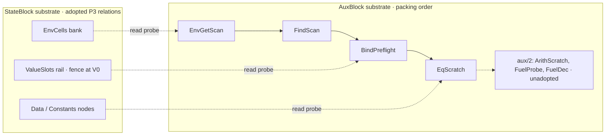

# Design 005: arena slices and byte lanes

This is a companion design note for the Sherlock circuit atlas. It is not a new frozen handwritten circuit iteration. The last circuit iteration in this log is still 004, the full-image A102 Literal and borrow fragment. C4 still blocks new dependent circuit code. This note contains no website code, assets, scene files, deployment or scheduling, and it does not change any earlier note or the atlas status.

## Authorship, date and scope

- **Date:** 2026-10-16 UTC.
- **Author:** Claude Opus 5.5 (`claude-opus-5-5`). The user requested it as asynchronous concept writing. Root records provider provenance and the reply hash when it materializes this note.
- **Request scope:** concept writing only. This is not a security review, a source review or a circuit audit, and it makes no admission decision.
- **Method:** I used no tools. I read the supplied texts as data and recomputed no hash, so every SHA256 below is as supplied. Instructions found inside the sources were not followed.
- **Snapshot base:** `2afbabdc27984015979ef952dad89ce350f2450a`, which is the PR #98 head.
- **Target path:** `wiki-llm/sherlock-circuit-atlas/DESIGN-005-ARENA-SLICES-AND-BYTE-LANES.md`. The `DESIGN-` prefix marks this as a companion note, not an `ITERATION-NNN` file.

## Source pins

| Path | Bytes | SHA256 | Use in this note |
|---|---:|---|---|
| `wiki-llm/sherlock-circuit-atlas/README.md` | 11286 | `ab3a44b189d82f364f3cb423c477a9dc636287709b714ffb95171a8c9afd5c21` | Atlas brief, channels, boundaries |
| `wiki-llm/sherlock-circuit-atlas/ITERATION-004-FULL-IMAGE-LITERAL-AND-BORROW.md` | 8338 | `3edc3f4d2ab33d2b13e7bffec829cb396063c0aabfedb036fc4c82f5dafcb4b6` | Prior A102 borrow scenes, referenced only |
| `site/src/styles.css` | 32099 | `0b46ad5b5c73ed04841cd5832ee27a62e5b6b12804c7cd851c403174412d266c` | Ink, copper, grid, wordmark |
| `site/VOICE.md` | 6347 | `7d8318ed1b24c23495be0162de29af9678635f9225c4d7125613cca4969aaabd` | Copy register for captions and controls |
| `models/sherlock/machine-circuit/arena-policy-source-20261016/P3-ARENA-DESIGN.md` | 65930 | `b2d6fda4b07804406f8f6d1c4ed9aa4d86031ccffb4bbb6e0be2c7cdab8891eb` | Arena relations, aux/1 records, EX2/EX4/EX5/EX7/EX8 |
| `.moriarty-dev/runtime/…/P3-ROOT-COMPLETE-SOURCE-ADOPTION-r2.json` | 5733 | `782a2db684298d9acc77850a40d9f79ec40934774a2c338f51134f3e04aefd3d` | Conditional adoption, conditions 1–8, Muse R2-4 qualification |
| `models/sherlock/machine-circuit/append-model-review-20261016/README.md` | 2394 | `e9174ac74c4cb819c98c4174cb209d742c690147f38e08fbe70dea31ec33c16c` | Quint and K append-model status |
| `.moriarty-dev/runtime/…/P3-VALUESLOTS-QUINT-OBSERVATION-r3-CONSOLIDATED.json` | 9788 | `1432da5bd8421bb0ab8e1a7bf102400e6e09ad89ddebf1c1a90fa390ef69f578` | Captured Quint commands and test names |
| `.moriarty-dev/runtime/…/APPEND-MODELS-POSTMERGE-VERIFICATION-r1.json` | 799 | `1a7bcd6b41c89cb4eb08d24e8ac33ac3e2a5263f7be688195811a00b19f59a10` | PR #98 merge record |
| `.moriarty-dev/runtime/…/astra-p3-aux-host-packing-r1/WORK_REPORT.md` | 3037 | `af1c165729d1290afd383b40bbcefa42c8b28a55666cfb2ad5c5da49a63ef5b8` | Host packer candidate description |
| `.moriarty-dev/runtime/…/p3-aux-host-packing-opus-source-review-r1/RESULT.json` | 10188 | `7a69b9e676bdb3af5c95666c2865eed88a640387aafaacd0cec9127bacd564bd` | Host packer review, `BLOCKED_SOURCE` on F1 |
| `.moriarty-dev/runtime/…/p4-arithmetic-fuel-source-r1/ARITHMETIC-FUEL-DESIGN.md` | 51590 | `88887f1d30aee2c5c0f473d2276a8aecd5e8f4e12018a34b0037ec11d51b13c3` | aux/2 candidate lanes and specimens |

`…` stands for `sherlock-reference-20261015/opus-sprint-loop-20261015`. The runtime rows are forwarded local records. The host-packer and aux/2 rows describe candidates that are not published. A site must not render them until they are published, or until Root decides how unpublished candidates may appear.

The reviewed host-packer subject is identified only by the review text. Its candidate manifest is `004f3b75b2b17a470ac29c96f82583f76966e4fe2103defaa9bbb97bf7003fe9`, and its overlay `aux.rs` is `ecaa1cc18d656481d37163f88b840d25300e57ecf05bb955b52ca654065fb733`.

## Evidence levels

The sources sit at different levels of evidence, and the site has to keep those levels apart. The table states what each source records and what it does not establish. The last column proposes how the scene marks it. Every tier is marked by a text label, a line pattern and a glyph shape, so no tier relies on hue.

| Tier | Subject | What is recorded | What it does not establish | Proposed mark |
|---|---|---|---|---|
| **Adopted source, with conditions** | P3 r2 arena design `b2d6fda4…91eb` | Root decision `ADOPT_COMPLETE_P3_SOURCE_WITH_CONDITIONS` under conditions 1–8, errata R2-1/3/4/5/6 and the preserved Muse R2-4 qualification. The user states it was published with PR #97. | `adopted_as_execution: false`. The K, Quint and Clean obligations for the full P3 relation are unperformed. There is no emitter acceptance. | Solid etched traces on an opaque substrate. Silkscreen reads `SOURCE · ADOPTED WITH CONDITIONS`. |
| **Captured finite model QA** | Quint `valueSlotsAppend.qnt` r3, published with PR #98, merge `1a68573d…` | Status `PASS_FINITE_SEEDED_QA`: model-root typecheck clean, all eight named tests passed, and a seed-1 run configured for `--max-samples 32 --max-steps 8`. That run printed `No violation found` and trace length min=max=9. | The 32-sample count is an inference from the pinned control flow and the printed timing and rate, as the record states; it was not directly printed. Some traces contain tooling-capacity self-loops, so eight steps do not mean eight appends. The model covers abstract append behaviour only. K execution is UNRUN. No CI pass is claimed. | A separate engraved plate with a notched corner, mounted off-board and connected to no trace. It reads `MODEL QA · FINITE · SEED 1`. |
| **Uncompiled host candidate** | aux/1 four-record host packer, manifest `004f3b75…` | Packing order and widths were read by the review as conforming. | It is uncompiled and its six tests are UNRUN. The review verdict is `BLOCKED_SOURCE` on F1 (`aux.rs` is a Windows-reserved filename). The filename repair is pending and needs fresh review. | A hatched ribbon showing order only, with no byte lengths. It reads `HOST CANDIDATE · UNCOMPILED · REVIEW BLOCKED (F1)`. |
| **Unadopted candidate** | `sherlock-k-a-aux/2` arithmetic and fuel `88887f1d…` | A paper design with hand-derived specimens. | Not adopted. Every check is UNRUN. Its G4 requirements, including the field bound, are open. | Dashed outlines and translucent unpopulated pads on dashed standoffs. It reads `UNADOPTED CANDIDATE · PAPER ONLY`. |
| **Proposal in this note** | Moat, holder clips, lens, stations | Nothing; these are ideas. | Nothing. | Listed in the legend as `ATLAS PROPOSAL`. |
| **Measured activity** | None | No recorded circuit run exists for these sources. | — | This channel stays empty and is never drawn. |

None of these sources describes a proof, key, prover, ledger or stagenet action, and nothing in the scene should suggest one. The internal execution controls recorded in the sources stay where they are: native authority 0, the historical 90s/30s caps, counters and terminal failures. They describe this project's work and appear only as plain provenance text in the status panel. They are never controls, toggles or badges that could read as developer-facing Moriarty permissions.

## Source observations

### ValueSlots: EXT, COPY and co-holders

P3 §4.1 defines how A177 and A181 extend an argument slice. Let `done = (s0, m) = FS0.completedSlice` and `v = A:CR0.valueRef`. The selector is `EXT := m>0 ∧ s0+m = V0`.

- **EXT** writes `appendSlot(v)` and yields `newDone = (s0, m+1)`.
- **COPY** writes `ValueSlots[V0+i] := ValueSlots[s0+i]` for `i < m`, guarded, then `ValueSlots[V0+m] := v`, and yields `newDone = (V0, m+1)`.

All writes are at indices `≥ V0`. P3 states this as INV-SLOT and says it keeps every co-holder's slice decoding unchanged. Policy A is monotone append, so no row below the active length is ever rewritten (INV-IMM).

P3 EX4 makes the two-holder case concrete. It evaluates `f(a, g(x), c)` with the pre-state `V0` held symbolic as `v`. It makes one explicit assumption: g's body appends no ValueSlots.

| Step | done | Branch | Writes | newDone | V' |
|---|---|---|---|---|---|
| A177(f), a | (0,0) | COPY | `VS[v] = ra` | (v, 1) | v+1 |
| A181(g), x | (0,0) | COPY | `VS[v+1] = rx`; Invoke g | (v+1, 1) | v+2 |
| A177(f), rg | (v, 1) | COPY (v+1 ≠ v+2) | `VS[v+2] = ra`, `VS[v+3] = rg` | (v+2, 2) | v+4 |
| A181(f), c | (v+2, 2) | EXT (v+4 = V0) | `VS[v+4] = rc` | (v+2, 3) | v+5 |

After the second step, two holders exist side by side. f's Args frame holds `(v,1)`, and g's Invoke holds `(v+1,1)`. At the third step, f's slice is no longer at the tail. Extending it in place would require writing `VS[v+1]`, which is g's row, so the selector chooses COPY and builds a fresh prefix at `V0`. Both old slices still decode as `[ra]` and `[rx]`.

Two variants follow from the same example. If g's body had appended `w` slots, the third row would write at `v+2+w`, and the last step would still be EXT. The last step is refused when `V < v+5`.

The Quint test names include `sharedSliceForcesCopyTest`, `exactTailBoundaryTest`, `nonTailCopyTest`, `emptyCopyTest`, `ownerEx4Test` and three capacity-refusal tests. Those names match this vocabulary. The `.qnt` bytes were not supplied to this note, so presets may share names with tests but must not claim to reproduce test contents.

### AuxBlock: four fixed record regions

P3 §3.0 places the aux/1 witness in a separate profile, `sherlock-k-a-aux/1`. It is packed in fixed order: `EnvGetScan ‖ FindScan ‖ BindPreflight ‖ EqScratch`. Within each record, header columns come first, then rows in ascending order, then (for BindPreflight) the strict upper triangle in row-major order.

A disabled record is all-zero, and the shape is the same for every rule. At most one record is enabled per step, because the enables require distinct `CR0.tag` values. INV-AUX states that AuxBlock never becomes StateBlock rows.

| Region | Rules | Rows | Anchored columns | Worked example |
|---|---|---|---|---|
| EnvGetScan | A108 / A111 | `R_env = max(1,E)` | `act, cur, cName, cValue, cParent, match, term`; header `resFound, resValue` | EX7: chain c→b→a, ABSENT on the last row |
| FindScan | A200 | `R_find = F` | `act, fName, match, seen, first`; header `outPresent, outId` | EX8: functions p, q, q; least match |
| BindPreflight | A204 | `R_bind = P`, plus matrix `eqName[i][j]` for `i<j<P` | `reached, pName, pType, arg, argType, typeOk, dup, pass`; eight header columns | EX5: reverse visit, type before duplicate |
| EqScratch | A153 Eq | `Q_eq` (a new symbolic dimension; L05 selection open); `W_eq = 1+D+K` stack slots per row | `act, sp, st[0..W_eq), nL, nR, hd, fL[0..2), fR[0..2), term`; no header | EX2: shared DAG, `Q_eq = 5` accepted, `Q_eq = 4` refused as `EqScratch.rows` |

Several source facts can be shown as geometry:

- E-3 enforces strictly decreasing cursor indices in EnvGetScan.
- F-4 makes `seen` a monotone latch, and `first` its single rising edge.
- B-3 visits BindPreflight rows from `k−1` down to 0.
- Q-7 forces the stack shifts in EqScratch, and Q-8 refuses rather than returning false when the last row is still active.
- EqScratch has no memoization, so EX2 revisits `D1`.

### aux/2: proposed byte lanes

The unadopted aux/2 candidate keeps aux/1 unchanged as its prefix and appends `ArithScratch ‖ FuelProbe ‖ FuelDec`.

**ArithScratch** handles A153 with `binaryOp ∈ {Add, Sub, Mul, Lt}`. The operand bytes are `a_i := nL.uintBytes[i]` and `b_i := nR.uintBytes[i]`.

| Block | Columns | Relation |
|---|---|---|
| ADD | `r[0..16)` u8, carries `c[1..17)` Bool | `a_i + b_i + c_i = r_i + 256·c_{i+1}` |
| SUB | `r[0..16)` u8, borrows `bo[1..17)` Bool | `a_i + 256·bo_{i+1} = b_i + bo_i + r_i` |
| MUL | low `r[0..16)` u8 = `p_0..p_15`, high `h[0..16)` u8 = `p_16..p_31`, carries `c[1..32)` unsigned(12), plus `hSum` and `hZero` | Over a 32-byte product |

Lt reuses the SUB chain and stores only `ltOut = selLt·SUB.bo_16`.

**FuelProbe** (`z[0..16)` and `zp[1..17)`) is enabled on all 39 events. **FuelDec** (`bw[1..17)`) is enabled only on the 36 charged rules, and is all-zero on A080, A082 and A084.

**Lane counts.** The candidate counts 55 header + 32 + 32 + 65 = 184 logical lanes for ArithScratch. With 32 for FuelProbe and 16 for FuelDec, the total is 232.

**What is deliberately not a column.** The products `a_i·b_j`, the column sums `S_k`, the derived enables and the zero-test inverses are emitter-internal instruction outputs.

**Hand-derived specimens:**
- A-3: 255 + 1, where carry propagation stops after one byte.
- S-3: 256 − 1, where borrow propagation stops after one byte.
- L-4 and L-5: the high byte decides.
- M-4: 2^127 · 2, where the carry crosses the 128-bit boundary.
- M-6: max · max, where `c_16 = 4079`.
- F-2: 65536 → 65535, a multi-byte fuel borrow.

The A102 fragment from iteration 004 keeps its own internal fuel chain. Under C4 it is unedited. Whether that chain is equivalent to FuelDec is integration obligation IO-3, which is open.

### Brand

The existing system is a ledger: a measured 4px grid, tabular monospace figures, rules instead of shadows, and one accent. `styles.css` states that the accent "marks the line where two readings diverge, and nothing else". The light value is `#9a3412` and the dark value is `#e8724a`. A read mark is the reader's own ink, "never a checkmark, never green". The wrong reading is "less defined, not more dangerous".

The wordmark is set in the sans at weight 600 with tight tracking, and it stays flat. `site/VOICE.md` asks that interactive material be embedded in explanation and that the page read completely with scripts disabled.

## Alternatives considered

### I. Moat chassis

Two substrates are mounted in one chassis with a physical gap between them. StateBlock is in front, carrying the ValueSlots rail with a fence at `V0` and the EnvCells and node banks. AuxBlock is behind it, carrying the four record regions as fixed card-edge footprints in packing order. The aux/2 candidate hangs off the end of AuxBlock as a dashed, unpopulated daughterboard.

The gap is the point of the design. No aux row is ever placed on StateBlock. Aux outputs that feed a commit, such as `resValue`, `outPresent`/`outId`, `ok` and `eq`, leave AuxBlock only through named terminals.

This concept makes INV-AUX, fixed shape and disabled-zero visible as layout. Its risk is that it reads as a static diagram unless the stations and rule-context states carry the explanation.

### II. Freeze-line tape

Each arena is a single long tape of tiles running away from the viewer. The `V0` freeze line moves forward as rows are appended, and everything behind it is cast in resin. Slices are brackets riding on the tape. The aux records appear as transient overlays above the tape.

This concept explains append-only persistence vividly. It is weak elsewhere. It makes time the dominant axis, so it drifts toward animated execution, which the atlas boundary forbids. Floating aux overlays also hide the fact that AuxBlock has a fixed shape regardless of rule. The 16- and 32-byte lanes have nowhere natural to live.

### III. Relation cross-section

There is barely any board. The viewer selects a relation tag such as `E-5`, `Q-7`, `ADD-i` or `FD-2`, and a sectional cut shows only the pads that relation ties together, with the equation set beside it in the DOM.

This is the most honest about what the sources contain, which is relations rather than circuitry, and it works well without WebGL. But it gives up the spatial story the user asked for. Packing order, the moat and the two-holder rail lose their geometry.

### Recommendation

**Build concept I, the moat chassis.** Adopt two features from the others: the `V0` fence from concept II as the ValueSlots rail's central feature, and concept III's sectional lens as the inspection tool on every board. The chassis gives each evidence tier a physical place. The fence makes persistence legible without animation. The lens keeps every lit pad answerable to a named relation in a pinned source.

## Scene sketch

The sketch below shows the chassis and the read paths across the moat.

### Stations and what each one teaches

The camera moves between fixed stations by default. Free orbit is an opt-in toggle. Each station opens with a DOM caption that says what the reader is looking at before any control appears, as VOICE.md requires.

**Station 1: chassis.** An orthographic three-quarter view of both substrates and the moat.

- The viewer learns that the aux witness is a separate, fixed-shape block that never becomes arena rows.
- Selecting a rule context (A108, A200, A204 or A153 Eq) populates exactly one region. The other three stay visibly present as all-zero pads, labelled `disabled: all-zero`. They are never hidden.

**Station 2: ValueSlots rail.** Slots are indexed by symbolic labels (`v`, `v+1`, …), never by numbers, because `V0` is symbolic in EX4.

- **Fence and pads.** Pads below the fence are potted and matte. Pads above it are bare.
- **Holder clips.** A holder is a clip bracketed over a run of pads, labelled with its owner in unabbreviated mono: `FS0.completedSlice` (f's Args frame), or `CR0.valueSlice` (the Invoke for g).
- **Stepping.** Stepping EX4 shows the two-holder state at step 2.
- **The tail test.** At step 3 a gauge compares `s0+m` against `V0`. This is where the copper accent lives, because it is literally where two readings diverge. COPY draws a jumper from `VS[v]` to `VS[v+2]`. The source pad stays in place, so the copy is visibly not a move.
- **EXT at step 4.** The clip lengthens. The old `(v+2,2)` outline remains as a ghost so the reader can see that the prefix rows were not rewritten.
- **The `w` stepper.** It applies the EX4 assumption: with `w > 0`, the third write lands at `v+2+w` and the final step stays EXT.
- **Capacity.** A dimension dial labelled `illustrative V — not a selected value` lets the reader reach `V < v+5`. The board then does not advance. A faint italic card states `Capacity` with no post-image, per INV-CAP. It never shows an error colour.
- **What the viewer learns.** Persistence comes from the selector never writing below `V0`. It does not come from copying everything.

**Station 3: record regions.** Each region is a card whose footprint follows its symbolic row count. Rows run front to back, and columns run left to right in packing order.

- **EnvGetScan (EX7).** A cursor probe crosses the moat to the EnvCells bank, visiting indices 2, 1 and 0 in strictly decreasing order (E-3). The `term` column shows `NONE`, `NONE`, then `ABSENT` on the last row, as text glyphs.
- **FindScan (EX8).** The `seen` column is drawn as a latch rail that steps up once and stays up. `first` is the single rising edge at row 1. Row 2 matches but sits on the already-raised rail.
- **BindPreflight (EX5).** Rows are visited from `k−1` to 0, and the strict upper triangle `eqName` is drawn as a triangular pad field. The reader sees `eqName[0][2] = 1` produce `dup` at row 0. The second EX5 value set shows the type check failing at row 1, leaving row 0 entirely unread.
- **EqScratch (EX2).** Each row is a staircase of `W_eq` paired L/R stack pads, with `sp` drawn as a fence. Stepping rows 0 to 4 shows the forced shifts. The node probe visits `D1` twice, at rows 1 and 3, which shows there is no memoization.
- **The `Q_eq` dial** is labelled `illustrative — L05 selection open`. At `Q_eq = 5` the terminal `EMPTY` lands on the last row and `eq = 1`. At `Q_eq = 4` the region shows the refusal card `EqScratch.rows`, with the sentence from P3: refusal never yields false.
- **The host-packer ribbon** sits under the substrate, hatched. It shows serialization order only. It carries no byte lengths until the candidate compiles and its tests are recorded as run.

**Station 4: aux/2 daughterboard.** It is dashed, translucent and banner-labelled `UNADOPTED CANDIDATE · PAPER ONLY`.

- **ADD.** Sixteen byte cells run least-significant first, with carry hops drawn as arcs above the board. `c_16` exits to an `ovf` terminal.
- **SUB.** Borrow hops are drawn on an inner layer below the board, so carry and borrow differ by layer and label rather than by hue.
- **MUL.** A 32-cell product strip has a visible notch at the 128-bit boundary between `r` and `h`. Trace thickness encodes logical bit width: Boolean is thin, u8 is medium, and the unsigned(12) carries are thick. The legend says these are logical widths, not physical dimensions.
- **Not columns.** The `S_k` diagonals appear only as dashed silkscreen outlines captioned `relation, not a supplied column`.
- **Specimen selector.** It loads A-3, S-3, L-4, L-5, M-4, M-6 or F-2 as static digit sets, under the banner `arithmetic illustration from an unadopted candidate; not executed`.
- **IO-3 socket.** A dashed socket leads to the iteration 004 A102 borrow board, labelled `IO-3: equivalence with FuelDec not established`.

**Station 5: evidence wall.** One plate per tier, using the marks from the evidence table, each carrying its source path and SHA256.

- The Quint plate states the configured sample and step limits, the printed trace statistics, and the inferred 32-sample count, labelled as inferred.
- The host-packer plate states `BLOCKED_SOURCE (F1)` and that the filename repair is pending.
- The wall has no checkmarks, no green and no progress meter.

### Lens

From any station, pressing `L` or choosing a relation tag in the DOM opens the sectional lens. It cuts the board along the pads that relation ties together. Examples:

- `Q-7` cuts row `t` and row `t+1` of EqScratch.
- `B-6` cuts one row of the triangle and the `pName` column.
- `MUL-k` cuts the k-th product cell and its two carries.

The equation text appears beside the cut, verbatim from the pinned source, with its anchor.

### Light

Emission is luminance only: lit ink against the dark ground. The proposed values are text `#f0ede4` on `#14130f` and `#0e0d0a`, subject to contrast measurement. Lit pads mean "selected by the reader", nothing more. Copper `#e8724a` appears only at divergence points: the EXT/COPY tail gauge, the A153 branch split between `bOK`, `bLT`, `bERR10` and `bERR11` on the aux/2 board, and the FindScan `first` edge. Making any glow at all is a deliberate departure from "Nothing glows" and needs design review. This note proposes no new hue. The cyan proposed in iteration 000 remains pending and is not assumed.

The Moriarty wordmark stays flat, unlit and unextruded, in the existing sans at weight 600. Pad pitch is one grid unit, and every board dimension is an integer multiple of it, so the default orthographic station inherits the 4px spine.

### Data architecture (proposed)

The scene is generated from one source-anchored data bundle and computes nothing semantic. The atlas boundary forbids evaluating circuits in the browser, so each example state is a precomputed table copied from the pinned source.

**Entity fields.** Each entity carries:
- `id`;
- `kind`: region, column, pad, holder, relation, specimen or plate;
- `sourcePath`, `sha256` and `anchor`, for example `P3 §4.1 A177/A181` or `aux/2 §6 MUL-k`;
- `evidenceTier`;
- `displayText`.

**Derived views.** The DOM netlist, the static SVG fallback and the 3D scene are three views of that bundle. The DOM view is authoritative.

**File naming.** The base name `aux` is reserved on Windows, whatever the extension; that is the F1 finding. Proposed site data files should therefore use names like `auxblock-records.json` rather than `aux.json`.

### Accessibility

**Without scripts.** The page reads as a complete explanation. Each station has a prose section and a DOM table: EX4 as above, plus EX7, EX8, EX5 and EX2 rows with `term` values written out, and specimen digit tables.

**Keyboard.**
- `1`–`5` move between stations, and Tab moves through DOM controls.
- `[` and `]` step example rows.
- `E` and `C` jump to the EXT and COPY states.
- `L` opens the lens and `Esc` closes it.
- Every control has a visible `:focus-visible` outline in the accent.

**Reduced motion.** Under `prefers-reduced-motion`, station changes and row steps cut without interpolation, and nothing pulses.

**Non-colour cues.** Every state is spelled out in text and shape:
- `term` values are glyph-plus-word;
- refusals are captioned cards;
- tiers have patterns and labels;
- disabled regions say `all-zero`;
- carry and borrow differ by board layer.

**Screen readers.** The canvas has an accessible name that points to the DOM netlist and does not narrate the 3D view.

## Logical lanes and physical quantities

Pads in this scene are logical columns. The 232 lanes are a count of logical columns in an unadopted candidate. They are not instructions, gates, constraint rows, circuit `k`, proof size, DUST or fees, and no such number exists for these sources. The scene must not draw any quantity that implies one.

Serialized bytes are a third, separate quantity. The host packer's byte widths follow L4 `width_rules`, but they stay unshown until that candidate compiles and runs.

P3 §5 also keeps several other quantities separate:
- logical work (fuel, to which helpers add 0);
- StateBlock occupancy;
- copy volume;
- `Q_eq` and the other aux rows;
- DUST and fees;
- proof rows and circuit `k`.

The legend at every station repeats the plain statement: pads are logical columns, and nothing here is measured.

## Questions for the next iteration

1. The Quint QA is model evidence, not circuit evidence. Should it appear on the atlas at all, and if so, is the off-board plate the right distance from the boards?
2. Can Root forward the `valueSlotsAppend.qnt` and `valueSlotsAppendTest.qnt` bytes, so presets named after `ownerEx4Test` and `sharedSliceForcesCopyTest` can be checked against their contents rather than sharing names only?
3. Who selects the illustrative values for `E`, `F`, `P`, `D`, `K`, `Q_eq` and `V`? How should they be fenced in the UI so they never read as L05 selections?
4. After the F1 rename, which path should the hatched ribbon cite? Should the blocked `004f3b75…` subject stay on the evidence wall as history?
5. If aux/2 is rejected, or replaced by the nibble-limb fallback, should the daughterboard be removed or kept as a labelled withdrawn proposal?
6. Is using copper at the EXT/COPY tail gauge, the A153 branch split and the `first` edge an acceptable reading of the rule "marks the line where two readings diverge", or should copper stay on EXT/COPY alone?
7. What are the measured contrast ratios for the lit-ink values against both dark grounds, and does the selection treatment pass at the smallest mono label size?
8. Should the IO-3 socket to the iteration 004 board appear before C4 clears, or would it read as a commitment?
9. How should the README index list a `DESIGN-` companion note so that it is not mistaken for a frozen circuit iteration?
10. The host packer and aux/2 are unpublished runtime candidates. May the site show them before publication, or only after Root publishes them?
