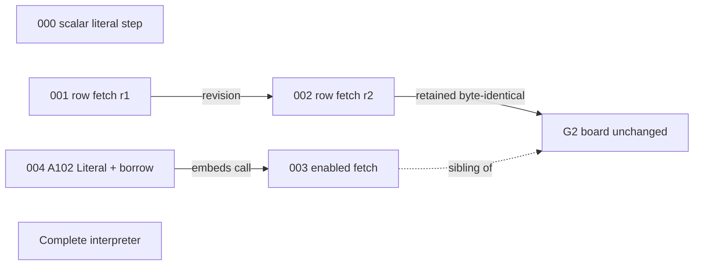

# Design 006: source boards, assembly history and execution replay

## Internal scope preface

This is a companion design note for the Sherlock circuit atlas concept log. It records design ideas. It is not a handwritten circuit iteration and must not be read as iteration 005. The latest circuit iteration remains [004](ITERATION-004-FULL-IMAGE-LITERAL-AND-BORROW.md). [Design 005](DESIGN-005-ARENA-SLICES-AND-BYTE-LANES.md) and its [status and provenance clarification](DESIGN-005-STATUS-AND-PROVENANCE.md) are unchanged.

This revision replaces the initial DESIGN006 candidate for materialization. The materializer keeps that initial draft privately as immutable author output.

**Finished-release assumption.** Every passage marked *Visitor copy*, and every caption, label and storyboard description meant for the public site, is written for a single moment. That moment is the public launch of the atlas after the full Sherlock v1 goal has been genuinely accepted. At launch, four things hold:

- every handwritten circuit shown has a published source revision and an accepted netlist;
- every execution replay uses a complete published capture;
- every circuit activity mark is backed by recorded constraint or trace bindings;
- the final accepted architecture supplies the integration edges between boards.

The visitor copy states these things plainly because they will be true when the site goes live. Nothing in this note claims that they are true today. Current truth lives in the grounding section and in the launch bindings section, and the site does not launch until those bindings resolve. The visitor flow therefore carries no proposed, unrun or status badges.

- **Authorship.** Creative author identity and requested high effort are recorded in [`AUTHORSHIP.json`](AUTHORSHIP.json). This note claims no provider model and no returned effort.
- **Method.** No tools were used. All sources were read as data. Every SHA256 below is as supplied and was not recomputed. This note contains no site code, assets, scenes or deployment, and it performs no circuit, compiler, model or native operation.

## Grounding and provenance (author-facing)

This section carries the current state so that the rest of the note can describe the finished product directly. Each row keeps the status that applied at its own freeze date.

| Subject | Current recorded fact | What it does not establish |
|---|---|---|
| Handwritten iterations 000–004 | Historical source freezes; execution was UNRUN at each freeze. The later registered ten-file A102 candidate (manifest `2ccd8027e250a5b6a57049c5da39570ad96518fe4745fbc683ad490c130afd63`) is source-only and uncompiled, with sixteen tests UNRUN. It is not part of iteration 004. | Any netlist, constraint result, `k`, gate count, cost or proof. |
| joined09 HOST source | [PR #126](https://github.com/CharlesHoskinson/Moriarty/pull/126), merge `d2a8f40c9567344fce7a823f1928fe4eb810b759`: exactly 21 files, 473,146 bytes. Qualified Stage1 HOST source only: `sherlock-helper-microstep/1`, `DedicatedSorts`, finance `Absent`, `HostOnly`, genesis plus one uncut segment. R1–R7 remain open. The README's source-freeze runtime UNRUN text stays unchanged. | A released SDK, Stage2/3, refinement, StepInv, or compiler, circuit, native or target correspondence. |
| D01 capture | [PR #128](https://github.com/CharlesHoskinson/Moriarty/pull/128), merge `8174e52975d8db9bf59636fea0fa338c0f47c855`. One SDK-free HOST invocation, fuel 64, stack limit 4, seven records, 30046 bytes, SHA256 `9231489b77a7cf4a2bffe05a197428b755f35e15117a43d6331214d1fe32d114`. Semantic and prefix comparison UNRUN. The publication-delta and actual-result reviews returned `APPROVE_WITH_SCOPE`, within their stated scope. | Semantic correctness, complete-prefix or corpus comparison, recursion, finance, circuit, native, proof, performance, or any field-to-circuit correspondence. |
| Circuit activity | None recorded for any source in this log. | — |
| Emission and cyan | User-requested proposals. The current brand says `Nothing glows`, and no contrast has been measured. | Adoption. |
| This note | Brainstorm; the recommendation is nonbinding. Native authority 0; C4 unchanged. | Design acceptance, implementation, or permissions for Moriarty developers. |

**Published grounding files** (repository-relative from this folder):

- D01 observation folder:
  - [`D01.actual.jsonl`](../../models/sherlock/d01-host-observation-20261016/D01.actual.jsonl)
  - [`README.md`](../../models/sherlock/d01-host-observation-20261016/README.md)
  - [`INPUT.json`](../../models/sherlock/d01-host-observation-20261016/INPUT.json)
  - [`OBSERVED-RESULT.json`](../../models/sherlock/d01-host-observation-20261016/OBSERVED-RESULT.json)
  - [`PROVENANCE.json`](../../models/sherlock/d01-host-observation-20261016/PROVENANCE.json)
  - [`PUBLICATION-RECEIPT.json`](../../models/sherlock/d01-host-observation-20261016/PUBLICATION-RECEIPT.json)
- joined09 HOST source:
  - [`execution_capture.rs`](../../models/sherlock/joined09-host-source-20261016/execution_capture.rs) `98695a6b084634dcc4b8edda29d140f6f62367b33c13ed1c40dec30980d96bbe`
  - [`observation_json.rs`](../../models/sherlock/joined09-host-source-20261016/observation_json.rs) `c14bcacbba167c2e066965f75657208c6adc991dbad1ce9b03026a7a1ec339bd`
  - [`QUALIFIED-SOURCE-DECISION.json`](../../models/sherlock/joined09-host-source-20261016/QUALIFIED-SOURCE-DECISION.json) `8074aa096c7b84fc5555246c019093ab9095ba12ccbbdde08dec80021ceceece`
  - [`SOURCE-MEMBERSHIP.json`](../../models/sherlock/joined09-host-source-20261016/SOURCE-MEMBERSHIP.json) `5721f8c451e6178b05d526736a39f04dfcf3296ebe336a8082f6013a6df8a37c`
  - [`README.md`](../../models/sherlock/joined09-host-source-20261016/README.md) `ea64bb33f036ea39b7cb4a1a2efeed7234c4b581aafa853a13d94d011ec53791`
- Brand: `site/VOICE.md` `7d8318ed…aabd` and `site/src/styles.css` `0b46ad5b…266c`.
- Atlas inputs: README `0c36813c…4413`, `AUTHORSHIP.json` `1ffa11be…4306`, Design 005 `1a55057a…133a`, Design 005 clarification `1056080b…b406`.

Iteration source pins are recorded in full in `AUTHORSHIP.json`. Private retention records, review bodies, provider streams and private paths are neither quoted nor linked. The D01 timing figures in `OBSERVED-RESULT.json` are tool provenance; the site never draws them as speed or performance.

## The assembly ledger

The user's latest purpose is that this log "shows the circuit being built up". The finished atlas should make that its spine. Sherlock was not drawn once. It was written as a sequence of frozen handwritten source revisions, and that engineering history is the clearest way into the complete machine.

The finished site presents the history as an intentional assembly narrative. It is not a changelog, and it is not a set of preview disclaimers. A visitor scrubs from the first board to the complete interpreter and watches each revision add, keep or replace parts.

### What each entry records

Every actual circuit source iteration adds one ledger entry, and the entry is derived from that iteration's frozen pins. Design companions such as 005 and 006 never become entries. HOST observations never become entries either; they belong to the Execution channel. An entry carries:

- **Revision:** the iteration number, manifest hash and exact file pins.
- **Relation:** how the revision relates to earlier boards. The vocabulary is fixed:
  - *new lineage*: no source relation to an earlier board;
  - *revision*: the same module with files replaced;
  - *sibling*: a new module beside an earlier one that stays byte-identical;
  - *embeds*: the source calls an earlier constructor;
  - *integrates*: reserved for edges that the final accepted architecture supplies.
- **Added, retained and replaced:** computed from pins. A file whose path and SHA256 both match the predecessor is *retained*. A file at the same path with a different hash is *replaced*. A new path is *added*.
- **Reason:** quoted from the iteration note or mapping, never paraphrased into a claim.
- **Board delta:** a before/after mesh pair keyed by source symbol.
- **Reader path:** what the addition lets a visitor follow that they could not follow before.

### Actual history so far

| Iteration | Relation | Added | Retained | Replaced | Reader path enabled |
|---|---|---|---|---|---|
| 000 scalar literal step (`sherlock_step`, `sherlock-scalar-literal-step/1`) | New lineage, separate from 001 onward | `sherlock_step/mod.rs` `7cefbcfc…`, tests, step-slice README and expectations | — | — | A single literal step as a standalone module |
| 001 bounded row fetch, r1 | New lineage (`sherlock_machine`) | `mod.rs` `56e58bc0…`, `fetch.rs` `df1d55b4…`, `normal_tests.rs`, machine-circuit `MAPPING.md` and `expected.json` | — | — | Selecting one row of a bounded table |
| 002 identifiers and wiring, r2 | Revision of 001 | `identifier_rejection_tests.rs` `3c5be80e…` | `expected.json` `1c0319aa…` | `fetch.rs` → `6e71e0dc…`, `mod.rs` → `87fcffae…`, `normal_tests.rs` → `651a4713…`, `MAPPING.md` → `e0864af4…` | `%`-scoped net names; locked wiring |
| 003 enabled fetch | Sibling of the unchanged G2 fetch | `enabled_fetch.rs` `6c45ab91…`, its tests, enabled-fetch `MAPPING.md` and `expected.json` | `fetch.rs`, `identifier_rejection_tests.rs`, `normal_tests.rs`, machine-circuit `MAPPING.md`, `expected.json` | `mod.rs` → `e2af2fe0…` | Enable bus; guarded selects; disabled-zero as construction data |
| 004 full-image A102 Literal and borrow | Embeds G3: `literal_step.rs` calls `emit_enabled_fetch_block` | `literal_step.rs` `b5d2ca73…`, its tests, literal-step `MAPPING.md` | — (separate files) | — | Program, pre and post images; the selected row feeding post `ControlRows` row 0; the sixteen-byte borrow chain |

Five facts in this table must survive into the finished site:

- 000 is its own module, so the scrubber never grows 001 out of it.
- 002 replaces 001's files in place. Its before/after delta is a rewire of the same footprints, and r1's unprefixed net names belong to r1 only.
- 003 leaves G2 byte-identical and sets a sibling board beside it, so G2's mesh does not change at that stop.
- 004's link to 003 is a real source call. It is drawn as a daughterboard socket carrying the G3 footprint. The 004 freeze manifest does not pin an `enabled_fetch.rs` revision, so the embedded footprint's binding is open (see launch bindings).
- No edge joins the 000 lineage to the `sherlock_machine` lineage. No edge joins the separate fragments into one working machine until the final accepted architecture supplies those integration edges.

### How the scrubber moves

The history rail is indexed by frozen source revision. Dates and companion notes do not position anything on it. Each stop renders the cumulative set of boards that exist at that revision, laid out as stacked substrate layers in an exploded view. A newly added component rises into its layer. A replaced component crossfades between its two pinned meshes, with the old pin shown as a ghost outline that can be toggled. Retained components do not move at all.

The final stop is the complete interpreter. Its integration edges appear only there, because only the final architecture supplies them.

> *Visitor copy:* Sherlock was built one piece at a time, and every piece is still here. Move along the history rail to watch the machine assemble. Each stop is an exact source revision. The board shows what that revision added, what it kept, and what it replaced, and every part opens onto the handwritten code that made it.

## What the finished atlas teaches

The atlas shows the same machine in three domains, and each domain has its own label, geometry and line pattern.

- **Source** is the handwritten code, as exact text with its path and hash.
- **Circuit** is the board that code builds, drawn from the accepted netlist.
- **Execution** is a program running, replayed record by record from a published capture.

A fourth layer, **Circuit activity**, lights the constraints that a recorded trace exercised. It appears wherever recorded bindings tie execution to circuit rows.

A visitor should leave understanding three things: how the interpreter was assembled, how a program moves through it step by step, and how recursion is carried as continuations on a stack. They should be able to verify any of it by clicking through to bytes.

> *Visitor copy:* Sherlock is the Mori interpreter, written by hand as ZKIR circuits. You can read it in three ways. **Source** is the code its authors wrote. **Circuit** is the board that code builds. **Execution** is a real program running on it, one recorded step at a time. Anything you see can be opened down to the exact file and line it came from.

## Visual approaches

### I. Assembly bench

The hero is a single workbench. The history rail runs along its front edge, and the cumulative boards assemble on the bench in exploded layers. Each layer is one ledger entry. Selecting a component follows its nets across layers.

The Execution hall sits behind the bench, through a deliberate cut rather than a camera flight. It holds the record spine and the continuation stack. Circuit activity, where bound, is projected onto the bench boards from a recorded trace, never from the Execution hall's plates.

This approach puts the build-up story first and keeps every domain on its own geometry. Its cost is scene complexity, because layer diffs, ghost outlines and net following all need careful staging.

### II. Lineage gallery

Each frozen revision is a separate framed board on a gallery wall, arranged as a family tree with labelled relation edges (revision, sibling, embeds). Visitors walk the wall. The complete interpreter hangs at the end.

This approach makes relationships unmistakable and is easy to keep honest. However, the machine never visibly becomes one object, and the "watch it get built" experience reduces to a sequence of separate pictures.

### III. Machine first

The complete interpreter is the opening hero, running a program. History is a drill-down panel, and source is a side drawer.

This is the most cinematic opening, but the assembly story becomes a footnote, which is the opposite of the user's purpose. It also invites the visitor to read early fragments as parts of a running machine before any integration edge applies to them.

A projection of host records directly onto circuit boards (Design 006's original third concept) stays rejected. Without accepted bindings it asserts a correspondence, and with accepted bindings it is Circuit activity, which already has its own layer.

### Recommendation

The nonbinding recommendation is **approach I, the assembly bench**, with approach II's lineage tree folded into the history rail as a compact relation map above the scrubber. The bench gives the cumulative construction story the prominence the user asked for. The relation map keeps sibling, revision and embed relationships legible while the boards stack. The Execution hall keeps replay state off the boards.

The `FINAL` node has no edges in this sketch on purpose. Its integration edges come only from the final accepted architecture.

## Storyboard

Every station opens with a DOM caption that states what the visitor is looking at, before any control appears.

### Station 1: opening

The masthead carries the flat, unlit Moriarty wordmark in the existing sans at weight 600 with tight tracking. Below it, the three domain swatches are distinguished by line pattern and glyph as well as by name:

- **Source**: hairline outline with a bracket glyph;
- **Circuit**: solid trace with a pad glyph;
- **Execution**: ruled plate with a tab glyph.

**Circuit activity** joins the legend as a dotted pad ring.

### Station 2: assembly

This is the bench with the history rail. At each stop a caption quotes the entry's reason and lists added, retained and replaced parts in tabular mono, beside the relation map.

- **Add, keep and replace.** A *Changes* toggle isolates the delta, and a *Before* toggle swaps to the predecessor mesh.
- **At 003,** the G2 board stays perfectly still while the sibling board rises beside it. The caption names the retained files.
- **At 004,** the G3 footprint appears inside a socket on the A102 board, with a pin label reading `emit_enabled_fetch_block`.
- **At the final stop,** integration traces draw between boards.

> *Visitor copy:* At this step the enabled fetch arrives as a new board beside the row fetch, which stays exactly as it was. The two share their table vocabulary, and the new board adds an enable line that every select listens to.

### Station 3: board inspection

Selecting any pad, trace or footprint opens a DOM drawer containing the source path, full SHA256, commit, symbol anchor and a verbatim excerpt copied from the pinned bytes at build time.

Following a net highlights the actual operand path through the emitted instructions. For example, at 004 the selected Expressions row's `valueRef.space` and `valueRef.index` run to post `ControlRows` row 0, and the borrow chain runs from `borrow_0 = enable` through sixteen guarded byte equations to `ConstrainEq(borrow_16, 0)`. Control paths (enable buses and `CondSelect` trapezoids) and data paths (image lanes) use different line weights and dash patterns.

> *Visitor copy:* Follow a wire to see where a value goes. This one carries the constant the literal refers to. It is selected from the program table and becomes the value the machine returns.

### Station 4: execution replay

The Execution hall shows one program at a time as a vertical record spine. The first plate is the admitted initial image. It has no event tab above it, because admission is not a step. Each later plate is one recorded step, with a tab carrying `ordinal`, `rule_id`, `event_kind` and `disposition`. Changed fields rise from the plate, and unchanged fields stay visible and flat. The spine ends on the first plate whose outcome is no longer `Running`.

Two rulers flank the spine:

- **Record position** on the left, labelled `record · step ordinal`, evenly spaced;
- **Logical work** on the right, with lanes for `consumed_work`, `remaining_work` and `helper_work`.

Neither ruler is a clock, and the site shows no wall-clock time. Copper marks only the places where the two rulers diverge.

If D01 remains in the release set, it is the opening example:

> *Visitor copy:* The smallest program is the literal `7`. A Validate helper checks the constant first: it enters, visits its one task, reaches its empty case with status `Positive`, and exits `Validated`. The machine then returns the constant, and the run publishes `Halted`. Watch the right-hand rule. Five units of logical work are spent, and publishing spends none.

### Station 5: the recursive machine

Programs that call functions open the continuation view. The image's `frames` array is drawn as a stack of continuation plates beside the spine. Each plate is titled by its recorded `FrameRowC` variant (`LetF`, `ArgsF`, `ReturnF`, `ScopeF` and so on) and shows its saved environment and origin fields verbatim.

Each element comes straight from the record:

- A step whose `logical_depth_after` exceeds its `logical_depth_before` pushes a plate.
- A return that consumes a frame lifts that plate away.
- The control pad shows the recorded `ControlC` variant: `Eval`, `Invoke`, `Enter`, `Bound`, `Return` and the rest.
- Call, return and continuation links are drawn only between plates and steps that the record relates.
- `stack_limit` is drawn as a ceiling line.

> *Visitor copy:* When a function calls another, the machine pushes a frame that remembers what to do with the answer. That frame is a continuation. The stack beside the steps is the machine's frames exactly as recorded. A frame appears when a step pushes it and leaves when the return that needs it arrives.

### Station 6: circuit activity

On the bench, a step selected in the Execution hall lights the pads that the bound trace records for that step. Lit pads use a dotted ring and a text count of the exercised relations, so the information does not rely on light alone.

> *Visitor copy:* Lit pads are the constraints this step's recorded trace exercised. Open any pad to see the constraint, the step that exercised it and the source line that wrote it.

### Station 7: provenance and download

A single provenance page lists every source revision, netlist, capture and binding manifest, with its path, size, SHA256 and commit, and links out to each. Downloads are described under exports below.

## D01 as the Execution grounding specimen

D01 grounds the design of the Execution channel. It is not evidence of finished circuits.

Its admission identity repeats on every record:

- `profile_id` 2, `DedicatedSorts`, `finance` `Absent`;
- `layout_version` `["oracle.scalar-env","host-literal-1"]`;
- `layout_digest`, `bounds_digest` and `program_membership_digest` are each `{"$variant":"Unselected"}`;
- `field_id` is `null`.

The program is one `Literal` expression pointing to constant `{"$variant":"U128","marker_free":true,"n":7}`. The bounds include `step_cap` 1, and the run produced six recorded steps; the site shows both figures verbatim, without a gloss. `HostOnly` comes from the decision scope, not from the capture.

| Record | `ordinal` | `rule_id` | `event_kind` / `disposition` | Work after (consumed / remaining / helper) | Recorded change |
|---|---:|---|---|---|---|
| R0 | — | — | initial image | 0 / 64 / 0 | `Eval expr 0`, `Running`; all tables empty |
| R1 | 0 | `BHelperValidateEntry` | `HelperEnter` / `Applied` | 1 / 63 / 1 | `Validate` helper, `Pending`; one `ValidateTask`; `taskLive` 1 |
| R2 | 1 | `BHelperValidateOccurrence` | `HelperVisit` / `Applied` | 2 / 62 / 2 | task consumed; `helper_visits` 1 |
| R3 | 2 | `BHelperValidateEmpty` | `HelperVisit` / `Applied` | 3 / 61 / 3 | `Tri Pending` → `Tri Positive` |
| R4 | 3 | `BHelperValidateExit` | `HelperExit` / `Applied` | 4 / 60 / 4 | `result` `Validated`, `ok: true` |
| R5 | 4 | `KMachineEvalLiteralValid` | `LegacyComplete` / `Applied` | 5 / 59 / 4 | control `Return Const 0`; `reference_cursor` 1 |
| R6 | 5 | `KAdminPublishValue` | `Publish` / `Published` | 5 / 59 / 4 | `Halted Const 0`; `boundary` `Terminal`; `site` `null` |

Several rules follow from the capture contract:

- R0 is an image only. `execution_capture.rs` states that "P0 and Startup emit no StepEvent", so the replay invents no startup event.
- The spine ends at R6 because R6's own observation is non-Running. There is no terminal probe and no R7.
- R5 records `helper_kind` `Validate` alongside a `null` helper. The site shows both values verbatim.
- `depth` stays 0 throughout, so D01 opens no continuation stack.
- The capture writer's `Ok(())` and its partial-final-line caveat define the capture's scope. They are not claims of completeness or correctness.
- No D01 field is mapped to any circuit pad. The 004 A102 board belongs to a different source and profile, and no adopted correspondence joins them.

## Launch bindings

The finished visitor copy is correct only if every rendered element resolves to a binding at build time. Each binding is a manifest checked into the release, and the build refuses to launch on any unresolved element rather than rendering it with a disclaimer.

1. **Source binding.** For each board component: published path, SHA256, commit and symbol anchor of the handwritten source. Assembly entries bind to the exact frozen revisions in `AUTHORSHIP.json` and its successors. The 004 socket's `enabled_fetch.rs` revision must be pinned explicitly.
2. **Circuit binding.** An accepted netlist emitted from that exact source revision, plus a map from mesh element to netlist element to source symbol. Mesh generation is a reproducible function of the netlist and source pins.
3. **Execution binding.** A complete published capture with its bytes, SHA256, schema (`sherlock-host-capture-v1` or its released successor), producing source composition and inputs. If the released host differs from joined09, D01 is replaced by a capture from the released host, and the copy is re-derived from that capture's fields.
4. **Activity binding.** A recorded constraint or trace binding that ties each capture record to exercised circuit rows under an accepted correspondence. Without one, the activity layer is omitted for that program.
5. **Integration binding.** Edges between boards come from the final accepted architecture document, pinned by hash.

## Materials and light

**Boards.** Matte substrates in the ink grounds `#14130f` and `#0e0d0a`. Traces are tinned ink (`#a9a396`) rendered with high-roughness `MeshStandardMaterial`; pads use `InstancedMesh` and traces use `LineSegments`. Assembly layers are thin substrate sheets separated along one axis, and each layer carries its entry number in silkscreen.

**Plates and stack.** Execution plates are ruled ledger cards in `#1c1a16`, drawn with unlit `MeshBasicMaterial` so that values never depend on lighting.

**Labels and figures.** All text is DOM (`CSS2DRenderer`) in the existing tabular monospace, so identifiers stay exact, selectable and unabbreviated.

**Layout and accent.** Every dimension is a multiple of the 4px grid. Copper (`#e8724a` dark, `#9a3412` light) marks only divergence.

**Internal light proposals.** These are pending design review and measured contrast, and they are not part of the visitor flow until adopted:

- edge emission on the active assembly layer for the Tron-like feel;
- a cyan for selected nets, carried over from iteration 000;
- lit ink for Circuit activity.

Every proposal keeps a non-colour twin: a dash pattern, glyph or word. The wordmark is never lit or extruded.

## Interaction, accessibility and exports

**Keyboard.**
- `1`–`7` jump between stations.
- `←` and `→` move along the history rail; `[` and `]` step records; `Home` and `End` jump to the ends.
- `B` toggles the before mesh, `N` follows a net, `S` opens the source drawer, `Esc` closes drawers.
- Every control has a visible `:focus-visible` outline.

**Mouse and touch.** Fixed orthographic stations are the default, and orbit is an opt-in toggle. On touch, swiping the rail scrubs, tapping opens a drawer, and every target is at least 44 px.

**Reduced motion.** Assembly and replay cut between states without interpolation, and nothing pulses.

**Without WebGL or scripts.** Every station renders as prose plus tables:

- the ledger as a table of added, retained and replaced pins;
- each record as `
` holding its complete field tree in original key order, with every `$variant`, `null`, zero, `Unselected` and `taskLive` written out exactly;
- the stack as a nested list.

**Mobile.** The bench collapses to one board at a time, with the history rail as a horizontal list. The Execution spine stacks under its rulers.

**Screen readers.** The canvas's accessible name points to the DOM equivalent and does not narrate the 3D view.

**Exports.**
- Captures download as their exact published bytes, with filename, byte count and SHA256 kept, and are never re-serialized. Per-record copy yields the original line. A pretty-printed view is labelled as a derived display and keeps every field.
- Source exports bundle each revision's pinned files with a manifest.
- Snapshots carry a caption block and a sidecar listing domain, revision or record range, pins, commits and binding manifests.

## Open design notes

1. Should the history rail show the later registered A102 candidate as its own entry only once it is frozen as an iteration, and how should the assembly rail mark a revision that the final architecture later supersedes?
2. Is an exploded layer stack the right reading of "cumulative PCB layers", or should completed lineages merge into one substrate at the final stop?
3. Which recorded fields should drive push and pop links in the continuation view, given that `logical_depth_before`/`logical_depth_after` and the `frames` array could disagree in a malformed record? Should the site then show both verbatim?
4. Should `profile_id` 2 and `sherlock-helper-microstep/1` appear side by side until a published mapping joins them?
5. Is copper at assembly-delta boundaries an acceptable extension of the divergence rule, or should copper stay on the Execution rulers only?
6. What contrast ratios do the internal light proposals reach against both grounds at the smallest mono size?
7. How should the README index list this companion so that it is never mistaken for iteration 005?